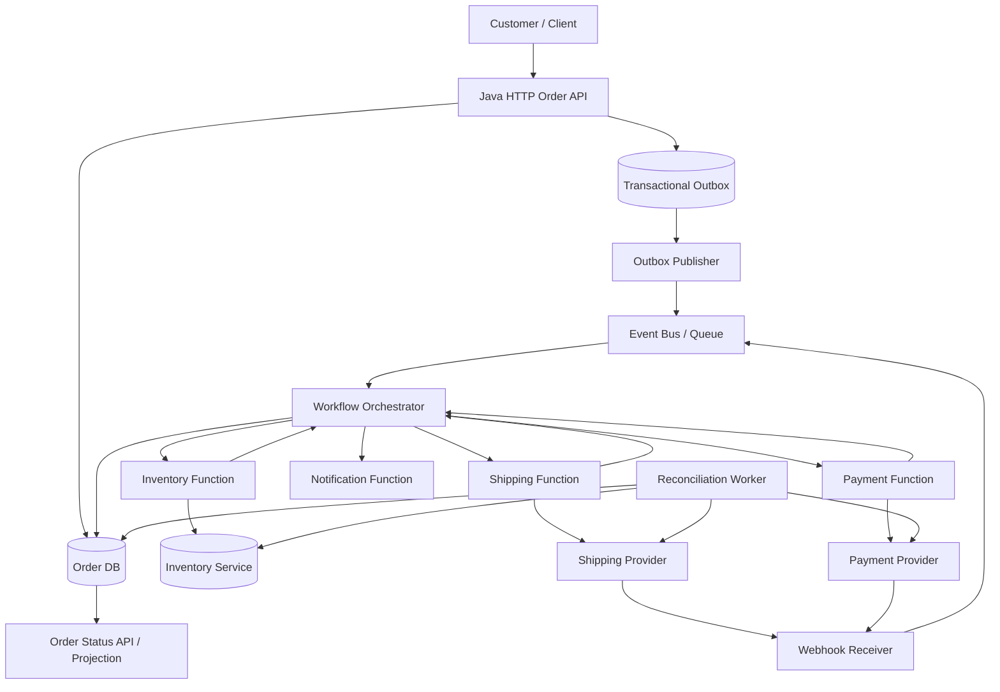
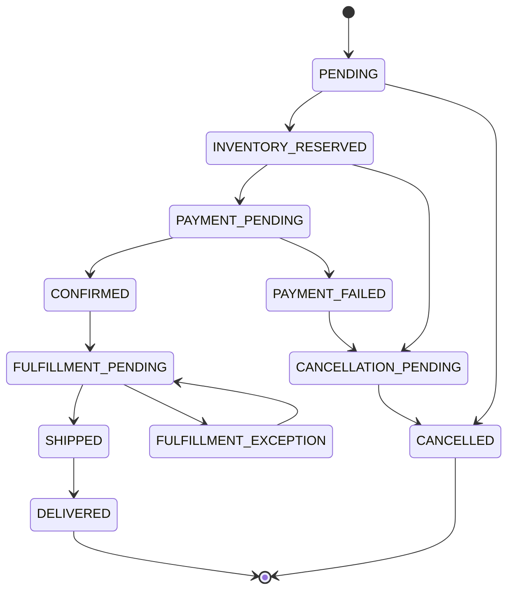
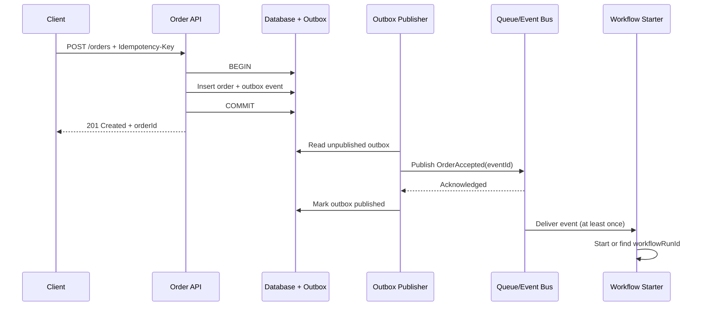
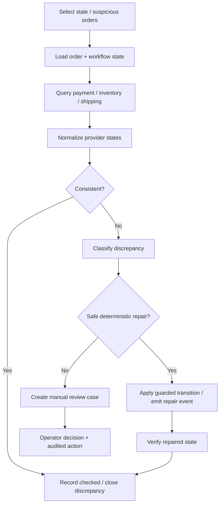

# Theo dõi phiên workflow và đối soát trạng thái đơn hàng

Một đơn hàng có thể đi qua nhiều dịch vụ sau khi khách hàng nhấn nút đặt hàng: xác nhận đơn, giữ tồn kho, thu tiền, yêu cầu giao hàng, gửi thông báo và cập nhật trạng thái cho người mua. Mỗi bước có thể chạy trong một Java serverless function riêng, được kích hoạt bởi HTTP, queue hoặc event. Các bước không nhất thiết hoàn tất cùng lúc; một dịch vụ có thể timeout sau khi đã thực hiện side effect, event có thể được giao lại và hai hệ thống có thể tạm thời hiển thị trạng thái khác nhau.

Để vận hành luồng này, hệ thống cần theo dõi **workflow execution** (một lần chạy quy trình) và **order state** (trạng thái nghiệp vụ của đơn hàng). Hai loại trạng thái có liên quan nhưng không đồng nhất: workflow có thể đang retry bước thanh toán trong khi đơn hàng vẫn ở `PAYMENT_PENDING`; một workflow có thể kết thúc với trạng thái cần can thiệp nhưng đơn hàng vẫn tồn tại và cần được đối soát.

Bài học dùng dự án **Order Processing Workflow** làm ví dụ. Mục tiêu là thiết kế cách tạo và theo dõi phiên workflow, lưu lịch sử từng bước, xử lý retry/timeout/compensation, duy trì trạng thái đơn hàng nhất quán và đối soát với payment, inventory và shipping. Các ví dụ dùng Java, database, queue/event và workflow orchestrator theo mô hình serverless.

## 1. Bài toán nghiệp vụ và mục tiêu thiết kế

Khi khách hàng tạo đơn hàng, API cần phản hồi nhanh và lưu đơn hàng bền vững. Các bước xử lý phía sau có thể kéo dài vài giây hoặc vài phút. Hệ thống phải cho phép người dùng xem trạng thái hiện tại, support tra cứu tiến trình và operator tìm ra bước đang bị kẹt.

Một workflow điển hình:

1. Nhận yêu cầu tạo đơn hàng và xác thực tenant/customer.
2. Lưu đơn hàng ở trạng thái `PENDING`.
3. Kiểm tra và giữ tồn kho.
4. Tạo yêu cầu thanh toán hoặc xác nhận thanh toán.
5. Xác nhận đơn hàng.
6. Tạo shipment và theo dõi giao hàng.
7. Gửi notification và cập nhật read model.
8. Nếu một bước thất bại, retry, bù trừ hoặc đưa vào xử lý thủ công theo policy.

Các mục tiêu thiết kế:

- Có một định danh ổn định cho mỗi workflow execution và liên kết được với order.
- Biết workflow đang ở bước nào, đã thử bao nhiêu lần và lỗi gần nhất là gì.
- Không tạo side effect trùng khi event/message được giao lại.
- Không để workflow state bị nhầm với business order state.
- Phát hiện workflow chạy quá lâu, thiếu event hoặc có trạng thái mâu thuẫn.
- Đối soát được trạng thái với hệ thống bên ngoài.
- Có thể resume, retry, cancel hoặc can thiệp thủ công với audit trail.
- Không để một workflow lỗi làm cạn concurrency hoặc làm quá tải database/API phụ thuộc.

## 2. Phân biệt Order, Workflow và Workflow Execution

Ba khái niệm này cần được tách rõ:

| Khái niệm | Đại diện cho | Vòng đời |
| --- | --- | --- |
| Order | Đơn hàng và trạng thái nghiệp vụ mà khách hàng quan tâm | Từ lúc tạo đến khi hoàn tất, hủy hoặc đóng |
| Workflow definition | Mẫu quy trình gồm các bước, transition, retry và timeout policy | Được version hóa theo release |
| Workflow execution/run | Một lần thực thi workflow cho một order hoặc business command | Có startedAt, currentStep, attempts, status và completedAt |
| Step execution | Một lần chạy cụ thể của một bước | Có input/output reference, attempt, duration và result |
| Event | Thông tin một điều đã xảy ra hoặc một yêu cầu xử lý | Có eventId, type, version, occurredAt và aggregate sequence |

Ví dụ order `ord-8421` có workflow execution `wfr-01J...`. Bước `reserve-inventory` có thể được thử 2 lần; workflow execution vẫn chỉ là một logical run. Nếu operator tạo một lần repair workflow mới, cần liên kết execution mới với order và execution gốc thay vì ghi đè lịch sử cũ.

### Workflow status khác order status

Workflow status mô tả tiến trình kỹ thuật/điều phối, ví dụ `RUNNING`, `WAITING`, `RETRY_WAIT`, `COMPENSATING`, `COMPLETED` hoặc `FAILED`. Order status mô tả kết quả nghiệp vụ, ví dụ `PENDING_PAYMENT`, `CONFIRMED`, `SHIPPED`, `DELIVERED` hoặc `CANCELLED`.

Một workflow có thể `COMPLETED` khi đã hoàn tất việc phát yêu cầu giao hàng, trong khi order vẫn ở `SHIPPING`. Ngược lại, workflow có thể `FAILED` do notification provider lỗi sau khi order đã `CONFIRMED`; không nên tự động đổi order thành `FAILED` nếu nghiệp vụ đã hoàn tất.

## 3. Actors và use cases

| Actor | Nhu cầu | Hành động |
| --- | --- | --- |
| Customer | Biết đơn hàng đang ở đâu | Xem order status, lịch sử hiển thị cho khách |
| Order API | Tiếp nhận yêu cầu và khởi tạo workflow | Tạo order, ghi outbox, trả order ID |
| Workflow orchestrator | Điều phối bước và lưu execution state | Start, wait, retry, branch, compensate |
| Java worker/function | Thực hiện từng bước nghiệp vụ | Reserve stock, authorize payment, create shipment |
| External provider | Cung cấp kết quả thanh toán/giao hàng | Callback hoặc event status |
| Support operator | Điều tra đơn hàng bị kẹt | Xem timeline, retry step được phép, mở case |
| Reconciliation worker | Phát hiện sai lệch giữa các hệ thống | Query provider, cập nhật projection hoặc tạo repair task |
| Auditor | Xem lịch sử thay đổi | Truy vấn actor, transition, reason và correlation |

Các use case chính:

- Tạo order và workflow execution một cách nguyên tử về mặt logic.
- Lấy trạng thái order và tiến trình workflow.
- Xem timeline các step execution.
- Nhận callback/event từ payment và shipping provider.
- Retry một bước transient mà không chạy lại side effect đã thành công.
- Thực hiện compensation khi quy trình không thể tiếp tục.
- Phát hiện execution quá hạn hoặc không có heartbeat.
- Đối soát order với payment, inventory và shipment.
- Tạo manual review/repair execution có audit.

## 4. Kiến trúc tổng thể

Một kiến trúc tham khảo gồm HTTP API, database, transactional outbox, event bus/queue, workflow orchestrator, Java workers và các hệ thống phụ thuộc.



Sơ đồ là một cách tổ chức. Workflow orchestrator có thể là managed state machine hoặc một service tự quản lý durable state. Dù chọn công cụ nào, order state và execution history vẫn cần được mô hình hóa rõ theo nhu cầu nghiệp vụ, audit và khả năng recovery.

### Ranh giới trách nhiệm

- Order API xác thực, validate, lưu order và ghi yêu cầu khởi chạy workflow.
- Outbox publisher chuyển yêu cầu đã commit sang broker/orchestrator.
- Orchestrator quản lý step order, timeout, retry, wait và compensation flow.
- Worker thực hiện một operation có ranh giới rõ, trả kết quả có cấu trúc.
- Order state service áp dụng business transition hợp lệ.
- Reconciliation worker so sánh dữ liệu giữa các hệ thống và ghi nhận discrepancy.
- Status API trình bày trạng thái phù hợp cho customer/operator.

Không để mọi function tự ý cập nhật mọi field của order. Các transition quan trọng cần đi qua domain service hoặc conditional update có invariant.

## 5. Định danh và liên kết workflow execution

Mỗi lần chạy cần định danh riêng, ổn định và có thể truy vết:

| Identifier | Mục đích | Ví dụ |
| --- | --- | --- |
| `orderId` | Định danh aggregate đơn hàng | `ord-8421` |
| `workflowId` | Định danh loại workflow/definition | `order-fulfillment-v3` |
| `workflowRunId` | Định danh một execution | `wfr-01JQ...` |
| `stepExecutionId` | Định danh lần chạy một step | `stp-01JQ...` |
| `eventId` | Deduplicate event | `evt-01JQ...` |
| `correlationId` | Nối các request/log/trace cùng luồng | `cor-01JQ...` |
| `causationId` | Chỉ ra event/command trực tiếp gây ra event hiện tại | `evt-01JP...` |
| `idempotencyKey` | Ngăn tạo operation trùng | `create-order:tenant-7:key-abc` |

`orderId` không thay thế `workflowRunId`: một order có thể có workflow fulfillment ban đầu, workflow refund và workflow repair riêng. `correlationId` không thay thế `eventId`: nhiều event trong cùng một luồng có cùng correlation ID nhưng phải có event ID riêng.

### Quy tắc tạo ID

- ID không chứa secret, email hoặc dữ liệu nhận diện trực tiếp.
- Workflow run ID duy nhất và không thay đổi trong vòng đời execution.
- Retry step giữ logical step key nhưng có attempt number/step execution ID riêng.
- Repair run có ID mới, lưu `parentRunId` hoặc `causedByIncidentId`.
- ID từ client không được tin cậy làm quyền truy cập; luôn xác thực tenant/owner.

## 6. Mô hình trạng thái của order

Một state machine đơn giản:



State machine trên là ví dụ; quy tắc thực tế phụ thuộc nghiệp vụ. Ví dụ có thể cho phép hủy sau khi đã thanh toán nhưng phải refund; có thể cho phép giao một phần; hoặc payment có trạng thái `AUTHORIZED` và `CAPTURED` riêng.

### Transition cần có guard

Mỗi transition cần định nghĩa:

- State hiện tại được phép chuyển đi đâu.
- Actor/service nào được phép yêu cầu transition.
- Điều kiện nghiệp vụ cần thỏa mãn.
- Side effect nào được phát sinh.
- Event nào được ghi sau khi commit.
- Nếu điều kiện không thỏa mãn thì trả conflict hay chờ.

Ví dụ chỉ được chuyển `PAYMENT_PENDING -> CONFIRMED` nếu payment provider đã xác nhận capture/authorization theo business policy và inventory reservation còn hiệu lực. Không cho worker gửi `status=CONFIRMED` tùy ý.

## 7. Mô hình trạng thái của workflow execution

Workflow execution có vòng đời riêng:

| Status | Ý nghĩa |
| --- | --- |
| `CREATED` | Execution đã được tạo nhưng chưa bắt đầu |
| `RUNNING` | Đang thực thi một hoặc nhiều step |
| `WAITING` | Đang chờ callback, timer hoặc external event |
| `RETRY_WAIT` | Một step lỗi transient và chờ retry |
| `COMPENSATING` | Đang thực hiện hành động bù |
| `COMPLETED` | Các bước bắt buộc hoàn tất theo definition |
| `FAILED` | Không thể tiếp tục tự động hoặc đã hết retry |
| `CANCEL_REQUESTED` | Có yêu cầu hủy, cần xử lý an toàn |
| `CANCELLED` | Đã hủy theo policy và ghi nhận kết quả |
| `MANUAL_REVIEW` | Cần người vận hành quyết định |

Không đặt `FAILED` chỉ vì một attempt lỗi. Nếu policy cho phép retry, execution có thể ở `RETRY_WAIT` và sau đó trở lại `RUNNING`. Không đặt `COMPLETED` khi chỉ mới enqueue bước cuối; phải xác định rõ completion semantics.

### Khi workflow thất bại nhưng order vẫn hợp lệ

Ví dụ payment đã capture thành công và order đã `CONFIRMED`, nhưng notification service lỗi liên tục. Workflow có thể `MANUAL_REVIEW` hoặc kết thúc với notification step `FAILED` tùy definition; order vẫn `CONFIRMED`. Notification là side effect phụ, không nên làm mất trạng thái thanh toán thành công.

## 8. Lưu execution state và step history

Không chỉ lưu một cột `current_status` trên order. Để điều tra và resume, cần lịch sử execution/step.

### Bảng workflow execution

Một schema khái niệm:

```sql
CREATE TABLE workflow_execution (
    workflow_run_id       VARCHAR(80) PRIMARY KEY,
    workflow_id           VARCHAR(120) NOT NULL,
    workflow_version      INTEGER NOT NULL,
    order_id              VARCHAR(80) NOT NULL,
    tenant_id             VARCHAR(80) NOT NULL,
    status                VARCHAR(32) NOT NULL,
    current_step          VARCHAR(120),
    correlation_id        VARCHAR(100) NOT NULL,
    parent_run_id         VARCHAR(80),
    started_at            TIMESTAMP,
    updated_at            TIMESTAMP NOT NULL,
    completed_at          TIMESTAMP,
    deadline_at           TIMESTAMP,
    last_error_code       VARCHAR(100),
    version               BIGINT NOT NULL DEFAULT 0
);
```

### Bảng step execution

```sql
CREATE TABLE workflow_step_execution (
    step_execution_id     VARCHAR(80) PRIMARY KEY,
    workflow_run_id       VARCHAR(80) NOT NULL,
    step_key              VARCHAR(120) NOT NULL,
    attempt               INTEGER NOT NULL,
    status                VARCHAR(32) NOT NULL,
    input_reference       VARCHAR(500),
    output_reference      VARCHAR(500),
    started_at            TIMESTAMP,
    completed_at          TIMESTAMP,
    duration_ms           BIGINT,
    error_code            VARCHAR(100),
    error_category        VARCHAR(40),
    UNIQUE (workflow_run_id, step_key, attempt)
);
```

Các bảng trên là schema tham khảo, cần bổ sung foreign key/index theo database và retention policy. Tránh lưu payload nhạy cảm hoặc JSON rất lớn trực tiếp trong execution history; có thể lưu object reference/checksum. Step history nên append attempt mới thay vì ghi đè toàn bộ lịch sử.

### Execution state không phải audit log duy nhất

Current state phục vụ truy vấn nhanh; step history/audit phục vụ điều tra và giải thích. Có thể duy trì projection hiện tại cùng event/history bất biến. Nếu chỉ có một row bị cập nhật liên tục, operator sẽ mất thông tin về các attempt trước và lý do transition.

## 9. Tạo order và workflow một cách tin cậy

Một lỗi thường gặp là API ghi order vào database rồi gọi workflow engine qua HTTP. Nếu database commit thành công nhưng lời gọi orchestrator thất bại, order tồn tại nhưng không có workflow. Nếu orchestrator bắt đầu rồi database transaction rollback, workflow xử lý một order không tồn tại.

Dùng transactional outbox:

1. Trong một database transaction, tạo order và outbox message `OrderAccepted`.
2. Commit transaction.
3. Outbox publisher đọc message chưa publish và gửi tới broker/workflow starter.
4. Publisher đánh dấu published sau khi broker xác nhận.
5. Nếu publisher crash sau publish nhưng trước khi đánh dấu, message có thể được gửi lại; consumer deduplicate bằng `eventId`.



API chỉ trả `201 Created` sau khi order và outbox commit. Việc workflow bắt đầu có thể bất đồng bộ; response contract cần nói rõ `workflowStatus=CREATED` hoặc cung cấp endpoint theo dõi.

## 10. Idempotency khi start workflow

Client có thể retry `POST /orders` sau timeout. Outbox publisher cũng có thể gửi `OrderAccepted` nhiều lần. Do đó, cần idempotency ở nhiều boundary:

- API create order: key theo tenant + client key.
- Workflow starter: unique logical execution key theo order + workflow type/version policy.
- Step worker: idempotency key theo workflow run + step key + business operation.
- Provider call: provider idempotency key nếu API hỗ trợ.
- Event consumer: inbox/processed-event table theo event ID.

Không dùng cùng một key cho mọi boundary nếu semantics khác nhau. Một order có thể có workflow refund sau này; unique key chỉ theo order ID sẽ chặn nhầm workflow hợp lệ.

### Bảng idempotency/inbox

```sql
CREATE TABLE processed_event (
    consumer_name    VARCHAR(120) NOT NULL,
    event_id         VARCHAR(100) NOT NULL,
    processed_at     TIMESTAMP NOT NULL,
    result_reference VARCHAR(500),
    PRIMARY KEY (consumer_name, event_id)
);
```

Unique constraint là lớp bảo vệ cuối cùng khi hai invocation cùng xử lý event. Nếu side effect và inbox row ở cùng database, ghi chúng trong cùng transaction. Với side effect ngoài database, cần provider idempotency, outbox hoặc reconciliation cho unknown outcome.

## 11. Theo dõi từng step và attempt

Một step execution cần có dữ liệu đủ để trả lời:

- Step bắt đầu lúc nào, hoàn tất lúc nào?
- Nó được thử bao nhiêu lần?
- Lỗi thuộc nhóm transient, business hay configuration?
- Có gọi external provider không? Request/reference nào?
- Có side effect đã xảy ra trước timeout không?
- Output được lưu ở đâu?
- Có thể retry an toàn hay phải reconcile trước?

### Step state gợi ý

| Status | Ý nghĩa |
| --- | --- |
| `PENDING` | Chưa chạy |
| `RUNNING` | Attempt đang chạy |
| `SUCCEEDED` | Step đã hoàn tất và output được lưu |
| `RETRY_WAIT` | Chờ retry |
| `FAILED` | Hết retry hoặc lỗi không retry |
| `SKIPPED` | Không cần chạy theo branch condition |
| `COMPENSATING` | Đang chạy hành động bù |
| `COMPENSATED` | Hành động bù đã hoàn tất |
| `UNKNOWN_OUTCOME` | Không biết provider đã thực hiện side effect hay chưa |

`UNKNOWN_OUTCOME` rất quan trọng với external API. Ví dụ payment request timeout: provider có thể đã charge nhưng response không về. Không retry charge ngay; query provider theo merchant reference/idempotency key để xác định kết quả.

## 12. Retry policy theo loại lỗi

Không phải lỗi nào cũng nên retry:

| Lỗi | Retry? | Hành động |
| --- | --- | --- |
| Network reset/temporary DNS | Có giới hạn | Backoff, jitter, timeout |
| HTTP 429 | Có theo policy | Tôn trọng `Retry-After`, giảm concurrency |
| HTTP 5xx từ dependency | Thường có | Backoff và circuit breaker |
| Validation/business rejection | Không tự retry | Đánh dấu business failure hoặc yêu cầu sửa input |
| Authorization 401/403 | Không retry liên tục | Sửa identity/permission/credential |
| Resource not found do eventual consistency | Có thể retry ngắn | Chỉ khi contract cho phép và có deadline |
| Provider timeout sau side effect | Chưa retry trực tiếp | Chuyển `UNKNOWN_OUTCOME`, reconcile |
| Schema version không hỗ trợ | Không retry mù | Upcast hoặc quarantine |

Một policy exponential backoff minh họa:

\[
delay_n = \min(delay_{max}, delay_{base} \times 2^n) + jitter
\]

Giới hạn attempt và tổng deadline. Tránh retry ở orchestrator, worker SDK và provider client cùng lúc mà không tính tổng attempt; retry amplification có thể làm downstream quá tải.

## 13. Timeout và deadline cho workflow dài

Một workflow có nhiều bước nên có deadline tổng và timeout riêng cho từng step. Ví dụ:

| Step | Timeout mục tiêu minh họa |
| --- | ---: |
| Reserve inventory | 2 giây |
| Authorize payment | 8 giây |
| Create shipment | 10 giây |
| Wait for carrier acceptance | 30 phút |
| Send notification | 3 giây |
| End-to-end initial processing | 1 phút không tính thời gian giao hàng |

Timeout của một function không nhất thiết đồng nghĩa workflow hết hạn. Một workflow có thể chờ external event hàng giờ hoặc vài ngày; cần durable wait state, không giữ invocation sống để sleep.

Truyền deadline/remaining budget qua các service. Nếu workflow deadline còn 5 giây, worker không nên bắt đầu API call có timeout 30 giây. Khi hết deadline, xác định business policy: retry, compensation, manual review hay tiếp tục chờ callback.

## 14. Compensation và Saga

Các bước nghiệp vụ có side effect trên nhiều hệ thống thường không thể nằm trong một database transaction. Dùng Saga/compensation để xử lý khi workflow không thể hoàn tất.

Ví dụ:

1. Reserve inventory.
2. Authorize payment.
3. Create shipment.
4. Nếu shipment bị từ chối vĩnh viễn, void/refund payment và release inventory theo policy.

Compensation không phải rollback vật lý của transaction ban đầu. Nó là một hành động nghiệp vụ mới, có thể thất bại và cần retry/đối soát riêng.

| Forward step | Compensation có thể có |
| --- | --- |
| Reserve inventory | Release reservation |
| Authorize payment | Void authorization |
| Capture payment | Refund payment |
| Create shipment | Cancel shipment nếu carrier cho phép |
| Allocate promotion | Restore promotion quota nếu policy cho phép |
| Send email | Không thể thu hồi email đã gửi; có thể gửi correction notice |

Compensation cần idempotent và có status riêng. Nếu payment đã capture và refund đang chờ, order có thể ở `CANCELLATION_PENDING` thay vì chuyển ngay sang `CANCELLED`.

## 15. Java model cho workflow execution

Một model domain có thể biểu diễn execution và step:

```java
import java.time.Instant;
import java.util.List;

public record WorkflowExecution(
        String workflowRunId,
        String workflowId,
        int workflowVersion,
        String orderId,
        String tenantId,
        WorkflowStatus status,
        String currentStep,
        String correlationId,
        Instant startedAt,
        Instant updatedAt,
        Instant deadlineAt,
        long version
) {}

public enum WorkflowStatus {
    CREATED,
    RUNNING,
    WAITING,
    RETRY_WAIT,
    COMPENSATING,
    COMPLETED,
    FAILED,
    CANCEL_REQUESTED,
    CANCELLED,
    MANUAL_REVIEW
}

public record StepResult(
        String stepKey,
        StepStatus status,
        int attempt,
        String outputReference,
        String errorCode,
        Instant startedAt,
        Instant completedAt
) {}

public enum StepStatus {
    PENDING,
    RUNNING,
    SUCCEEDED,
    RETRY_WAIT,
    FAILED,
    SKIPPED,
    COMPENSATING,
    COMPENSATED,
    UNKNOWN_OUTCOME
}
```

Record Java là immutable value object; transition nên được thực hiện qua domain service/repository có optimistic version check, không tạo object mới rồi ghi đè trạng thái mà không xác minh version.

### State transition service

```java
public final class OrderTransitionService {
    private final OrderRepository orders;
    private final OrderEventOutbox outbox;

    public OrderTransitionService(
            OrderRepository orders,
            OrderEventOutbox outbox
    ) {
        this.orders = orders;
        this.outbox = outbox;
    }

    public Order transition(
            String tenantId,
            String orderId,
            OrderStatus expected,
            OrderStatus target,
            String reason,
            String correlationId
    ) {
        return orders.inTransaction(tx -> {
            Order current = tx.findForUpdate(tenantId, orderId)
                    .orElseThrow(OrderNotFoundException::new);

            if (current.status() != expected) {
                throw new OrderStateConflictException(
                        current.status(), expected);
            }
            if (!OrderPolicy.canTransition(expected, target)) {
                throw new InvalidOrderTransitionException(expected, target);
            }

            Order updated = current.withStatus(target);
            tx.update(updated);
            outbox.append(new OrderStatusChanged(
                    orderId, expected, target, reason, correlationId));
            return updated;
        });
    }
}
```

Đây là skeleton minh họa. `findForUpdate`/optimistic update và `outbox.append` phải tham gia cùng transaction. Không gọi payment/shipping provider bên trong transaction database đang giữ lock; ghi command/outbox rồi gọi bất đồng bộ.

## 16. Java worker: idempotent step với external provider

Worker nên nhận một command có business key ổn định, kiểm tra trạng thái và dùng provider idempotency key:

```java
public final class PaymentAuthorizationWorker {
    private final PaymentRepository payments;
    private final PaymentGateway gateway;

    public PaymentAuthorizationWorker(
            PaymentRepository payments,
            PaymentGateway gateway
    ) {
        this.payments = payments;
        this.gateway = gateway;
    }

    public PaymentResult authorize(AuthorizePaymentCommand command) {
        var existing = payments.findByOrderId(command.orderId());
        if (existing.filter(Payment::isAuthorized).isPresent()) {
            return PaymentResult.alreadyAuthorized(
                    existing.get().providerReference());
        }

        String idempotencyKey = "authorize:" + command.orderId()
                + ":" + command.paymentAttempt();

        try {
            ProviderAuthorization response = gateway.authorize(
                    command.amountMinor(),
                    command.currency(),
                    idempotencyKey);
            return payments.recordAuthorization(
                    command.orderId(), response.providerReference(),
                    response.status());
        } catch (ProviderTimeoutException ex) {
            payments.markUnknownOutcome(command.orderId(), idempotencyKey);
            throw ex;
        }
    }
}
```

Ví dụ giả định provider hỗ trợ idempotency key và có API tra cứu authorization. Nếu provider không hỗ trợ, cần dùng merchant reference duy nhất và reconciliation để xác định kết quả sau timeout. Không tạo `paymentAttempt` mới chỉ vì function timeout; nếu cùng logical authorization đang unknown outcome, phải kiểm tra provider trước.

## 17. Nhận callback/webhook từ payment và shipping provider

External provider có thể gửi webhook nhiều lần, sai thứ tự hoặc chậm. Webhook receiver cần:

1. Xác minh chữ ký, timestamp và replay protection theo contract provider.
2. Validate event type, provider account và resource reference.
3. Ghi raw event metadata và event ID vào inbox bền vững.
4. Trả response nhanh sau khi event đã được lưu bền vững.
5. Worker xử lý event bất đồng bộ và deduplicate.
6. Kiểm tra transition hợp lệ trước khi cập nhật payment/order state.
7. Nếu event đến sai thứ tự, query provider hoặc giữ event chờ state trước đó.

Không tin trạng thái trong webhook chỉ vì payload parse được. Xác minh chữ ký và đối chiếu merchant reference/order ID. Không log secret signature hoặc toàn bộ payload có thông tin thanh toán.

### Event envelope mẫu

```json
{
  "eventId": "evt-pay-778",
  "eventType": "PaymentCaptured",
  "schemaVersion": 1,
  "provider": "payment-gateway",
  "providerReference": "pay-ref-990",
  "orderId": "ord-8421",
  "occurredAt": "2026-11-17T10:15:30Z",
  "receivedAt": "2026-11-17T10:15:32Z",
  "correlationId": "cor-order-8421"
}
```

Giữ cả `occurredAt` và `receivedAt`: chúng giúp phân biệt provider phát event muộn với consumer xử lý muộn.

## 18. Đối soát trạng thái order với payment, inventory và shipping

Event-driven workflow không đảm bảo mọi hệ thống luôn cập nhật cùng một thời điểm. Có thể có các trường hợp:

- Order `PAYMENT_PENDING`, payment provider đã capture nhưng webhook bị mất.
- Order `CONFIRMED`, inventory reservation đã hết hạn do worker lỗi.
- Order `SHIPPED`, carrier đã giao hàng nhưng webhook `Delivered` chưa tới.
- Workflow `FAILED`, nhưng external provider đã thực hiện side effect thành công.
- Database order cập nhật thành công, nhưng read model/cache chưa được refresh.

Reconciliation là tiến trình định kỳ hoặc theo event để so sánh trạng thái giữa các nguồn và xác định hành động sửa chữa.

### Nguồn dữ liệu chuẩn theo domain

Không nên mặc định order database là nguồn chuẩn cho mọi thứ:

| Domain | Nguồn có thẩm quyền thường gặp | Dữ liệu cần đối chiếu |
| --- | --- | --- |
| Order | Order service/database | Order state, amount, currency, line items |
| Payment | Payment ledger/provider theo contract | Authorization, capture, refund, settlement reference |
| Inventory | Inventory/reservation service | Reserved, committed, released quantity |
| Shipping | Carrier/shipping service | Shipment created, accepted, in transit, delivered |
| Workflow | Orchestrator/execution store | Current step, attempt, wait, failure, compensation |
| Notification | Notification provider/outbox | Sent/failed status; không quyết định order state |

Một nguồn có thể là authoritative cho một phần dữ liệu. Ví dụ provider là nguồn xác nhận capture, nhưng order service quyết định business policy có chuyển order sang `CONFIRMED` hay không.

## 19. Reconciliation algorithm

Một reconciliation worker có thể chạy theo các bước:

1. Chọn tập order cần kiểm tra: state quá lâu, workflow stuck, webhook missing hoặc random audit sample.
2. Tải order, workflow execution và provider references.
3. Query trạng thái hiện tại từ payment/inventory/shipping provider với rate limit.
4. Chuẩn hóa trạng thái về canonical model.
5. So sánh expected state với observed state.
6. Phân loại discrepancy: event delay, missing event, duplicate, state conflict, unknown outcome hoặc data corruption.
7. Tự sửa chỉ với rule deterministic và được phê duyệt.
8. Tạo repair task/manual review cho trường hợp không an toàn.
9. Ghi reconciliation result và audit trail.
10. Kiểm tra lại sau repair và đóng discrepancy.



Không dùng reconciliation để ép mọi status về trạng thái “mong muốn” mà không hiểu side effect. Ví dụ payment provider báo `CAPTURED` nhưng order đã bị hủy; không tự động chuyển order thành `CONFIRMED`. Có thể cần refund hoặc manual review tùy policy.

## 20. Thiết kế discrepancy và repair record

Một discrepancy record giúp tránh xử lý lặp và hỗ trợ audit:

```sql
CREATE TABLE order_discrepancy (
    discrepancy_id       VARCHAR(80) PRIMARY KEY,
    order_id             VARCHAR(80) NOT NULL,
    workflow_run_id      VARCHAR(80),
    domain               VARCHAR(40) NOT NULL,
    discrepancy_type     VARCHAR(80) NOT NULL,
    expected_state       VARCHAR(80),
    observed_state       VARCHAR(80),
    source_reference     VARCHAR(200),
    status               VARCHAR(32) NOT NULL,
    detected_at          TIMESTAMP NOT NULL,
    resolved_at          TIMESTAMP,
    resolution_code      VARCHAR(80),
    resolution_actor     VARCHAR(120)
);
```

Discrepancy status có thể là `OPEN`, `AUTO_REPAIR_PENDING`, `MANUAL_REVIEW`, `RESOLVED`, `IGNORED_WITH_REASON` hoặc `REOPENED`. Không xóa record khi đã xử lý; lưu resolution code, actor và evidence reference.

### Repair không phải sửa trực tiếp database

Operator nên dùng command/API có validation và audit thay vì chạy `UPDATE order SET status=...` tùy ý. Repair command phải:

- Xác định order/tenant và expected current version.
- Yêu cầu reason/ticket/incident ID.
- Kiểm tra business invariant và permission.
- Thực hiện transition có guard.
- Ghi audit/outbox trong cùng transaction.
- Liên kết với discrepancy và workflow run.
- Có thể idempotently retry nếu operator không nhận được response.

## 21. Detect workflow bị kẹt

Một execution có thể ở `RUNNING` quá lâu vì worker chết, callback không tới, lease không renew hoặc downstream treo. Cần định nghĩa timeout theo step và deadline theo workflow.

Các tín hiệu:

- `updatedAt` hoặc heartbeat cũ hơn ngưỡng.
- `RUNNING` nhưng không có step attempt active.
- `WAITING` quá callback deadline.
- `RETRY_WAIT` không có `nextAttemptAt` hợp lệ.
- Step attempt tăng nhưng không có completion.
- Order state không thay đổi trong khi provider đã đổi trạng thái.
- Execution deadline đã qua nhưng workflow chưa terminal.
- Outbox event chưa publish quá lâu.

### Sweeper/monitor job

Một scheduled function có thể scan execution cũ theo index và tạo `WorkflowStuckDetected` event. Không nên cho sweeper tự ý retry tất cả step; nó cần xác định lease hết hạn, deadline, retry policy và unknown outcome. Với external side effect, query provider/reconcile trước khi gửi lại.

Để tránh nhiều sweeper xử lý cùng execution, dùng lease/conditional claim và unique key cho repair event. Chia scan theo partition, giới hạn batch và concurrency.

## 22. Workflow versioning và execution đang chạy

Workflow definition có thể thay đổi khi business rule thay đổi. Một execution bắt đầu bằng version 2 không nên âm thầm chuyển sang version 3 ở giữa luồng nếu semantics khác.

Lưu `workflowVersion` trên execution và xác định policy:

- Execution mới dùng version mới.
- Execution đang chạy tiếp tục bằng definition version cũ nếu orchestrator hỗ trợ.
- Nếu cần migrate execution, dùng migration step có kiểm soát và audit.
- Event payload có schema version độc lập với workflow version.
- Worker phải hỗ trợ message/execution version còn trong retention window.

Không xóa handler cũ khi queue vẫn có command được tạo bởi release cũ. Giữ compatibility window hoặc upcast command/event trước khi gọi business logic.

## 23. Bảo mật và phân quyền khi xem workflow

Workflow history có thể chứa thông tin thanh toán, địa chỉ giao hàng, provider reference và lỗi nội bộ. Không phải ai xem order cũng được xem toàn bộ execution detail.

Phân quyền gợi ý:

| Role | Quyền |
| --- | --- |
| Customer | Xem trạng thái order và timeline đã lọc thông tin nội bộ |
| Support | Xem execution summary và discrepancy theo tenant/customer được phân công |
| Operator | Xem step history, retry metadata và dependency status |
| Finance | Xem payment/refund reference và reconciliation result theo scope |
| Workflow service | Đọc/ghi execution state theo service identity |
| Auditor | Đọc audit history và resolution metadata |

API phải scope theo tenant và resource authorization. Không trả raw provider response hoặc stack trace cho customer. Mask card/payment data, token, secret và địa chỉ nhạy cảm trong logs/history theo policy.

## 24. API theo dõi order và workflow

Một API có thể cung cấp trạng thái tổng quát và endpoint riêng cho operator:

| Method | Path | Mục đích |
| --- | --- | --- |
| `POST` | `/v1/orders` | Tạo order và khởi tạo yêu cầu workflow |
| `GET` | `/v1/orders/{orderId}` | Xem trạng thái nghiệp vụ của order |
| `GET` | `/v1/orders/{orderId}/timeline` | Xem timeline đã lọc cho customer |
| `GET` | `/v1/workflow-runs/{workflowRunId}` | Xem execution summary theo quyền operator |
| `GET` | `/v1/workflow-runs/{workflowRunId}/steps` | Xem step attempts và lỗi |
| `GET` | `/v1/orders/{orderId}/discrepancies` | Xem discrepancy theo quyền support/operator |
| `POST` | `/v1/discrepancies/{id}/resolve` | Gửi repair/resolve command có audit |

### Response customer-facing

```json
{
  "orderId": "ord-8421",
  "status": "CONFIRMED",
  "statusUpdatedAt": "2026-11-17T10:16:00Z",
  "fulfillment": {
    "status": "PREPARING",
    "estimatedDispatchAt": "2026-11-18T09:00:00Z"
  },
  "timeline": [
    {
      "status": "PENDING",
      "occurredAt": "2026-11-17T10:14:00Z",
      "label": "Đã nhận đơn hàng"
    },
    {
      "status": "CONFIRMED",
      "occurredAt": "2026-11-17T10:16:00Z",
      "label": "Đơn hàng đã được xác nhận"
    }
  ]
}
```

Customer-facing response không nên lộ tên step nội bộ như `charge-provider-retry-3` hoặc raw error. Operator API có thể cung cấp execution ID, attempt, error code và dependency reference với quyền phù hợp.

## 25. Workflow orchestrator và Java worker

Có hai cách tổ chức phổ biến:

### Managed orchestration

Managed workflow service lưu trạng thái execution, step, retry, wait và branch. Java function thực hiện task cụ thể. Ưu điểm là giảm code điều phối và có execution history; cần hiểu giới hạn payload, execution duration, state transition, retry semantics và chi phí.

### Durable orchestration tự quản lý

Ứng dụng lưu workflow state trong database và phát command qua queue. Worker xử lý command, ghi result/event và coordinator cập nhật state. Cách này linh hoạt nhưng nhóm phải tự xây dựng lease, deduplication, timeout, retry, recovery và operator tooling.

Không nên vừa để managed orchestrator điều phối một step, vừa để worker tự retry cùng step bằng một state machine khác mà không có ranh giới. Xác định rõ lớp nào sở hữu retry và trạng thái step.

## 26. AWS Step Functions với Lambda workers

Một kiến trúc AWS có thể dùng:

- API Gateway/Lambda cho HTTP order API.
- DynamoDB hoặc RDS cho order state và business data.
- Transactional outbox/broker để khởi chạy workflow đáng tin cậy.
- AWS Step Functions để điều phối các bước, wait, retry, catch và compensation.
- Lambda Java functions cho inventory/payment/shipping adapters.
- EventBridge/SQS cho event và async handoff.
- CloudWatch logs/metrics/alarms và tracing cho observability.

Chọn Standard hoặc Express workflow theo thời lượng, execution semantics, throughput và khả năng audit/history cần thiết. Đặt `workflowRunId`/execution name có liên hệ với order nhưng tuân thủ quy tắc uniqueness của service. Payload state nên chứa ID/reference thay vì toàn bộ dữ liệu nhạy cảm hoặc file lớn.

Một Step Functions execution thành công chỉ chứng minh definition đã kết thúc theo state machine; cần định nghĩa rõ state cuối có nghĩa là order đã hoàn tất nghiệp vụ hay chỉ hoàn tất một giai đoạn. Callback/wait pattern phù hợp khi chờ provider, nhưng phải có timeout và xử lý callback duplicate.

## 27. Azure Durable Functions

Azure Durable Functions cung cấp orchestrator, activity và durable external event:

- Orchestrator quản lý thứ tự bước và trạng thái workflow.
- Activity thực hiện side effect như reserve stock hoặc gọi payment API.
- External event nhận callback từ provider.
- Timer hỗ trợ deadline và timeout.
- Fan-out/fan-in hỗ trợ các bước độc lập.

Orchestrator code có thể được replay để dựng lại trạng thái. Vì vậy, code orchestrator phải deterministic: không gọi trực tiếp random/time/HTTP/DB hoặc side effect tùy ý; đặt các thao tác đó trong activity hoặc API durable phù hợp. Activity cũng cần idempotent vì có thể được thực hiện lại trong một số failure scenario.

Lưu ý lịch sử execution và retention của Durable Functions; cần xác định cách purge/archival theo audit và privacy requirements. Không dựa vào execution history vô thời hạn như business ledger.

## 28. Google Cloud Workflows và Cloud Run functions/jobs

Google Cloud Workflows có thể điều phối HTTP/API calls, branch, retry và wait; Cloud Run functions hoặc Cloud Run services/jobs thực hiện Java task. Eventarc/Pub/Sub có thể đưa event vào workflow hoặc worker.

Một flow mẫu:

1. Order API ghi order và outbox.
2. Publisher gửi event tới Pub/Sub.
3. Workflow được khởi chạy với order ID và correlation ID.
4. Workflow gọi Cloud Run function/service để reserve inventory và authorize payment.
5. Workflow chờ event shipping hoặc callback theo correlation key.
6. Reconciliation worker kiểm tra execution/order quá hạn.

Giới hạn execution duration, payload, retry và connector/API quotas cần được kiểm tra theo loại workflow/service đang dùng. Dữ liệu nghiệp vụ và execution reference nên lưu trong database; workflow input không phải nơi lưu toàn bộ order record.

## 29. Order status projection và eventual consistency

Customer API thường cần đọc nhanh trạng thái order, trong khi workflow execution và các provider event được cập nhật bất đồng bộ. Có thể duy trì một read projection cho customer:

- Workflow/execution store giữ tiến trình kỹ thuật.
- Order database giữ trạng thái nghiệp vụ authoritative.
- Projection/cache cung cấp read model tổng hợp.
- Event cập nhật projection sau khi business transaction commit.

Projection có thể trễ. API nên trả `statusUpdatedAt` hoặc `lastSyncedAt` để client biết độ mới, nhưng không nên hiển thị một status đã lỗi thời như kết quả cuối cùng nếu có cách phát hiện lag.

### Version/sequence để chống event cũ ghi đè

Mỗi order có thể có `aggregateVersion` hoặc `statusSequence`. Consumer chỉ áp dụng event có version mới hơn:

```sql
UPDATE order_status_projection
SET status = :new_status,
    aggregate_version = :incoming_version,
    updated_at = :occurred_at
WHERE order_id = :order_id
  AND aggregate_version < :incoming_version;
```

Nếu version bằng hoặc thấp hơn, event có thể là duplicate/out-of-order và cần được bỏ qua hoặc điều tra. Không chỉ so sánh timestamp nếu đồng hồ producer khác nhau hoặc hai event có cùng timestamp.

## 30. Reconciliation theo lịch và theo event

Reconciliation có thể được kích hoạt theo hai cách:

- **Event-driven:** nhận webhook/provider event, phát hiện ngay một thay đổi.
- **Scheduled sweep:** quét order/workflow stale để phát hiện event bị mất, callback không tới hoặc consumer lỗi.

Hai cách bổ sung cho nhau. Webhook giảm độ trễ; sweep đảm bảo hệ thống không phụ thuộc tuyệt đối vào một lần delivery.

### Chọn tập order cần đối soát

Không query toàn bộ order mỗi phút. Tạo index/queue cho:

- `PAYMENT_PENDING` quá SLA.
- `INVENTORY_RESERVED` nhưng workflow không tiến triển.
- `SHIPPED` nhưng carrier không cập nhật trong cửa sổ quy định.
- `CANCELLATION_PENDING` quá deadline.
- `UNKNOWN_OUTCOME` cần query provider.
- Execution có heartbeat cũ hoặc `deadlineAt` đã qua.
- Discrepancy đang `OPEN` hoặc `REOPENED`.

Chia batch, dùng cursor, giới hạn provider API calls và lưu checkpoint. Với mỗi order, lưu `lastReconciledAt`, `nextReconcileAt` và `reconcileAttempt` để tránh quét quá thường xuyên.

## 31. Reconciliation policy theo domain

### Payment

- So sánh order amount/currency với provider transaction.
- Kiểm tra authorization, capture, void, refund và settlement reference.
- Nếu provider `CAPTURED` nhưng order chưa confirm, xác minh inventory/order policy rồi thực hiện guarded transition.
- Nếu order đã cancelled nhưng provider `CAPTURED`, tạo refund/compensation hoặc manual case.
- Nếu kết quả unknown, query provider theo idempotency/merchant reference trước khi gửi command mới.

### Inventory

- So sánh reservation ID, order line, quantity và expiry.
- Nếu reservation hết hạn trong khi payment đã capture, xác định policy restock/re-reserve/compensation.
- Không tự tăng tồn kho chỉ dựa trên order status; inventory service là nguồn authoritative cho available/reserved quantity.

### Shipping

- So sánh shipment reference, carrier status và tracking event sequence.
- Xử lý callback duplicate hoặc out-of-order.
- Nếu shipment đã delivered nhưng order projection còn shipped, cập nhật qua guarded transition và audit.
- Nếu carrier không có shipment nhưng order báo shipped, mở discrepancy thay vì tạo shipment mới ngay.

## 32. Operator workflow và manual intervention

Một hệ thống production cần hỗ trợ người vận hành xử lý trường hợp tự động không thể quyết định.

Operator UI/API nên hiển thị:

- Order summary và tenant/customer scope.
- Workflow run ID, definition/version, status và current step.
- Timeline từng step/attempt với duration và error code.
- External reference của payment, inventory và shipment đã mask.
- Discrepancy, evidence và lần reconciliation gần nhất.
- Retry/compensation actions được phép theo policy.
- Reason/ticket/actor cho mỗi thao tác thủ công.

Không cung cấp nút “retry all” không giới hạn. Mỗi action cần mô tả tác động: retry một step, tạo repair run, query provider, release reservation, refund hay mark as manually resolved. Một số hành động không thể đảo ngược và cần approval.

## 33. Observability: metrics, logs và traces

### Metrics workflow

| Metric | Ý nghĩa |
| --- | --- |
| `workflow.started` | Số execution được tạo |
| `workflow.completed` | Số execution hoàn tất |
| `workflow.failed` | Số execution terminal failed |
| `workflow.running` | Execution đang chạy |
| `workflow.waiting` | Execution chờ external event/timer |
| `workflow.age` | Thời gian từ start đến hiện tại |
| `workflow.step.duration` | Duration từng step |
| `workflow.step.retry` | Số lần retry theo step/error category |
| `workflow.stuck` | Execution vượt heartbeat/deadline threshold |
| `order.transition.conflict` | Transition bị từ chối do state/version mismatch |
| `reconciliation.discrepancy` | Số discrepancy theo domain/type |
| `reconciliation.age` | Thời gian discrepancy còn mở |
| `outbox.oldest_unpublished_age` | Tuổi message chưa publish |

Metric label nên có `workflowId`, `stepKey`, `environment`, `region` và `result` với tập giá trị hữu hạn. Không dùng `orderId`, `workflowRunId`, `customerId` làm label metric vì cardinality rất cao; dùng log/trace có kiểm soát để drill-down.

### Structured log

Mỗi log liên quan workflow nên có:

```json
{
  "timestamp": "2026-11-17T10:16:02Z",
  "level": "INFO",
  "service": "order-workflow-worker",
  "environment": "production",
  "orderId": "ord-8421",
  "workflowRunId": "wfr-01JQ...",
  "stepKey": "authorize-payment",
  "attempt": 1,
  "eventId": "evt-01JQ...",
  "correlationId": "cor-01JQ...",
  "result": "SUCCEEDED",
  "durationMs": 420
}
```

Không log access token, card data, secret, full provider payload hoặc PII không cần thiết. Giữ correlation context qua HTTP, queue và workflow state.

### Trace

Trace có thể biểu diễn parent-child span:

```text
POST /orders
  └── create-order transaction
       └── outbox publish
            └── workflow execution
                 ├── reserve-inventory
                 ├── authorize-payment
                 │    └── payment-provider HTTP call
                 ├── create-shipment
                 └── publish-order-confirmed
```

Workflow có thể kéo dài nhiều giờ/ngày nên không nhất thiết giữ một trace span mở suốt vòng đời. Dùng trace link/correlation ID và span riêng cho từng step/event; lưu workflowRunId trong execution history để nối các trace.

## 34. SLO cho workflow và đối soát

Đừng chỉ đo HTTP API availability. Một API có thể trả `201` nhanh nhưng workflow không bao giờ bắt đầu.

| SLI | SLO minh họa | Ý nghĩa |
| --- | --- | --- |
| Order acceptance | 99,9% request hợp lệ được lưu bền vững | API không báo nhận khi chưa commit |
| Workflow dispatch | 99% order có execution được tạo trong 30 giây | Outbox/broker không bị kẹt |
| Initial processing | 95% order standard đạt `CONFIRMED` trong 2 phút nếu provider khỏe | Theo dõi bước đồng bộ ban đầu |
| Stuck execution detection | 99% execution quá deadline được phát hiện trong 5 phút | Không để run treo vô hạn |
| Reconciliation freshness | Order stale được kiểm tra trong cửa sổ policy | Phát hiện event/provider mismatch |
| Duplicate side effect | Không có duplicate payment capture được xác nhận | Correctness control quan trọng |

Các con số chỉ là ví dụ. Product/operations phải xác định SLA của provider, business deadline, traffic và mức độ chấp nhận chờ. Với shipping, end-to-end delivery có thể phụ thuộc carrier và không nằm hoàn toàn trong quyền kiểm soát của hệ thống.

### Alert cần có

- Outbox oldest unpublished age vượt ngưỡng.
- Order `PENDING` quá lâu nhưng chưa có workflow run.
- Workflow `RUNNING`/`WAITING` vượt deadline.
- Payment `UNKNOWN_OUTCOME` chưa được reconcile.
- Discrepancy `OPEN` quá SLA.
- Retry rate, DLQ hoặc step failure tăng đột biến.
- Order state transition conflict tăng.
- Projection lag hoặc webhook age tăng.

## 35. Backpressure và giới hạn concurrency

Workflow fan-out có thể tạo nhiều function invocation cùng lúc. Nếu nhiều order đồng thời reserve inventory hoặc gọi payment provider, downstream có thể bị quá tải.

Các biện pháp:

- Giới hạn concurrency theo step và dependency.
- Dùng queue buffer cho công việc không cần hoàn tất ngay.
- Đặt rate limit theo provider quota/tenant.
- Dùng timeout ngắn hơn workflow deadline.
- Dùng circuit breaker khi dependency lỗi kéo dài.
- Retry với backoff/jitter và attempt budget.
- Ưu tiên step critical; trì hoãn notification/report best-effort.
- Theo dõi queue age và workflow wait duration.

Không giải quyết mọi lỗi bằng cách tăng concurrency. Nếu payment provider đang rate-limit, tăng worker chỉ làm số 429 và retry tăng thêm.

## 36. Workflow recovery và replay

Khi orchestrator hoặc worker gặp sự cố, cần biết execution có thể resume từ đâu:

- Managed orchestrator có execution history/checkpoint theo semantics riêng.
- Custom orchestrator cần durable step state, lease, fencing và command queue.
- Worker cần idempotency cho mỗi step.
- External side effect cần provider reference và unknown outcome reconciliation.
- Event replay cần giữ event ID, sequence và occurredAt.
- Repair run cần liên kết execution gốc và discrepancy.

Không replay toàn bộ `OrderAccepted` cho một order đã capture payment mà không có deduplication/guard. Workflow definition mới có thể chạy lại từ đầu và tạo duplicate side effect nếu không thiết kế resume semantics.

### Manual resume policy

Trước khi resume:

1. Xác định step cuối cùng có side effect đã xác nhận.
2. Kiểm tra provider state cho step có unknown outcome.
3. Kiểm tra order aggregate version và state hiện tại.
4. Xác định step nào được retry, step nào cần skip hoặc compensate.
5. Ghi reason/operator/ticket và tạo repair execution nếu phù hợp.
6. Theo dõi kết quả và chạy reconciliation sau repair.

## 37. Test strategy

Kiểm thử workflow phải bao gồm happy path và failure mode:

| Scenario | Kết quả mong đợi |
| --- | --- |
| Inventory, payment, shipping đều thành công | Order tiến qua state hợp lệ |
| Event được giao duplicate | Một logical side effect được áp dụng |
| Payment timeout sau khi provider đã capture | Đánh dấu unknown outcome và query provider trước retry |
| Payment decline | Không xác nhận order; compensation inventory theo policy |
| Inventory reservation hết hạn | Không tiếp tục capture nếu guard yêu cầu reservation còn hiệu lực |
| Webhook đến sai thứ tự | Không áp dụng transition làm lùi state |
| Worker chết sau provider call | Resume/reconcile không tạo duplicate |
| Outbox publisher gửi lặp | Consumer deduplicate event ID |
| Workflow chờ callback quá hạn | Timeout path/compensation/manual review |
| Reconciliation phát hiện mismatch | Tạo discrepancy và repair có guard |
| Operator retry step | Audit đầy đủ, idempotency giữ nguyên |
| Deploy workflow version mới | Execution cũ tiếp tục theo compatibility policy |
| Tenant A đọc order của tenant B | Bị từ chối/che giấu theo security contract |

Test contract với provider giả lập, fault injection và test concurrency cho conditional transition. Không chỉ mock toàn bộ database/orchestrator; cần integration test để xác nhận transaction, unique constraint và retry semantics thực tế.

## 38. Ví dụ end-to-end: payment thành công nhưng workflow bị timeout

Giả sử worker gọi payment provider để capture 500.000 VND. Provider thực hiện capture thành công nhưng response bị mất do network timeout.

Một xử lý an toàn:

1. Worker không đánh dấu `PAYMENT_FAILED`; nó ghi `UNKNOWN_OUTCOME` cho step.
2. Workflow chuyển sang `WAITING` hoặc `RETRY_WAIT` theo policy nhưng không gửi một capture mới với key khác.
3. Reconciliation worker query provider bằng merchant reference/idempotency key.
4. Nếu provider xác nhận `CAPTURED`, lưu provider transaction reference và phát kết quả payment.
5. Order transition service kiểm tra inventory reservation và chuyển `PAYMENT_PENDING -> CONFIRMED` nếu guard hợp lệ.
6. Outbox phát `OrderConfirmed` sau commit.
7. Nếu provider xác nhận không capture, workflow có thể retry cùng logical operation key hoặc xử lý decline.
8. Nếu provider không thể xác định kết quả, tạo manual review case.

Điểm mấu chốt: timeout chỉ cho biết caller không nhận được response trong thời hạn; nó không chứng minh side effect chưa xảy ra.

## 39. Quy trình triển khai dự án

1. **Model:** xác định order state machine, workflow definition và step boundaries.
2. **Identity:** định nghĩa orderId, workflowRunId, stepExecutionId, eventId và correlationId.
3. **Persistence:** tạo order, workflow execution, step history, outbox, inbox và discrepancy schema.
4. **Start path:** tạo order + outbox trong transaction; publisher khởi chạy workflow idempotently.
5. **Workers:** implement inventory/payment/shipping/notification step với contract và idempotency.
6. **Orchestration:** cấu hình retry, timeout, wait, branch, compensation và workflow version.
7. **Status API:** expose order status customer-facing và execution detail cho operator theo quyền.
8. **Reconciliation:** tạo scheduled/event-driven sweeper, provider adapters và repair queue.
9. **Observability:** dashboard execution, step, stale order, discrepancy, outbox và dependency health.
10. **Resilience:** test duplicate, out-of-order, timeout-after-side-effect, retry storm và provider outage.
11. **Operations:** viết runbook, manual intervention policy, retention và audit.
12. **Release:** canary một nhóm order/tenant, đối soát kết quả và mở rộng traffic.

## 40. Checklist trước production

- [ ] Order state và workflow execution state được tách riêng.
- [ ] Workflow definition có version và execution lưu version đã dùng.
- [ ] Mỗi order/run/step/event có ID và correlation metadata ổn định.
- [ ] Order và outbox event được ghi trong cùng transaction.
- [ ] Workflow starter và event consumer idempotent.
- [ ] Step history lưu attempt, duration, output reference và error category.
- [ ] Retry chỉ áp dụng cho lỗi phù hợp; có backoff, jitter và deadline.
- [ ] External call timeout có xử lý `UNKNOWN_OUTCOME` và reconciliation.
- [ ] Order transition có guard, optimistic version và audit/outbox.
- [ ] Compensation có state, idempotency và policy riêng.
- [ ] Webhook được xác minh chữ ký, chống replay và deduplicate.
- [ ] Order status API không lộ raw execution/provider detail cho customer.
- [ ] Reconciliation bao phủ payment, inventory, shipping và workflow stale.
- [ ] Discrepancy có owner, status, evidence và resolution audit.
- [ ] Sweeper dùng lease/checkpoint, batch và rate limit.
- [ ] Metrics theo dõi workflow age, step retry, outbox lag và discrepancy age.
- [ ] Alert có playbook cho stuck execution, unknown payment và mismatch.
- [ ] Tenant isolation được enforce ở API, repository, event và operator tools.
- [ ] Retention của execution history, webhook payload và audit phù hợp policy.
- [ ] Fault-injection test đã kiểm tra duplicate, timeout, out-of-order và recovery.
- [ ] Manual retry/repair có quyền, reason, approval và idempotency.

Theo dõi workflow execution và đối soát trạng thái đơn hàng là hai phần bổ sung nhau. Execution history giải thích hệ thống đã chạy những bước nào, retry ra sao và đang chờ điều gì; order state biểu diễn kết quả nghiệp vụ mà khách hàng quan tâm; reconciliation xác minh những trạng thái đó với payment, inventory và shipping provider. Khi dùng ID/correlation nhất quán, durable step history, idempotent worker, guarded transition, outbox/inbox và repair có audit, một Java serverless workflow có thể phục hồi sau duplicate delivery, timeout hoặc callback bị mất mà vẫn giữ được tính đúng đắn của đơn hàng.

## Tài liệu tham khảo chính thức

- [AWS Step Functions – Developer Guide](https://docs.aws.amazon.com/step-functions/latest/dg/welcome.html)
- [AWS Step Functions – Error handling](https://docs.aws.amazon.com/step-functions/latest/dg/concepts-error-handling.html)
- [AWS Lambda – Best practices](https://docs.aws.amazon.com/lambda/latest/dg/best-practices.html)
- [AWS Prescriptive Guidance – Saga orchestration pattern](https://docs.aws.amazon.com/prescriptive-guidance/latest/cloud-design-patterns/saga.html)
- [Azure Durable Functions overview](https://learn.microsoft.com/azure/azure-functions/durable/durable-functions-overview)
- [Azure Durable Functions – Orchestrator code constraints](https://learn.microsoft.com/azure/azure-functions/durable/durable-functions-code-constraints)
- [Azure Architecture Center – Scheduler Agent Supervisor pattern](https://learn.microsoft.com/azure/architecture/patterns/scheduler-agent-supervisor)
- [Google Cloud Workflows – Overview](https://cloud.google.com/workflows/docs/overview)
- [Google Cloud Workflows – Retry](https://cloud.google.com/workflows/docs/reference/syntax/retrying)
- [Google Cloud Pub/Sub – Message delivery and ordering](https://cloud.google.com/pubsub/docs/subscriber)
- [OpenTelemetry – Context propagation](https://opentelemetry.io/docs/concepts/context-propagation/)
- [RFC 9457 – Problem Details for HTTP APIs](https://www.rfc-editor.org/rfc/rfc9457)
