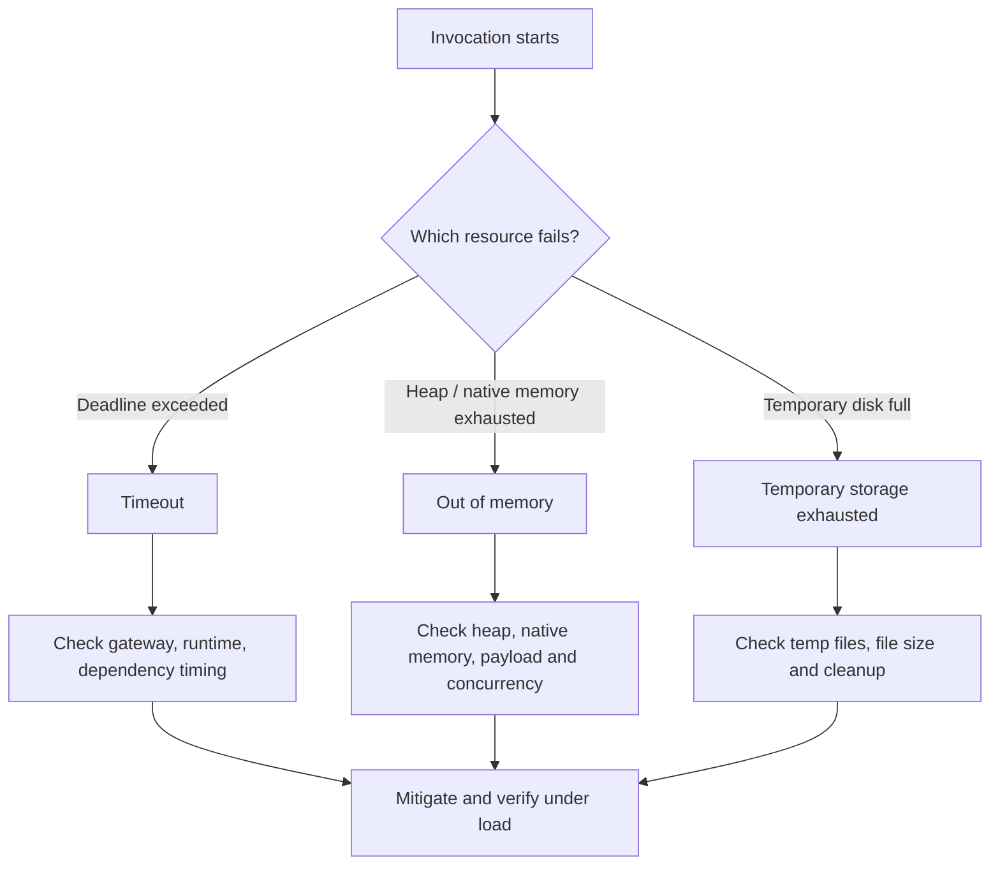
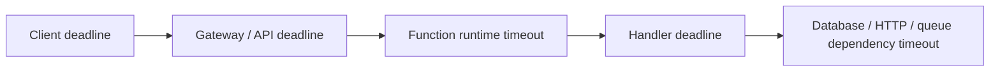

# Chẩn đoán lỗi timeout, hết bộ nhớ và cạn thư mục tạm

Java function trên nền tảng serverless có thể thất bại dù code không thay đổi: invocation chạy quá thời hạn, JVM vượt giới hạn bộ nhớ hoặc ứng dụng không còn chỗ ghi file tạm. Ba sự cố này thường xuất hiện khi tải tăng, payload lớn, dependency chậm, xử lý batch hoặc một thay đổi cấu hình làm tăng tài nguyên sử dụng.

Muốn xử lý đúng, cần tìm ra **lớp tài nguyên bị cạn hoặc thời hạn bị vượt**, rồi lần theo request/event để xác định nguyên nhân. Tăng timeout, memory hoặc dung lượng `/tmp` có thể là một phần giải pháp, nhưng nếu không kiểm tra dependency, concurrency, kích thước dữ liệu và vòng đời file thì sự cố sẽ quay lại hoặc chuyển thành chi phí cao hơn.

## 1. Nhận diện ba nhóm sự cố

| Nhóm | Dấu hiệu thường gặp | Điều cần xác định đầu tiên |
|---|---|---|
| Timeout | Request chậm, `Task timed out`, function execution exceeded limit, message bị giao lại | Timeout ở client, gateway, runtime hay dependency? |
| Out of memory (OOM) | `OutOfMemoryError`, process bị kill, restart, memory sát giới hạn | Heap, native memory, thread, direct buffer hay payload/batch tăng? |
| Temporary storage exhausted | `No space left on device`, `IOException`, upload/download thất bại | File nào chiếm chỗ, file có được dọn không, dung lượng ephemeral storage là bao nhiêu? |

Ba lỗi có thể liên quan nhau. Ví dụ, function ghi nhiều file tạm làm storage cạn; thao tác ghi bắt đầu retry hoặc chờ I/O; invocation vượt timeout. Hoặc function xử lý batch lớn tạo nhiều byte array, làm heap tăng, GC liên tục và cuối cùng timeout trước khi OOM.



## 2. Bắt đầu từ invocation và bằng chứng vận hành

Trước khi thay cấu hình, hãy thu thập dữ liệu của một invocation lỗi và một invocation thành công tương đương. Tối thiểu cần có:

- Timestamp, request ID/invocation ID, correlation ID và event ID.
- Function name, version/alias hoặc deployment slot, runtime Java và region.
- Trigger type: HTTP, SQS/queue, stream, EventBridge, timer hoặc Azure binding.
- Payload size, số record trong batch và loại công việc đang xử lý.
- Config memory, timeout, concurrency, batch size và ephemeral storage.
- Handler duration, init/startup duration, dependency latency và số lần retry.
- Memory peak, GC activity, thread count và dung lượng thư mục tạm nếu có.
- Thay đổi gần nhất: release, IAM/RBAC, secret rotation, schema, route hoặc traffic pattern.

Tìm log theo invocation ID thay vì chỉ tìm từ khóa `ERROR`. Một invocation có thể có log bắt đầu nhưng không có log kết thúc vì runtime đã kill process hoặc hết thời gian. Đối chiếu thêm metric nền tảng và log của dependency để không kết luận nhầm rằng handler là nguyên nhân.

### 2.1. Một thứ tự điều tra hiệu quả

1. Xác nhận lỗi xảy ra ở request/event nào và version nào.
2. Xác định invocation bị timeout, OOM hay lỗi ghi file; một invocation có thể có nhiều dấu hiệu.
3. So sánh duration và tài nguyên với baseline cùng payload/tải.
4. Tìm dependency chậm, payload lớn, batch lớn hoặc concurrency tăng.
5. Kiểm tra retry/redelivery và side effect đã commit hay chưa.
6. Chọn một thay đổi nhỏ để kiểm chứng giả thuyết.
7. Chạy lại với tải đại diện và theo dõi metric sau thay đổi.

Không xóa log, file dump hoặc message lỗi trước khi lưu bằng chứng cần thiết. Với payload chứa dữ liệu nhạy cảm, chỉ lưu metadata hoặc bản đã mask theo quy trình bảo mật.

## 3. Chẩn đoán timeout theo từng lớp

Timeout là một giới hạn thời gian, nhưng trong một request có thể tồn tại nhiều deadline khác nhau. Client có thể timeout trước gateway; gateway có thể timeout trước function; function có thể chờ database hoặc HTTP API lâu hơn thời gian còn lại.



Các timeout nên được cấu hình có quan hệ rõ ràng. Timeout của dependency thường phải ngắn hơn thời gian còn lại của invocation; handler cần đủ thời gian để ghi log, đóng tài nguyên và trả lỗi có kiểm soát. Nếu dependency có thể chờ vô hạn, function sẽ giữ concurrency và tài nguyên trong khi không tiến triển.

### 3.1. Phân biệt timeout của client, gateway và runtime

| Lớp | Dấu hiệu | Cách xác minh |
|---|---|---|
| Client | Browser/SDK báo timeout hoặc đóng kết nối | Client log, request duration và retry policy |
| API gateway/proxy | Gateway trả 504 hoặc integration timeout | Gateway access/execution log, integration latency và limit của dịch vụ |
| Function runtime | AWS `Task timed out`; Azure host ghi execution timeout | Function log, runtime metric và configured timeout |
| Handler/dependency | JDBC timeout, HTTP connect/read timeout, SDK timeout | Trace span, pool metric, DNS/TLS và dependency log |
| Queue/trigger | Message giao lại, visibility/lock hết hạn hoặc batch bị retry | Queue age, receive count, lock/visibility settings và invocation log |

Gateway timeout không luôn có nghĩa function đã dừng. Một số kiểu invocation có thể tiếp tục chạy sau khi client đã ngắt kết nối. Nếu client retry, cùng một operation có thể chạy song song hoặc tạo side effect trùng. Với command ghi dữ liệu, cần idempotency key và operation status.

### 3.2. Tách thời gian xử lý thành các đoạn

Đo tổng duration không cho biết thời gian bị tiêu ở đâu. Gắn timing quanh các bước chính:

- Parse/deserialize payload.
- Validate và mapping dữ liệu.
- Lấy connection từ pool.
- Query/transaction database.
- Gọi HTTP service hoặc secret manager.
- Đọc/ghi object hoặc file tạm.
- Serialize response và cleanup.

Ví dụ Java dùng `System.nanoTime()` để đo elapsed time:

```java
long started = System.nanoTime();

try {
    long dbStarted = System.nanoTime();
    Order order = repository.load(orderId);
    long dbMs = (System.nanoTime() - dbStarted) / 1_000_000;

    long serviceStarted = System.nanoTime();
    Quote quote = pricingClient.getQuote(order);
    long serviceMs = (System.nanoTime() - serviceStarted) / 1_000_000;

    return buildResponse(order, quote, dbMs, serviceMs);
} finally {
    long totalMs = (System.nanoTime() - started) / 1_000_000;
    logger.info("operation=calculate totalMs=" + totalMs);
}
```

Đây là ví dụ instrumentation; cần dùng logger và kiểu dữ liệu phù hợp trong ứng dụng. `System.nanoTime()` phù hợp đo thời lượng trong cùng process. Không dùng timestamp wall-clock để trừ duration vì đồng hồ có thể được điều chỉnh. Không log payload hoặc secret cùng timing.

### 3.3. Tính deadline từ thời gian còn lại

AWS Lambda Java `Context` cung cấp `getRemainingTimeInMillis()`. Có thể dùng giá trị này để không bắt đầu một thao tác dài khi invocation gần hết thời gian.

```java
int remainingMs = context.getRemainingTimeInMillis();
int cleanupReserveMs = 500;

if (remainingMs <= cleanupReserveMs) {
    throw new IllegalStateException("Insufficient invocation time");
}

int dependencyTimeoutMs = Math.min(2_000, remainingMs - cleanupReserveMs);
```

Timeout truyền xuống dependency nên bao gồm thời gian đủ để xử lý response và cleanup. Không chỉ kiểm tra remaining time một lần ở đầu handler nếu workflow có nhiều bước dài; hãy tính lại trước mỗi dependency call hoặc truyền deadline xuyên suốt các tầng.

Với Azure Functions Java, `ExecutionContext` cung cấp invocation ID và logger, nhưng không có API tương đương trực tiếp để đọc remaining execution time như AWS Lambda `Context`. Hãy quản lý deadline ở tầng ứng dụng dựa trên timeout được cấu hình, cancellation/timeout của client và deadline do caller truyền vào nếu có. Không giả định có thể truy vấn chính xác thời gian còn lại của host từ mọi binding/runtime.

## 4. Nguyên nhân timeout thường gặp trong Java serverless

### 4.1. Dependency chậm hoặc không có timeout

Một JDBC query, HTTP call hoặc DNS lookup có thể chờ lâu hơn dự kiến. Nếu client library không đặt connect/read/request timeout, thread có thể bị giữ đến khi runtime timeout.

Kiểm tra:

- JDBC connection acquisition timeout và query/statement timeout.
- HTTP connect timeout, response timeout và connection pool wait timeout.
- AWS/Azure SDK API call timeout và per-attempt timeout.
- DNS resolution, TLS handshake, proxy, NAT và private endpoint.
- Retry count và backoff của SDK/client.

Ví dụ Java `HttpClient` có timeout rõ ràng:

```java
HttpClient client = HttpClient.newBuilder()
        .connectTimeout(Duration.ofSeconds(2))
        .build();

HttpRequest request = HttpRequest.newBuilder()
        .uri(URI.create(serviceUrl))
        .timeout(Duration.ofSeconds(3))
        .GET()
        .build();

HttpResponse<String> response = client.send(
        request,
        HttpResponse.BodyHandlers.ofString());
```

`connectTimeout` giới hạn thời gian thiết lập kết nối; timeout trên request giới hạn thời gian trao đổi theo API của `HttpClient`. Chọn các giá trị theo deadline tổng và SLO. Trong production, tái sử dụng `HttpClient` phù hợp thay vì tạo mới cho mỗi invocation, và giới hạn kích thước response/body.

### 4.2. Connection pool cạn

Function scale-out tạo nhiều execution environment; mỗi process có thể có pool riêng. Nếu mỗi pool cho phép 10 connection và có 40 instance, database có thể nhận đến khoảng 400 connection. Request chờ lấy connection rồi timeout dù database query thực tế không quá chậm.

Kiểm tra:

- Active/idle/pending connection và pool wait time.
- Pool size nhân với số instance/concurrency.
- Connection leak, transaction không commit/rollback hoặc result set không đóng.
- Database max connections và proxy/pooler capacity.
- Function concurrency có vượt khả năng downstream không.

Dùng try-with-resources cho JDBC `Connection`, `PreparedStatement` và `ResultSet`; giới hạn pool size; đặt connection acquisition timeout; cân nhắc RDS Proxy/PgBouncer hoặc dịch vụ pool phù hợp. Tăng function concurrency mà không tính database capacity thường làm timeout tăng nhanh hơn.

### 4.3. Retry lồng nhau

API client, function handler và SDK có thể đều retry. Nếu mỗi lớp retry nhiều lần, một request có thể tạo ra nhiều lần gọi downstream, kéo dài invocation và làm dependency đang lỗi chịu tải lớn hơn.

Hãy xác định retry owner, giới hạn tổng retry budget và dùng exponential backoff với jitter cho lỗi tạm thời. Không retry lỗi validation, schema hoặc permission như thể chúng tự biến mất. Với thao tác ghi, timeout có thể xảy ra sau khi downstream đã commit; dùng idempotency key trước khi retry.

### 4.4. Cold start hoặc khởi tạo dependency

Java cold start có thể bao gồm JVM startup, class loading, framework bootstrap, secret retrieval và client initialization. Nếu log cho thấy handler chưa thực sự bắt đầu nhưng client đã timeout, xem initialization metric/log thay vì chỉ tối ưu code bên trong handler.

Không đặt công việc nặng hoặc network call không cần thiết trong static initializer. Tái sử dụng client thread-safe trong execution environment, nhưng có timeout và xử lý lỗi khởi tạo. Nếu startup phụ thuộc secret store hoặc database đang lỗi, mọi environment mới có thể cùng thất bại.

## 5. Timeout trên AWS Lambda và Azure Functions

### 5.1. AWS Lambda

Lambda có timeout cấu hình cho function. Khi vượt giới hạn, runtime dừng invocation và log có thể ghi `Task timed out after ... seconds`. CloudWatch Logs thường có các dòng `START`, `END` và `REPORT`; `REPORT` cung cấp duration, billed duration, memory size, max memory used và có thể có init duration khi phù hợp.

Quy trình kiểm tra:

1. Tìm `REPORT` theo request ID và so sánh `Duration` với timeout cấu hình.
2. Nếu có `Init Duration`, xác định phần startup có chiếm phần lớn thời gian không.
3. Đối chiếu API Gateway integration latency hoặc client timing.
4. Kiểm tra dependency span, connection pool, retry và network.
5. Với async/queue trigger, xem retry, event age, receive count và DLQ.

Tăng timeout chỉ khi công việc có giới hạn hợp lý và cần thêm thời gian thực sự. Nếu handler bị treo do connection hoặc query không timeout, tăng giới hạn chỉ khiến invocation giữ concurrency lâu hơn và có thể tăng chi phí.

### 5.2. Azure Functions

Azure Functions có cấu hình `functionTimeout` trong `host.json`; hành vi và giới hạn phụ thuộc hosting plan, runtime và phiên bản nền tảng. HTTP request còn có timeout ở client, reverse proxy hoặc API Management. Vì vậy, cần phân biệt host timeout với caller timeout.

Kiểm tra:

- `functionTimeout` trong đúng deployment artifact và app settings.
- Function execution duration, host/worker log và Application Insights request/exception.
- Plan/instance scaling, worker restart và cold start.
- Timeout của binding, SDK, database và HTTP client.
- Queue/Service Bus lock duration, retry và poison message handling.

Không sao chép `functionTimeout` giữa các hosting plan mà không kiểm tra tài liệu hiện hành của plan mục tiêu. Với HTTP-triggered function, caller có thể nhận timeout trước khi host kết thúc xử lý; thiết kế idempotency và trạng thái operation nếu client có thể retry.

## 6. Chẩn đoán OutOfMemoryError trong Java

JVM có nhiều vùng bộ nhớ. `-Xmx` chỉ giới hạn Java heap; process còn dùng metaspace, code cache, thread stack, direct/native buffer, JNI/native library và runtime/agent memory. Vì vậy, heap chưa đầy không có nghĩa process chắc chắn còn đủ memory.

### 6.1. Nhận diện loại OOM

| Dấu hiệu | Khu vực có thể cạn | Hướng điều tra |
|---|---|---|
| `Java heap space` | Heap object | Heap histogram/dump, object retention, collection/batch size |
| `GC overhead limit exceeded` | Heap gần cạn, GC tốn nhiều thời gian nhưng thu hồi ít | Allocation rate, retained objects, cache và GC log |
| `Metaspace` | Class metadata | Classloader leak, dynamic proxy/class generation, framework scanning |
| `Direct buffer memory` | Off-heap direct buffer | NIO/Netty buffer lifecycle, pool và native memory |
| `unable to create new native thread` | Native memory hoặc giới hạn thread/process | Thread count, stack size, executor và concurrency |
| Process bị kill/exit 137, không có Java stack trace | Container/host memory limit hoặc OOM killer | Platform/container memory metrics và runtime log |

Không phải mọi OOM đều phát ra stack trace trong function log. Nếu nền tảng kill process trước khi JVM ghi exception, cần đối chiếu process restart, exit code, platform diagnostics và memory metrics.

### 6.2. Heap tăng do payload hoặc batch lớn

Các pattern dễ gây tăng heap:

- Deserialize toàn bộ payload lớn thành object graph.
- Đọc toàn bộ file/object vào `byte[]` thay vì stream.
- Gom tất cả record trong batch vào `List` trước khi xử lý.
- Tạo nhiều bản sao chuỗi/JSON khi mapping.
- Cache không giới hạn hoặc giữ reference trong static collection.
- Giữ `InputStream`, `ResultSet`, buffer hoặc object trong queue nội bộ quá lâu.

Với queue trigger, batch size lớn có thể làm memory peak tăng theo số record và kích thước body. Hãy thử giảm batch size, xử lý từng record, giới hạn payload và đo peak memory. Nếu record độc lập, có thể xử lý theo chunk có giới hạn thay vì nạp toàn bộ batch vào heap.

### 6.3. Heap dump và GC diagnostics

Trong môi trường có thể kiểm soát, heap dump giúp xác định object nào giữ nhiều memory. JVM flags như `-XX:+HeapDumpOnOutOfMemoryError` có thể hữu ích nếu runtime cho phép ghi dump vào vùng lưu trữ còn đủ chỗ. Nhưng dump có thể chứa dữ liệu nhạy cảm và rất lớn; không bật bừa bãi trên production.

GC log giúp hiểu allocation rate, pause và live set. Native Memory Tracking có thể hỗ trợ điều tra native memory trong môi trường cho phép bật tùy chọn JVM tương ứng, nhưng có overhead. Chỉ bật diagnostics có mục tiêu và bảo vệ file dump/log như dữ liệu nhạy cảm.

## 7. Tối ưu memory cho Java function

### 7.1. Đo trước khi tăng memory

Trên AWS Lambda, cấu hình memory function cũng ảnh hưởng lượng CPU được cấp. Tăng memory có thể giảm duration và startup, nhưng làm thay đổi giá invocation. So sánh cost per successful invocation và p95 latency, không chỉ nhìn memory peak.

Trên Azure Functions, memory/CPU và giới hạn process phụ thuộc hosting plan và worker configuration. Kiểm tra metrics ở đúng plan và instance; không suy luận từ cấu hình Java heap riêng lẻ.

### 7.2. Không đặt heap bằng toàn bộ memory limit

Nếu function được cấp memory giới hạn, JVM vẫn cần vùng ngoài heap cho metaspace, thread stack, code cache, direct buffer, TLS, SDK và native runtime. Đặt `-Xmx` bằng toàn bộ memory quota có thể khiến process bị kill dù heap chưa phát sinh OOM.

Chọn heap theo workload và đo native overhead. Khi dùng `MaxRAMPercentage`, xác minh JVM nhận diện đúng giới hạn container/platform và giá trị cuối cùng trong runtime. Không copy một con số phần trăm từ service chạy lâu dài sang FaaS mà không đo.

### 7.3. Giới hạn concurrency và executor

Một invocation có thể tạo nhiều thread hoặc xử lý song song. Nếu mỗi invocation tạo executor không giới hạn, burst traffic nhân số thread lên rất nhanh. Dùng bounded thread pool, queue có capacity, semaphore hoặc concurrency control. Tái sử dụng executor thread-safe nếu lifecycle phù hợp và shutdown đúng cách khi ứng dụng kết thúc.

Không dùng `parallelStream()` hoặc `CompletableFuture` không giới hạn cho payload lớn mà không tính memory, downstream capacity và thời gian còn lại. Async task bị bỏ lại khi invocation kết thúc có thể không được hoàn thành như mong đợi.

### 7.4. Giảm allocation và xử lý theo luồng

- Dùng streaming parser cho JSON/file lớn nếu phù hợp.
- Xử lý từng record hoặc chunk nhỏ.
- Tránh chuyển đổi qua lại nhiều lần giữa byte array, String và object.
- Giới hạn kích thước response và số kết quả trả về.
- Đóng stream, cursor, response body và JDBC resource.
- Giới hạn cache size và TTL.
- Không giữ toàn bộ request context hoặc payload trong static collection.

## 8. Chẩn đoán cạn thư mục tạm (`java.io.tmpdir`)

Java có thể tạo file tạm qua `Files.createTempFile`, thư viện upload/download, archive, image processing hoặc framework. Đường dẫn mặc định được JVM biểu diễn qua `System.getProperty("java.io.tmpdir")`; không hardcode `/tmp` cho mọi nền tảng.

Trên AWS Lambda, `/tmp` là ephemeral storage gắn với execution environment và có dung lượng cấu hình được. Nội dung có thể còn tồn tại khi environment được tái sử dụng, nhưng không phải storage bền vững và có thể mất khi environment bị thay thế. Trên Azure Functions, thư mục temp và quota phụ thuộc OS/hosting plan; hãy đọc runtime path và kiểm tra giới hạn thực tế của môi trường triển khai.

### 8.1. Dấu hiệu thường gặp

- `java.io.IOException: No space left on device`.
- `FileSystemException` khi tạo/ghi file tạm.
- Upload/download hoặc unzip thất bại giữa chừng.
- Function chạy tốt ở payload nhỏ nhưng lỗi khi batch/file lớn.
- Lần invocation sau lỗi dù payload nhỏ vì file từ invocation trước còn sót trong environment.
- Memory không tăng đáng kể nhưng temp storage usage chạm quota.

### 8.2. Kiểm tra đường dẫn và dung lượng khả dụng

```java
import java.io.IOException;
import java.nio.file.FileStore;
import java.nio.file.Files;
import java.nio.file.Path;

public final class TempStorageDiagnostics {
    public static void logTempSpace() throws IOException {
        Path tempDir = Path.of(System.getProperty("java.io.tmpdir"));
        FileStore store = Files.getFileStore(tempDir);

        long total = store.getTotalSpace();
        long usable = store.getUsableSpace();
        long used = total - store.getUnallocatedSpace();

        System.out.printf(
                "tempDir=%s totalBytes=%d usableBytes=%d usedBytes=%d%n",
                tempDir, total, usable, used);
    }
}
```

Đây là phép đo filesystem tại thời điểm gọi; quota hiển thị có thể phản ánh volume dùng chung hoặc cách mount của nền tảng. Không coi `getUsableSpace()` là bảo đảm rằng một file có thể ghi hết dung lượng đó: các invocation khác có thể đồng thời sử dụng storage.

### 8.3. Dùng file tạm an toàn

```java
Path tempFile = Files.createTempFile("order-export-", ".json");

try {
    try (OutputStream out = Files.newOutputStream(tempFile)) {
        writeExportInChunks(out);
    }

    uploadToObjectStorage(tempFile);
} finally {
    Files.deleteIfExists(tempFile);
}
```

`writeExportInChunks` và `uploadToObjectStorage` đại diện cho logic ứng dụng. Dùng `try/finally` để cleanup cả khi upload hoặc serialization thất bại. Với nhiều file hoặc luồng phức tạp, có thể tạo một temp directory riêng cho invocation và xóa đệ quy sau khi hoàn tất. Cần bảo đảm cleanup không xóa file của invocation khác nếu runtime cho phép concurrency trong cùng process.

Không dùng tên file cố định như `/tmp/output.json` cho nhiều invocation đồng thời. Tên duy nhất tránh ghi đè và race condition. Nếu file chứa dữ liệu nhạy cảm, hạn chế permission, không log nội dung và xóa theo policy.

### 8.4. Vì sao file tạm còn sót?

Các nguyên nhân thường gặp:

- Cleanup chỉ chạy trên happy path, không chạy khi exception.
- Runtime timeout hoặc process bị kill trước `finally`.
- Thư viện tạo file nhưng ứng dụng không biết vị trí để xóa.
- Tên file cố định khiến nhiều invocation cùng ghi.
- File lớn hơn dự kiến hoặc unzip giải nén với tỷ lệ nén rất cao.
- Static cache giữ handle hoặc file path và không giải phóng.

Cleanup trong `finally` không thể chạy nếu process bị kill cứng. Vì vậy cần cả cleanup chủ động lẫn thiết kế chịu được file sót: dùng prefix riêng, kiểm tra tuổi file khi an toàn, giới hạn kích thước và tránh phụ thuộc vào việc environment luôn được tái sử dụng.

## 9. Chọn giữa streaming, memory và temporary storage

Không phải file nào cũng cần ghi xuống disk. Hãy chọn theo kích thước, khả năng retry, giới hạn memory và API của dependency.

| Cách xử lý | Ưu điểm | Rủi ro/giới hạn |
|---|---|---|
| Giữ toàn bộ trong `byte[]` | Đơn giản, nhanh với payload nhỏ | Heap peak cao; dễ OOM khi file/batch lớn |
| Stream trực tiếp qua pipeline | Memory bounded theo buffer | Khó retry giữa chừng; cần quản lý backpressure và stream lifecycle |
| Ghi file tạm rồi upload/process | Hữu ích với thư viện yêu cầu seek/random access | Dùng ephemeral storage; cần cleanup và quota |
| Chuyển file sang object storage rồi xử lý async | Tách upload khỏi compute, dễ retry theo object/event | Cần quản lý object lifecycle, event duplicate và quyền truy cập |

Với file lớn, một pattern tốt là client upload trực tiếp lên object storage bằng URL/credential có giới hạn; function nhận event chứa object key rồi xử lý theo stream hoặc chunk. Tránh truyền toàn bộ file qua HTTP API gateway/function nếu nền tảng có giới hạn payload hoặc thời gian xử lý không phù hợp.

## 10. Retry và idempotency khi function timeout hoặc OOM

Timeout/OOM không chứng minh nghiệp vụ chưa commit. Function có thể đã ghi database hoặc gọi dịch vụ ngoài rồi bị kill trước khi ACK message hoặc trả response. Lần retry tiếp theo có thể thực hiện lại side effect.

Với event-driven function:

- Dùng event ID hoặc idempotency key ổn định.
- Ghi trạng thái xử lý cùng transaction nghiệp vụ khi có thể.
- Phân biệt lỗi tạm thời với poison message hoặc dữ liệu không hợp lệ.
- Cấu hình retry count, visibility/lock timeout, batch size và DLQ theo trigger.
- Không retry vô hạn một event gây OOM do payload quá lớn.
- Với batch, hỗ trợ partial batch failure nếu nền tảng và trigger cho phép.
- Có runbook redrive/replay và kiểm tra duplicate trước khi chạy lại.

Với SQS, visibility timeout cần được thiết kế theo thời gian xử lý và batching; nếu message hiển thị lại trong khi invocation cũ còn chạy, hai consumer có thể cùng xử lý. Với Azure Queue/Service Bus, lock duration và renewal behavior cũng cần phù hợp thời gian xử lý. Các con số và cơ chế cụ thể khác nhau theo trigger và hosting/runtime.

## 11. Ma trận triệu chứng và hướng điều tra

| Triệu chứng | Nguyên nhân có thể | Bằng chứng cần tìm | Hướng xử lý ban đầu |
|---|---|---|---|
| `Task timed out` sau một khoảng cố định | Function timeout quá ngắn hoặc handler bị treo | Runtime log, duration, dependency span | Xác định bước chờ; đặt timeout cho dependency; chỉ tăng function timeout nếu workload hợp lý |
| Gateway 504 nhưng function log vẫn tiếp tục | Gateway/client timeout ngắn hơn runtime | Gateway integration latency, invocation ID | Điều chỉnh deadline hoặc chuyển tác vụ dài sang async job |
| JDBC pool wait tăng | Connection leak hoặc pool quá nhỏ so với concurrency | Active/pending connections, pool wait | Đóng resource, giới hạn concurrency, pool sizing và proxy |
| HTTP client timeout tăng | Downstream chậm, DNS/TLS/NAT hoặc retry | Connect/response timing, network errors | Timeout tách biệt, circuit breaker, kiểm tra network path |
| `Java heap space` | Payload/batch/cache giữ nhiều object | Heap dump/histogram, GC log | Stream/chunk, giảm batch, giới hạn cache và allocation |
| `GC overhead limit exceeded` | Heap gần đầy, object không được giải phóng | GC log, retained object | Tìm leak/retention, giảm live set và đo lại heap |
| `Metaspace` | Classloader leak hoặc dynamic class generation | Class count, classloader profile | Kiểm soát classloader/framework/plugin lifecycle |
| `unable to create new native thread` | Thread tăng không giới hạn hoặc native memory thấp | Thread count, executor queue, process limit | Bounded executor, giảm parallelism và kiểm tra stack size |
| Exit 137/restart không có Java exception | Process bị kill do memory limit | Platform diagnostics, memory peak | Giảm peak memory, điều chỉnh memory sau khi đo |
| `No space left on device` | Temp file không cleanup hoặc payload/file lớn | Temp path, usable space, file inventory | Stream/chunk, cleanup, giới hạn file và tăng ephemeral storage khi cần |
| Chỉ invocation sau mới lỗi disk full | File còn lại trong environment tái sử dụng | File age/size theo prefix | Dọn file an toàn, dùng unique path và TTL cleanup |
| Queue message lặp sau timeout | Invocation không ACK hoặc visibility/lock hết hạn | Receive count, event ID, idempotency record | Điều chỉnh lock/visibility, xử lý idempotent và DLQ |

## 12. Runbook xử lý sự cố

### 12.1. Runbook timeout

1. Lấy invocation/request ID, function version và trigger type.
2. Xác nhận timeout ở client, gateway hay runtime.
3. Đọc duration/init duration và timing từng dependency.
4. Kiểm tra connection pool, DNS/TLS, retry và downstream latency.
5. Xác định operation đã commit hay chưa trước khi replay.
6. Nếu backlog tăng, điều tiết producer/concurrency thay vì tăng retry vô hạn.
7. Áp dụng timeout/bulkhead/circuit breaker hoặc chuyển tác vụ dài sang queue/workflow.
8. Chạy lại smoke/load test và theo dõi p95/p99, errors, throttles và queue age.

### 12.2. Runbook OOM

1. Xác định loại OOM hoặc process kill; lưu log và exit status.
2. So sánh memory size, max memory used, heap/GC và concurrency.
3. Kiểm tra payload size, batch size, cache, static collection và thread count.
4. Kiểm tra direct buffer/native library và classloader nếu heap không giải thích được.
5. Giảm batch/concurrency hoặc stream dữ liệu để hạ peak memory.
6. Chỉ tăng memory/CPU hoặc điều chỉnh JVM heap sau khi hiểu memory profile.
7. Chạy test với payload lớn nhất dự kiến và burst concurrency đại diện.

### 12.3. Runbook temporary storage

1. Lấy `java.io.tmpdir` và dung lượng usable/total.
2. Xác định prefix/file nào tăng và invocation nào tạo chúng.
3. Kiểm tra cleanup trên success, exception, timeout và concurrent invocation.
4. Thay buffer lớn bằng streaming/chunk nếu phù hợp.
5. Dùng unique temp path, giới hạn kích thước và cleanup an toàn.
6. Tăng ephemeral storage chỉ khi workload thật sự cần dung lượng đó.
7. Kiểm tra file còn sót sau nhiều invocation và sau environment recycle.

## 13. Ngăn sự cố tái diễn

- Đặt timeout riêng cho từng dependency và deadline tổng.
- Đặt memory, batch size và concurrency theo tải đo được.
- Giới hạn executor, connection pool, cache và payload size.
- Dùng streaming cho file lớn và cleanup temp file trong `finally`.
- Có metric về memory peak, GC, thread, temp storage, dependency latency và queue age.
- Tách lỗi transient khỏi poison event; giới hạn retry và dùng DLQ.
- Thiết kế idempotency để timeout/OOM không gây duplicate side effect.
- Load test cả payload cực đại, burst concurrency và downstream degradation.
- Cảnh báo trước khi memory/storage/queue age chạm giới hạn cứng.
- Ghi runbook có lệnh xác minh và owner cho từng dependency.

## 14. Checklist chẩn đoán

1. Invocation ID, version, trigger và payload size đã được xác định chưa?
2. Timeout xảy ra ở client, gateway, runtime hay dependency?
3. Có timing cho deserialize, database, HTTP, storage và cleanup không?
4. Timeout/retry của SDK và từng lớp có vượt deadline tổng không?
5. Connection pool, thread pool và concurrency có giới hạn không?
6. OOM thuộc heap, metaspace, direct buffer, native thread hay process kill?
7. Có GC log, heap histogram/dump hoặc platform memory diagnostics không?
8. Payload/batch/cache có làm memory peak tăng không?
9. `java.io.tmpdir` trỏ đến đâu và còn bao nhiêu dung lượng?
10. Temp file có unique name, giới hạn size và cleanup trên mọi nhánh không?
11. Timeout/OOM có khiến message được retry hoặc side effect chạy trùng không?
12. Có idempotency, DLQ, replay và reconciliation không?
13. Thay đổi khắc phục đã được kiểm tra bằng tải đại diện và worst-case payload chưa?
14. Dashboard/alarm có phát hiện sớm trước khi chạm hard limit không?

## Kết luận

Timeout, OOM và cạn thư mục tạm là ba biểu hiện khác nhau của việc invocation vượt giới hạn thời gian hoặc tài nguyên. Chẩn đoán timeout bằng cách tách deadline ở client, gateway, runtime và dependency; chẩn đoán OOM bằng cách phân biệt heap với native memory, thread và process limit; chẩn đoán disk bằng cách kiểm tra `java.io.tmpdir`, file growth và cleanup. Trong Java serverless, payload/batch, scale-out, connection pool và retry có thể khuếch đại cả ba vấn đề. Hãy đo theo invocation, giới hạn tài nguyên ở từng tầng, xử lý dữ liệu theo luồng khi phù hợp và bảo đảm retry idempotent trước khi tăng giới hạn nền tảng.

## Tài liệu tham khảo chính thức

- [AWS Lambda timeout configuration](https://docs.aws.amazon.com/lambda/latest/dg/configuration-timeout.html)
- [AWS Lambda memory configuration](https://docs.aws.amazon.com/lambda/latest/dg/configuration-memory.html)
- [AWS Lambda ephemeral storage](https://docs.aws.amazon.com/lambda/latest/dg/configuration-ephemeral-storage.html)
- [AWS Lambda execution environment lifecycle](https://docs.aws.amazon.com/lambda/latest/dg/lambda-runtime-environment.html)
- [AWS Lambda Java context](https://docs.aws.amazon.com/lambda/latest/dg/java-context.html)
- [Azure Functions host.json reference](https://learn.microsoft.com/en-us/azure/azure-functions/functions-host-json)
- [Azure Functions scale and hosting](https://learn.microsoft.com/en-us/azure/azure-functions/functions-scale)
- [Monitor executions in Azure Functions](https://learn.microsoft.com/en-us/azure/azure-functions/functions-monitoring)
- [Java Runtime troubleshooting](https://docs.oracle.com/en/java/javase/21/troubleshoot/)
