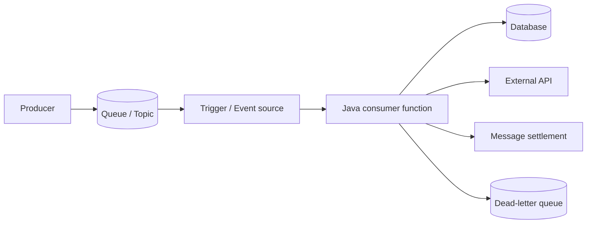

# Khắc phục queue backlog, poison message và throttling

Trong hệ thống serverless xử lý sự kiện, queue hấp thụ chênh lệch giữa tốc độ producer gửi dữ liệu và tốc độ consumer xử lý. Queue tăng trong một đợt traffic burst chưa chắc là sự cố. Sự cố xuất hiện khi backlog tiếp tục tăng, message cũ vượt SLA, consumer liên tục thất bại hoặc một tầng bị throttling khiến hệ thống không thể bắt kịp lưu lượng đến.

Ba vấn đề thường xuất hiện cùng nhau:

- **Queue backlog:** số message đang chờ tăng hoặc message nằm trong queue quá lâu.
- **Poison message:** một message liên tục làm consumer thất bại, chiếm lượt giao và có thể gây nghẽn.
- **Throttling:** broker, nền tảng function hoặc dependency giới hạn tốc độ request/concurrency; consumer không thể tăng throughput như mong muốn.

Khắc phục đúng cần tìm bottleneck trước khi tăng worker. Nếu database đã quá tải mà chỉ tăng concurrency, queue có thể giảm trong vài phút nhưng database sẽ suy giảm nặng hơn. Nếu poison message bị retry vô hạn, scale-out chỉ tạo thêm invocation thất bại. Bài này trình bày cách đo, chẩn đoán và phục hồi queue workload cho Java serverless.

Trong phạm vi **CLOUD_SERVERLESS**, bài học tập trung vào phát triển và triển khai ứng dụng serverless, đặc biệt là Java function kích hoạt bởi HTTP, thông điệp hoặc sự kiện. Người học xử lý trigger, trạng thái, quyền truy cập, retry, idempotency, cold start, mở rộng và chi phí. Nội dung dưới đây áp dụng các nguyên tắc đó vào vận hành consumer, kiểm soát backlog, cô lập poison message và điều tiết throttling.

## 1. Nhận diện triệu chứng

| Triệu chứng | Khả năng nguyên nhân | Dữ liệu cần kiểm tra |
|---|---|---|
| Queue depth tăng liên tục | Arrival rate cao hơn processing rate | Enqueue/dequeue rate, active workers |
| Oldest message age tăng | Message chờ lâu, partition/consumer bị nghẽn | Age, queue/partition distribution |
| Invocation tăng nhưng throughput không tăng | Retry storm, throttling hoặc xử lý chậm | Attempt count, duration, errors |
| Consumer thường xuyên timeout | Downstream chậm, batch quá lớn hoặc timeout không phù hợp | p95/p99 duration, dependency latency |
| DLQ tăng đột ngột | Poison payload, schema mismatch, bug sau release | Dead-letter reason, event type, release |
| HTTP 429/503 từ dependency | Rate/concurrency vượt quota hoặc dependency quá tải | Status code, Retry-After, quota |
| Một partition có lag cao | Hot key hoặc consumer ownership mất cân bằng | Lag theo partition/key |
| Queue giảm rồi tăng lại | Autoscaling dao động, producer burst hoặc retry | Scale events, arrival/processing rate |

Không kết luận chỉ từ queue depth. Một queue có nhiều message nhưng consumer đang xử lý nhanh và oldest age thấp có thể là burst bình thường. Ngược lại, queue depth nhỏ nhưng oldest message age cao có thể chỉ ra một message bị kẹt hoặc partition không tiến triển.

## 2. Mô hình luồng xử lý và các điểm nghẽn

Một event-driven pipeline thường gồm producer, broker, event source mapping/trigger, Java function, dependency và settlement/ack:



Backlog có thể hình thành ở broker, trong hàng đợi nội bộ của trigger, ở worker pool hoặc ở downstream. Cần xác định message đã được nhận khỏi broker chưa, đang invisible/locked hay vẫn visible, consumer có đang xử lý hay bị chặn, và message được ack/commit đúng lúc hay không.

Một số nền tảng có queue buffer nội bộ hoặc event source polling layer. Vì vậy số invocation không nhất thiết bằng số message đã enqueue, và số message đã được nhận cũng không nhất thiết bằng số message đã xử lý thành công.

## 3. Đo backlog bằng throughput và message age

Đặt:

- λ: tốc độ message đến (arrival rate), message/giây.
- μ: tốc độ xử lý thành công (processing rate), message/giây.
- B: số message đang chờ.
- W: thời gian chờ trung bình trong queue.
- N: số worker/consumer instance đang hoạt động.

Nếu λ lớn hơn μ trong một khoảng thời gian đủ dài, backlog có xu hướng tăng. Nếu μ lớn hơn λ, hệ thống có thể drain backlog, miễn là tốc độ xử lý ổn định và không bị giới hạn bởi dependency khác.

Ước lượng thời gian drain khi không có message mới:

```text
drainTime = backlog / processingRate
```

Nếu producer vẫn tiếp tục gửi message, thời gian drain gần đúng khi μ lớn hơn λ là:

```text
drainTime = backlog / (processingRate - arrivalRate)
```

Ví dụ backlog 120.000 message, consumer xử lý thành công 500 message/giây, producer vẫn gửi 200 message/giây. Throughput dư để drain là 300 message/giây, do đó thời gian drain lý thuyết khoảng 400 giây. Thực tế còn phụ thuộc retry, message size, batch, partition, downstream throttling và biến động traffic.

Đây là ước lượng vận hành, không phải SLA. Hãy dùng throughput thành công thực tế thay vì số message được nhận hoặc số invocation.

## 4. Little's Law và queue latency

Trong hệ thống ổn định, Little's Law mô tả quan hệ:

```text
L = arrivalRate * averageTimeInSystem
```

Trong đó L là số item trung bình trong hệ thống. Với queue, có thể dùng để hiểu quan hệ giữa queue length, arrival rate và thời gian chờ khi workload tương đối ổn định.

Ví dụ nếu arrival rate 100 message/giây và thời gian chờ trung bình 20 giây, queue có khoảng 2.000 message chờ ở trạng thái ổn định. Khi backlog tăng mà throughput không đổi, thời gian chờ cũng tăng.

Không áp dụng trực tiếp công thức này cho một burst chưa ổn định hoặc khi có nhiều loại message với thời gian xử lý khác nhau mà không phân nhóm. Theo dõi percentile của age/latency để phát hiện tail behavior.

## 5. Chỉ số cần thu thập

Tối thiểu cần có:

- Queue depth hoặc backlog theo queue/subscription.
- Oldest message age hoặc age của message chưa xử lý lâu nhất.
- Enqueue/arrival rate.
- Successful processing/dequeue/ack rate.
- In-flight/invisible/locked message count.
- Consumer concurrency và số instance hoạt động.
- Invocation duration p50/p95/p99.
- Retry/delivery attempt count.
- DLQ arrival rate và DLQ depth.
- Throttling count theo broker, function platform và dependency.
- Downstream latency, connection pool saturation và error rate.
- Batch size, partial batch failure và message size.

Phải phân biệt metric broker với metric ứng dụng. Ví dụ message được dequeue/received không đồng nghĩa business transaction đã commit. Consumer nên phát metric thành công sau khi side effect bền vững và settlement đúng semantics.

## 6. Quy trình chẩn đoán ban đầu

Khi alert backlog tăng:

1. Xác định queue, subscription, topic hoặc partition bị ảnh hưởng.
2. Xem backlog và oldest age tăng từ thời điểm nào.
3. So sánh arrival rate với successful processing rate.
4. Kiểm tra worker/function concurrency, throttling và timeout.
5. Kiểm tra DLQ, retry attempts và loại event chiếm tỷ lệ cao.
6. Kiểm tra database, API ngoài, cache và connection pool.
7. Đối chiếu release/config change gần thời điểm sự cố.
8. Chọn biện pháp bảo vệ: pause producer, giảm tốc, scale có giới hạn hoặc cô lập poison message.
9. Thử nghiệm thay đổi trên một phần traffic nếu có thể.
10. Theo dõi backlog, oldest age và downstream health sau mỗi thay đổi.

Không thay đồng thời nhiều tham số như batch size, concurrency, timeout và retry count nếu chưa có lý do. Khi thay một biến tại một thời điểm, sẽ dễ xác định thay đổi nào cải thiện hoặc làm xấu hệ thống.

## 7. Xác định bottleneck nằm ở đâu

| Tầng | Dấu hiệu | Hướng điều tra |
|---|---|---|
| Producer | Arrival rate tăng bất thường | Release, retry producer, loop, batch replay |
| Broker | Publish/receive throttled, partition limit | Quota, partition, message size, broker capacity |
| Trigger/platform | Invocation bị throttle, poll rate thấp | Concurrency quota, event source settings, account limit |
| Java function | Duration tăng, CPU/heap/GC cao | Profiling, cold start, batch size, serialization |
| Database | Connection pool full, query latency cao | Index, transaction, lock, connection budget |
| External API | 429/503, latency tăng | Quota, rate limit, circuit breaker |
| Settlement | Message redelivered dù xử lý xong | Ack/complete/commit timing, lock/visibility |
| Partition/key | Một shard lag hơn phần còn lại | Hot key, ordering, partition skew |

Tăng số worker chỉ phù hợp khi bottleneck nằm ở consumer capacity và downstream còn dư capacity. Nếu database đã đạt connection limit, scale worker sẽ làm tình trạng tệ hơn.

## 8. Phân biệt backlog do traffic burst và backlog do suy giảm

Traffic burst thường có đặc điểm:

- Arrival rate tăng đột ngột nhưng processing rate vẫn gần baseline.
- Worker scale-out theo sau một khoảng trễ.
- Oldest age tăng trong burst rồi giảm khi traffic hạ.
- Error/throttle rate không tăng đáng kể.

Suy giảm consumer thường có đặc điểm:

- Processing rate giảm dù arrival rate ổn định.
- Duration, timeout hoặc retry tăng.
- Oldest age tiếp tục tăng ngay cả sau khi burst kết thúc.
- DLQ hoặc dependency error tăng.

Backlog do burst có thể chỉ cần capacity headroom và autoscaling phù hợp. Backlog do suy giảm cần sửa bottleneck hoặc cô lập lỗi trước khi scale.

## 9. Poison message là gì?

Poison message là message làm consumer thất bại lặp lại vì payload, schema, dữ liệu nghiệp vụ hoặc bug xử lý. Một poison message có thể:

- Luôn gây deserialization exception.
- Gây lỗi validation không thể retry.
- Làm worker vượt timeout do một record bất thường.
- Gây exception trong một nhánh code hiếm.
- Làm batch bị rollback toàn bộ dù các message khác hợp lệ.
- Tạo head-of-line blocking trong FIFO/session/partition stream.

Poison message khác lỗi transient. Nếu dependency tạm thời timeout, retry có thể giúp. Nếu payload không parse được, retry cùng một payload với cùng consumer code không làm vấn đề biến mất.

## 10. Nhận diện poison message

Dấu hiệu:

- Cùng event ID hoặc message key xuất hiện nhiều lần trong log.
- Delivery count tăng đến ngưỡng dead-letter.
- Cùng event type/schema version gây lỗi.
- Một partition hoặc FIFO message group không tiến triển.
- Batch liên tục thất bại dù các record khác có thể xử lý.
- DLQ reason tập trung vào deserialization, validation hoặc unsupported schema.
- Lỗi bắt đầu ngay sau một consumer deployment.

Log nên ghi event ID, message ID, event type, schema version, partition/offset hoặc group ID, attempt count, consumer version và normalized error code. Không log raw payload nhạy cảm để tìm poison message.

## 11. Phân loại lỗi trước khi retry

| Nhóm lỗi | Ví dụ | Hành động |
|---|---|---|
| Transient | Network timeout, connection reset | Retry có giới hạn và backoff |
| Throttling | HTTP 429, broker quota exceeded | Giảm tốc, tôn trọng retry hint |
| Dependency unavailable | HTTP 503, database failover | Retry có jitter, circuit breaker |
| Invalid schema | JSON hỏng, field bắt buộc thiếu | DLQ/quarantine |
| Unsupported version | Consumer không hiểu schema mới | Deploy compatibility hoặc transform đã duyệt |
| Business rejection | Order đã hủy, account đóng | Ghi kết quả nghiệp vụ, không retry vô hạn |
| Duplicate | Event đã áp dụng | Acknowledge sau khi xác minh idempotency |
| Stale/expired | Deadline hết hoặc aggregate đã tiến xa | Bỏ qua/reconcile theo domain |
| Unknown | Exception chưa phân loại | Retry giới hạn rồi DLQ và điều tra |

Đừng bắt mọi exception rồi trả thành công để tránh DLQ. Điều đó làm message bị mất khỏi retry flow trong khi business effect chưa hoàn tất.

## 12. Retry budget và exponential backoff

Retry policy cần giới hạn:

- Số attempt tối đa.
- Tổng thời gian retry.
- Backoff ban đầu và tối đa.
- Jitter.
- Message TTL/deadline.
- Visibility timeout hoặc lock duration.
- Function timeout và dependency timeout.
- Chính sách chuyển DLQ.

Ví dụ backoff có cap:

```text
delay = min(maxDelay, initialDelay * 2^(attempt - 1))
actualDelay = random(0, delay)  // full jitter
```

Full jitter phân tán các lần retry để tránh tất cả consumer gọi lại cùng thời điểm. Giá trị backoff cần dựa trên đặc tính dependency và SLA. Retry quá dài có thể làm message hết giá trị nghiệp vụ; retry quá ngắn có thể tạo storm.

Nếu producer, broker, SDK HTTP và consumer đều tự retry, tổng số lần gọi có thể nhân lên. Chọn một tầng chịu trách nhiệm retry chính và đặt budget xuyên suốt.

## 13. Visibility timeout, lock duration và ack deadline

Khi consumer nhận message, broker thường làm message tạm thời không visible hoặc cấp lock/lease trong một khoảng thời gian. Nếu worker không settle trước khi thời gian này hết, message có thể được giao lại dù worker vẫn đang chạy.

Các thuật ngữ theo nền tảng có thể khác nhau:

- SQS: visibility timeout.
- Azure Service Bus: message lock duration và lock renewal.
- Pub/Sub: ack deadline/lease management.
- Kafka: consumer poll, processing và offset commit; không dùng cùng semantics với queue visibility.

Nguyên tắc:

- Thời gian xử lý chunk phải phù hợp với lock/visibility.
- Nếu cần xử lý lâu, gia hạn lock/visibility theo API được hỗ trợ.
- Không để function timeout dài hơn khả năng giữ lock mà không có renewal.
- Không settle trước khi side effect bền vững.
- Nếu message bị giao lại, consumer phải idempotent.
- Tránh để lock renewal chạy vô hạn khi worker đã treo.

Một lock hết hạn có thể khiến hai worker cùng xử lý một message. Dùng conditional state/idempotency ở storage để ngăn side effect kép.

## 14. Batch processing và partial batch failure

Batch giúp giảm overhead invoke/poll, nhưng một message lỗi có thể làm cả batch bị retry nếu handler chỉ trả một kết quả thành công/thất bại chung.

Ví dụ batch gồm 10 message, 9 message xử lý thành công và 1 message sai schema. Nếu cả batch bị retry, 9 message tốt cũng được giao lại. Điều này tạo duplicate work và tăng backlog.

Các cách giảm tác động:

- Bật partial batch response nếu trigger/provider hỗ trợ.
- Chỉ báo các message thất bại cần retry.
- Dùng idempotency cho mọi side effect.
- Chọn batch size theo memory, duration và error isolation.
- Với FIFO/ordered stream, tuân thủ semantics dừng/commit theo thứ tự.
- Tách message nặng hoặc loại event khác nhau sang queue riêng nếu cần.

Không giả định partial batch failure có cùng format trên mọi cloud provider. Đọc đúng hợp đồng event source mapping và test bằng message lỗi ở giữa batch.

## 15. Cô lập poison message bằng DLQ hoặc quarantine

DLQ giúp message lỗi không chiếm retry capacity của luồng chính. Quarantine có thể được dùng khi cần kiểm tra bảo mật hoặc sửa dữ liệu thủ công.

Một luồng xử lý:

1. Consumer nhận message.
2. Phân loại lỗi.
3. Lỗi transient: retry trong budget.
4. Lỗi permanent hoặc hết attempt: dead-letter.
5. Ghi metadata nguyên nhân, source, event ID và consumer version.
6. Alert owner.
7. Điều tra, sửa code/schema/data hoặc xác định message không còn hợp lệ.
8. Chạy dry-run redrive và replay có giới hạn.
9. Reconcile business outcome.

Không redrive toàn bộ DLQ chỉ để làm queue count về 0. Message cần được lọc theo reason, age, schema version, tenant, event type và business state.

## 16. Head-of-line blocking và ordering

Một message lỗi có thể ngăn các message sau tiến lên trong hệ thống yêu cầu ordering. Điều này thường xảy ra với FIFO group, Service Bus session hoặc Kafka partition.

Ví dụ một aggregate có các event:

```text
OrderCreated(version=1)
OrderPaid(version=2)
OrderShipped(version=3)
```

Nếu event version 1 bị poison nhưng version 2 và 3 đã được xử lý ở nơi khác, replay event 1 sau đó có thể làm state lùi hoặc tạo side effect sai.

Cách xử lý:

- Giữ ordering key/partition key theo aggregate.
- Kiểm tra aggregate version trước khi áp dụng event.
- Phân biệt event cũ, duplicate và event bị thiếu.
- Cân nhắc quarantine theo partition/group nếu semantics yêu cầu tuần tự.
- Dùng repair workflow hoặc compensating event khi replay trực tiếp không an toàn.
- Không thay đổi partition key tùy tiện khi redrive.

Queue Standard thường không đảm bảo ordering toàn cục; FIFO/session/partition chỉ đảm bảo trong phạm vi được định nghĩa. Cần thiết kế theo semantics thực tế của broker.

## 17. Throttling xảy ra ở những tầng nào?

Throttling không chỉ là lỗi của function platform. Có thể xảy ra ở:

| Tầng | Ví dụ |
|---|---|
| Producer | API rate limit, quota publish |
| Broker | Publish/receive quota, partition throughput, request quota |
| Event source | Polling limit, max concurrent invokes |
| Serverless platform | Account concurrency, reserved/max concurrency, invocation throttle |
| Java runtime | Thread pool, connection pool hoặc semaphore đầy |
| Database | Connection limit, query/transaction capacity |
| External API | HTTP 429, quota per key/tenant |
| Object storage | Request rate, multipart limits hoặc bandwidth |
| Telemetry | Exporter/collector queue và backend ingestion quota |

Phải gắn throttling metric với đúng tầng. Nếu function bị throttle, tăng poller concurrency có thể không giúp. Nếu downstream trả 429, tăng function concurrency có thể làm lỗi nặng hơn.

## 18. Phân biệt throttling với lỗi tạm thời khác

Throttling thường có dấu hiệu rõ như HTTP 429, broker-specific quota exception hoặc metric throttled invocation. Nhưng một số provider có thể biểu diễn capacity exhaustion bằng 5xx hoặc exception riêng.

Khi gặp throttling:

- Đọc response header như Retry-After nếu có.
- Kiểm tra quota theo account, region, resource, API key hoặc tenant.
- Xác định quota cứng hay quota có thể tăng.
- Giảm concurrency/rate để không tiếp tục vượt ngưỡng.
- Dùng exponential backoff có jitter.
- Theo dõi tỷ lệ thành công sau khi giảm tốc.
- Không retry tức thì trong vòng lặp nóng.

Timeout không nhất thiết là throttling. Có thể dependency bị chậm, DNS/network lỗi hoặc connection pool cạn. Phân loại chính xác giúp chọn biện pháp đúng.

## 19. Tính throughput và concurrency cần thiết

Nếu mỗi worker xử lý trung bình t giây/message và có N worker đồng thời, throughput lý thuyết gần đúng là:

```text
processingRate ≈ N / averageSecondsPerMessage
```

Nếu worker xử lý batch b message trong t_b giây:

```text
processingRate ≈ N * b / batchProcessingSeconds
```

Ví dụ mỗi worker xử lý 20 message/giây và có 10 worker, throughput lý thuyết là 200 message/giây. Nếu arrival rate là 250 message/giây, backlog sẽ tăng trung bình 50 message/giây cho đến khi workload thay đổi.

Đây chỉ là mô hình đơn giản. Thực tế cần đo service time phân phối, batch failure, downstream quota, cold start và contention. Tăng batch size có thể giảm overhead nhưng làm một invocation lâu hơn, tăng memory và tăng phạm vi retry khi partial failure không được hỗ trợ.

## 20. Scale consumer có giới hạn

Scale-out phù hợp khi:

- Arrival rate tăng hợp lệ.
- Consumer đang sử dụng CPU/memory chưa hết capacity.
- Database/API/storage còn dư capacity.
- Throttling không tăng theo concurrency.
- Queue partition có thể phân phối công việc cho nhiều worker.

Scale-out không phù hợp khi:

- Database connection pool đã đầy.
- External API đang trả 429.
- Một hot key/partition giới hạn ordering.
- Consumer đang retry poison message.
- Worker duration tăng vì lock contention hoặc query chậm.
- Function đã chạm account concurrency quota.

Đặt max concurrency theo downstream budget. Có thể giới hạn tổng worker concurrency ở platform, giới hạn concurrency theo event source hoặc dùng semaphore/rate limiter trong Java. Local limit trên mỗi instance phải được nhân với số instance tối đa để tính tổng tải.

## 21. Autoscaling nên dùng nhiều tín hiệu

Queue depth là một tín hiệu, nhưng không đủ. Một policy autoscaling tốt có thể kết hợp:

- Backlog depth.
- Oldest message age.
- Arrival/processing rate gap.
- Consumer utilization/concurrency.
- Downstream latency và throttling.
- Partition lag/hot partition.
- Target processing latency hoặc queue age.

Nếu backlog tăng nhưng downstream đang bị throttle, autoscaling nên giữ hoặc giảm concurrency thay vì tăng. Có thể sử dụng hai vòng điều khiển: một vòng tăng worker theo queue pressure, một vòng giới hạn tổng concurrency theo downstream health.

## 22. Backpressure ở producer và consumer

Backpressure là cơ chế làm chậm nguồn phát khi hệ thống phía sau không còn capacity.

Producer có thể:

- Từ chối request mới bằng 429/503.
- Trả Retry-After.
- Buffer trong queue giới hạn.
- Giảm tốc batch publish.
- Ưu tiên event quan trọng và trì hoãn bulk workload.
- Áp quota theo tenant.

Consumer có thể:

- Giảm polling hoặc receive rate.
- Giảm concurrency.
- Tạm pause partition/subscription nếu broker hỗ trợ.
- Dừng nhận batch mới khi downstream unhealthy.
- Dùng bounded queue trong JVM, tránh unbounded in-memory buffering.

Không dùng memory queue không giới hạn để che backlog. Nó chỉ chuyển vấn đề từ broker sang heap, có thể gây OOM và mất dữ liệu khi instance bị recycle.

## 23. Công bằng giữa tenant và loại workload

Một tenant gửi burst lớn có thể chiếm toàn bộ queue capacity và worker slots. Nếu nhiều tenant dùng chung queue, hãy cân nhắc:

- Per-tenant rate limit và concurrency cap.
- Queue/topic riêng cho tenant lớn hoặc workload quan trọng.
- Priority class cho interactive, standard và bulk events.
- Weighted fair scheduling thay vì strict priority không giới hạn.
- Quota và alert theo tenant.
- Admission control khi tenant vượt budget.

Không tạo một queue riêng cho mọi tenant nếu chi phí vận hành vượt lợi ích. Có thể dùng shared queue với tenant key và scheduler, hoặc phân shard theo nhóm tenant.

## 24. Java consumer: phân loại và settlement rõ ràng

Một consumer nên tách xử lý nghiệp vụ, phân loại lỗi và quyết định settlement. Ví dụ khung trung lập với broker:

```java
public void handle(MessageEnvelope message) {
    try {
        processor.processIdempotently(message);
        // ACK/complete/commit only after durable business success.
        settlement.acknowledge(message);
    } catch (RetryableDependencyException retryable) {
        settlement.retry(message, retryPolicy.delayFor(message.attempt()));
    } catch (PermanentMessageException permanent) {
        settlement.deadLetter(message, permanent.code());
    } catch (Exception unknown) {
        settlement.retryOrDeadLetter(
                message, retryPolicy, "UNCLASSIFIED_FAILURE");
    }
}
```

Đây là pseudocode vì API ack/retry/DLQ khác nhau theo broker. Một số trigger tự quản lý settlement dựa trên exception; một số cần gọi explicit acknowledge/complete; Kafka cần quản lý offset commit. Không gọi cả acknowledge và retry cho cùng delivery.

Không catch mọi exception rồi log và return bình thường nếu runtime coi return là thành công. Điều đó có thể ack message bị lỗi và làm mất cơ hội retry/DLQ.

## 25. Java: error taxonomy thay vì retry mọi exception

Có thể định nghĩa lỗi domain rõ ràng:

```java
sealed interface ProcessingFailure
        permits TransientFailure, ThrottledFailure,
                InvalidPayload, BusinessRejected {}

record TransientFailure(Throwable cause) implements ProcessingFailure {}
record ThrottledFailure(Duration retryAfter, Throwable cause)
        implements ProcessingFailure {}
record InvalidPayload(String code) implements ProcessingFailure {}
record BusinessRejected(String code) implements ProcessingFailure {}
```

Adapter chuyển lỗi từ HTTP client, database và parser thành nhóm failure phù hợp. Application service không cần biết một broker cụ thể; adapter trigger quyết định retry, dead-letter hoặc acknowledge theo hợp đồng của broker.

Với Java version không hỗ trợ sealed interface/record, dùng class/enum tương đương. Điều quan trọng là không phân loại lỗi chỉ bằng một catch-all RuntimeException.

## 26. Rate limiting trong Java

Nếu downstream cho phép tối đa một số request/giây, consumer có thể dùng token bucket hoặc thư viện rate limiter. Ví dụ khái niệm với Resilience4j:

```java
RateLimiterConfig config = RateLimiterConfig.custom()
        .limitForPeriod(20)
        .limitRefreshPeriod(Duration.ofSeconds(1))
        .timeoutDuration(Duration.ZERO)
        .build();

RateLimiter limiter = RateLimiter.of("partner-api", config);

Supplier<Response> protectedCall = RateLimiter.decorateSupplier(
        limiter, () -> partnerClient.send(request));

Response response = protectedCall.get();
```

Cần chọn policy chờ hay fail-fast phù hợp; không block thread vô hạn để chờ permit. RateLimiter trong một JVM chỉ giới hạn instance đó. Nếu có 20 instance, mỗi instance cho phép 20 request/giây thì tổng lý thuyết có thể lên tới 400 request/giây. Quota toàn cục cần được điều tiết ở gateway, distributed limiter hoặc dispatcher chung.

Nếu provider trả Retry-After, policy nên ưu tiên thời gian đó khi hợp lệ. Rate limiter chủ động tránh vượt quota; retry policy xử lý lỗi đã xảy ra. Hai cơ chế cần phối hợp.

## 27. Circuit breaker và bulkhead khi downstream throttling

Circuit breaker có thể mở khi dependency liên tục lỗi hoặc chậm; bulkhead giới hạn số lời gọi đồng thời; rate limiter giới hạn tốc độ. Chúng giải quyết các khía cạnh khác nhau:

| Cơ chế | Giới hạn |
|---|---|
| Rate limiter | Số request trong một đơn vị thời gian |
| Bulkhead | Số operation đồng thời |
| Circuit breaker | Có tiếp tục gọi dependency đang lỗi hay không |
| Retry budget | Số lần thử lại và tổng thời gian |
| Backpressure | Tốc độ công việc được đưa vào hệ thống |

Khi nhận 429, không nhất thiết mở circuit breaker ngay lập tức; có thể giảm rate và tôn trọng Retry-After. Nếu dependency trả lỗi liên tục hoặc không phục hồi, breaker có thể bảo vệ worker. Fallback phải đúng semantics nghiệp vụ; không báo thành công giả.

## 28. Tối ưu batch size và thời gian xử lý

Batch size quá nhỏ làm tăng invoke/poll overhead; quá lớn làm tăng memory, duration và phạm vi retry. Cần đo:

- Thời gian xử lý trung bình và p99 mỗi batch.
- Số record thành công/thất bại.
- Kích thước payload và object allocation.
- Database round trips.
- Partial batch failure support.
- Function timeout và visibility/lock duration.

Dùng batch size nhỏ hơn cho message nặng hoặc có side effect không thể batch. Có thể chia batch theo event type hoặc kích thước payload nếu workload không đồng nhất.

Không chọn batch size chỉ để đạt throughput tối đa. Mục tiêu là đáp ứng oldest-age/SLA trong khi giữ error isolation và downstream trong giới hạn.

## 29. Những khác biệt cần lưu ý giữa các broker

| Hệ thống | Cách theo dõi lag/backlog | Cơ chế retry/settlement | Lưu ý vận hành |
|---|---|---|---|
| AWS SQS + Lambda | Approximate visible/in-flight counts, age, Lambda concurrency/throttle | Visibility timeout, receive count, redrive policy/DLQ, partial batch response | Max concurrency và account concurrency phải phù hợp; test partial batch |
| Azure Service Bus | Active/dead-letter count, age, lock loss, processor errors | Complete/abandon/defer/dead-letter, lock renewal, delivery count | Sessions ảnh hưởng ordering; prefetch/concurrency có thể giữ nhiều message locked |
| Google Cloud Pub/Sub | Undelivered backlog, oldest unacked age, subscriber throughput | Ack deadline/lease extension, retry policy, dead-letter topic | Flow control giới hạn outstanding messages/bytes; delivery attempts có semantics riêng |
| Kafka | Consumer group lag theo partition, records lag/max lag | Offset commit, retry topic/quarantine topic hoặc pause/resume | Partition count và key distribution giới hạn parallelism/ordering |
| Azure Event Hubs | Consumer lag/checkpoint theo partition | Checkpoint, retry ở consumer, quarantine pattern | Partition ownership và checkpoint cadence ảnh hưởng recovery |

Tên metric, semantics và giới hạn thay đổi theo tier/region/runtime. Luôn đối chiếu tài liệu provider đang dùng. Không chuyển một cấu hình visibility timeout từ SQS sang Service Bus hoặc Kafka mà không hiểu khác biệt settlement.

## 30. AWS Lambda với SQS: các điểm kiểm tra

Khi Lambda đọc SQS, event source mapping poll queue và invoke function theo batch. Khi function xử lý thành công, mapping xóa message; nếu batch thất bại theo cơ chế mặc định, message có thể được giao lại. Partial batch response cho phép báo các message lỗi riêng lẻ nếu được bật và handler trả đúng cấu trúc.

Điểm kiểm tra:

- Queue visibility timeout tương thích với function timeout và batching configuration theo khuyến nghị AWS hiện hành.
- DLQ/redrive policy đặt maxReceiveCount phù hợp.
- Batch size không vượt memory/time budget.
- Partial batch response được bật nếu cần cô lập lỗi trong batch.
- Max concurrency của event source mapping và reserved/account concurrency phối hợp đúng.
- Downstream connection pool không bị nhân lên quá mức khi Lambda scale-out.
- IAM role chỉ có quyền cần thiết cho queue, DLQ, logs và dependency.

Đừng tăng maximum concurrency trước khi đo database/API capacity. Với queue FIFO, message group và ordering có thể giới hạn concurrency thực tế.

## 31. Azure Service Bus: lock, prefetch và concurrency

Service Bus receiver xử lý message trong thời gian lock. Nếu xử lý lâu hơn lock và không gia hạn, message có thể bị giao lại. Prefetch lấy message trước vào client buffer; prefetch quá cao có thể khiến message nằm trong buffer trong khi lock vẫn chạy, làm lock hết hạn trước khi xử lý.

Kiểm tra:

- maxConcurrentCalls theo CPU, DB pool và downstream quota.
- Prefetch count vừa đủ, tránh giữ nhiều lock hơn khả năng xử lý.
- Auto lock renewal có giới hạn thời gian phù hợp.
- Dead-letter reason/description được ghi rõ.
- Sessions chỉ dùng khi cần ordering theo session.
- Receiver settle message sau khi business transaction commit.

Khi tăng concurrency, quan sát lock lost, delivery count và database pool. Nếu lock lost tăng, tăng worker có thể làm duplicate delivery nhiều hơn thay vì giảm backlog.

## 32. Google Cloud Pub/Sub: flow control và ack deadline

Subscriber cần giới hạn số message và tổng bytes đang outstanding. Nếu không có flow control phù hợp, client có thể nhận nhiều message hơn khả năng xử lý và kéo dài ack deadline hoặc tăng memory pressure.

Kiểm tra:

- Max outstanding messages/bytes.
- Ack deadline extension và giới hạn lease management.
- Subscriber concurrency và executor size.
- Retry policy và dead-letter topic.
- Ordering key nếu ordering được bật.
- Subscriber throughput so với publish rate.
- Quyền publish vào dead-letter topic và subscribe trên topic đó.

Nếu worker xử lý message tuần tự trong khi flow control cho phép hàng nghìn outstanding messages, client có thể giữ quá nhiều message chưa ack. Điều chỉnh flow control theo số worker và thời gian xử lý thực tế.

## 33. Kafka/Event Hubs: lag và partition skew

Với stream, backlog thường được biểu diễn bằng consumer lag thay vì queue depth. Cần xem lag theo từng partition, không chỉ tổng lag.

Nếu một partition có lag rất cao còn các partition khác gần zero, khả năng có hot key, dữ liệu phân bố lệch hoặc consumer bị kẹt tại một offset. Tăng số consumer vượt quá số partition không tự tăng parallelism cho một partition.

Kiểm tra:

- Lag theo partition và thời gian event.
- Consumer group rebalance và ownership changes.
- Processing time so với poll interval.
- Commit/checkpoint chỉ sau khi side effect bền vững.
- Partition key distribution.
- Retry/quarantine path không chặn partition vô hạn.

Không commit offset quá sớm để giảm lag. Lag giảm không có nghĩa business processing thành công nếu offset được commit trước khi side effect commit.

## 34. Bảo vệ database và external API

Khi downstream là bottleneck:

- Dùng connection pool có giới hạn.
- Đặt query timeout và transaction timeout.
- Dùng index và tránh N+1 query.
- Tách reporting/read workload khỏi OLTP nếu phù hợp.
- Dùng bulkhead theo dependency.
- Dùng rate limiter theo quota.
- Cache dữ liệu đọc nhiều nếu semantics cho phép.
- Tôn trọng Retry-After.
- Mở circuit khi dependency liên tục thất bại.
- Giảm consumer concurrency trước khi database bị cạn connection.

Đừng retry database transaction đã timeout mà không xác định transaction trước đó đã commit hay chưa. Với side effect, cần idempotency key hoặc reconciliation để xử lý kết quả không rõ.

## 35. Dashboard và alerting

Một dashboard vận hành nên có:

| Panel | Metric |
|---|---|
| Backlog | Queue depth, visible/in-flight, partition lag |
| Age/SLA | Oldest message age, p95/p99 end-to-end delay |
| Throughput | Arrival rate, successful processing rate, drain rate |
| Consumer | Active instances, concurrency, duration, batch size |
| Failure | Retry count, delivery count, DLQ rate, error category |
| Throttling | Function throttle, broker throttle, downstream 429/503 |
| Dependency | DB pool usage, query latency, API latency/error |
| Settlement | Ack/complete/commit rate, lock lost, redelivery |
| Recovery | Redrive rate, oldest DLQ age, recovered business outcome |
| Cost | Invocation, compute duration, retry overhead, storage |

Alert nên dựa trên SLA và xu hướng, không chỉ một ngưỡng depth cố định. Ví dụ alert khi oldest message age vượt SLA, backlog tăng liên tục trong nhiều cửa sổ hoặc successful processing rate thấp hơn arrival rate trong thời gian dài.

Cardinality metric cần giới hạn. Dùng queue, service, region, event type có tập giá trị kiểm soát; không gắn message ID hoặc tenant ID không giới hạn làm label.

## 36. Runbook khi backlog tăng

Một quy trình ứng phó có thể theo thứ tự:

1. **Xác định phạm vi:** queue, subscription, partition, tenant và event type.
2. **Đánh giá mức ảnh hưởng:** oldest age, số message, SLA và business priority.
3. **So sánh rate:** arrival, successful processing, retry và DLQ.
4. **Kiểm tra throttling:** platform, broker, database và external API.
5. **Tìm poison message:** event ID lặp, error category, schema version, delivery count.
6. **Bảo vệ downstream:** giảm concurrency, rate limit, circuit breaker hoặc tạm pause consumer.
7. **Cô lập lỗi:** DLQ/quarantine message permanent; không ack nhầm.
8. **Khôi phục consumer:** deploy fix/config đã kiểm thử hoặc tăng capacity có giới hạn.
9. **Drain có kiểm soát:** tăng concurrency/rate dần, theo dõi downstream và oldest age.
10. **Reconcile:** xác minh business outcome, duplicate và event bị bỏ sót.
11. **Đóng incident:** lưu timeline, root cause, thay đổi và số message còn lại.
12. **Ngăn tái diễn:** test poison payload, alert, quota, schema compatibility và capacity plan.

Nếu downstream đang bị throttling, đừng tăng worker để làm queue depth giảm nhanh. Trước tiên giảm tốc đầu vào hoặc concurrency, sau đó phục hồi theo capacity đã đo.

## 37. Kế hoạch drain backlog an toàn

Khi nguyên nhân đã được khắc phục:

- Ước lượng thời gian drain bằng backlog và throughput dư.
- Chọn một mức concurrency ban đầu thấp hơn giới hạn downstream.
- Tăng dần theo từng bước, quan sát latency, throttle và error rate.
- Giữ capacity cho traffic mới; không để bulk backlog chiếm hết worker.
- Ưu tiên event theo SLA/priority nếu contract cho phép.
- Pause khi downstream vượt ngưỡng hoặc DLQ rate tăng.
- Theo dõi oldest age, không chỉ queue depth.
- Xác minh event cuối cùng đã tạo business effect đúng.
- Giảm concurrency sau khi backlog về baseline.

Nếu queue chứa message cũ đã hết deadline hoặc nghiệp vụ không còn hợp lệ, không phải tất cả đều cần xử lý. Có thể expire, cancel hoặc chuyển sang reconciliation theo domain, nhưng phải ghi nhận và có approval phù hợp.

## 38. Kiểm thử tải và fault injection

Test nên bao gồm:

- Producer burst gấp nhiều lần baseline.
- Consumer scale-out và scale-in.
- Downstream latency tăng nhưng không trả lỗi.
- Downstream trả 429/503.
- Database connection pool cạn.
- Poison message ở đầu batch và giữa batch.
- Duplicate delivery và worker crash trước/sau commit.
- Lock/visibility timeout hết hạn khi worker đang chạy.
- Hot partition hoặc tenant gửi burst.
- DLQ tăng và redrive trong lúc traffic mới vẫn đến.
- Function account concurrency quota bị chạm.
- Collector/logging backend bị throttle.

Đo backlog, oldest age, successful throughput, business error, duplicate effect và chi phí. Không chỉ đo invocation duration hoặc CPU. Fault injection cần thực hiện trong staging hoặc theo quy trình chaos được phê duyệt.

## 39. Những lỗi vận hành thường gặp

| Lỗi | Hậu quả | Cách khắc phục |
|---|---|---|
| Chỉ nhìn queue depth | Bỏ qua message age và SLA | Theo dõi oldest age và throughput |
| Scale worker không giới hạn | Downstream quá tải | Concurrency budget và autoscaling có guardrail |
| Retry mọi exception | Poison message và retry storm | Error taxonomy và retry cap |
| Ack trước business commit | Mất message khi crash | Settlement sau durable success |
| Không idempotent | Duplicate side effect khi redelivery | Durable idempotency key |
| Batch quá lớn | Một lỗi làm retry cả batch | Partial failure hoặc giảm batch |
| Visibility/lock quá ngắn | Message giao lại khi worker vẫn chạy | Tune timeout/renewal và chunk size |
| Prefetch quá cao | Message lock hết hạn trong buffer | Giới hạn prefetch theo processing capacity |
| Không tách hot partition | Một shard lag kéo dài | Rebalance key/partition hoặc xử lý hot key |
| Tăng retry khi bị 429 | Quota bị vượt nhiều hơn | Rate limit và Retry-After |
| Đẩy mọi lỗi vào DLQ | Mất khả năng retry transient | Phân loại lỗi và retry policy |
| Redrive toàn bộ DLQ | Backlog mới và duplicate | Dry-run, filter, rate limit, reconcile |

## 40. Checklist production

| Câu hỏi | Bằng chứng cần có |
|---|---|
| Có đo backlog và oldest age? | Dashboard theo queue/subscription/partition |
| Có arrival và successful processing rate? | Metric ứng dụng sau business commit |
| Đã biết bottleneck? | Phân tích producer, broker, trigger, function, downstream |
| Retry có budget? | Max attempts, backoff, jitter, deadline |
| Poison message được cô lập? | Error taxonomy, DLQ/quarantine và owner |
| Consumer idempotent? | Durable key và duplicate test |
| Settlement đúng semantics? | Ack/complete/commit sau durable success |
| Visibility/lock/ack deadline phù hợp? | Processing duration và renewal test |
| Batch có partial failure? | Provider configuration và integration test |
| Concurrency nằm trong downstream budget? | DB/API quota và max instance calculation |
| Autoscaling có guardrail? | Backlog/age cùng dependency health |
| Producer có backpressure? | Rate limit, 429/Retry-After hoặc bounded buffer |
| Partition/tenant fairness được xử lý? | Lag theo partition và quota theo tenant |
| Có dashboard throttling? | Platform, broker, database và external API |
| Có runbook drain? | Rate ramp, pause condition, reconciliation |
| Đã diễn tập lỗi? | Load test, poison injection và recovery result |

Khắc phục queue backlog hiệu quả bắt đầu bằng đo đúng arrival rate, successful processing rate và oldest message age. Poison message cần được phân loại và cách ly; throttling cần được xác định ở đúng tầng trước khi điều chỉnh concurrency. Với Java serverless, retry budget, idempotency, settlement đúng thời điểm, backpressure và giới hạn downstream phải phối hợp với autoscaling. Chỉ tăng worker khi hệ thống phía sau còn capacity; sau khi sửa lỗi, drain backlog theo từng bước và xác minh business outcome để bảo đảm message không bị mất hoặc xử lý lặp.

