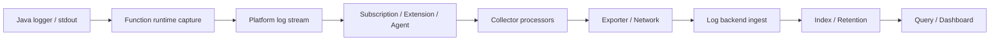
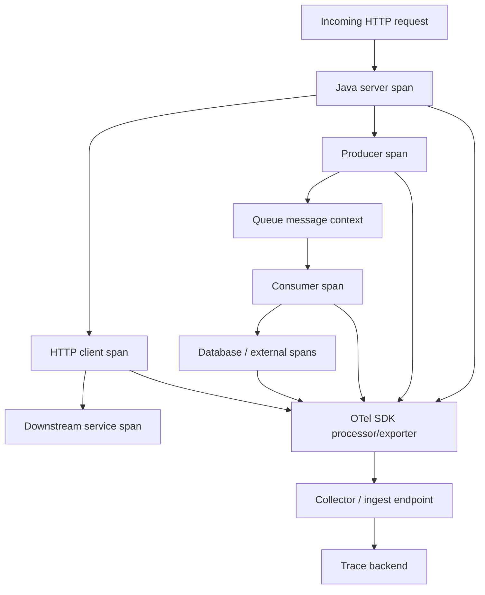

# Tìm nguyên nhân log bị thiếu và trace bị đứt giữa các dịch vụ

Trong hệ thống serverless, một request HTTP có thể đi qua API gateway, Java function, queue, một hoặc nhiều consumer function, database và dịch vụ bên ngoài. Khi có lỗi, nhóm vận hành cần ghép log và trace từ các thành phần đó để biết request đã đi đến đâu, bước nào thất bại và dữ liệu có được xử lý hay chưa. Nhưng log có thể không xuất hiện trong hệ thống tập trung, còn trace có thể chỉ hiển thị một phần hoặc bị tách thành nhiều trace ID.

Không nên kết luận ngay rằng function không ghi log hoặc OpenTelemetry bị lỗi. Telemetry đi qua nhiều tầng: ứng dụng phát dữ liệu, runtime/agent thu thập, exporter gửi đi, collector xử lý, backend ingest và index, rồi người vận hành truy vấn. Một mắt xích sai cấu hình hoặc quá tải đều có thể làm dữ liệu biến mất. Với trace, việc không truyền context qua ranh giới HTTP/queue/async còn khiến các span có mặt nhưng không nối được với nhau.

Bài này trình bày cách tìm nguyên nhân log bị thiếu và trace bị đứt giữa các dịch vụ Java serverless. Nội dung bao gồm pipeline log/trace, lifecycle của function, OpenTelemetry và W3C Trace Context, propagation qua HTTP và message, async execution, sampling, Java MDC, exporter/collector, IAM/network, clock skew, quy trình chẩn đoán, kiểm thử và runbook vận hành.

## 1. Phân biệt triệu chứng trước khi điều tra

### 1.1. Log không có trong backend chưa chắc ứng dụng không phát log

Một dòng log có thể mất ở nhiều vị trí:

1. Code không chạy đến câu lệnh log hoặc log level đang tắt.
2. Logger/appender không được cấu hình hoặc filter loại bỏ record.
3. Log được ghi vào stdout/stderr nhưng runtime không capture đúng stream.
4. Buffer chưa flush khi invocation kết thúc hoặc execution environment bị freeze/terminate.
5. Function thiếu quyền ghi log hoặc agent thiếu quyền đọc log.
6. Subscription/extension/collector không nhận đúng log group, file hoặc stream.
7. Collector drop record do queue đầy, memory limit, parse lỗi hoặc processor filter.
8. Network, DNS, TLS, proxy hoặc endpoint sai khiến exporter không gửi được.
9. Backend từ chối do quota, authentication, payload size hoặc schema.
10. Log đã ingest nhưng nằm ở index, project, region, time range hoặc tenant khác.
11. Query filter, retention hoặc sampling khiến người vận hành không nhìn thấy log.

Do đó, hãy xác định tầng cuối cùng còn nhìn thấy record trước khi thay đổi code.

### 1.2. Trace bị đứt có nhiều dạng

- Root span có mặt nhưng downstream span không có.
- Mỗi function có trace ID riêng dù xử lý cùng một request.
- Consumer span tồn tại nhưng là root span mới, không có parent/link đến producer.
- Một số message trong batch nối được, một số message không.
- Trace có đủ span nhưng thứ tự thời gian nhìn có vẻ sai.
- Trace xuất hiện lúc có lúc không do sampling hoặc export failure.
- Trace kết thúc trước khi async work hoàn tất.
- Trace được gửi nhưng query không tìm thấy vì service/resource attribute không đúng.

Phân biệt **context propagation failure**, **sampling**, **export loss** và **query/index issue**. Chúng có cách xử lý khác nhau.

### 1.3. Bảng triệu chứng và hướng kiểm tra đầu tiên

| Triệu chứng | Kiểm tra trước |
| --- | --- |
| Không có log của một invocation | Request ID, stdout/stderr, logger level, execution role, runtime log capture |
| Có log ở platform nhưng không có ở backend | Subscription/agent, collector queue, network/TLS, exporter authentication |
| Log đến chậm | Async batch processor, flush, collector batch/queue, backend ingest delay |
| Chỉ mất log khi function chạy ngắn | Buffering, flush timeout, process freeze/termination |
| Chỉ mất log khi tải cao | Queue overflow, throttling, rate limit, memory limiter, backend quota |
| Trace bị tách sau HTTP call | `traceparent` bị bỏ/ghi đè, instrumentation hoặc proxy header handling |
| Trace bị tách sau queue | Trace context không được inject vào message attributes/envelope hoặc consumer không extract |
| Batch có nhiều trace cha | Cần span links cho nhiều message context, không chọn một parent tùy tiện |
| Chỉ một phần trace xuất hiện | Sampling decision, exporter drop/retry, retention hoặc query filter |
| Span có timestamp lệch | Clock sync, timestamp source, timezone hiển thị và async delay |

## 2. Hiểu pipeline log và trace

### 2.1. Pipeline log



Mỗi mũi tên là một ranh giới cần kiểm chứng. Nếu log có trong platform log stream nhưng không có trong backend, việc tăng log level ở Java thường không giải quyết đúng nguyên nhân.

### 2.2. Pipeline trace



Trace context quyết định các span thuộc cùng trace và quan hệ cha-con/link. Exporter/collector/backend chịu trách nhiệm chuyển và lưu span. Một trace bị đứt có thể do propagation hoặc do một phần span không được export.

### 2.3. Phân loại dữ liệu quan sát

| Loại | Mục đích | Đặc điểm |
| --- | --- | --- |
| Log | Ghi sự kiện và chi tiết lỗi | Có message/attributes, thường truy vấn theo thời gian và field |
| Metric | Đo xu hướng/sức khỏe | Tổng hợp, cardinality cần kiểm soát |
| Trace | Nối các bước của một request/operation | Span, parent, link, context và timing |
| Audit event | Ghi hành động có ý nghĩa kiểm soát | Cần integrity, access và retention theo policy |

Không dùng trace sampling để thay thế audit log. Không dùng log volume làm metric chính nếu cần thống kê chính xác. Mỗi loại có semantics và retention riêng.

## 3. Đặc thù telemetry trong serverless

### 3.1. Invocation và execution environment là hai vòng đời khác nhau

Một function invocation có thể chạy trong execution environment được tái sử dụng cho nhiều invocation. Environment có thể bị freeze, scale down hoặc thay thế bất kỳ lúc nào. Static client/logger có thể được tái sử dụng, nhưng không được coi memory là nơi lưu telemetry bền vững.

### 3.2. Flush và shutdown

Batch exporter thường gom span/log trước khi gửi để giảm overhead. Trong function có thời gian sống ngắn, invocation có thể kết thúc trước khi batch được export. Kiểm tra:

- batch processor có queue/timeout phù hợp;
- exporter có endpoint và timeout đúng;
- flush được gọi ở ranh giới invocation khi platform/SDK yêu cầu;
- flush không vượt invocation deadline;
- lỗi flush được ghi nhận bằng kênh độc lập hoặc metric;
- shutdown chỉ thực hiện ở lifecycle phù hợp, không gọi đóng SDK toàn cục sau mỗi invocation nếu environment được tái sử dụng.

Không giả định shutdown hook luôn chạy khi function bị terminate. Với platform có extension/agent/managed telemetry integration, làm theo hướng dẫn lifecycle của nền tảng.

### 3.3. Flush mỗi invocation hay batch xuyên invocation?

Hai cách có trade-off:

- Flush mỗi invocation giúp giảm khả năng mất buffer khi environment bị dừng, nhưng tăng latency, network request và cost.
- Batch xuyên invocation giảm overhead nhưng phụ thuộc lifecycle/reuse và cần chấp nhận rủi ro mất phần dữ liệu chưa export.
- Managed extension/collector có thể nhận telemetry độc lập với function handler, nhưng vẫn cần kiểm tra queue, retry và shutdown semantics.

Chọn theo yêu cầu observability, platform support và mức chấp nhận mất telemetry. Không thêm `forceFlush()` một cách máy móc nếu nó làm function timeout hoặc tạo retry storm lên collector.

### 3.4. Cold start và warm start

Cold start có thể tạo log/span initialization khác với invocation bình thường. Nếu instrumentation khởi tạo exporter/client quá muộn, log đầu tiên hoặc span đầu tiên có thể thiếu. Nếu SDK khởi tạo nhiều lần trong warm environment, có thể tạo duplicate exporter/thread hoặc resource leak.

Khởi tạo SDK/client theo lifecycle phù hợp, ghi nhận cold start như một attribute/event, và phân biệt init duration với handler duration.

### 3.5. Runtime capture và logger output

Nếu dùng stdout/stderr capture, xác nhận framework không redirect log sang file local hoặc appender riêng mà platform không thu thập. Nếu dùng file appender, kiểm tra agent/extension có đọc đúng path và file rotation không. Function filesystem thường không phải nơi lưu log bền vững.

## 4. Logging có cấu trúc cho Java function

### 4.1. Dùng structured logging

Log JSON hoặc structured attributes giúp lọc theo service, environment, invocation và trace. Các trường hữu ích:

- `timestamp` theo UTC;
- `severity`;
- `service.name`, `service.version`, `deployment.environment`;
- function name/version hoặc revision;
- platform request/invocation ID;
- `trace_id`, `span_id`, `trace_flags` khi có context hợp lệ;
- `correlation_id`, `event_id`, `operation_id`;
- error type/code và phase.

Không dùng `operation_id`, user ID hoặc event ID làm metric label vì cardinality cao. Chúng phù hợp hơn trong log/trace có access control.

### 4.2. Correlation ID và trace ID khác nhau

- **Trace ID** xác định một distributed trace theo tracing model.
- **Span ID** xác định một operation cụ thể trong trace.
- **Correlation ID** là business/request identifier do ứng dụng định nghĩa để nối các log/event khi trace bị sample hoặc không thể nối liên tục.
- **Event ID** định danh một message/event để deduplicate.
- **Invocation ID** định danh một lần thực thi function do platform cấp.

Không thay trace context bằng correlation ID. Cũng không coi correlation ID là bằng chứng xác thực hoặc quyền truy cập.

### 4.3. Java SLF4J MDC

MDC giúp gắn trace/correlation field vào log pattern:

```java
import io.opentelemetry.api.trace.Span;
import io.opentelemetry.api.trace.SpanContext;
import org.slf4j.MDC;

public final class LogContext implements AutoCloseable {
    public LogContext(String correlationId) {
        SpanContext span = Span.current().getSpanContext();
        if (correlationId != null) {
            MDC.put("correlation_id", correlationId);
        }
        if (span.isValid()) {
            MDC.put("trace_id", span.getTraceId());
            MDC.put("span_id", span.getSpanId());
            MDC.put("trace_flags", span.getTraceFlags().asHex());
        }
    }

    @Override
    public void close() {
        MDC.remove("correlation_id");
        MDC.remove("trace_id");
        MDC.remove("span_id");
        MDC.remove("trace_flags");
    }
}
```

Sử dụng trong handler:

```java
try (LogContext ignored = new LogContext(event.correlationId())) {
    logger.info("Processing event type={}", event.type());
    process(event);
} catch (RuntimeException error) {
    logger.error("Event processing failed eventId={}", event.eventId(), error);
    throw error;
}
```

MDC là thread-local trong nhiều logging implementation. Phải clear sau mỗi invocation/task để context của invocation trước không rò sang invocation sau trong thread được tái sử dụng. Với async executor, cần propagate OpenTelemetry `Context` và MDC một cách có chủ đích; không giả định thread mới tự nhận context.

### 4.4. Tránh log dữ liệu nhạy cảm

Không log password, token, secret, raw authorization header, payment data hoặc payload chứa PII nếu không có căn cứ và kiểm soát. Redact trước khi log, giới hạn quyền đọc và retention. Một log đầy đủ nhưng chứa credential có thể tạo incident bảo mật nghiêm trọng hơn lỗi ban đầu.

## 5. W3C Trace Context và quan hệ giữa các span

### 5.1. `traceparent`

W3C Trace Context định nghĩa header `traceparent` mang trace ID, parent span ID và trace flags. Dạng phổ biến:

```text
00-4bf92f3577b34da6a3ce929d0e0e4736-00f067aa0ba902b7-01
```

Các thành phần:

- `00`: version;
- `4bf...4736`: trace ID 16 byte dạng hex;
- `00f...02b7`: parent span ID 8 byte dạng hex;
- `01`: trace flags, trong đó bit sampled được thể hiện theo chuẩn.

`tracestate` có thể mang vendor-specific tracing state. Không tự parse/ghép header bằng string thủ công; dùng propagator của OpenTelemetry để tránh sai format và validation.

### 5.2. HTTP propagation

Khi HTTP server nhận request có `traceparent`, instrumentation tạo server span trong trace đó. HTTP client instrumentation inject context hiện tại vào outbound request. Nếu một proxy/gateway xóa header hoặc ứng dụng tạo client không được instrument, downstream có thể trở thành root trace mới.

Kiểm tra:

- inbound header có đến function không;
- propagator cấu hình có hỗ trợ W3C Trace Context không;
- server/client instrumentation có hoạt động không;
- header có bị allowlist/CORS/proxy rule loại bỏ không;
- code có vô tình tạo root span thay vì child span không.

Không nhận trace context từ mọi caller bên ngoài một cách mù quáng nếu có yêu cầu trust boundary. Context là metadata tracing, không phải authentication. Với traffic không tin cậy, có thể restart trace hoặc sanitize baggage theo policy nhưng cần giữ correlation phù hợp.

### 5.3. Java inject context vào HTTP/message headers

Ví dụ inject bằng OpenTelemetry API vào map header:

```java
import io.opentelemetry.api.GlobalOpenTelemetry;
import io.opentelemetry.context.propagation.TextMapPropagator;
import java.util.HashMap;
import java.util.Map;

public final class TraceHeaders {
    private static final TextMapPropagator PROPAGATOR =
            GlobalOpenTelemetry.getPropagators().getTextMapPropagator();

    public static Map<String, String> injectCurrentContext() {
        Map<String, String> headers = new HashMap<>();
        PROPAGATOR.inject(
                io.opentelemetry.context.Context.current(),
                headers,
                (carrier, key, value) -> carrier.put(key, value));
        return headers;
    }

    private TraceHeaders() {
    }
}
```

Đưa các header được inject vào HTTP request hoặc message attributes theo giới hạn của transport. Không copy tất cả baggage tùy tiện; chỉ truyền field cần thiết và được phép.

### 5.4. Java extract context ở consumer

```java
import io.opentelemetry.api.GlobalOpenTelemetry;
import io.opentelemetry.api.trace.Span;
import io.opentelemetry.api.trace.SpanKind;
import io.opentelemetry.api.trace.StatusCode;
import io.opentelemetry.context.Context;
import io.opentelemetry.context.Scope;
import io.opentelemetry.context.propagation.TextMapGetter;
import io.opentelemetry.context.propagation.TextMapPropagator;
import java.util.Map;

public final class MessageTrace {
    private static final TextMapPropagator PROPAGATOR =
            GlobalOpenTelemetry.getPropagators().getTextMapPropagator();

    private static final TextMapGetter<Map<String, String>> GETTER =
            new TextMapGetter<>() {
                @Override
                public Iterable<String> keys(Map<String, String> carrier) {
                    return carrier.keySet();
                }

                @Override
                public String get(Map<String, String> carrier, String key) {
                    return carrier.get(key);
                }
            };

    public static void process(
            Map<String, String> messageAttributes,
            Runnable businessWork) {
        Context parent = PROPAGATOR.extract(
                Context.current(), messageAttributes, GETTER);

        var tracer = GlobalOpenTelemetry.getTracer("orders-consumer");
        var span = tracer.spanBuilder("process order event")
                .setSpanKind(SpanKind.CONSUMER)
                .setParent(parent)
                .startSpan();

        try (Scope scope = span.makeCurrent()) {
            businessWork.run();
        } catch (RuntimeException error) {
            span.recordException(error);
            span.setStatus(StatusCode.ERROR);
            throw error;
        } finally {
            span.end();
        }
    }

    private MessageTrace() {
    }
}
```

Ví dụ giả định message attributes được chuyển thành `Map<String,String>`. Adapter thực tế phải map đúng metadata field của queue/broker. Nếu message không có context hợp lệ, propagator trả context hiện tại và consumer span có thể trở thành root mới; ghi correlation/event ID để điều tra.

### 5.5. Queue không tự động mang HTTP context

Khi producer nhận HTTP request rồi enqueue message, trace context không nhất thiết tự đi theo payload. Phải inject vào message attributes/headers hoặc envelope theo convention chung. Consumer phải extract trước khi tạo processing span.

Đừng chỉ đưa trace ID vào JSON body rồi quên parent span ID/trace flags. Dùng W3C propagator để inject/extract đầy đủ.

### 5.6. Batch consumer và span links

Một invocation có thể nhận batch chứa nhiều message từ nhiều trace khác nhau. Một span chỉ có một parent span. Không chọn parent của message đầu tiên rồi gắn mọi message còn lại vào trace đó.

Có thể tạo một processing span mới và thêm **span links** đến context của từng message. Điều này thể hiện quan hệ fan-in chính xác hơn. Với batch nhỏ có thể tạo child span cho từng record; cân nhắc cost và cardinality.

### 5.7. Retry và redelivery

Message redelivery nên giữ event identity và trace context gốc nếu semantics yêu cầu, nhưng mỗi lần xử lý có thể tạo một consumer attempt span mới. Ghi `messaging.message.id`, delivery attempt hoặc retry count dưới dạng span/log attribute phù hợp. Không ghi đè trace context bằng context rỗng khi retry.

## 6. Async execution trong Java

### 6.1. Context không tự truyền qua mọi thread

OpenTelemetry `Context` gắn với execution scope hiện tại. Khi dùng `ExecutorService`, `CompletableFuture` hoặc reactive scheduler, thread mới có thể không có context của caller nếu không instrument/wrap executor.

### 6.2. Wrap executor

Ví dụ:

```java
import io.opentelemetry.context.Context;
import java.util.concurrent.ExecutorService;
import java.util.concurrent.Executors;

ExecutorService rawExecutor = Executors.newFixedThreadPool(4);
ExecutorService contextualExecutor = Context.taskWrapping(rawExecutor);

contextualExecutor.submit(() -> {
    logger.info("Background step started");
    performBackgroundStep();
});
```

Đóng executor theo lifecycle phù hợp với runtime. Trong FaaS, không tạo thread pool mới cho mỗi invocation nếu environment được tái sử dụng; cũng không giả định task nền sẽ tiếp tục sau khi handler trả về. Công việc cần durable execution phải được enqueue/workflow hóa thay vì chỉ submit thread rồi kết thúc invocation.

### 6.3. CompletableFuture

Với `CompletableFuture`, dùng executor đã được wrap hoặc instrumentation tương thích. Nếu callback chạy trên common pool mà không propagate context, span có thể trở thành root hoặc không có trace ID trong log.

### 6.4. Reactive pipeline

Reactive framework có cơ chế context riêng. Xác nhận bridge giữa Reactor context và OpenTelemetry context được bật đúng phiên bản. MDC thread-local không đủ để giữ correlation qua thread hop; dùng context propagation được framework hỗ trợ.

### 6.5. Không giữ span mở qua thời gian chờ dài

Không mở một span rồi giữ nó qua nhiều invocation hoặc nhiều giờ. Mỗi invocation/bước xử lý nên có span riêng, nối bằng trace context, link, correlation ID và operation ID. Trace backend có giới hạn span duration/retention và một trace quá dài có thể khó truy vấn.

## 7. Resource identity và thuộc tính span

### 7.1. `service.name` phải ổn định

Resource mô tả service/process/runtime, không phải từng invocation. Ví dụ:

- `service.name=orders-consumer`;
- `service.version=2.4.1`;
- `deployment.environment=production`;
- `cloud.region=...`;
- `faas.name=orders-consumer-function` nếu semantic convention/platform hỗ trợ.

Invocation ID, request ID và event ID là thuộc tính của span/log, không phải resource attribute dùng chung cho mọi invocation trong một environment.

### 7.2. Service name không thống nhất làm trace khó đọc

Nếu cùng một service lúc ghi `orders`, lúc `order-service`, lúc `lambda-handler`, backend có thể tách thành ba service. Chuẩn hóa service name giữa instrumentation, deployment metadata và dashboard.

### 7.3. Attributes hữu ích

- `http.request.method`, `http.response.status_code`;
- `messaging.system`, `messaging.destination.name`, message ID;
- `faas.invocation_id` nếu convention/runtime cung cấp;
- operation type, phase và retry attempt;
- database system/operation, không ghi query chứa dữ liệu nhạy cảm;
- error.type và exception event.

Semantic convention thay đổi theo phiên bản OpenTelemetry. Dùng convention phù hợp với SDK/instrumentation đang triển khai, tránh tự đặt tên không nhất quán.

### 7.4. Baggage

Baggage truyền metadata xuyên process, nhưng mọi downstream có thể nhận giá trị đó. Không đưa PII, secret, token hoặc dữ liệu lớn vào baggage. Giới hạn key/value và chỉ cho phép field cần thiết qua trust boundary.

## 8. Sampling và trace không đầy đủ

### 8.1. Head sampling

Head sampler quyết định ở đầu trace có record/sample hay không. Nếu root bị loại, downstream span thường cũng bị loại khi dùng parent-based sampler. Việc không tìm thấy trace có thể là sampling behavior chứ không phải mất telemetry.

### 8.2. Parent-based sampling

Parent-based sampler giữ quyết định sampling của parent khi context được truyền đúng. Nếu context bị mất và consumer tạo root mới, consumer có thể nhận quyết định sampling khác; trace nhìn như bị đứt hoặc chỉ có một nửa.

### 8.3. Tail sampling

Tail sampling ở collector có thể giữ trace có lỗi/chậm sau khi đã thấy các span. Nó cần buffer và chờ đủ thời gian để gom trace; collector phải có capacity, routing và trace affinity phù hợp. Trong serverless, span có thể đến muộn hoặc qua nhiều collector, khiến tail sampling bỏ sót nếu cấu hình không đúng.

### 8.4. Phân biệt sampling và exporter drop

Kiểm tra sampler decision/trace flags, SDK span processor metrics, exporter failed/dropped count và collector telemetry. Nếu span không được sample, không có lỗi exporter. Nếu span được sample nhưng exporter queue đầy, đây là export loss.

### 8.5. Sampling không đồng nghĩa log sampling

Trace sampling và log filtering là hai cơ chế khác nhau. Log có thể được ghi đầy đủ nhưng trace bị sample; hoặc trace đầy đủ nhưng log appender filter loại record. Dashboard phải thể hiện rõ chính sách.

## 9. Exporter và collector

### 9.1. Kiểm tra cấu hình exporter

Các cấu hình cần xác minh:

- OTLP endpoint và protocol (gRPC/HTTP protobuf);
- TLS certificate/CA và hostname;
- authentication header/API key;
- timeout;
- batch size, queue size và retry;
- compression/payload limit;
- proxy/egress route;
- signal được bật (traces/logs/metrics).

Endpoint sai protocol/path hoặc collector chỉ nhận traces nhưng không nhận logs có thể tạo triệu chứng chỉ mất một loại telemetry.

### 9.2. Collector pipeline

Một OpenTelemetry Collector pipeline thường gồm receiver, processor và exporter. Kiểm tra:

- receiver có mở đúng port/protocol;
- processor filter/transform có drop field hoặc record không;
- memory limiter có từ chối dữ liệu khi quá tải;
- batch processor có queue/timeout hợp lý;
- exporter queue/retry có đầy không;
- exporter auth/network có lỗi không;
- pipeline logs và traces có cấu hình riêng và đều được enable.

### 9.3. Collector drop không nhất thiết xuất hiện ở app log

Collector có thể drop record vì queue overflow hoặc memory pressure mà function không biết. Theo dõi internal telemetry của collector: accepted/refused/failed spans, exporter send failures, queue size/capacity, retry và memory limiter events.

### 9.4. Network và DNS

Trong VPC/private network, kiểm tra:

- function subnet có route đến collector/endpoint;
- security group/firewall cho phép đúng port;
- private DNS resolve đúng IP;
- NAT/egress được cấu hình nếu endpoint public;
- TLS inspection/proxy không thay certificate;
- connection timeout và DNS caching.

Không mở egress toàn bộ chỉ để “thử cho chạy”. Xác định hostname/port đích và cấp quyền tối thiểu.

### 9.5. Exporter retry và queue

Retry export có giới hạn. Nếu backend outage kéo dài, queue có thể đầy; khi đó cần backpressure, drop policy rõ và alert. Không cấu hình retry vô hạn khiến memory tăng đến OOM hoặc làm function timeout.

## 10. IAM và quyền truy cập telemetry

### 10.1. Tách quyền runtime và collector

Function có thể cần quyền ghi platform log hoặc gửi telemetry đến collector. Extension/agent có thể chạy dưới identity khác. Kiểm tra đúng principal của từng thành phần.

### 10.2. Quyền cần rà soát

- create/write log stream/group theo service;
- publish telemetry hoặc invoke ingest endpoint;
- read log source nếu agent kéo dữ liệu;
- decrypt key nếu log/secret dùng customer-managed key;
- access secret/API token cho exporter;
- network access đến collector/backend.

Không cấp quyền admin hoặc wildcard chỉ để khắc phục lỗi `AccessDenied`. Xem chính xác action/resource bị từ chối trong audit/platform log.

### 10.3. Collector identity

Nếu collector chạy như container/agent/extension riêng, xác định workload identity của nó, secret rotation và quyền ghi vào backend. Không dùng credential của function nếu collector có thể dùng identity riêng.

## 11. Timestamp, ordering và clock skew

### 11.1. Timestamp không phải quan hệ nhân quả

Các máy/region có thể lệch clock. Event có thể được queue giữ lâu trước khi consumer xử lý. Vì vậy, span consumer có timestamp sau producer nhiều phút không nhất thiết là lỗi trace.

### 11.2. Dùng monotonic clock cho duration

Trong một process, dùng monotonic clock (`System.nanoTime()` trong Java) để đo duration. Wall clock (`Instant.now()`) dùng cho timestamp/event time. Không tính duration bằng cách trừ hai wall-clock timestamp nếu có thể bị clock adjustment.

### 11.3. Ordering dựa trên parent/link/sequence

Để hiểu thứ tự event, dùng parent-child relationship, span links, message sequence/offset và business event time. Không sắp xếp toàn bộ trace chỉ theo timestamp.

### 11.4. Đồng bộ thời gian

Đảm bảo host/platform/collector sử dụng time synchronization phù hợp. Ghi timestamp UTC, tránh timezone local không rõ. Trong dashboard, hiển thị rõ timezone và phân biệt event timestamp với ingest timestamp.

## 12. Diagnostic workflow: tìm log bị thiếu

### 12.1. Bước 1 — Chọn một invocation cụ thể

Thu thập function name/version, region, thời gian UTC, platform request ID, event ID và correlation ID. Không bắt đầu bằng truy vấn toàn bộ hệ thống vì dễ lẫn nhiều invocation.

### 12.2. Bước 2 — Xác nhận code đã chạy

- Có invocation metric/request ID không?
- Handler có vào nhánh cần log không?
- Log level có bật không?
- Exception xảy ra trước câu log không?
- Logger có filter hoặc async appender không?

Thêm một canary log có cấu trúc ở đầu handler và cuối handler trong môi trường an toàn để phân biệt start/finish.

### 12.3. Bước 3 — Kiểm tra stdout/stderr và platform log

Tìm platform request ID trong log stream gốc. Nếu không có, xem runtime capture, execution role, log group/stream, retention và region. Nếu có, ghi lại timestamp và exact message để tiếp tục.

### 12.4. Bước 4 — Kiểm tra subscription/agent/extension

Xác nhận đúng log source, filter pattern, subscription destination, extension version, file path và checkpoint. Kiểm tra consumer/agent có backlog hoặc permission error.

### 12.5. Bước 5 — Kiểm tra collector/exporter

Đối chiếu collector internal metrics/logs, exporter queue, failed send, retry, TLS/auth error và payload rejection. Nếu backend ingest nhận record nhưng không query thấy, chuyển sang bước 6.

### 12.6. Bước 6 — Kiểm tra backend query/index

- đúng project/account/tenant/region;
- đúng index/dataset/log group;
- time range dùng UTC hay local;
- field parser có đổi timestamp không;
- query filter có loại severity/service/version không;
- retention/TTL có xóa record không;
- ingest/index delay có đang xảy ra không.

### 12.7. Bước 7 — So sánh một canary record end-to-end

Phát một record có `canary_id` duy nhất, không chứa dữ liệu nhạy cảm. Theo dõi nó ở từng tầng: application output → platform log → collector → backend ingest → query. Đây là cách xác định ranh giới mất dữ liệu nhanh và có bằng chứng.

## 13. Diagnostic workflow: tìm trace bị đứt

### 13.1. Bước 1 — Chọn span cha và downstream call

Ghi trace ID/span ID ở outbound call hoặc message producer. Xác định downstream service có nhận request/message thực sự không.

### 13.2. Bước 2 — Kiểm tra propagation carrier

Với HTTP, xem `traceparent` và `tracestate` có đến downstream không. Với queue, xem message attributes/envelope có trace context không. Không log toàn bộ header nếu có credential; chỉ ghi presence/validated trace ID/span ID khi policy cho phép.

### 13.3. Bước 3 — Kiểm tra instrumentation

- server instrumentation có tạo server span;
- HTTP client instrumentation có tạo client span;
- queue producer/consumer instrumentation có bật;
- framework instrumentation có đúng phiên bản;
- manual span có `setParent(extractedContext)` khi cần;
- context có được propagate qua executor/reactive boundary.

### 13.4. Bước 4 — Kiểm tra sampler và trace flags

So sánh sampled flag ở parent/message và downstream. Nếu context bị mất, downstream có thể tạo root với sampling decision khác. Kiểm tra sampling configuration ở mọi service.

### 13.5. Bước 5 — Kiểm tra export riêng từng service

Mỗi service có exporter/collector route riêng. Trace có thể có span ở service A nhưng span của B bị drop do IAM/network/quota. Kiểm tra span processor/exporter metrics theo service.

### 13.6. Bước 6 — Kiểm tra service/resource identity

Tìm theo trace ID trước, sau đó xem `service.name`, version, environment và region. Nếu service name không ổn định, span có thể bị nhóm sai trong service map.

### 13.7. Bước 7 — Kiểm tra batch/fan-in

Nếu một invocation xử lý nhiều message, kiểm tra span links và event IDs. Một trace có nhiều producer không thể biểu diễn đúng bằng cách gán tất cả message vào một parent tùy tiện.

## 14. Các tình huống thường gặp và cách khắc phục

### 14.1. Log cuối cùng của function bị mất

**Nguyên nhân có thể:** async appender chưa flush, exporter queue còn dữ liệu, function hết timeout hoặc runtime kết thúc environment.

**Cách xử lý:** kiểm tra appender/exporter queue; dùng flush có timeout phù hợp tại invocation boundary nếu cần; giảm log volume; dùng managed extension/collector khi platform hỗ trợ; theo dõi flush failure. Không giả định shutdown hook chắc chắn chạy.

### 14.2. Log chỉ mất khi burst traffic

**Nguyên nhân có thể:** collector/backend throttling, queue đầy, memory limiter, rate limit hoặc concurrency vượt capacity.

**Cách xử lý:** xem accepted/refused/failed counters; tăng capacity có kiểm soát; điều chỉnh batch/queue; giảm log debug không cần thiết; giữ error/audit record theo policy; đặt alert trước khi queue đầy.

### 14.3. Log ở một region không xuất hiện

**Nguyên nhân có thể:** endpoint/collector khác region, IAM cross-account, private DNS hoặc resource policy thiếu.

**Cách xử lý:** so sánh deployment config, region/account, endpoint, role và network route; không chỉ tìm trong dashboard mặc định của region đang dùng.

### 14.4. HTTP trace nối được nhưng queue consumer tạo trace mới

**Nguyên nhân:** producer không inject context vào message attributes hoặc consumer không extract.

**Cách xử lý:** dùng W3C propagator ở producer/consumer; test round-trip context; xác nhận broker giữ message attributes khi redrive/retry.

### 14.5. Trace bị đứt khi dùng CompletableFuture

**Nguyên nhân:** callback chạy trên thread pool không mang OTel Context/MDC.

**Cách xử lý:** wrap executor bằng `Context.taskWrapping`, dùng instrumentation framework phù hợp hoặc capture context và wrap task rõ ràng. Kiểm tra MDC cleanup để tránh context leak.

### 14.6. Trace có lúc đủ, có lúc thiếu

**Nguyên nhân:** sampling, exporter queue overflow, collector load, retry timing hoặc query time range.

**Cách xử lý:** so sánh sampled flag, export failure metrics và collector drop counters; chạy canary với sampling policy đã biết; không tắt sampling toàn hệ thống ngay lập tức.

### 14.7. Batch consumer hiển thị một parent sai

**Nguyên nhân:** gắn span của batch vào parent message đầu tiên.

**Cách xử lý:** tạo consumer/batch span mới và link tới từng message context, hoặc tạo child span riêng cho mỗi record khi phù hợp.

### 14.8. Trace có span nhưng service map không đúng

**Nguyên nhân:** `service.name` khác nhau giữa deployment, instrumentation và environment; resource attributes bị ghi đè.

**Cách xử lý:** chuẩn hóa resource builder/env; không đặt invocation ID vào resource; kiểm tra service version/environment.

### 14.9. Log có trace ID nhưng không tìm thấy trace

**Nguyên nhân:** span không được sample/export, trace backend retention khác log retention hoặc trace ID bị ghi từ context invalid.

**Cách xử lý:** chỉ ghi trace ID khi `SpanContext.isValid()`, ghi sampled flag, kiểm tra trace export counters và trace retention. Correlation ID vẫn giúp điều tra khi trace không được lưu.

## 15. Cấu hình OpenTelemetry trong Java

### 15.1. Resource và SDK dùng chung

Khởi tạo SDK theo lifecycle của execution environment, cấu hình resource ổn định và exporter phù hợp. Không tạo `OpenTelemetrySdk` mới cho từng request nếu runtime tái sử dụng environment.

Ví dụ khởi tạo khái niệm:

```java
import io.opentelemetry.api.OpenTelemetry;
import io.opentelemetry.api.common.AttributeKey;
import io.opentelemetry.api.common.Attributes;
import io.opentelemetry.sdk.OpenTelemetrySdk;
import io.opentelemetry.sdk.resources.Resource;
import io.opentelemetry.semconv.ResourceAttributes;

public final class Telemetry {
    private static final OpenTelemetry INSTANCE = create();

    private static OpenTelemetry create() {
        Resource resource = Resource.getDefault().merge(
                Resource.create(Attributes.of(
                        ResourceAttributes.SERVICE_NAME, "orders-consumer",
                        ResourceAttributes.SERVICE_VERSION, "2.4.1",
                        AttributeKey.stringKey("deployment.environment"),
                        System.getenv().getOrDefault("APP_ENV", "unknown"))));

        // Configure trace/log exporters and processors according to the platform.
        return OpenTelemetrySdk.builder()
                .setTracerProvider(
                        io.opentelemetry.sdk.trace.SdkTracerProvider.builder()
                                .setResource(resource)
                                .build())
                .build();
    }

    public static OpenTelemetry get() {
        return INSTANCE;
    }

    private Telemetry() {
    }
}
```

Đây là skeleton để minh họa resource lifecycle; chưa cấu hình exporter/processor nên không tự gửi span đến backend. Trong ứng dụng thật, dùng OpenTelemetry SDK/agent/distribution và semantic convention version tương thích; đăng ký provider một lần theo runtime lifecycle.

### 15.2. Exporter endpoint và protocol

Ví dụ các biến cấu hình thường gặp:

```text
OTEL_SERVICE_NAME=orders-consumer
OTEL_EXPORTER_OTLP_ENDPOINT=https://otel-collector.example.internal
OTEL_EXPORTER_OTLP_PROTOCOL=http/protobuf
OTEL_PROPAGATORS=tracecontext,baggage
OTEL_TRACES_SAMPLER=parentbased_traceidratio
OTEL_TRACES_SAMPLER_ARG=0.10
```

Tên/giá trị được hỗ trợ phụ thuộc SDK/distribution và phiên bản. Secret header nên lấy từ secret manager/runtime secret injection, không commit vào repository hoặc log khi startup.

### 15.3. Batch processor

Batch processor cần cấu hình queue size, max export batch size, schedule delay và exporter timeout. Giá trị phải cân đối với invocation duration, memory và backend capacity. Nếu dùng managed collector/extension, xác nhận telemetry được buffer ở đâu và giới hạn queue nào.

### 15.4. Logs và traces là pipeline riêng

Một SDK có thể export traces thành công nhưng log appender vẫn ghi stdout hoặc gửi đến endpoint khác. Xác định rõ:

- application log đi qua stdout/platform log hay OTLP Logs;
- trace đi qua OTLP exporter/collector nào;
- metric đi qua pipeline nào;
- mỗi pipeline có authentication/retention/alert riêng.

Đừng giả định cấu hình trace exporter tự động cấu hình log exporter.

## 16. Collector pipeline và kiểm soát mất dữ liệu

### 16.1. Các điểm cần đo

Theo dõi collector:

- receiver accepted/refused;
- processor dropped;
- exporter sent/failed;
- exporter queue size/capacity;
- retry count;
- memory limiter refusal;
- batch size và batch timeout;
- scrape/health status.

Tên metric cụ thể thay đổi theo collector version và exporter. Dùng telemetry của collector đang chạy để xác nhận.

### 16.2. Queue đầy

Khi exporter queue đầy, collector có thể backpressure hoặc drop tùy cấu hình. Tăng queue chỉ trì hoãn vấn đề nếu backend không đủ throughput. Xem cả producer rate, exporter capacity và backend ingest quota.

### 16.3. Parse/transform filter

Processor có thể xóa field, đổi timestamp hoặc filter theo severity/service. Kiểm tra config version và sample record trước/sau processor. Đặc biệt chú ý parser kỳ vọng JSON nhưng ứng dụng ghi plain text, hoặc timestamp parser đổi event time sai.

### 16.4. Payload limit và truncation

Log payload quá lớn có thể bị runtime/backend truncate hoặc reject. Không ghi toàn bộ request/response body; log metadata và reference an toàn. Kiểm tra maximum event size ở từng tầng.

### 16.5. Retry và backpressure

Exporter retry phải có queue và timeout hữu hạn. Nếu backend chậm, collector có thể tăng memory. Dùng memory limiter, queue persistent nếu phù hợp và alert queue saturation. Không bật retry vô hạn mà không có capacity plan.

## 17. Kiểm thử propagation và log pipeline

### 17.1. Unit test inject/extract

Tạo span cha, inject context vào map, extract ở consumer và xác minh trace ID giữ nguyên, parent span ID đúng. Kiểm tra trường hợp header thiếu, sai format và baggage bị loại bỏ theo policy.

### 17.2. Integration test HTTP

- gửi request có `traceparent`;
- xác minh server span;
- gọi downstream qua instrumented HTTP client;
- xác minh trace ID giống nhau và parent-child relationship đúng;
- thử proxy/gateway config để phát hiện header bị strip.

### 17.3. Integration test queue

- producer inject context vào message attributes;
- broker lưu/forward attributes;
- consumer extract context;
- kiểm tra retry/redrive giữ event ID và context;
- test batch nhiều parent dùng span links;
- test message không có context tạo root span hợp lệ.

### 17.4. Async executor test

Tạo span trong thread caller, submit task qua contextual executor và xác minh task log/span cùng trace. Test cả executor không wrap để chứng minh regression test bắt được context loss.

### 17.5. Log end-to-end canary

Phát log canary có ID duy nhất qua một invocation test và xác nhận record xuất hiện ở:

1. ứng dụng/stdout;
2. platform log stream;
3. collector receiver;
4. exporter/backend ingest;
5. query/index.

Test không chỉ kiểm tra HTTP 200 từ function; cần kiểm tra record thực sự được truy vấn ở backend sau thời gian ingest hợp lý.

### 17.6. Failure injection

Thử:

- collector endpoint unreachable;
- exporter auth denied;
- DNS/TLS failure;
- backend throttling;
- collector queue full;
- function kết thúc ngay sau khi log;
- invocation timeout trước flush;
- cold start/warm reuse;
- sampling decision drop;
- malformed log payload;
- message redelivery và duplicate.

Đo phần telemetry mất, thời gian phục hồi và tác động lên function latency/cost.

## 18. Metrics và alert cho telemetry health

### 18.1. Application-level

- số log records phát theo severity;
- span started/ended;
- invalid/missing trace context rate;
- context extraction failure;
- exporter force-flush duration/failure nếu dùng;
- invocation có log start nhưng không có completion log.

Không thêm metric label theo trace ID/request ID. Có thể ghi ID trong log/trace.

### 18.2. Collector/backend-level

- accepted/refused/dropped spans/logs;
- exporter send failures/retries;
- queue utilization;
- ingest throttling/quota;
- indexing delay;
- retention/deletion count;
- authentication/network error rate.

### 18.3. Synthetic canary

Định kỳ tạo canary log và trace qua các đường HTTP và queue quan trọng. Alert nếu canary không xuất hiện ở backend trong SLO ingest window hoặc trace không có span dự kiến.

Canary nên dùng service/operation test riêng, payload vô hại và volume thấp. Không tạo synthetic traffic quá lớn làm méo chi phí hoặc sampling.

### 18.4. Alert phải chỉ ra owner

Alert về collector/backend thuộc platform/observability owner; alert về thiếu propagation ở một service thuộc application owner. Gắn runbook và escalation route để tránh alert không ai nhận.

## 19. Runbook chẩn đoán nhanh

### 19.1. Không thấy log của invocation

1. Lấy platform request/invocation ID và timestamp UTC.
2. Xác nhận invocation có thực sự chạy.
3. Kiểm tra logger level, stdout/stderr và canary log.
4. Tìm trong platform log stream gốc.
5. Nếu platform không có: kiểm tra runtime capture, IAM, log group/region và timeout.
6. Nếu platform có: kiểm tra subscription/extension/collector.
7. Xem collector queue/drop/exporter error.
8. Kiểm tra backend project/index/time range/retention/query.
9. Ghi lại tầng đầu tiên không còn thấy canary record và giao đúng owner.

### 19.2. Trace bị tách giữa HTTP và queue

1. Lấy trace ID/span ID của producer span.
2. Xác minh `traceparent` hoặc context attributes được inject trước publish.
3. Kiểm tra message thực tế có attributes sau khi qua broker.
4. Xác minh consumer extract bằng cùng propagator.
5. Kiểm tra consumer span parent hoặc span link.
6. Kiểm tra sampler decision và exporter metrics ở producer/consumer.
7. So sánh service name, environment, region và trace retention.

### 19.3. Trace thiếu span khi function chạy async

1. Xác định thread/executor nơi callback chạy.
2. Kiểm tra OTel Context có được wrap/propagate.
3. Kiểm tra MDC được set và clear đúng.
4. Xác minh span được end trong mọi nhánh.
5. Kiểm tra invocation không kết thúc trước khi task durable hoàn tất.
6. Nếu task dài, tách thành message/workflow step thay vì thread nền.

### 19.4. Log/trace mất khi backend quá tải

1. Kiểm tra ingest quota và collector exporter queue.
2. Kiểm tra retry/drop/memory limiter metrics.
3. Giảm log debug và payload lớn theo policy.
4. Giới hạn sampling/traffic có chủ đích, không tắt toàn bộ telemetry.
5. Tăng capacity hoặc điều chỉnh batch/queue sau khi tính memory.
6. Xác minh canary record/trace phục hồi.

## 20. Anti-pattern cần tránh

- Chỉ tìm log trong dashboard mà không kiểm tra platform log stream.
- Giả định stdout luôn được flush trước khi function kết thúc.
- Gọi SDK shutdown sau mỗi invocation trong warm environment.
- Dùng `ThreadLocal`/MDC mà không cleanup hoặc propagate qua executor.
- Tạo root span mới ở mỗi function dù đã có `traceparent`.
- Không inject context vào queue message attributes.
- Gán batch consumer vào parent của message đầu tiên.
- Dùng timestamp để suy ra ordering tuyệt đối giữa region.
- Đưa user ID/trace ID vào metric labels.
- Đưa PII/secret vào baggage hoặc log.
- Bật retry exporter vô hạn làm collector cạn memory.
- Tắt sampling toàn hệ thống chỉ để tìm một trace.
- Dùng trace ID như correlation/business identity hoặc security token.
- Coi backend ingest success là bằng chứng log đã được index/query.
- Không có canary test cho pipeline observability.

## 21. Checklist production

- [ ] Mỗi service có `service.name`, version và environment ổn định.
- [ ] Invocation ID/request ID được ghi ở span/log, không đặt làm resource identity.
- [ ] Log dùng structured format và timestamp UTC.
- [ ] Log level/filter/appender được kiểm tra trong production config.
- [ ] stdout/stderr hoặc file agent capture được xác minh.
- [ ] Function runtime có quyền log đúng resource.
- [ ] Collector/extension có identity và quyền riêng phù hợp.
- [ ] Exporter endpoint, protocol, TLS, auth, timeout và retry được kiểm tra.
- [ ] Collector queue/memory limiter/drop/exporter metrics có dashboard.
- [ ] Flush behavior phù hợp invocation lifecycle và timeout budget.
- [ ] Không dựa vào shutdown hook để bảo đảm telemetry được gửi.
- [ ] W3C Trace Context được inject/extract qua HTTP.
- [ ] Queue/event message mang trace context trong attributes/envelope.
- [ ] Consumer batch dùng span links khi có nhiều parent context.
- [ ] Async executor/reactive pipeline propagate OTel Context đúng.
- [ ] MDC được cleanup sau mỗi invocation/task.
- [ ] Sampling policy được hiểu và đồng nhất giữa services.
- [ ] Trace export failure được phân biệt với sampling.
- [ ] Timestamp UTC, duration dùng monotonic clock và ordering dùng context/sequence.
- [ ] Log/trace không chứa secret, credential hoặc PII ngoài policy.
- [ ] Metric cardinality được kiểm soát.
- [ ] Canary log/trace xác minh pipeline end-to-end.
- [ ] Runbook chỉ ra cách khoanh vùng app/runtime/collector/backend.
- [ ] Integration/failure/load tests bao phủ HTTP, queue, async và exporter outage.

## Kết luận

Log bị thiếu và trace bị đứt là hai triệu chứng có thể xuất phát từ nhiều tầng khác nhau. Với log, hãy lần theo pipeline từ logger/stdout đến runtime capture, collector, exporter, backend ingest, index và query. Với trace, hãy kiểm tra context propagation, instrumentation, async boundary, queue metadata, sampling và export ở từng service.

Trong Java serverless, execution environment có thể được tái sử dụng hoặc kết thúc bất ngờ, nên không dựa vào local state hay shutdown hook để bảo đảm telemetry. Dùng structured logging, OpenTelemetry context, W3C Trace Context, outbox/message attributes và executor propagation. Với batch fan-in, span links thể hiện nhiều parent chính xác hơn. Dùng correlation/event/operation ID bổ sung khi trace bị sample hoặc không thể nối xuyên suốt.

Khi sự cố xảy ra, chọn một invocation hoặc canary record cụ thể và tìm tầng cuối cùng còn thấy dữ liệu. Kiểm tra collector drop/queue, exporter auth/network, sampling và backend query trước khi thay đổi code. Duy trì synthetic canary, telemetry health metrics, runbook và failure tests để phát hiện pipeline observability hỏng trước khi cần dùng nó để điều tra production incident.
