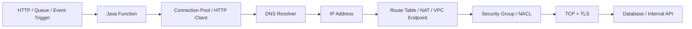

# Xử lý connection exhaustion, lỗi DNS và lỗi kết nối VPC

Một Java function chạy trên nền tảng serverless có thể hoạt động ổn định khi tải thấp nhưng bắt đầu lỗi khi lưu lượng tăng, khi nhiều instance khởi động cùng lúc hoặc khi phụ thuộc mạng thay đổi. Các lỗi thường xuất hiện dưới dạng timeout, không phân giải được hostname, không mở được kết nối tới cơ sở dữ liệu, hoặc kết nối bị từ chối dù dịch vụ đích vẫn đang chạy. Ba nhóm sự cố cần phân biệt là **connection exhaustion** (cạn tài nguyên kết nối), **DNS failure** (lỗi phân giải tên) và **VPC connectivity failure** (lỗi đường mạng hoặc chính sách truy cập trong mạng riêng).

Trong serverless, mỗi lần tăng concurrency có thể tạo thêm execution environment, connection pool, socket và truy vấn DNS. Một function được scale ngang nhanh hơn khả năng tiếp nhận của database, NAT gateway hoặc DNS resolver có thể làm hỏng chính dịch vụ phụ thuộc. Vì vậy, xử lý sự cố cần nhìn cả vòng đời function, số lượng instance, giới hạn kết nối ở từng tầng và đường đi mạng từ đúng môi trường thực thi.

Bài học này hướng dẫn cách nhận diện, khoanh vùng và khắc phục các sự cố kết nối trong ứng dụng Java serverless được kích hoạt bằng HTTP, message hoặc event. Các ví dụ dùng thuật ngữ VPC phổ biến trên cloud; tên dịch vụ, giới hạn và cách cấu hình cụ thể cần đối chiếu với nền tảng đang triển khai.

## 1. Nhìn đúng tầng đang lỗi

Một request đi từ function đến dịch vụ đích thường đi qua nhiều giai đoạn:

1. Lấy connection từ pool hoặc tạo socket mới.
2. Phân giải hostname thành địa chỉ IP bằng DNS.
3. Tìm đường đi qua route table, gateway, peering hoặc network endpoint.
4. Thiết lập TCP handshake tới IP và port.
5. Thực hiện TLS handshake nếu dùng HTTPS hoặc kết nối được mã hóa.
6. Xác thực với database hoặc dịch vụ đích.
7. Thực thi truy vấn hoặc request ứng dụng.

Lỗi ở một giai đoạn có thể bị biểu hiện thành timeout chung ở tầng gọi. Chẳng hạn, `SocketTimeoutException` có thể xuất hiện khi chờ DNS, khi kết nối TCP, khi TLS handshake hoặc khi đọc response; cần xem stack trace và thời điểm timeout để xác định chính xác.

Sơ đồ đường đi kết nối:



Phân biệt các lỗi thường gặp:

| Triệu chứng hoặc exception | Tầng cần kiểm tra trước | Gợi ý |
|---|---|---|
| `SQLTransientConnectionException`, Hikari pool timeout | Pool hoặc giới hạn kết nối database | Function chờ lấy connection; có thể chưa gửi packet ra mạng |
| `UnknownHostException` | DNS | Resolver không trả được địa chỉ hoặc tên không tồn tại |
| `ConnectException: Connection refused` | TCP và dịch vụ đích | IP có thể tới được nhưng port không có listener hoặc bị từ chối chủ động |
| `NoRouteToHostException` | Routing hoặc chính sách mạng | Không có đường đi hợp lệ hoặc thiết bị mạng trả lỗi |
| `SocketTimeoutException` lúc connect | TCP, route, firewall hoặc endpoint quá tải | SYN không nhận được phản hồi đúng hạn |
| `SSLHandshakeException` | TLS, certificate, hostname hoặc thời gian hệ thống | TCP đã kết nối nhưng thương lượng TLS thất bại |
| HTTP 401/403 | Xác thực hoặc quyền ở dịch vụ đích | Mạng có thể đã hoạt động; kiểm tra token và policy |
| HTTP 502/503 | Proxy, load balancer hoặc dịch vụ đích | Xem health, quota, upstream và retry |

Đừng bắt đầu bằng cách tăng timeout cho mọi exception. Timeout dài hơn có thể làm invocation giữ tài nguyên lâu hơn, khiến pool đầy nhanh hơn và làm hàng đợi tích tụ.

## 2. Connection exhaustion là gì?

Connection exhaustion xảy ra khi một thành phần không còn đủ tài nguyên để tạo hoặc duy trì kết nối. Tài nguyên bị cạn có thể là:

- Số connection database tối đa.
- Số connection tối đa trong pool của từng function instance.
- Socket hoặc file descriptor của execution environment.
- Cổng nguồn (ephemeral port) dùng cho kết nối đi ra hoặc NAT/SNAT.
- Giới hạn connection hoặc concurrent stream ở proxy, load balancer hay dịch vụ đích.
- Bảng theo dõi trạng thái kết nối (conntrack) hoặc quota của một network appliance.

Các nhóm lỗi này có triệu chứng gần giống nhau nhưng cách khắc phục khác nhau. Ví dụ, tăng `maximumPoolSize` có thể làm pool local ít timeout hơn nhưng lại khiến database hết connection sớm hơn.

### 2.1. Vì sao serverless dễ tạo nhiều connection?

Một ứng dụng chạy trên một server dài hạn thường có một số lượng pool tương đối ổn định. Với FaaS, nền tảng có thể tạo nhiều execution environment để xử lý concurrency. Mỗi environment có thể khởi tạo một `DataSource`, HTTP client hoặc pool riêng.

Nếu một function có 40 environment đang hoạt động và mỗi environment cho phép tối đa 8 connection database, tổng số connection có thể đạt 320. Con số thực tế phụ thuộc số connection được mở theo nhu cầu, số pool, vòng đời instance và cách nền tảng tái sử dụng environment.

Công thức ước lượng giới hạn:

\[
C_{\text{potential}} =
I_{\text{warm}} \times P_{\text{per-instance}} \times D_{\text{pools}}
\]

Trong đó:

- \(I_{\text{warm}}\): số execution environment có thể đồng thời hoạt động.
- \(P_{\text{per-instance}}\): giới hạn connection của một pool trên mỗi environment.
- \(D_{\text{pools}}\): số pool mà mỗi environment khởi tạo tới cùng dịch vụ đích.

Cần cộng thêm connection từ ứng dụng khác, migration, công cụ quản trị, batch job và replica đọc. Không nên dùng toàn bộ `max_connections` của database cho một function.

Ví dụ database cho phép tối đa 500 connection. Nếu dành 100 cho quản trị và các ứng dụng khác, cộng thêm 50 dự phòng, thì ngân sách của workflow serverless chỉ còn 350. Nếu concurrency có thể đạt 70 environment, pool tối đa trung bình nên nhỏ hơn 5 connection mỗi environment (70 × 5 = 350), và thực tế còn cần chừa headroom vì concurrency có thể tăng đột ngột.

| Biến | Tăng quá cao sẽ gây gì? | Cách kiểm soát |
|---|---|---|
| Function concurrency | Nhiều environment và pool cùng mở | Reserved concurrency, giới hạn consumer concurrency |
| Pool size mỗi environment | Mỗi instance giữ nhiều connection nhàn rỗi | Chọn pool nhỏ theo số truy vấn song song thực tế |
| Số pool mỗi instance | Nhân số connection không cần thiết | Tái sử dụng một pool cho cùng dịch vụ và cấu hình |
| Thời gian giữ connection | Connection bị chiếm lâu | Đóng tài nguyên đúng cách, rút ngắn transaction |
| Retry đồng loạt | Tạo thêm đỉnh connection sau sự cố | Backoff, jitter, retry budget và circuit breaker |

### 2.2. Phân biệt pool exhaustion với database exhaustion

**Pool exhaustion**: function không lấy được connection từ pool trong thời hạn `connectionTimeout`. Có thể database vẫn còn khả năng nhận connection. Nguyên nhân thường là truy vấn lâu, connection leak, pool quá nhỏ hoặc concurrency bên trong một environment quá cao.

**Database exhaustion**: database đã đạt giới hạn connection hoặc không còn đủ worker/resource để phục vụ connection mới. Nhiều instance function có thể đồng loạt báo lỗi dù mỗi pool riêng chưa đầy.

**Network/NAT exhaustion**: ứng dụng không cấp phát hoặc duy trì được socket/cổng nguồn. Connection database hiện hữu có thể vẫn hoạt động, nhưng kết nối mới tới một đích hoặc qua một đường NAT nhất định thất bại.

Để phân biệt, so sánh đồng thời:

- Số connection đang mở và giới hạn ở database.
- Số connection active, idle, pending và timeout của pool trên function.
- Số execution environment và concurrency.
- Số socket đang mở, trạng thái `TIME_WAIT`/`CLOSE_WAIT` nếu nền tảng cho phép quan sát.
- Metric của NAT gateway, proxy hoặc network appliance.
- Thời điểm lỗi so với đỉnh traffic và số lần retry.

## 3. Chẩn đoán và sửa connection pool trong Java

### 3.1. Tái sử dụng pool trong vòng đời execution environment

Không tạo `DataSource` hoặc connection pool mới trong mỗi invocation. Với runtime Java có thể tái sử dụng execution environment, khởi tạo pool ở cấp class hoặc dependency container để các invocation tuần tự trong cùng environment dùng lại pool đó.

Ví dụ với HikariCP:

```java
import com.zaxxer.hikari.HikariConfig;
import com.zaxxer.hikari.HikariDataSource;

import javax.sql.DataSource;
import java.sql.Connection;
import java.sql.SQLException;

public final class DatabaseResources {
    private static final HikariDataSource DATA_SOURCE = createDataSource();

    private DatabaseResources() {}

    private static HikariDataSource createDataSource() {
        HikariConfig config = new HikariConfig();
        config.setJdbcUrl(System.getenv("JDBC_URL"));
        config.setUsername(System.getenv("DB_USER"));
        config.setPassword(System.getenv("DB_PASSWORD"));

        // Bắt đầu với pool nhỏ; điều chỉnh dựa trên concurrency và DB budget.
        config.setMaximumPoolSize(4);
        config.setMinimumIdle(0);

        config.setConnectionTimeout(3_000);
        config.setValidationTimeout(1_000);

        // Chọn thấp hơn giới hạn idle của DB/proxy nếu hệ thống có giới hạn đó.
        config.setMaxLifetime(25 * 60_000L);
        config.setIdleTimeout(5 * 60_000L);

        return new HikariDataSource(config);
    }

    public static DataSource dataSource() {
        return DATA_SOURCE;
    }

    public static void checkConnection() throws SQLException {
        try (Connection connection = DATA_SOURCE.getConnection()) {
            if (!connection.isValid(1)) {
                throw new SQLException("Database connection is not valid");
            }
        }
    }
}
```

Các giá trị trên chỉ là điểm bắt đầu minh họa. Hãy đặt `maximumPoolSize` theo ngân sách connection toàn hệ thống, không theo số CPU của function. `minimumIdle=0` có thể giảm connection nhàn rỗi trong môi trường scale ngang, nhưng cần cân nhắc độ trễ mở connection ở traffic thấp. `maxLifetime` nên nhỏ hơn giới hạn tuổi thọ connection do database, proxy hoặc firewall áp dụng; đừng đặt một con số tùy ý nếu chưa biết giới hạn đó.

Connection phải được đóng bằng try-with-resources. Đóng `Connection` trong ứng dụng trả nó về pool; không nhất thiết đóng socket vật lý ngay lập tức.

```java
import javax.sql.DataSource;
import java.sql.Connection;
import java.sql.PreparedStatement;
import java.sql.ResultSet;
import java.sql.SQLException;

public final class OrderRepository {
    private final DataSource dataSource;

    public OrderRepository(DataSource dataSource) {
        this.dataSource = dataSource;
    }

    public int countOpenOrders(String customerId) throws SQLException {
        String sql = "SELECT COUNT(*) "
                + "FROM orders "
                + "WHERE customer_id = ? AND status = ?";

        try (Connection connection = dataSource.getConnection();
             PreparedStatement statement = connection.prepareStatement(sql)) {
            statement.setString(1, customerId);
            statement.setString(2, "OPEN");

            try (ResultSet resultSet = statement.executeQuery()) {
                resultSet.next();
                return resultSet.getInt(1);
            }
        }
    }
}
```

Các lỗi thường làm pool bị cạn:

- Không đóng `Connection`, `Statement` hoặc `ResultSet`.
- Giữ connection trong khi gọi HTTP tới dịch vụ khác.
- Mở transaction rồi chờ xử lý file, message hoặc thao tác người dùng.
- Truy vấn thiếu index hoặc khóa dòng quá lâu.
- Pool tạo mới trong từng invocation hoặc từng repository.
- Đặt `maximumPoolSize` cao hơn khả năng chịu tải của database.

Nên giữ transaction ngắn và chỉ giữ connection trong đoạn cần truy cập database. Không gọi API bên ngoài khi đang mở transaction nếu có thể tách thao tác đó ra.

### 3.2. Đặt concurrency và pool size cùng một ngân sách

Nếu mỗi environment có pool tối đa 4 connection và function được phép chạy đồng thời 80 environment, giới hạn lý thuyết là 320 connection. Nếu database chỉ dành 250 connection cho workload này, cấu hình trên không an toàn ngay cả khi pool local chưa bao giờ đầy.

Cần chọn một trong các biện pháp:

1. Giảm `maximumPoolSize` mỗi environment.
2. Giới hạn concurrency của function hoặc consumer.
3. Dùng database proxy/pooling service nếu nền tảng cung cấp, và hiểu rõ proxy quản lý client connection và backend connection ra sao.
4. Chia workload theo database hoặc read replica khi kiến trúc cho phép.
5. Giảm thời gian query và transaction để connection quay về pool nhanh hơn.

Database proxy có thể gom nhiều client connection thành ít backend connection hơn, nhưng không xóa giới hạn tài nguyên. Proxy cũng có giới hạn session, pinning, transaction và throughput riêng. Cần xem metric cả proxy lẫn database.

### 3.3. Tái sử dụng HTTP client và tránh mở socket không cần thiết

Với Java 11 trở lên, có thể tái sử dụng một `HttpClient` cho nhiều invocation trong cùng execution environment:

```java
import java.net.URI;
import java.net.http.HttpClient;
import java.net.http.HttpRequest;
import java.net.http.HttpResponse;
import java.time.Duration;

public final class PartnerApi {
    private static final HttpClient CLIENT = HttpClient.newBuilder()
            .connectTimeout(Duration.ofSeconds(2))
            .version(HttpClient.Version.HTTP_2)
            .build();

    private PartnerApi() {}

    public static String getOrder(String baseUrl, String orderId)
            throws Exception {
        HttpRequest request = HttpRequest.newBuilder()
                .uri(URI.create(baseUrl + "/orders/" + orderId))
                .timeout(Duration.ofSeconds(5))
                .GET()
                .build();

        HttpResponse<String> response = CLIENT.send(
                request, HttpResponse.BodyHandlers.ofString());

        if (response.statusCode() / 100 != 2) {
            throw new IllegalStateException(
                    "Partner API returned " + response.statusCode());
        }
        return response.body();
    }
}
```

Không tạo client mới cho từng request nếu client có thể được tái sử dụng. Client có thể quản lý connection keep-alive và multiplexing tùy giao thức. Tuy vậy, phải đặt timeout cho cả kết nối và request, đóng body stream khi dùng body handler dạng stream, và không giữ response body không giới hạn trong bộ nhớ.

Khi gọi nhiều hostname hoặc dịch vụ khác nhau, quan sát số socket và connection theo đích. Một client tái sử dụng tốt vẫn có thể tạo nhiều connection nếu ứng dụng dùng quá nhiều host hoặc không tái sử dụng cùng cấu hình.

## 4. Cạn cổng nguồn, NAT và giới hạn socket

Mỗi kết nối TCP cần một tuple địa chỉ nguồn/port và địa chỉ đích/port. Khi mở quá nhiều kết nối ngắn tới cùng một đích, cổng nguồn có thể bị giữ trong trạng thái chờ tái sử dụng. Nếu các kết nối đi qua NAT/SNAT, thiết bị NAT cũng phải cấp phát và theo dõi các mapping.

Dấu hiệu thường gặp:

- Kết nối mới tới một số đích thất bại trong khi kết nối đang tồn tại vẫn dùng được.
- Lỗi tăng khi có burst traffic hoặc nhiều retry.
- Chỉ các function chạy trong một subnet hoặc qua một NAT gateway bị ảnh hưởng.
- Metric NAT hoặc proxy cho thấy số kết nối, cổng đang dùng, lỗi cấp phát hoặc dropped packet tăng.
- Tạo client/socket mới liên tục làm số connection tăng dù request đã hoàn thành.

Biện pháp:

- Tái sử dụng HTTP client và connection pool.
- Tránh tạo quá nhiều kết nối ngắn; dùng keep-alive khi phù hợp.
- Đặt timeout và giới hạn connection tới từng upstream.
- Hạn chế concurrency theo năng lực NAT và dịch vụ đích.
- Dùng private service endpoint khi dịch vụ đích hỗ trợ, để lưu lượng không phải đi qua NAT công cộng.
- Phân bổ lưu lượng qua nhiều NAT hoặc network path theo thiết kế và giới hạn của nhà cung cấp.
- Theo dõi metric NAT gateway, proxy và connection tracking; không chỉ xem metric của function.

Đừng cố xử lý bằng cách giảm mọi timeout hoặc đóng socket ngay sau mỗi request. Đóng socket quá thường xuyên có thể làm tăng handshake, TLS negotiation và áp lực cổng nguồn.

## 5. Lỗi DNS trong môi trường serverless

DNS biến hostname thành địa chỉ IP. Function có thể gọi dịch vụ bằng hostname public, tên private trong VPC hoặc tên endpoint do cloud provider cấp. DNS có thể lỗi ở bước phân giải, trả sai địa chỉ, trả địa chỉ cũ hoặc bị chậm do resolver quá tải.

### 5.1. Nhận diện loại lỗi DNS

| Dấu hiệu | Ý nghĩa thường gặp | Kiểm tra |
|---|---|---|
| `UnknownHostException` | Java không phân giải được hostname | Tên có đúng không, record có tồn tại không, resolver có truy cập được không |
| DNS timeout | Không nhận được phản hồi resolver đúng hạn | Đường tới resolver, UDP/TCP 53, DNS proxy, quota và packet loss |
| `NXDOMAIN` | Tên không tồn tại trong vùng DNS được truy vấn | Record, zone, suffix, split-horizon và tên đầy đủ |
| `SERVFAIL` | Resolver không thể hoàn thành truy vấn | Authoritative server, DNSSEC, forwarder hoặc cấu hình zone |
| Trả IP cũ | Cache hoặc TTL chưa hết | TTL của record, cache JVM, cache resolver và cache trung gian |
| Chỉ lỗi trong VPC | Private DNS hoặc DNS resolver của VPC | VPC DNS support, zone association, DHCP options và custom resolver |
| Chỉ một AZ/subnet lỗi | Cấu hình subnet, resolver path hoặc endpoint khác nhau | So sánh cấu hình và đường mạng giữa các subnet |

`UnknownHostException` không nhất thiết có nghĩa record bị xóa. Nó cũng có thể xuất hiện khi resolver không truy cập được, truy vấn timeout hoặc môi trường dùng sai DNS suffix.

### 5.2. Kiểm tra tên và record

Bắt đầu bằng cách xác nhận hostname chính xác từ cấu hình runtime. Kiểm tra có thừa khoảng trắng, thiếu domain suffix, sai môi trường hoặc sai tên endpoint sau khi đổi region/account hay không.

Trong môi trường chẩn đoán có công cụ DNS:

```bash
# Truy vấn record A/AAAA
dig service.internal.example A
dig service.internal.example AAAA

# Xem TTL và máy chủ DNS trả lời
dig service.internal.example A +noall +answer

# Truy vấn một resolver cụ thể
dig @10.0.0.2 service.internal.example A

# Kiểm tra loại phản hồi và thời gian truy vấn
dig service.internal.example A +stats
```

Hoặc:

```bash
nslookup service.internal.example
getent hosts service.internal.example
```

Các lệnh phải chạy từ môi trường có đường DNS tương đương với function. Kết quả từ laptop hoặc máy ảo ở subnet khác không chứng minh function có cùng khả năng phân giải.

Trong Java, có thể ghi nhận thời gian phân giải và địa chỉ được trả về khi chẩn đoán:

```java
import java.net.InetAddress;
import java.net.UnknownHostException;
import java.util.Arrays;

public final class DnsDiagnostics {
    private DnsDiagnostics() {}

    public static void resolve(String hostname) throws UnknownHostException {
        long startedAt = System.nanoTime();
        InetAddress[] addresses = InetAddress.getAllByName(hostname);
        long elapsedMillis =
                (System.nanoTime() - startedAt) / 1_000_000;

        String[] values = Arrays.stream(addresses)
                .map(InetAddress::getHostAddress)
                .toArray(String[]::new);

        System.out.printf(
                "dns hostname=%s elapsedMs=%d addresses=%s%n",
                hostname, elapsedMillis, Arrays.toString(values));
    }
}
```

Không ghi thông tin nhạy cảm vào log. Đoạn code trên là phép đo chủ động; không nên gọi liên tục trên mọi request vì nó có thể tạo thêm tải DNS và làm thay đổi hành vi cache.

### 5.3. Cache DNS trong JVM

Java có thể cache kết quả phân giải tên qua `InetAddress`. Vì vậy, thay đổi record DNS chưa chắc có hiệu lực ngay trong một execution environment đang chạy. Chính sách cache tích cực và cache âm (negative cache) phụ thuộc phiên bản Java, security properties và môi trường runtime.

Cần kiểm tra các security property như:

- `networkaddress.cache.ttl`: thời gian cache kết quả phân giải thành công.
- `networkaddress.cache.negative.ttl`: thời gian cache kết quả phân giải thất bại.

Đây là security properties của Java; cách cấu hình có thể khác với system properties thông thường. Không giả định truyền `-Dnetworkaddress.cache.ttl=...` luôn có hiệu lực trên mọi runtime. Kiểm tra cấu hình security của JDK và tài liệu phiên bản đang dùng trước khi thay đổi.

Không đặt TTL quá dài nếu hostname trỏ tới endpoint có thể thay đổi, vì JVM có thể tiếp tục dùng IP cũ. TTL quá ngắn cũng không phải giải pháp mặc định: nó tăng truy vấn DNS, tạo áp lực lên resolver và có thể làm cold path chậm hơn. Chọn TTL theo đặc tính dịch vụ, khả năng failover và chính sách DNS của nền tảng.

Cache DNS ở nhiều tầng có thể cùng tồn tại: JVM, DNS resolver trong VPC, forwarder, authoritative DNS và ứng dụng/proxy. Khi điều tra IP cũ, cần xác định tầng nào còn giữ bản ghi và TTL tương ứng.

### 5.4. Private DNS, split-horizon và DNS resolver

Trong VPC, cùng một hostname có thể trả IP khác nhau tùy nơi truy vấn. Split-horizon DNS thường dùng để hostname nội bộ trả private IP khi truy vấn từ mạng riêng và trả public IP ở bên ngoài.

Các điểm cần kiểm tra:

- VPC có bật khả năng DNS resolution và DNS hostnames theo yêu cầu của nền tảng không.
- Private hosted zone đã được liên kết với đúng VPC chưa.
- Record có đúng tên, loại A/AAAA/CNAME và alias target không.
- Resolver tùy chỉnh có forward đúng zone không.
- DHCP option hoặc DNS server được cấp cho subnet có đúng không.
- DNS firewall, resolver rule hoặc policy có chặn tên cần truy vấn không.
- Nếu phân giải tên từ mạng on-premises, inbound/outbound resolver endpoint và đường VPN/Direct Connect/peering có được cấu hình đúng không.

Nếu hostname private trả về public IP, function có thể đi sai đường mạng và gặp timeout hoặc bị policy từ chối. Nếu hostname public bị private zone che khuất bởi một record nội bộ thiếu, kết quả có thể là NXDOMAIN dù tên public vẫn tồn tại.

## 6. Chẩn đoán kết nối VPC theo từng lớp

Khi function được gắn vào VPC hoặc mạng riêng, phải xác minh cả vị trí triển khai của function và đường đi tới đích. Việc function có thể phân giải hostname không chứng minh nó có thể mở TCP connection tới IP đó.

### 6.1. Xác minh subnet và route table

Trước hết, ghi lại:

- Function được gắn với subnet nào và security group nào.
- Database hoặc dịch vụ đích nằm trong subnet, VPC và region nào.
- IP mà DNS trả về thuộc dải private hay public.
- Route table gắn với từng subnet có route phù hợp không.
- Có NAT gateway, internet gateway, VPC endpoint, peering hoặc transit gateway nào trên đường đi không.

Một function trong private subnet thường cần NAT hoặc private endpoint để gọi dịch vụ public. Gắn function vào VPC không tự tạo đường ra Internet. Tương tự, route tới một VPC khác không tự động tồn tại chỉ vì hai VPC có peering hoặc cùng một tổ chức cloud.

Các trường hợp thường gặp:

| Mục tiêu | Đường đi thường cần |
|---|---|
| Database trong cùng VPC | Route local của VPC và policy cho phép TCP port của database |
| Dịch vụ private trong VPC khác | Peering hoặc transit gateway cùng route hai chiều |
| Dịch vụ public từ private subnet | NAT gateway hoặc egress path được hỗ trợ |
| Dịch vụ cloud có private endpoint | Route tới endpoint và DNS private phù hợp |
| Dịch vụ on-premises | VPN/Direct Connect hoặc kết nối mạng riêng tương đương, cùng route hai chiều |

Peering thường không có tính transitive. Ví dụ VPC A peering với B và B peering với C không có nghĩa A tự động truy cập được C. Cần thiết kế route qua transit gateway hoặc một network hub nếu cần kết nối bắc cầu.

### 6.2. Security group và network ACL

Security group thường là firewall có trạng thái (stateful): khi kết nối outbound được cho phép, traffic phản hồi của kết nối đó thường được cho phép tự động. Tuy nhiên, rule ingress ở phía dịch vụ đích vẫn phải cho phép nguồn phù hợp.

Network ACL thường là stateless: phải cho phép cả chiều đi và chiều về. Kết nối TCP tới port dịch vụ có thể cần rule outbound từ function đến port đích và rule inbound cho ephemeral port phản hồi ở phía function; phía đích cũng cần rule tương ứng. Dải ephemeral port cụ thể phụ thuộc hệ điều hành và nền tảng.

Ví dụ function gọi PostgreSQL:

- Security group của function cho phép egress TCP 5432 tới security group hoặc dải mạng của database.
- Security group của database cho phép ingress TCP 5432 từ security group của function.
- NACL của hai subnet cho phép request và response theo đúng port đích và dải ephemeral port.
- Route table có đường đi giữa hai subnet.

Không mở toàn bộ port hoặc toàn bộ CIDR chỉ để thử nhanh trên production. Dùng rule hẹp theo port và nguồn đã xác định; nếu cần thử nghiệm, thực hiện ở môi trường kiểm soát và khôi phục cấu hình ngay sau khi có bằng chứng.

### 6.3. NAT gateway, VPC endpoint và egress

Một lỗi phổ biến là function trong private subnet cần gọi object storage, secrets service, queue hoặc API cloud nhưng subnet không có NAT route hoặc endpoint riêng.

Trước khi thay đổi kiến trúc, xác định dịch vụ đích có hỗ trợ private endpoint không. Endpoint có thể giảm lưu lượng qua NAT, giảm chi phí egress và hạn chế phụ thuộc Internet. Nhưng endpoint có security group, route, DNS và endpoint policy riêng; có endpoint không đồng nghĩa mọi request đều được phép.

Kiểm tra:

- Route `0.0.0.0/0` hoặc `::/0` có trỏ đúng NAT/egress gateway không, nếu cần.
- NAT gateway có nằm trong subnet có đường ra phù hợp không.
- Function có chọn subnet/AZ tương thích với network design không.
- Private DNS của endpoint có được bật và hostname có resolve về địa chỉ endpoint không.
- Endpoint policy và IAM/resource policy có cho phép hành động không.
- Metric NAT có cho thấy connection error, port allocation error hoặc bytes tăng bất thường không.

Không đưa function vào public subnet rồi mặc định rằng function sẽ có public IP hoặc Internet access. Hành vi này phụ thuộc dịch vụ serverless; nhiều nền tảng không cấp public IP cho function chỉ vì subnet có route tới Internet gateway.

### 6.4. Peering, transit gateway và kết nối hybrid

Với database hoặc API ở VPC khác, kiểm tra route ở cả hai phía. VPC nguồn cần route tới CIDR đích; VPC đích cần route phản hồi về CIDR nguồn. Dải CIDR chồng lấn có thể khiến kết nối không thể định tuyến theo cách mong muốn.

Với mạng on-premises, kiểm tra trạng thái tunnel VPN hoặc kết nối chuyên dụng, BGP route nếu dùng, route propagation, firewall trung gian và DNS forwarding. Nếu DNS đã resolve đúng IP nhưng TCP timeout, có thể packet không đi qua tunnel hoặc route phản hồi thiếu.

## 7. Kiểm tra TCP và TLS từ đúng môi trường

Sau khi xác nhận DNS, kiểm tra TCP tới đúng IP và port. Dùng một diagnostic function hoặc máy kiểm thử trong cùng VPC, subnet, security group và route path với function thật. Công cụ kiểm tra từ laptop thường không có cùng DNS hoặc policy.

Ví dụ:

```bash
# Kiểm tra TCP tới database port
nc -vz -w 3 db.internal.example 5432

# Kiểm tra TLS tới HTTPS endpoint
openssl s_client -connect api.internal.example:443 \
  -servername api.internal.example -brief

# Xem route ở máy Linux có quyền chẩn đoán
ip route get 10.20.4.15
```

Diễn giải kết quả:

- DNS không trả IP: xử lý resolver, record và zone.
- DNS trả IP nhưng TCP timeout: kiểm tra route, firewall, NACL, NAT, endpoint và trạng thái dịch vụ.
- TCP connection refused: kiểm tra port listener, service health, target port và policy trả lỗi chủ động.
- TCP thành công nhưng TLS lỗi: kiểm tra hostname/SNI, certificate chain, truststore, protocol/cipher và đồng hồ hệ thống.
- TLS thành công nhưng HTTP 403/401: chuyển sang xác thực, IAM hoặc resource policy.
- HTTP/database đã kết nối nhưng thao tác chậm: xem query, lock, connection pool, quota và tải dịch vụ đích.

Nếu function không có shell hoặc công cụ chẩn đoán, hãy tạo một diagnostic handler tạm thời có bảo vệ truy cập, chạy trong cùng network configuration và chỉ ghi log các thông tin cần thiết. Không để endpoint chẩn đoán công khai trong production.

## 8. Timeout, retry và circuit breaker

Một request có thể tiêu tốn thời gian ở nhiều tầng. Cần đặt timeout theo ngân sách tổng:

\[
T_{\text{total}} =
T_{\text{pool}} +
T_{\text{DNS}} +
T_{\text{connect}} +
T_{\text{TLS}} +
T_{\text{response}} +
T_{\text{cleanup}}
\]

Tổng thời gian phải nhỏ hơn thời gian tối đa của invocation và phải chừa thời gian cho ghi log, cập nhật trạng thái hoặc xác nhận message. Các timeout không nhất thiết được thực hiện tuần tự trong mọi client, nhưng ngân sách này giúp tránh để một lời gọi downstream chiếm hết thời gian function.

Nguyên tắc:

- `connectionTimeout`: giới hạn thời gian chờ lấy connection từ pool.
- `connectTimeout`: giới hạn thời gian thiết lập kết nối TCP.
- `request/readTimeout`: giới hạn thời gian chờ response hoặc đọc dữ liệu.
- `validationTimeout`: giới hạn thời gian kiểm tra connection trong pool.
- Timeout của function: giới hạn tổng thời gian invocation.

Retry chỉ phù hợp với lỗi tạm thời và thao tác có thể retry an toàn. Không retry vô hạn lỗi DNS do hostname sai, lỗi quyền, lỗi schema hoặc lỗi nghiệp vụ. Với request có tác dụng phụ, cần idempotency key để tránh tạo tác dụng phụ trùng khi client không nhận được response.

Dùng exponential backoff có jitter để tránh mọi instance retry cùng lúc:

\[
d_n = \min(d_{\max}, d_0 \times 2^n) + jitter
\]

Giới hạn số lần retry và tổng thời gian retry. Với lỗi kéo dài, circuit breaker có thể tạm dừng gọi upstream để bảo vệ function và upstream; sau khoảng nghỉ, cho phép một số request thử lại. Circuit breaker cần được thiết kế phù hợp với execution environment serverless: state trong bộ nhớ của một instance không đại diện cho toàn fleet, nên có thể cần điều phối hoặc rate limit ở tầng dùng chung nếu muốn giới hạn toàn hệ thống.

## 9. Quan sát và thu thập bằng chứng

Không thể chẩn đoán tốt nếu log chỉ ghi “connection failed”. Mỗi lỗi nên có:

- `requestId` hoặc `correlationId`.
- `functionName`, phiên bản deployment và trigger.
- `orderId` hoặc message ID nếu phù hợp.
- Hostname và port đích (không ghi credential hoặc query string nhạy cảm).
- Giai đoạn thất bại: pool, DNS, TCP, TLS, auth hay query.
- Thời gian chờ ở từng giai đoạn nếu client cung cấp.
- Exception class và root cause.
- Subnet/AZ hoặc network identifier nếu nền tảng cho phép ghi nhận an toàn.
- Retry attempt, timeout cấu hình và trạng thái circuit breaker.

Các metric nên theo dõi:

| Tầng | Metric |
|---|---|
| Function | Concurrent executions, duration, timeout, cold start, throttling |
| Pool | Active, idle, pending, max, acquisition timeout, connection creation |
| Database | Current connections, max connections, query latency, lock wait, CPU/memory |
| DNS | Query latency, timeout, NXDOMAIN/SERVFAIL, resolver throttling |
| NAT/Network | Active connections, port allocation errors, dropped packets, bytes |
| Endpoint/Proxy | Connection count, target health, rejected connection, latency |
| Message broker | Queue depth, age of oldest message, retry count, DLQ count |

Phân tích theo cùng một khoảng thời gian. Ví dụ, nếu pool pending tăng trước khi database đạt max connection, vấn đề có thể là query chậm hoặc connection leak. Nếu database connection đạt giới hạn đồng thời với concurrency function tăng, cần giảm pool/concurrency hoặc thêm proxy. Nếu chỉ function trong một subnet lỗi và DNS vẫn resolve đúng, so sánh route table, NACL và NAT của subnet đó.

Flow log hoặc network telemetry có thể giúp xác định packet bị accept/reject ở đâu. Tuy nhiên, flow log thường không giải thích được DNS cache trong JVM hoặc trạng thái pool; cần kết hợp log ứng dụng và metric dịch vụ.

## 10. Runbook xử lý sự cố

Khi có cảnh báo, thực hiện theo trình tự để tránh thay đổi nhiều biến cùng lúc.

### Bước 1: Xác định phạm vi

- Lỗi xảy ra với mọi function hay chỉ một function?
- Tất cả request hay chỉ một trigger, một region, một AZ hoặc một subnet?
- Tất cả hostname hay chỉ một dịch vụ đích?
- Bắt đầu sau deployment, đổi DNS, đổi security group, thay route hoặc tăng traffic?
- Lỗi xuất hiện ở cold start, khi scale burst hay sau thời gian chạy dài?

Ghi lại thời điểm bắt đầu, deployment version, request ID và một số exception đầy đủ.

### Bước 2: Xác định giai đoạn lỗi

- Pool timeout: xem pool metrics và connection leak.
- `UnknownHostException`: xác minh hostname, DNS record và resolver.
- TCP timeout/refused: kiểm tra IP, port, route, SG, NACL, NAT và listener.
- TLS handshake: kiểm tra SNI, certificate và truststore.
- Lỗi sau khi kết nối: kiểm tra auth, query, quota và trạng thái dịch vụ đích.

### Bước 3: So sánh function lỗi và function hoạt động

Nếu có thể, chạy diagnostic invocation trong cùng region và cùng VPC nhưng ở subnet hoặc security group khác. So sánh DNS answer, route, TCP reachability và metric. Thay đổi một yếu tố mỗi lần để xác định nguyên nhân.

### Bước 4: Giảm áp lực trong khi khắc phục

Nếu database hoặc NAT đang quá tải, giảm concurrency hoặc tốc độ consumer để chặn số kết nối mới. Tạm dừng retry dồn dập, áp dụng backoff và giới hạn retry. Không tăng pool size hoặc tăng concurrency khi chưa biết giới hạn ở tầng đích.

### Bước 5: Sửa nguyên nhân và xác minh

Sửa đúng tầng: pool, DNS, route, firewall, endpoint hoặc quota. Sau thay đổi, kiểm tra lại từ môi trường tương đương với function; theo dõi metric qua cả giờ cao điểm và giai đoạn scale-in/scale-out. Xác minh message retry và DLQ không tăng bất thường.

### Bước 6: Ghi lại và phòng ngừa

Ghi nguyên nhân gốc, tín hiệu phát hiện, thay đổi đã thực hiện, tác động phụ và ngưỡng cảnh báo. Cập nhật runbook để lần sau người trực có thể xác định tầng lỗi nhanh hơn.

## 11. Các tình huống thực tế

### Tình huống A: Database từ chối kết nối sau khi tăng concurrency

Một Java function tiêu thụ message được nâng concurrency từ 20 lên 100. Sau vài phút, database báo vượt giới hạn connection. Mỗi environment có Hikari pool tối đa 5 connection; tổng lý thuyết tăng từ 100 lên 500 connection, chưa tính các service khác.

Cách xử lý:

1. Giảm consumer concurrency để database phục hồi.
2. Xác nhận số connection từ function, pool active/idle và giới hạn DB.
3. Giảm pool size theo số truy vấn song song thật sự.
4. Cân nhắc database proxy và kiểm tra metric backend connection.
5. Thử tải tăng dần, theo dõi connection peak và query latency.
6. Đặt giới hạn concurrency gắn với ngân sách DB, có headroom cho các ứng dụng khác.

### Tình huống B: Function không resolve được tên database private

Ứng dụng báo `UnknownHostException` sau khi chuyển function sang VPC mới. Tên database vẫn hoạt động từ VPC cũ.

Cách xử lý:

1. Chạy truy vấn DNS từ subnet của function mới.
2. Xác nhận private hosted zone đã liên kết với VPC mới.
3. Kiểm tra record, resolver rule và VPC DNS settings.
4. Kiểm tra cache âm của JVM nếu vừa sửa record trước đó.
5. Gọi lại từ một execution environment mới và environment đã chạy để so sánh.
6. Theo dõi DNS timeout/NXDOMAIN sau thay đổi.

### Tình huống C: DNS resolve được nhưng TCP timeout

Function resolve hostname database thành private IP đúng, nhưng kết nối TCP 5432 timeout.

Cách xử lý:

1. Kiểm tra route table của subnet function và subnet database.
2. Kiểm tra egress security group của function và ingress security group của database.
3. Kiểm tra NACL hai chiều, đặc biệt dải ephemeral port phản hồi.
4. Xác minh database đang listen đúng port và subnet.
5. Dùng flow log để xác định packet bị reject hoặc không tới đích.
6. Kiểm tra route phản hồi và CIDR overlap nếu qua peering/transit gateway.

### Tình huống D: Lỗi chỉ xuất hiện sau nhiều giờ

Function hoạt động bình thường lúc đầu nhưng sau nhiều giờ bắt đầu timeout khi gọi API đối tác.

Cách xử lý:

1. Kiểm tra HTTP client có được tái sử dụng và response body có được tiêu thụ/đóng đúng cách không.
2. Xem số connection, socket state, pool pending và lỗi stale connection.
3. Kiểm tra idle timeout ở proxy/firewall và keep-alive của upstream.
4. Cấu hình giới hạn tuổi thọ/keep-alive phù hợp với hạ tầng.
5. Thử tải dài hạn và kiểm tra scale-in/scale-out, không chỉ test một request đơn lẻ.

## 12. Bảo mật khi chẩn đoán mạng

Công cụ chẩn đoán có thể vô tình làm lộ thông tin nội bộ. Tuân thủ các nguyên tắc:

- Không log password, token, JDBC URL có credential hoặc nội dung header xác thực.
- Không công khai endpoint diagnostic hoặc cho phép người dùng tùy ý cung cấp hostname/IP để function kết nối; điều đó có thể tạo lỗ hổng SSRF.
- Không mở security group tới `0.0.0.0/0` hoặc mọi port chỉ để xác nhận kết nối.
- Giới hạn quyền xem log, flow log, DNS query log và network topology.
- Chỉ dùng packet capture hoặc công cụ kiểm tra chủ động trong phạm vi được phép.
- Dùng TLS và xác minh certificate; không tắt kiểm tra hostname để “sửa” lỗi handshake.
- Xóa hoặc khóa endpoint chẩn đoán tạm thời sau khi hoàn tất điều tra.

## 13. Checklist trước khi đưa function vào production

- [ ] Pool và HTTP client được tái sử dụng trong execution environment.
- [ ] Mọi connection, statement, result set và response stream được đóng đúng cách.
- [ ] Pool size × concurrency nằm trong ngân sách database/proxy.
- [ ] Có giới hạn concurrency và tốc độ consumer phù hợp với upstream.
- [ ] Có timeout riêng cho pool, connect, request và toàn invocation.
- [ ] Retry có giới hạn, exponential backoff, jitter và idempotency cho tác dụng phụ.
- [ ] Hostname, DNS zone, private DNS và TTL JVM được hiểu rõ.
- [ ] Function chạy trong đúng subnet, route table và security group.
- [ ] NACL cho phép cả request và response; route hai chiều đã được xác minh.
- [ ] NAT hoặc private endpoint đáp ứng nhu cầu egress và quota.
- [ ] Có metric cho pool, database, DNS, NAT, endpoint và function concurrency.
- [ ] Có diagnostic runbook từ cùng network path với function.
- [ ] Log không chứa credential hoặc dữ liệu nhạy cảm.
- [ ] Đã thử nghiệm tải đồng thời, burst traffic, lỗi DNS, timeout và failover.

## Kết luận

Connection exhaustion, lỗi DNS và lỗi kết nối VPC thường xuất hiện cùng lúc trong các đợt tăng tải, nhưng chúng nằm ở những tầng khác nhau. Hãy xác định request dừng ở pool, DNS, TCP, TLS hay dịch vụ đích; sau đó đối chiếu số execution environment, ngân sách connection, cache DNS và đường đi mạng. Tái sử dụng client, giới hạn concurrency, cấu hình timeout và retry có kiểm soát, đồng thời kiểm tra route, security group, NACL, NAT và private endpoint sẽ giúp Java function serverless duy trì kết nối ổn định khi scale.
