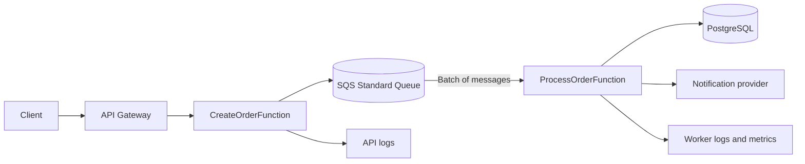
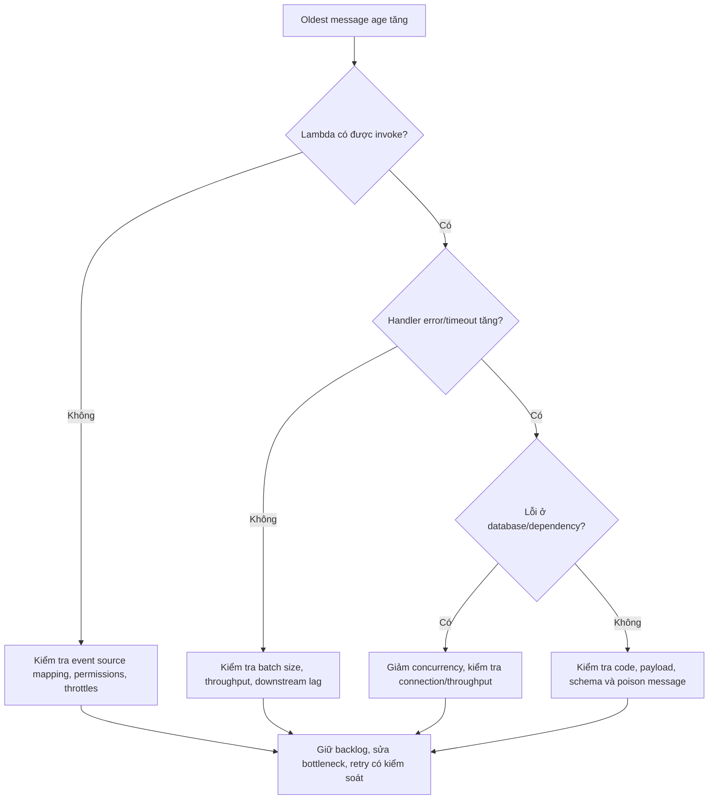

# Viết postmortem và cập nhật runbook từ một sự cố mô phỏng

Khi một hệ thống serverless gặp sự cố, việc khôi phục dịch vụ chỉ là một phần của công việc. Nhóm vận hành còn cần hiểu điều gì đã xảy ra, vì sao các lớp bảo vệ không ngăn được tác động, tín hiệu nào đã giúp phát hiện sự cố và cần thay đổi runbook ra sao để lần sau xử lý nhanh hơn. **Postmortem** ghi lại sự kiện, tác động, nguyên nhân và hành động cải thiện; **runbook** hướng dẫn người trực vận hành phát hiện, khoanh vùng, giảm tác động, phục hồi và xác minh hệ thống.

Bài này dùng một tình huống mô phỏng Java Lambda đọc SQS và ghi vào PostgreSQL. Khi traffic tăng đột biến, Lambda mở quá nhiều execution environment, connection pool của mỗi environment làm cạn connection database. Lỗi database khiến batch thất bại; do chưa bật partial batch response, toàn bộ batch bị giao lại. Retry và message visibility timeout ngắn làm backlog tăng nhanh. Từ tình huống này, ta thực hành viết postmortem theo hướng không đổ lỗi cá nhân và chuyển kết luận thành runbook có thể làm theo trong ca trực.

## 1. Postmortem và runbook giải quyết hai việc khác nhau

| Tài liệu | Câu hỏi chính | Người sử dụng | Kết quả mong đợi |
|---|---|---|---|
| Incident timeline | Chuyện gì xảy ra và khi nào? | Incident commander, on-call, người điều tra | Dòng thời gian có bằng chứng |
| Postmortem | Điều gì gây ra tác động, hệ thống học được gì? | Engineering, SRE, platform, product owner | Nguyên nhân, yếu tố góp phần và action items |
| Runbook | Khi thấy tín hiệu này, cần làm gì tiếp theo? | On-call và đội hỗ trợ | Quy trình triage, mitigation, recovery và escalation |
| Playbook | Làm sao xử lý một nhóm tình huống có thể lặp lại? | Vận hành và incident commander | Các bước phối hợp theo tình huống |

Postmortem không phải bản tường trình để tìm người mắc lỗi. Một postmortem tốt xem xét cả thiết kế, giới hạn kỹ thuật, tín hiệu quan sát, quyền hạn, quy trình triển khai và giả định vận hành. Runbook cũng không nên chỉ chép lại nguyên nhân; nó phải giúp người trực nhận ra triệu chứng và thực hiện hành động an toàn ngay cả khi chưa biết root cause.

## 2. Tình huống mô phỏng: queue backlog và database connection exhaustion

### Kiến trúc trước sự cố

Một API nhận yêu cầu tạo đơn hàng. API Gateway gọi Java Lambda `CreateOrderFunction`; function kiểm tra dữ liệu, ghi command vào SQS Standard Queue và trả HTTP `202 Accepted`. Một Java Lambda khác, `ProcessOrderFunction`, được SQS event source mapping gọi theo batch để ghi đơn hàng vào PostgreSQL. Function gửi thông báo sau khi ghi thành công.



Các cấu hình liên quan trước sự cố:

| Thành phần | Cấu hình mô phỏng |
|---|---|
| Worker batch size | 10 messages |
| Batch window | 1 giây |
| Lambda timeout | 15 giây |
| SQS visibility timeout | 30 giây |
| Worker maximum concurrency | Không giới hạn riêng ở event source mapping |
| Lambda reserved concurrency | Chưa đặt cho worker |
| HikariCP max pool size | 5 connection mỗi execution environment |
| PostgreSQL max connections | 120 |
| Partial batch response | Chưa bật |
| Idempotency | Có unique order key cho ghi đơn hàng; notification chưa có outbox/idempotency key |

Đây là số liệu giả định phục vụ bài tập, không phải cấu hình khuyến nghị chung. Số liệu và ngưỡng của hệ thống thật phải lấy từ dashboard, cấu hình IaC và giới hạn dịch vụ đang triển khai.

### Điều gì đã xảy ra?

Trong một chiến dịch bán hàng, tốc độ tạo đơn tăng từ khoảng 30 lên 180 message/giây. SQS hấp thụ được burst nên API vẫn trả `202`, nhưng worker scale nhanh. Khoảng 85 execution environment có thể cùng tồn tại; mỗi environment có pool tối đa 5 connection, tạo ra nhu cầu lý thuyết lên tới 425 connection. PostgreSQL chỉ cho phép 120 connection và còn phục vụ các workload khác.

Khi connection cạn, một số record không lấy được connection trước timeout. Handler ném exception, làm invocation thất bại. Vì event source mapping chưa bật `ReportBatchItemFailures`, một lỗi record khiến toàn bộ batch được giao lại. Message chưa được xử lý có thể trở nên visible sau 30 giây, trong khi function timeout là 15 giây và AWS khuyến nghị visibility timeout cho Lambda SQS event source nên có đủ margin, thường ít nhất sáu lần function timeout cộng batch window. Retry làm tăng số lần xử lý và số lần cạnh tranh connection.

Một số đơn hàng đã được ghi trước khi invocation lỗi ở record khác. Unique order key ngăn tạo đơn hàng trùng, nhưng bước gửi notification không có outbox hoặc idempotency key nên có 23 notification bị gửi lặp trong khoảng thời gian sự cố.

### Tác động nghiệp vụ

- 8,4% đơn hàng trong khoảng thời gian sự cố mất hơn 5 phút mới hoàn tất xử lý.
- Độ trễ lớn nhất từ lúc API chấp nhận đến khi đơn hàng được ghi nhận là khoảng 17 phút.
- 23 notification được gửi trùng; không phát hiện đơn hàng bị mất hoặc đơn hàng trùng.
- API tiếp tục trả `202` vì message đã được nhận vào queue; người dùng nhìn thấy trạng thái “đang xử lý” lâu hơn bình thường.
- Không có bằng chứng dữ liệu database bị hỏng; nhóm vẫn chạy reconciliation trước khi đóng incident.

Khi viết postmortem thật, cần nêu rõ khoảng thời gian, số tenant/user bị ảnh hưởng, tỷ lệ lỗi, số giao dịch chậm hoặc thất bại, dữ liệu mất/trùng và tác động tài chính nếu có. Không dùng các con số mô phỏng này như dữ liệu production.

## 3. Phát hiện và phân loại sự cố

Các tín hiệu xuất hiện trong incident:

- SQS `ApproximateAgeOfOldestMessage` tăng liên tục.
- Số message visible và số message nhận lại tăng.
- Lambda `Errors`, `Duration` và `ConcurrentExecutions` tăng.
- Log worker có lỗi lấy connection từ pool và timeout khi mở transaction.
- PostgreSQL active connections tiến sát giới hạn; connection acquire latency tăng.
- DLQ bắt đầu nhận message sau khi vượt `maxReceiveCount`.
- API Gateway vẫn trả nhiều response `202`, vì ingress và worker là hai bước riêng.

Sự cố được phân loại là **SEV-2** trong ví dụ vì giao dịch vẫn được tiếp nhận nhưng xử lý chậm đáng kể, một phần notification bị gửi lặp và backlog ảnh hưởng đến trải nghiệm khách hàng. Mức severity thực tế phải theo chính sách incident của tổ chức; không suy ra chỉ từ một metric kỹ thuật.

### Những metric cần xem cùng nhau

| Lớp | Metric/log | Điều cần trả lời |
|---|---|---|
| API ingress | Request rate, 4xx/5xx, latency, accepted count | Request có đến được queue không? |
| SQS | Visible, not visible, oldest age, receive count, DLQ depth | Backlog có tăng? Message có bị redeliver? |
| Lambda worker | Concurrent executions, throttles, errors, duration, timeout | Worker scale bao nhiêu và lỗi ở pha nào? |
| JVM/pool | Active/idle/pending connections, acquire timeout, heap, GC | Worker có chờ database hoặc cạn tài nguyên không? |
| Database | Active connections, connection errors, CPU, query latency, locks | Database còn khả năng nhận tải không? |
| Business | Orders accepted/completed, processing age, duplicate notification | Tác động tới khách hàng là gì? |

Một metric riêng lẻ thường không đủ. Ví dụ Lambda concurrency cao có thể bình thường khi traffic tăng; chỉ khi ghép với pool wait, database connections và queue age mới xác định được bottleneck.

## 4. Timeline của incident mô phỏng

Thời gian trong bảng dùng UTC để tránh nhầm múi giờ. Khi ghi postmortem thật, thống nhất UTC hoặc ghi rõ timezone cho mọi mốc.

| Thời điểm | Sự kiện | Bằng chứng |
|---|---|---|
| 09:00 | Chiến dịch bắt đầu; message rate tăng nhanh | SQS incoming messages, API request rate |
| 09:04 | Worker concurrency tăng lên khoảng 85; DB gần chạm 120 connections | Lambda concurrency, PostgreSQL connection metric |
| 09:06 | Connection pool bắt đầu timeout; worker errors tăng | Java log, Hikari pool metrics |
| 09:08 | Batch retry tăng; oldest message age vượt 2 phút | SQS receive count và queue age |
| 09:10 | Alarm queue age kích hoạt; on-call xác nhận SEV-2 | Alert event và incident channel timeline |
| 09:14 | Incident commander giới hạn worker concurrency và giảm traffic không thiết yếu | Change record, event source mapping config |
| 09:20 | DB connections giảm; worker error rate bắt đầu hạ | Database và Lambda metrics |
| 09:25 | Worker xử lý ổn định; backlog bắt đầu giảm rõ rệt | SQS visible messages, oldest age |
| 10:10 | Queue age trở lại ngưỡng bình thường; incident chuyển sang monitoring | Queue và business completion dashboard |
| 10:40 | Reconciliation xác nhận không mất đơn hàng; ghi nhận notification trùng | Order ledger và notification provider report |

Timeline phải ghi cả thời điểm sự kiện xảy ra và thời điểm nhóm biết về sự kiện nếu hai thời điểm khác nhau. Ghi nguồn dữ liệu cho từng mốc: alert, log, dashboard, deployment event hoặc lời xác nhận của người trực. Nếu chưa chắc, ghi “ước lượng” thay vì biến suy đoán thành sự thật.

## 5. Triage: xác định bottleneck trước khi thay đổi cấu hình

Khi nhận alert queue age tăng, on-call nên trả lời theo thứ tự:

1. Producer có đang gửi message bình thường không?
2. Consumer có đang poll và invoke không?
3. Lambda có bị throttling, timeout hay lỗi handler?
4. Worker lỗi ở bước parse, database, external API hay acknowledgement?
5. Database/HTTP dependency có còn capacity không?
6. Message có bị redeliver hoặc dồn vào DLQ không?
7. Có dấu hiệu dữ liệu trùng, thiếu hoặc side effect lặp không?

Không tăng concurrency ngay khi queue backlog tăng. Nếu database đã quá tải, tăng worker concurrency có thể làm backlog ngắn hạn giảm nhưng database outage nghiêm trọng hơn. Trước tiên tìm giới hạn bền vững của dependency.

### Cây quyết định nhanh



## 6. Root cause và các yếu tố góp phần

### Root cause

Worker Lambda không có giới hạn concurrency phù hợp với năng lực database. Mỗi execution environment tạo connection pool tối đa 5 connection; khi event source mapping scale-out trong burst, tổng connection demand vượt khả năng PostgreSQL. Connection acquire timeout làm invocation thất bại và tốc độ xử lý thấp hơn tốc độ message đến.

### Các yếu tố góp phần

1. **Không có concurrency cap ở event source mapping:** Lambda scale theo backlog mà không có giới hạn phản ánh database capacity.
2. **Connection pool mỗi environment quá lớn:** `maxPoolSize=5` được chọn theo giả định ứng dụng chạy trên một số instance ổn định, không tính phép nhân với serverless concurrency.
3. **Không bật partial batch response:** một record lỗi làm các record thành công trong batch bị retry.
4. **Visibility timeout quá ngắn:** 30 giây không có đủ margin so với timeout 15 giây và batch window; message có thể được giao lại sớm hơn kỳ vọng vận hành.
5. **Idempotency chưa bao phủ mọi side effect:** ghi order có unique key, nhưng gửi notification không có outbox hoặc idempotency key.
6. **Thiếu cảnh báo pool saturation:** dashboard có database connections nhưng chưa có alarm cho pool pending/acquire timeout và queue age kết hợp.
7. **Runbook chưa có bước giảm concurrency an toàn:** on-call phải tìm cấu hình event source mapping trong lúc incident.

### 5 Whys

| Câu hỏi | Câu trả lời dựa trên tình huống |
|---|---|
| Vì sao đơn hàng xử lý chậm? | Worker không xử lý kịp message; queue backlog tăng. |
| Vì sao worker không xử lý kịp? | Nhiều invocation chờ database connection và timeout. |
| Vì sao database hết connection? | Lambda scale-out; mỗi execution environment có pool tối đa 5 connection, không có concurrency cap phù hợp. |
| Vì sao retry làm tình hình xấu hơn? | Một record lỗi khiến cả batch retry; visibility timeout ngắn và side effect chưa idempotent đầy đủ. |
| Vì sao nhóm không giảm tải sớm hơn? | Runbook và alert chưa liên kết queue age, Lambda concurrency, pool saturation và DB connection capacity. |

5 Whys là cách tổ chức câu hỏi, không phải bằng chứng tự động. Nếu điều tra cho thấy một câu trả lời không chính xác, cập nhật theo dữ liệu mới. Có thể có nhiều nhánh nguyên nhân cùng góp phần.

## 7. Phân biệt nguyên nhân trực tiếp, yếu tố góp phần và điều kiện nền

Không gộp mọi vấn đề thành một câu “Lambda scale quá nhanh”. Postmortem nên phân biệt:

- **Trigger:** campaign làm message rate tăng đột biến.
- **Nguyên nhân trực tiếp:** tổng nhu cầu connection từ worker vượt capacity PostgreSQL.
- **Yếu tố khuếch đại:** retry toàn batch, visibility timeout ngắn và thiếu concurrency cap.
- **Điều kiện nền:** pool size được thiết kế cho server cố định; thiếu load test ở concurrency cao; runbook thiếu thao tác giảm tải.
- **Phát hiện chậm:** chưa có alert trên connection pool wait và oldest message age kết hợp.
- **Tác động phụ:** notification không idempotent nên gửi trùng khi batch chạy lại.

Trigger không nhất thiết là root cause. Traffic tăng là hành vi dự kiến của một chiến dịch; hệ thống serverless cần có giới hạn và backpressure để chịu được burst trong capacity đã thiết kế.

## 8. Khôi phục dịch vụ: thứ tự hành động an toàn

Mục tiêu trong incident là bảo vệ dữ liệu, ngăn dependency bị quá tải thêm, khôi phục xử lý và xác minh backlog. Không cố làm mọi thứ cùng lúc.

### Giai đoạn A: xác nhận và chỉ định vai trò

- Tạo incident record và đặt severity theo policy.
- Chỉ định incident commander, technical lead và người ghi timeline.
- Xác nhận queue, function, database và tenant bị ảnh hưởng.
- Chốt một nguồn thông tin vận hành để tránh nhiều người thay đổi cấu hình đồng thời.

### Giai đoạn B: khoanh vùng và giảm tải

- Tạm giảm traffic producer hoặc bật API throttling/admission control nếu cần.
- Đặt giới hạn maximum concurrency của SQS event source mapping theo capacity database đã xác minh.
- Đặt reserved concurrency của function cao hơn hoặc bằng tổng maximum concurrency của các event source mapping cần chạy, đồng thời giữ phần capacity dành cho hoạt động khác.
- Giảm connection pool mỗi execution environment.
- Nếu database đang ở trạng thái nguy cấp, tạm dừng consumer có kiểm soát; message vẫn ở queue trong retention window.
- Không purge queue và không xóa message để “làm sạch” backlog.

### Giai đoạn C: sửa delivery và retry

- Kiểm tra function timeout, batch window và SQS visibility timeout.
- Cấu hình visibility timeout đủ dài; với Lambda SQS event source, AWS khuyến nghị thường ít nhất sáu lần function timeout cộng batch window.
- Bật partial batch response (`ReportBatchItemFailures`) sau khi code trả đúng danh sách message ID thất bại.
- Giảm batch size tạm thời nếu memory, duration hoặc failure isolation yêu cầu.
- Kiểm tra redrive policy và DLQ; không replay DLQ trước khi sửa nguyên nhân.

### Giai đoạn D: phục hồi và xác minh

- Theo dõi DB connections, pool wait, Lambda errors/throttles và queue age.
- Tăng concurrency từng bước nếu database còn headroom.
- Xác minh throughput xử lý lớn hơn tốc độ message đến để backlog thực sự giảm.
- Kiểm tra DLQ, duplicate side effect và order ledger.
- Chạy reconciliation để xác nhận không mất hoặc ghi trùng dữ liệu.
- Chuyển incident sang monitoring sau khi queue age và business metrics ổn định trong khoảng thời gian đã thống nhất.

## 9. Tính lại concurrency và connection pool

Một ước lượng đơn giản cho số connection tối đa từ Lambda worker:

\[
Connections_{worker} \approx Concurrency_{worker} \times PoolSize_{per\ environment}
\]

Giả sử PostgreSQL có tối đa 120 connection. Các workload khác cần 25 connection; nhóm giữ thêm 15 connection cho admin, migration và headroom. Capacity còn lại cho worker là:

\[
120 - 25 - 15 = 80
\]

Nếu pool mỗi environment tối đa 2 connection, giới hạn concurrency lý thuyết theo công thức là 40. Nhóm chọn maximum concurrency 30 để còn thêm margin cho dao động, connection chưa đóng và hành vi failover. Đây là sizing ban đầu; cần xác minh bằng load test và metric database.

Ví dụ cấu hình sau mitigation:

| Tham số | Trước | Sau mitigation |
|---|---:|---:|
| SQS batch size | 10 | 5 |
| Batch window | 1 giây | 1 giây |
| Lambda timeout | 15 giây | 15 giây |
| SQS visibility timeout | 30 giây | 120 giây |
| Event source maximum concurrency | Không đặt | 30 |
| Lambda reserved concurrency | Không đặt | 35 |
| Hikari max pool size | 5 | 2 |
| Partial batch response | Tắt | Bật |

Reserved concurrency 35 lớn hơn event source maximum concurrency 30, để mapping không bị giới hạn thấp hơn cấu hình scale của nó và vẫn có khoảng trống nhỏ cho hoạt động khác theo thiết kế. Nếu function có nhiều event source mapping, phải tính tổng maximum concurrency của tất cả mapping và các invocation khác.

## 10. Java SQS handler với partial batch response

Khi bật `ReportBatchItemFailures`, handler có thể báo các record lỗi thay vì làm cả batch thất bại. Mỗi record phải được xử lý độc lập và idempotent.

```java
import com.amazonaws.services.lambda.runtime.Context;
import com.amazonaws.services.lambda.runtime.RequestHandler;
import com.amazonaws.services.lambda.runtime.events.SQSEvent;
import com.amazonaws.services.lambda.runtime.events.SQSBatchResponse;
import org.slf4j.Logger;
import org.slf4j.LoggerFactory;

import java.util.ArrayList;
import java.util.List;

public final class ProcessOrdersHandler
        implements RequestHandler<SQSEvent, SQSBatchResponse> {

    private static final Logger log =
            LoggerFactory.getLogger(ProcessOrdersHandler.class);
    private final OrderService orderService = OrderService.create();

    @Override
    public SQSBatchResponse handleRequest(SQSEvent event, Context context) {
        List<SQSBatchResponse.BatchItemFailure> failures = new ArrayList<>();

        for (SQSEvent.SQSMessage message : event.getRecords()) {
            try {
                orderService.processIdempotently(
                        message.getMessageId(), message.getBody());
            } catch (RetryableDependencyException ex) {
                log.warn("Retryable order failure; messageId={}",
                        message.getMessageId(), ex);
                failures.add(new SQSBatchResponse.BatchItemFailure(
                        message.getMessageId()));
            } catch (PermanentMessageException ex) {
                log.error("Permanent message failure; messageId={}",
                        message.getMessageId(), ex);
                failures.add(new SQSBatchResponse.BatchItemFailure(
                        message.getMessageId()));
            }
        }

        return new SQSBatchResponse(failures);
    }
}
```

Ví dụ giả định `OrderService` phân loại lỗi và chỉ hoàn tất một record khi side effect đã commit. Với lỗi vĩnh viễn, tùy policy có thể ghi record vào quarantine store rồi coi record đã được xử lý; nếu chỉ trả failure, message sẽ retry đến DLQ. Không nuốt exception ngoài dự kiến và không log raw payload hoặc dữ liệu khách hàng.

Event source mapping phải bật response type tương ứng; nếu không, danh sách `BatchItemFailure` có thể không được áp dụng như mong đợi. Với FIFO queue, phải tuân thủ ordering: khi một record trong message group thất bại, không tiếp tục xử lý các record sau trong group nếu điều đó vi phạm thứ tự nghiệp vụ.

### Idempotency cho side effect

Unique constraint trên `order_id` giúp tránh tạo đơn hàng trùng, nhưng không bảo vệ một API notification đã được gọi trước khi invocation retry. Một thiết kế tốt hơn:

1. Trong transaction database, ghi order và một outbox record với unique key như `order-created:<orderId>`.
2. Publisher đọc outbox và gửi notification/event.
3. Nếu provider hỗ trợ idempotency key, gửi cùng key cho mọi retry.
4. Lưu delivery state và provider response ID.
5. Nếu provider không hỗ trợ idempotency, thiết kế dedup ở consumer hoặc chấp nhận/đối soát duplicate theo contract.

Không thể bảo đảm exactly-once side effect giữa database và một HTTP API ngoài chỉ bằng transaction local. Outbox và idempotent receiver làm delivery at-least-once an toàn hơn.

## 11. Runbook: queue age tăng và worker lỗi

Runbook dưới đây là quy trình vận hành có thể chuyển vào hệ thống nội bộ. Các tên resource và ngưỡng phải được thay bằng giá trị thực của môi trường.

### Metadata runbook

| Thuộc tính | Giá trị mẫu |
|---|---|
| Tên | SQS worker backlog / database connection exhaustion |
| Service | Orders API |
| Trigger | Oldest message age vượt SLO hoặc worker errors tăng |
| Severity | Theo incident policy; ví dụ SEV-2 khi giao dịch bị chậm đáng kể |
| Primary owner | Orders on-call |
| Secondary owner | Database/platform on-call |
| Dependencies | API Gateway, producer Lambda, SQS, worker Lambda, PostgreSQL, notification provider |
| Dashboard | API health, SQS queue, Lambda worker, DB connections/pool |
| Escalation | Incident commander → platform/database owner → service owner |

### Điều kiện kích hoạt

Kích hoạt runbook khi một hoặc nhiều điều kiện xảy ra:

- `ApproximateAgeOfOldestMessage` vượt ngưỡng SLO trong nhiều chu kỳ liên tiếp.
- Queue visible messages tăng liên tục và completion rate thấp hơn ingress rate.
- Worker error/timeout tăng cùng database connection saturation.
- DLQ depth tăng bất thường.
- Business processing age hoặc số đơn hàng PENDING vượt ngưỡng.

Không kích hoạt chỉ vì queue depth tăng trong một burst ngắn nếu oldest age vẫn thấp và consumer đang xử lý kịp. Dùng kết hợp age, rate và business impact.

### Bước 1 — Xác nhận phạm vi

1. Ghi thời điểm alert và dashboard snapshot.
2. Xác định queue URL, function name, event source mapping UUID, database cluster và region.
3. Kiểm tra producer có đang tiếp tục gửi message không.
4. Kiểm tra queue visible/in-flight/DLQ và oldest message age.
5. Xác định tenant, route hoặc campaign có traffic bất thường.

Ví dụ lệnh AWS CLI đọc trạng thái queue:

```bash
aws sqs get-queue-attributes \
  --queue-url "$QUEUE_URL" \
  --attribute-names All
```

Lệnh trả về các thuộc tính như visibility timeout, redrive policy và số lượng message xấp xỉ. Các thuộc tính số lượng là eventual/approximate; dùng CloudWatch metric để xem xu hướng thay vì coi một lần đọc là số tuyệt đối.

### Bước 2 — Kiểm tra event source mapping và function

```bash
aws lambda get-event-source-mapping --uuid "$ESM_UUID"

aws lambda get-function-concurrency \
  --function-name "$FUNCTION_NAME"
```

Đối chiếu:

- Mapping có ở trạng thái `Enabled` không?
- Batch size và maximum batching window là bao nhiêu?
- Function có reserved concurrency không?
- Event source mapping có maximum concurrency không?
- Partial batch response đã bật chưa?
- Lambda có throttles, timeout hoặc duration tăng không?

Không chỉnh concurrency trước khi xem database connection capacity. Ghi lại cấu hình hiện tại để có thể rollback hoặc giải thích thay đổi.

### Bước 3 — Kiểm tra database

- So sánh active connections với max connections.
- Xem connection pool active/idle/pending và acquire timeout.
- Kiểm tra query latency, lock wait, CPU, memory và database throttling.
- Xác định workload khác đang dùng connection.
- Kiểm tra connection leak hoặc transaction giữ quá lâu.

Nếu DB đã gần cạn connection, ưu tiên giảm worker concurrency và pool size. Không tăng connection limit ngay nếu instance database không đủ CPU/memory hoặc quota dịch vụ không cho phép.

### Bước 4 — Khoanh vùng và giảm tải

- Giảm traffic producer không thiết yếu hoặc áp dụng API throttling theo incident commander.
- Đặt event source maximum concurrency ở mức database chịu được.
- Đặt reserved concurrency của Lambda phù hợp với tổng event source maximum concurrency.
- Tạm dừng event source mapping nếu database đang có nguy cơ mất ổn định; xác nhận queue retention đủ để giữ backlog.
- Không xóa/purge message và không replay DLQ trước khi hiểu lỗi.

Ví dụ cập nhật maximum concurrency của SQS event source mapping:

```bash
aws lambda update-event-source-mapping \
  --uuid "$ESM_UUID" \
  --scaling-config '{"MaximumConcurrency":30}'
```

Ví dụ đặt reserved concurrency:

```bash
aws lambda put-function-concurrency \
  --function-name "$FUNCTION_NAME" \
  --reserved-concurrent-executions 35
```

Các con số 30 và 35 chỉ thuộc tình huống mô phỏng. Chọn giá trị thật theo connection budget, số mapping và các workload khác. Nếu thay đổi production, dùng role được phê duyệt và ghi change/incident log.

### Bước 5 — Kiểm tra timeout và retry configuration

Ví dụ tăng visibility timeout lên 120 giây cho function timeout 15 giây và batch window 1 giây:

```bash
aws sqs set-queue-attributes \
  --queue-url "$QUEUE_URL" \
  --attributes VisibilityTimeout=120
```

Trước khi áp dụng, xác minh queue có được chia sẻ với consumer khác không. Visibility timeout là thuộc tính của queue; thay đổi có thể ảnh hưởng mọi consumer. Nếu nhiều consumer dùng queue, thống nhất cấu hình với owner.

Kiểm tra thêm:

- Batch size có phù hợp memory và thời gian xử lý không?
- `ReportBatchItemFailures` có được bật trên event source mapping không?
- `maxReceiveCount` và DLQ có phù hợp không?
- Consumer có idempotency cho database và external side effects không?
- Retry có tạo tải lặp nhanh hơn tốc độ phục hồi không?

### Bước 6 — Phục hồi có kiểm soát

1. Xác nhận database connections và pool wait đã giảm.
2. Bật lại event source mapping nếu đã tạm dừng.
3. Tăng maximum concurrency theo từng bước nhỏ, theo dõi DB và queue age sau mỗi bước.
4. Xác nhận completion rate cao hơn ingress rate đủ lâu để giảm backlog.
5. Theo dõi DLQ và các message có receive count cao.
6. Chỉ replay DLQ sau khi sửa nguyên nhân và xác nhận replay an toàn/idempotent.

### Bước 7 — Xác minh nghiệp vụ và đóng incident

- Queue oldest age trở lại dưới ngưỡng trong khoảng thời gian ổn định đã quy định.
- Visible/in-flight messages giảm theo dự kiến; DLQ không tiếp tục tăng.
- Worker errors, throttles và database connection wait ổn định.
- Số đơn hàng accepted khớp với số đơn hàng completed, failed hoặc đang chờ hợp lệ.
- Notification duplicate được xác định và xử lý theo chính sách.
- Không có dữ liệu mất hoặc sai trạng thái sau reconciliation.
- Incident commander thông báo chuyển sang monitoring/resolved và ghi mốc thời gian.

## 12. Mẫu postmortem có thể tái sử dụng

Mẫu dưới đây có thể sao chép cho mỗi incident. Các trường chưa biết phải ghi `TBD` và giao owner xác minh; không tự điền suy đoán.

```markdown
# Postmortem: <tên sự cố>

## Metadata
- Incident ID:
- Service / environment / region:
- Severity:
- Start / end time (UTC):
- Incident commander:
- Authors / reviewers:
- Status: Draft / Reviewed / Closed

## Executive summary
Mô tả một đoạn: điều gì xảy ra, tác động chính và trạng thái hiện tại.

## Customer and business impact
- Người dùng/tenant bị ảnh hưởng:
- Request/transaction lỗi hoặc chậm:
- Dữ liệu mất/trùng/sai:
- Thời gian ảnh hưởng:

## Detection
- Alert hoặc report đầu tiên:
- Thời gian phát hiện:
- Tín hiệu đã có:
- Tín hiệu còn thiếu:

## Timeline (UTC)
| Time | Event | Evidence / source |
|---|---|---|

## Technical explanation
- Architecture và luồng request/event:
- Trigger:
- Root cause:
- Contributing factors:
- Vì sao các guardrail không ngăn được tác động:

## Response and recovery
- Mitigation đã thực hiện:
- Điều gì hiệu quả:
- Điều gì làm chậm phục hồi:
- Cách xác minh dữ liệu và dịch vụ:

## What went well
- ...

## What was difficult / unclear
- ...

## Action items
| Action | Owner | Priority | Due date | Success measure | Status |
|---|---|---|---|---|---|

## Runbook / dashboard changes
- Runbook section updated:
- New or changed alert:
- Validation / game day:

## Review notes
- Open questions:
- Follow-up review date:
```

## 13. Postmortem đã điền cho sự cố mô phỏng

### Executive summary

Trong khoảng 09:04–10:10 UTC, worker Java Lambda xử lý order từ SQS không theo kịp traffic tăng đột biến. Lambda scale-out làm tổng connection pool demand vượt khả năng PostgreSQL; connection acquire timeout gây worker failures. Vì partial batch response chưa bật, record lỗi khiến cả batch được retry. Queue age tăng, một số order hoàn tất chậm và 23 notification được gửi trùng. Không phát hiện order bị mất hoặc tạo trùng. Nhóm giảm worker concurrency, giảm pool size, điều chỉnh visibility timeout và khôi phục consumer theo từng bước; sau đó chạy reconciliation.

### Tác động

- 8,4% order trong cửa sổ ảnh hưởng mất hơn 5 phút để hoàn tất.
- Độ trễ tối đa khoảng 17 phút.
- 23 notification trùng.
- Không phát hiện order mất/trùng sau reconciliation.
- API ingress vẫn chấp nhận phần lớn request; tác động chính nằm ở thời gian xử lý bất đồng bộ.

### Root cause

Worker Lambda không giới hạn concurrency theo database capacity. Mỗi execution environment có Hikari pool tối đa 5 connection; concurrency khoảng 85 tạo nhu cầu lý thuyết 425 connection, vượt xa PostgreSQL max connections 120. Connection exhaustion khiến record xử lý lỗi và làm backlog tăng.

### Contributing factors

- Không có event source maximum concurrency.
- Không bật partial batch response.
- Visibility timeout 30 giây quá ngắn so với function timeout 15 giây và batch window 1 giây.
- Notification không có outbox/idempotency key.
- Chưa có alert pool pending/acquire timeout và runbook giảm concurrency.

### What went well

- SQS giữ message nên nhóm có thể giảm tải và xử lý backlog sau khi database ổn định.
- API trả `202` chỉ sau khi queue chấp nhận message.
- Unique order key ngăn tạo đơn hàng trùng khi message được giao lại.
- Queue age alert giúp on-call phát hiện tác động trước khi hết retention.

### What was difficult

- Dashboard không đặt Lambda concurrency cạnh database connections và pool wait.
- Runbook không nêu maximum concurrency của event source mapping.
- Notification side effect không có idempotency, làm phát sinh duplicate.
- Visibility timeout chưa được rà soát khi function timeout/batch config thay đổi.

### Action items

| Action | Owner role | Priority | Success measure |
|---|---|---|---|
| Đặt event source maximum concurrency 30 và reserved concurrency 35 theo capacity test | Platform | P0 | Load test 2× forecast không vượt DB connection budget |
| Giảm Hikari max pool size từ 5 xuống 2; thêm pool wait/acquire timeout metrics | Service team | P0 | Peak worker connections không vượt budget; không có pool exhaustion trong soak test |
| Bật partial batch response và thêm test record-level retry | Service team | P0 | Một record lỗi không làm record thành công bị retry |
| Điều chỉnh visibility timeout và kiểm tra timeout/batch window đồng bộ | Platform | P0 | Message không redeliver trong thời gian invocation hợp lệ |
| Thêm outbox/idempotency key cho notification | Service team | P1 | Replay cùng event không gửi notification thứ hai |
| Alert queue age, DLQ depth, DB connections và pool wait | SRE | P1 | Alert test kích hoạt trong thời gian mục tiêu |
| Cập nhật runbook và chạy game day retry/backlog | SRE + Platform | P1 | On-call hoàn thành tabletop và game day theo checklist |
| Thêm load test burst với DB connection cap | QA/Performance | P1 | Báo cáo p95, throughput, connection và backlog được lưu trong CI |

Action item cần có một owner role/người nhận, hạn hoàn thành, mức ưu tiên và tiêu chí kiểm chứng. “Tăng monitoring” hoặc “tối ưu database” quá mơ hồ để đóng. Chỉ đánh dấu done khi có bằng chứng như test report, dashboard, pull request hoặc runbook revision.

## 14. Cập nhật runbook từ bài học postmortem

Postmortem cần tạo thay đổi cụ thể trong runbook. Trong ví dụ, các phần sau được bổ sung:

| Phần runbook | Trước incident | Cập nhật sau incident |
|---|---|---|
| Trigger | Alert Lambda errors | Kết hợp oldest message age, completion rate, DLQ và business processing age |
| Triage | Kiểm tra Lambda logs | Thêm thứ tự kiểm tra SQS → event source mapping → Lambda concurrency → pool → DB |
| Mitigation | Tạm dừng function khi lỗi | Ưu tiên giảm event source maximum concurrency theo DB budget; pause có kiểm soát khi cần |
| Retry | Kiểm tra DLQ | Kiểm tra partial batch response, visibility timeout, receive count và idempotency trước replay |
| Database | Xem CPU và connections | Thêm pool pending/acquire timeout, active connections, lock/query latency |
| Recovery | Xem Lambda errors giảm | Thêm backlog drain rate, oldest age, order reconciliation và notification duplicate check |
| Escalation | Gọi platform khi function lỗi | Gọi database owner khi connections/pool wait vượt ngưỡng; incident commander điều phối thay đổi |

### Nguyên tắc cập nhật runbook

- Viết hành động bằng động từ rõ ràng: “kiểm tra”, “so sánh”, “giảm”, “xác minh”.
- Ghi tên metric, dashboard, log query và resource identifier cần tìm.
- Đánh dấu bước nào chỉ đọc và bước nào thay đổi production.
- Với thao tác thay đổi, ghi điều kiện thực hiện, giá trị dựa trên capacity và cách rollback.
- Không ghi credential, token hoặc secret trong runbook.
- Ghi owner và ngày review; kiểm tra link và lệnh sau mỗi lần đổi kiến trúc.
- Có tiêu chí xác định “đã phục hồi” và “có thể đóng incident”.

## 15. Cảnh báo và dashboard nên bổ sung

Một dashboard vận hành tốt cho pipeline SQS–Lambda–database nên có các biểu đồ đồng trục thời gian:

1. Producer incoming rate và SQS messages sent.
2. SQS visible/in-flight messages và oldest message age.
3. Lambda concurrent executions, invocations, errors, throttles và duration.
4. Event source mapping maximum concurrency và trạng thái enabled/disabled.
5. Database active/max connections, CPU, query latency và connection errors.
6. Hikari active/idle/pending connections và acquisition timeout.
7. Order accepted/completed/failed và notification duplicate count.
8. DLQ depth và message receive count distribution.

Ví dụ cảnh báo có thể được định nghĩa theo logic:

| Alert | Điều kiện gợi ý | Phản ứng |
|---|---|---|
| Queue age high | Oldest message age vượt SLO trong nhiều chu kỳ | Kích hoạt queue backlog runbook |
| Consumer falling behind | Ingress rate lớn hơn completion rate kéo dài | Kiểm tra concurrency và downstream capacity |
| DB connection saturation | Active connections gần budget hoặc pool pending tăng | Giảm consumer concurrency, gọi DB owner |
| Worker retry storm | Errors + receive count tăng cùng lúc | Kiểm tra partial batch, visibility timeout và dependency |
| DLQ growth | DLQ có message mới vượt ngưỡng | Phân loại poison/permanent/transient trước replay |
| Business processing delay | P95 accepted-to-completed vượt SLO | Đánh giá tác động người dùng và incident severity |

Không đặt alarm chỉ dựa trên một điểm dữ liệu ngắn. Dùng duration, evaluation period, missing-data behavior và mức độ quan trọng của service phù hợp. Mỗi alarm cần có runbook link và owner.

## 16. Game day: diễn tập sự cố trước khi production gặp lại

Sau khi sửa, nhóm nên diễn tập trong staging hoặc môi trường được cô lập. Mục tiêu là xác minh guardrail và runbook, không phải tạo outage production.

### Kịch bản diễn tập

1. Tạo traffic burst có kiểm soát vào queue.
2. Giảm capacity database giả lập hoặc làm chậm dependency bằng fault injection.
3. Quan sát pool wait, worker errors và queue age.
4. Xác nhận event source maximum concurrency giới hạn tải.
5. Gửi một record lỗi trong batch và kiểm tra partial batch response chỉ retry record đó.
6. Dừng một worker giữa xử lý để xác minh idempotency/outbox.
7. Khôi phục database và quan sát backlog drain.
8. Kiểm tra DLQ, duplicate side effect và reconciliation.
9. Cho on-call khác thực hiện runbook mà không dựa vào người viết tài liệu.
10. Ghi thời gian phát hiện, thời gian giảm tải và thời gian phục hồi.

### Tiêu chí thành công

- Database không vượt connection budget đã định.
- Queue age không vượt ngưỡng SLO quá thời gian cho phép hoặc có mitigation kịp thời.
- Partial batch response không retry record thành công.
- Duplicate delivery không tạo duplicate business side effect.
- DLQ được xử lý theo quy trình và không replay mù quáng.
- Người trực xác định đúng owner/escalation và hoàn thành các bước an toàn.
- Dashboard/alert hiển thị đủ tín hiệu để giải thích hành vi hệ thống.

## 17. Viết postmortem theo hướng blameless

Ngôn ngữ postmortem ảnh hưởng cách tổ chức học từ sự cố. Tránh các câu như “người trực quên đặt concurrency” hoặc “developer cấu hình sai”. Những câu đó mô tả cá nhân nhưng không giải thích vì sao hệ thống cho phép thay đổi nguy hiểm mà không có guardrail.

Thay bằng câu hỏi về điều kiện hệ thống:

- Template có mặc định concurrency không giới hạn vì lý do nào?
- Review có hiển thị tác động của pool size nhân với Lambda concurrency không?
- Load test có mô phỏng burst và database connection cap không?
- Alert có cho thấy worker scale và DB saturation trên cùng dashboard không?
- Runbook có hướng dẫn giảm tải và quyền thực hiện không?
- Deployment pipeline có policy kiểm tra visibility timeout và partial batch response không?

Blameless không có nghĩa bỏ qua trách nhiệm hoặc không cần hành động. Nó có nghĩa tập trung cải thiện điều kiện làm việc, thiết kế, công cụ và quy trình để lỗi đơn lẻ không dễ biến thành sự cố lớn.

### Phân biệt fact, hypothesis và unknown

Trong postmortem, gắn nhãn rõ:

- **Fact:** có log/metric/config chứng minh.
- **Hypothesis:** giải thích hợp lý nhưng chưa đủ bằng chứng.
- **Unknown:** chưa có dữ liệu hoặc không thể tái tạo.

Ví dụ: “Lambda concurrency đạt 85” là fact nếu metric xác nhận. “Retry làm DB connections tăng thêm 40%” chỉ là hypothesis nếu chưa có số liệu attempt/connection theo thời gian. Tạo action item để đo lần sau thay vì ghi giả thuyết như kết luận.

## 18. Quy trình review và xuất bản postmortem

1. Thu thập timeline từ logs, metrics, deployment events và incident notes.
2. Xác minh customer impact với dữ liệu nghiệp vụ, không chỉ metric hạ tầng.
3. Viết executive summary ngắn, không đưa kết luận vượt quá bằng chứng.
4. Tách root cause, contributing factors, detection gap và recovery gap.
5. Review với service owner, platform, database và SRE.
6. Chuyển kết luận thành action item có owner, due date và success measure.
7. Cập nhật runbook/dashboard/alert trong cùng chu kỳ follow-up.
8. Chạy tabletop hoặc game day để xác minh runbook có thể thực hiện.
9. Theo dõi action item đến khi có bằng chứng hoàn thành.
10. Lưu postmortem theo incident ID và policy retention của tổ chức.

Không đợi đến khi mọi câu hỏi được giải đáp mới phát hành bản đầu. Có thể phát hành bản sơ bộ với `TBD`, sau đó cập nhật khi có bằng chứng mới; ghi rõ revision và người cập nhật.

## 19. Checklist postmortem và runbook

### Postmortem

- [ ] Có incident ID, severity, service, region và thời gian UTC.
- [ ] Impact mô tả rõ người dùng, giao dịch, dữ liệu và thời gian.
- [ ] Timeline có nguồn bằng chứng cho từng mốc.
- [ ] Root cause tách khỏi trigger và contributing factors.
- [ ] Fact, hypothesis và unknown được phân biệt.
- [ ] Phân tích retry, duplicate, idempotency và side effects.
- [ ] Có phần what went well và điều gây khó khăn.
- [ ] Action item có owner, priority, due date và success measure.
- [ ] Ngôn ngữ blameless, tập trung vào điều kiện hệ thống.

### Runbook

- [ ] Trigger/alert và severity được mô tả.
- [ ] Dashboard, log query, metric và resource ID có thể tìm được.
- [ ] Có thứ tự triage để xác định bottleneck.
- [ ] Bước read-only được phân biệt với bước thay đổi production.
- [ ] Có điều kiện giảm tải, pause/resume và rollback.
- [ ] Có hướng dẫn queue, visibility timeout, batch failure và DLQ.
- [ ] Có kiểm tra database connection/pool và downstream capacity.
- [ ] Có bước xác minh business data và reconciliation.
- [ ] Có escalation contact, owner và thời điểm review tài liệu.

### Diễn tập và theo dõi

- [ ] Game day mô phỏng burst, dependency failure và retry.
- [ ] Partial batch response và idempotency đã được kiểm tra.
- [ ] Alert phát hiện queue age và pool saturation đúng thời gian.
- [ ] Người trực khác có thể thực hiện runbook độc lập.
- [ ] Action items được theo dõi đến khi có bằng chứng hoàn tất.

Postmortem giúp tổ chức hiểu sự cố qua bằng chứng và cải thiện hệ thống; runbook chuyển những bài học đó thành hành động rõ ràng cho người trực tiếp theo. Với Java serverless, cần nhìn toàn bộ chuỗi API, queue, Lambda concurrency, connection pool và database thay vì chỉ xem lỗi function. Khi giới hạn concurrency theo capacity downstream, xử lý partial batch, thiết kế idempotent side effect, đặt alert theo queue age và cập nhật runbook có kiểm chứng, nhóm có thể giảm cả xác suất tái diễn lẫn thời gian phục hồi.
