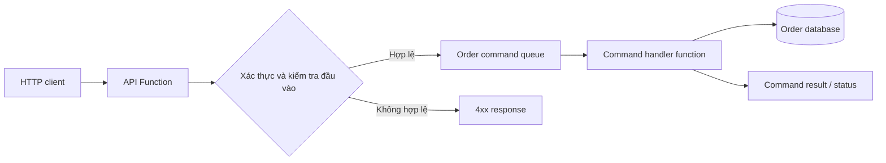
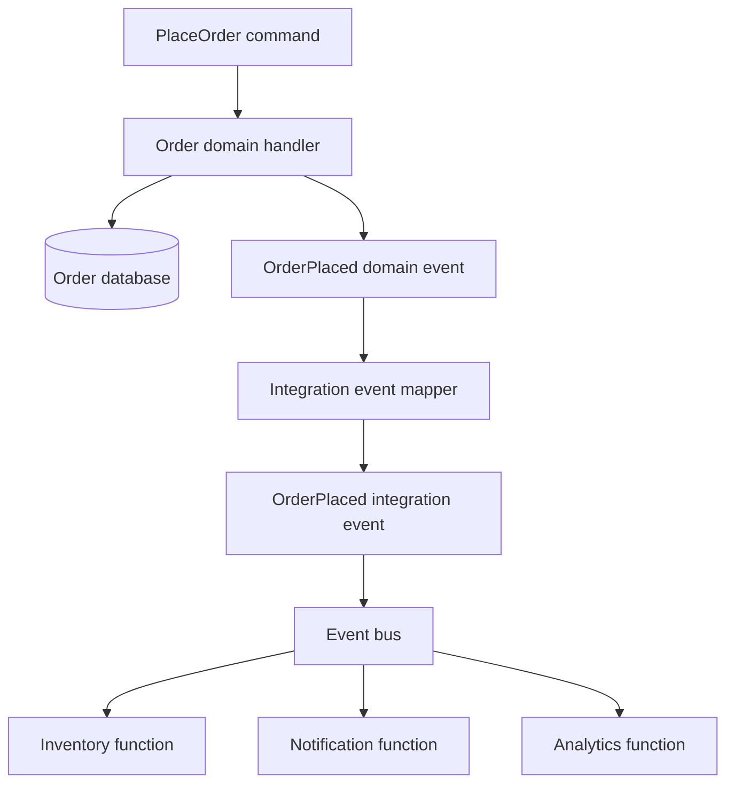
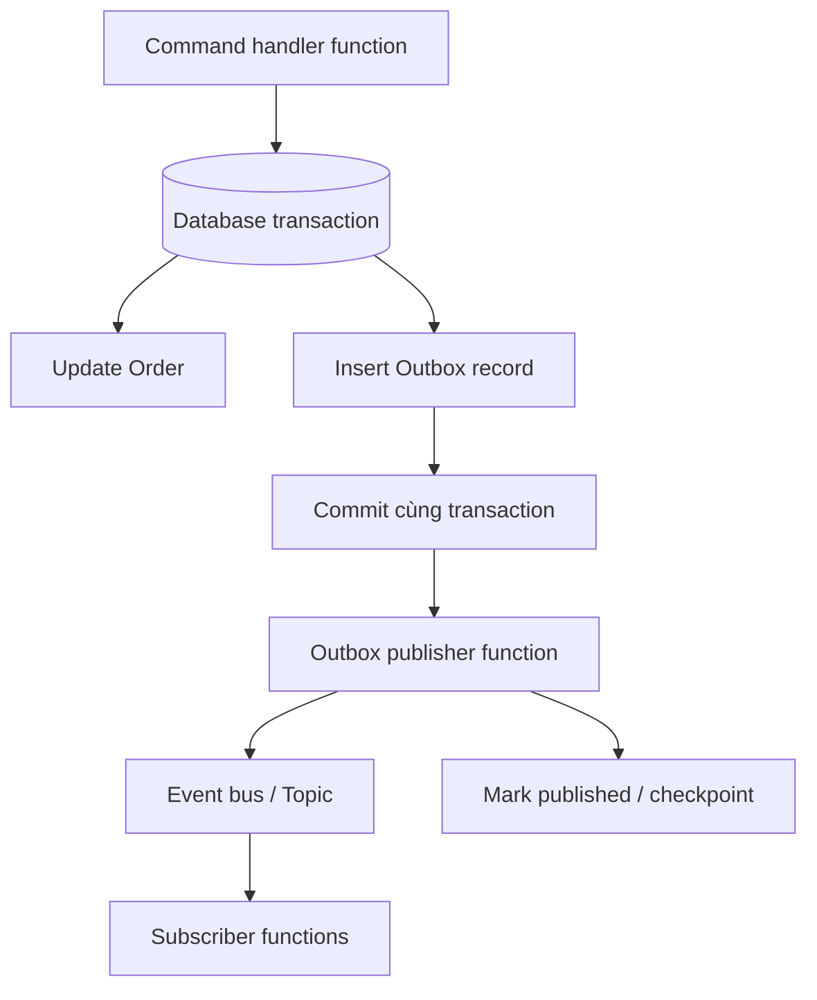

# Phân biệt command, domain event và integration event

Trong ứng dụng serverless, một Java function có thể được gọi bởi HTTP request, message trong queue hoặc event từ event bus. Các đầu vào này đều có thể được biểu diễn thành JSON, nhưng chúng không mang cùng một ý nghĩa. Một số đầu vào yêu cầu hệ thống thực hiện hành động; một số khác thông báo rằng một việc đã xảy ra. Nếu trộn lẫn hai ý nghĩa, các function dễ phụ thuộc chặt vào nhau, xử lý trùng lặp hoặc hiểu sai trách nhiệm của bên gửi và bên nhận.

Ba khái niệm cần phân biệt là **command**, **domain event** và **integration event**. Command diễn đạt điều người gửi muốn một thành phần thực hiện. Domain event ghi nhận một sự thật có ý nghĩa trong mô hình nghiệp vụ của một bounded context. Integration event công bố một sự thật đã xảy ra để hệ thống hoặc bounded context khác có thể phản ứng. Phân biệt đúng ba loại này giúp chọn trigger, thiết kế hợp đồng dữ liệu và xác định cách xử lý lỗi phù hợp.

## 1. Nhìn vào ý nghĩa trước khi nhìn vào định dạng

Một message không tự trở thành event chỉ vì nó được gửi qua queue hoặc có trường `type`. Hãy hỏi người gửi đang muốn điều gì:

- Nếu người gửi yêu cầu một bên nhận thực hiện một hành động, đó là command.
- Nếu nội dung khẳng định một điều đã xảy ra trong nghiệp vụ, đó là event.
- Nếu sự thật đó được công bố qua ranh giới hệ thống hoặc bounded context, nó là integration event.

| Đặc điểm | Command | Domain event | Integration event |
| --- | --- | --- | --- |
| Ý nghĩa | Yêu cầu thực hiện hành động | Sự thật nghiệp vụ đã xảy ra | Sự thật được công bố cho hệ thống khác |
| Cách đặt tên | Mệnh lệnh, thường là động từ + đối tượng | Sự kiện đã xảy ra, thường ở thì quá khứ | Sự kiện đã xảy ra, tên rõ nghĩa trong hợp đồng công khai |
| Ví dụ | `PlaceOrder`, `CancelOrder` | `OrderPlaced`, `OrderCancelled` | `OrderPlacedV1`, `OrderCancelledV1` |
| Người nhận | Một handler hoặc một nhóm xử lý được chỉ định | Thành phần trong cùng mô hình nghiệp vụ | Một hoặc nhiều subscriber ở hệ thống khác |
| Kết quả | Thành công, từ chối hoặc lỗi xử lý | Được ghi nhận khi thay đổi nghiệp vụ hợp lệ | Subscriber tự quyết định phản ứng |
| Quan hệ với người gửi | Người gửi muốn hành động được thực hiện | Thành phần phát event xác nhận sự thật | Producer công bố sự thật, không điều khiển từng subscriber |

Tên gọi và cấu trúc payload là quy ước thiết kế; điều quyết định vẫn là ngữ nghĩa. Một JSON có tên `OrderPlaced` nhưng thực chất mang ý định “hãy tạo đơn hàng” đang bị đặt tên sai: đó là command và nên được đổi thành `PlaceOrder` hoặc tên mệnh lệnh tương đương.

## 2. Command: yêu cầu một hành động

Command mô tả ý định của bên gửi. Người gửi thường biết thành phần nào chịu trách nhiệm xử lý command và mong đợi một kết quả có thể quan sát được: chấp nhận, từ chối do quy tắc nghiệp vụ, hoặc thất bại do lỗi kỹ thuật.

Ví dụ trong hệ thống đặt hàng:

```text
PlaceOrder
  customerId: C-1042
  items:
    - productId: P-18
      quantity: 2
  idempotencyKey: checkout-7f2a
```

Command này có nghĩa “hãy thử tạo đơn hàng cho khách hàng với các mặt hàng trên”. Nó chưa khẳng định đơn hàng đã được tạo. Handler có thể từ chối vì sản phẩm hết hàng, thông tin không hợp lệ hoặc khách hàng không đủ điều kiện.

Các đặc điểm thiết kế quan trọng:

- **Có đích xử lý:** command thường được gửi đến một handler có trách nhiệm cụ thể, chẳng hạn `OrderService` hoặc queue dành cho `OrderCommandHandler`.
- **Diễn đạt ý định:** dùng động từ rõ nghĩa như `PlaceOrder`, `ReserveInventory` hoặc `CancelPayment`.
- **Có thể bị từ chối:** quy tắc nghiệp vụ có thể khiến command không được thực hiện. Đừng phát event thành công trước khi hành động thực sự được xác nhận.
- **Có thể cần phản hồi:** HTTP caller có thể nhận kết quả ngay; xử lý bất đồng bộ có thể trả `202 Accepted` cùng job ID hoặc correlation ID để tra cứu trạng thái.
- **Cần kiểm soát lặp:** cùng một command có thể được gửi lại do client retry, timeout hoặc message redelivery. Dùng idempotency key và lưu kết quả xử lý.

Command không bắt buộc phải là HTTP request. Nó có thể đi qua queue để xử lý bất đồng bộ. Ngược lại, không phải mọi HTTP request đều là command: một request đọc dữ liệu có thể chỉ là query. Phân biệt command với query dựa trên việc có yêu cầu thay đổi trạng thái hay không.

### Command trong luồng serverless

Một API function có thể xác thực request, kiểm tra quyền, chuẩn hóa dữ liệu và gửi command vào queue. Worker function nhận command, kiểm tra quy tắc nghiệp vụ và thực hiện thay đổi trong database. Nếu việc xử lý kéo dài, API có thể trả job ID để caller tra cứu thay vì giữ kết nối HTTP mở.



Ở luồng này, queue chứa yêu cầu cần xử lý. Worker có trách nhiệm hoàn tất hoặc từ chối command và ghi trạng thái. Nếu message bị giao lại, worker phải nhận ra command đã được xử lý thông qua khóa idempotency.

## 3. Domain event: sự thật trong một miền nghiệp vụ

Domain event là bản ghi về một điều có ý nghĩa nghiệp vụ đã xảy ra trong một bounded context. Tên event nên diễn đạt sự thật ở thì quá khứ, ví dụ `OrderPlaced`, `InventoryReserved` hoặc `PaymentCaptured`.

Ví dụ sau khi command `PlaceOrder` được chấp nhận, mô hình đơn hàng có thể phát sinh domain event `OrderPlaced`. Event đó không phải yêu cầu tạo đơn hàng; nó xác nhận rằng đơn hàng đã được tạo theo quy tắc của miền đơn hàng.

Domain event thường có các vai trò:

- Ghi nhận một thay đổi nghiệp vụ đã được xác nhận.
- Kích hoạt các bước tiếp theo trong cùng bounded context.
- Giúp tách các thành phần nội bộ khỏi việc gọi trực tiếp lẫn nhau.
- Cung cấp thông tin để cập nhật projection hoặc duy trì các quy tắc nhất quán.

Một domain event thường thuộc ngôn ngữ và mô hình nội bộ của bounded context phát sinh nó. Ví dụ `OrderPlaced` có thể mang `OrderId`, `CustomerId`, các dòng hàng và trạng thái nội bộ mà domain model cần. Không nên mặc định payload nội bộ đó là hợp đồng thích hợp để công bố cho mọi hệ thống bên ngoài.

Domain event chỉ nên được phát sau khi sự kiện nghiệp vụ thực sự xảy ra. Nếu một command bị từ chối vì tồn kho không đủ, hệ thống không được phát `OrderPlaced`. Có thể phát một event khác như `OrderPlacementRejected` nếu việc từ chối đó là sự thật nghiệp vụ cần được ghi nhận; việc có phát hay không tùy nhu cầu mô hình và kiểm toán.

### Domain event không phải thông báo về ý định

So sánh hai tên sau:

```text
ReserveInventory  -> command: yêu cầu giữ hàng
InventoryReserved -> event: hàng đã được giữ thành công
```

Nếu consumer nhận `InventoryReserved`, consumer có thể cập nhật trạng thái đơn hàng hoặc chuẩn bị bước tiếp theo. Consumer không nên hiểu message này là yêu cầu thử giữ hàng lần nữa.

Domain event có thể được xử lý trong cùng process hoặc được chuyển qua cơ chế nội bộ. Dù triển khai bằng in-memory event dispatcher hay message broker, ngữ nghĩa của nó vẫn là sự thật đã xảy ra trong domain.

## 4. Integration event: công bố sự thật qua ranh giới hệ thống

Integration event là hợp đồng mà một service công bố để service khác có thể phản ứng với một sự thật đã xảy ra. Nó thường được phát qua message broker, event bus, stream hoặc webhook. Producer không cần biết tất cả subscriber đang làm gì; subscriber đăng ký nhận loại event mà họ quan tâm.

Ví dụ, sau khi đơn hàng được tạo thành công, hệ thống Order có thể công bố `OrderPlaced` cho các hệ thống khác. Inventory có thể giữ hàng, Notification gửi email, Analytics cập nhật số liệu và Shipping chuẩn bị giao hàng. Producer chỉ công bố sự thật “đơn hàng đã được tạo”; nó không ra lệnh từng hệ thống phải thực hiện một thuật toán cụ thể.

Integration event cần được thiết kế như một API công khai:

- **Ổn định:** thay đổi cấu trúc phải tính đến consumer đang triển khai độc lập.
- **Có phiên bản hoặc quy tắc tương thích:** consumer cũ có thể tiếp tục đọc event khi producer được nâng cấp.
- **Đủ dữ liệu để phản ứng:** payload có định danh và dữ liệu cần thiết, nhưng không phát tán toàn bộ mô hình nội bộ.
- **Có nguồn gốc và định danh:** consumer có thể truy vết, chống xử lý trùng và đối soát.
- **Không chứa dữ liệu nhạy cảm dư thừa:** chỉ công bố thông tin cần thiết cho mục đích tích hợp.

Integration event có thể được tạo bằng cách ánh xạ domain event sang một schema công khai. Việc ánh xạ này giúp domain model thay đổi mà không bắt buộc mọi consumer phải thay đổi theo.



Ví dụ, domain event nội bộ có thể chứa thông tin chi tiết phục vụ logic Order, trong khi integration event chỉ công bố `orderId`, `customerId`, tổng tiền, đơn vị tiền tệ và thời điểm tạo đơn. Inventory không cần nhận email, số điện thoại hoặc ghi chú nội bộ nếu không phục vụ trách nhiệm của nó.

## 5. Ví dụ hợp đồng dữ liệu cho ba loại

Giả sử một khách hàng đặt đơn hàng. Ba message có thể trông gần giống nhau về cấu trúc nhưng khác nhau về ngữ nghĩa.

### Command

```json
{
  "commandId": "cmd-8c1f",
  "commandType": "PlaceOrder",
  "idempotencyKey": "checkout-7f2a",
  "customerId": "C-1042",
  "items": [
    { "productId": "P-18", "quantity": 2 }
  ]
}
```

Message này yêu cầu Order service tạo đơn. `commandId` định danh yêu cầu; `idempotencyKey` giúp nhận diện lần gửi lại cùng ý định. Handler sẽ kiểm tra dữ liệu, quyền truy cập và quy tắc nghiệp vụ trước khi thay đổi trạng thái.

### Domain event

```json
{
  "eventType": "OrderPlaced",
  "orderId": "O-9021",
  "customerId": "C-1042",
  "items": [
    { "productId": "P-18", "quantity": 2, "unitPrice": 125000 }
  ],
  "aggregateVersion": 7
}
```

Event này cho biết đơn hàng O-9021 đã được tạo trong miền Order. `aggregateVersion` có thể giúp xác định thứ tự thay đổi của aggregate nếu mô hình lưu trữ và consumer sử dụng thông tin đó.

### Integration event

```json
{
  "specversion": "1.0",
  "id": "evt-4e29",
  "source": "/services/orders",
  "type": "com.example.orders.order-placed.v1",
  "subject": "orders/O-9021",
  "time": "2026-11-17T12:30:00Z",
  "datacontenttype": "application/json",
  "data": {
    "orderId": "O-9021",
    "customerId": "C-1042",
    "total": 250000,
    "currency": "VND"
  }
}
```

Ví dụ này dùng envelope theo phong cách CloudEvents để minh họa metadata phổ biến. `id` định danh event, `source` cho biết nguồn phát, `type` mô tả loại event và `subject` xác định đối tượng liên quan. `data` chứa payload tích hợp đã được chọn lọc. Hệ thống có thể dùng CloudEvents hoặc một envelope nội bộ khác, miễn là hợp đồng được định nghĩa rõ và consumer hiểu cùng một cách.

Không đưa `idempotencyKey` của command sang integration event một cách máy móc. Command ID, event ID, correlation ID và causation ID phục vụ các mục đích khác nhau. Hãy giữ chúng riêng biệt và liên kết khi cần truy vết.

## 6. Thiết kế contract: envelope, schema và versioning

Một integration event nên tách metadata chung khỏi dữ liệu nghiệp vụ. Envelope giúp nền tảng định tuyến, quan sát và chống trùng; payload `data` mô tả sự thật cụ thể.

Các trường thường hữu ích gồm:

| Trường | Mục đích |
| --- | --- |
| `id` | Định danh duy nhất của event để truy vết và chống xử lý lặp |
| `source` | Thành phần hoặc service phát event |
| `type` | Tên loại event và có thể kèm phiên bản contract |
| `time` | Thời điểm event được tạo theo quy ước đã công bố |
| `subject` | Định danh đối tượng nghiệp vụ liên quan |
| `correlationId` | Liên kết các bước trong cùng một luồng xử lý |
| `causationId` | Chỉ ra command hoặc event đã gây ra event hiện tại |
| `data` | Payload nghiệp vụ theo schema đã định nghĩa |
| `schemaVersion` | Phiên bản schema nếu không mã hóa phiên bản trong `type` |

Không nhất thiết phải có tất cả trường trên. Chọn một quy ước nhất quán, ghi rõ trường bắt buộc, kiểu dữ liệu, ý nghĩa timestamp, đơn vị tiền tệ, múi giờ và quy tắc null.

### Nguyên tắc tương thích

Consumer và producer thường được triển khai ở thời điểm khác nhau. Vì vậy, contract nên cho phép nâng cấp theo hướng tương thích:

- Thêm trường tùy chọn có giá trị mặc định hợp lý thường an toàn hơn việc thêm trường bắt buộc.
- Consumer nên bỏ qua trường không biết nếu contract cho phép mở rộng.
- Không đổi tên hoặc đổi kiểu một trường đang được sử dụng.
- Không tái sử dụng một giá trị enum cũ với ý nghĩa mới.
- Không xóa trường ngay khi producer ngừng gửi; cần giai đoạn deprecation và xác nhận consumer đã chuyển đổi.
- Nếu thay đổi không tương thích, phát phiên bản event mới hoặc dùng schema version mới với kế hoạch chuyển tiếp rõ ràng.

Ví dụ, thêm `salesChannel` tùy chọn có thể tương thích nếu consumer cũ bỏ qua trường lạ. Đổi `total` từ số nguyên đơn vị đồng sang chuỗi chứa số thập phân sẽ phá vỡ cách diễn giải của consumer và cần một contract mới hoặc một trường mới có đơn vị được xác định rõ.

Đối với tiền tệ, không chỉ ghi `amount`: phải định nghĩa đơn vị nhỏ nhất hay đơn vị chính, kiểu số, quy tắc làm tròn và mã tiền tệ. Với thời gian, xác định timestamp là thời điểm nghiệp vụ xảy ra hay thời điểm message được phát; nên dùng định dạng có múi giờ rõ ràng, thường là UTC.

## 7. Ánh xạ domain event sang integration event trong Java

Ví dụ Java dưới đây minh họa việc giữ domain event và integration event thành hai kiểu dữ liệu riêng. Các record chỉ thể hiện cấu trúc; phần persist, publish và xử lý lỗi cần được triển khai bằng công nghệ lưu trữ/broker của ứng dụng.

```java
import java.time.Instant;
import java.util.List;

public final class OrderEventMapper {
    // Kiểu nội bộ trong bounded context Order.
    public record OrderPlaced(
            String orderId,
            String customerId,
            List<OrderLine> lines,
            long aggregateVersion,
            Instant occurredAt
    ) {}

    public record OrderLine(
            String productId,
            int quantity,
            long unitPriceMinor
    ) {}

    // Hợp đồng công bố cho service bên ngoài.
    public record OrderPlacedV1(
            String orderId,
            String customerId,
            long totalMinor,
            String currency,
            Instant occurredAt
    ) {}

    public OrderPlacedV1 toIntegrationEvent(OrderPlaced event) {
        long total = event.lines().stream()
                .mapToLong(line -> Math.multiplyExact(
                        line.unitPriceMinor(), line.quantity()))
                .reduce(0L, Math::addExact);

        return new OrderPlacedV1(
                event.orderId(),
                event.customerId(),
                total,
                "VND",
                event.occurredAt()
        );
    }
}
```

Ở ví dụ này, `OrderPlaced` giữ các dòng hàng và phiên bản aggregate để phục vụ nội bộ. `OrderPlacedV1` chỉ công bố dữ liệu mà consumer cần. Mã tiền tệ phải đến từ ngữ cảnh đơn hàng hoặc cấu hình nghiệp vụ thực tế; ví dụ dùng `VND` để minh họa và không nên hard-code như vậy trong hệ thống đa tiền tệ.

Một handler có thể tạo domain event sau khi thay đổi nghiệp vụ được xác nhận, sau đó ánh xạ event sang integration event. Tuy nhiên, không nên chỉ lưu đơn hàng rồi publish trực tiếp bằng hai thao tác độc lập mà không có cơ chế bảo vệ. Nếu process chết sau khi commit database nhưng trước khi publish, hệ thống sẽ mất thông báo tích hợp.

## 8. Đảm bảo phát event tin cậy: transactional outbox

Khi thay đổi trạng thái trong database và gửi message qua broker, hai thao tác thường không nằm trong cùng một giao dịch phân tán. Có thể xảy ra hai lỗi:

- Database commit thành công nhưng function timeout hoặc chết trước khi publish event.
- Event đã publish nhưng transaction database rollback hoặc lần chạy sau không xác nhận được kết quả.

Transactional outbox giải quyết khoảng hở này bằng cách ghi thay đổi nghiệp vụ và một bản ghi outbox trong cùng giao dịch database. Một publisher function hoặc tiến trình relay đọc outbox và gửi event lên broker. Sau khi gửi, nó đánh dấu bản ghi đã được phát theo quy tắc của hệ thống.



Publisher có thể gửi lại cùng một outbox record nếu timeout xảy ra sau khi broker nhận message nhưng trước khi publisher đánh dấu đã gửi. Vì vậy, transactional outbox thường cung cấp khả năng phát ít nhất một lần, không tự bảo đảm consumer chỉ nhận đúng một lần. Consumer vẫn cần idempotency theo event ID hoặc khóa nghiệp vụ.

Một consumer có thể dùng inbox table hoặc bảng xử lý event để ghi nhận event ID đã xử lý trong cùng transaction với cập nhật nghiệp vụ. Khi event được giao lại, consumer thấy ID đã tồn tại và không lặp side effect. Việc đánh dấu đã xử lý và cập nhật dữ liệu cần có tính nguyên tử để tránh đánh dấu trước nhưng chưa cập nhật, hoặc cập nhật xong nhưng chưa đánh dấu.

## 9. Idempotency, thứ tự và eventual consistency

Với serverless, broker hoặc event source thường có thể giao message nhiều lần. Function có thể timeout sau khi ghi dữ liệu nhưng trước khi ACK; event source không biết kết quả đã hoàn tất nên gửi lại. Vì thế, consumer cần xử lý theo hướng at-least-once delivery và chuẩn bị cho duplicate.

Các nguyên tắc cần áp dụng:

1. Dùng event ID ổn định qua các lần redelivery; không tạo ID mới cho cùng một event mỗi lần retry.
2. Lưu dấu event đã xử lý cùng với thay đổi nghiệp vụ trong một transaction khi có thể.
3. Thiết kế thao tác có tính idempotent, ví dụ cập nhật trạng thái theo điều kiện hoặc upsert theo khóa duy nhất.
4. Không giả định event đến đúng thứ tự nếu broker, partition hoặc cấu hình subscription không bảo đảm thứ tự đó.
5. Nếu thứ tự quan trọng, dùng partition key theo aggregate ID, sequence/version hoặc kiểm tra trạng thái trước khi áp dụng event.
6. Xử lý event cũ, event đến trễ và event bị thiếu bằng cách phát hiện version gap, retry có giới hạn hoặc đối soát từ nguồn dữ liệu chuẩn.

Integration event thường tạo eventual consistency: sau khi Order công bố `OrderPlaced`, Inventory và Shipping có thể cập nhật ở những thời điểm khác nhau. Trong khoảng chuyển tiếp, các read model có thể chưa phản ánh trạng thái mới. API và giao diện cần thể hiện trạng thái đang xử lý nếu nghiệp vụ yêu cầu, thay vì giả định mọi service đã cập nhật đồng thời.

Đừng dùng event bus để thay thế mọi lời gọi đồng bộ. Nếu người dùng cần biết ngay một command có bị từ chối vì quy tắc nghiệp vụ hay không, command handler cần trả kết quả hoặc cung cấp trạng thái xử lý có thể tra cứu. Event phù hợp để thông báo sự thật và kích hoạt phản ứng độc lập.

## 10. Lựa chọn giữa command và event trong thiết kế function

Một số tình huống thường gặp:

| Tình huống | Nên dùng | Lý do |
| --- | --- | --- |
| Client yêu cầu tạo đơn hàng | `PlaceOrder` command qua HTTP hoặc queue | Có ý định thay đổi trạng thái và cần kết quả xử lý |
| Đơn hàng đã được tạo thành công | `OrderPlaced` domain event | Ghi nhận sự thật trong miền Order |
| Inventory, Notification và Analytics cần phản ứng với đơn hàng mới | `OrderPlaced` integration event | Nhiều subscriber độc lập quan tâm cùng một sự thật |
| Người dùng yêu cầu hủy đơn | `CancelOrder` command | Handler phải kiểm tra đơn có được phép hủy không |
| Hủy đơn đã hoàn tất | `OrderCancelled` event | Thông báo trạng thái đã thay đổi |
| Service cần đọc chi tiết đơn hàng hiện tại | Query hoặc HTTP GET | Đọc dữ liệu, không phải command hay event |

Khi command được xử lý thành công, handler có thể phát domain event. Từ domain event, ứng dụng có thể tạo integration event cho các service khác. Luồng này tách ý định, sự thật nghiệp vụ và hợp đồng tích hợp thành các bước có trách nhiệm riêng.

## 11. Bảo mật và quyền truy cập của hợp đồng event

Event bus và queue là ranh giới tin cậy. Việc một function có thể gửi hoặc nhận message cần được giới hạn bằng IAM hoặc cơ chế phân quyền tương đương:

- Producer chỉ được publish vào đúng topic, bus hoặc queue cần thiết.
- Consumer chỉ được đọc subscription hoặc queue được giao.
- Không đưa access token, password, secret hoặc thông tin thanh toán nhạy cảm vào event payload.
- Chỉ công bố dữ liệu cá nhân khi có mục đích nghiệp vụ và quyền truy cập rõ ràng; cân nhắc token hóa hoặc tham chiếu ID để consumer lấy dữ liệu theo quyền riêng.
- Xác thực nguồn event ở webhook hoặc kênh tích hợp công khai; kiểm tra chữ ký, danh tính và chống replay nếu giao thức yêu cầu.
- Mã hóa dữ liệu khi truyền và khi lưu; đặt retention và quyền truy cập log phù hợp.
- Validate schema và kích thước payload trước khi xử lý; không tin dữ liệu chỉ vì nó đến từ broker nội bộ.

Contract cũng là ranh giới bảo mật: trường nào được công bố sẽ trở thành dữ liệu mà nhiều hệ thống có thể lưu giữ và sao chép. Hãy thiết kế payload tối thiểu ngay từ đầu.

## 12. Checklist trước khi công bố một message contract

- [ ] Message là command, domain event hay integration event? Ý nghĩa có được thể hiện bằng tên không?
- [ ] Command có đích xử lý, kết quả và quy tắc idempotency rõ ràng không?
- [ ] Event chỉ được phát sau khi sự thật nghiệp vụ đã xảy ra không?
- [ ] Domain event nội bộ đã được ánh xạ sang payload tích hợp phù hợp chưa?
- [ ] Envelope có ID, source, type, timestamp và correlation/causation metadata cần thiết không?
- [ ] Schema có mô tả kiểu, đơn vị, nullability, trường bắt buộc và version không?
- [ ] Consumer cũ có tiếp tục xử lý được khi producer thêm trường không?
- [ ] Retry, duplicate, ordering, DLQ và poison message đã có chính sách chưa?
- [ ] Producer và consumer có quyền tối thiểu cần thiết không?
- [ ] Payload có tránh secret và dữ liệu cá nhân không cần thiết không?
- [ ] Có trace, metric và quy trình đối soát khi event bị trễ hoặc mất không?

Trong ứng dụng serverless, command giúp gửi yêu cầu đến đúng nơi chịu trách nhiệm thực hiện; domain event ghi nhận điều đã xảy ra trong mô hình nghiệp vụ; integration event công bố sự thật đó qua ranh giới service bằng một hợp đồng ổn định. Khi ba khái niệm được tách bạch, Java function có thể phối hợp qua HTTP, queue và event bus mà giảm phụ thuộc trực tiếp, xử lý retry an toàn và cho phép các service phát triển độc lập.
