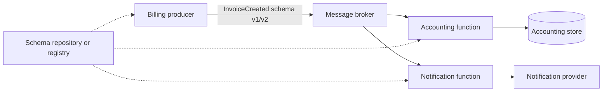

# Quản lý phiên bản schema và tương thích producer với consumer

Trong hệ thống serverless hướng sự kiện, producer và consumer thường được triển khai độc lập. Producer phát thông điệp vào broker hoặc event bus; một hay nhiều Java function nhận thông điệp ở thời điểm khác nhau, có thể chạy phiên bản mã khác nhau và thậm chí xử lý lại dữ liệu cũ. Vì vậy, thay đổi cấu trúc một event có thể ảnh hưởng đến nhiều dịch vụ mà nhóm phát triển không nhìn thấy trực tiếp.

**Schema** mô tả cấu trúc và kiểu dữ liệu của thông điệp. **Data contract** mô tả đầy đủ hơn cách các bên trao đổi dữ liệu: ý nghĩa trường, quy tắc hợp lệ, phiên bản, quyền sở hữu, cách giao nhận và cam kết tương thích. Quản lý tốt schema và data contract giúp producer phát triển mà không làm consumer hiện hữu ngừng hoạt động.

Trong phạm vi **CLOUD_SERVERLESS**, bài học tập trung vào event được phát bởi ứng dụng và được xử lý bởi Java function thông qua message hoặc event trigger. Người phát triển cần biết cách thiết kế schema, tăng phiên bản, kiểm tra tương thích, triển khai thay đổi theo từng giai đoạn và xử lý event không hợp lệ trong môi trường phân tán.

## 1. Producer, consumer, schema và data contract

Một luồng sự kiện có ít nhất hai vai trò:

- **Producer** tạo và phát event. Producer sở hữu ý nghĩa của sự kiện, dữ liệu được công bố và cam kết về cấu trúc mà consumer có thể dựa vào.
- **Consumer** nhận và xử lý event. Consumer phụ thuộc vào một phần hoặc toàn bộ dữ liệu đã công bố, nhưng nên chỉ sử dụng những trường cần cho nghiệp vụ của mình.
- **Broker hoặc event bus** tiếp nhận, định tuyến và giao event theo đặc tính của dịch vụ. Nó có thể lưu trữ, retry hoặc giữ event trong một khoảng thời gian; nó không tự hiểu ý nghĩa nghiệp vụ của schema.

Schema thường mô tả tên trường, kiểu dữ liệu, trường bắt buộc, trường tùy chọn và cấu trúc lồng nhau. Data contract cần bổ sung các quy ước như:

- Tên event và ý nghĩa nghiệp vụ của event.
- Đơn vị đo, tiền tệ, múi giờ, định dạng thời gian và quy tắc làm tròn.
- Trường nào có thể vắng mặt, trường nào có thể nhận `null`, giá trị mặc định và miền giá trị hợp lệ.
- Quy tắc định danh, thứ tự, giao nhận, retry và xử lý trùng.
- Chủ sở hữu, phiên bản, chính sách tương thích và thời gian lưu giữ.
- Phân loại dữ liệu, quyền truy cập và yêu cầu bảo vệ thông tin nhạy cảm.

Ví dụ, schema có thể nói `amount` là một số. Data contract phải nói rõ đó là số tiền theo đơn vị nhỏ nhất hay số thập phân, dùng loại tiền nào, có cho phép số âm không và trường hợp hoàn tiền được biểu diễn ra sao. Hai bên có thể đọc cùng một JSON nhưng vẫn xử lý sai nghiệp vụ nếu không thống nhất ngữ nghĩa.

## 2. Thiết kế event contract ổn định

Một event nên mô tả một sự việc đã xảy ra, thường dùng tên ở dạng quá khứ như `InvoiceCreated`, `PaymentCaptured` hoặc `OrderCancelled`. Event là dữ kiện đã xảy ra; nó khác command, vốn là yêu cầu một thành phần thực hiện hành động trong tương lai.

Nên tách metadata chung khỏi dữ liệu nghiệp vụ. Ví dụ:

```json
{
  "eventId": "evt-8f31c2",
  "eventType": "InvoiceCreated",
  "schemaVersion": 1,
  "occurredAt": "2026-11-17T09:30:00Z",
  "producer": "billing-service",
  "correlationId": "req-42a91d",
  "data": {
    "invoiceId": "inv-2048",
    "customerId": "cus-1024",
    "amountMinor": 1250000,
    "currency": "VND"
  }
}
```

Trong ví dụ, `eventId` nhận diện một lần phát event; `eventType` mô tả loại sự kiện; `schemaVersion` chỉ phiên bản cấu trúc của phần dữ liệu; `occurredAt` là thời điểm nghiệp vụ xảy ra; `correlationId` giúp nối các bước trong một luồng xử lý. `data` chứa thông tin nghiệp vụ.

Một số nền tảng hỗ trợ chuẩn hóa envelope theo CloudEvents hoặc một chuẩn tương tự. Dùng chuẩn có sẵn có thể giúp thống nhất metadata giữa các dịch vụ, nhưng vẫn cần định nghĩa schema và ngữ nghĩa của `data`. Không nên đưa thông tin riêng của broker vào domain payload nếu consumer không cần phụ thuộc vào broker đó.

Các nguyên tắc thiết kế hữu ích:

1. Đặt tên event theo sự kiện nghiệp vụ đã xảy ra, tránh tên quá chung như `DataChanged` nếu consumer cần biết loại thay đổi.
2. Dùng định danh ổn định cho event và thực thể nghiệp vụ. Không dùng vị trí trong mảng hoặc thời gian nhận làm định danh duy nhất.
3. Giữ event bất biến sau khi phát. Nếu thông tin cần sửa, phát một event điều chỉnh hoặc event mới có ý nghĩa rõ ràng.
4. Chỉ công bố dữ liệu consumer cần; tránh sao chép toàn bộ bản ghi cơ sở dữ liệu vào event.
5. Ghi rõ đơn vị, múi giờ, quy tắc null và ý nghĩa từng trường trong tài liệu contract.
6. Tách phiên bản schema khỏi phiên bản ứng dụng producer. Một lần phát hành ứng dụng có thể không thay đổi schema; ngược lại schema có thể thay đổi mà không đổi tên ứng dụng.

## 3. Phiên bản schema và phiên bản event

Phiên bản giúp producer và consumer xác định cấu trúc nào đang được sử dụng. Cần phân biệt ba khái niệm:

| Khái niệm | Trả lời câu hỏi | Ví dụ |
|---|---|---|
| Event type | Đây là sự kiện nghiệp vụ nào? | `InvoiceCreated` |
| Schema version | Payload tuân theo cấu trúc nào? | `1`, `2` |
| Application version | Phiên bản phần mềm producer đang chạy? | `billing-service 3.8.0` |

Không nên tăng schema version mỗi khi build hoặc phát hành producer. Chỉ tăng khi hợp đồng dữ liệu thay đổi theo chính sách phiên bản của tổ chức. Ngược lại, không nên giữ nguyên schema version khi đã thay đổi cấu trúc hoặc ý nghĩa khiến consumer phải xử lý khác đi.

Có thể đặt phiên bản trong envelope, trong metadata của broker, hoặc dùng schema ID do schema registry cấp. Điều quan trọng là consumer có thể xác định chính xác schema cần dùng để giải mã event. Không nên chỉ dựa vào tên topic nếu topic chứa nhiều event type hoặc nhiều schema version.

Với thay đổi tương thích, có thể giữ nguyên event type và tăng schema version theo quy ước quản trị. Với thay đổi phá vỡ tương thích, có thể tạo event type mới, topic mới hoặc phiên bản major mới theo chiến lược đã công bố. Tránh tạo topic mới cho mọi thay đổi nhỏ vì điều đó làm tăng số luồng phải vận hành và theo dõi.

## 4. Hiểu đúng các hướng tương thích

Tương thích phải được đánh giá theo góc nhìn producer và consumer, cũng như theo định dạng schema đang dùng. Ba khái niệm thường gặp là backward, forward và full compatibility.

| Chế độ | Ý nghĩa phổ biến | Tình huống ví dụ |
|---|---|---|
| Backward compatibility | Consumer dùng schema mới có thể đọc dữ liệu đã được ghi theo schema cũ | Consumer mới chấp nhận event cũ chưa có trường `salesChannel` |
| Forward compatibility | Consumer dùng schema cũ có thể đọc dữ liệu được ghi theo schema mới | Consumer cũ bỏ qua trường `salesChannel` mới được thêm |
| Full compatibility | Cả hai hướng đều được bảo đảm trong phạm vi quy tắc của định dạng và registry | Consumer cũ và mới cùng xử lý được dữ liệu cũ và mới |

Các thuật ngữ này có thể được schema registry định nghĩa chính xác theo định dạng như Avro, Protobuf hoặc JSON Schema. Cần đọc quy tắc của công cụ đang sử dụng, đặc biệt là cách xử lý default, trường tùy chọn, enum và tham chiếu schema. Không phải mọi thay đổi được xem là tương thích trong một định dạng đều tự động tương thích trong định dạng khác.

Một ví dụ dễ hiểu: producer thêm trường `salesChannel` vào event. Consumer cũ có thể bỏ qua trường lạ nên vẫn chạy được; consumer mới có thể đọc event cũ nếu trường mới là tùy chọn hoặc có default phù hợp. Nếu consumer mới bắt buộc trường này phải có, event cũ sẽ không còn đáp ứng hợp đồng.

Khi chọn chính sách, hãy xét cả thời gian lưu event và khả năng replay. Consumer được triển khai hôm nay có thể phải đọc event đã phát từ nhiều tuần trước. Vì thế, kiểm tra tương thích chỉ với dữ liệu mới nhất là chưa đủ.

## 5. Những thay đổi thường tương thích và thay đổi phá vỡ hợp đồng

Tính tương thích phụ thuộc vào schema format, validator và cách consumer đọc dữ liệu. Bảng dưới đây là hướng dẫn thiết kế phổ biến cho JSON event, không thay thế quy tắc cụ thể của công cụ schema.

| Thay đổi | Rủi ro | Cách xử lý khuyến nghị |
|---|---|---|
| Thêm trường tùy chọn | Thường ít rủi ro nếu consumer cũ bỏ qua trường chưa biết | Công bố ý nghĩa, kiểu và default; kiểm tra consumer dùng parser nghiêm ngặt |
| Thêm trường bắt buộc | Event cũ không có trường mới; consumer mới có thể không đọc được | Thêm dưới dạng tùy chọn trước, backfill hoặc phát hành phiên bản major nếu bắt buộc |
| Xóa trường | Consumer cũ vẫn có thể cần trường đó | Ngừng khuyến nghị sử dụng trước, đo mức sử dụng, rồi mới loại bỏ ở phiên bản phá vỡ tương thích |
| Đổi tên trường | Consumer cũ không tìm thấy tên cũ | Thêm trường mới song song, chuyển consumer, sau đó loại bỏ trường cũ theo giai đoạn |
| Đổi kiểu dữ liệu | Có thể lỗi parse hoặc đổi cách tính | Giữ kiểu cũ; thêm trường mới với tên và ngữ nghĩa rõ ràng |
| Thu hẹp miền giá trị | Consumer có thể gặp giá trị trước đây hợp lệ nhưng nay bị từ chối | Kiểm tra dữ liệu hiện có và công bố thay đổi như một thay đổi nghiệp vụ |
| Thêm giá trị enum | Consumer có switch exhaustive có thể lỗi hoặc xử lý sai | Thiết kế nhánh `UNKNOWN`/mặc định và quy định hành vi với giá trị chưa biết |
| Thay đổi ý nghĩa nhưng giữ tên/kiểu | Schema validator vẫn pass nhưng nghiệp vụ sai | Xem là thay đổi hợp đồng; dùng trường hoặc event mới và tài liệu hóa ngữ nghĩa |

Thay đổi ngữ nghĩa thường nguy hiểm hơn thay đổi cấu trúc. Ví dụ, trường `amount` vẫn là số nhưng chuyển từ “đồng” sang “nghìn đồng”; JSON Schema có thể vẫn hợp lệ trong khi consumer tính toán sai một nghìn lần. Hãy coi đơn vị, múi giờ, quy tắc làm tròn, trạng thái và ý nghĩa null là một phần của contract.

## 6. Ví dụ tiến hóa schema theo hướng tương thích

Giả sử phiên bản đầu của `InvoiceCreated` có dữ liệu như sau:

```json
{
  "invoiceId": "inv-2048",
  "customerId": "cus-1024",
  "amountMinor": 1250000,
  "currency": "VND"
}
```

Sau đó, nghiệp vụ cần biết hóa đơn được tạo từ kênh nào. Có thể thêm `salesChannel` dưới dạng tùy chọn:

```json
{
  "invoiceId": "inv-2048",
  "customerId": "cus-1024",
  "amountMinor": 1250000,
  "currency": "VND",
  "salesChannel": "ONLINE"
}
```

Consumer cũ cần bỏ qua trường chưa biết. Consumer mới phải chấp nhận event cũ không có `salesChannel` và gán một trạng thái rõ ràng như `UNKNOWN` hoặc `UNSPECIFIED` theo nghiệp vụ. Không nên tự suy ra `ONLINE` chỉ vì trường bị thiếu; thiếu dữ liệu không đồng nghĩa với một giá trị cụ thể.

Ví dụ Java minh họa việc chuyển event bên ngoài thành mô hình nội bộ:

```java
public record InvoiceCreatedV1(
        String invoiceId,
        String customerId,
        long amountMinor,
        String currency) {}

public record InvoiceCreatedV2(
        String invoiceId,
        String customerId,
        long amountMinor,
        String currency,
        String salesChannel) {}

public record CreateInvoiceCommand(
        String invoiceId,
        String customerId,
        long amountMinor,
        String currency,
        String salesChannel) {}

public final class InvoiceEventMapper {
    public CreateInvoiceCommand fromV1(InvoiceCreatedV1 event) {
        return new CreateInvoiceCommand(
                event.invoiceId(),
                event.customerId(),
                event.amountMinor(),
                event.currency(),
                "UNSPECIFIED");
    }

    public CreateInvoiceCommand fromV2(InvoiceCreatedV2 event) {
        return new CreateInvoiceCommand(
                event.invoiceId(),
                event.customerId(),
                event.amountMinor(),
                event.currency(),
                event.salesChannel() == null
                        ? "UNSPECIFIED"
                        : event.salesChannel());
    }
}
```

Đây là ví dụ mô hình hóa; lớp deserialize thực tế phải kiểm tra schema version và xác thực dữ liệu trước khi gọi mapper. Việc chuyển event thành command nội bộ giúp domain model không phụ thuộc trực tiếp vào cấu trúc wire format. Khi schema thay đổi, nhóm có thể cập nhật adapter mà không buộc toàn bộ logic nghiệp vụ phải thay đổi cùng lúc.

## 7. Chiến lược triển khai thay đổi phá vỡ tương thích

Đôi khi không thể thay đổi schema theo hướng tương thích, chẳng hạn đổi kiểu `amount` từ số nguyên sang một object chứa giá trị và đơn vị. Khi đó, cần một quy trình chuyển đổi có kiểm soát.

Một chiến lược thường dùng là **expand and contract**:

1. **Expand:** producer bổ sung trường mới hoặc phát phiên bản mới song song, đồng thời vẫn giữ cách biểu diễn cũ.
2. **Deploy consumer:** cập nhật consumer để đọc cả cấu trúc cũ và mới; chuẩn hóa về cùng mô hình nội bộ.
3. **Verify:** theo dõi số lượng event cũ/mới, lỗi deserialize, kết quả nghiệp vụ và các consumer còn phụ thuộc trường cũ.
4. **Switch producer:** chuyển producer sang phát cấu trúc mới sau khi các consumer cần thiết đã sẵn sàng.
5. **Contract:** ngừng phát trường hoặc phiên bản cũ khi đã hết thời hạn tương thích và không còn consumer cần nó.

Ví dụ nếu đổi `amountMinor` thành `amount: { value, currency }`, producer có thể phát cả hai trường trong giai đoạn chuyển tiếp. Consumer mới ưu tiên object mới nhưng vẫn đọc `amountMinor` từ event cũ. Sau khi xác nhận mọi consumer đã chuyển đổi và event cũ hết thời gian lưu/replay, nhóm mới loại bỏ trường cũ.

Nếu thay đổi quá lớn hoặc hai cấu trúc mang ý nghĩa khác nhau, tạo event type mới có thể rõ ràng hơn việc nhồi nhiều nhánh vào một schema. Dù chọn topic mới hay event type mới, cần công bố lịch chuyển đổi và người sở hữu từng consumer.

Không nên triển khai producer mới trước rồi hy vọng consumer tự thích nghi. Một consumer cũ có thể chạy trong nhiều giờ hoặc nhiều ngày sau khi producer đã phát cấu trúc mới. Trình tự rollout phải tính đến thời gian triển khai, retry và độ trễ của hàng đợi.

## 8. Consumer tolerant nhưng vẫn phải xác thực

Consumer thường nên có khả năng bỏ qua trường tùy chọn mà nó không sử dụng, để producer có thể bổ sung dữ liệu mà không làm mọi consumer phải phát hành lại. Tuy nhiên, tolerant reader không có nghĩa là chấp nhận mọi payload.

Một Java function làm consumer cần:

- Xác định event type và schema version trước khi deserialize vào DTO phù hợp.
- Kiểm tra các trường bắt buộc mà logic nghiệp vụ thực sự cần.
- Xử lý trường tùy chọn, giá trị null và giá trị enum chưa biết theo quy tắc đã công bố.
- Từ chối hoặc đưa vào luồng lỗi payload sai kiểu, thiếu định danh hoặc vi phạm ràng buộc nghiệp vụ.
- Không âm thầm gán giá trị mặc định có thể làm sai nghiệp vụ.
- Tách lỗi dữ liệu vĩnh viễn khỏi lỗi hạ tầng tạm thời để tránh retry vô hạn.

Với JSON, một parser có thể được cấu hình bỏ qua property chưa biết, nhưng schema validation vẫn cần kiểm tra các trường quan trọng. Nếu bật chế độ quá dễ dãi, consumer có thể nhận một event thiếu trường định danh rồi ghi dữ liệu không thể truy vết.

Một nguyên tắc hữu ích là: **producer xác thực chặt trước khi phát; consumer xác thực những điều kiện cần cho nghiệp vụ và chịu được phần mở rộng đã được hợp đồng cho phép**.

## 9. Schema registry và chính sách kiểm soát phiên bản

Schema registry là dịch vụ hoặc kho quản lý schema tập trung. Nó có thể lưu phiên bản, cấp schema ID, kiểm tra tương thích và giúp producer/consumer tìm đúng schema khi serialize hoặc deserialize. Không phải kiến trúc serverless nào cũng cần registry; với ít event và ít consumer, kho schema trong repository có thể đủ. Khi số lượng producer/consumer tăng, registry giúp giảm việc quản lý phiên bản rời rạc.

Nếu sử dụng registry, cần xác định:

- Ai có quyền tạo, sửa hoặc phát hành schema.
- Schema được định danh theo event type, subject, topic hay một quy tắc khác.
- Chính sách tương thích là backward, forward, full hay một chế độ riêng.
- Kiểm tra áp dụng với phiên bản gần nhất hay toàn bộ lịch sử schema.
- Cách xử lý khi schema không tương thích và quy trình xin ngoại lệ.
- Thời hạn giữ schema cũ để replay event lịch sử.
- Cách đồng bộ schema giữa môi trường phát triển, staging và production.

Registry giúp kiểm tra cấu trúc nhưng không thay thế review nghiệp vụ. Một thay đổi có thể pass schema compatibility nhưng vẫn đổi đơn vị, ý nghĩa hoặc quyền sử dụng dữ liệu. Chủ sở hữu event phải review cả schema lẫn mô tả contract.

## 10. Kiểm thử contract trong pipeline

Không nên đợi đến khi function nhận event thật mới phát hiện producer và consumer không tương thích. Có thể đưa kiểm tra contract vào CI/CD để phát hiện lỗi trước khi triển khai.

Các lớp kiểm thử nên gồm:

1. **Schema validation:** payload mẫu do producer tạo ra phải hợp lệ theo schema được công bố.
2. **Compatibility check:** schema mới phải tuân thủ chính sách tương thích với các phiên bản cần hỗ trợ.
3. **Consumer contract test:** consumer đọc được các payload mẫu của những phiên bản còn trong thời hạn hỗ trợ và xử lý đúng trường tùy chọn/giá trị chưa biết.
4. **Producer contract test:** producer phát đúng event type, metadata, kiểu dữ liệu và ý nghĩa đã cam kết.
5. **Integration test:** kiểm tra serialize/deserialize qua broker hoặc adapter thực tế, bao gồm encoding, header, partition key và cơ chế xác nhận.
6. **Replay test:** chạy consumer mới với một tập event cũ đại diện cho dữ liệu lịch sử.
7. **Failure test:** xác minh payload sai được đưa vào dead-letter queue hoặc luồng cách ly phù hợp, có log đủ để điều tra.

Ví dụ kiểm tra schema trong pipeline có thể được tổ chức như sau:

```text
Pull request
    |
    v
Build producer/consumer
    |
    v
Validate example payloads
    |
    v
Compare schema with supported history
    |
    v
Run producer and consumer contract tests
    |
    v
Run integration/replay tests
    |
    v
Publish artifact and schema together
```

Schema và payload mẫu nên được lưu cùng mã nguồn hoặc trong một repository contract có version control. Pull request thay đổi schema cần có review từ nhóm sở hữu producer và các nhóm consumer bị ảnh hưởng khi thay đổi đó có khả năng phá vỡ tương thích.

## 11. Xử lý event không hợp lệ và replay an toàn

Ngay cả khi đã kiểm tra contract, hệ thống vẫn có thể nhận payload lỗi do producer cũ, dữ liệu bị hỏng, cấu hình sai hoặc nguồn event bên ngoài thay đổi. Cần định nghĩa cách xử lý rõ ràng.

- Lỗi tạm thời như timeout của database có thể retry theo giới hạn và backoff.
- Lỗi schema hoặc dữ liệu không hợp lệ thường không tự hết khi retry; nên cách ly event, ghi lý do và chuyển đến dead-letter queue hoặc kho lỗi.
- Không ghi toàn bộ payload nhạy cảm vào log. Có thể ghi event ID, schema version, lỗi validation và correlation ID.
- Khi sửa lỗi và replay, cần xác định event nào được phát lại, ai phê duyệt, tốc độ phát lại và cách tránh xử lý nghiệp vụ trùng.
- Giữ schema cũ đủ lâu để đọc event lịch sử trong thời hạn lưu trữ và replay đã cam kết.

Event delivery thường có thể là at-least-once. Vì vậy, kiểm thử contract phải đi cùng kiểm thử idempotency: cùng một `eventId` được giao lại không được tạo tác động nghiệp vụ lặp. Nếu consumer chỉ hỗ trợ schema mới, replay event cũ cần adapter hoặc quá trình chuyển đổi dữ liệu trước khi phát lại.

## 12. Quyền sở hữu và quản trị data contract

Khi một event có nhiều consumer, không thể để mỗi nhóm tự diễn giải schema theo cách riêng. Mỗi contract nên có chủ sở hữu rõ ràng và một nơi tra cứu chính thức.

| Trách nhiệm | Producer owner | Consumer owner | Platform/team vận hành |
|---|---|---|---|
| Định nghĩa ý nghĩa event và schema | Chịu trách nhiệm chính | Góp ý các trường cần dùng | Cung cấp quy ước và công cụ |
| Công bố phiên bản và thay đổi | Tạo đề xuất, ghi release note | Theo dõi thay đổi ảnh hưởng | Quản lý registry/catalog nếu có |
| Kiểm tra payload trước khi phát | Chịu trách nhiệm | — | Cung cấp pipeline hoặc validator dùng chung |
| Xử lý trường chưa biết và event cũ | Công bố quy tắc | Chịu trách nhiệm trong consumer | Hỗ trợ replay và quan sát broker |
| Quyền truy cập và dữ liệu nhạy cảm | Phân loại dữ liệu được phát | Chỉ truy cập phần được cấp quyền | Cung cấp IAM, encryption và audit |
| Sự cố contract | Hỗ trợ xác định nguồn phát | Báo lỗi và cung cấp event ID | Điều phối broker, DLQ và luồng vận hành |

Một contract catalog tối thiểu nên ghi event type, mô tả nghiệp vụ, owner, schema hiện tại, phiên bản còn hỗ trợ, chính sách tương thích, topic/source, phân loại dữ liệu, thời hạn lưu trữ và danh sách consumer đã đăng ký. Danh sách consumer giúp đánh giá tác động trước khi loại bỏ trường hoặc phiên bản cũ.

Data contract cũng là ranh giới bảo mật. Producer không nên phát dữ liệu cá nhân hoặc bí mật chỉ vì consumer có thể cần trong tương lai. Cần xác định mục đích sử dụng, phân loại dữ liệu, quyền truy cập, thời hạn lưu và cách che dữ liệu trong log hoặc môi trường kiểm thử.

## 13. Ví dụ triển khai thay đổi schema cho Java function

Giả sử `billing-service` phát `InvoiceCreated` vào broker. Hai consumer là `accounting-function` và `notification-function`. Nhóm billing muốn thêm `salesChannel` để phục vụ báo cáo.



Quy trình an toàn có thể diễn ra như sau:

1. Billing owner đề xuất thêm `salesChannel` tùy chọn, ghi rõ các giá trị hợp lệ và ý nghĩa của `UNSPECIFIED`.
2. Pipeline kiểm tra schema mới theo chính sách tương thích và chạy payload mẫu với cả hai consumer.
3. Accounting và notification xác nhận parser bỏ qua trường chưa biết; phiên bản mới của consumer được cập nhật để sử dụng trường khi có.
4. Billing triển khai producer phát schema mới. Event cũ vẫn có thể được giao lại nên consumer mới tiếp tục chấp nhận schema v1.
5. Dashboard theo dõi lỗi deserialize, số event theo schema version, retry và dead-letter queue.
6. Sau thời gian hỗ trợ đã công bố, nhóm đánh giá có thể ngừng schema cũ hay không. Nếu còn event lịch sử cần replay, adapter đọc v1 vẫn phải được giữ hoặc dữ liệu phải được chuyển đổi.

Trong ví dụ này, việc thêm một trường không yêu cầu mọi function phát hành đồng thời. Contract tương thích và rollout theo giai đoạn cho phép các thành phần được triển khai độc lập.

## 14. Checklist trước khi công bố schema mới

| Câu hỏi | Bằng chứng cần có |
|---|---|
| Event type mô tả đúng một sự kiện nghiệp vụ? | Tên, mô tả, thời điểm phát và điều kiện phát rõ ràng |
| Mỗi trường có ngữ nghĩa cụ thể? | Kiểu, đơn vị, timezone, nullability, miền giá trị và ví dụ |
| Event có định danh và metadata cần thiết? | `eventId`, event type, schema version, thời điểm và correlation ID phù hợp |
| Schema mới tương thích với lịch sử cần hỗ trợ? | Kết quả compatibility check và danh sách schema được so sánh |
| Consumer cũ có xử lý được trường mới? | Contract test với consumer hiện tại và parser thực tế |
| Consumer mới có đọc được event cũ? | Replay test với payload lịch sử |
| Thay đổi phá vỡ có kế hoạch chuyển đổi? | Expand-and-contract, phiên bản song song và tiêu chí kết thúc hỗ trợ |
| Event lỗi được xử lý ra sao? | Validation, retry policy, DLQ và quy trình replay |
| Event có thể được xử lý lặp? | Idempotency theo event ID hoặc khóa nghiệp vụ |
| Ai sở hữu contract? | Owner, catalog, release note và danh sách consumer |
| Dữ liệu có được phép chia sẻ? | Phân loại dữ liệu, IAM, retention và quy tắc log |

## 15. Duy trì tương thích trong suốt vòng đời event

Contract không kết thúc khi producer phát hành schema lần đầu. Consumer mới có thể được triển khai sau producer; event cũ có thể nằm trong broker, kho lưu trữ hoặc bản backup; một nhóm khác có thể bắt đầu sử dụng event sau nhiều tháng. Vì vậy, việc thay đổi schema phải tính đến toàn bộ thời gian tồn tại của dữ liệu.

Hãy duy trì ba hoạt động liên tục:

- **Quản lý thay đổi:** lưu schema có version control, review ý nghĩa trường, kiểm tra tương thích tự động và công bố thời hạn hỗ trợ.
- **Quản lý consumer:** ghi nhận consumer đang hoạt động, kiểm thử cả event cũ và mới, xử lý trường chưa biết và triển khai theo giai đoạn.
- **Quản lý vận hành:** theo dõi lỗi deserialize, retry, DLQ, event theo phiên bản, replay và quyền truy cập dữ liệu.

Khi producer và consumer có thể phát triển độc lập, data contract là thỏa thuận giúp các nhóm phối hợp mà không cần triển khai đồng thời. Thiết kế schema rõ nghĩa, chọn chính sách tương thích phù hợp và kiểm thử event lịch sử giúp Java function tiếp tục xử lý dữ liệu chính xác khi hệ thống serverless thay đổi theo thời gian.
