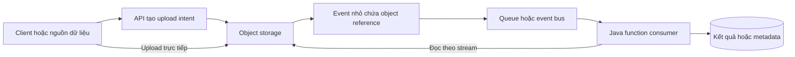
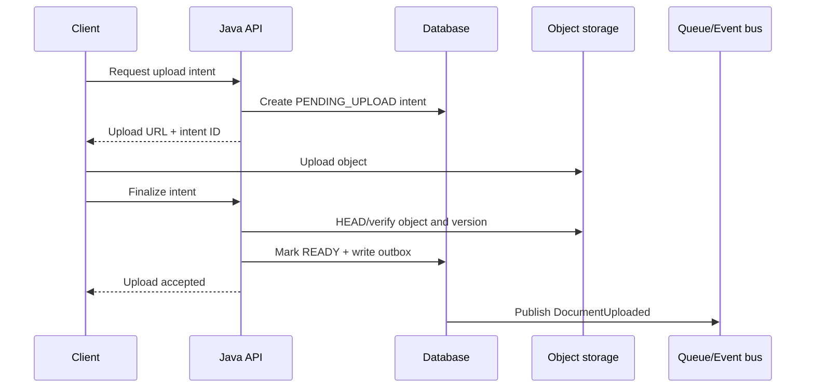

# Truyền tham chiếu thay cho payload lớn

Trong kiến trúc serverless, function thường giao tiếp qua HTTP, queue hoặc event bus. Những kênh này phù hợp để truyền lệnh và dữ liệu nhỏ, nhưng không phải lúc nào cũng phù hợp để mang toàn bộ nội dung của một tệp lớn. Ảnh, video, bản ghi âm, tài liệu PDF, tệp CSV xuất dữ liệu hoặc gói nén có thể làm payload vượt giới hạn của dịch vụ trung gian, tăng chi phí truyền nhận và buộc nhiều function giữ dữ liệu lớn trong bộ nhớ.

Một cách thiết kế phổ biến là **lưu nội dung lớn trong object storage và chỉ truyền tham chiếu đến đối tượng đó**. Message hoặc event khi ấy chứa thông tin đủ để consumer xác định đối tượng cần xử lý, kiểm tra tính toàn vẹn và truy cập bằng quyền phù hợp. Mẫu này thường được gọi là *claim check pattern* hoặc *large message payload pattern*.

Với Java serverless, mẫu này giúp function nhận event nhỏ, mở luồng đọc từ object storage và xử lý dữ liệu theo từng phần. Tuy nhiên, nó tạo thêm một phụ thuộc lưu trữ, vòng đời đối tượng, cơ chế cấp quyền và các tình huống lỗi cần quản lý. Bài học này trình bày cách chọn mẫu, thiết kế hợp đồng tham chiếu, tổ chức luồng upload/download và vận hành an toàn.

## 1. Vì sao không đưa toàn bộ tệp vào event?

Giả sử một API nhận tệp dữ liệu 80 MB, sau đó cần kiểm tra, phân tích và ghi kết quả. Nếu API đưa nguyên tệp vào message, message phải đi qua broker hoặc event bus trước khi consumer xử lý. Tùy nền tảng, kênh truyền có giới hạn kích thước message, giới hạn thời gian giữ message hoặc cách tính phí theo dung lượng. Ngay cả khi payload chưa vượt giới hạn, nhiều lần sao chép và tuần tự hóa dữ liệu vẫn làm tăng bộ nhớ và độ trễ.

Nếu có ba consumer cần cùng một tệp, việc nhúng nội dung vào từng message có thể khiến dữ liệu lớn được truyền và lưu lặp lại. Với function Java, việc đọc toàn bộ tệp thành `byte[]` còn tạo áp lực heap và garbage collection. Khi nhiều invocation chạy đồng thời, tổng bộ nhớ sử dụng có thể tăng nhanh.

Thay vào đó, producer tải tệp lên object storage rồi phát một event nhỏ chứa tham chiếu. Consumer dùng tham chiếu để đọc nội dung khi cần.



Event không mang nội dung tệp. Nó mang thông tin nhận diện đối tượng, phiên bản, kích thước và checksum cần thiết. Consumer có thể chạy độc lập với API upload, và nhiều consumer có thể đọc cùng một đối tượng mà không cần producer gửi lại nội dung.

### Khi nào nên dùng?

Mẫu tham chiếu phù hợp khi:

- Nội dung có kích thước lớn hoặc biến thiên đáng kể, khó đảm bảo luôn nằm trong giới hạn payload của các dịch vụ trung gian.
- Nhiều consumer cần đọc cùng một nội dung.
- Công việc xử lý có thể chạy bất đồng bộ sau khi upload hoàn tất.
- Nội dung cần được lưu bền vững, kiểm tra, lưu phiên bản hoặc giữ theo chính sách riêng.
- Có thể quản lý quyền đọc object storage cho từng producer và consumer.

Không cần dùng mẫu này cho mọi message. Nếu dữ liệu chỉ là một lệnh nhỏ, vài trường metadata hoặc một sự kiện nghiệp vụ ngắn, truyền trực tiếp thường đơn giản hơn. Nếu dữ liệu lớn nhưng chỉ tồn tại trong một kết nối ngắn và không cần lưu trữ, có thể cân nhắc streaming qua một giao thức phù hợp. Quyết định nên dựa trên giới hạn nền tảng, kích thước thực tế, số consumer, độ bền dữ liệu và chi phí toàn luồng.

## 2. Tham chiếu đối tượng gồm những gì?

Tham chiếu cần giúp consumer tìm đúng nội dung và xác minh rằng nội dung đó đúng với sự kiện. Một đường dẫn chung chung như `uploads/report.csv` thường chưa đủ vì đối tượng có thể bị ghi đè, di chuyển hoặc xóa trước khi consumer đọc.

Một hợp đồng tham chiếu có thể gồm:

| Trường | Ý nghĩa | Lưu ý |
|---|---|---|
| `storage` hoặc `provider` | Hệ thống lưu trữ hoặc adapter cần dùng | Có thể bỏ nếu toàn hệ thống chỉ dùng một storage đã cấu hình |
| `bucket` hoặc `container` | Vùng chứa đối tượng | Không nên cho consumer tùy ý truy cập vùng chứa từ payload không tin cậy |
| `key` | Định danh đối tượng trong vùng chứa | Nên là khóa do server tạo, không chứa thông tin cá nhân nếu không cần |
| `versionId` hoặc `generation` | Phiên bản bất biến của đối tượng | Nên dùng nếu storage hỗ trợ versioning |
| `sizeBytes` | Kích thước dự kiến | Dùng để kiểm tra trước khi đọc và phát hiện dữ liệu bất thường |
| `checksum` | Dấu kiểm tra nội dung, ví dụ SHA-256 | Xác minh tính toàn vẹn; không nhầm checksum với ETag nếu provider định nghĩa khác |
| `contentType` | Kiểu nội dung khai báo | Là gợi ý, cần xác minh từ nội dung thực tế nếu dùng cho quyết định bảo mật |

Không phải mọi trường đều bắt buộc trong mọi hệ thống. Hợp đồng cần chọn một định danh đủ ổn định. Nếu storage không bật versioning, có thể dùng object key duy nhất cho mỗi lần upload và không ghi đè đối tượng đã công bố. Nếu dùng versioning, consumer phải đọc đúng `versionId`/generation của sự kiện, thay vì đọc phiên bản mới nhất theo key.

### Ví dụ event envelope

Event có thể được thiết kế theo cấu trúc sau:

```json
{
  "eventId": "evt-8f2a4c",
  "eventType": "DocumentUploaded",
  "schemaVersion": 1,
  "occurredAt": "2026-11-17T09:30:00Z",
  "correlationId": "req-72d19a",
  "data": {
    "tenantId": "tenant-42",
    "documentId": "doc-913",
    "object": {
      "bucket": "private-ingress",
      "key": "tenant-42/2026/11/9a7f.../source.bin",
      "versionId": "v-003",
      "sizeBytes": 83886080,
      "checksumAlgorithm": "SHA-256",
      "checksum": "base64-encoded-digest",
      "contentType": "application/octet-stream"
    }
  }
}
```

Đây là ví dụ minh họa; giá trị định danh và checksum cần được tạo từ hệ thống thật. `tenantId` hoặc `documentId` trong event chỉ là dữ liệu để định tuyến và đối chiếu. Consumer vẫn phải xác thực quyền truy cập bằng danh tính thực thi và dữ liệu sở hữu ở phía server. Không được coi việc một payload tự khai báo `tenantId` là bằng chứng người gửi có quyền đọc đối tượng của tenant đó.

Event nên có `eventId` ổn định để hỗ trợ deduplication, `schemaVersion` để tiến hóa hợp đồng và `correlationId` để nối log/trace từ upload đến xử lý. Không đưa access key, token, mật khẩu hoặc URL ký tạm thời vào event. URL ký tạm thời là một bearer capability: ai có URL đều có thể thực hiện hành động được cấp trong thời gian hiệu lực. Nếu consumer cần truy cập, hãy để consumer dùng role/service identity của chính nó để lấy object; nếu phải cấp URL cho một bên ngoài, hãy tạo URL ngắn hạn đúng lúc sử dụng và giới hạn quyền.

## 3. Thiết kế luồng upload

Một luồng upload an toàn cần phân biệt việc **được phép tải lên**, **tải lên hoàn tất** và **đối tượng đã được chấp nhận để xử lý**. Không nên phát event xử lý ngay khi client mới bắt đầu upload.

### Bước 1: Tạo upload intent

Client gọi API để yêu cầu tải tệp lên. API xác thực người dùng, kiểm tra tenant và quyền nghiệp vụ, xác định giới hạn kích thước/loại tệp, rồi tạo một upload intent trong cơ sở dữ liệu. Server tạo object key khó đoán, duy nhất và gắn intent với chủ sở hữu, thời hạn, kích thước tối đa, content type dự kiến cùng trạng thái `PENDING_UPLOAD`.

API có thể cấp một pre-signed URL hoặc cơ chế upload trực tiếp tương đương. URL cần giới hạn:

- Một object key cụ thể, không cho client chọn tùy ý vùng chứa hay đường dẫn.
- Phương thức HTTP được phép, thường là `PUT` hoặc các bước của multipart upload.
- Thời gian hiệu lực ngắn vừa đủ cho phiên upload.
- Các header được ký hoặc điều kiện về content type/checksum nếu nền tảng hỗ trợ.
- Giới hạn kích thước hoặc chính sách upload phù hợp với khả năng của storage.

Pre-signed URL là thông tin nhạy cảm. Không ghi URL vào log, analytics hoặc event; không đưa URL vào nơi có thể bị chia sẻ công khai. Khi hết hạn, client cần xin intent hoặc URL mới theo chính sách, không nên tái sử dụng URL cũ vô thời hạn.

### Bước 2: Upload trực tiếp vào object storage

Client truyền dữ liệu trực tiếp tới object storage. Cách này giảm việc API/function phải nhận rồi chuyển tiếp toàn bộ byte. Với tệp rất lớn, dùng multipart/resumable upload nếu provider hỗ trợ để có thể tiếp tục sau khi mạng gián đoạn và không phải gửi lại toàn bộ tệp.

Client có thể gửi checksum dự kiến, nhưng server cần xác minh kết quả bằng metadata đáng tin cậy hoặc đọc và tính lại checksum theo yêu cầu. Không nên tin `Content-Type`, tên file hay kích thước do client khai báo. Tên file chỉ nên là metadata hiển thị đã được làm sạch; object key nên do server sinh.

### Bước 3: Xác nhận upload hoàn tất

Sau khi upload hoàn tất, client gọi API finalize hoặc hệ thống nhận notification từ object storage. API/consumer xác minh object tồn tại, thuộc upload intent tương ứng, đúng vùng chứa và key đã cấp, kích thước nằm trong giới hạn, checksum hợp lệ và phiên bản đối tượng được ghi nhận.

Chỉ sau khi xác minh, hệ thống mới chuyển trạng thái sang `UPLOADED` hoặc `READY_FOR_PROCESSING` và công bố event. Nếu cần cập nhật database đồng thời với việc phát event, có thể ghi một outbox record trong cùng giao dịch với trạng thái upload. Publisher đọc outbox rồi gửi event; consumer phải idempotent vì publisher có thể gửi lại sau khi không nhận được xác nhận.

Nếu dùng notification native của object storage, cần xác định rõ event nào biểu thị upload đã hoàn tất. Với multipart upload, không được xử lý object trước khi thao tác complete thành công. Notification có thể đến trùng hoặc sai thứ tự, vì vậy consumer nên kiểm tra phiên bản và trạng thái hiện tại trước khi xử lý.

### Bước 4: Công bố event nhỏ

Event chỉ nên chứa metadata cần cho định tuyến, kiểm tra và truy vết. Tránh lặp lại những trường không cần thiết hoặc đưa toàn bộ metadata người dùng vào event. Consumer lấy nội dung từ object storage bằng danh tính được cấp quyền.



Trong thực tế, publisher outbox thường là tiến trình riêng hoặc một function được kích hoạt theo lịch/stream. Sơ đồ rút gọn thể hiện thứ tự logic, không hàm ý database có thể gửi event nguyên tử tới queue trong cùng một transaction thông thường.

## 4. Consumer Java đọc object theo stream

Consumer chỉ nhận event nhỏ. Nó xác thực schema, kiểm tra trường bắt buộc, kiểm tra trạng thái nghiệp vụ và quyền truy cập rồi mở object bằng SDK hoặc adapter của storage. Với nội dung lớn, nên dùng `InputStream` hoặc API streaming tương đương để xử lý từng phần.

Ví dụ sau minh họa cấu trúc trung lập với nhà cung cấp. Adapter `ObjectStore` có thể được triển khai bằng SDK của S3, Google Cloud Storage, Azure Blob Storage hoặc dịch vụ tương đương.

```java
import java.io.IOException;
import java.io.InputStream;

public record ObjectReference(
        String bucket,
        String key,
        String versionId,
        long sizeBytes,
        String checksumSha256,
        String contentType
) {}

public record DocumentUploadedEvent(
        String eventId,
        int schemaVersion,
        String correlationId,
        String tenantId,
        String documentId,
        ObjectReference object
) {}

public record StoredObjectMetadata(
        long sizeBytes,
        String checksumSha256,
        String versionId
) {}

public interface ObjectStore {
    StoredObjectMetadata head(ObjectReference reference);
    InputStream open(ObjectReference reference) throws IOException;
}

public interface ProcessingClaims {
    // Claim phải được thực hiện nguyên tử và có lease để thu hồi sau crash.
    ClaimResult claimIfNotCompleted(String eventId, String objectVersion);
    void markCompleted(String eventId, String objectVersion);
}

public enum ClaimResult {
    CLAIMED,
    ALREADY_COMPLETED,
    BUSY
}

public final class RetryableProcessingException extends RuntimeException {
    public RetryableProcessingException(String message) {
        super(message);
    }
}

public interface DocumentParser {
    void parseAndStoreResult(InputStream input, String documentId) throws IOException;
}

public final class DocumentUploadedHandler {
    private final ObjectStore objectStore;
    private final ProcessingClaims claims;
    private final DocumentParser parser;

    public DocumentUploadedHandler(
            ObjectStore objectStore,
            ProcessingClaims claims,
            DocumentParser parser
    ) {
        this.objectStore = objectStore;
        this.claims = claims;
        this.parser = parser;
    }

    public void handle(DocumentUploadedEvent event) throws IOException {
        if (event.schemaVersion() != 1 || event.object() == null) {
            throw new IllegalArgumentException("Unsupported or incomplete event");
        }

        ObjectReference ref = event.object();
        String version = ref.versionId() == null ? ref.key() : ref.versionId();
        ClaimResult claim = claims.claimIfNotCompleted(event.eventId(), version);
        if (claim == ClaimResult.ALREADY_COMPLETED) {
            return; // Bản giao lại của công việc đã hoàn tất.
        }
        if (claim == ClaimResult.BUSY) {
            throw new RetryableProcessingException("Another invocation holds the processing lease");
        }

        StoredObjectMetadata actual = objectStore.head(ref);
        if (actual.sizeBytes() != ref.sizeBytes()) {
            throw new IllegalArgumentException("Object size does not match event");
        }
        if (ref.versionId() != null && !ref.versionId().equals(actual.versionId())) {
            throw new IllegalArgumentException("Object version does not match event");
        }
        if (ref.checksumSha256() != null
                && !ref.checksumSha256().equals(actual.checksumSha256())) {
            throw new IllegalArgumentException("Object checksum does not match event");
        }

        try (InputStream input = objectStore.open(ref)) {
            parser.parseAndStoreResult(input, event.documentId());
        }

        claims.markCompleted(event.eventId(), version);
    }
}
```

Đây là ví dụ cấu trúc, cần hoàn thiện adapter, kiểm tra quyền và xử lý lỗi theo nền tảng triển khai. `claimIfNotCompleted` phải là thao tác nguyên tử trong kho trạng thái bền vững; lease cần hết hạn hoặc được gia hạn để một invocation khác có thể tiếp tục khi function bị dừng đột ngột. Nếu chỉ ghi trạng thái `PROCESSING` vĩnh viễn, một crash có thể khiến công việc bị kẹt.

Ví dụ cũng giả định `parseAndStoreResult` có thể retry an toàn hoặc tự bảo vệ bằng idempotency. Nếu parser tạo side effect bên ngoài, việc ghi `markCompleted` sau side effect vẫn có khoảng trống: side effect thành công nhưng function chết trước khi ghi hoàn tất. Khi đó lần retry có thể tạo side effect lần nữa. Cần dùng khóa idempotency ở hệ thống đích, transaction/outbox cho kết quả cục bộ hoặc quy trình đối soát/bù trừ.

### Streaming thay vì đọc toàn bộ vào heap

Không nên viết:

```java
byte[] content = input.readAllBytes();
```

cho tệp lớn nếu không có giới hạn kích thước chặt và đủ bộ nhớ. Cách này buộc toàn bộ tệp cùng tồn tại trong heap. Thay vào đó, parser nên đọc từng record, chunk hoặc buffer có kích thước cố định. Nếu thư viện xử lý bắt buộc cần seek hoặc đọc nhiều lần, có thể dùng file tạm trong vùng `/tmp` hoặc ổ đĩa tạm được nền tảng cung cấp, nhưng cần kiểm soát dung lượng, dọn dẹp và mã hóa dữ liệu nhạy cảm.

Ví dụ sao chép theo buffer có giới hạn:

```java
import java.io.IOException;
import java.io.InputStream;
import java.io.OutputStream;

static void copyBounded(InputStream in, OutputStream out, long maxBytes)
        throws IOException {
    byte[] buffer = new byte[64 * 1024];
    long total = 0;
    int count;
    while ((count = in.read(buffer)) != -1) {
        total += count;
        if (total > maxBytes) {
            throw new IOException("Input exceeds configured size limit");
        }
        out.write(buffer, 0, count);
    }
}
```

Giới hạn trong ví dụ phải lấy từ chính sách nghiệp vụ và tài nguyên function. Nếu biết kích thước từ metadata, vẫn nên đếm byte thực tế khi đọc vì metadata hoặc event có thể sai. Với định dạng nén, kích thước sau giải nén có thể lớn hơn nhiều lần; cần giới hạn cả kích thước giải nén, số entry và thời gian xử lý để tránh archive bomb hoặc từ chối dịch vụ.

## 5. Bảo mật tham chiếu và quyền truy cập object

Object key là định danh, không phải cơ chế phân quyền. Việc key khó đoán có thể giảm khả năng dò tìm nhưng không thay thế IAM, ACL hoặc chính sách truy cập. Bucket/container nên ở chế độ private; function consumer dùng execution role/service identity có quyền đọc đúng vùng hoặc prefix cần thiết.

Các nguyên tắc quan trọng:

- **Quyền tối thiểu:** API upload chỉ được tạo object trong prefix được phép; consumer chỉ đọc object cần xử lý; function xử lý kết quả không cần quyền xóa dữ liệu nguồn nếu không có yêu cầu.
- **Xác thực chủ sở hữu:** ánh xạ upload intent với người dùng/tenant trong database; không suy ra quyền chỉ từ tên prefix hoặc trường tenant trong event.
- **Khóa do server tạo:** tránh dùng nguyên tên file client làm object key; dùng định danh ngẫu nhiên và lưu tên hiển thị riêng.
- **Mã hóa:** bật mã hóa khi truyền và khi lưu; quản lý khóa mã hóa theo phân loại dữ liệu và yêu cầu kiểm toán.
- **URL ký tạm thời:** giới hạn thời gian, phương thức, object key và điều kiện upload; xem URL như bí mật có thể bị sử dụng bởi bất kỳ ai nắm được nó.
- **Không log bí mật:** không ghi pre-signed URL, access token, dữ liệu nhạy cảm hoặc nội dung tệp vào log và trace.
- **Kiểm tra nội dung:** không tin phần mở rộng hoặc content type do client khai báo; kiểm tra chữ ký định dạng, kích thước và quét malware nếu loại dữ liệu yêu cầu.
- **Chống truy cập chéo tenant:** xác thực quyền ở server cho mỗi lần tạo intent và mỗi lần consumer lấy object; không để payload điều khiển tùy ý bucket hoặc endpoint.

Nếu một consumer bên ngoài không có quyền truy cập trực tiếp vào storage, có thể tạo URL đọc ký tạm thời khi consumer đã được xác thực. URL cần thời hạn ngắn và chỉ cấp quyền đọc đúng object/version. Không đưa URL này vào message có thể tồn tại lâu hơn thời hạn URL; consumer nên yêu cầu URL mới khi cần.

Không xây dựng object key thành URL tùy ý rồi để function tải bằng HTTP mà không kiểm tra host. Nếu consumer nhận URL ngoài hệ thống, cần xác thực nguồn và chống SSRF bằng allowlist endpoint, chặn địa chỉ nội bộ không được phép và dùng client cấu hình an toàn. Với object storage nội bộ, ưu tiên SDK và danh tính thực thi thay vì fetch một URL do event cung cấp.

## 6. Vòng đời object và trạng thái nghiệp vụ

Object storage giữ nội dung; database thường giữ trạng thái nghiệp vụ, quyền sở hữu, metadata tìm kiếm và tiến trình xử lý. Không nên dùng danh sách object trong bucket như nguồn duy nhất để xác định một hồ sơ nghiệp vụ đã hoàn tất hay chưa.

Một vòng đời có thể gồm:

| Trạng thái | Ý nghĩa | Hành động thường gặp |
|---|---|---|
| `PENDING_UPLOAD` | Đã cấp upload intent, chưa có object hợp lệ | Hết hạn intent nếu client không upload |
| `UPLOADED` | Object đã được xác minh | Ghi nhận version, size và checksum |
| `READY_FOR_PROCESSING` | Đã công bố hoặc sẵn sàng công bố event | Chờ consumer xử lý |
| `PROCESSING` | Một consumer đang giữ lease | Gia hạn lease hoặc cho phép reclaim khi hết hạn |
| `COMPLETED` | Kết quả nghiệp vụ đã được ghi nhận | Có thể lưu trữ, chuyển tier hoặc xóa bản tạm theo chính sách |
| `FAILED` | Xử lý kết thúc với lỗi cần can thiệp | Giữ bằng chứng, hiển thị lỗi phù hợp và hỗ trợ xử lý lại |

Trạng thái này chỉ là ví dụ. Hệ thống cần định nghĩa chuyển trạng thái hợp lệ, ai được phép chuyển và thao tác nào phải nguyên tử. Ví dụ, chỉ chuyển sang `READY_FOR_PROCESSING` sau khi object đã được xác minh và event/outbox được ghi nhận bền vững.

### Tránh ghi đè object đang được consumer sử dụng

Nếu producer ghi đè cùng một key sau khi phát event, consumer có thể đọc nội dung mới trong khi event mô tả nội dung cũ. Cách an toàn là dùng key bất biến cho mỗi lần upload hoặc dùng versioning và lưu chính xác version/generation vào event. Nếu cần cập nhật tài liệu, hãy tạo version mới và phát một event mới.

Đối tượng chưa hoàn tất có thể nằm trong prefix/quarantine riêng. Chỉ sau khi kiểm tra thành công mới chuyển trạng thái hoặc copy/promote sang khu vực được phép xử lý. Việc copy giữa các prefix/bucket có thể tạo thêm chi phí và cần xử lý xóa bản cũ; hãy chọn cách dựa trên chính sách bảo mật và storage.

### Retention và dọn dẹp

Object có thể lớn và tồn tại lâu, nên cần chính sách vòng đời rõ ràng:

- Xóa upload intent hết hạn và multipart upload chưa hoàn tất.
- Dọn object mồ côi không có bản ghi nghiệp vụ sau một khoảng chờ đủ để xử lý sự cố nhất thời.
- Giữ object nguồn trong thời gian cần cho retry, điều tra và đối soát.
- Chuyển sang storage tier rẻ hơn hoặc xóa theo chính sách lưu giữ, yêu cầu pháp lý và quyền người dùng.
- Ghi nhận ai đã truy cập/xóa object khi yêu cầu kiểm toán áp dụng.

Không xóa object ngay sau khi consumer đầu tiên đọc thành công nếu còn consumer khác, retry window hoặc quy trình phát lại cần dữ liệu. Nếu nhiều consumer cùng tham chiếu một object, chính sách xóa phải xét trạng thái hoàn tất của tất cả consumer hoặc thời hạn lưu chung.

## 7. Xử lý lỗi, retry và tính idempotent

Notification từ object storage, queue và event bus có thể được giao nhiều lần. Consumer phải giả định event có thể trùng, đến trễ hoặc không theo thứ tự. Một event nhỏ không làm cho việc xử lý object trở thành exactly-once.

### Chọn khóa idempotency

Có thể dùng `eventId` nếu producer tạo ID ổn định cho cùng một sự kiện và giữ ID đó khi retry. Với notification do storage phát ra, khóa có thể kết hợp bucket/container, key và version/generation. Không chỉ dùng key nếu key có thể bị ghi đè.

Kho trạng thái xử lý nên hỗ trợ thao tác claim có điều kiện để hai invocation đồng thời không cùng thực hiện công việc. Lưu trạng thái như `PROCESSING`, `COMPLETED`, `FAILED`, lease owner, thời điểm lease hết hạn và số lần thử. Khi event đã `COMPLETED`, consumer có thể bỏ qua bản giao lại. Khi lease hết hạn sau crash, invocation mới có thể tiếp tục theo chính sách.

### Phân loại lỗi

| Lỗi | Cách xử lý gợi ý |
|---|---|
| Timeout hoặc lỗi mạng tạm thời khi đọc object | Retry có giới hạn với backoff và jitter |
| Storage trả throttling hoặc service unavailable | Giảm tốc độ tiêu thụ, retry theo chính sách và theo dõi quota |
| Object chưa tồn tại do event đến sớm hoặc upload chưa hoàn tất | Retry ngắn nếu có thể là eventual consistency; sau ngưỡng thì chuyển điều tra |
| Object đã bị xóa hoặc version không còn | Lỗi cần đối soát; không retry vô hạn |
| Kích thước/checksum không khớp | Cách ly object, ghi nhận lỗi toàn vẹn và yêu cầu upload lại hoặc điều tra |
| Định dạng không hợp lệ hoặc malware | Đánh dấu lỗi nghiệp vụ, cách ly và không retry vô hạn |
| Hết quyền đọc | Cảnh báo cấu hình IAM/tenant; retry chỉ khi lỗi quyền được sửa |
| Kết quả đã ghi nhưng function timeout trước khi ack | Dùng idempotency ở bước ghi kết quả để retry không tạo bản ghi/side effect trùng |

Retry chỉ có ích với lỗi có khả năng tự phục hồi. Lỗi dữ liệu không hợp lệ, checksum sai hoặc không đủ quyền thường không tự biến mất nếu không có thay đổi. Cần DLQ hoặc vùng lưu lỗi để giữ event, metadata và lý do; thao tác replay phải có quyền, có audit và xác định rõ việc xử lý lại có thể tạo side effect nào.

### Tránh xóa dữ liệu trước khi xử lý hoàn tất

Không nên để consumer xóa object ngay khi vừa mở stream. Nếu function bị timeout sau khi đọc nhưng trước khi lưu kết quả, lần retry sẽ không còn nguồn dữ liệu. Chỉ xóa sau khi trạng thái hoàn tất được ghi bền vững và hết thời hạn retry/đối soát cần thiết. Với nhiều consumer, cần một chính sách lưu chung hoặc một bản sao riêng cho từng luồng có lý do rõ ràng.

## 8. Tải lớn, concurrency và chi phí

Truyền tham chiếu làm message nhỏ hơn, nhưng không làm biến mất chi phí đọc object. Nếu một event kích hoạt nhiều consumer và mỗi consumer tải toàn bộ object, lưu lượng đọc và chi phí storage có thể tăng theo số consumer. Hãy xác định consumer nào cần nội dung, consumer nào chỉ cần metadata và có thể dùng kết quả đã chuẩn hóa.

### Bảo vệ function và dịch vụ phụ thuộc

- Đặt giới hạn kích thước object trước khi xử lý.
- Giới hạn concurrency theo năng lực CPU, heap, `/tmp`, băng thông và downstream.
- Dùng queue để hấp thụ burst; điều chỉnh tốc độ consumer để không làm quá tải storage hoặc database.
- Đọc theo stream hoặc chunk; tránh giữ nhiều bản sao của cùng tệp trong heap.
- Với xử lý lâu, cân nhắc chia tệp thành các phần hoặc dùng workflow/batch phù hợp thay vì kéo dài một invocation đến sát timeout.
- Ghi nhận số byte đọc, thời gian tải, thời gian parse, tỷ lệ retry và dung lượng tạm.

Một function có thể tự mở rộng nhanh hơn tốc độ database chấp nhận kết nối. Nếu mỗi invocation mở một kết nối mới, burst có thể làm cạn connection limit. Cần dùng pool có giới hạn phù hợp với vòng đời execution environment, proxy/pooling service khi nền tảng hỗ trợ và concurrency cap ở phía function.

### Tính chi phí đầy đủ

Khi so sánh truyền payload trực tiếp với truyền tham chiếu, hãy tính:

- Chi phí lưu object theo dung lượng và thời gian giữ.
- Request upload, multipart, HEAD/metadata và download.
- Lưu lượng truyền giữa vùng, vùng sẵn sàng hoặc ra Internet.
- Số lần consumer đọc lại do retry hoặc nhiều consumer.
- Invocation, thời gian chạy, bộ nhớ/CPU và chi phí workflow/queue/event.
- Log, trace, kiểm tra malware, mã hóa khóa và vận hành dọn dẹp.

Nếu cùng một object được nhiều consumer đọc thường xuyên, có thể cân nhắc cache hoặc tạo bản dẫn xuất nhỏ phù hợp với từng consumer. Cần bảo đảm cache có chính sách phân quyền, hết hạn và invalidation đúng; cache không được trở thành nơi lưu dữ liệu nhạy cảm không kiểm soát.

## 9. Các lỗi thiết kế thường gặp

| Lỗi | Hệ quả | Cách khắc phục |
|---|---|---|
| Đưa URL ký tạm thời vào event lâu sống | Consumer nhận URL đã hết hạn hoặc URL bị lộ | Truyền object reference; consumer lấy bằng role hoặc xin URL ngắn hạn khi cần |
| Chỉ truyền key mà không có version | Consumer có thể đọc nhầm nội dung bị ghi đè | Dùng key bất biến hoặc version/generation cụ thể |
| Tin kích thước/content type từ client | Có thể nhận tệp quá lớn hoặc giả dạng định dạng | Xác minh metadata và nội dung ở phía server |
| Đọc toàn bộ tệp vào `byte[]` | Heap tăng, GC nhiều hoặc OOM | Streaming, chunk hoặc file tạm có giới hạn |
| Dùng object key làm quyền truy cập | Người biết key có thể truy cập nếu policy sai | IAM/identity và kiểm tra quyền ở server |
| Phát event trước khi upload hoàn tất | Consumer đọc object thiếu hoặc không tồn tại | Finalize upload, kiểm tra object và công bố event sau đó |
| Xóa object sau consumer đầu tiên | Retry hoặc consumer khác không còn dữ liệu | Retention theo toàn bộ luồng và cửa sổ phục hồi |
| Không chống event trùng | Tạo kết quả hoặc side effect nhiều lần | Idempotency key và claim nguyên tử có lease |
| Không dọn multipart upload/orphan | Tốn chi phí lưu trữ không cần thiết | Lifecycle rule và job đối soát |
| Không giới hạn concurrency | Quá tải storage, database hoặc API ngoài | Queue, backpressure và concurrency cap |

## 10. Quy trình áp dụng mẫu tham chiếu

Khi thiết kế một luồng xử lý tệp lớn, có thể đi theo trình tự sau:

1. **Đo payload và kênh truyền.** Xác định kích thước thường gặp, kích thước cực đại, số consumer và giới hạn của HTTP, queue hoặc event bus đang dùng.
2. **Chọn nơi lưu nội dung.** Xác định bucket/container, vùng dữ liệu, mã hóa, versioning, retention và chính sách truy cập.
3. **Định nghĩa object reference.** Chọn key bất biến, version, size, checksum, content type và metadata nghiệp vụ tối thiểu.
4. **Thiết kế upload intent.** Xác thực chủ sở hữu, tạo key phía server, giới hạn pre-signed URL và xác định cách finalize upload.
5. **Thiết kế event envelope.** Có event ID, schema version, correlation ID và tham chiếu; không nhúng credential hoặc URL ký tạm thời.
6. **Thiết kế consumer.** Đọc đúng object/version bằng danh tính thực thi; streaming, kiểm tra giới hạn, checksum và idempotency.
7. **Thiết kế lỗi và phục hồi.** Quy định retry, DLQ, lease, replay, đối soát object mồ côi và điều kiện xóa dữ liệu.
8. **Đo vận hành và chi phí.** Theo dõi byte đọc, thời gian xử lý, backlog, retry, cold start, concurrency, storage và request cost.

Trước khi đưa vào production, hãy thử các tình huống: client ngắt mạng giữa multipart upload; finalize được gọi hai lần; notification được giao trùng; object bị ghi đè sau khi event phát; consumer timeout sau khi đã ghi kết quả; object hết hạn trong lúc còn retry; checksum không khớp; và nhiều tệp lớn đến cùng lúc. Mỗi tình huống cần có trạng thái cuối cùng, cách phục hồi và metric/cảnh báo tương ứng.

## Kết luận

Truyền tham chiếu thay cho payload lớn giúp giữ message và event gọn, giảm việc sao chép nội dung và cho phép consumer lấy dữ liệu khi cần. Để mẫu này an toàn và tin cậy, cần định danh object ổn định, version hoặc key bất biến, checksum, upload intent, xác nhận hoàn tất, quyền truy cập tối thiểu, streaming và chính sách retention. Trong Java serverless, consumer phải xử lý event trùng, timeout, object thiếu hoặc sai phiên bản bằng idempotency, retry có giới hạn và DLQ. Hãy đánh giá chi phí của cả upload, lưu trữ, download, invocation và vận hành trước khi quyết định dùng mẫu này.
