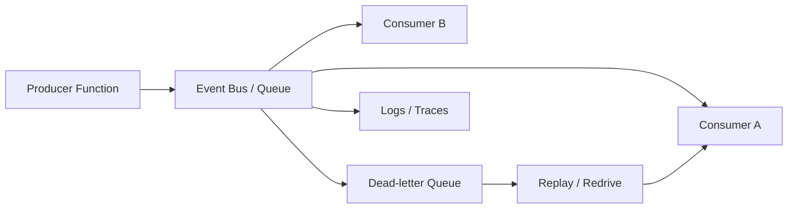
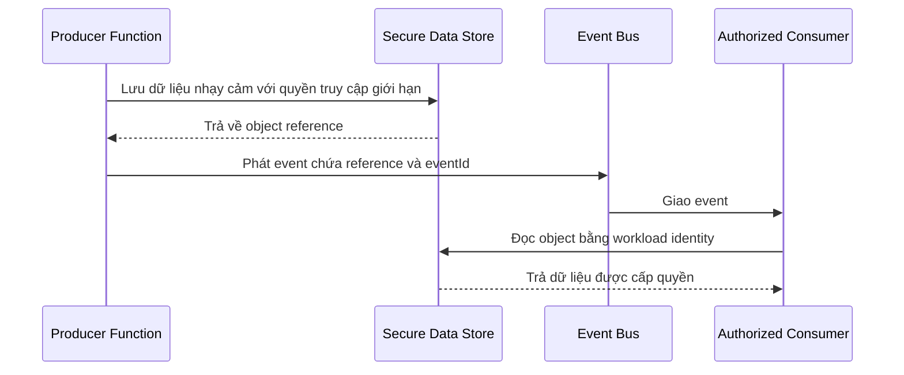
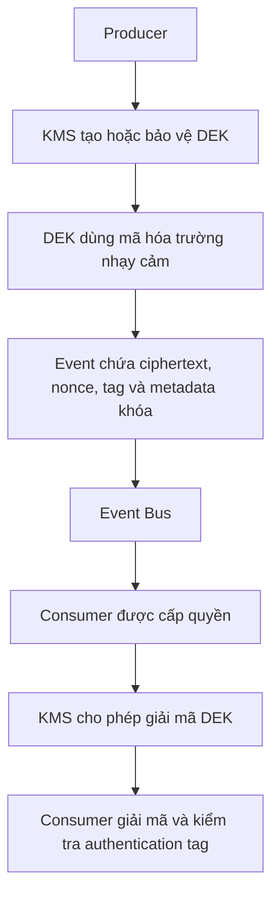

# Bảo vệ dữ liệu nhạy cảm trong nội dung sự kiện

Trong hệ thống serverless, một sự kiện có thể đi qua nhiều thành phần: function phát sự kiện, event bus hoặc queue, một hay nhiều consumer, hệ thống log, dead-letter queue (DLQ), kho lưu trữ và công cụ replay. Payload vì thế có thể được sao chép và tồn tại lâu hơn lần thực thi function ban đầu. Nếu payload chứa thông tin cá nhân, thông tin thanh toán, bí mật truy cập hoặc dữ liệu nghiệp vụ hạn chế, mỗi bản sao đều trở thành một điểm cần bảo vệ.

Bảo vệ dữ liệu nhạy cảm bắt đầu từ hợp đồng event: chỉ đưa vào những trường consumer thực sự cần, xác định rõ ai được đọc, giới hạn thời gian lưu và kiểm soát cách dữ liệu xuất hiện trong log, trace, DLQ cũng như bản replay. Mã hóa là một lớp bảo vệ quan trọng, nhưng không thể thay thế việc giảm dữ liệu và giới hạn quyền truy cập.

## 1. Vì sao payload sự kiện cần được bảo vệ?

Một function có thể xử lý request rồi kết thúc, nhưng sự kiện mà nó phát ra có thể được giữ trong queue, nhân bản sang nhiều subscriber hoặc lưu để xử lý lại khi có lỗi. Một payload chứa email, số điện thoại hay access token có thể xuất hiện trong nhiều nơi mà nhóm phát triển không nhìn thấy trong luồng nghiệp vụ chính.



Các đường đi này tạo ra một số rủi ro:

- **Phạm vi lan truyền rộng:** một event có thể được gửi đến nhiều consumer hơn dự kiến. Một trường không cần thiết cho consumer A vẫn được sao chép đến A cùng toàn bộ payload.
- **Bản sao tồn tại lâu:** queue, DLQ, log, bản backup và hệ thống phân tích có thể giữ payload sau khi function kết thúc.
- **Quyền truy cập không đồng đều:** người vận hành broker, người xem log hoặc người có quyền replay có thể có quyền khác với consumer nghiệp vụ.
- **Retry và replay:** một payload đã lỗi có thể được giữ lại, xem xét hoặc phát lại nhiều lần.
- **Rò rỉ qua metadata:** dữ liệu nhạy cảm có thể nằm trong message attribute, header, partition key, tên topic, exception hoặc trace baggage chứ không chỉ trong phần body.

Do đó, cần xem toàn bộ vòng đời event là một phần của thiết kế dữ liệu và bảo mật.

## 2. Phân loại dữ liệu trước khi thiết kế schema

Không phải mọi trường trong event đều có cùng mức độ nhạy cảm. Trước khi tạo schema, hãy xác định dữ liệu nào được phép công khai trong phạm vi hệ thống, dữ liệu nào chỉ dành cho nội bộ và dữ liệu nào cần kiểm soát chặt.

| Nhóm dữ liệu | Ví dụ | Cách xử lý khuyến nghị |
|---|---|---|
| Dữ liệu kỹ thuật ít nhạy cảm | Loại sự kiện, phiên bản schema, thời điểm phát | Có thể nằm trong envelope nếu không tiết lộ thông tin nội bộ nhạy cảm |
| Định danh nghiệp vụ | `orderId`, `invoiceId`, `jobId` | Chỉ đưa vào nếu consumer cần; tránh dùng giá trị có thể suy ra thông tin cá nhân |
| Dữ liệu cá nhân | Họ tên, email, số điện thoại, địa chỉ, mã định danh cá nhân | Loại khỏi event nếu không cần; nếu cần, giới hạn consumer, mã hóa hoặc dùng token tham chiếu |
| Dữ liệu tài chính | Số tài khoản, thông tin thẻ, giao dịch, số dư | Chỉ truyền phần tối thiểu; không đưa dữ liệu xác thực thanh toán hoặc toàn bộ thông tin thẻ vào event |
| Bí mật xác thực | Password, access token, refresh token, API key, private key | Không đưa vào payload, attribute, header hoặc log; dùng secret manager và danh tính workload |
| Dữ liệu đặc biệt nhạy cảm | Hồ sơ sức khỏe, dữ liệu sinh trắc học, thông tin pháp lý hoặc dữ liệu hạn chế theo chính sách | Chỉ xử lý khi có căn cứ và quyền truy cập phù hợp; cân nhắc tách khỏi event và dùng dịch vụ lưu trữ chuyên biệt |

Tên phân loại và quy tắc cụ thể cần theo chính sách dữ liệu của tổ chức và quy định áp dụng. Bảng trên là khung kỹ thuật để bắt đầu phân tích, không thay thế quy trình phân loại chính thức.

Hãy kiểm tra cả dữ liệu trực tiếp lẫn dữ liệu có thể suy luận. Một mã khách hàng có vẻ vô danh nhưng nếu có thể nối với bảng tra cứu thì vẫn có thể xác định một người. Một event ghi chính xác thời gian, địa điểm và loại giao dịch cũng có thể tiết lộ thông tin nhạy cảm khi kết hợp với nguồn khác.

## 3. Tối thiểu hóa nội dung event

Nguyên tắc quan trọng nhất là chỉ phát những trường consumer cần để thực hiện nhiệm vụ. Đừng sao chép nguyên request HTTP hoặc toàn bộ entity database vào event chỉ vì cách đó tiện cho producer.

### 3.1. Tránh phát toàn bộ đối tượng nghiệp vụ

Ví dụ payload không phù hợp:

```json
{
  "eventType": "OrderPlaced",
  "order": {
    "id": "ord-1042",
    "customer": {
      "name": "Nguyen Van A",
      "email": "customer@example.com",
      "phone": "+84901234567",
      "address": "..."
    },
    "payment": {
      "cardNumber": "...",
      "accessToken": "..."
    },
    "items": []
  }
}
```

Payload này đưa dữ liệu khách hàng và thông tin thanh toán đến mọi consumer nhận event, dù một consumer chỉ cần biết đơn hàng đã được tạo. Việc phát nguyên object còn khiến thay đổi cấu trúc database vô tình trở thành thay đổi hợp đồng event.

Ví dụ payload đã tối thiểu hóa:

```json
{
  "specversion": "1.0",
  "id": "evt-7f31",
  "type": "com.example.order.placed.v1",
  "source": "order-service",
  "time": "2026-11-17T10:15:30Z",
  "data": {
    "orderId": "ord-1042",
    "customerRef": "cust-ref-82",
    "total": 1250000,
    "currency": "VND"
  }
}
```

Ở ví dụ thứ hai, consumer nhận mã tham chiếu thay vì tên, email, số điện thoại và thông tin thanh toán. Consumer chỉ cần đọc thêm dữ liệu khi có lý do nghiệp vụ và được cấp quyền phù hợp.

### 3.2. Dùng tham chiếu thay vì nhúng dữ liệu lớn hoặc nhạy cảm

Khi consumer cần dữ liệu nhạy cảm để hoàn thành tác vụ, có thể lưu dữ liệu đó trong kho chuyên biệt rồi gửi một tham chiếu trong event. Consumer dùng danh tính workload của chính nó để truy xuất đúng đối tượng.



Tham chiếu nên là định danh đối tượng không tiết lộ dữ liệu, ví dụ `customerRecordRef` hoặc `secureObjectId`. Không nhúng password, bearer token, khóa truy cập hay URL ký sẵn có quyền đọc lâu dài vào event. Nếu dùng URL ký sẵn, nó thực chất là một bearer credential; cần thời hạn rất ngắn, phạm vi hẹp và cân nhắc rủi ro khi URL xuất hiện trong log hoặc DLQ. Thông thường, cấp quyền truy xuất qua IAM/workload identity sẽ dễ quản lý vòng đời hơn.

Mẫu tham chiếu giúp giảm số bản sao dữ liệu nhạy cảm trong broker và log. Tuy nhiên, nó tạo thêm một lần truy xuất và phụ thuộc vào tính sẵn sàng của kho dữ liệu. Cần định nghĩa thời hạn lưu của object, quyền đọc, cách xử lý khi object đã hết hạn và khả năng replay event sau khi object bị xóa.

### 3.3. Tokenization và pseudonymization

**Tokenization** thay giá trị nhạy cảm bằng một token được ánh xạ trong một hệ thống kiểm soát riêng. Consumer chỉ nhận token và không thể tự suy ra giá trị gốc nếu không có quyền truy cập dịch vụ ánh xạ.

**Pseudonymization** thay định danh trực tiếp bằng một định danh giả hoặc mã tham chiếu. Dữ liệu vẫn có thể liên kết lại với một cá nhân thông qua thông tin bổ sung, vì vậy không nên xem pseudonymization là ẩn danh hoàn toàn.

Không nên dùng phép băm SHA-256 đơn giản trên email hoặc số điện thoại làm giải pháp ẩn danh. Miền giá trị của các dữ liệu này có thể đoán được và kẻ tấn công có thể thử từ điển. Nếu cần đối chiếu ổn định mà không phát giá trị gốc, cân nhắc HMAC với khóa bí mật được quản lý an toàn hoặc một dịch vụ tokenization. Không đặt khóa HMAC trong source code hay event payload.

## 4. Mã hóa dữ liệu trên đường truyền và khi lưu trữ

Mã hóa giúp giảm khả năng đọc trộm dữ liệu khi payload bị truy cập trái phép ở một lớp hạ tầng. Cần thiết kế cả đường truyền, broker, nơi lưu trữ và trường nhạy cảm.

### 4.1. Mã hóa khi truyền

Producer, broker và consumer cần giao tiếp qua kênh được bảo vệ, thường là TLS. Xác minh chứng thư máy chủ; khi phù hợp, dùng mutual TLS hoặc cơ chế xác thực workload do nền tảng hỗ trợ. Không tắt kiểm tra chứng thư để khắc phục lỗi kết nối.

TLS bảo vệ dữ liệu trên đường truyền giữa các điểm kết nối. Khi broker nhận payload, dịch vụ có thể giải mã dữ liệu để định tuyến hoặc giao cho consumer. Vì vậy, TLS không tự bảo vệ payload khỏi người có quyền đọc broker, log hoặc DLQ.

### 4.2. Mã hóa khi lưu trữ

Bật mã hóa at rest cho queue, event bus, database, object storage, DLQ, backup và nơi lưu log theo khả năng của nền tảng. Dùng khóa do dịch vụ quản lý khóa (KMS) quản lý khi cần kiểm soát quyền sử dụng khóa, luân chuyển và audit.

Mã hóa ở cấp dịch vụ thường bảo vệ dữ liệu trên thiết bị lưu trữ. Quản trị viên hoặc workload có quyền đọc dịch vụ vẫn có thể nhận payload đã giải mã thông qua API. Nếu cần giới hạn cả nhà vận hành broker hoặc tách quyền đọc theo từng consumer, cân nhắc mã hóa ở cấp ứng dụng trước khi phát event.

### 4.3. Mã hóa cấp trường hoặc cấp ứng dụng

Với dữ liệu nhạy cảm cần nằm trong payload, producer có thể mã hóa riêng trường đó bằng cơ chế mã hóa đã được kiểm chứng. Consumer có quyền giải mã mới có thể đọc giá trị. Một cách triển khai phổ biến là envelope encryption: KMS bảo vệ data encryption key (DEK), còn DEK dùng để mã hóa dữ liệu bằng thuật toán xác thực như AES-GCM.



Payload có thể chứa ciphertext, nonce/IV, authentication tag và metadata nhận diện phiên bản khóa hoặc thuật toán. Không chứa plaintext DEK hay khóa gốc. Cần bảo đảm nonce không bị tái sử dụng với cùng khóa trong AES-GCM, xác thực tính toàn vẹn khi giải mã và có kế hoạch luân chuyển khóa. Không tự thiết kế thuật toán mã hóa hoặc tự viết giao thức mật mã; hãy dùng thư viện chuẩn và dịch vụ KMS được tổ chức phê duyệt.

Mã hóa cấp trường làm tăng độ phức tạp. Event bus có thể không đọc được trường đã mã hóa để lọc hoặc định tuyến. Vì vậy, các thuộc tính định tuyến cần thiết nên là metadata không nhạy cảm, được kiểm tra kỹ, còn dữ liệu riêng tư nằm trong phần mã hóa. Tránh để thông tin nhạy cảm lọt vào trường không mã hóa chỉ để phục vụ routing.

## 5. Quản lý secret và danh tính workload

Secret không phải dữ liệu nghiệp vụ. Password, API key, access token, refresh token, private key và credential database không được đưa vào event, message attribute, header tùy chỉnh, log hay trace.

Khi consumer cần gọi một dịch vụ khác, hãy cấp danh tính workload cho function và cho phép function lấy credential ngắn hạn hoặc đọc secret từ secret manager. Quyền truy cập cần giới hạn theo function, môi trường và mục đích. Không dùng chung một credential toàn quyền cho tất cả producer và consumer.

Một event có thể mang `customerRef` hoặc `resourceId` để consumer tìm dữ liệu, nhưng không được mang token để consumer dùng thay cho danh tính của chính nó. Việc một producer có quyền đọc dữ liệu không tự động có nghĩa mọi subscriber của event cũng có quyền đọc dữ liệu đó.

Nếu secret vô tình xuất hiện trong event, cần coi đó là sự cố lộ credential: thu hồi hoặc luân chuyển credential, xác định các queue/DLQ/log/backup đã nhận bản sao, giới hạn truy cập và xử lý bản sao theo quy trình ứng phó sự cố. Xóa message khỏi queue không bảo đảm secret đã biến mất khỏi mọi nơi.

## 6. Kiểm soát quyền truy cập theo producer và consumer

Hãy cấp quyền tối thiểu cho từng thành phần:

- Producer chỉ được phát đến đúng topic, queue hoặc event bus cần dùng.
- Consumer chỉ được đọc subscription hoặc queue của nó; chỉ được giải mã các trường mà nhiệm vụ yêu cầu.
- Dịch vụ lưu trữ chỉ cho phép đúng workload đọc object tương ứng.
- Quyền quản trị broker, DLQ, replay và log cần được giới hạn riêng, vì các quyền này có thể cho phép xem hoặc tái phát payload.
- Quyền dùng khóa KMS để mã hóa và giải mã cần tách biệt; không cấp quyền giải mã rộng chỉ vì một function có quyền nhận event.

Ngoài IAM hoặc policy của nền tảng, cần kiểm tra nguồn phát và tính hợp lệ của event. Không tin trường `source`, `tenantId`, `role` hoặc `userId` trong payload như bằng chứng xác thực nếu producer không được xác thực và event không được bảo vệ tính toàn vẹn. Với môi trường nhiều tenant, consumer phải xác định tenant từ ngữ cảnh đáng tin cậy và kiểm tra quyền trên tài nguyên trước khi truy xuất dữ liệu.

Nếu dùng chữ ký số hoặc HMAC để kiểm tra tính toàn vẹn và nguồn phát, hãy quản lý khóa riêng qua KMS/secret manager, xác định phiên bản khóa, thời điểm hết hạn và cơ chế chống replay. Chữ ký chứng minh dữ liệu không bị thay đổi bởi bên không có khóa; nó không thay thế kiểm tra quyền truy cập của consumer.

## 7. Bảo vệ log, trace, metric và thông báo lỗi

Một lỗi thường gặp là payload được bảo vệ trong broker nhưng lại bị ghi nguyên văn vào log khi parse thất bại. Log, trace và metric có phạm vi người xem, thời gian lưu và cơ chế xuất dữ liệu riêng; cần áp dụng chính sách bảo vệ tương đương.

Nên ghi log theo allowlist: event type, event ID, correlation ID, kết quả xử lý và mã lỗi đã chuẩn hóa. Chỉ ghi các định danh nghiệp vụ cần thiết. Không log toàn bộ object, HTTP body, header xác thực, message body, access token, số thẻ hoặc dữ liệu cá nhân.

Ví dụ log không an toàn:

```java
logger.error("Cannot process event: {}", objectMapper.writeValueAsString(event));
```

Ví dụ log có kiểm soát:

```java
logger.error(
        "Cannot process eventId={} type={} errorCode={}",
        event.eventId(),
        "order.placed.v1",
        "INVALID_ORDER_REFERENCE");
```

Không nên dựa hoàn toàn vào regex để che dữ liệu sau khi đã ghi toàn bộ payload. Regex có thể bỏ sót định dạng mới, dữ liệu lồng nhau hoặc trường tùy biến. Tốt hơn là chỉ log các trường đã được cho phép. Event ID và correlation ID cũng nên là giá trị opaque, không mã hóa email, số điện thoại hoặc thông tin cá nhân trong cấu trúc ID. Nếu cần che dữ liệu trong một hệ thống log trung tâm, vẫn phải giảm dữ liệu ngay từ producer vì payload có thể bị ghi ở nhiều điểm khác.

Với trace, không đưa email, số điện thoại, token hoặc nội dung message vào span attribute hay baggage. Với metric, không dùng định danh người dùng hoặc order ID làm label có cardinality cao. Dùng số liệu tổng hợp như số event theo loại, tỷ lệ lỗi và độ trễ xử lý.

Thông báo lỗi gửi về client hoặc hệ thống gọi nên dùng mã lỗi ổn định và correlation ID. Stack trace, câu truy vấn, nội dung payload và thông tin nội bộ chỉ được ghi ở nơi vận hành có kiểm soát, sau khi đã loại bỏ dữ liệu nhạy cảm.

## 8. DLQ, retry, lưu giữ và replay

DLQ thường lưu nguyên message gây lỗi để điều tra hoặc phát lại. Vì vậy, DLQ là nơi lưu dữ liệu nhạy cảm nếu payload ban đầu có dữ liệu đó. Hãy áp dụng cùng yêu cầu mã hóa, quyền đọc, audit và thời hạn lưu cho DLQ như queue chính.

Trước khi bật replay hoặc redrive, hãy xác định:

1. Ai được xem và phát lại message? Có cần phê duyệt cho dữ liệu hạn chế không?
2. Consumer hiện tại có còn tương thích với schema và phiên bản event cũ không?
3. Dữ liệu tham chiếu còn tồn tại và người chạy replay có quyền truy cập không?
4. Event có chứa secret hoặc dữ liệu đã hết hạn lưu không? Có cần loại bỏ hoặc thay thế payload trước khi phát lại không?
5. Consumer có idempotent để tránh tạo tác động nghiệp vụ trùng không?
6. Replay có ghi lại người thực hiện, thời điểm, phạm vi message và kết quả hay không?

Thiết lập retention phù hợp cho queue, DLQ, log, trace, object storage và backup. Không giữ payload vô thời hạn chỉ vì có thể hữu ích cho debug. Khi có yêu cầu xóa dữ liệu, cần xác định các bản sao và hệ thống downstream chịu trách nhiệm xử lý; event bất biến có thể khiến việc xóa một trường khỏi bản ghi gốc không tự động xóa dữ liệu trong các bản sao cũ.

Với dữ liệu cần khả năng replay dài hạn, hãy cân nhắc event chỉ chứa định danh và dữ liệu nghiệp vụ tối thiểu. Dữ liệu nhạy cảm được lấy từ kho có chính sách retention riêng. Khi dữ liệu bị xóa hoặc hết hạn, replay có thể nhận lỗi tham chiếu đã hết hạn và phải có cách xử lý rõ ràng.

## 9. Ví dụ thiết kế event an toàn trong Java

Ví dụ sau dùng Java record để thể hiện hợp đồng event chỉ mang dữ liệu cần cho consumer. `customerRef` là mã tham chiếu do hệ thống tokenization hoặc dịch vụ định danh nội bộ cấp; nó không phải email hay số điện thoại.

```java
import java.math.BigDecimal;
import java.time.Instant;

public record OrderPlacedEvent(
        String eventId,
        String orderId,
        String customerRef,
        BigDecimal total,
        String currency,
        Instant occurredAt
) {}
```

Producer tạo event sau khi giao dịch đơn hàng được commit:

```java
public final class OrderEventPublisher {
    private final EventBus eventBus;
    private final CustomerReferenceService references;

    public OrderEventPublisher(
            EventBus eventBus,
            CustomerReferenceService references) {
        this.eventBus = eventBus;
        this.references = references;
    }

    public void publish(Order order) {
        String customerRef = references.referenceFor(order.customerId());

        OrderPlacedEvent event = new OrderPlacedEvent(
                order.eventId(),
                order.id(),
                customerRef,
                order.total(),
                order.currency(),
                Instant.now());

        eventBus.publish("order.placed.v1", event);
    }
}
```

`EventBus`, `Order` và `CustomerReferenceService` là giao diện minh họa của ứng dụng. Trong hệ thống thực tế, thời điểm phát event cần được bảo đảm nhất quán với giao dịch nghiệp vụ, ví dụ dùng transactional outbox. `customerRef` phải được tạo và quản lý bởi dịch vụ tin cậy; không tự tạo token bằng cách băm dữ liệu cá nhân không có khóa.

Consumer chỉ truy xuất dữ liệu riêng tư nếu nhiệm vụ yêu cầu và danh tính workload được cấp quyền:

```java
public final class OrderNotificationHandler {
    private final CustomerProfileService profiles;
    private final NotificationService notifications;

    public OrderNotificationHandler(
            CustomerProfileService profiles,
            NotificationService notifications) {
        this.profiles = profiles;
        this.notifications = notifications;
    }

    public void handle(OrderPlacedEvent event) {
        CustomerContact contact = profiles.getContact(event.customerRef());
        notifications.sendOrderConfirmation(event.orderId(), contact);
    }
}
```

Ví dụ này giả định function notification được cấp quyền đọc thông tin liên hệ qua `CustomerProfileService`. Một consumer phân tích doanh thu có thể chỉ cần `orderId`, `total` và `currency`, không cần quyền đọc hồ sơ khách hàng. Tách quyền như vậy giảm phạm vi ảnh hưởng khi một consumer bị xâm nhập.

## 10. Kiểm tra và vận hành bảo vệ dữ liệu

Trước khi phát hành một schema event, hãy thực hiện kiểm tra ở cả thời điểm phát triển và khi chạy:

- **Schema review:** đánh dấu trường nhạy cảm, chủ sở hữu dữ liệu, mục đích sử dụng, consumer được phép và thời hạn lưu.
- **Contract test:** xác nhận producer không phát thêm trường ngoài hợp đồng và consumer chỉ phụ thuộc trường đã cam kết.
- **Test log:** gửi payload giả lập có email, token và số định danh; xác minh chúng không xuất hiện trong log, trace hoặc thông báo lỗi.
- **Test quyền:** thử đọc queue, DLQ, object và giải mã trường bằng danh tính không được cấp quyền; thao tác phải bị từ chối.
- **Test replay:** phát lại event cũ, event trùng và event có tham chiếu hết hạn; xác minh idempotency và xử lý lỗi.
- **Audit:** theo dõi việc đọc DLQ, sử dụng khóa, thay đổi policy và thao tác replay.
- **Alert:** cảnh báo khi số lượng DLQ tăng bất thường, có truy cập trái phép hoặc payload bị ghi vào log ngoài dự kiến.

Khi phát hiện dữ liệu nhạy cảm bị phát nhầm, cần xác định event ID và các bản sao có thể bị ảnh hưởng; giới hạn quyền truy cập; dừng replay hoặc fan-out nếu cần; thu hồi credential nếu có secret; đánh giá log, DLQ, backup và consumer downstream; rồi xử lý xóa hoặc thay thế dữ liệu theo quy trình ứng phó sự cố của tổ chức. Ghi nhận phạm vi, thời điểm, người xử lý và quyết định khắc phục để có thể kiểm tra lại.

## 11. Checklist thiết kế payload an toàn

Trước khi đưa event vào production, hãy trả lời các câu hỏi sau:

1. Mỗi trường có mục đích nghiệp vụ rõ ràng và có consumer thực sự cần không?
2. Có thể bỏ dữ liệu cá nhân, dùng token hoặc gửi reference thay cho giá trị gốc không?
3. Payload, message attribute, header, partition key và tên resource có vô tình chứa dữ liệu nhạy cảm không?
4. Dữ liệu có được mã hóa khi truyền và khi lưu trữ ở broker, DLQ, backup và log không?
5. Có cần mã hóa cấp trường để giới hạn consumer được đọc plaintext không? Ai có quyền giải mã?
6. Producer, consumer, người vận hành, người xem log và người replay có quyền tối thiểu không?
7. Secret được lấy từ secret manager hoặc workload identity thay vì nằm trong event chứ?
8. Log, trace, metric và exception có chỉ chứa dữ liệu được cho phép không?
9. Retention, xóa dữ liệu, backup, DLQ và replay có cùng một chính sách được hiểu rõ không?
10. Có test hợp đồng, test quyền, test redaction và audit để phát hiện sai lệch không?

## Kết luận

Bảo vệ dữ liệu nhạy cảm trong event cần bắt đầu từ việc giảm nội dung payload và giới hạn người nhận. Dùng token hoặc tham chiếu khi consumer không cần dữ liệu gốc; mã hóa trên đường truyền, khi lưu trữ và ở cấp trường khi cần; cấp quyền theo danh tính workload; đồng thời bảo vệ log, DLQ, backup và replay. Một hợp đồng event an toàn giúp các function trao đổi thông tin vừa đủ cho nghiệp vụ mà không mở rộng không cần thiết phạm vi dữ liệu được sao chép và truy cập.
