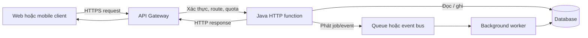

# Thiết kế REST API cho backend serverless

REST API là một cách tổ chức giao tiếp HTTP quanh các tài nguyên và thao tác trên tài nguyên. Trong backend serverless, API thường đi qua API gateway hoặc HTTP router rồi kích hoạt một function Java. Function xác thực và kiểm tra request, thực hiện quy tắc nghiệp vụ, đọc hoặc ghi trạng thái ở dịch vụ bên ngoài và trả response theo hợp đồng HTTP.

Một REST API tốt cần cho client biết tài nguyên nào tồn tại, có thể thực hiện thao tác gì, dữ liệu được gửi theo cấu trúc nào, lỗi được biểu diễn ra sao và một thao tác mất bao lâu để hoàn tất. Kiến trúc serverless bổ sung các quyết định về trigger, timeout, concurrency, retry, idempotency và cách chuyển công việc dài sang xử lý bất đồng bộ.

Bài học này tập trung vào thiết kế API cho backend serverless dùng HTTP trigger. Các nguyên tắc REST và HTTP vẫn áp dụng cho backend chạy trên máy chủ truyền thống; điểm cần chú ý là function có vòng đời invocation riêng, không nên giữ trạng thái nghiệp vụ trong bộ nhớ và có thể bị nền tảng gọi lại khi client hoặc hạ tầng retry.

## 1. REST API và mô hình tài nguyên

REST tổ chức API quanh **resource** (tài nguyên), được nhận diện bằng URI. Tài nguyên có thể là một thực thể nghiệp vụ như đơn hàng, khách hàng, báo cáo hoặc một tập hợp như danh sách đơn hàng. HTTP method mô tả thao tác mong muốn trên tài nguyên.

Ví dụ với hệ thống đơn hàng:

| Tài nguyên | URI mẫu | Ý nghĩa |
|---|---|---|
| Danh sách đơn hàng | `/v1/orders` | Tập hợp đơn hàng trong phạm vi người gọi được phép truy cập |
| Một đơn hàng | `/v1/orders/{orderId}` | Một đơn hàng cụ thể |
| Các dòng hàng của đơn | `/v1/orders/{orderId}/items` | Tập hợp dòng hàng thuộc đơn hàng |
| Một dòng hàng | `/v1/orders/{orderId}/items/{itemId}` | Một dòng hàng cụ thể |
| Trạng thái thanh toán | `/v1/orders/{orderId}/payment` | Trạng thái hoặc tài nguyên thanh toán của đơn |
| Công việc tạo báo cáo | `/v1/report-jobs/{jobId}` | Trạng thái một công việc xử lý bất đồng bộ |

Tên URI thường dùng danh từ số nhiều cho collection và định danh cho một phần tử. Dùng cấu trúc nhất quán để client có thể dự đoán đường dẫn. Tránh đặt URI theo tên function như `/createOrder`, `/getOrder` hoặc `/runReport`; đó là cách đặt tên hành động gắn với implementation hơn là tài nguyên.

Một thao tác đặc biệt khó biểu diễn như tài nguyên có thể được mô hình hóa thành sub-resource hoặc command resource. Ví dụ, thay vì tạo endpoint tùy ý `/payNow`, có thể tạo một payment intent hoặc payment attempt gắn với đơn hàng. Cách biểu diễn phải làm rõ đối tượng được tạo hoặc trạng thái nghiệp vụ được thay đổi.

REST không yêu cầu mọi API phải có đầy đủ mọi thao tác CRUD. Chỉ công khai những thao tác nghiệp vụ mà client được phép thực hiện. Một đơn hàng đã thanh toán có thể không cho phép sửa dòng hàng dù về mặt kỹ thuật database hỗ trợ update.

## 2. Chọn HTTP method và status code đúng ngữ nghĩa

HTTP method truyền đạt ý nghĩa của thao tác. Client, proxy, cache và công cụ quan sát dựa vào ngữ nghĩa này để xử lý request.

| Method | Mục đích thường dùng | Đặc tính ngữ nghĩa |
|---|---|---|
| `GET` | Đọc collection hoặc resource | Safe; không yêu cầu thay đổi trạng thái nghiệp vụ |
| `POST` | Tạo resource hoặc gửi command | Không mặc định idempotent |
| `PUT` | Tạo hoặc thay thế representation tại URI đã biết | Idempotent theo ngữ nghĩa |
| `PATCH` | Thay đổi một phần resource | Có thể không idempotent, tùy patch semantics |
| `DELETE` | Xóa hoặc yêu cầu xóa resource | Idempotent theo ngữ nghĩa, dù response các lần gọi có thể khác |
| `HEAD` | Lấy metadata tương tự GET mà không có response body | Safe |
| `OPTIONS` | Khám phá method hoặc hỗ trợ CORS preflight | Safe |

**Safe** nghĩa là client không yêu cầu method làm thay đổi trạng thái nghiệp vụ. Logging, metric hoặc cập nhật cache nội bộ vẫn có thể xảy ra. **Idempotent** nghĩa là thực hiện cùng một request nhiều lần có cùng hiệu ứng nghiệp vụ như thực hiện một lần; response ở các lần gọi không nhất thiết giống hệt nhau.

Ví dụ:

- `GET /v1/orders/ord-1042` đọc một đơn hàng.
- `POST /v1/orders` tạo đơn hàng mới.
- `PUT /v1/customers/cus-42/preferences` thay thế toàn bộ preferences tại URI đó.
- `PATCH /v1/orders/ord-1042` cập nhật một số trường được cho phép.
- `DELETE /v1/orders/ord-1042` yêu cầu xóa hoặc chuyển tài nguyên sang trạng thái đã xóa theo chính sách nghiệp vụ.

Không dùng GET để thực hiện thao tác có side effect như thanh toán, gửi email hoặc tạo đơn. Client, crawler hay proxy có thể gọi lại GET vì mục đích cache, prefetch hoặc kiểm tra. Thao tác thay đổi dữ liệu phải dùng method có ngữ nghĩa phù hợp và có bảo vệ retry.

Các status code thường gặp:

| Status | Khi nào dùng |
|---|---|
| `200 OK` | Request thành công và có representation trong response |
| `201 Created` | Đã tạo resource; nên trả header `Location` trỏ tới resource mới |
| `202 Accepted` | Đã tiếp nhận công việc để xử lý sau; chưa khẳng định nghiệp vụ hoàn tất |
| `204 No Content` | Thành công nhưng không cần response body |
| `304 Not Modified` | Representation chưa thay đổi theo điều kiện cache |
| `400 Bad Request` | Request sai cú pháp hoặc không thỏa điều kiện đầu vào cơ bản |
| `401 Unauthorized` | Thiếu hoặc không có credential hợp lệ; client cần xác thực |
| `403 Forbidden` | Đã nhận diện caller nhưng không được phép thực hiện hành động |
| `404 Not Found` | Resource không tồn tại hoặc không được tiết lộ trong phạm vi truy cập |
| `409 Conflict` | Xung đột với trạng thái hiện tại hoặc quy tắc nghiệp vụ |
| `412 Precondition Failed` | Điều kiện như `If-Match` không còn đúng |
| `415 Unsupported Media Type` | Content type không được hỗ trợ |
| `422 Unprocessable Content` | Nội dung đúng cú pháp nhưng không thể xử lý theo quy tắc validation |
| `429 Too Many Requests` | Caller vượt giới hạn tốc độ hoặc quota |
| `500 Internal Server Error` | Lỗi không dự kiến trong backend |
| `502 Bad Gateway` | Gateway nhận phản hồi không hợp lệ từ upstream |
| `503 Service Unavailable` | Dịch vụ tạm thời không sẵn sàng |
| `504 Gateway Timeout` | Gateway không nhận được phản hồi upstream trong thời hạn |

Status code phải thống nhất trên toàn API. Ví dụ, lỗi thiếu quyền nên không lúc trả 400, lúc trả 500. Cần chọn cách xử lý 404 cho resource thuộc tenant khác theo chính sách bảo mật: một số hệ thống trả 404 để không tiết lộ resource tồn tại; hệ thống khác trả 403 khi việc tiết lộ đó được chấp nhận.

## 3. Thiết kế request và response dễ dùng

JSON thường là định dạng trao đổi phổ biến cho REST API. Hãy dùng tên field, kiểu dữ liệu, đơn vị đo và quy tắc null nhất quán. Một field biểu diễn số tiền cần chỉ rõ currency hoặc quy tắc đơn vị; một timestamp nên có timezone, thường dùng ISO 8601 ở UTC.

Ví dụ request tạo đơn hàng:

```http
POST /v1/orders HTTP/1.1
Content-Type: application/json
Authorization: Bearer <access-token>
Idempotency-Key: 4e9f3d2a-2f63-4db1-9d40-0f5a90b31a12

{
  "items": [
    {
      "productId": "prd-12",
      "quantity": 2
    }
  ],
  "currency": "VND"
}
```

Ví dụ response khi tạo thành công:

```http
HTTP/1.1 201 Created
Content-Type: application/json
Location: /v1/orders/ord-1042

{
  "id": "ord-1042",
  "status": "PENDING_PAYMENT",
  "currency": "VND",
  "totalAmount": 250000,
  "createdAt": "2026-11-17T10:15:30Z"
}
```

Response nên trả dữ liệu đủ để client tiếp tục công việc, nhưng không trả toàn bộ database record. Không để lộ internal ID nếu nó làm tăng rủi ro, tên bảng, stack trace, SQL, secret, thông tin nội bộ của nhà cung cấp hoặc trường chỉ dành cho vận hành.

Các nguyên tắc hữu ích:

- Dùng cùng kiểu định danh cho một loại resource trong mọi endpoint.
- Dùng số nguyên hoặc decimal có quy tắc rõ ràng cho tiền; tránh floating point nhị phân cho phép tính tiền tệ.
- Dùng UTC và định dạng timestamp nhất quán.
- Phân biệt field bị bỏ qua, field có giá trị null và field rỗng.
- Giữ response schema ổn định; thêm field tùy chọn thường dễ tương thích hơn đổi kiểu hoặc đổi ý nghĩa field cũ.
- Không yêu cầu client gửi lại dữ liệu server đã có thể xác định đáng tin cậy, như user ID từ access token.
- Dùng content negotiation khi API thực sự hỗ trợ nhiều representation; nếu chỉ dùng JSON, công bố rõ `application/json`.

Không phản chiếu nguyên văn mọi input vào response hoặc log. Dữ liệu đầu vào có thể chứa HTML, thông tin nhạy cảm hoặc chuỗi lớn được tạo để gây quá tải.

## 4. Định tuyến request qua API gateway tới Java function

Trong kiến trúc serverless, API gateway thường là điểm vào HTTP. Gateway có thể định tuyến theo path và method, xác thực token, giới hạn tốc độ, áp dụng quota, cấu hình CORS, chuyển tiếp request tới function và ánh xạ response. Một số trách nhiệm có thể nằm trong function hoặc dịch vụ identity riêng, tùy nền tảng.

Luồng tổng quát:



Một request có thể được xử lý theo các bước:

1. Gateway nhận HTTPS request và áp dụng giới hạn cơ bản.
2. Gateway hoặc authorizer xác minh credential.
3. Gateway chọn route dựa trên method và path.
4. Function nhận request cùng context đáng tin cậy do adapter cung cấp.
5. Function kiểm tra payload, quyền trên resource và quy tắc nghiệp vụ.
6. Function đọc/ghi trạng thái hoặc chuyển công việc sang queue.
7. Adapter chuyển kết quả thành status, headers và body HTTP.
8. Gateway trả response về client.

Hãy xác định rõ đâu là nơi chịu trách nhiệm cho từng kiểm soát. Nếu gateway xác thực JWT, function vẫn phải phân quyền trên resource. Nếu gateway validate một phần schema, domain layer vẫn phải bảo vệ bất biến nghiệp vụ. Nếu gateway thêm header chứa danh tính, phải ngăn client tự gửi header cùng tên để giả mạo context.

Không phụ thuộc vào một header identity chỉ vì nó xuất hiện trong request. Chỉ tin context do gateway hoặc runtime tạo sau khi xác minh và bảo vệ đường truyền giữa gateway với function. Nếu function có thể được gọi trực tiếp, phải áp dụng cơ chế xác thực tương đương hoặc giới hạn quyền invoke để không thể bỏ qua gateway.

## 5. Validate request và bảo vệ quy tắc nghiệp vụ

Validation cần được thực hiện ở biên HTTP và ở tầng nghiệp vụ. Gateway có thể chặn request quá lớn hoặc sai content type; function cần parse và kiểm tra schema; domain service cần bảo vệ các quy tắc như số lượng hàng phải dương, đơn hàng không được thanh toán hai lần hoặc người dùng chỉ thao tác trong tenant được cấp quyền.

Phân biệt các nhóm kiểm tra:

- **Cú pháp:** JSON hợp lệ, field đúng kiểu, path parameter đúng định dạng.
- **Giới hạn:** độ dài chuỗi, số phần tử, kích thước file, giá trị số và số trang.
- **Ngữ nghĩa:** currency được hỗ trợ, quantity lớn hơn 0, ngày kết thúc không trước ngày bắt đầu.
- **Quyền:** caller được đọc hoặc thay đổi resource cụ thể.
- **Trạng thái:** resource đang ở trạng thái cho phép thao tác, ví dụ chỉ đơn hàng chưa thanh toán mới có thể hủy.
- **Tính nhất quán:** giá, tồn kho và version vẫn hợp lệ tại thời điểm ghi.

Ví dụ Java minh họa phần validation và phân quyền trước khi tạo đơn:

```java
public CreateOrderResult createOrder(
        VerifiedIdentity identity,
        CreateOrderRequest request) {

    if (request.items() == null || request.items().isEmpty()) {
        throw new ValidationException("items must not be empty");
    }

    for (CreateOrderItem item : request.items()) {
        if (item.quantity() <= 0) {
            throw new ValidationException(
                    "quantity must be greater than zero");
        }
    }

    authorization.requireCanCreateOrder(
            identity,
            identity.tenantId()
    );

    return orderService.create(
            identity.tenantId(),
            identity.subject(),
            request
    );
}
```

Đây là ví dụ về cấu trúc trách nhiệm; các kiểu request, identity, exception và adapter phụ thuộc framework Java đang dùng. Trong ứng dụng thực tế, không lấy tenant hoặc subject từ body để thay thế identity đã xác minh. Domain service cần tiếp tục kiểm tra các điều kiện nghiệp vụ khi ghi dữ liệu, đặc biệt khi có concurrency.

Validation không thay thế parameterized query hoặc ORM binding. Không ghép chuỗi SQL, tên bảng hoặc biểu thức truy vấn từ input không tin cậy. Với URL đích do người dùng cung cấp, cần kiểm tra scheme, hostname và địa chỉ phân giải để tránh SSRF. Với file upload, kiểm tra kích thước, định dạng thực và quyền truy cập object.

## 6. Xác thực, phân quyền và CORS

REST API công khai cần xác định rõ cách nhận diện caller. Các lựa chọn thường gặp gồm OAuth 2.0/OIDC access token, JWT được xác minh bởi authorizer, session cookie hoặc API key cho use case giới hạn. API key thường phù hợp để nhận diện ứng dụng hoặc áp dụng quota; không nên coi nó là bằng chứng đầy đủ về danh tính người dùng.

Xác thực (authentication) trả lời ai đang gọi. Phân quyền (authorization) trả lời danh tính đó được phép làm gì trên resource nào. Một token hợp lệ không có nghĩa caller được đọc mọi đơn hàng. Hãy kiểm tra quyền trên từng resource và tenant ở phía server, kể cả khi client đã gửi ID hợp lệ.

Một số nguyên tắc:

- Xác minh chữ ký, issuer, audience, thời hạn và các claim cần thiết của token.
- Dùng scope hoặc role để giới hạn nhóm hành động; kiểm tra quyền trên resource cụ thể.
- Lấy subject và tenant từ identity context đáng tin cậy.
- Dùng IAM/workload identity cho function gọi dịch vụ cloud hoặc function khác.
- Cấp quyền tối thiểu cho execution role của function.
- Không nhúng secret hoặc access key dài hạn trong source code hay response.
- Dùng TLS cho mọi đường truyền có dữ liệu xác thực hoặc dữ liệu nghiệp vụ.
- Có chính sách thu hồi, xoay vòng và thời hạn cho credential.

**CORS** là cơ chế của trình duyệt kiểm soát việc một origin có được đọc response từ origin khác hay không. CORS không phải cơ chế xác thực và không ngăn client ngoài trình duyệt gọi API. Cấu hình CORS cần nêu rõ allowed origins, methods, headers và việc có cho phép credential hay không. Nếu dùng cookie hoặc credential, không kết hợp wildcard origin với credential; hãy trả origin cụ thể được phép và cấu hình cookie phù hợp.

Request preflight dùng method OPTIONS có thể được xử lý tại gateway. Nếu gateway đã xử lý CORS, tránh cấu hình response headers mâu thuẫn ở function. Hãy kiểm thử cả request đơn giản, preflight, origin hợp lệ và origin không được phép.

## 7. Idempotency và retry cho thao tác thay đổi dữ liệu

Trong serverless, client có thể gửi lại request khi timeout hoặc mất kết nối, dù function đã thực hiện side effect. Gateway, SDK hoặc lớp mạng cũng có thể retry theo chính sách riêng. Nếu mỗi lần POST đều tạo một đơn hàng mới, người dùng có thể bị tạo đơn trùng hoặc thanh toán hai lần.

Idempotency key cho phép client gửi một định danh duy nhất cho một ý định nghiệp vụ. Server lưu key cùng phạm vi caller/tenant, loại thao tác, dấu vân tay request và kết quả. Khi nhận lại cùng key với cùng nội dung, server trả kết quả đã lưu hoặc trạng thái đang xử lý. Nếu cùng key nhưng payload khác, trả lỗi xung đột.

Một luồng xử lý điển hình:

1. Client tạo idempotency key và gửi cùng request.
2. Function xác thực caller, validate request và tạo scope key.
3. Backend thực hiện thao tác claim key bằng transaction hoặc conditional write nguyên tử.
4. Nếu key đã hoàn tất và fingerprint khớp, trả kết quả đã lưu.
5. Nếu key đang được xử lý, trả trạng thái phù hợp hoặc yêu cầu client truy vấn lại.
6. Nếu key mới, thực hiện nghiệp vụ và ghi kết quả cùng trạng thái idempotency.
7. Lưu key trong khoảng thời gian phù hợp với thời gian client có thể retry.

Không chỉ lưu key trong static map của function. Nhiều execution environment có thể nhận cùng request; bộ nhớ từng môi trường không chia sẻ và có thể bị thu hồi. Idempotency cần được thực thi ở kho trạng thái dùng chung với bảo đảm atomicity.

Phân biệt retry kỹ thuật với retry nghiệp vụ. Timeout khi gọi dịch vụ ngoài có thể để lại kết quả không rõ: request đã được xử lý hay chưa? Với payment provider, dùng idempotency key ở cả phía provider nếu hỗ trợ, và truy vấn trạng thái trước khi gửi lại thao tác không rõ kết quả.

## 8. Thiết kế endpoint cho công việc bất đồng bộ

Function serverless thường có giới hạn thời gian invocation. Nếu một request cần tạo báo cáo lớn, xử lý video, gọi nhiều hệ thống hoặc chờ workflow dài, giữ HTTP request mở có thể gây timeout ở client hoặc gateway. API có thể tiếp nhận công việc rồi xử lý bất đồng bộ.

Ví dụ:

```http
POST /v1/report-jobs HTTP/1.1
Content-Type: application/json

{
  "reportType": "monthly-sales",
  "month": "2026-10"
}
```

Response:

```http
HTTP/1.1 202 Accepted
Location: /v1/report-jobs/job-91ac
Retry-After: 3
Content-Type: application/json

{
  "id": "job-91ac",
  "status": "QUEUED",
  "statusUrl": "/v1/report-jobs/job-91ac"
}
```

Client truy vấn trạng thái:

```http
GET /v1/report-jobs/job-91ac HTTP/1.1
```

Khi hoàn tất, response có thể chứa trạng thái `SUCCEEDED` cùng link tải kết quả. Khi lỗi, resource job có thể lưu mã lỗi công khai, thông tin có thể retry và thời điểm cập nhật. Không trả stack trace hoặc thông tin nội bộ của worker.

Một mô hình trạng thái đơn giản:

```text
QUEUED -> RUNNING -> SUCCEEDED
                  -> FAILED
                  -> CANCELLED
```

Cần định nghĩa rõ:

- Job được tạo và lưu bền vững trước khi API trả 202.
- Queue message mang job ID hoặc dữ liệu tối thiểu cần thiết.
- Worker cập nhật trạng thái bằng conditional update hoặc version để tránh ghi đè.
- Retry có giới hạn; job có thể vào DLQ khi không tự phục hồi.
- Client có thể truy vấn trạng thái và biết khi nào kết quả sẵn sàng.
- Quyền đọc, hủy và tải kết quả được kiểm tra theo owner hoặc tenant.
- Job và kết quả có retention policy rõ ràng.

Không trả 202 nếu request mới chỉ được đưa vào một queue trong bộ nhớ hoặc một background thread không bền vững. Cần có bằng chứng tiếp nhận được lưu bền vững trước khi phản hồi thành công.

## 9. Pagination, filtering, sorting và cache

Endpoint collection có thể tăng nhanh về số lượng. Trả toàn bộ dữ liệu trong một response gây tốn bộ nhớ, tăng latency và có thể vượt giới hạn payload của gateway. Hãy hỗ trợ pagination và giới hạn kích thước trang.

Có hai cách phổ biến:

- **Offset pagination:** dùng `limit` và `offset`, dễ hiểu nhưng có thể chậm ở offset lớn và dữ liệu thay đổi giữa các trang có thể làm bản ghi bị lặp hoặc bỏ sót.
- **Cursor pagination:** response trả một cursor để lấy trang tiếp theo. Cursor nên được mã hóa hoặc ký, gắn với điều kiện truy vấn và có thể chứa khóa sắp xếp ổn định.

Ví dụ:

```http
GET /v1/orders?limit=25&status=PAID&sort=-createdAt
```

Response:

```json
{
  "items": [
    {
      "id": "ord-1042",
      "status": "PAID",
      "createdAt": "2026-11-17T10:15:30Z"
    }
  ],
  "nextCursor": "eyJjcmVhdGVkQXQiOi..."
}
```

Các quy tắc:

- Đặt default limit và maximum limit ở server.
- Chỉ cho phép filter và sort trên field đã công bố.
- Kiểm tra quyền và tenant trước khi trả dữ liệu.
- Dùng thứ tự ổn định, thường kết hợp timestamp với unique ID.
- Không để cursor cho phép người dùng truy cập tenant hoặc điều kiện truy vấn khác.
- Không trả tổng số bản ghi nếu phép đếm quá tốn kém hoặc làm lộ thông tin.

Với GET response có thể cache, cân nhắc `Cache-Control`, `ETag`, `Last-Modified`, `If-None-Match` và `If-Modified-Since`. Dữ liệu cá nhân hoặc tenant-specific không được cache công khai. Đặt `Cache-Control: private` hoặc `no-store` khi phù hợp. Cache không thay thế authorization; phải tránh trả response của một user cho user khác do cache key thiếu yếu tố phân vùng.

## 10. Chuẩn hóa lỗi và hợp đồng API

Client cần nhận biết lỗi theo một cấu trúc ổn định. Có thể dùng Problem Details theo RFC 9457 với content type `application/problem+json`.

Ví dụ:

```http
HTTP/1.1 422 Unprocessable Content
Content-Type: application/problem+json

{
  "type": "https://api.example.com/problems/invalid-order",
  "title": "Order cannot be created",
  "status": 422,
  "detail": "At least one item has an invalid quantity.",
  "instance": "/v1/orders",
  "code": "INVALID_ITEM_QUANTITY",
  "traceId": "req-91ac"
}
```

Các field chuẩn có ý nghĩa:

- `type` định danh loại vấn đề, thường là URI.
- `title` là mô tả ngắn.
- `status` là HTTP status tương ứng.
- `detail` giải thích cụ thể cho lần xảy ra lỗi.
- `instance` định danh request hoặc resource liên quan.

Có thể bổ sung `code` để client xử lý theo mã ổn định và `traceId` để hỗ trợ liên hệ với bộ phận vận hành. Không đưa exception message nội bộ, stack trace, SQL, token hoặc dữ liệu nhạy cảm vào response.

Hãy phân loại lỗi để quyết định retry:

| Nhóm lỗi | Ví dụ | Hành vi client thường dùng |
|---|---|---|
| Validation | 400, 415, 422 | Sửa request; không retry nguyên trạng |
| Authentication | 401 | Lấy hoặc làm mới credential |
| Authorization | 403 | Không retry nếu quyền chưa thay đổi |
| Conflict | 409, 412 | Đọc trạng thái mới và giải quyết xung đột |
| Rate limit | 429 | Tôn trọng Retry-After và backoff |
| Transient server/dependency | 502, 503, 504 | Retry có giới hạn với backoff và jitter; giữ idempotency key |
| Unexpected failure | 500 | Chỉ retry khi thao tác an toàn và có chính sách rõ |

Không phải mọi 5xx đều chắc chắn có thể retry an toàn. Nếu request tạo thanh toán đã đến provider nhưng response timeout, retry có thể tạo giao dịch mới nếu provider không hỗ trợ idempotency. Client cần dùng key ổn định và backend phải xử lý trạng thái không rõ kết quả.

## 11. Versioning và tiến hóa API

API thường được client sử dụng lâu hơn một lần triển khai backend. Producer và consumer có thể được cập nhật không đồng thời, vì vậy thay đổi hợp đồng phải có kế hoạch tương thích.

Một cách phổ biến là version trong path, ví dụ `/v1/orders`, `/v2/orders`. Cũng có thể dùng version trong media type hoặc header, nhưng cần nhất quán và dễ quan sát. Không tăng major version chỉ vì thêm field tùy chọn có default hợp lý; hãy ưu tiên thay đổi tương thích ngược.

Thường có thể xem các thay đổi sau là tương thích hơn:

- Thêm field response tùy chọn mà client cũ bỏ qua được.
- Thêm endpoint mới.
- Thêm giá trị enum chỉ khi client được thiết kế để xử lý giá trị chưa biết.
- Thêm query parameter tùy chọn có hành vi mặc định rõ ràng.

Các thay đổi dễ phá vỡ client:

- Xóa hoặc đổi tên field.
- Đổi kiểu dữ liệu hoặc ý nghĩa field.
- Đổi status code hoặc quy tắc lỗi theo cách làm client cũ xử lý sai.
- Biến field tùy chọn thành bắt buộc.
- Thay đổi semantics của method hoặc thứ tự xử lý.

Duy trì OpenAPI specification như hợp đồng có thể kiểm tra trong CI. Từ spec có thể tạo client SDK, tài liệu và contract test. Kiểm tra breaking change trước khi phát hành; theo dõi usage theo version và thông báo thời gian ngừng hỗ trợ trước khi xóa endpoint cũ.

## 12. Bảo mật, giới hạn tải và chi phí ở API gateway

API công khai là điểm vào có thể bị lạm dụng. Gateway và function cần có các lớp kiểm soát phù hợp:

- Rate limit theo IP, API key, user, tenant hoặc loại operation.
- Quota theo gói dịch vụ hoặc giới hạn nghiệp vụ.
- Giới hạn kích thước body, số phần tử, độ dài query và thời gian xử lý.
- Timeout cho lời gọi database và dịch vụ bên ngoài.
- Giới hạn concurrency để bảo vệ dependency.
- WAF hoặc rule lọc request khi phù hợp.
- Giới hạn egress và kiểm soát SSRF khi function gọi URL bên ngoài.
- Cấu hình payload logging có chọn lọc và che dữ liệu nhạy cảm.
- Cấp quyền tối thiểu cho function và các dịch vụ được gọi.

Serverless có thể tự mở rộng invocation, nhưng database hoặc API đối tác không nhất thiết mở rộng cùng tốc độ. Nếu không giới hạn concurrency, một đợt traffic lớn có thể tạo nhiều kết nối, vượt quota hoặc làm dependency quá tải. Hãy xem queue, backpressure, batch size và concurrency cap là một phần của thiết kế API.

Chi phí có thể phát sinh từ request gateway, invocation, thời gian thực thi, memory, log, network transfer, database, queue và các dịch vụ phụ trợ. Một endpoint trả quá nhiều dữ liệu hoặc gọi nhiều dependency tuần tự có thể tăng cả latency lẫn chi phí. Thiết kế pagination, cache hợp lý, giới hạn payload và chuyển công việc dài sang queue giúp kiểm soát hai yếu tố này.

## 13. Quan sát và truy vết request xuyên nhiều function

Một request có thể đi qua gateway, function, database, queue và worker. Chỉ log một dòng “request failed” là không đủ để tìm nguyên nhân. Hãy tạo hoặc tiếp nhận request ID và truyền correlation/trace context qua các bước.

Mỗi log có cấu trúc nên chứa các trường phù hợp:

- Timestamp, severity, service/function name và environment.
- HTTP method, route template và status code.
- Request ID, trace ID hoặc correlation ID.
- Thời gian xử lý và dependency latency.
- Kết quả validation/authentication/authorization ở mức không tiết lộ dữ liệu.
- Idempotency outcome như mới, replayed hoặc đang xử lý.
- Job ID hoặc event ID khi request chuyển sang bất đồng bộ.

Không ghi access token, cookie, password, secret, toàn bộ body hoặc dữ liệu cá nhân không cần thiết. Dùng route template như `/v1/orders/{orderId}` thay vì ghi URI chứa ID nhạy cảm nếu chính sách log yêu cầu.

Các metric hữu ích:

- Request count, success/error rate theo route và status.
- p50, p95, p99 latency.
- Tỷ lệ 401, 403, 429 và lỗi validation.
- Timeout, throttling và cold start của function.
- Dependency latency và error rate.
- Queue depth, job age, retry và DLQ count.
- Chi phí theo endpoint hoặc nhóm nghiệp vụ nếu có thể gắn nhãn.

Trace xuyên suốt giúp xác định thời gian nằm ở gateway, function hay dependency. Cần giữ cùng trace context khi chuyển message sang worker theo chuẩn telemetry được nền tảng và thư viện hỗ trợ.

## 14. Kiểm thử và phát hành REST API serverless

Kiểm thử API cần xác minh hợp đồng HTTP và hành vi nghiệp vụ, không chỉ kiểm tra function trả 200.

Một chiến lược phù hợp gồm:

1. **Unit test:** kiểm tra validation, authorization policy, mapping và domain rule.
2. **Contract test:** kiểm tra request/response khớp OpenAPI specification và các client contract quan trọng.
3. **Integration test:** kiểm tra adapter HTTP, gateway mapping, database, queue và identity provider trong môi trường kiểm thử.
4. **Security test:** thử token hết hạn, sai audience, tenant khác, IDOR, payload lớn, CORS sai origin và injection.
5. **Resilience test:** thử timeout dependency, retry, duplicate request, idempotency key dùng lại với payload khác và queue delay.
6. **Load test:** đo latency, concurrency, throttling, database connections và chi phí dưới tải đại diện.
7. **Deployment verification:** kiểm tra route, stage, environment variables, secret access, IAM permission, CORS và health endpoint sau triển khai.

Triển khai API gateway và function cần tương thích về route, method, payload format và response mapping. Khi đổi version function, có thể dùng alias hoặc stage để phát hành có kiểm soát, sau đó theo dõi error rate và latency. Có rollback plan nếu version mới làm tăng lỗi hoặc thay đổi semantics.

Không nên đưa test chỉ chạy được trên máy phát triển vào làm bằng chứng rằng API gateway và runtime production hoạt động giống hệt. Các giới hạn về payload, timeout, concurrency, header mapping và CORS phải được kiểm chứng ở môi trường gần production.

## 15. Checklist thiết kế endpoint

Trước khi công bố endpoint, hãy trả lời được:

1. Resource là gì và URI có biểu diễn đúng resource không?
2. HTTP method có đúng semantics safe/idempotent không?
3. Status code cho thành công, validation, conflict, auth và lỗi tạm thời đã rõ chưa?
4. Request/response schema, content type, đơn vị và timestamp có được công bố không?
5. Ai xác thực caller và ai kiểm tra quyền trên resource?
6. Có kiểm tra tenant và chống IDOR ở phía server không?
7. Request có giới hạn kích thước, số lượng, timeout và rate không?
8. Thao tác có side effect có idempotency strategy không?
9. Tác vụ dài có job resource và cơ chế truy vấn trạng thái không?
10. Pagination, cache và conditional request có phù hợp không?
11. Lỗi có cấu trúc ổn định và không làm lộ nội bộ không?
12. Versioning và OpenAPI contract có được kiểm tra tự động không?
13. Log, trace và metric có đủ để theo dõi nhưng không chứa dữ liệu nhạy cảm không?
14. Concurrency và quota có bảo vệ database, queue và dependency không?
15. API đã được kiểm thử với duplicate request, timeout, burst traffic và token sai chưa?

## Kết luận

Thiết kế REST API cho backend serverless bắt đầu từ mô hình tài nguyên và ngữ nghĩa HTTP rõ ràng. Mỗi endpoint cần có URI, method, schema, status code, quyền truy cập và chính sách lỗi nhất quán. Gateway xử lý các trách nhiệm phù hợp ở biên; Java function thực hiện validation, phân quyền tài nguyên và quy tắc nghiệp vụ; trạng thái quan trọng được lưu bền vững ở database hoặc dịch vụ phù hợp.

Vì invocation có thể timeout, bị retry hoặc chạy trên execution environment mới, API cần idempotency cho thao tác có side effect, giới hạn tải để bảo vệ dependency và chuyển công việc dài sang queue/workflow khi cần. Hợp đồng OpenAPI, error format ổn định, trace xuyên suốt và kiểm thử ở môi trường gần production giúp API dễ tích hợp, vận hành và phát triển theo thời gian.

