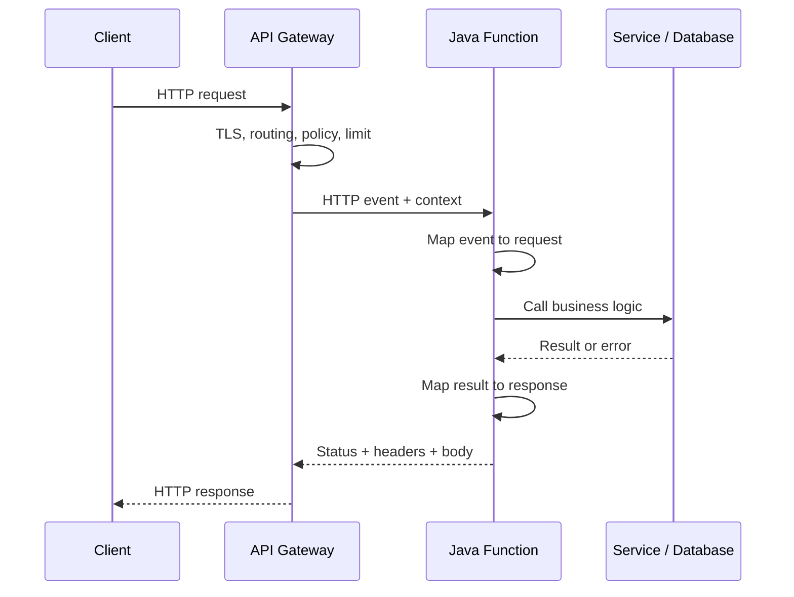

# Ánh xạ request, response, header và mã trạng thái HTTP

Khi một Java function được kích hoạt bởi HTTP, nền tảng thường chuyển request HTTP thành một event hoặc object trung gian rồi gọi handler. Function xử lý dữ liệu đó và trả về một cấu trúc response để nền tảng chuyển thành HTTP response gửi cho client. Quá trình chuyển đổi này được gọi là ánh xạ request/response.

Trong module **CLOUD_SERVERLESS**, HTTP là một trong các trigger chính bên cạnh message và event. Hiểu cách ánh xạ HTTP giúp người phát triển xây dựng API và webhook có hợp đồng rõ ràng, xác thực đầu vào, trả mã trạng thái đúng, xử lý lỗi nhất quán và không phụ thuộc nhầm vào chi tiết riêng của một nhà cung cấp cloud.

## 1. Luồng HTTP request qua serverless function

Một HTTP API serverless thường có các thành phần sau:

1. Client gửi HTTP request đến URL công khai.
2. API gateway, load balancer hoặc HTTP frontend nhận request, áp dụng TLS, routing, giới hạn kích thước, xác thực hoặc throttling theo cấu hình.
3. Nền tảng chuyển thông tin HTTP thành event chứa method, path, query, headers, body và context.
4. Runtime gọi Java handler với event và context thực thi.
5. Handler ánh xạ event thành mô hình request của ứng dụng, gọi logic nghiệp vụ và tạo response.
6. Adapter chuyển response của ứng dụng về định dạng mà nền tảng yêu cầu; gateway gửi HTTP status, headers và body về client.



Sơ đồ mô tả mô hình tổng quát. Tên field và cấu trúc event cụ thể khác nhau giữa API Gateway, Function URL, Cloud Functions, Azure Functions và các nền tảng khác. Có nền tảng đưa request vào object có kiểu; nền tảng khác gửi JSON event với các field như `httpMethod`, `rawPath`, `queryStringParameters`, `headers`, `body` hoặc `isBase64Encoded`.

Điều quan trọng là phân biệt hai hợp đồng:

- **Hợp đồng HTTP:** method, URI, headers, body, status code và semantics mà client nhìn thấy.
- **Hợp đồng event của nhà cung cấp:** cấu trúc dữ liệu mà runtime chuyển vào function và cấu trúc output mà gateway mong đợi.

Ứng dụng nên có lớp adapter chịu trách nhiệm chuyển đổi giữa hai hợp đồng. Logic nghiệp vụ không nên phụ thuộc vào tên field của một event cloud cụ thể.

## 2. Các phần của HTTP request cần ánh xạ

Một request HTTP/1.1 quen thuộc có method, target URI, headers và có thể có body. Với HTTP/2 hoặc HTTP/3, một số thông tin được biểu diễn bằng pseudo-header ở tầng giao thức. Khi request đến function, gateway thường chuẩn hóa chúng thành các field riêng.

| Thành phần | Ý nghĩa | Cách dùng trong function |
|---|---|---|
| Method | Hành động như GET, POST, PUT, PATCH, DELETE, OPTIONS | Chọn route và kiểm tra method được hỗ trợ |
| Path / route | Đường dẫn tài nguyên, ví dụ `/orders/42` | Xác định endpoint và trích xuất path parameter |
| Query string | Tham số sau dấu `?`, ví dụ `?page=2&tag=a&tag=b` | Lọc, phân trang, sắp xếp; kiểm tra kiểu và giới hạn |
| Headers | Metadata, xác thực, content type, caching, tracing | Đọc theo tên không phân biệt hoa thường; kiểm tra và chuẩn hóa |
| Body | Nội dung gửi lên, thường là JSON, form hoặc binary | Kiểm tra kích thước, media type, encoding và schema trước khi xử lý |
| Cookies | Dữ liệu cookie của client | Chỉ dùng khi API thực sự có cơ chế session/cookie; thiết lập thuộc tính bảo mật khi trả về |
| Context | Request ID, stage, identity từ authorizer, thông tin gateway | Logging, tracing và dùng danh tính đã được xác thực từ nguồn tin cậy |

### Method và routing

Method thể hiện ý định của client. Các method thường gặp:

- `GET`: đọc tài nguyên; không nên gây thay đổi trạng thái nghiệp vụ.
- `POST`: tạo tài nguyên hoặc thực hiện một hành động không phù hợp với các method khác.
- `PUT`: tạo hoặc thay thế trạng thái của tài nguyên tại URI đã biết; thường được thiết kế idempotent.
- `PATCH`: cập nhật một phần tài nguyên theo định dạng patch đã công bố.
- `DELETE`: yêu cầu xóa tài nguyên; thiết kế API nên xác định rõ hành vi khi tài nguyên đã bị xóa.
- `OPTIONS`: khám phá khả năng của endpoint và thường được dùng cho CORS preflight.
- `HEAD`: tương tự GET nhưng response không có body.

Không nên chọn route chỉ bằng cách kiểm tra một chuỗi path tùy tiện. Router cần ghép method và route, xử lý path parameter, từ chối method không hỗ trợ và phân biệt endpoint không tồn tại với tài nguyên không tồn tại.

Ví dụ, `GET /orders/42` và `DELETE /orders/42` có cùng path nhưng là hai hành động khác nhau. Nếu path tồn tại nhưng method không được hỗ trợ, API trả `405 Method Not Allowed` và phải kèm header `Allow` liệt kê method được hỗ trợ. Nếu không có route phù hợp, trả `404 Not Found`.

### Path parameter và query parameter

Path parameter xác định một phần của tài nguyên, ví dụ `/customers/{customerId}/orders/{orderId}`. Query parameter thường biểu diễn lựa chọn hoặc cách trình bày kết quả, ví dụ phân trang, lọc và sắp xếp.

```http
GET /customers/c-18/orders?status=PAID&page=2&tag=gift&tag=priority HTTP/1.1
Host: api.example.test
Accept: application/json
```

Ở request trên, `c-18` và `orderId` (nếu có trong route) là path parameter; `status`, `page` và hai giá trị `tag` là query parameter. Không giả định mỗi tên query chỉ xuất hiện một lần. Nếu API cho phép tham số lặp, mô hình dữ liệu nên giữ danh sách giá trị thay vì ép tất cả thành một chuỗi. Nếu API không cho phép lặp, hãy từ chối trường hợp trùng theo hợp đồng.

Giá trị query đã được URL-encode trên wire. Nền tảng có thể trả về giá trị đã decode hoặc cung cấp cả dạng raw query string. Cần biết rõ hành vi của adapter để tránh decode hai lần hoặc xử lý sai dấu `+`, `%2F` và ký tự Unicode. Không ghép giá trị query trực tiếp vào SQL hoặc biểu thức truy vấn; hãy validate và dùng parameter binding.

### Headers

Header mang metadata cho request. Một số header thường dùng:

| Header | Mục đích | Lưu ý |
|---|---|---|
| `Content-Type` | Kiểu dữ liệu của body gửi lên | Kiểm tra media type trước khi parse |
| `Accept` | Kiểu response client muốn nhận | Có thể cần thương lượng content type; trả `406` nếu không thể đáp ứng hợp đồng |
| `Authorization` | Credential hoặc access token | Không log giá trị; xác thực bằng middleware/authorizer hoặc thư viện phù hợp |
| `Content-Length` | Kích thước body theo byte | Có thể bị gateway chuẩn hóa; vẫn phải áp dụng giới hạn payload ở server |
| `Accept-Language` | Ngôn ngữ client ưu tiên | Chỉ áp dụng nếu API hỗ trợ nhiều ngôn ngữ |
| `If-Match`, `If-None-Match` | Điều kiện dựa trên entity tag | Hữu ích cho cập nhật có điều kiện và cache |
| `Idempotency-Key` | Khóa do client gửi để nhận diện thao tác lặp | Cần lưu và kiểm tra bền vững ở server; chỉ có header không tự tạo idempotency |
| `X-Request-Id` hoặc `traceparent` | Tương quan request và tracing | Chọn nguồn tin cậy, validate và tránh để client giả mạo ID nội bộ |

Tên header không phân biệt chữ hoa/chữ thường. Khi ánh xạ sang Java, nên chuẩn hóa tên header, ví dụ lowercase với `Locale.ROOT`, hoặc dùng kiểu dữ liệu header có quy tắc case-insensitive. Không giả định gateway giữ nguyên chữ hoa/thường hoặc thứ tự header.

Một số header có thể xuất hiện nhiều lần. Không được nối mọi giá trị bằng dấu phẩy một cách máy móc: quy tắc gộp phụ thuộc loại header. Đặc biệt, `Set-Cookie` cần được giữ thành nhiều header riêng vì mỗi cookie có thuộc tính riêng. Một số event schema cung cấp `multiValueHeaders`, một số schema khác có danh sách cookie riêng.

Không tin cậy tuyệt đối các header do client gửi như `X-Forwarded-For`, `X-Forwarded-Host` hay `X-Forwarded-Proto`. Chỉ dùng chúng theo chuỗi proxy tin cậy và cấu hình gateway; nếu client có thể gọi thẳng function hoặc proxy ngoài kiểm soát chèn header, giá trị có thể bị giả mạo. Khi có thể, dùng request context do nền tảng cấp.

### Body, encoding và media type

Body có thể rỗng, là JSON, form, văn bản hoặc dữ liệu nhị phân. Event của gateway thường biểu diễn body dưới dạng chuỗi. Nếu body là binary, gateway có thể mã hóa Base64 và đặt cờ `isBase64Encoded=true`. Adapter phải giải mã Base64 trước khi đưa byte vào parser hoặc lưu file.

Quy trình xử lý body an toàn:

1. Kiểm tra body có tồn tại hay không và endpoint có yêu cầu body không.
2. Kiểm tra giới hạn kích thước ở gateway và trong ứng dụng. Không chỉ dựa vào `Content-Length`, vì request có thể được chunk hoặc header có thể bị thay đổi ở proxy.
3. Đọc `Content-Type`, kiểm tra media type được hỗ trợ và charset nếu hợp đồng cho phép.
4. Nếu event đánh dấu Base64, giải mã trước khi parse; nếu cờ không bật, chuyển chuỗi event thành byte theo quy ước encoding của adapter.
5. Parse bằng parser an toàn, validate schema, kiểu dữ liệu, độ dài, giá trị enum và quan hệ giữa các trường.
6. Chỉ sau khi xác thực và phân quyền mới thực hiện thay đổi nghiệp vụ.

Ví dụ, endpoint nhận JSON nên từ chối `text/plain` hoặc `application/octet-stream` nếu hợp đồng chỉ chấp nhận `application/json`. JSON được trao đổi giữa các hệ thống nên dùng UTF-8. Nếu endpoint nhận file, hãy xác định rõ media type, kích thước tối đa, cách xử lý tên file và định dạng thực tế; không chỉ tin phần mở rộng do client khai báo.

## 3. Mô hình request nội bộ trong Java

Một cách tổ chức dễ kiểm thử là chuyển event của nhà cung cấp sang một kiểu request nội bộ. Kiểu này chỉ chứa dữ liệu mà tầng ứng dụng cần, không mang theo toàn bộ object event.

```java
import java.util.List;
import java.util.Map;

public record HttpRequest(
        String method,
        String path,
        Map<String, String> pathParameters,
        Map<String, List<String>> queryParameters,
        Map<String, List<String>> headers,
        byte[] body,
        String requestId,
        AuthenticatedPrincipal principal) {
}
```

`AuthenticatedPrincipal` đại diện cho danh tính đã được xác thực bởi cơ chế tin cậy như authorizer hoặc middleware. Không tạo principal chỉ bằng cách đọc một header tùy ý hoặc tin claim chưa được xác minh. Nếu endpoint công khai, principal có thể vắng mặt; các route cần đăng nhập phải kiểm tra điều đó trước khi gọi nghiệp vụ.

Một response nội bộ có thể được mô hình hóa như sau:

```java
import java.util.Map;

public record HttpResponse(
        int statusCode,
        Map<String, String> headers,
        byte[] body) {
}
```

Trong ứng dụng thực tế, nên dùng một abstraction response có hỗ trợ nhiều `Set-Cookie`, header lặp và binary body nếu gateway yêu cầu. Ví dụ trên đơn giản hóa để minh họa hợp đồng.

### Adapter chuyển event thành request

Adapter là nơi xử lý khác biệt giữa event schema của nhà cung cấp và request nội bộ. Đoạn mã dưới đây là pseudocode Java có chủ đích: `GatewayEvent` và `GatewayContext` là kiểu do adapter cụ thể định nghĩa, không phải API chung của mọi cloud.

```java
public final class GatewayAdapter {

    public HttpRequest toRequest(GatewayEvent event, GatewayContext context) {
        byte[] body = decodeBody(
                event.body(), event.isBase64Encoded());

        return new HttpRequest(
                normalizeMethod(event.httpMethod()),
                event.path(),
                event.pathParameters(),
                normalizeQuery(event.queryParameters()),
                normalizeHeaders(event.headers()),
                body,
                context.requestId(),
                context.authenticatedPrincipal());
    }

    private byte[] decodeBody(String body, boolean base64Encoded) {
        if (body == null || body.isEmpty()) {
            return new byte[0];
        }
        if (base64Encoded) {
            return Base64.getDecoder().decode(body);
        }
        return body.getBytes(StandardCharsets.UTF_8);
    }
}
```

Trong triển khai thật, adapter phải xử lý event thiếu field, header trùng, query parameter lặp, body Base64 không hợp lệ và encoding theo đúng hợp đồng của gateway. Nếu gateway trả về raw path/query và path parameter đã decode, không decode lại một lần nữa. Nếu event có cả header đơn và multi-value header, hãy xác định rõ field nào là nguồn dữ liệu chuẩn.

Không đưa toàn bộ `GatewayEvent` vào service nghiệp vụ. Việc này giúp unit test service mà không cần tạo event cloud, đồng thời giảm ảnh hưởng khi đổi gateway hoặc phiên bản event schema.

## 4. Ánh xạ response về HTTP

HTTP response có ba thành phần chính:

- **Status code:** kết quả xử lý ở cấp giao thức, ví dụ `200`, `201`, `400` hoặc `500`.
- **Headers:** metadata của response như `Content-Type`, `Location`, `Cache-Control`, `ETag` và `Set-Cookie`.
- **Body:** dữ liệu trả về, thường là JSON hoặc nội dung nhị phân. Một số status/method không được phép hoặc không nên có body.

Gateway có thể yêu cầu một object response dạng:

```json
{
  "statusCode": 201,
  "headers": {
    "content-type": "application/json",
    "location": "/orders/ord-42"
  },
  "body": "{\"id\":\"ord-42\",\"status\":\"CREATED\"}",
  "isBase64Encoded": false
}
```

Đây là ví dụ envelope phổ biến, không phải schema bắt buộc của mọi nhà cung cấp. Một số adapter dùng `statusCode`, `headers`, `body`, `cookies`; nền tảng khác dùng object có kiểu hoặc API response riêng. Nếu function trả sai cấu trúc, gateway có thể trả lỗi tích hợp như `502 Bad Gateway` dù logic nghiệp vụ đã chạy.

### Header response thường gặp

| Header | Khi sử dụng |
|---|---|
| `Content-Type` | Khai báo media type và charset của body, ví dụ `application/json; charset=utf-8` |
| `Location` | URI của tài nguyên vừa tạo hoặc nơi client nên chuyển đến khi redirect |
| `Cache-Control` | Chính sách cache, ví dụ `no-store` cho dữ liệu nhạy cảm |
| `ETag` | Validator để client cache và gửi điều kiện `If-Match`/`If-None-Match` |
| `Retry-After` | Gợi ý thời điểm thử lại khi server throttling hoặc tạm không phục vụ |
| `WWW-Authenticate` | Challenge cho cơ chế xác thực HTTP khi trả `401` |
| `Access-Control-Allow-Origin` | Cho phép origin cụ thể truy cập response qua browser CORS |
| `Set-Cookie` | Tạo hoặc cập nhật cookie cùng thuộc tính bảo mật |
| `X-Request-Id` | ID tương quan để client gửi khi cần hỗ trợ; tránh lộ thông tin nội bộ |

Không tự đặt các hop-by-hop header như `Connection` hoặc `Transfer-Encoding` trong response do function tạo. Gateway/proxy quản lý framing và kết nối ở tầng HTTP. Cũng không đặt `Content-Length` thủ công nếu nền tảng chịu trách nhiệm tính toán hoặc có thể nén/chuyển đổi body.

### Body response và content negotiation

Nếu API trả JSON, hãy serialize object bằng thư viện JSON và đặt `Content-Type: application/json`. Không nối chuỗi JSON thủ công từ dữ liệu người dùng. Nếu client gửi `Accept`, API có thể chọn media type tương thích; nếu không có định dạng nào được hỗ trợ, trả `406 Not Acceptable` theo hợp đồng.

Response không có body trong một số trường hợp:

- `HEAD`: không trả body dù endpoint có thể dùng metadata tương tự GET.
- `204 No Content`: biểu thị xử lý thành công nhưng không có nội dung response.
- `304 Not Modified`: dùng trong conditional GET; không gửi representation body.

Nếu API tạo tài nguyên mới, `201 Created` thường đi cùng `Location` trỏ đến tài nguyên vừa tạo và có thể kèm representation. Nếu chỉ tiếp nhận công việc xử lý bất đồng bộ, `202 Accepted` cho biết request đã được chấp nhận; nó không khẳng định công việc đã hoàn tất. Nên trả URI hoặc mã theo dõi để client truy vấn trạng thái.

## 5. Chọn mã trạng thái HTTP phù hợp

Status code là một phần của hợp đồng API. Client, proxy, cache, SDK và công cụ giám sát có thể dựa vào mã này để quyết định retry, hiển thị lỗi hoặc ghi nhận thành công. Không nên trả `200 OK` cho mọi tình huống rồi đặt một mã lỗi riêng trong JSON body.

### Nhóm 2xx — request được xử lý thành công

| Mã | Ý nghĩa | Ví dụ sử dụng |
|---|---|---|
| `200 OK` | Xử lý thành công và có representation hoặc kết quả | GET trả dữ liệu; POST thực hiện hành động và trả kết quả |
| `201 Created` | Đã tạo tài nguyên mới | POST tạo order; kèm `Location` nếu có URI tài nguyên |
| `202 Accepted` | Đã nhận yêu cầu nhưng xử lý chưa hoàn tất | Function ghi job vào queue để xử lý nền |
| `204 No Content` | Thành công, không có body | DELETE thành công hoặc cập nhật không cần trả representation |

Không dùng `202` chỉ vì function chạy trên serverless. Nếu function đã hoàn tất nghiệp vụ đồng bộ, trả mã phản ánh kết quả thực tế. Nếu đã nhận job nhưng chưa hoàn tất, `202` phù hợp hơn.

### Nhóm 3xx — chuyển hướng hoặc dùng cache

| Mã | Ý nghĩa | Lưu ý |
|---|---|---|
| `301 Moved Permanently` | URI đã chuyển vĩnh viễn | Client có thể ghi nhớ redirect; cân nhắc thay đổi method theo hành vi client |
| `302 Found` | Chuyển hướng tạm thời | Một số client có thể đổi POST thành GET; không dùng nếu cần giữ method/body |
| `303 See Other` | Điều hướng client lấy tài nguyên khác bằng GET | Thường dùng sau khi POST form hoặc tạo tác vụ tương tác |
| `307 Temporary Redirect` | Chuyển hướng tạm thời, giữ method | Hữu ích khi cần giữ method và body |
| `308 Permanent Redirect` | Chuyển hướng vĩnh viễn, giữ method | Dùng khi endpoint được chuyển mà semantics cần giữ nguyên |
| `304 Not Modified` | Representation chưa thay đổi theo validator | Dùng với `If-None-Match` hoặc `If-Modified-Since`; không có body |

Redirect cần header `Location` hợp lệ. Không tạo redirect URL từ input không tin cậy nếu chưa kiểm tra allowlist host để tránh open redirect.

### Nhóm 4xx — lỗi thuộc request hoặc quyền của client

| Mã | Ý nghĩa | Ví dụ sử dụng |
|---|---|---|
| `400 Bad Request` | Request sai cú pháp hoặc không thể parse | JSON hỏng, query parameter sai định dạng |
| `401 Unauthorized` | Thiếu hoặc credential không hợp lệ | Token thiếu, hết hạn hoặc chữ ký không hợp lệ; response phải kèm challenge `WWW-Authenticate` |
| `403 Forbidden` | Đã xác định client nhưng không có quyền | User không được xem order thuộc user khác |
| `404 Not Found` | Route hoặc tài nguyên không tồn tại | Không tìm thấy order; có thể dùng để tránh tiết lộ sự tồn tại của tài nguyên |
| `405 Method Not Allowed` | Route tồn tại nhưng method không được hỗ trợ | Gửi DELETE đến endpoint chỉ cho GET; phải kèm `Allow` |
| `406 Not Acceptable` | Không có response representation phù hợp `Accept` | Client chỉ chấp nhận XML nhưng API chỉ hỗ trợ JSON |
| `409 Conflict` | Request xung đột với trạng thái hiện tại | Chuyển trạng thái order không hợp lệ hoặc idempotency key bị dùng với payload khác |
| `412 Precondition Failed` | Điều kiện HTTP như `If-Match` không thỏa | ETag đã thay đổi khi client cập nhật |
| `413 Content Too Large` | Payload vượt giới hạn | Upload file vượt giới hạn API |
| `415 Unsupported Media Type` | Media type body không được hỗ trợ | Gửi XML vào endpoint chỉ nhận JSON |
| `422 Unprocessable Content` | Nội dung đúng cú pháp nhưng không thỏa quy tắc nghiệp vụ/validation | JSON parse được nhưng trường ngày hoặc quan hệ dữ liệu không hợp lệ |
| `429 Too Many Requests` | Client bị throttling | Vượt rate limit hoặc quota; có thể kèm `Retry-After` |

Phân biệt `401` và `403`: `401` nói rằng client chưa được xác thực hợp lệ và response phải đưa ra ít nhất một challenge `WWW-Authenticate`; `403` nói rằng danh tính đã biết nhưng không được phép thực hiện hành động. Không trả chi tiết credential, policy nội bộ hoặc thông tin nhạy cảm trong body lỗi.

### Nhóm 5xx — lỗi ở server hoặc thành phần trung gian

| Mã | Ý nghĩa | Ví dụ sử dụng |
|---|---|---|
| `500 Internal Server Error` | Lỗi không dự kiến khi xử lý | Exception chưa được ánh xạ thành lỗi client cụ thể |
| `502 Bad Gateway` | Gateway nhận phản hồi không hợp lệ từ upstream | Function crash, trả envelope sai hoặc integration lỗi |
| `503 Service Unavailable` | Tạm thời không thể phục vụ | Quá tải, bảo trì hoặc dependency chưa sẵn sàng; có thể kèm `Retry-After` |
| `504 Gateway Timeout` | Gateway chờ upstream quá lâu | Function hoặc dịch vụ phụ trợ vượt timeout tích hợp |

Không phải mọi lỗi đều do code function quyết định status cuối cùng. Gateway có thể tự trả `413`, `429`, `502` hoặc `504` trước/sau khi function chạy. Cần kiểm tra log của cả gateway và function để xác định lỗi xảy ra ở lớp nào.

## 6. Chuẩn hóa lỗi và response body

Một API tốt trả lỗi theo cấu trúc nhất quán để client có thể xử lý mà không phải đoán theo thông điệp tự do. Có thể dùng định dạng Problem Details cho HTTP API, với media type `application/problem+json`.

Ví dụ:

```json
{
  "type": "https://api.example.test/problems/invalid-order-state",
  "title": "Order state conflict",
  "status": 409,
  "detail": "The order cannot be paid in its current state.",
  "instance": "/orders/ord-42",
  "code": "ORDER_STATE_CONFLICT",
  "requestId": "req-7f9c"
}
```

`type`, `title`, `status`, `detail` và `instance` là các trường tiêu chuẩn của Problem Details; `code` và `requestId` là extension do API định nghĩa. Nội dung `detail` cần đủ hữu ích cho client nhưng không chứa stack trace, SQL, tên host nội bộ, secret hoặc dữ liệu cá nhân không cần thiết.

Một exception mapper có thể chuyển lỗi ứng dụng thành response:

```java
public final class ErrorMapper {

    public HttpResponse toResponse(
            RuntimeException error, String requestId) {
        if (error instanceof ValidationException) {
            return problem(422, "Validation failed",
                    "One or more fields are invalid.",
                    "VALIDATION_FAILED", requestId);
        }

        if (error instanceof OrderConflictException) {
            return problem(409, "Order state conflict",
                    "The order cannot be changed in its current state.",
                    "ORDER_STATE_CONFLICT", requestId);
        }

        // Log exception đầy đủ ở server, không đưa stack trace cho client.
        logUnexpected(error, requestId);
        return problem(500, "Internal server error",
                "The request could not be completed.",
                "INTERNAL_ERROR", requestId);
    }

    private HttpResponse problem(
            int status, String title, String detail,
            String code, String requestId) {
        ProblemDetails body = new ProblemDetails(
                status, title, detail, code, requestId);
        return new HttpResponse(
                status,
                Map.of("content-type", "application/problem+json"),
                serialize(body));
    }
}
```

Ví dụ giả định có các exception và hàm serialize/log của ứng dụng. Trong hệ thống thật, hãy xác định rõ exception nào là lỗi đầu vào, lỗi xác thực, lỗi phân quyền, xung đột nghiệp vụ hay lỗi hệ thống. Không bắt mọi exception rồi trả `200`; cũng không biến mọi lỗi thành `500` nếu có thể ánh xạ chính xác hơn.

## 7. CORS, cookie và một số header đặc biệt

### CORS cho browser

Cross-Origin Resource Sharing (CORS) là cơ chế browser dùng để quyết định JavaScript từ origin này có được đọc response của origin khác hay không. CORS không thay thế authentication hoặc authorization.

Với một số request cross-origin, browser gửi preflight `OPTIONS` trước request thực tế. Response thường cần các header như:

- `Access-Control-Allow-Origin`: origin được phép, ví dụ `https://app.example.test`.
- `Access-Control-Allow-Methods`: method được phép, ví dụ `GET, POST, PATCH, DELETE, OPTIONS`.
- `Access-Control-Allow-Headers`: request header mà browser được phép gửi, ví dụ `authorization, content-type, idempotency-key`.
- `Access-Control-Allow-Credentials: true`: chỉ khi API thực sự dùng credential/cookie cross-origin và origin được chỉ định cụ thể.
- `Access-Control-Max-Age`: thời gian browser có thể cache kết quả preflight theo giới hạn hỗ trợ.

Nếu cho phép credentials, không dùng `Access-Control-Allow-Origin: *`. Chỉ phản hồi origin nằm trong allowlist. Cần quyết định CORS ở gateway hay trong function và tránh cấu hình hai nơi tạo header mâu thuẫn. Với request không được phép, CORS header không nên vô tình mở quyền đọc response.

### Cookie

Khi trả cookie, cần thiết lập thuộc tính phù hợp:

```http
Set-Cookie: session=opaque-value; Path=/; HttpOnly; Secure; SameSite=Lax
```

- `HttpOnly` ngăn JavaScript truy cập cookie qua API document.cookie.
- `Secure` chỉ gửi cookie qua kết nối bảo mật.
- `SameSite` kiểm soát việc gửi cookie trong ngữ cảnh cross-site.
- `Path`, `Domain` và `Max-Age`/`Expires` xác định phạm vi và thời hạn.

Cookie session nên chứa định danh hoặc giá trị opaque được bảo vệ; dữ liệu session quan trọng cần lưu ở nơi bền vững và có cơ chế hết hạn. Nếu response cần nhiều cookie, adapter phải giữ từng `Set-Cookie` riêng; không nối nhiều cookie thành một chuỗi phân tách bằng dấu phẩy.

### Cache và validator

API đọc dữ liệu ít thay đổi có thể dùng `Cache-Control`, `ETag` hoặc `Last-Modified` để giảm tải và băng thông. Với response chứa thông tin cá nhân hoặc dữ liệu theo quyền, cần đặt chính sách cache phù hợp, thường là `private` hoặc `no-store` tùy yêu cầu. Không bật cache công khai cho response phụ thuộc vào Authorization nếu cache key không phân biệt danh tính và quyền.

## 8. Webhook: HTTP request đến từ hệ thống khác

Webhook cũng là HTTP request, thường là `POST` do một hệ thống bên ngoài gửi khi có sự kiện. Function cần xử lý nó như một endpoint công khai có hợp đồng rõ ràng:

1. Xác minh nguồn gửi bằng chữ ký HMAC hoặc cơ chế xác thực mà nhà cung cấp webhook công bố.
2. Xác minh chữ ký trên đúng raw body bytes trước khi parse hoặc chuẩn hóa JSON, nếu thuật toán chữ ký yêu cầu raw payload.
3. Dùng so sánh constant-time cho chữ ký và kiểm tra timestamp/window để giảm nguy cơ replay.
4. Kiểm tra event ID và lưu dấu xử lý bằng cơ chế bền vững để phát hiện delivery trùng.
5. Xác nhận tiếp nhận nhanh bằng status phù hợp sau khi đã ghi sự kiện/job bền vững; xử lý nghiệp vụ nặng trong queue nếu cần.
6. Trả status lỗi có chủ đích để nhà cung cấp webhook áp dụng retry theo hợp đồng; không giả định mọi nhà cung cấp retry giống nhau.

Một webhook thường giao ít nhất một lần hoặc có thể gửi lại khi không nhận được response thành công. Vì vậy, function phải idempotent. Có thể dùng event ID làm unique key trong database; thao tác ghi event và tạo job nên được thiết kế để tránh tình trạng đã trả `2xx` nhưng chưa lưu sự kiện bền vững.

Ví dụ xác minh HMAC rút gọn:

```java
boolean isValidSignature(
        byte[] rawBody, byte[] suppliedSignature, byte[] secret)
        throws GeneralSecurityException {
    Mac mac = Mac.getInstance("HmacSHA256");
    mac.init(new SecretKeySpec(secret, "HmacSHA256"));
    byte[] expected = mac.doFinal(rawBody);
    return MessageDigest.isEqual(expected, suppliedSignature);
}
```

Ví dụ chỉ minh họa thuật toán; định dạng header, cách tạo canonical string, encoding chữ ký, timestamp và secret rotation phụ thuộc nhà cung cấp webhook. Không tự thay thế đặc tả chữ ký của nhà cung cấp bằng đoạn mã này. Secret phải lấy từ secret manager hoặc cấu hình bảo mật, không hardcode trong source code hay log ra console.

## 9. Ví dụ hoàn chỉnh: API tạo đơn hàng

Giả sử API có endpoint `POST /orders` nhận JSON:

```json
{
  "customerId": "cus-18",
  "items": [
    { "sku": "book-1", "quantity": 2 }
  ]
}
```

Một response thành công có thể là:

```http
HTTP/1.1 201 Created
Content-Type: application/json; charset=utf-8
Location: /orders/ord-42
Cache-Control: no-store
X-Request-Id: req-7f9c
```

```json
{
  "id": "ord-42",
  "customerId": "cus-18",
  "status": "PENDING"
}
```

Các bước xử lý trong Java:

```java
public final class OrderController {
    private final OrderService orderService;
    private final JsonCodec json;

    public HttpResponse create(HttpRequest request) {
        if (!"POST".equals(request.method())) {
            return response(405,
                    Map.of("allow", "POST, OPTIONS"), new byte[0]);
        }

        if (!isJson(request.headers())) {
            return problem(415, "UNSUPPORTED_MEDIA_TYPE",
                    "This endpoint accepts application/json.");
        }

        CreateOrderCommand command;
        try {
            command = json.read(request.body(), CreateOrderCommand.class);
        } catch (InvalidJsonException error) {
            return problem(400, "INVALID_JSON",
                    "The request body is not valid JSON.");
        }

        ValidationResult validation = validate(command);
        if (!validation.valid()) {
            return problem(422, "VALIDATION_FAILED",
                    "One or more order fields are invalid.");
        }

        AuthenticatedPrincipal principal = request.principal();
        if (principal == null) {
            return problem(401, "UNAUTHENTICATED",
                    "Authentication is required.");
        }

        if (!principal.canCreateOrderFor(command.customerId())) {
            return problem(403, "FORBIDDEN",
                    "You cannot create an order for this customer.");
        }

        Order created = orderService.create(command, principal);
        byte[] body = json.write(created);
        return response(201, Map.of(
                "content-type", "application/json; charset=utf-8",
                "location", "/orders/" + created.id(),
                "cache-control", "no-store"), body);
    }
}
```

Đây là ví dụ cấu trúc, không phải chương trình hoàn chỉnh có thể biên dịch ngay: các kiểu `HttpRequest`, `HttpResponse`, `JsonCodec`, `OrderService`, `AuthenticatedPrincipal` và helper response thuộc ứng dụng. Trong triển khai thực tế, kiểm tra method thường nằm ở router; authentication/authorization nên được thực hiện bởi middleware hoặc authorizer tin cậy; response phải được adapter chuyển sang event schema đúng nhà cung cấp. Cũng cần xử lý idempotency cho thao tác tạo đơn nếu client hoặc gateway có thể retry.

Luồng lỗi của endpoint có thể được quy định như sau:

| Tình huống | Status đề xuất | Ghi chú |
|---|---:|---|
| JSON sai cú pháp | 400 | Client sửa payload trước khi gửi lại |
| Thiếu hoặc token không hợp lệ | 401 | Không gọi service nghiệp vụ |
| Có danh tính nhưng không có quyền tạo đơn cho customer | 403 | Không tiết lộ dữ liệu ngoài phạm vi quyền |
| Media type không được hỗ trợ | 415 | Ghi rõ media type được chấp nhận |
| JSON hợp lệ nhưng quantity không hợp lệ | 422 | Có thể trả danh sách lỗi theo field |
| Idempotency key được dùng với payload khác | 409 | Client cần dùng key mới hoặc kiểm tra request trước |
| Tạo đơn thành công | 201 | Kèm Location và representation |
| Database tạm thời không khả dụng | 503 hoặc 500 tùy nguyên nhân/hợp đồng | Không lộ chi tiết nội bộ; retry phải có kiểm soát |

## 10. Checklist thiết kế ánh xạ HTTP

Trước khi triển khai endpoint serverless, hãy kiểm tra:

- **Request contract:** method, route, path parameter, query parameter, header, body và content type đã được định nghĩa chưa?
- **Event mapping:** adapter có xử lý đúng schema gateway, header lặp, query lặp, body Base64 và request context không?
- **Validation:** có giới hạn kích thước, kiểm tra encoding, schema, kiểu dữ liệu và giá trị hợp lệ trước khi gọi nghiệp vụ không?
- **Security:** authentication và authorization có dựa trên nguồn tin cậy không; header forwarding và cookie có được kiểm tra đúng không?
- **Response contract:** status, header và body có đúng với semantics HTTP không; response JSON có Content-Type chính xác không?
- **Error mapping:** lỗi client, lỗi nghiệp vụ, lỗi hệ thống và lỗi gateway có được phân biệt không; body lỗi có tránh lộ thông tin nội bộ không?
- **CORS/cache:** browser origin, preflight, credentials và chính sách cache có khớp yêu cầu bảo mật không?
- **Webhook:** chữ ký, timestamp, event ID, replay protection, idempotency và retry đã được xử lý chưa?
- **Observability:** request ID/trace ID có được ghi cùng log mà không ghi token, cookie hoặc payload nhạy cảm không?
- **Platform limits:** timeout, payload size, response size, binary media type, concurrency và gateway integration timeout đã được kiểm tra theo dịch vụ thật chưa?

Nên kiểm thử adapter bằng event mẫu đúng schema của nền tảng, sau đó kiểm thử HTTP end-to-end qua gateway. Unit test service chỉ xác nhận logic nghiệp vụ; nó không chứng minh gateway đã ánh xạ header, body, binary, CORS hoặc status code đúng.

## 11. Kết luận

Ánh xạ HTTP trong serverless gồm hai chiều: chuyển request event của gateway thành mô hình request Java và chuyển kết quả ứng dụng thành response mà gateway hiểu. Request cần được ánh xạ chính xác từ method, path, query, headers, body và context; response cần status code, headers và body đúng semantics HTTP.

Hãy đặt chuyển đổi ở adapter, giữ logic nghiệp vụ độc lập với event schema, validate dữ liệu trước khi xử lý và chọn status code phản ánh đúng kết quả. Với webhook, bổ sung xác minh chữ ký, chống replay và idempotency. Khi các hợp đồng này rõ ràng, Java function có thể cung cấp HTTP API nhất quán dù runtime hoặc nhà cung cấp cloud thay đổi.
