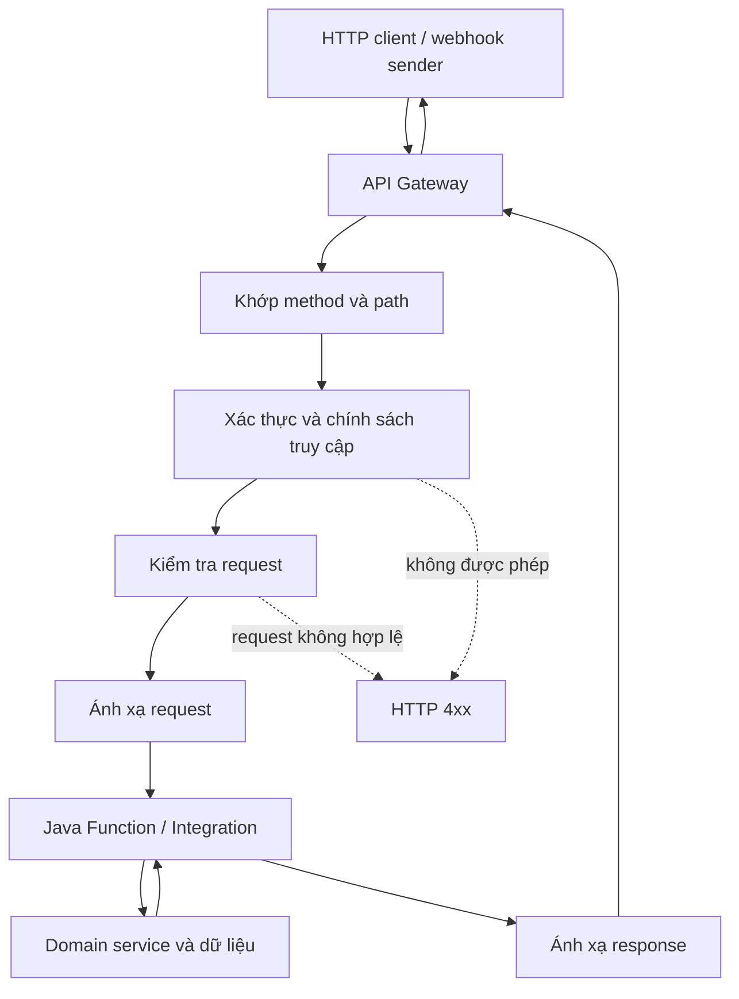

# Routing, validation và chuyển đổi dữ liệu tại API gateway

## 1. Vai trò của API gateway trong ứng dụng serverless

API gateway là điểm tiếp nhận HTTP tập trung của một ứng dụng hoặc một nhóm dịch vụ. Gateway nhận request từ ứng dụng khách hay hệ thống đối tác, áp dụng các chính sách ở biên, chọn nơi xử lý và chuyển request đến function hoặc dịch vụ đích. Sau khi backend trả kết quả, gateway có thể chuẩn hóa response trước khi gửi lại cho client.

Trong kiến trúc serverless, gateway thường kết nối các route HTTP với Java function. Nó đảm nhiệm những việc có tính chất chung cho nhiều endpoint như định tuyến, xác thực ở mức đầu vào, giới hạn lưu lượng, kiểm tra cấu trúc request, chuyển đổi định dạng và ghi nhận thông tin request. Function tiếp tục thực hiện quy tắc nghiệp vụ, truy cập dữ liệu và kiểm tra quyền trên từng tài nguyên.

Ba nhóm chức năng của bài học này liên hệ chặt chẽ với nhau:

- **Routing (định tuyến):** quyết định request thuộc endpoint nào và cần gọi integration nào.
- **Validation (kiểm tra dữ liệu):** từ chối request sai cấu trúc hoặc không đáp ứng các điều kiện đầu vào đã khai báo.
- **Transformation (chuyển đổi dữ liệu):** ánh xạ request/response giữa hợp đồng HTTP công khai và định dạng mà backend sử dụng.

Gateway là một phần của toàn bộ tuyến xử lý. Nó không thay thế domain service, database constraint hoặc authorization theo tài nguyên. Thiết kế tốt phân chia rõ trách nhiệm giữa gateway và function để các endpoint có hành vi nhất quán, dễ kiểm thử và dễ vận hành.

## 2. Routing: từ HTTP request đến function

### 2.1. Thành phần dùng để định tuyến

Một HTTP request thường có các thông tin mà gateway có thể sử dụng để chọn route:

| Thành phần | Ví dụ | Vai trò |
| --- | --- | --- |
| HTTP method | `GET`, `POST`, `PATCH`, `DELETE` | Phân biệt thao tác trên tài nguyên |
| Path | `/v1/orders/ord-42` | Xác định nhóm tài nguyên và endpoint |
| Path parameter | `orderId = ord-42` | Truyền định danh nằm trong đường dẫn |
| Query parameter | `?status=PAID&page=2` | Truyền bộ lọc, phân trang hoặc tùy chọn truy vấn |
| Header | `Content-Type`, `Authorization`, `X-Request-Id` | Mang metadata, thông tin xác thực và điều khiển nội dung |
| Host/domain | `api.example.com` | Có thể phân biệt API hoặc tenant nếu gateway hỗ trợ |

Phần lớn gateway định tuyến chủ yếu theo method và path. Một số nền tảng còn hỗ trợ host, header hoặc điều kiện nâng cao. Cú pháp khai báo route và quy tắc ưu tiên khi nhiều route cùng khớp phụ thuộc nhà cung cấp; cần đọc tài liệu nền tảng trước khi dựa vào hành vi cụ thể.

Ví dụ API quản lý đơn hàng có thể khai báo các route sau:

| Method | Path | Integration | Mục đích |
| --- | --- | --- | --- |
| `POST` | `/v1/orders` | `CreateOrderFunction` | Tạo đơn hàng |
| `GET` | `/v1/orders/{orderId}` | `GetOrderFunction` | Lấy chi tiết đơn hàng |
| `GET` | `/v1/orders` | `ListOrdersFunction` | Tìm và phân trang đơn hàng |
| `PATCH` | `/v1/orders/{orderId}` | `UpdateOrderFunction` | Cập nhật một phần thông tin |
| `DELETE` | `/v1/orders/{orderId}` | `CancelOrderFunction` | Hủy đơn theo chính sách nghiệp vụ |

`{orderId}` là path parameter. Với request `GET /v1/orders/ord-42`, gateway khớp route `GET /v1/orders/{orderId}` và chuyển giá trị `ord-42` trong dữ liệu đầu vào của integration. Với `GET /v1/orders`, route danh sách được chọn; method và path cùng tham gia xác định endpoint.

### 2.2. Route cụ thể, route tham số và route mặc định

Route tĩnh như `/v1/orders/search` thường có ý nghĩa rõ ràng hơn route tham số `/v1/orders/{orderId}`. Khi một gateway hỗ trợ cả route tĩnh, route tham số và wildcard, thứ tự ưu tiên phải tuân theo quy tắc của nền tảng. Không nên giả định mọi nhà cung cấp đều xử lý route xung đột giống nhau.

Route wildcard hoặc catch-all, chẳng hạn một route đại diện cho nhiều path, có thể hữu ích khi chuyển tiếp đến một backend chung. Tuy nhiên, nó dễ che khuất lỗi khai báo route và vô tình mở rộng bề mặt API. Chỉ dùng khi có nhu cầu rõ ràng, giới hạn method được phép và kiểm tra đường dẫn ở backend.

Nên tránh khai báo hai route có thể khớp cùng một request nhưng có mục đích khác nhau. Đặc biệt, hãy kiểm tra các trường hợp:

- Route tĩnh trùng với giá trị có thể xuất hiện của path parameter.
- Cùng path nhưng thiếu khai báo cho một HTTP method.
- Path có hoặc không có dấu `/` cuối cùng.
- Khác biệt chữ hoa/chữ thường, percent-encoding và dấu gạch chéo lặp.
- Wildcard có thể nhận cả path ngoài dự kiến.

Không nên âm thầm chuẩn hóa path theo nhiều cách ở nhiều tầng. Client, gateway và backend cần thống nhất cách giải mã URL, xử lý dấu `/` và diễn giải path parameter để tránh một request bị hiểu thành hai tài nguyên khác nhau.

### 2.3. Stage, domain và phiên bản API

Nhiều gateway hỗ trợ stage hoặc deployment environment như `dev`, `test` và `prod`. Stage giúp tách cấu hình, hostname, quota và integration giữa môi trường. Một số nền tảng đưa stage vào URL, trong khi nền tảng khác dùng custom domain và base path mapping để che chi tiết đó.

Phiên bản API công khai thường được thể hiện trong path, ví dụ `/v1/orders` và `/v2/orders`, hoặc qua một cơ chế versioning khác. Phiên bản giúp thay đổi hợp đồng có kiểm soát khi cấu trúc request/response thay đổi không tương thích. Với thay đổi bổ sung như thêm field tùy chọn, vẫn cần xem xét client cũ, schema validation và cách backend xử lý field chưa biết.

Nên có kế hoạch ngừng hỗ trợ phiên bản cũ: thông báo thời hạn, theo dõi lượng request theo version, hướng dẫn client chuyển đổi và chỉ gỡ route khi các bên liên quan đã sẵn sàng. Không nên thay đổi ý nghĩa của một field hiện có mà vẫn giữ nguyên version nếu điều đó làm client cũ diễn giải sai dữ liệu.

### 2.4. Integration và cách chuyển request đến backend

Sau khi khớp route, gateway gọi một integration. Integration có thể là function, HTTP service hoặc dịch vụ cloud được quản lý. Có hai kiểu tích hợp thường gặp:

- **Proxy/pass-through integration:** gateway chuyển phần lớn request cùng context đến backend. Backend chịu trách nhiệm đọc method, path, header, query và body. Kiểu này linh hoạt, giảm cấu hình mapping nhưng làm function phụ thuộc vào cấu trúc event của gateway.
- **Non-proxy/mapped integration:** gateway chọn trường cần chuyển, đổi tên hoặc biến đổi dữ liệu trước khi gọi backend. Backend nhận hợp đồng gọn và ổn định hơn, nhưng mapping phức tạp có thể khó theo dõi và kiểm thử.

Một số nền tảng còn hỗ trợ tích hợp trực tiếp với dịch vụ cloud mà không cần function trung gian. Việc chọn kiểu integration phụ thuộc yêu cầu kiểm soát, độ phức tạp và khả năng của nhà cung cấp.

Ví dụ cấu hình khái niệm dưới đây minh họa mối liên hệ giữa route, validation và integration. Đây là pseudoconfiguration để giải thích kiến trúc, không phải file triển khai trực tiếp cho một nhà cung cấp cụ thể:

```yaml
routes:
  - method: POST
    path: /v1/orders
    integration: CreateOrderFunction
    authorization: customer-jwt
    requestSchema: CreateOrderRequest
    throttlingProfile: orders-write

  - method: GET
    path: /v1/orders/{orderId}
    integration: GetOrderFunction
    authorization: customer-jwt
    pathParameters:
      orderId: required
```

### 2.5. Luồng xử lý tổng quát



Thứ tự thực tế của xác thực, kiểm tra, quota và mapping có thể khác nhau giữa các gateway. Sơ đồ biểu diễn các bước logic cần có, không khẳng định thứ tự triển khai nội bộ của mọi sản phẩm.

## 3. Validation: kiểm tra request ở đúng lớp

### 3.1. Kiểm tra cấu trúc và kiểm tra nghiệp vụ

Validation ở gateway phù hợp với những điều kiện có thể kiểm tra từ request mà không cần truy cập trạng thái nghiệp vụ. Ví dụ:

- Method và path phải khớp route đã công bố.
- Header bắt buộc phải có; `Content-Type` phải thuộc loại được hỗ trợ.
- Query parameter và path parameter phải hiện diện, đúng định dạng hoặc nằm trong giới hạn cho phép.
- Body phải là JSON hợp lệ, không vượt giới hạn kích thước và phù hợp schema.
- Token hoặc API key phải qua bước xác thực theo chính sách của gateway.

Các điều kiện phụ thuộc vào dữ liệu hoặc quy tắc miền cần được kiểm tra ở function/domain service. Ví dụ: khách hàng có sở hữu đơn hàng hay không, sản phẩm còn hàng không, giá có còn hiệu lực không, trạng thái hiện tại có cho phép hủy đơn không. Gateway không nên truy vấn database nghiệp vụ cho mọi request chỉ để thay thế các kiểm tra này.

Có thể chia thành ba lớp:

| Lớp | Ví dụ | Nơi phù hợp |
| --- | --- | --- |
| Cú pháp và giao thức | JSON parse được, header hợp lệ, body đúng kiểu media | Gateway và bộ giải mã request |
| Cấu trúc dữ liệu | Field bắt buộc, kiểu dữ liệu, độ dài, giới hạn số lượng | Gateway nếu hỗ trợ schema validation; function vẫn kiểm tra lại điều kiện quan trọng |
| Ngữ nghĩa nghiệp vụ | Quyền sở hữu tài nguyên, trạng thái đơn, hạn mức tài khoản | Function/domain service và tầng dữ liệu |

Một request vượt qua schema validation vẫn có thể không hợp lệ về nghiệp vụ. Chẳng hạn `quantity: 2` là số nguyên dương đúng schema, nhưng sản phẩm có thể chỉ còn một đơn vị trong kho.

### 3.2. Kiểm tra path, query và header

Path parameter thường định danh một tài nguyên; cần giới hạn độ dài và định dạng để tránh giá trị bất thường. Query parameter thường điều khiển tìm kiếm và phân trang. Hãy đặt giới hạn `pageSize`, kiểm tra kiểu số, enum và cách xử lý tham số lặp như `?tag=a&tag=b`.

Header có thể mang `Content-Type`, `Accept`, `Authorization`, `Idempotency-Key`, `X-Correlation-Id` hoặc chữ ký webhook. Cần xác định rõ header nào bắt buộc, header nào do client gửi và header nào chỉ gateway được phép tạo. Không tin một header định danh do client tự khai báo nếu backend dùng nó làm danh tính đã xác thực.

HTTP header không phân biệt chữ hoa/chữ thường theo chuẩn, nhưng một số hệ thống trung gian có thể chuẩn hóa hoặc gộp header. Với header có ý nghĩa bảo mật như chữ ký, hãy kiểm tra chính xác cách gateway chuyển tiếp giá trị, thứ tự và các giá trị trùng theo tài liệu của nền tảng.

### 3.3. Schema validation cho JSON body

Schema mô tả cấu trúc body: loại dữ liệu, field bắt buộc, giới hạn, enum, pattern và cấu trúc object lồng nhau. JSON Schema hoặc schema được khai báo trong OpenAPI thường được dùng để mô tả hợp đồng request.

Ví dụ schema rút gọn cho yêu cầu tạo đơn:

```json
{
  "type": "object",
  "required": ["customerId", "items"],
  "additionalProperties": false,
  "properties": {
    "customerId": {
      "type": "string",
      "minLength": 1,
      "maxLength": 64
    },
    "items": {
      "type": "array",
      "minItems": 1,
      "maxItems": 50,
      "items": {
        "type": "object",
        "required": ["sku", "quantity"],
        "additionalProperties": false,
        "properties": {
          "sku": { "type": "string", "minLength": 1 },
          "quantity": { "type": "integer", "minimum": 1 }
        }
      }
    }
  }
}
```

Đây là ví dụ schema JSON; mức độ hỗ trợ JSON Schema, các keyword được hỗ trợ và cách gắn schema vào route tùy gateway. Cần kiểm tra khả năng tương thích của nền tảng trước khi dựa vào một keyword cụ thể.

`additionalProperties: false` giúp từ chối field ngoài hợp đồng. Điều này hữu ích khi API muốn kiểm soát chặt đầu vào, nhưng có thể gây khó khăn cho client gửi field mới trong quá trình rollout. Một lựa chọn khác là cho phép field chưa biết nhưng function phải bỏ qua chúng an toàn. Hãy chọn chính sách có chủ đích và giữ nhất quán giữa gateway, OpenAPI và backend.

### 3.4. Kích thước, kiểu nội dung và giới hạn lưu lượng

Schema hợp lệ không đảm bảo request an toàn về tài nguyên. Gateway nên áp dụng giới hạn body size, timeout, số request trên một khoảng thời gian và giới hạn burst phù hợp. Từ chối payload quá lớn sớm giúp giảm chi phí truyền dữ liệu và tránh function phải đọc hoặc parse dữ liệu không cần thiết.

Kiểm tra `Content-Type` trước khi parse body. Nếu endpoint chỉ nhận `application/json`, request gửi `text/plain` hoặc media type không hỗ trợ nên được phản hồi phù hợp, thường là `415 Unsupported Media Type`. Header `Accept` có thể dùng để thương lượng định dạng response nếu API hỗ trợ nhiều loại nội dung.

Rate limit có thể áp dụng theo API key, client, tenant, route hoặc danh tính đã xác thực. Rate limit giúp bảo vệ backend và kiểm soát mức sử dụng; nó không thay thế kiểm soát quyền truy cập. Khi vượt ngưỡng, gateway thường trả `429 Too Many Requests`, có thể kèm `Retry-After` nếu chính sách có thể xác định thời điểm thử lại.

### 3.5. Gateway validation không thay thế kiểm tra trong Java function

Function cần kiểm tra lại các điều kiện quan trọng vì có thể được gọi từ nhiều nguồn khác nhau, chẳng hạn queue, event, test harness hoặc một gateway khác. Đừng coi mọi invocation đều đã đi qua cùng một gateway.

Ví dụ Java dưới đây minh họa lớp biên của function: chuyển dữ liệu đã giải mã thành command, kiểm tra các bất biến cơ bản rồi gọi domain service. Các kiểu `CreateOrderRequest`, `CreateOrderCommand`, `OrderService` và `ApiResponse` là kiểu ứng dụng minh họa; phần chuyển API event cụ thể phụ thuộc runtime của nhà cung cấp.

```java
import java.util.List;

public record OrderLineRequest(String sku, int quantity) {}

public record CreateOrderRequest(
        String customerId,
        List<OrderLineRequest> items) {}

public record ValidationError(String field, String message) {}

public final class CreateOrderHandler {
    private final OrderService orderService;

    public CreateOrderHandler(OrderService orderService) {
        this.orderService = orderService;
    }

    public ApiResponse handle(
            CreateOrderRequest request,
            AuthenticatedPrincipal principal) {

        if (request == null
                || request.customerId() == null
                || request.customerId().isBlank()
                || request.items() == null
                || request.items().isEmpty()) {
            return ApiResponse.badRequest("INVALID_REQUEST");
        }

        for (OrderLineRequest item : request.items()) {
            if (item == null
                    || item.sku() == null
                    || item.sku().isBlank()
                    || item.quantity() <= 0) {
                return ApiResponse.badRequest("INVALID_ORDER_ITEM");
            }
        }

        // Danh tính lấy từ context xác thực đã được tin cậy,
        // không lấy từ customerId do client tự khai báo.
        CreateOrderCommand command = new CreateOrderCommand(
                principal.subject(), request.customerId(), request.items());

        Order order = orderService.create(command);
        return ApiResponse.created("/v1/orders/" + order.id(), order);
    }
}
```

Trong hệ thống thực tế, nên trả danh sách lỗi có cấu trúc thay vì chỉ một mã tổng quát nếu client cần sửa nhiều field cùng lúc. Ví dụ trên tập trung vào vị trí kiểm tra và nguồn danh tính. Domain service vẫn phải kiểm tra khách hàng có quyền tạo đơn cho tài khoản đó và áp dụng các quy tắc về tồn kho, giá, trạng thái.

## 4. Transformation: ánh xạ request và response

### 4.1. Vì sao cần chuyển đổi dữ liệu?

Hợp đồng HTTP công khai thường được thiết kế theo nhu cầu của client và có thể phải duy trì trong nhiều năm. Backend có thể dùng tên field, cấu trúc event hoặc mô hình dữ liệu khác. Gateway có thể chuyển đổi giữa hai hình dạng để giảm phụ thuộc trực tiếp giữa client và function.

Ví dụ client gửi:

```json
{
  "customer_id": "cus-81",
  "items": [
    { "sku": "BK-7", "qty": 2 }
  ]
}
```

Gateway có thể ánh xạ sang payload nội bộ:

```json
{
  "customerId": "cus-81",
  "lines": [
    { "productCode": "BK-7", "quantity": 2 }
  ]
}
```

Nhờ đó, API công khai có thể giữ tên `customer_id` và `qty` trong khi Java domain model dùng `customerId`, `productCode` và `quantity`. Tuy nhiên, chỉ nên thực hiện mapping đơn giản ở gateway. Những phép biến đổi cần tra cứu dữ liệu, tính giá, áp dụng chính sách hoặc phối hợp nhiều bước thuộc về function/domain service.

### 4.2. Request mapping

Request mapping có thể thực hiện một hoặc nhiều việc sau:

- Chọn method, path, query parameter và header được chuyển tiếp.
- Đổi tên hoặc chuẩn hóa field trong body.
- Bổ sung metadata như request ID, stage hoặc danh tính đã xác thực vào integration context.
- Chuyển định dạng giữa JSON, form data hoặc cấu trúc event mà backend hỗ trợ.
- Loại bỏ header nội bộ không nên đi đến backend hoặc ghi đè header do client có thể giả mạo.

Hãy dùng allowlist cho các header và query parameter được chuyển tiếp khi backend không cần toàn bộ dữ liệu. Nếu gateway thêm `principalId` vào context, phải lấy giá trị từ authorizer hoặc identity context đáng tin cậy. Không được sao chép một header như `X-User-Id` từ client rồi coi đó là danh tính đã xác thực.

### 4.3. Response mapping

Response mapping chuyển kết quả nội bộ thành hợp đồng HTTP ổn định. Gateway có thể ánh xạ:

- Mã kết quả nội bộ thành HTTP status code.
- Field nội bộ thành tên field công khai.
- Header như `Content-Type`, `Location`, `Cache-Control` và `Retry-After`.
- Cấu trúc lỗi nội bộ thành error envelope thống nhất.
- Metadata không nên công khai được loại bỏ khỏi response.

Ví dụ backend trả một kết quả nội bộ:

```json
{
  "orderId": "ord-42",
  "state": "PAYMENT_PENDING",
  "internalRiskScore": 17
}
```

Response công khai có thể chỉ gồm:

```json
{
  "id": "ord-42",
  "status": "PENDING_PAYMENT"
}
```

Không nên để lộ tên bảng, stack trace, thông tin kết nối, mã nội bộ hoặc điểm đánh giá rủi ro nếu client không có quyền xem. Việc lọc field nhạy cảm nên được bảo vệ cả trong domain/API layer; không phụ thuộc duy nhất vào một mapping ở gateway nếu còn đường gọi backend khác.

### 4.4. Chuẩn hóa response lỗi

API nên có cấu trúc lỗi nhất quán để client xử lý được bằng mã lỗi và field lỗi thay vì phân tích chuỗi thông báo. Ví dụ:

```json
{
  "error": {
    "code": "INVALID_ORDER_ITEM",
    "message": "Một hoặc nhiều mặt hàng không hợp lệ.",
    "requestId": "req-7f2a",
    "details": [
      {
        "field": "items[0].quantity",
        "reason": "must be greater than zero"
      }
    ]
  }
}
```

Gateway có thể chuyển đổi lỗi integration sang định dạng chung, nhưng không nên che mất khác biệt giữa lỗi client, lỗi xác thực và lỗi hệ thống. Cần giữ correlation/request ID để tra log. Thông báo gửi client nên đủ hữu ích nhưng không tiết lộ chi tiết nội bộ.

### 4.5. Giới hạn của mapping ở gateway

Mapping phức tạp làm cấu hình gateway khó đọc, khó kiểm thử và khó quan sát. Nếu một mapping phải thực hiện nhiều phép tính, gọi dịch vụ khác hoặc có nhánh nghiệp vụ, hãy chuyển phần đó vào function. Gateway nên tập trung vào việc điều phối request và chuyển đổi định dạng ở biên.

Khi thay đổi mapping, cần kiểm tra cả request và response của các phiên bản API đang được hỗ trợ. Một mapping mới có thể làm thay đổi giá trị mặc định, bỏ field hoặc đổi kiểu dữ liệu mà không thay đổi code function; vì thế cấu hình gateway cũng cần review, versioning và triển khai có kiểm soát.

## 5. HTTP status code và hành vi của route

Gateway và function cần thống nhất cách biểu diễn kết quả. Bảng dưới đây là quy ước thường gặp; API cụ thể có thể chọn chi tiết khác miễn là nhất quán và được tài liệu hóa.

| Status | Khi nào dùng | Ví dụ |
| --- | --- | --- |
| `200 OK` | Request thành công và có response | Đọc hoặc cập nhật tài nguyên thành công |
| `201 Created` | Đã tạo tài nguyên | Tạo đơn hàng; có thể trả header `Location` |
| `202 Accepted` | Đã nhận yêu cầu xử lý bất đồng bộ | Gửi công việc vào queue để xử lý sau |
| `204 No Content` | Thành công nhưng không có body | Xóa hoặc cập nhật không cần trả nội dung |
| `400 Bad Request` | Request sai cú pháp hoặc không thể xử lý | JSON sai, thiếu tham số bắt buộc |
| `401 Unauthorized` | Thiếu hoặc thông tin xác thực không hợp lệ | Token hết hạn hoặc không có token |
| `403 Forbidden` | Đã xác thực nhưng không được phép | Principal không có quyền gọi chức năng |
| `404 Not Found` | Route hoặc tài nguyên không tồn tại | Không có endpoint hoặc không tìm thấy đơn hàng |
| `405 Method Not Allowed` | Path có nhưng method không được hỗ trợ | Gọi `PUT` vào endpoint chỉ hỗ trợ `GET` |
| `409 Conflict` | Xung đột với trạng thái hiện tại | Hủy đơn đã giao hàng |
| `413 Content Too Large` | Payload vượt giới hạn | Body upload lớn hơn mức cho phép |
| `415 Unsupported Media Type` | Media type không được hỗ trợ | Gửi XML đến endpoint chỉ nhận JSON |
| `422 Unprocessable Content` | Cú pháp hợp lệ nhưng nội dung không đáp ứng quy tắc đã công bố | Field có giá trị không chấp nhận được |
| `429 Too Many Requests` | Vượt giới hạn tốc độ hoặc quota | Client gửi quá nhiều request |
| `502 Bad Gateway` | Gateway nhận phản hồi không hợp lệ từ upstream | Integration đóng kết nối bất thường |
| `503 Service Unavailable` | Backend tạm thời không sẵn sàng | Hết capacity hoặc đang bảo trì |
| `504 Gateway Timeout` | Backend không phản hồi trong thời hạn gateway chờ | Function hoặc dịch vụ phụ thuộc xử lý quá lâu |

Không nên biến mọi lỗi backend thành `200 OK` với một field `success: false`, vì client, cache, monitoring và retry policy dựa vào status code để diễn giải kết quả. Ngược lại, cũng không nên trả `500` cho lỗi đầu vào mà client có thể sửa.

## 6. Bảo mật và các trường hợp đặc biệt của HTTP API

### 6.1. Xác thực, ủy quyền và tin cậy context

Gateway có thể xác thực request bằng JWT/OAuth 2.0, API key, cơ chế IAM hoặc authorizer tùy nền tảng. API key thường phù hợp cho nhận diện ứng dụng, quota hoặc đo mức sử dụng; không nên mặc định xem API key là bằng chứng đủ để xác thực người dùng cuối.

Sau xác thực, function vẫn cần kiểm tra quyền trên tài nguyên. Ví dụ token hợp lệ cho biết người gọi là `user-17`, nhưng function phải kiểm tra `user-17` có quyền đọc `ord-42` hay không. Đây là authorization theo tài nguyên và thường cần dữ liệu nghiệp vụ.

Nếu gateway đưa principal, scope hoặc claim vào context integration, backend chỉ nên tin nguồn context được gateway bảo vệ. Hãy xóa hoặc ghi đè các header trùng tên do client gửi. Cấu hình mạng và quyền gọi function cũng cần ngăn client bỏ qua gateway để gọi thẳng integration nếu điều đó phá vỡ chính sách bảo mật.

### 6.2. CORS và preflight

Trình duyệt áp dụng Cross-Origin Resource Sharing (CORS) khi trang web gọi API ở origin khác. Gateway có thể thêm các header như `Access-Control-Allow-Origin`, `Access-Control-Allow-Methods` và `Access-Control-Allow-Headers`; một số request cần xử lý preflight `OPTIONS` trước request thật.

Chỉ cho phép origin cần thiết. Không kết hợp wildcard origin với credentials theo cách trình duyệt không cho phép. CORS là chính sách mà trình duyệt dùng để kiểm soát việc JavaScript đọc response; nó không phải cơ chế xác thực và không ngăn mọi loại client khác gọi API.

### 6.3. Webhook và chữ ký request

Webhook là HTTP request do một hệ thống bên ngoài gửi đến endpoint của ứng dụng khi có sự kiện. Ngoài route và schema, webhook thường cần xác minh chữ ký HMAC hoặc cơ chế xác thực tương đương, kiểm tra timestamp để hạn chế replay và xử lý event ID trùng lặp.

Một số nhà cung cấp ký trên byte gốc của request body. Nếu gateway parse rồi serialize lại JSON, thay đổi khoảng trắng, thứ tự field hoặc encoding có thể làm chữ ký không còn hợp lệ. Với webhook kiểu này, cần giữ raw body và các header chữ ký theo đúng yêu cầu của nhà cung cấp, rồi xác minh chữ ký trong function hoặc một thành phần được thiết kế để bảo toàn byte gốc. Không xác minh chữ ký trên payload đã bị biến đổi.

Webhook thường được gửi lại khi bên nhận timeout hoặc trả lỗi. Handler phải idempotent: lưu event ID đã xử lý, xác định hành vi khi nhận event cũ và trả response phù hợp. Nếu xử lý mất nhiều thời gian, có thể xác thực request, ghi nhận event bền vững, đưa vào queue và trả `202 Accepted`; consumer xử lý sau. Cần bảo đảm ghi nhận event và phát thông điệp không tạo ra khoảng mất dữ liệu, chẳng hạn bằng transaction/outbox phù hợp với hệ thống.

### 6.4. Chuẩn hóa đầu vào và chống giả mạo

Các lớp gateway, proxy và function có thể diễn giải URL, header hoặc body khác nhau nếu chuẩn hóa không nhất quán. Những khác biệt này có thể tạo lỗ hổng như bypass kiểm soát route hoặc xác thực chữ ký sai. Cần kiểm thử trường hợp percent-encoding, header trùng, query parameter lặp, body rỗng, ký tự Unicode và content type bất thường.

Không nối trực tiếp path parameter vào câu SQL, tên file hoặc đường dẫn hệ thống. Dùng truy vấn tham số hóa, allowlist định dạng ID và API truy cập dữ liệu an toàn. Giới hạn kích thước request và thời gian xử lý ở gateway lẫn backend để giảm nguy cơ tiêu thụ tài nguyên quá mức.

## 7. Quan sát và kiểm thử routing, validation, transformation

### 7.1. Dữ liệu quan sát

Với mỗi request, nên có request ID hoặc correlation ID được truyền qua gateway và function. Log có cấu trúc có thể ghi method, route template, status code, integration, latency, kết quả validation và mã lỗi. Tránh ghi toàn bộ body, token, chữ ký hoặc dữ liệu cá nhân nếu không cần thiết.

Các metric hữu ích gồm:

- Số request theo route, method và status code.
- Tỷ lệ request bị từ chối do validation, authentication hoặc throttling.
- Độ trễ tại gateway, integration và tổng thời gian phản hồi, thường theo p50/p95/p99.
- Số timeout, lỗi kết nối integration, throttling và response 5xx.
- Lưu lượng theo API version, client hoặc tenant để hỗ trợ deprecation và capacity planning.

Nếu gateway và function cùng ghi log, hãy dùng chung request ID để nối hai phía. Đừng chỉ theo dõi tổng số request thành công; tỷ lệ lỗi theo từng route giúp phát hiện một endpoint có vấn đề trong khi các route khác vẫn bình thường.

### 7.2. Ma trận kiểm thử route

Mỗi route nên có kiểm thử cho method/path đúng và các trường hợp gần giống nhưng không hợp lệ. Ví dụ với `POST /v1/orders`:

| Trường hợp | Kết quả mong đợi |
| --- | --- |
| `POST /v1/orders` với JSON hợp lệ | Gọi đúng function tạo đơn |
| `GET /v1/orders` | Gọi function liệt kê, không gọi function tạo đơn |
| `POST /v1/orders/ord-42` | Không khớp route tạo đơn |
| `PUT /v1/orders` | Trả lỗi method theo hợp đồng API |
| Body JSON sai cú pháp | Bị từ chối trước hoặc tại lớp parse |
| Thiếu `customerId` | Validation trả lỗi có cấu trúc |
| `quantity` bằng 0 | Validation hoặc domain rule từ chối |
| Body vượt giới hạn | Gateway từ chối với status phù hợp |
| Token không hợp lệ | Không gọi function nghiệp vụ |
| Token hợp lệ nhưng không sở hữu đơn | Function từ chối theo authorization |

### 7.3. Kiểm thử mapping và hợp đồng

Kiểm thử mapping cần xác nhận cả dữ liệu được giữ lại lẫn dữ liệu phải bị loại bỏ. Với request, kiểm tra tên field, kiểu dữ liệu, encoding, header và context. Với response, kiểm tra status, body, header và việc không rò rỉ field nội bộ.

Nên có contract test dựa trên OpenAPI hoặc schema dùng chung để phát hiện khi gateway và function không còn thống nhất. Thay đổi schema cần kiểm tra client hiện tại, consumer webhook và các phiên bản API đang được triển khai. Ngoài unit test cho function, hãy chạy integration test qua gateway thật hoặc môi trường tương đương để kiểm tra route precedence, authorizer, CORS, mapping và timeout.

## 8. Quy trình thiết kế một endpoint mới

Khi thêm endpoint cho Java function, có thể thực hiện theo thứ tự sau:

1. **Viết hợp đồng HTTP:** xác định method, path, query, header, request body, response body và status code.
2. **Chọn route và integration:** xác định function đích, stage, version và kiểu proxy hay mapped integration.
3. **Xác định chính sách truy cập:** chọn cơ chế authentication, quota và quyền cần có; phân biệt xác thực với authorization theo tài nguyên.
4. **Khai báo validation:** schema body, tham số bắt buộc, content type, kích thước tối đa và rate limit.
5. **Thiết kế mapping:** quyết định field/header nào được chuyển, field nào đổi tên, context nào được thêm và response nào cần chuẩn hóa.
6. **Xử lý lỗi:** thống nhất mã lỗi, HTTP status, request ID và cách phân biệt lỗi client với lỗi integration.
7. **Bảo đảm an toàn khi vận hành:** giới hạn timeout, log có cấu trúc, metric theo route và cảnh báo cho 4xx/5xx bất thường.
8. **Kiểm thử qua gateway:** kiểm tra route đúng/sai, method, validation, auth, mapping, CORS và các trường hợp payload biên.
9. **Triển khai có kiểm soát:** version cấu hình, review thay đổi, phát hành theo stage/canary nếu hỗ trợ và chuẩn bị rollback.

## 9. Những lỗi thiết kế thường gặp

| Lỗi | Hậu quả | Cách khắc phục |
| --- | --- | --- |
| Dùng catch-all route cho nhiều endpoint không liên quan | Request ngoài dự kiến đi vào backend và khó phát hiện route thiếu | Khai báo route rõ ràng, giới hạn method và kiểm thử path không khớp |
| Chỉ validation ở gateway | Function bị gọi từ đường khác có thể nhận dữ liệu sai | Kiểm tra lại bất biến và dữ liệu quan trọng trong function/domain layer |
| Đưa quy tắc nghiệp vụ phức tạp vào mapping | Cấu hình khó hiểu, khó test và khó debug | Giữ mapping ở mức chuyển đổi định dạng; đưa nghiệp vụ vào service |
| Tin header danh tính do client gửi | Client có thể giả mạo principal | Lấy identity từ context xác thực tin cậy, xóa hoặc ghi đè header giả mạo |
| Không giới hạn body và rate | Tăng nguy cơ cạn tài nguyên và chi phí | Đặt payload limit, quota, throttling và timeout |
| Thay đổi response mà không quản lý version | Client cũ có thể lỗi hoặc diễn giải sai dữ liệu | Duy trì hợp đồng tương thích và kế hoạch version/deprecation |
| Biến đổi raw body trước khi xác minh chữ ký webhook | Chữ ký hợp lệ có thể bị từ chối hoặc kiểm tra sai dữ liệu | Giữ byte gốc và xác minh theo đúng thuật toán của nhà cung cấp |
| Trả mọi lỗi dưới status `200` | Client và hệ thống giám sát hiểu sai kết quả | Dùng HTTP status và error contract nhất quán |

## 10. Kết luận

API gateway tạo ranh giới HTTP cho ứng dụng serverless. Routing đưa request đến đúng integration dựa trên method, path và cấu hình route. Validation kiểm tra giao thức, cấu trúc và giới hạn đầu vào trước khi request tiêu thụ tài nguyên backend. Transformation chuyển đổi hợp đồng công khai sang định dạng nội bộ và chuẩn hóa response để client ít phụ thuộc vào chi tiết triển khai.

Khi thiết kế endpoint, hãy giữ route rõ ràng, schema có version, mapping đơn giản, context xác thực đáng tin cậy và quy tắc lỗi nhất quán. Function Java vẫn chịu trách nhiệm kiểm tra bất biến nghiệp vụ và quyền trên tài nguyên. Kết hợp hai lớp cùng quan sát và kiểm thử qua gateway giúp API serverless dễ mở rộng, an toàn và ổn định khi backend thay đổi.
