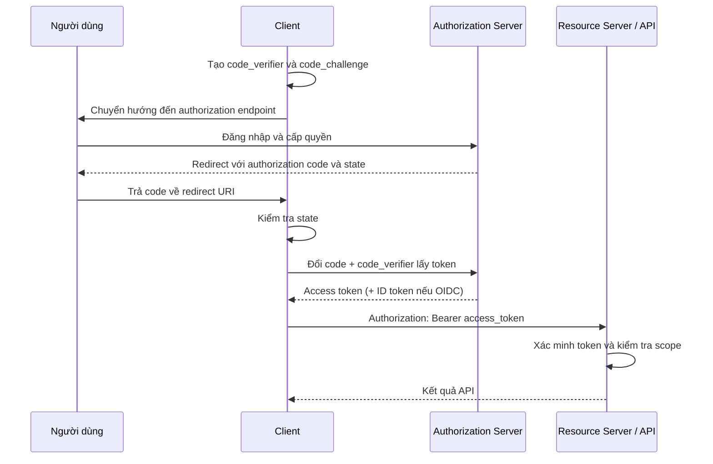
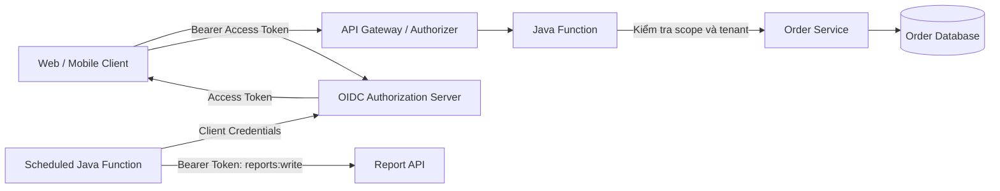

# Xác thực API bằng OAuth 2.0, OpenID Connect và JWT

Một HTTP API cần biết ai đang gửi request, request được phép làm gì và token dùng để chứng minh quyền đó có còn hợp lệ hay không. Trong hệ thống serverless, việc xác thực có thể được thực hiện ở API Gateway, authorizer hoặc ngay trong Java function. Dù đặt ở lớp nào, hệ thống vẫn cần phân biệt danh tính, quyền truy cập và tính hợp lệ của thông tin xác thực.

OAuth 2.0, OpenID Connect (OIDC) và JSON Web Token (JWT) thường xuất hiện cùng nhau nhưng giải quyết các vấn đề khác nhau. OAuth 2.0 là framework ủy quyền để client nhận quyền truy cập tài nguyên. OIDC bổ sung lớp xác thực danh tính người dùng trên OAuth 2.0. JWT là một định dạng biểu diễn claims có thể được ký hoặc mã hóa; nó thường được dùng làm access token hoặc ID token, nhưng bản thân JWT không phải một giao thức cấp quyền.

Hiểu đúng ranh giới này giúp tránh những lỗi phổ biến như dùng ID token để gọi API, chỉ giải mã JWT mà không xác minh chữ ký, hoặc chấp nhận token hợp lệ về chữ ký nhưng không dành cho API hiện tại.

## 1. Phân biệt OAuth 2.0, OpenID Connect và JWT

### 1.1. OAuth 2.0: ủy quyền truy cập

OAuth 2.0 mô tả cách một client nhận access token từ authorization server để truy cập tài nguyên do resource server bảo vệ. Access token đại diện cho quyền được cấp theo một phạm vi, đối tượng nhận và thời hạn nhất định.

Các vai trò cơ bản gồm:

- **Resource owner:** chủ thể có quyền cấp quyền truy cập; thường là người dùng.
- **Client:** ứng dụng muốn truy cập tài nguyên thay mặt resource owner hoặc bằng danh tính của chính ứng dụng.
- **Authorization server:** xác thực người dùng hoặc client, áp dụng chính sách cấp quyền và phát token.
- **Resource server:** API nhận access token, kiểm tra token và quyết định có cho phép thao tác hay không.

Ví dụ, một ứng dụng quản lý đơn hàng cần đọc danh sách đơn. Người dùng đăng nhập qua authorization server và cấp scope `orders:read`. Client nhận access token rồi gửi token đến API. API kiểm tra token và scope trước khi trả dữ liệu.

OAuth 2.0 trả lời câu hỏi *client được phép truy cập tài nguyên nào?* Nó không tự định nghĩa cách đăng nhập người dùng hay chuẩn hóa thông tin hồ sơ người dùng. Đó là lý do OIDC được xây dựng trên OAuth 2.0.

### 1.2. OpenID Connect: xác thực danh tính

OIDC là một lớp định danh (identity layer) đặt trên OAuth 2.0. Khi client yêu cầu scope `openid`, authorization server có thể phát thêm **ID token**. ID token chứa claims về quá trình xác thực và người dùng, chẳng hạn `sub` (định danh ổn định của subject trong issuer), `iss`, `aud`, `exp` và có thể có `auth_time`, `nonce`.

ID token dành cho client để hiểu kết quả đăng nhập. **Access token dành cho resource server/API để kiểm tra quyền truy cập.** Không dùng ID token thay cho access token khi gọi API, trừ khi một giao thức riêng được thiết kế rõ ràng cho mục đích đó.

OIDC còn định nghĩa discovery metadata và UserInfo endpoint. Client có thể lấy cấu hình issuer, authorization endpoint, token endpoint và JWKS URI từ tài liệu discovery của nhà cung cấp. Client phải kiểm tra issuer mong đợi và cấu hình tin cậy; không được lấy một URL tùy ý từ đầu vào người dùng rồi tự động tin cậy metadata ở đó.

### 1.3. JWT: định dạng token

JWT là một cách biểu diễn claims. JWT thường được ký dưới dạng JWS; trong trường hợp đó, token compact thường có ba phần phân cách bằng dấu chấm:

```text
base64url(header).base64url(payload).base64url(signature)
```

- **Header:** thông tin về kiểu token và thuật toán ký, có thể chứa `kid` để nhận diện khóa.
- **Payload:** các claims như issuer, audience, subject, thời hạn, scope hoặc dữ liệu ứng dụng.
- **Signature:** chữ ký cho phép bên nhận kiểm tra token có được ký bởi khóa tin cậy và nội dung có bị thay đổi hay không.

Các phần header và payload chỉ được mã hóa Base64URL để biểu diễn dữ liệu. Chúng không được giữ bí mật. Bất kỳ ai có token đều có thể giải mã phần payload của một JWS. Không đưa mật khẩu, secret, số thẻ hoặc dữ liệu nhạy cảm vào JWT với giả định rằng chữ ký sẽ che giấu nội dung.

JWT cũng có thể được mã hóa theo JWE; cấu trúc compact của JWE thường có năm phần. Tuy nhiên, nhiều access token JWT dùng trong API là JWS đã ký chứ không phải token mã hóa. Luôn kiểm tra profile và hợp đồng token của authorization server đang dùng.

### 1.4. Access token không nhất thiết là JWT

OAuth 2.0 không bắt buộc access token phải là JWT. Authorization server có thể phát token dạng opaque (chuỗi không có cấu trúc mà client không thể tự đọc). Resource server có thể xác minh opaque token thông qua introspection endpoint hoặc cơ chế tra cứu do nhà cung cấp cung cấp.

| Đặc điểm | JWT access token | Opaque access token |
| --- | --- | --- |
| Cách kiểm tra | Xác minh chữ ký và claims theo profile | Gọi introspection hoặc dịch vụ tra cứu tin cậy |
| Có thể kiểm tra offline | Có, nếu có khóa và chính sách phù hợp | Thường không |
| Thu hồi tức thời | Khó hơn nếu chỉ xác minh cục bộ | Có thể phản ánh trạng thái thu hồi qua introspection |
| Phụ thuộc mạng lúc xác minh | Có thể giảm nếu cache JWKS hợp lý | Thường cần kết nối đến authorization server hoặc cache |
| Kích thước | Có thể lớn do chứa claims và chữ ký | Thường nhỏ hơn, tùy triển khai |

Không nên chọn JWT chỉ vì có thể giải mã nó. Hãy chọn dựa trên nhu cầu thu hồi, độ trễ, tính sẵn sàng, quy mô hệ thống và khả năng vận hành khóa.

## 2. Các luồng OAuth 2.0 thường dùng

Luồng cấp token phải phù hợp với loại client và cách người dùng hoặc dịch vụ tương tác. Không nên dùng một grant type cho mọi trường hợp.

### 2.1. Authorization Code với PKCE

Đây là lựa chọn phù hợp cho ứng dụng có người dùng, bao gồm ứng dụng web, mobile và public client. PKCE (Proof Key for Code Exchange) bảo vệ authorization code khỏi bị ứng dụng khác chặn và sử dụng lại.

Quy trình khái quát:

1. Client tạo `code_verifier` ngẫu nhiên và tính `code_challenge` bằng SHA-256 (method `S256`).
2. Client chuyển người dùng đến authorization endpoint với `response_type=code`, `client_id`, `redirect_uri`, `scope`, `state`, `code_challenge` và `code_challenge_method=S256`.
3. Authorization server xác thực người dùng, xin consent nếu cần và chuyển trình duyệt về redirect URI cùng authorization code và `state`.
4. Client kiểm tra `state`, sau đó gửi code, redirect URI và `code_verifier` đến token endpoint.
5. Authorization server xác minh PKCE và phát access token; nếu dùng OIDC, có thể phát thêm ID token.
6. Client gửi access token đến API bằng header `Authorization: Bearer`.



`state` giúp liên kết phản hồi với yêu cầu đăng nhập đã bắt đầu và chống CSRF trong luồng redirect. `nonce` trong OIDC liên kết ID token với phiên xác thực của client và giúp chống phát lại ID token trong ngữ cảnh đó. `state` và `nonce` có mục đích khác nhau; không dùng một giá trị thay thế tùy tiện cho cả hai.

Với ứng dụng web server-side là confidential client, client có thể xác thực tại token endpoint bằng phương thức được authorization server hỗ trợ. Với ứng dụng mobile hoặc SPA là public client, không thể giữ client secret an toàn trong mã phân phối cho người dùng; PKCE là yêu cầu bảo vệ quan trọng và không nên nhúng secret tĩnh vào ứng dụng.

### 2.2. Client Credentials

Client Credentials phù hợp cho giao tiếp service-to-service khi một workload cần truy cập API bằng danh tính của chính nó, không đại diện cho người dùng đang đăng nhập.

1. Service gọi token endpoint bằng danh tính client đã đăng ký.
2. Authorization server xác thực client, chẳng hạn bằng client secret được bảo vệ, private key hoặc cơ chế xác thực khác được hỗ trợ.
3. Authorization server phát access token với scope và audience được cấp.
4. Service gửi access token đến API đích.

Ví dụ, một function Java tổng hợp báo cáo theo lịch cần gọi API lưu trữ báo cáo. Function dùng danh tính workload để xin token có scope `reports:write`, rồi gửi token đến resource server. Không cần giả lập một người dùng để thực hiện tác vụ nền này.

Client Credentials không tạo phiên đăng nhập người dùng và thường không phát ID token. Không dùng client secret trong source code, image container, biến cấu hình không được bảo vệ hoặc log. Nên ưu tiên workload identity, managed identity hoặc cơ chế credential ngắn hạn của nền tảng nếu có.

### 2.3. Các luồng cần tránh

- **Implicit grant:** không nên dùng cho ứng dụng mới; Authorization Code với PKCE thay thế tốt hơn.
- **Resource Owner Password Credentials grant:** không nên dùng; ứng dụng không nên thu thập mật khẩu của người dùng để đổi token.
- **Tự tạo token tùy ý:** không tự phát JWT bằng secret dùng chung giữa nhiều service nếu không có quy trình issuer, key management, audience và rotation rõ ràng.

Khi thiết kế hệ thống mới, hãy chọn authorization code + PKCE cho đăng nhập người dùng và client credentials cho tác vụ service-to-service, trừ khi nhà cung cấp hoặc kiến trúc có yêu cầu khác đã được đánh giá.

## 3. Access token được gửi đến HTTP API như thế nào?

Sau khi nhận access token, client thường gửi token trong HTTP header:

```http
GET /v1/orders HTTP/1.1
Host: api.example.com
Authorization: Bearer eyJ...<access-token>
Accept: application/json
```

Bearer có nghĩa là bên nắm giữ token có thể sử dụng token. Vì vậy, access token cần được bảo vệ như một credential: chỉ truyền qua HTTPS, không đặt trong URL query string, không ghi vào log và không gửi đến domain không đáng tin cậy.

API cần xác định token có được phát bởi issuer tin cậy, dành cho chính API này, còn hạn và có quyền thực hiện thao tác yêu cầu hay không. Xác minh chữ ký chỉ là một bước trong quy trình.

## 4. Xác minh JWT access token

Resource server không được tin token chỉ vì token có ba phần hoặc payload chứa một `sub` quen thuộc. Nó phải xác minh chữ ký và các điều kiện trong hợp đồng token trước khi sử dụng claims.

### 4.1. Xác minh chữ ký bằng khóa tin cậy

Authorization server ký token bằng private key. Resource server lấy public key tương ứng từ JWKS endpoint đã được tin cậy. JWKS là tập hợp public key được công bố để bên nhận xác minh chữ ký.

Header JWT có thể chứa `kid` (key ID). Resource server dùng `kid` để chọn khóa phù hợp trong JWKS. Nếu không tìm thấy khóa, có thể refresh JWKS một cách có kiểm soát để xử lý rotation; không được tải URL tùy ý do token cung cấp.

Các nguyên tắc quan trọng:

- Lấy issuer và JWKS URI từ cấu hình tin cậy hoặc OIDC discovery đã được kiểm tra.
- Chỉ cho phép tập thuật toán ký mà hệ thống đã cấu hình và nhà cung cấp cam kết sử dụng.
- Không để token tự quyết định thuật toán được chấp nhận; không chấp nhận `alg=none`.
- Chọn đúng khóa theo `kid`, kiểm tra loại khóa và thuật toán tương thích.
- Cache JWKS có thời hạn hợp lý để giảm độ trễ và tải; hỗ trợ refresh khi gặp `kid` mới, có giới hạn để tránh request storm.
- Không chấp nhận token nếu xác minh chữ ký thất bại hoặc không thể thiết lập chuỗi tin cậy.

### 4.2. Kiểm tra claims

Sau khi chữ ký hợp lệ, API vẫn phải kiểm tra các claims phù hợp với profile access token:

| Claim | Ý nghĩa | Kiểm tra ở resource server |
| --- | --- | --- |
| `iss` | Issuer phát token | Phải khớp chính xác issuer tin cậy đã cấu hình |
| `aud` | Đối tượng nhận token | Phải bao gồm định danh API/resource server hiện tại |
| `exp` | Thời điểm hết hạn | Token phải còn hạn; chỉ cho phép clock skew nhỏ theo chính sách |
| `nbf` | Chưa được chấp nhận trước thời điểm này | Không dùng token trước thời điểm hợp lệ, có xét sai lệch đồng hồ nhỏ |
| `iat` | Thời điểm phát token | Có thể kiểm tra giá trị hợp lý và chính sách tuổi token |
| `sub` | Subject mà token đại diện | Dùng làm định danh trong đúng phạm vi issuer; không xem riêng `sub` là danh tính toàn cục |
| `scope` hoặc `scp` | Quyền được cấp | Phải chứa quyền cần thiết cho endpoint/action |
| `client_id` | Client được cấp access token trong profile JWT access token tương ứng | Kiểm tra nếu chính sách API giới hạn client được phép gọi; tên claim phụ thuộc profile token |
| `jti` | Định danh token | Có thể dùng cho audit hoặc danh sách thu hồi nếu kiến trúc hỗ trợ |

Tên claim và kiểu dữ liệu có thể khác nhau giữa authorization server. Một số token biểu diễn scope dưới dạng chuỗi phân cách bằng dấu cách; một số profile dùng mảng hoặc claim `scp`. Hãy tuân theo hợp đồng của issuer thay vì đoán tên claim.

Đặc biệt, kiểm tra `aud` ngăn việc dùng token được phát cho một API khác. Kiểm tra `iss` ngăn token cùng khóa hoặc cùng định dạng nhưng đến từ issuer không được tin cậy. Không chấp nhận audience rỗng hoặc wildcard chỉ để làm cho việc xác minh dễ dàng hơn.

### 4.3. Phân quyền theo scope và resource

Một access token hợp lệ không có nghĩa người sở hữu được làm mọi việc. Sau khi xác thực token, API phải kiểm tra quyền theo endpoint và dữ liệu đích.

Ví dụ:

- `orders:read` cho phép đọc đơn hàng.
- `orders:write` cho phép tạo hoặc cập nhật đơn hàng.
- `reports:write` cho phép tạo báo cáo.

Scope thường biểu diễn quyền ở mức API. API vẫn cần kiểm tra quyền trên từng resource: người dùng có được đọc đơn hàng có `orderId` này không, tenant trong token có khớp tenant của dữ liệu không, và thao tác có hợp lệ với trạng thái nghiệp vụ không.

Không dùng `sub` hoặc `scope` đơn lẻ để bỏ qua kiểm tra ownership và tenant isolation. Một token có scope `orders:read` không tự động cho phép đọc đơn hàng của mọi khách hàng.

### 4.4. ID token và access token phải được xử lý khác nhau

OIDC ID token có audience thường là `client_id`, tức ứng dụng đăng nhập. Access token có audience là API/resource server. API không nên nhận ID token như access token chỉ vì cả hai đều là JWT được ký bởi cùng issuer.

Client xác minh ID token theo quy tắc OIDC, bao gồm issuer, audience của client, thời hạn, chữ ký và nonce khi được gửi trong authentication request; `azp` cũng cần được kiểm tra theo quy tắc OIDC khi có hoặc khi được yêu cầu. Resource server xác minh access token theo profile dành cho API, bao gồm audience của API và scope/quyền tương ứng. Không mặc định `azp` là claim thay thế phổ quát cho `client_id` trong mọi access token.

## 5. Tích hợp xác thực vào Java FaaS

Trong kiến trúc serverless, có hai vị trí thường dùng để xác minh access token:

1. **API Gateway hoặc authorizer:** kiểm tra token trước khi chuyển request đến function. Cách này giảm lượng request không hợp lệ đi vào mã nghiệp vụ và cho phép quản lý chính sách tập trung.
2. **Java function/resource server:** kiểm tra token trong ứng dụng. Cách này hữu ích khi function được gọi qua nhiều đường, cần kiểm tra scope chi tiết hoặc cần bảo vệ cả những invocation không đi qua gateway.

Hai lớp có thể cùng tham gia. Gateway có thể xác minh chữ ký và các claims cơ bản, còn function kiểm tra quyền nghiệp vụ, tenant và ownership. Nếu chỉ xác minh ở gateway, cần bảo đảm không có đường gọi trực tiếp hoặc đường nội bộ khác bỏ qua gateway. IAM/resource policy nên giới hạn quyền invoke function cho đúng gateway và principal cần thiết.

### 5.1. Tách phần xác minh token khỏi handler

Không nên tự viết thuật toán JWT bằng cách tách chuỗi, Base64 decode rồi so sánh nội dung. Hãy dùng thư viện OAuth/JWT được duy trì, cấu hình issuer, audience, JWKS URI và thuật toán cho phép. Adapter dưới đây minh họa ranh giới giữa thư viện xác minh token và logic HTTP; các kiểu dữ liệu là hợp đồng ứng dụng, không phải API tiêu chuẩn của một thư viện cụ thể.

```java
public interface AccessTokenVerifier {
    // Chỉ trả về khi chữ ký và các claims bắt buộc đã được xác minh.
    VerifiedAccessToken verify(String compactToken);
}

public record VerifiedAccessToken(
        String subject,
        String issuer,
        Set<String> audiences,
        Set<String> scopes,
        String clientId) {
}

public final class OrdersHandler {
    private final AccessTokenVerifier tokenVerifier;
    private final OrderService orderService;

    public OrdersHandler(
            AccessTokenVerifier tokenVerifier,
            OrderService orderService) {
        this.tokenVerifier = tokenVerifier;
        this.orderService = orderService;
    }

    public ApiResponse listOrders(ApiRequest request) {
        String token = bearerToken(request.header("Authorization"));
        if (token == null) {
            return ApiResponse.unauthorized(
                    "Bearer authentication is required");
        }

        final VerifiedAccessToken principal;
        try {
            principal = tokenVerifier.verify(token);
        } catch (InvalidAccessTokenException error) {
            return ApiResponse.unauthorized("Invalid access token");
        }

        if (!principal.scopes().contains("orders:read")) {
            return ApiResponse.forbidden("Insufficient scope");
        }

        // Service tiếp tục kiểm tra tenant/ownership theo chính sách nghiệp vụ.
        return ApiResponse.ok(
                orderService.listVisibleTo(principal.subject()));
    }

    private static String bearerToken(String authorization) {
        if (authorization == null) {
            return null;
        }
        String prefix = "Bearer ";
        if (!authorization.regionMatches(
                true, 0, prefix, 0, prefix.length())) {
            return null;
        }
        String value = authorization.substring(prefix.length()).trim();
        return value.isEmpty() ? null : value;
    }
}
```

Đoạn mã giả định `AccessTokenVerifier` chỉ trả về principal đã xác minh. Khi triển khai, adapter nên dùng thư viện JOSE/OIDC đáng tin cậy và cấu hình rõ:

- issuer chính xác;
- audience của API;
- JWKS URI lấy từ cấu hình issuer tin cậy;
- allowlist thuật toán ký;
- cách xử lý `kid`, cache và key rotation;
- kiểm tra `exp`, `nbf` và clock skew;
- profile access token và cách đọc scope;
- chính sách client được phép gọi API nếu cần.

Không tạo `VerifiedAccessToken` từ payload chưa xác minh. Không dùng một hàm `decode()` thay cho `verify()`. Nếu dùng framework bảo mật như Spring Security Resource Server, hãy cấu hình JWT decoder/issuer và audience validator trong security layer rồi để handler nhận principal đã được xác minh.

### 5.2. Ví dụ kiểm tra quyền ở từng endpoint

Giả sử API có hai endpoint:

| Endpoint | Scope tối thiểu | Kiểm tra nghiệp vụ bổ sung |
| --- | --- | --- |
| `GET /v1/orders` | `orders:read` | Chỉ trả các đơn thuộc tenant hoặc người dùng được phép |
| `POST /v1/orders` | `orders:write` | Kiểm tra quyền tạo đơn, hạn mức và dữ liệu đầu vào |
| `GET /v1/reports/{id}` | `reports:read` | Kiểm tra report thuộc tenant hiện tại |

Không nên gán scope quá rộng như `admin` cho mọi function chỉ để giảm cấu hình. Cấp quyền theo nguyên tắc tối thiểu và tách scope đọc/ghi khi nghiệp vụ cần ranh giới đó.

### 5.3. Xử lý lỗi HTTP

API thường dùng:

- **401 Unauthorized:** thiếu thông tin xác thực hoặc access token không hợp lệ, hết hạn, sai chữ ký, sai issuer/audience.
- **403 Forbidden:** token hợp lệ nhưng không có scope hoặc quyền nghiệp vụ cần thiết.
- **400 Bad Request:** header hoặc request có định dạng sai theo hợp đồng API.
- **429 Too Many Requests:** client vượt giới hạn tốc độ; đây là điều tiết tải, không phải lỗi xác thực.

Với Bearer token, API có thể trả header `WWW-Authenticate` theo RFC 6750, ví dụ `Bearer error="invalid_token"` hoặc `Bearer error="insufficient_scope"`. Không trả stack trace, thông tin khóa, chi tiết nội bộ của issuer hoặc lý do xác minh nhạy cảm cho client.

## 6. Quản lý vòng đời token và khóa

### 6.1. Thời hạn access token

Access token nên có thời hạn phù hợp với rủi ro và trải nghiệm người dùng. Token ngắn hạn giảm khoảng thời gian một token bị đánh cắp có thể được sử dụng. Tuy nhiên, thời hạn quá ngắn làm tăng số lần xin token và phụ thuộc vào availability của authorization server.

Refresh token thường được cấp cho client theo chính sách của issuer để xin access token mới. Resource server không nên nhận refresh token để gọi API nghiệp vụ. Client phải lưu refresh token an toàn, dùng rotation hoặc sender constraint nếu nhà cung cấp hỗ trợ, và xử lý phát hiện refresh token bị tái sử dụng theo chính sách.

### 6.2. Thu hồi JWT

JWT được xác minh cục bộ có thể tiếp tục hợp lệ đến `exp`, ngay cả khi người dùng đã logout hoặc quyền đã bị thu hồi, trừ khi API có cơ chế kiểm tra bổ sung. Các lựa chọn gồm:

- access token có thời hạn ngắn;
- opaque token với introspection;
- danh sách thu hồi theo `jti` hoặc session ID;
- kiểm tra trạng thái tài khoản/phiên ở hệ thống có thẩm quyền;
- sender-constrained token như mTLS hoặc DPoP khi mô hình client và nhà cung cấp hỗ trợ.

Danh sách thu hồi hoặc tra cứu trạng thái có thể tăng độ trễ và tạo dependency mới. Cần cân bằng yêu cầu thu hồi tức thời với tính sẵn sàng và chi phí.

### 6.3. Key rotation và JWKS cache

Authorization server có thể thay khóa ký theo lịch hoặc khi cần xử lý sự cố. Resource server cần hỗ trợ nhiều khóa trong giai đoạn chuyển tiếp:

1. Issuer công bố public key mới trong JWKS.
2. Issuer bắt đầu ký token mới bằng private key mới.
3. Resource server tải hoặc refresh JWKS, nhận diện khóa qua `kid`.
4. Issuer giữ public key cũ đủ lâu để token được ký trước đó hết hạn hoặc hết giai đoạn chuyển tiếp.
5. Khóa cũ được loại bỏ theo chính sách.

Nếu cache JWKS quá lâu, API có thể không nhận ra khóa mới. Nếu refresh mỗi request, API có thể tạo tải lớn và dễ bị gián đoạn khi JWKS endpoint chậm. Dùng cache có TTL, refresh có kiểm soát khi gặp `kid` chưa biết, giới hạn tần suất refresh và giữ nguyên xác minh nghiêm ngặt khi không lấy được khóa.

Không tải `jku` hoặc `x5u` từ header JWT theo mặc định để lấy khóa. Điều đó có thể khiến API truy cập URL do kẻ tấn công điều khiển. Dùng JWKS URI được cấu hình từ issuer tin cậy.

## 7. Bảo mật khi dùng OAuth, OIDC và JWT

### 7.1. Bảo vệ token trong quá trình truyền và lưu

- Chỉ truyền token qua HTTPS và bật kiểm tra chứng thư đúng chuẩn.
- Không đặt access token trong URL, query string hoặc fragment.
- Không ghi token vào application log, access log, tracing attribute hay error report.
- Lưu token phía client trong vị trí phù hợp với nền tảng; tránh lưu trữ lâu dài trong local storage nếu mô hình đe dọa của ứng dụng web không chấp nhận rủi ro XSS.
- Không chia sẻ token giữa các audience hoặc service ngoài mục đích được cấp.
- Không đưa secret hoặc dữ liệu nhạy cảm vào payload JWT với giả định chữ ký sẽ mã hóa nội dung.

### 7.2. CORS và CSRF

CORS là chính sách trình duyệt kiểm soát trang web nào được đọc response cross-origin. CORS không xác thực client và không thay thế OAuth hoặc kiểm tra quyền ở API.

Nếu ứng dụng dùng cookie tự động được trình duyệt gửi kèm, cần xem xét CSRF và cấu hình cookie như `Secure`, `HttpOnly`, `SameSite` cùng biện pháp chống CSRF phù hợp. Nếu dùng bearer token được JavaScript chủ động gắn vào header, mô hình CSRF khác đi nhưng nguy cơ XSS và đánh cắp token vẫn cần xử lý. Không coi CORS là ranh giới bảo mật duy nhất.

### 7.3. Multi-tenant và định danh người dùng

Với API đa tenant, cần kiểm tra tenant claim hoặc ánh xạ tenant đáng tin cậy từ issuer. Không nhận `tenantId` do client gửi rồi mặc định rằng token có quyền truy cập tenant đó. API phải kiểm tra tenant trong token, resource được yêu cầu và quyền truy cập nghiệp vụ trong cùng một quyết định.

`sub` chỉ duy nhất trong ngữ cảnh issuer. Nếu hệ thống hỗ trợ nhiều issuer, khóa định danh người dùng nên bao gồm cả `iss` và `sub`, hoặc dùng một ánh xạ định danh nội bộ đã được kiểm soát.

### 7.4. Bảo vệ webhook

Webhook là HTTP request do một hệ thống khác chủ động gửi đến endpoint. Có thể bảo vệ webhook bằng OAuth bearer token nếu nhà cung cấp hỗ trợ, nhưng nhiều webhook dùng chữ ký HMAC hoặc chữ ký bất đối xứng trên nội dung request.

Với HMAC webhook, receiver thường cần:

1. Đọc raw request body đúng nguyên bản.
2. Tính chữ ký từ secret và dữ liệu theo quy ước của nhà cung cấp.
3. So sánh chữ ký theo cách constant-time.
4. Kiểm tra timestamp hoặc cửa sổ thời gian để giảm nguy cơ replay.
5. Dùng event ID hoặc delivery ID để chống xử lý lặp.
6. Chỉ xác nhận nhận webhook sau khi đã lưu bền vững event hoặc xử lý theo hợp đồng.

Không thể thay xác minh chữ ký webhook bằng cách decode một JWT bất kỳ. Nếu webhook dùng JWT, receiver vẫn phải xác minh chữ ký, issuer, audience, thời hạn và các claim được quy định. Hợp đồng bảo mật của nhà cung cấp webhook là nguồn quyết định cách kiểm tra.

## 8. Các lỗi triển khai thường gặp

| Lỗi | Vì sao nguy hiểm | Cách sửa |
| --- | --- | --- |
| Chỉ Base64 decode JWT | Kẻ tấn công có thể tự tạo payload tùy ý | Dùng thư viện xác minh chữ ký và claims |
| Chấp nhận mọi thuật toán trong header | Có thể tạo đường xác minh yếu hoặc sai cấu hình | Cấu hình allowlist thuật toán và kiểm tra loại khóa |
| Không kiểm tra `iss` | Chấp nhận token từ issuer khác | So khớp issuer chính xác |
| Không kiểm tra `aud` | Token dành cho API khác có thể bị dùng lại | Yêu cầu audience đúng với resource server |
| Chỉ kiểm tra `exp` | Token chưa hết hạn vẫn có thể sai chữ ký hoặc sai mục đích | Kiểm tra toàn bộ profile token |
| Dùng ID token gọi API | Nhầm danh tính đăng nhập với quyền truy cập resource | Dùng access token đúng audience |
| Không kiểm tra scope | Mọi token hợp lệ đều có thể gọi mọi endpoint | Kiểm tra scope và quyền resource ở từng action |
| Tin `sub` mà không xét `iss` | Có thể trùng subject giữa nhiều issuer | Dùng cặp issuer/subject hoặc ánh xạ nội bộ |
| Tin `kid` để tải khóa từ URL trong token | Có thể tạo SSRF hoặc tải khóa từ nguồn không tin cậy | Chỉ dùng JWKS URI cấu hình tin cậy |
| Cache JWKS không có refresh | Token ký bằng khóa mới bị từ chối | Cache có TTL và refresh có kiểm soát |
| Log nguyên access token | Token có thể bị lấy từ hệ thống log | Redact Authorization header và secret |
| Dùng client secret trong SPA/mobile | Secret có thể bị trích xuất | Dùng public client + PKCE hoặc workload identity phù hợp |

## 9. Quy trình thiết kế và kiểm thử

Trước khi đưa OAuth/OIDC/JWT vào production, hãy đi theo các bước sau:

1. **Xác định loại client.** Đây là ứng dụng người dùng, backend confidential client hay workload service-to-service?
2. **Chọn flow phù hợp.** Dùng authorization code + PKCE cho đăng nhập người dùng; client credentials cho tác vụ giữa các service.
3. **Xác định issuer và audience.** API tin issuer nào, resource identifier nào và endpoint nào cần bảo vệ?
4. **Định nghĩa scope và quyền nghiệp vụ.** Tách quyền đọc/ghi, tenant và ownership; không chỉ dựa vào token hợp lệ.
5. **Chọn định dạng token và cách xác minh.** JWT với JWKS hay opaque token với introspection? Yêu cầu thu hồi và độ trễ là gì?
6. **Tích hợp tại gateway/function.** Xác định lớp xác minh chữ ký, lớp kiểm tra scope và quyền resource; bảo vệ đường invoke trực tiếp.
7. **Thiết kế vòng đời token/khóa.** Thời hạn access token, refresh token, rotation, cache JWKS và xử lý issuer outage.
8. **Kiểm thử trường hợp hợp lệ và không hợp lệ.** Chữ ký sai, `iss` sai, `aud` sai, token hết hạn, `nbf` ở tương lai, `kid` không biết, thiếu scope và tenant không khớp.
9. **Kiểm thử vận hành.** JWKS endpoint tạm thời không sẵn sàng, key rotation, concurrency cao, log redaction, gateway timeout và khả năng quan sát.
10. **Theo dõi và rà soát quyền.** Đo tỷ lệ 401/403, lỗi introspection/JWKS, thời gian xác minh, token issuance và thay đổi scope.

### Ma trận kiểm thử token

| Tình huống | Kết quả mong đợi |
| --- | --- |
| Token chữ ký hợp lệ, issuer/audience đúng, còn hạn, đủ scope | Cho phép nếu quyền resource cũng hợp lệ |
| Không có Authorization header | 401 |
| Token sai chữ ký hoặc `kid` không được tin cậy | 401 |
| Token hết hạn hoặc chưa đến `nbf` | 401 |
| Issuer không nằm trong allowlist | 401 |
| Audience không chứa API hiện tại | 401 |
| Token hợp lệ nhưng thiếu scope | 403 |
| Token có scope nhưng truy cập resource thuộc tenant khác | 403 hoặc phản hồi theo chính sách không tiết lộ sự tồn tại của resource |
| JWKS tạm thời không truy cập được và không có khóa cache phù hợp | Fail closed; ghi nhận lỗi xác minh và xử lý availability theo chính sách |
| Token hợp lệ nhưng request vượt rate limit | 429 |

Với tình huống JWKS endpoint không sẵn sàng, không được bỏ qua chữ ký để cho request đi qua. Nếu cache còn khóa hợp lệ và chính sách cho phép, có thể tiếp tục xác minh bằng khóa cache. Nếu không có khóa tin cậy, từ chối xác thực và phát cảnh báo về dependency.

## 10. Ví dụ kiến trúc serverless

Một hệ thống quản lý đơn hàng có client web, authorization server và Java functions sau API Gateway:



Client web/mobile đăng nhập qua authorization code + PKCE. Authorization server phát access token dành cho Order API. API Gateway xác minh token trước khi chuyển request đến Java function. Function tiếp tục kiểm tra scope, tenant và quyền truy cập đơn hàng cụ thể. Một scheduled function khác dùng client credentials để gọi Report API bằng quyền `reports:write`.

Mô hình này tách danh tính người dùng khỏi danh tính workload. Cả hai đều dùng access token, nhưng token có client, subject, audience và scope khác nhau. Mỗi API chỉ chấp nhận issuer/audience và quyền đã được cấu hình cho chính nó.

## Kết luận

OAuth 2.0 cung cấp cơ chế ủy quyền để client nhận access token; OIDC bổ sung xác thực danh tính và ID token; JWT là một định dạng biểu diễn claims thường dùng cho token đã ký. Access token và ID token có mục đích, audience và cách kiểm tra khác nhau.

Một resource server an toàn phải xác minh chữ ký bằng khóa tin cậy, kiểm tra issuer, audience, thời hạn và các claims cần thiết, sau đó kiểm tra scope cùng quyền truy cập resource. Với Java FaaS, API Gateway có thể xác minh sớm, còn function cần bảo vệ logic nghiệp vụ và tenant; đường invoke trực tiếp phải được giới hạn bằng policy phù hợp.

Việc chọn flow, thời hạn token, cách thu hồi, cache JWKS, key rotation và retry khi authorization service gặp sự cố đều ảnh hưởng đến bảo mật và tính sẵn sàng. Dùng thư viện được duy trì, kiểm thử token sai và ghi log có kiểm soát giúp OAuth 2.0, OIDC và JWT trở thành một phần đáng tin cậy của kiến trúc HTTP API serverless.
