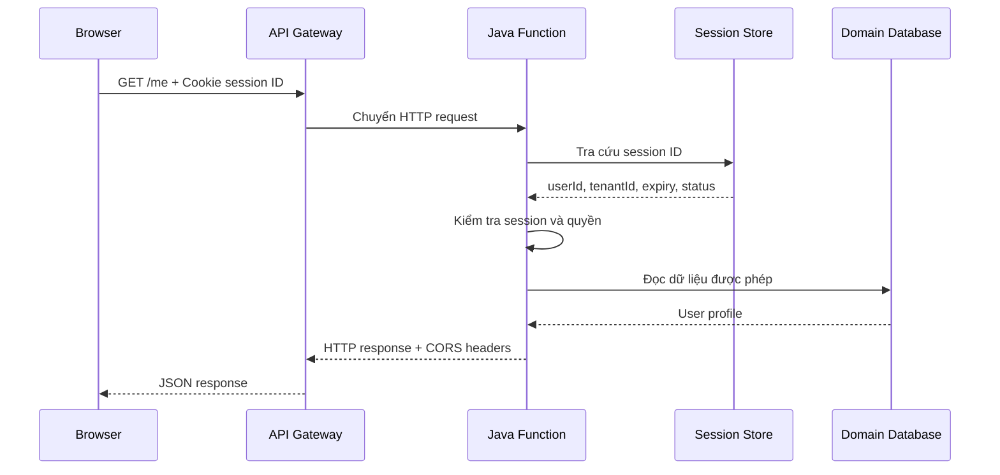

# CORS, cookie và phiên người dùng trong API serverless

## 1. Bối cảnh: trình duyệt, HTTP API và Java function

Một ứng dụng web thường chạy giao diện ở một địa chỉ và gọi API ở địa chỉ khác. Ví dụ giao diện ở `https://app.example.com` gọi API tại `https://api.example.com`. Trình duyệt xem hai địa chỉ này là hai origin khác nhau vì hostname khác nhau, dù chúng có thể thuộc cùng một website. Khi API cần xác thực người dùng bằng cookie, trình duyệt còn áp dụng quy tắc về cookie, credentials và chính sách quyền riêng tư.

Trong mô hình serverless, request có thể đi qua CDN hoặc API gateway rồi mới kích hoạt Java function. Gateway có thể xử lý CORS, TLS, xác thực sơ bộ và định tuyến; function kiểm tra phiên, quyền nghiệp vụ và trả response. Nếu CORS được cấu hình ở nhiều lớp mà không thống nhất, response có thể chứa header trùng hoặc sai. Nếu session được lưu trong bộ nhớ của function, request tiếp theo có thể được chuyển đến instance khác và không tìm thấy phiên.

Ba khái niệm cần phân biệt:

- **CORS (Cross-Origin Resource Sharing):** cơ chế để server khai báo trình duyệt được phép cho JavaScript ở origin nào đọc response của một request cross-origin.
- **Cookie:** dữ liệu nhỏ do server yêu cầu trình duyệt lưu và gửi lại theo domain, path, thời hạn và chính sách SameSite.
- **Session:** trạng thái xác thực hoặc trạng thái người dùng được duy trì qua nhiều HTTP request. Cookie thường chỉ mang session ID hoặc token tham chiếu đến trạng thái đó.

CORS không phải cơ chế xác thực. Cookie không tự chứng minh request hợp lệ nếu không kiểm tra phiên. Session cũng không nên phụ thuộc vào một instance FaaS cụ thể. Cần thiết kế cả ba phần cùng với CSRF, XSS, quyền truy cập và vòng đời triển khai.

## 2. Origin, site và same-origin policy

Một origin được xác định bởi bộ ba **scheme, host và port**. Hai URL có cùng hostname nhưng khác scheme hoặc port vẫn là hai origin khác nhau.

| URL thứ nhất | URL thứ hai | Cùng origin? | Lý do |
|---|---|---:|---|
| `https://app.example.com` | `https://app.example.com/api` | Có | Scheme, host và port mặc định giống nhau |
| `https://app.example.com` | `https://api.example.com` | Không | Host khác nhau |
| `https://app.example.com` | `http://app.example.com` | Không | Scheme khác nhau |
| `https://app.example.com` | `https://app.example.com:8443` | Không | Port khác nhau |

Same-origin policy giới hạn việc một trang web đọc tài nguyên của origin khác. CORS là cơ chế nới quyền đọc response có kiểm soát cho một số request. Đây là quy tắc do trình duyệt thực thi; một chương trình backend gọi API bằng Java, curl hoặc một service khác không bị CORS của trình duyệt chặn.

**Site** là khái niệm khác với origin. Trong ngữ cảnh cookie SameSite, trình duyệt xét scheme và registrable domain (cùng các quy tắc public suffix), không chỉ xét hostname. Ví dụ `https://app.example.com` và `https://api.example.com` là khác origin nhưng thường là same-site. Hai địa chỉ `https://app.example.com` và `https://api.other.net` là cross-site.

Sự khác biệt này quan trọng: request từ frontend sang API có thể cần CORS vì khác origin, nhưng cookie vẫn được xem là same-site. Ngược lại, một ứng dụng nhúng hoặc frontend ở domain khác có thể cần cookie cross-site và gặp thêm hạn chế của trình duyệt đối với third-party cookies.

## 3. CORS hoạt động như thế nào?

Khi JavaScript gửi request cross-origin, trình duyệt quyết định có cần preflight hay không. Với một số request đơn giản, trình duyệt gửi request trực tiếp nhưng chỉ cho JavaScript đọc response nếu header CORS hợp lệ. Với request không đơn giản, trình duyệt gửi một request `OPTIONS` trước để hỏi server có cho phép origin, method và các header dự kiến hay không.

Ví dụ request từ frontend:

```javascript
const response = await fetch("https://api.example.com/orders", {
  method: "POST",
  headers: {
    "Content-Type": "application/json",
    "X-Request-Id": "req-81"
  },
  body: JSON.stringify({ productId: "BOOK-01", quantity: 2 })
});

if (!response.ok) {
  throw new Error(`HTTP ${response.status}`);
}

const order = await response.json();
```

`Content-Type: application/json` và header tùy chỉnh `X-Request-Id` khiến request này cần preflight trong trường hợp cross-origin. Trình duyệt gửi một request tương tự:

```http
OPTIONS /orders HTTP/1.1
Host: api.example.com
Origin: https://app.example.com
Access-Control-Request-Method: POST
Access-Control-Request-Headers: content-type,x-request-id
```

Server có thể trả lời:

```http
HTTP/1.1 204 No Content
Access-Control-Allow-Origin: https://app.example.com
Access-Control-Allow-Methods: GET, POST, PATCH, DELETE, OPTIONS
Access-Control-Allow-Headers: Content-Type, X-Request-Id, Authorization
Access-Control-Max-Age: 600
Vary: Origin
```

Sau khi preflight được chấp nhận, trình duyệt mới gửi request thực tế. Response thực tế cũng cần header CORS phù hợp để JavaScript đọc được. Nếu preflight bị từ chối, trình duyệt không gửi request thực tế theo luồng đó.

Preflight không phải request nghiệp vụ và thường không mang cookie xác thực. Vì vậy, route `OPTIONS` cần có thể trả lời mà không yêu cầu người dùng đăng nhập. Nếu gateway bắt buộc xác thực trước khi route `OPTIONS`, trình duyệt có thể không bao giờ gửi được request thực tế. Tuy vậy, request thực tế vẫn phải xác thực và phân quyền bình thường.

## 4. Các header CORS quan trọng

| Header | Vai trò | Lưu ý |
|---|---|---|
| `Access-Control-Allow-Origin` | Chỉ ra origin được phép đọc response | Một origin cụ thể hoặc `*` trong trường hợp không dùng credentials |
| `Access-Control-Allow-Methods` | Các HTTP method được phép | Phản hồi preflight; liệt kê đúng method API hỗ trợ |
| `Access-Control-Allow-Headers` | Các request header mà client được phép gửi | Bao gồm header tùy chỉnh và `Authorization` nếu cần |
| `Access-Control-Allow-Credentials` | Cho phép request CORS dùng credentials như cookie | Giá trị hợp lệ là `true`; không thể kết hợp `Allow-Origin: *` |
| `Access-Control-Expose-Headers` | Cho phép JavaScript đọc một số response header | Ví dụ `ETag`, `X-Request-Id` |
| `Access-Control-Max-Age` | Thời gian trình duyệt có thể cache kết quả preflight | Trình duyệt có thể áp dụng giới hạn riêng |
| `Vary: Origin` | Báo cache rằng response thay đổi theo Origin | Cần khi server phản hồi origin động từ allowlist |

`Access-Control-Allow-Origin` không phải danh sách phân tách bằng dấu phẩy. Một response chỉ trả về một origin cụ thể hoặc wildcard theo quy tắc CORS. Nếu server cho phép nhiều origin, hãy kiểm tra `Origin` với allowlist rồi trả lại đúng origin đã được chấp nhận.

Không phản chiếu bất kỳ giá trị `Origin` nào mà client gửi lên. Nếu server lấy nguyên `Origin` từ request và trả lại trong `Access-Control-Allow-Origin`, mọi website có thể được cấp quyền đọc response. So sánh origin theo giá trị đã parse và chuẩn hóa, gồm scheme, hostname và port; tránh kiểm tra chuỗi kiểu `endsWith("example.com")` vì có thể chấp nhận nhầm `example.com.attacker.net`.

Nếu API không dùng cookie hoặc HTTP authentication credentials, `Access-Control-Allow-Origin: *` có thể phù hợp cho một API công khai. Khi dùng credentials, phải trả origin cụ thể và `Access-Control-Allow-Credentials: true`. Không đặt `Access-Control-Allow-Credentials: true` chỉ vì API có đăng nhập; chỉ bật khi trình duyệt thực sự cần gửi hoặc nhận credentials trong request cross-origin.

## 5. Request có credentials và CORS có cookie

Mặc định, `fetch` không gửi cookie cho một request cross-origin. Frontend cần khai báo:

```javascript
const response = await fetch("https://api.example.com/me", {
  method: "GET",
  credentials: "include"
});
```

Server cần trả các header tương ứng trên response thực tế:

```http
Access-Control-Allow-Origin: https://app.example.com
Access-Control-Allow-Credentials: true
Vary: Origin
```

Nếu request có preflight, response `OPTIONS` cũng cần cho phép origin, method và các header mà request thực tế yêu cầu. Preflight bản thân nó thường không mang cookie; `Allow-Credentials` không biến preflight thành request có session. Trình duyệt vẫn áp dụng quy tắc cookie như Domain, Path, Secure, SameSite và chính sách third-party cookie khi gửi request thực tế.

Với request thực tế dùng credentials, response preflight cũng phải cho phép credentials bằng `Access-Control-Allow-Credentials: true`, dù chính request `OPTIONS` không mang cookie. Ví dụ response preflight:

```http
HTTP/1.1 204 No Content
Access-Control-Allow-Origin: https://app.example.com
Access-Control-Allow-Credentials: true
Access-Control-Allow-Methods: GET, POST, OPTIONS
Access-Control-Allow-Headers: Content-Type, X-CSRF-Token
Vary: Origin
```

Với request có credentials, không được dùng `Access-Control-Allow-Origin: *`. Cũng không được dùng wildcard cho `Access-Control-Allow-Headers` hoặc `Access-Control-Allow-Methods` theo cách mong đợi quyền rộng khi credentials được bật; hãy liệt kê cụ thể các header và method cần thiết. `Access-Control-Allow-Credentials` phải có giá trị chính xác `true` (phân biệt chữ hoa thường theo cú pháp header value).

Nếu server chọn origin động từ allowlist, response cần `Vary: Origin` để cache trung gian không phục vụ response đã cho phép một origin sang origin khác. Cấu hình CDN/API gateway cũng phải chuyển tiếp `Origin` và áp dụng cache key phù hợp. Khi không cần cache response cá nhân hóa, đặt chính sách cache riêng hoặc `Cache-Control: private, no-store` cho endpoint nhạy cảm.

## 6. Preflight và cách cấu hình ở API gateway

Preflight là một request `OPTIONS` với các header `Origin`, `Access-Control-Request-Method` và có thể có `Access-Control-Request-Headers`. Server nên:

1. Xác định origin có trong allowlist hay không.
2. Kiểm tra method được yêu cầu có được phép hay không.
3. Kiểm tra từng request header có nằm trong danh sách cho phép hay không.
4. Trả `204 No Content` hoặc response thành công tương đương, kèm các header CORS chính xác.
5. Không chạy nghiệp vụ tạo đơn, cập nhật dữ liệu hoặc tiêu thụ session trong preflight.

Ở kiến trúc serverless, có thể xử lý `OPTIONS` tại API gateway để không khởi chạy function. Nếu function tự xử lý, route `OPTIONS` phải được ánh xạ đúng và không bị middleware xác thực chặn. Hãy chọn một lớp chịu trách nhiệm chính cho CORS: gateway hoặc ứng dụng. Nếu cả hai cùng thêm header, có thể tạo response trùng `Access-Control-Allow-Origin` hoặc hai chính sách mâu thuẫn.

Đừng chỉ thêm CORS cho response thành công. Lỗi xác thực, lỗi validation, `404`, `429` và `5xx` cũng cần header CORS để frontend đọc được status và nội dung lỗi. Nếu gateway tự tạo response lỗi trước khi function chạy, cấu hình CORS ở gateway cũng phải bao phủ các response đó.

`Access-Control-Max-Age` giúp giảm số lần preflight, nhưng không nên đặt quá dài nếu danh sách origin hoặc quyền thay đổi thường xuyên. Trình duyệt có thể giới hạn thời gian cache thực tế. Việc thay đổi cấu hình CORS cũng không thu hồi ngay một preflight đã được trình duyệt cache cho đến khi cache hết hạn.

## 7. Cookie trong trình duyệt

Cookie được server gửi bằng `Set-Cookie`; trình duyệt tự quản lý và quyết định khi nào gửi lại qua header `Cookie`. JavaScript ở trang web không thể đọc cookie có `HttpOnly`. Đây là đặc điểm quan trọng khi dùng cookie làm session credential.

Ví dụ cookie session:

```http
Set-Cookie: __Host-session=opaque-random-value; Path=/; Secure; HttpOnly; SameSite=Lax; Max-Age=1800
```

Các thuộc tính quan trọng:

| Thuộc tính | Tác dụng | Khuyến nghị |
|---|---|---|
| `Secure` | Chỉ gửi cookie qua kết nối HTTPS | Bật cho session trong môi trường production |
| `HttpOnly` | Chặn JavaScript đọc cookie qua `document.cookie` | Bật cho session ID và refresh token trong cookie |
| `SameSite` | Hạn chế cookie trong request cross-site | Chọn `Strict`, `Lax` hoặc `None` theo luồng điều hướng và xác thực |
| `Path` | Giới hạn đường dẫn request nhận cookie | Dùng `/` cho session cấp ứng dụng |
| `Domain` | Mở rộng cookie đến domain và subdomain phù hợp | Bỏ qua để tạo host-only cookie nếu không cần chia sẻ subdomain |
| `Max-Age` / `Expires` | Quy định thời hạn cookie ở trình duyệt | Phải phù hợp với thời hạn session ở server |

Nếu không đặt `Domain`, cookie là host-only và chỉ được gửi đến host đã đặt cookie. Điều này thường an toàn hơn việc chia sẻ cookie cho mọi subdomain. Không đặt `Domain=.example.com` nếu frontend hoặc một subdomain ít tin cậy không cần nhận cookie.

`Path` không phải ranh giới bảo mật đáng tin cậy. Một cookie có `Path=/admin` vẫn không thay thế kiểm tra quyền ở server. Tương tự, việc cookie chỉ được gửi đến một host không chứng minh người dùng có quyền với mọi tài nguyên trên host đó.

### Prefix bảo vệ cookie

Trình duyệt hiện đại hỗ trợ các prefix cookie có quy tắc bổ sung:

- `__Host-`: yêu cầu `Secure`, `Path=/` và không có `Domain`. Phù hợp với session cookie gắn với một host.
- `__Secure-`: yêu cầu cookie được đặt qua secure context và có thuộc tính `Secure`.

Ví dụ `__Host-session` giúp giảm nguy cơ subdomain khác đặt cookie cùng tên với phạm vi domain rộng. Vẫn phải xác thực session ở server và chống CSRF.

### Chọn SameSite

| Giá trị | Hành vi tổng quát | Trường hợp sử dụng |
|---|---|---|
| `Strict` | Hạn chế gửi cookie trong các điều hướng cross-site | Ứng dụng cần bảo vệ chặt và chấp nhận một số luồng liên kết ngoài không tự đăng nhập |
| `Lax` | Cho phép cookie trong một số điều hướng top-level an toàn, nhưng hạn chế nhiều request cross-site khác | Lựa chọn mặc định thực tế cho nhiều session web |
| `None` | Cho phép cookie trong ngữ cảnh cross-site nếu đáp ứng yêu cầu Secure | Tích hợp cross-site thật sự, iframe hoặc frontend khác site |

Cookie `SameSite=None` phải có `Secure`. Tuy nhiên, cấu hình này không đảm bảo cookie sẽ luôn được gửi: trình duyệt có thể chặn third-party cookies hoặc áp dụng chế độ bảo vệ theo người dùng. Nếu sản phẩm cần đăng nhập ổn định, nên cân nhắc đưa frontend và API về cùng site hoặc dùng Backend-for-Frontend (BFF) để trình duyệt chỉ giao tiếp với một origin/site do ứng dụng kiểm soát.

## 8. CORS và cookie không thay thế CSRF protection

Cross-Site Request Forgery (CSRF) xảy ra khi trình duyệt tự động gửi cookie hợp lệ đến một website mà người dùng không chủ định thao tác. Kẻ tấn công có thể khiến trình duyệt gửi request thay mặt người dùng. CORS chủ yếu quyết định JavaScript ở origin khác có đọc được response hay không; nó không phải cơ chế ngăn mọi request cross-site được gửi.

Ví dụ, một trang độc hại có thể tạo form gửi POST đến một website mà người dùng đang đăng nhập. Trình duyệt có thể gửi request đó kèm cookie theo quy tắc cookie, dù trang độc hại không đọc được response. Vì vậy, API dùng cookie để xác thực cần cơ chế chống CSRF cho các thao tác làm thay đổi trạng thái.

Các lớp phòng vệ thường dùng:

- Đặt `SameSite=Lax` hoặc `Strict` nếu luồng sản phẩm cho phép.
- Dùng CSRF token theo mô hình synchronizer token: server cấp token gắn với session, frontend gửi token trong header hoặc body và server xác minh.
- Với mô hình double-submit cookie, dùng token riêng có chữ ký hoặc ràng buộc với session; không chỉ so sánh một cookie dễ bị ghi đè từ subdomain.
- Kiểm tra `Origin` và, khi phù hợp, `Referer` đối với request thay đổi trạng thái. Từ chối origin không nằm trong danh sách đáng tin cậy.
- Yêu cầu custom header cho API trình duyệt và chỉ cho phép header đó qua CORS; đây là lớp bổ sung, không phải thay thế CSRF token khi cần.
- Không dùng GET để thực hiện hành động thay đổi dữ liệu.

Không phải mọi endpoint đều cần cùng một biện pháp. API chỉ nhận bearer token trong `Authorization` header mà không dựa vào cookie tự động gửi thường ít chịu kiểu CSRF truyền thống hơn, nhưng vẫn cần bảo vệ XSS, token theft và các lỗi xác thực khác. Nếu cookie chứa JWT, request vẫn có đặc tính tự động gửi cookie và vẫn cần đánh giá CSRF.

## 9. Session người dùng trong môi trường serverless

HTTP là giao thức stateless: mỗi request độc lập. Session tạo ra sự liên tục bằng cách gửi một định danh hoặc credential trong từng request, rồi tra cứu trạng thái tương ứng. Một session thường chứa:

- ID session ngẫu nhiên, không đoán được.
- ID người dùng và tenant đã xác thực.
- Thời điểm tạo, thời điểm hoạt động gần nhất và thời điểm hết hạn.
- Trạng thái thu hồi hoặc phiên bản xác thực nếu cần.
- Các thông tin tối thiểu cần để kiểm tra quyền; dữ liệu quyền nhạy cảm nên được đọc từ nguồn có thẩm quyền khi cần.

Trong serverless, không lưu session duy nhất trong biến static, singleton của function hoặc bộ nhớ instance. Nền tảng có thể khởi chạy nhiều instance, tái sử dụng instance không xác định hoặc chuyển request kế tiếp sang instance khác. Local memory chỉ phù hợp làm cache ngắn hạn có thể mất bất kỳ lúc nào, không phải nguồn dữ liệu session chuẩn.

Một thiết kế phổ biến là cookie chỉ chứa session ID opaque; Java function đọc session từ kho dùng chung như Redis, DynamoDB hoặc cơ sở dữ liệu quan hệ. Kho dữ liệu cần hỗ trợ hết hạn TTL, truy vấn theo ID và thao tác cập nhật nguyên tử phù hợp với tải. Nếu dùng cache phân tán, cần hiểu thời gian replication, eviction và hành vi khi cache mất dữ liệu.



Nếu session store tạm thời không khả dụng, cần quyết định rõ endpoint nào fail closed (từ chối truy cập) và cách trả lỗi có thể retry. Không bỏ qua kiểm tra session để hệ thống “tiếp tục hoạt động”. Với dữ liệu nhạy cảm, lỗi session store nên làm request thất bại an toàn và được giám sát.

## 10. Tạo, gia hạn, xoay vòng và kết thúc session

Một vòng đời session an toàn thường gồm:

1. **Đăng nhập:** xác thực thông tin đăng nhập hoặc identity provider; tạo session ID bằng bộ sinh số ngẫu nhiên mật mã.
2. **Lưu session:** ghi ID, user, tenant, thời điểm tạo, idle expiry và absolute expiry vào kho dùng chung.
3. **Đặt cookie:** gửi session ID qua `Set-Cookie` với `Secure`, `HttpOnly`, `SameSite` và phạm vi host/path phù hợp.
4. **Xác thực request:** đọc cookie, tra session, kiểm tra hết hạn/thu hồi, rồi kiểm tra quyền của hành động.
5. **Gia hạn:** cập nhật idle expiry theo chính sách; không kéo dài vô hạn vượt absolute expiry.
6. **Xoay vòng:** tạo session ID mới sau đăng nhập, thay đổi quyền hoặc sự kiện nâng đặc quyền; vô hiệu hóa ID cũ.
7. **Đăng xuất:** thu hồi session ở server và gửi cookie hết hạn về trình duyệt.

Không giữ session ID trước đăng nhập rồi nâng quyền của chính ID đó sau đăng nhập; việc này có thể tạo session fixation. Sau xác thực thành công, cấp ID mới. Cũng nên xoay vòng khi người dùng đổi mật khẩu, bật/tắt MFA hoặc thay đổi vai trò nhạy cảm theo chính sách bảo mật.

Có thể dùng hai giới hạn thời gian:

- **Idle timeout:** session hết hạn nếu người dùng không hoạt động trong một khoảng thời gian.
- **Absolute timeout:** session hết hạn sau tổng thời gian tối đa kể từ lúc tạo, dù vẫn có request hoạt động.

TTL của kho session và thời hạn cookie cần nhất quán. Cookie còn ở trình duyệt sau khi server đã hết session không tạo quyền truy cập, nhưng gây trải nghiệm lỗi. Ngược lại, nếu cookie hết hạn trước session thì session mồ côi tồn tại đến khi TTL dọn dẹp. Logout phải thu hồi ở server; chỉ xóa cookie phía trình duyệt không thu hồi một session ID đã bị sao chép.

Ví dụ xóa cookie:

```http
Set-Cookie: __Host-session=; Path=/; Secure; HttpOnly; SameSite=Lax; Max-Age=0
```

Tên cookie, Path và các thuộc tính phạm vi cần khớp cookie ban đầu để trình duyệt xóa đúng cookie. Server đồng thời đánh dấu session đã bị thu hồi hoặc xóa bản ghi tương ứng.

## 11. Ba cách quản lý phiên phổ biến

| Mô hình | Cách hoạt động | Ưu điểm | Đánh đổi |
|---|---|---|---|
| Opaque session ID + session store | Cookie giữ ID ngẫu nhiên; server tra trạng thái trong kho dùng chung | Thu hồi ngay, cập nhật quyền tập trung, cookie nhỏ | Mỗi request cần đọc kho; cần vận hành và mở rộng session store |
| Signed/encrypted cookie session | Cookie chứa dữ liệu session có chữ ký hoặc mã hóa | Giảm lượt đọc kho, dễ mở rộng function | Khó thu hồi ngay nếu không có denylist/version; cookie lớn; phải quản lý key |
| Access token dạng JWT | Client gửi token có chữ ký, server xác minh claim | Có thể xác minh cục bộ, phù hợp API phân tán | Thu hồi khó, token cũ còn hiệu lực đến khi hết hạn, cần quản lý key và claim |

Cookie có chữ ký chỉ bảo đảm tính toàn vẹn, không che giấu nội dung. Nếu chứa dữ liệu riêng tư, cần mã hóa có xác thực hoặc chỉ lưu ID tham chiếu. Dù cookie được ký/mã hóa, vẫn phải đặt `Secure`, `HttpOnly`, `SameSite` và đánh giá CSRF nếu browser tự gửi cookie.

JWT là định dạng token có claim, không tự động là một hệ thống session hoàn chỉnh. Khi dùng JWT, server cần kiểm tra chữ ký bằng thuật toán được cấu hình an toàn, `iss`, `aud`, `exp`, `nbf` và các claim cần thiết. Không chấp nhận thuật toán tùy ý do token tự khai báo. Access token nên có thời hạn ngắn phù hợp với rủi ro; refresh token cần được bảo vệ, xoay vòng và phát hiện reuse nếu có thể.

Nếu cần logout hoặc thu hồi ngay, opaque session thường dễ vận hành hơn. Nếu dùng JWT stateless, có thể giảm thời gian sống token, dùng refresh token rotation, lưu trạng thái phiên bản hoặc denylist cho trường hợp cần thu hồi. Những cơ chế này làm hệ thống có trạng thái trở lại; hãy tính chi phí và độ phức tạp trước khi chọn.

## 12. Cookie, bearer token và BFF

Với cookie session, trình duyệt tự gửi credential theo chính sách cookie. JavaScript không cần đọc session ID nếu cookie là `HttpOnly`. Điều này giảm khả năng script lấy trực tiếp session ID khi xảy ra một số kiểu XSS, nhưng XSS vẫn có thể thực hiện hành động thay người dùng trong trang đang bị chiếm quyền.

Với bearer token, frontend thường gửi:

```http
Authorization: Bearer eyJ...
```

Nếu token được giữ trong `localStorage`, script chạy cùng origin có thể đọc nó khi XSS xảy ra. Lưu token trong bộ nhớ giảm thời gian tồn tại qua reload nhưng không ngăn script độc hại đang chạy. Không có nơi lưu token phía browser nào thay thế được phòng chống XSS, CSP và kiểm soát dependency.

Backend-for-Frontend (BFF) là một mô hình hữu ích cho ứng dụng web: trình duyệt gọi BFF cùng origin bằng cookie HttpOnly; BFF giữ access/refresh token phía server và gọi các API nội bộ. Mô hình này giảm việc đưa token OAuth vào JavaScript và thường đơn giản hóa CORS. BFF vẫn cần bảo vệ CSRF cho cookie và phải quản lý session ở kho dùng chung nếu chạy serverless.

Ứng dụng mobile native hoặc service-to-service có thể dùng bearer token phù hợp hơn cookie trình duyệt. Không nên ép mọi loại client dùng chung một cơ chế session nếu mô hình đe dọa và khả năng lưu credential khác nhau.

## 13. Java HTTP function: kiểm tra session và trả cookie

Ví dụ sau minh họa logic ứng dụng độc lập với nhà cung cấp cloud. Adapter của API gateway sẽ chuyển request vào `handle` và ánh xạ `HttpResponse` thành response format của nền tảng.

```java
import java.util.List;
import java.util.Map;

public record HttpRequest(
        String method,
        String origin,
        Map<String, String> headers,
        Map<String, String> cookies) {}

public record HttpResponse(
        int statusCode,
        Map<String, List<String>> headers,
        String body) {}

public record Session(
        String userId,
        String tenantId,
        boolean active) {}

public interface SessionService {
    Session findActive(String sessionId);
}

public final class ProfileFunction {
    private static final String ALLOWED_ORIGIN = "https://app.example.com";
    private final SessionService sessions;

    public ProfileFunction(SessionService sessions) {
        this.sessions = sessions;
    }

    public HttpResponse handle(HttpRequest request) {
        if ("OPTIONS".equalsIgnoreCase(request.method())) {
            return new HttpResponse(204, corsHeaders(request.origin()), "");
        }

        if (!ALLOWED_ORIGIN.equals(request.origin())) {
            return new HttpResponse(403, Map.of(), "Forbidden origin");
        }

        String sessionId = request.cookies().get("__Host-session");
        if (sessionId == null || sessionId.isBlank()) {
            return new HttpResponse(401, corsHeaders(request.origin()), "Unauthenticated");
        }

        Session session = sessions.findActive(sessionId);
        if (session == null || !session.active()) {
            return new HttpResponse(401, corsHeaders(request.origin()), "Session expired");
        }

        // Kiểm tra quyền theo userId và tenantId trước khi đọc dữ liệu thực tế.
        String body = "{\"userId\":\"" + session.userId() + "\"}";
        return new HttpResponse(200, corsHeaders(request.origin()), body);
    }

    private Map<String, List<String>> corsHeaders(String origin) {
        if (!ALLOWED_ORIGIN.equals(origin)) {
            return Map.of("Vary", List.of("Origin"));
        }
        return Map.of(
                "Access-Control-Allow-Origin", List.of(ALLOWED_ORIGIN),
                "Access-Control-Allow-Credentials", List.of("true"),
                "Access-Control-Allow-Methods", List.of("GET, OPTIONS"),
                "Access-Control-Allow-Headers", List.of("Content-Type, X-CSRF-Token"),
                "Vary", List.of("Origin"),
                "Cache-Control", List.of("private, no-store"));
    }
}
```

Đây là ví dụ minh họa, cần điều chỉnh theo API Gateway và framework thực tế. Trong production, không ghép JSON bằng nối chuỗi; dùng JSON serializer. Không trả `403` mà thiếu CORS header nếu frontend cần đọc lỗi; ví dụ cần áp dụng cùng header CORS cho mọi response thuộc origin đã cho phép. Phần `OPTIONS` trong ví dụ chỉ rút gọn cho GET; preflight thực tế cần kiểm tra `Access-Control-Request-Method` và `Access-Control-Request-Headers` trước khi trả lời.

`HttpRequest.cookies()` ở đây giả định adapter đã parse cookie header an toàn. Nhiều API gateway cung cấp cookies ở trường riêng hoặc gom header khác nhau; hãy đọc đúng định dạng trigger. Nếu response cần đặt nhiều cookie, adapter phải giữ nhiều `Set-Cookie` header riêng biệt. Không ghép nhiều cookie thành một header `Set-Cookie` phân tách bằng dấu phẩy vì thuộc tính `Expires` cũng chứa dấu phẩy và cú pháp cookie không tương đương header list thông thường.

Đối tượng `SessionService` phải truy cập kho session dùng chung. Không lưu session map trong field static của `ProfileFunction`; việc instance được tái sử dụng chỉ là tối ưu runtime, không phải bảo đảm trạng thái. Nếu có cache session, phải chấp nhận cache miss, eviction và cơ chế thu hồi nhất quán.

## 14. Cấu hình CORS động an toàn

Một API có nhiều frontend có thể dùng allowlist cấu hình theo môi trường. Ví dụ:

```text
Production:
  https://app.example.com
  https://admin.example.com

Staging:
  https://staging-app.example.net
```

Không đưa `http://localhost:*` vào allowlist production. Môi trường phát triển có thể cho phép origin localhost cụ thể bằng cấu hình riêng. Tránh wildcard subdomain nếu không kiểm soát được mọi subdomain, vì một subdomain bị chiếm quyền có thể trở thành origin được tin cậy.

Khi request đến, parse origin và so sánh chính xác với danh sách cấu hình. Nếu hợp lệ, phản hồi đúng origin đó; nếu không, không cấp quyền CORS. Đừng trả nhiều `Access-Control-Allow-Origin` header. Với request không có `Origin` (ví dụ một số server-to-server client), API vẫn có thể hoạt động theo xác thực thông thường; CORS không phải lý do để từ chối mọi client không phải trình duyệt.

Hãy quyết định rõ các method và request header thực sự cần thiết. Nếu API chỉ dùng `GET`, `POST` và `X-CSRF-Token`, không mở `PUT`, `PATCH`, `DELETE` và mọi header theo mặc định. `Access-Control-Expose-Headers` chỉ nên liệt kê header frontend cần đọc, ví dụ `X-Request-Id` hoặc `ETag`.

## 15. Vận hành session store với FaaS

Session store có thể trở thành dependency quan trọng trên mỗi request. Cần thiết kế nó cho tải tăng đột biến khi FaaS scale out:

- **Giới hạn kết nối:** nhiều instance Java có thể đồng thời tạo connection pool; tổng số kết nối phải nằm trong giới hạn database/cache.
- **Timeout ngắn và rõ ràng:** timeout session lookup phải phù hợp với latency budget của API; tránh request treo đến khi function hết thời gian.
- **TTL và dọn dẹp:** cấu hình TTL ở kho session, đồng thời vẫn kiểm tra expiry ở ứng dụng vì cơ chế TTL có thể xóa trễ.
- **Cập nhật nguyên tử:** gia hạn idle timeout, xoay vòng session và thu hồi phải tránh ghi đè lẫn nhau khi nhiều request đồng thời.
- **Cache có giới hạn:** cache giúp giảm lookup nhưng làm phức tạp logout và revoke; đặt TTL ngắn, invalidation rõ ràng và không dùng cache làm nguồn xác thực duy nhất.
- **Khả năng phục hồi:** giám sát lỗi, độ trễ, connection exhaustion và số session hết hạn; kiểm thử khi store mất kết nối.
- **Multi-region:** xác định session có thể dùng ở vùng nào, độ trễ replication và cách xử lý revoke khi dữ liệu chưa đồng bộ.

Một lỗi thường gặp là gia hạn session bằng cách ghi lại toàn bộ bản ghi từ dữ liệu cũ của request. Nếu request A và B cùng đọc session, A cập nhật vai trò mới còn B ghi lại bản cũ khi gia hạn TTL, B có thể vô tình khôi phục dữ liệu cũ. Hãy dùng cập nhật có điều kiện, patch field cần thiết hoặc version check để tránh lost update.

Không cần ghi lại session store ở mọi request nếu không có idle timeout hoặc trạng thái thay đổi. Việc cập nhật TTL liên tục có thể làm tăng write throughput và chi phí. Chọn khoảng gia hạn phù hợp, chẳng hạn chỉ gia hạn khi còn dưới một ngưỡng, và đánh giá theo yêu cầu bảo mật.

## 16. Lỗi thường gặp và cách xử lý

| Lỗi | Biểu hiện | Nguyên nhân và cách khắc phục |
|---|---|---|
| `Access-Control-Allow-Origin: *` cùng credentials | Trình duyệt báo lỗi CORS dù API trả 200 | Trả origin cụ thể đã kiểm tra và `Access-Control-Allow-Credentials: true` |
| Preflight nhận 401/403 | Request POST/PATCH không đến function nghiệp vụ | Cho phép route OPTIONS qua gateway và không yêu cầu session ở preflight |
| Chỉ thêm CORS cho response 200 | Frontend không đọc được lỗi 401/500 | Thêm header phù hợp vào response lỗi do function hoặc gateway tạo |
| Phản chiếu mọi Origin | Website bất kỳ có thể đọc response có credentials | So sánh chính xác với allowlist, không echo tùy tiện |
| Thiếu `Vary: Origin` | Cache có thể trả response CORS của origin khác | Thêm `Vary: Origin` và cấu hình cache key đúng |
| Cookie không được gửi | API luôn trả 401 | Kiểm tra `credentials: include`, Domain, Path, Secure, SameSite và chính sách third-party cookie |
| Cookie cross-site thiếu Secure | Trình duyệt từ chối cookie `SameSite=None` | Dùng HTTPS và `Secure` |
| Cookie session không có HttpOnly | Script có thể đọc session ID | Đặt `HttpOnly`; đồng thời xử lý XSS vì script vẫn có thể hành động thay người dùng |
| Dùng CORS thay CSRF protection | Request cross-site vẫn làm thay đổi dữ liệu | Dùng SameSite, CSRF token và kiểm tra Origin/Referer |
| Lưu session trong memory của function | Request lúc được, lúc mất đăng nhập | Dùng session store dùng chung, bền vững |
| Chỉ xóa cookie khi logout | Session ID bị sao chép vẫn có thể dùng | Thu hồi session ở server và hết hạn cookie |
| Session không xoay vòng sau login | Có nguy cơ session fixation | Cấp ID mới sau đăng nhập và thay đổi đặc quyền |
| JWT sống quá lâu và không có revoke | Token bị lộ vẫn dùng được lâu | Giảm TTL, xoay refresh token và thiết kế thu hồi khi cần |

## 17. Kiểm thử CORS, cookie và session

Kiểm thử cần bao gồm trình duyệt thật vì CORS và chính sách cookie do trình duyệt thực thi. Unit test Java chỉ xác minh logic tạo header hoặc kiểm tra session; nó không mô phỏng đầy đủ same-site, third-party cookie, preflight cache và chính sách riêng tư của từng browser.

Các tình huống nên kiểm tra:

1. Origin được phép gọi API và đọc response thành công.
2. Origin không được phép không nhận quyền CORS.
3. Preflight `OPTIONS` được trả lời đúng method và header; không bị yêu cầu đăng nhập.
4. Request thực tế vẫn yêu cầu session và quyền phù hợp.
5. Request có cookie dùng `credentials: include` và nhận được header CORS chính xác.
6. Response 401, 403, 404, 429 và 5xx vẫn có CORS header cho origin hợp lệ.
7. Cookie có `Secure`, `HttpOnly`, `SameSite`, `Path` và Domain phù hợp; logout xóa đúng cookie và thu hồi session.
8. Session hết idle timeout và absolute timeout; session cũ không dùng được sau khi xoay vòng.
9. CSRF request từ origin/site không tin cậy bị từ chối.
10. Nhiều instance function cùng đọc và cập nhật session mà không làm mất trạng thái.
11. Session store timeout hoặc mất kết nối dẫn đến hành vi fail-safe có giám sát.
12. CDN/cache không dùng nhầm response có `Access-Control-Allow-Origin` giữa các origin.

Có thể dùng curl để quan sát header và mô phỏng preflight, nhưng curl không thực thi chính sách CORS của trình duyệt:

```bash
curl -i -X OPTIONS 'https://api.example.com/orders' \
  -H 'Origin: https://app.example.com' \
  -H 'Access-Control-Request-Method: POST' \
  -H 'Access-Control-Request-Headers: content-type,x-csrf-token'
```

Sau đó kiểm tra request thực tế bằng browser DevTools, xem cả request, response, cookie bị chặn (nếu có) và thông báo CORS. Không chỉ nhìn status 200 trong log backend; trình duyệt có thể chặn JavaScript đọc response dù function đã xử lý thành công.

## 18. Quy trình lựa chọn kiến trúc

Khi thiết kế frontend và HTTP API serverless, hãy đi theo trình tự:

1. **Xác định loại client:** browser SPA, server-rendered web, mobile native hay service-to-service.
2. **Chọn topology origin/site:** xác định frontend và API cùng origin, cùng site hay cross-site; cân nhắc BFF nếu cookie cross-site gây phức tạp.
3. **Chọn cơ chế xác thực:** opaque session cookie, signed cookie hay bearer token; nêu rõ yêu cầu logout, revoke và thời gian sống.
4. **Thiết kế CORS:** allowlist origin, method, header, credentials, exposed headers, preflight và cache.
5. **Thiết kế cookie:** tên, host-only/domain, path, Secure, HttpOnly, SameSite, expiry và prefix.
6. **Thiết kế CSRF/XSS protection:** token, kiểm tra Origin, CSP, encode output và kiểm soát script bên thứ ba.
7. **Chọn session store:** dữ liệu cần lưu, TTL, atomic update, kết nối, cache, multi-region và hành vi khi store lỗi.
8. **Tích hợp serverless:** quyết định phần nào ở gateway, phần nào ở Java function; bảo đảm mọi response path có header cần thiết.
9. **Kiểm thử bằng browser:** xác nhận cookie thực sự được gửi, preflight hoạt động và response lỗi đọc được.
10. **Quan sát và vận hành:** log request ID/session lookup kết quả theo cách không lộ credential; đo latency và lỗi session store; cảnh báo CORS misconfiguration.

## 19. Checklist rà soát trước khi triển khai

- [ ] Origin được so sánh chính xác với allowlist theo từng môi trường.
- [ ] Không phản chiếu origin tùy ý và không dùng wildcard với credentials.
- [ ] `Vary: Origin` và cache key được cấu hình khi origin phản hồi động.
- [ ] Preflight OPTIONS không bị chặn bởi xác thực và chỉ cho phép method/header cần thiết.
- [ ] Response thành công và lỗi đều có CORS header đúng.
- [ ] Frontend dùng `credentials: include` khi cần gửi cookie cross-origin.
- [ ] Cookie session có `Secure`, `HttpOnly`, `SameSite` và phạm vi host/path phù hợp.
- [ ] `SameSite=None` luôn đi cùng `Secure`; đã đánh giá third-party cookie restrictions.
- [ ] Có CSRF protection cho thao tác xác thực bằng cookie.
- [ ] Session ID đủ ngẫu nhiên, được xoay vòng sau login và thu hồi khi logout.
- [ ] Session state nằm trong kho dùng chung, không phụ thuộc memory của function.
- [ ] Có idle timeout, absolute timeout, TTL và chính sách cập nhật nguyên tử.
- [ ] JWT hoặc signed cookie có quy tắc xác minh, key rotation và thời hạn phù hợp.
- [ ] Session store có timeout, giới hạn kết nối, giám sát và phương án khi lỗi.
- [ ] Không log cookie, session ID nguyên vẹn, bearer token hoặc CSRF secret.
- [ ] Đã kiểm thử bằng browser và kiểm tra các response do gateway tự tạo.

## Kết luận

CORS cho phép trình duyệt đọc response cross-origin theo chính sách server; cookie xác định credential nào được trình duyệt gửi; session duy trì trạng thái xác thực qua nhiều request. Trong ứng dụng serverless, session phải được lưu ở một kho dùng chung và Java function cần kiểm tra nó trên từng request. Khi dùng cookie, hãy cấu hình Secure, HttpOnly, SameSite, thời hạn và CSRF protection; khi dùng CORS credentials, chỉ cho phép origin cụ thể và xử lý preflight đúng cách. Thiết kế rõ ranh giới origin/site, quyền truy cập, vòng đời session và cache giúp API hoạt động ổn định khi function scale out mà vẫn bảo vệ được tài khoản người dùng.
