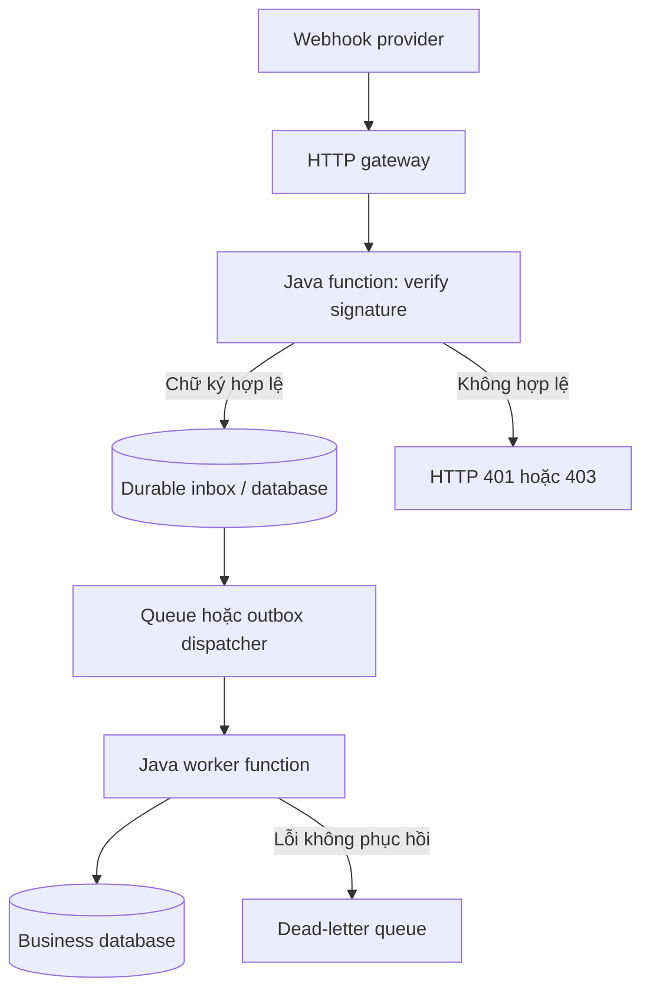

# Tiếp nhận webhook và xác minh chữ ký nhà cung cấp

Webhook là cơ chế một hệ thống chủ động gửi HTTP request đến endpoint của hệ thống khác khi một sự kiện xảy ra. Ví dụ, cổng thanh toán gửi thông báo khi giao dịch thành công, nền tảng quản lý mã nguồn gửi sự kiện khi có push hoặc một dịch vụ thương mại điện tử thông báo đơn hàng thay đổi trạng thái.

Trong kiến trúc serverless, endpoint webhook thường là HTTP function hoặc một API chạy trên nền tảng container serverless. Function nhận request, xác minh nguồn gửi và tính toàn vẹn của payload, sau đó tiếp nhận sự kiện để xử lý. Vì endpoint có thể được gọi từ Internet và nhà cung cấp có thể gửi lại cùng một sự kiện nhiều lần, hệ thống cần xác minh chữ ký, chống replay, xử lý idempotent và phản hồi đúng thời điểm.

Bài học tập trung vào cách tiếp nhận webhook an toàn trong Java, đặc biệt là xác minh chữ ký HMAC trên đúng byte của request body và tổ chức xử lý bất đồng bộ phù hợp với đặc tính của serverless.

## 1. Webhook hoạt động như thế nào?

Webhook là một HTTP callback. Khi có sự kiện, nhà cung cấp gửi request đến URL mà người nhận đã đăng ký. Payload thường ở dạng JSON và có các header mô tả loại nội dung, chữ ký hoặc mã định danh sự kiện.

Ví dụ một nhà cung cấp gửi thông báo đơn hàng:

```http
POST /webhooks/orders HTTP/1.1
Host: api.example.com
Content-Type: application/json
X-Provider-Event-Id: evt_91ab
X-Webhook-Timestamp: 1794910530
X-Webhook-Signature: 4f1c...e2a9

{"id":"evt_91ab","type":"order.paid","data":{"orderId":"ord_123","amount":250000}}
```

Đây là ví dụ minh họa với tên header giả định. Mỗi nhà cung cấp có thể đặt tên header, thuật toán, cách tạo chuỗi được ký và định dạng chữ ký khác nhau.

Luồng tổng quát:

1. Người dùng đăng ký URL webhook và cấu hình secret hoặc khóa xác minh theo hướng dẫn của nhà cung cấp.
2. Nhà cung cấp phát sinh sự kiện và tạo payload.
3. Nhà cung cấp ký payload theo giao thức của mình rồi gửi HTTP request đến endpoint.
4. Endpoint nhận raw body và header, kiểm tra chữ ký và các điều kiện an toàn.
5. Nếu hợp lệ, endpoint ghi nhận sự kiện bền vững hoặc đưa vào queue để xử lý bất đồng bộ.
6. Endpoint trả HTTP response theo quy ước của nhà cung cấp.
7. Worker xử lý nghiệp vụ, cập nhật trạng thái và ghi nhận kết quả để chống xử lý trùng.

Webhook khác với việc ứng dụng chủ động polling một API. Với polling, ứng dụng liên tục hỏi nhà cung cấp xem có dữ liệu mới hay không. Với webhook, nhà cung cấp chủ động gọi endpoint khi có sự kiện, nhờ đó giảm các request kiểm tra định kỳ và thường rút ngắn thời gian thông báo.

## 2. Vì sao phải xác minh chữ ký?

Endpoint webhook thường có URL công khai. Bất kỳ máy khách nào biết URL đều có thể thử gửi request đến đó. Nếu hệ thống tin mọi JSON nhận được, kẻ tấn công có thể giả mạo sự kiện thanh toán, thay đổi đơn hàng hoặc kích hoạt các tác vụ nội bộ.

Chữ ký giúp người nhận kiểm tra hai điều:

- Payload được tạo bởi bên nắm giữ khóa ký tương ứng.
- Nội dung nhận được không bị thay đổi kể từ khi được ký.

Chữ ký không thay thế TLS, phân quyền hoặc kiểm tra nghiệp vụ. Chữ ký hợp lệ không chứng minh rằng một giao dịch thực sự đã thanh toán trong hệ thống của bạn; nó chỉ xác thực thông điệp theo cơ chế của nhà cung cấp. Với sự kiện quan trọng, có thể cần truy vấn API chính thức của nhà cung cấp để đối chiếu trạng thái giao dịch.

### HMAC và chữ ký bất đối xứng

Hai cách phổ biến:

- **HMAC:** nhà cung cấp và người nhận cùng biết một secret. Nhà cung cấp tạo MAC bằng secret; người nhận tính lại MAC trên dữ liệu nhận được rồi so sánh. HMAC-SHA256 là lựa chọn phổ biến.
- **Chữ ký bất đối xứng:** nhà cung cấp ký bằng private key, người nhận xác minh bằng public key. Người nhận không cần giữ secret có khả năng tạo chữ ký.

Không được tự chọn thuật toán chỉ vì nó quen thuộc. Hãy dùng đúng thuật toán, encoding, header và quy tắc canonicalization mà nhà cung cấp công bố. Nếu nhà cung cấp hỗ trợ thư viện xác minh chính thức, ưu tiên thư viện đó và theo dõi phiên bản cập nhật.

### Chữ ký không phải mã hóa

HMAC không che giấu nội dung payload. Người có thể đọc request vẫn có thể đọc JSON; TLS bảo vệ dữ liệu trên đường truyền. Chữ ký cung cấp khả năng xác thực và kiểm tra toàn vẹn, còn TLS cung cấp kênh truyền được mã hóa và xác thực máy chủ.

## 3. Xác minh trên raw request body

Một lỗi phổ biến là parse JSON thành object rồi serialize lại trước khi tính chữ ký. Cách này có thể làm thay đổi khoảng trắng, thứ tự thuộc tính, cách escape ký tự hoặc biểu diễn số. Hai JSON có thể mang cùng ý nghĩa nhưng có byte khác nhau.

Ví dụ:

```json
{"orderId":"ord_123","amount":250000}
```

và

```json
{
  "amount": 250000,
  "orderId": "ord_123"
}
```

Hai tài liệu có thể tương đương về dữ liệu nhưng không có cùng chuỗi byte. Nếu nhà cung cấp ký byte gốc, việc serialize lại sẽ làm phép kiểm tra thất bại.

Quy tắc cần nhớ:

1. Nhận body dưới dạng byte[].
2. Lấy đúng header chữ ký và timestamp theo tài liệu nhà cung cấp.
3. Tạo chuỗi hoặc byte sequence cần ký đúng theo quy tắc của nhà cung cấp.
4. Tính MAC hoặc xác minh chữ ký trên dữ liệu đó.
5. So sánh chữ ký bằng phép so sánh an toàn.
6. Chỉ sau khi xác minh thành công mới parse JSON và chạy nghiệp vụ.

Không trim body, đổi encoding, parse rồi serialize lại hoặc chuẩn hóa JSON trước khi xác minh. Nếu API Gateway truyền body dưới dạng chuỗi Base64, cần giải mã đúng theo cờ encoding của gateway để thu được byte gốc trước khi tính chữ ký.

## 4. HMAC-SHA256 hoạt động ra sao?

HMAC là cơ chế tạo mã xác thực thông điệp dựa trên hàm băm và khóa bí mật. Với HMAC-SHA256, nhà cung cấp và người nhận dùng cùng một secret và cùng dữ liệu đầu vào để tạo ra giá trị MAC.

Ở mức khái niệm:

```text
signature = HMAC-SHA256(secret, signedMessage)
```

Trong đó:

- secret là khóa bí mật đã trao đổi an toàn.
- signedMessage là chuỗi byte mà giao thức quy định.
- signature là kết quả MAC, thường được mã hóa thành hexadecimal hoặc Base64 để đưa vào HTTP header.

Một số nhà cung cấp chỉ ký raw body. Một số nhà cung cấp đưa timestamp vào chuỗi được ký để chống phát lại. Ví dụ minh họa trong bài này giả định giao thức dùng:

```text
signedMessage = timestamp + "." + rawBody
signature = hex(HMAC-SHA256(secret, signedMessage))
```

Đây chỉ là một giao thức mẫu để giải thích cách triển khai. Không áp dụng công thức này cho mọi nhà cung cấp. Phải dùng chính xác quy tắc ký trong tài liệu của provider, bao gồm dấu phân cách, encoding, prefix và cách xử lý nhiều chữ ký.

### So sánh chữ ký an toàn

Không nên dùng toán tử so sánh chuỗi thông thường cho chữ ký bí mật. Một số phép so sánh có thể dừng ngay khi phát hiện byte đầu tiên khác nhau, làm lộ thông tin về vị trí khớp qua thời gian xử lý. Trong Java, dùng MessageDigest.isEqual để so sánh hai mảng byte.

Cũng cần kiểm tra định dạng chữ ký trước khi so sánh. Chữ ký hexadecimal sai định dạng, thiếu byte hoặc có độ dài bất thường phải bị từ chối. Không được tự chuyển đổi định dạng theo phỏng đoán.

## 5. Ví dụ Java xác minh HMAC

Ví dụ sau minh họa một giao thức giả định có hai header:

- X-Webhook-Timestamp chứa Unix timestamp theo giây.
- X-Webhook-Signature chứa HMAC-SHA256 dạng hexadecimal của timestamp, dấu chấm và raw body.

Trong production, thay phần định dạng header và tạo signed message bằng adapter tuân theo chính xác tài liệu của nhà cung cấp.

```java
import java.nio.charset.StandardCharsets;
import java.security.GeneralSecurityException;
import java.security.MessageDigest;
import java.time.Instant;
import java.util.HexFormat;
import javax.crypto.Mac;
import javax.crypto.spec.SecretKeySpec;

public final class HmacWebhookVerifier {

    private final byte[] secret;
    private final long toleranceSeconds;

    public HmacWebhookVerifier(byte[] secret, long toleranceSeconds) {
        if (secret == null || secret.length == 0) {
            throw new IllegalArgumentException("Webhook secret is required");
        }
        if (toleranceSeconds <= 0) {
            throw new IllegalArgumentException("Tolerance must be positive");
        }
        this.secret = secret.clone();
        this.toleranceSeconds = toleranceSeconds;
    }

    public boolean verify(
            byte[] rawBody,
            String timestampHeader,
            String signatureHex,
            Instant now) throws GeneralSecurityException {

        if (rawBody == null || timestampHeader == null
                || signatureHex == null || now == null) {
            return false;
        }

        final long timestamp;
        try {
            timestamp = Long.parseLong(timestampHeader);
        } catch (NumberFormatException ex) {
            return false;
        }

        long ageSeconds = now.getEpochSecond() - timestamp;
        if (ageSeconds > toleranceSeconds || ageSeconds < -toleranceSeconds) {
            return false;
        }

        final byte[] suppliedSignature;
        try {
            suppliedSignature = HexFormat.of().parseHex(signatureHex);
        } catch (IllegalArgumentException ex) {
            return false;
        }
        if (suppliedSignature.length != 32) {
            return false;
        }

        Mac mac = Mac.getInstance("HmacSHA256");
        mac.init(new SecretKeySpec(secret, "HmacSHA256"));

        // Giao thức mẫu: timestamp + "." + raw body.
        mac.update(timestampHeader.getBytes(StandardCharsets.UTF_8));
        mac.update((byte) '.');
        byte[] expectedSignature = mac.doFinal(rawBody);

        return MessageDigest.isEqual(expectedSignature, suppliedSignature);
    }
}
```

Điểm quan trọng trong ví dụ:

- secret được sao chép khi khởi tạo để tránh bên ngoài thay đổi mảng byte.
- Mac được tạo trong mỗi lần verify vì đối tượng Mac có trạng thái và không nên chia sẻ đồng thời giữa các invocation.
- Timestamp được kiểm tra trước khi thực hiện nghiệp vụ.
- Chữ ký được giải mã thành byte[] rồi so sánh bằng MessageDigest.isEqual.
- Hàm nhận rawBody trực tiếp và không parse JSON trước khi xác minh.

Ví dụ dùng HexFormat của Java 17. Nếu dự án dùng Java cũ hơn, có thể dùng thư viện giải mã hexadecimal phù hợp. Không nên viết bộ giải mã tùy tiện mà không kiểm tra độ dài và định dạng đầu vào.

### Điều chỉnh theo giao thức nhà cung cấp

Các chi tiết cần xác nhận trong tài liệu provider:

- Thuật toán: HMAC-SHA256, HMAC-SHA512 hay chữ ký bất đối xứng.
- Header chứa chữ ký và cách tách prefix.
- Payload được ký: raw body, timestamp cộng body, hoặc cấu trúc khác.
- Encoding của chữ ký: hex hay Base64.
- Có nhiều chữ ký trong một header hay không.
- Timestamp là giây, mili giây hay định dạng khác.
- Cách provider luân chuyển secret và hỗ trợ nhiều secret trong giai đoạn chuyển tiếp.

Không được lấy code minh họa rồi thay tên header là đủ. Sai một byte trong canonical message cũng khiến chữ ký khác hoàn toàn.

## 6. Timestamp và chống replay attack

Một request có chữ ký hợp lệ vẫn có thể bị gửi lại. Ví dụ, kẻ tấn công ghi lại một webhook thanh toán hợp lệ rồi gửi lại cùng payload nhiều lần. Nếu hệ thống thực hiện tác vụ mỗi lần nhận request, một sự kiện có thể gây ra nhiều lần cập nhật hoặc phát hành hàng hóa.

Đây là replay attack.

### Kiểm tra timestamp

Nếu provider đưa timestamp vào dữ liệu được ký, người nhận có thể giới hạn tuổi của request. Ví dụ, chỉ chấp nhận request có timestamp lệch không quá 5 phút so với đồng hồ server. Khoảng thời gian thực tế phải theo tài liệu provider và đặc tính retry của dịch vụ.

Timestamp phải nằm trong dữ liệu được ký. Nếu timestamp chỉ là header không được bảo vệ bởi chữ ký, kẻ tấn công có thể thay đổi timestamp để vượt qua kiểm tra cửa sổ thời gian.

Cần đồng bộ đồng hồ hệ thống bằng dịch vụ thời gian đáng tin cậy. Sai lệch đồng hồ có thể khiến webhook hợp lệ bị từ chối hoặc mở rộng cửa sổ chấp nhận không cần thiết.

### Timestamp không thay thế idempotency

Trong cửa sổ thời gian cho phép, cùng một request vẫn có thể được gửi lại nhiều lần. Vì vậy, timestamp chỉ giảm khả năng phát lại request cũ; nó không bảo đảm một sự kiện chỉ được xử lý một lần.

Hãy dùng event ID duy nhất của provider làm khóa chống trùng. Có thể lưu cặp provider + eventId trong bảng inbox với unique constraint. Khi request lặp lại, hệ thống nhận biết rằng event đã được tiếp nhận và trả response phù hợp mà không tạo thêm tác dụng phụ.

Nếu provider không cung cấp event ID ổn định, cần xác định khóa nghiệp vụ phù hợp theo tài liệu và semantics của sự kiện. Không nên tự tạo hash payload làm khóa duy nhất nếu hai sự kiện hợp lệ khác nhau có thể có nội dung giống nhau.

## 7. Nhận webhook trong Java HTTP endpoint

Một endpoint có thể dùng Spring Boot, adapter HTTP của nền tảng hoặc API Gateway gọi trực tiếp Java function. Dù dùng framework nào, thứ tự xử lý vẫn cần giữ nguyên: giới hạn request, xác minh chữ ký trên raw bytes, parse và kiểm tra dữ liệu, sau đó tiếp nhận bền vững.

Ví dụ controller dưới đây giả định đã có verifier và service inbox:

```java
import java.io.IOException;
import java.security.GeneralSecurityException;
import org.springframework.http.HttpStatus;
import org.springframework.http.ResponseEntity;
import org.springframework.web.bind.annotation.PostMapping;
import org.springframework.web.bind.annotation.RequestBody;
import org.springframework.web.bind.annotation.RequestHeader;
import org.springframework.web.bind.annotation.RestController;

@RestController
public class WebhookController {

    private static final int MAX_BODY_BYTES = 256 * 1024;

    private final HmacWebhookVerifier verifier;
    private final WebhookInbox inbox;

    public WebhookController(
            HmacWebhookVerifier verifier,
            WebhookInbox inbox) {
        this.verifier = verifier;
        this.inbox = inbox;
    }

    @PostMapping("/webhooks/provider")
    public ResponseEntity<Void> receive(
            @RequestHeader("X-Webhook-Timestamp") String timestamp,
            @RequestHeader("X-Webhook-Signature") String signature,
            @RequestBody byte[] rawBody)
            throws GeneralSecurityException, IOException {

        if (rawBody.length > MAX_BODY_BYTES) {
            return ResponseEntity.status(HttpStatus.PAYLOAD_TOO_LARGE).build();
        }

        boolean valid = verifier.verify(
                rawBody, timestamp, signature, java.time.Instant.now());

        if (!valid) {
            return ResponseEntity.status(HttpStatus.UNAUTHORIZED).build();
        }

        // Service parse, validate event và lưu inbox/outbox một cách bền vững.
        inbox.acceptVerifiedEvent(rawBody);

        return ResponseEntity.accepted().build();
    }
}
```

Đây là skeleton minh họa. WebhookInbox cần parse payload, kiểm tra event ID, lưu sự kiện và tạo công việc xử lý bền vững. Controller chỉ trả 202 sau khi hệ thống đã tiếp nhận được sự kiện theo cam kết lưu trữ của mình.

Giới hạn body nên được áp dụng cả ở API Gateway hoặc ingress trước khi framework đọc toàn bộ request vào bộ nhớ. Kiểm tra rawBody.length trong controller là lớp kiểm tra bổ sung; nếu chỉ kiểm tra sau khi đã nhận byte array, request lớn vẫn có thể tiêu tốn bộ nhớ trước đó.

### Trường hợp Java function nhận API Gateway event

Một số nền tảng chuyển HTTP request thành event object thay vì gọi Spring MVC trực tiếp. Event có thể chứa body dạng String cùng cờ cho biết body đã được Base64 encode hay chưa.

Trong trường hợp đó:

1. Đọc body và cờ isBase64Encoded từ event.
2. Nếu cờ bật, giải mã Base64 để lấy đúng byte gốc; nếu không, chuyển body thành byte theo encoding mà adapter/provider quy định.
3. Xác minh chữ ký trên byte[] đó.
4. Chỉ sau khi hợp lệ mới parse JSON.
5. Trả status code và header theo hợp đồng HTTP của API Gateway.

Không chuyển body thành JSON object rồi serialize lại trước khi xác minh. Việc decode phải giữ đúng byte sequence mà provider đã ký.

## 8. Tiếp nhận bền vững và xử lý bất đồng bộ

Webhook endpoint thường cần phản hồi nhanh. Nếu xử lý toàn bộ nghiệp vụ trong HTTP request, nhà cung cấp có thể timeout và gửi lại request trong khi function vẫn đang làm việc. Điều đó làm tăng tải, kéo dài thời gian phản hồi và dễ tạo xử lý trùng.

Một thiết kế phổ biến là:

1. Xác minh chữ ký.
2. Parse và kiểm tra cấu trúc tối thiểu cần thiết.
3. Ghi nhận event vào inbox hoặc queue bền vững.
4. Trả HTTP 2xx khi việc tiếp nhận đã thành công.
5. Worker xử lý nghiệp vụ bất đồng bộ.

Sơ đồ:



### Vì sao cần lưu bền vững trước khi trả 2xx?

HTTP 2xx thường báo cho provider biết rằng endpoint đã nhận request thành công. Nếu trả 2xx trước khi lưu event, function có thể dừng ngay sau response và sự kiện bị mất. Provider có thể không gửi lại vì đã nhận xác nhận.

Ngược lại, nếu ghi nhận event bền vững thành công nhưng response bị mất trên đường truyền, provider có thể gửi lại. Đây là lý do hệ thống vẫn phải idempotent.

Nếu dùng database và queue riêng, cần giải quyết khoảng trống giữa ghi database và publish message. Transactional outbox là một mẫu phổ biến: trong cùng transaction database, lưu inbox event và bản ghi outbox; một dispatcher đọc outbox rồi publish sang queue, sau đó đánh dấu đã gửi. Dispatcher có thể publish lặp nếu gặp lỗi ở thời điểm xác nhận, vì vậy consumer queue vẫn cần idempotency.

### Chọn thời điểm trả response

- Trả 2xx sau khi event đã được lưu hoặc enqueue bền vững.
- Trả 5xx khi hệ thống chưa thể tiếp nhận do database hoặc queue gặp lỗi tạm thời, để provider có cơ hội retry theo chính sách của họ.
- Trả 401/403 khi chữ ký không hợp lệ.
- Trả 400 khi payload sai cú pháp hoặc không đáp ứng hợp đồng cố định, nếu quy ước provider cho phép từ chối loại lỗi này.
- Với event trùng đã được tiếp nhận, trả 2xx mà không tạo thêm công việc nghiệp vụ.

Chính sách retry của provider khác nhau. Một số provider retry khi nhận bất kỳ response không thuộc 2xx; một số có lịch retry, timeout và giới hạn khác. Hãy xác nhận tài liệu provider để tránh retry kéo dài đối với payload lỗi vĩnh viễn hoặc vô tình xác nhận một event chưa được lưu.

## 9. Idempotency khi xử lý webhook

Idempotency nghĩa là cùng một yêu cầu hoặc sự kiện được xử lý lặp lại nhưng không tạo thêm tác dụng phụ ngoài ý muốn. Với webhook, đây là yêu cầu quan trọng vì provider có thể gửi lại khi timeout, mất response hoặc gặp lỗi mạng.

Ví dụ, event payment.succeeded được gửi ba lần. Hệ thống chỉ được ghi nhận một lần thanh toán và không được phát hành ba đơn hàng hoặc gửi ba lệnh giao hàng.

### Mẫu inbox với khóa duy nhất

Có thể lưu các trường:

| Trường | Mục đích |
|---|---|
| provider | Tên hoặc định danh provider |
| event_id | ID sự kiện do provider cấp |
| received_at | Thời điểm hệ thống nhận event |
| status | RECEIVED, PROCESSING, PROCESSED hoặc FAILED |
| payload_hash | Dấu vết kiểm tra payload nếu cần |
| processed_at | Thời điểm xử lý xong |

Tạo unique constraint trên (provider, event_id). Khi event đến:

1. Thử insert bản ghi inbox.
2. Nếu insert thành công, đây là event mới và có thể tạo công việc xử lý.
3. Nếu vi phạm unique constraint, event đã được tiếp nhận trước đó; không tạo tác dụng phụ lần nữa.
4. Trả 2xx nếu bản ghi cũ đã được tiếp nhận thành công.

Không chỉ dùng một biến static hoặc ConcurrentHashMap trong function để chống trùng. Môi trường serverless có thể chạy nhiều instance, bị dừng hoặc khởi tạo lại. Bộ nhớ cục bộ không chia sẻ giữa các instance và không tồn tại bền vững.

### Idempotency cho tác dụng phụ bên ngoài

Ngay cả khi inbox bảo đảm event chỉ được worker nhận một lần theo logic ứng dụng, worker có thể gọi một dịch vụ ngoài rồi bị dừng trước khi đánh dấu PROCESSED. Khi retry, lời gọi bên ngoài có thể được lặp lại.

Với thao tác thanh toán, gửi lệnh hoặc tạo tài nguyên ở hệ thống khác, hãy truyền idempotency key nếu API đích hỗ trợ. Nếu không hỗ trợ, cần thiết kế đối soát hoặc quy trình bù trừ để xử lý tình huống kết quả không rõ ràng.

Không nên đánh dấu event đã hoàn tất trước khi tác dụng phụ được xác nhận. Cũng không nên giả định queue hoặc webhook cung cấp exactly-once end-to-end; thực tế thường cần kết hợp at-least-once delivery với xử lý idempotent.

## 10. Quản lý secret và luân chuyển khóa

Webhook secret là thông tin nhạy cảm. Nếu bị lộ, kẻ tấn công có thể tạo payload có chữ ký hợp lệ theo thuật toán HMAC.

Các nguyên tắc cần áp dụng:

- Lưu secret trong secret manager hoặc dịch vụ quản lý khóa của nền tảng.
- Không commit secret vào Git, Docker image, file cấu hình công khai hoặc mã nguồn.
- Cấp quyền đọc secret tối thiểu cho function cần xác minh webhook.
- Không log secret, signature đầy đủ hoặc payload nhạy cảm.
- Tách secret theo môi trường và endpoint/provider khi có thể.
- Có kế hoạch rotation và khả năng xác minh bằng khóa cũ/mới trong khoảng chuyển tiếp nếu provider hỗ trợ.

Khi luân chuyển secret, cần phối hợp với provider theo quy trình của họ. Trong thời gian hai khóa cùng hợp lệ, verifier có thể thử xác minh lần lượt với danh sách khóa đang hoạt động. Không được chấp nhận vô thời hạn mọi secret cũ; cần thời điểm kết thúc rotation rõ ràng và theo dõi để loại bỏ khóa cũ.

Với HMAC, bất kỳ thành phần nào có secret đều có khả năng tạo chữ ký. Nếu muốn giảm số hệ thống nắm giữ khả năng ký, có thể dùng cơ chế chữ ký bất đối xứng nếu provider hỗ trợ: chỉ provider giữ private key, còn hệ thống nhận chỉ cần public key để xác minh.

## 11. Các lớp bảo vệ bổ sung

Chữ ký hợp lệ không có nghĩa là bỏ qua các biện pháp bảo vệ HTTP và ứng dụng khác.

**HTTPS.** Chỉ nhận webhook qua HTTPS với chứng chỉ hợp lệ. Không cho phép endpoint production nhận HTTP thuần.

**Giới hạn request.** Đặt giới hạn kích thước body, số request, timeout và concurrency ở gateway hoặc ingress. Giới hạn cần phù hợp với kích thước payload và retry behavior của provider.

**Xác minh nguồn gửi.** Nếu provider công bố dải IP cố định, có thể dùng allow-list như một lớp bổ sung. Dải IP có thể thay đổi; không nên coi IP là cơ chế xác thực duy nhất. Luôn xác minh chữ ký.

**Phân quyền endpoint.** Mỗi endpoint nên gắn với một provider hoặc loại sự kiện rõ ràng. Không dùng một secret chung cho mọi tích hợp nếu có thể tách riêng.

**Kiểm tra nghiệp vụ.** Xác minh trạng thái giao dịch, chủ sở hữu tài nguyên và tính hợp lệ của chuyển trạng thái trước khi cập nhật dữ liệu.

**Chống lạm dụng.** Theo dõi số lần request thất bại, chữ ký sai, timestamp ngoài cửa sổ, payload quá lớn và tốc độ tăng đột biến. Có thể giới hạn tốc độ theo endpoint và nguồn gửi nhưng phải cân nhắc retry của provider.

**Bảo vệ log.** Ghi provider, event ID, loại event, request correlation ID, kết quả xác minh và thời gian xử lý. Không ghi secret hoặc dữ liệu cá nhân không cần thiết.

## 12. Quan sát và vận hành trong serverless

Một webhook flow thường đi qua gateway, function xác minh, database hoặc queue và worker. Nếu không có correlation ID xuyên suốt, việc tìm nguyên nhân chậm hoặc mất sự kiện sẽ khó khăn.

Nên theo dõi các metric:

- Số request webhook nhận được theo provider và loại event.
- Tỷ lệ chữ ký hợp lệ/không hợp lệ.
- Số request bị từ chối do timestamp quá cũ hoặc quá xa trong tương lai.
- Độ trễ từ lúc nhận đến lúc lưu bền vững.
- Thời gian xử lý worker và số lần retry.
- Độ sâu queue, tuổi message cũ nhất và số message trong DLQ.
- Số event trùng và số event không thể parse.
- Số lần cold start, concurrency và lỗi timeout của function.

Với Java function, cần tránh khởi tạo lại client database, secret manager hoặc validator nặng trong mỗi invocation nếu có thể tái sử dụng an toàn. Tuy nhiên, không chia sẻ đối tượng có trạng thái không an toàn giữa các request đồng thời. Đối tượng Mac trong ví dụ xác minh nên được tạo riêng cho mỗi lần gọi.

Cold start có thể làm request đầu tiên chậm hơn. Nếu provider có timeout ngắn, hãy giữ phần xác minh và tiếp nhận nhẹ, tránh xử lý nghiệp vụ dài trong HTTP invocation. Cấu hình concurrency và giới hạn mở rộng cũng cần phù hợp với năng lực database và queue để không làm hệ thống phía sau quá tải.

## 13. Kiểm thử webhook

Trước khi triển khai production, nên có bộ kiểm thử cho cả trường hợp hợp lệ và không hợp lệ:

| Trường hợp | Kết quả mong đợi |
|---|---|
| Body và chữ ký hợp lệ | Xác minh thành công |
| Sửa một byte trong body | Chữ ký không hợp lệ |
| Dùng secret khác | Chữ ký không hợp lệ |
| Thiếu signature header | Từ chối request |
| Signature sai encoding hoặc độ dài | Từ chối request an toàn |
| Timestamp quá cũ | Từ chối nếu giao thức yêu cầu timestamp |
| Timestamp quá xa trong tương lai | Từ chối |
| JSON sai cú pháp nhưng chữ ký hợp lệ | Lỗi payload theo quy ước endpoint |
| Cùng event ID gửi nhiều lần | Chỉ tiếp nhận một lần |
| Hai request trùng đến đồng thời | Unique constraint chỉ cho một lần tiếp nhận |
| Database hoặc queue tạm thời lỗi | Không xác nhận thành công trước khi lưu bền vững |
| Secret rotation | Chấp nhận khóa hợp lệ trong cửa sổ chuyển tiếp và loại bỏ khóa cũ đúng hạn |

Có thể dùng sandbox hoặc công cụ gửi webhook thử nghiệm của provider để tạo request mẫu. Nếu tự tạo test vector, dùng secret dành riêng cho test và tính chữ ký theo đúng quy tắc của provider. Không dùng secret production trong unit test hoặc fixture.

Đối với kiểm thử thời gian, inject Clock vào verifier thay vì phụ thuộc trực tiếp vào thời gian hệ thống. Điều này giúp kiểm tra chính xác timestamp cũ, timestamp tương lai và ranh giới của cửa sổ chấp nhận.

## 14. Những lỗi triển khai thường gặp

- **Parse JSON rồi mới xác minh:** serialize lại có thể thay đổi byte và làm chữ ký sai; phải xác minh raw body.
- **Dùng String.equals cho chữ ký:** nên giải mã chữ ký về byte[] và so sánh bằng MessageDigest.isEqual.
- **Bỏ qua timestamp:** chữ ký hợp lệ có thể bị phát lại; kiểm tra timestamp nếu provider hỗ trợ và ký timestamp trong canonical message.
- **Chỉ dùng timestamp để chống trùng:** cùng event vẫn có thể được gửi lại trong cửa sổ thời gian; cần lưu event ID bền vững.
- **Trả 2xx trước khi lưu event:** function có thể dừng và làm mất sự kiện sau khi provider đã ngừng retry.
- **Xử lý toàn bộ nghiệp vụ trong request:** dễ vượt timeout và kích hoạt retry khi tải cao; nên tiếp nhận bền vững rồi xử lý bất đồng bộ.
- **Dùng bộ nhớ function làm kho idempotency:** các instance không chia sẻ bộ nhớ và có thể bị khởi tạo lại.
- **Giả định mọi provider dùng cùng HMAC format:** thuật toán, header, encoding và canonicalization có thể khác nhau.
- **Log toàn bộ request:** có thể làm lộ dữ liệu cá nhân, token hoặc thông tin thanh toán.
- **Chỉ kiểm tra IP nguồn:** IP không chứng minh payload chưa bị giả mạo; chữ ký vẫn là cơ chế xác minh chính.

## 15. Quy trình triển khai thực tế

Khi tích hợp một nhà cung cấp webhook mới, có thể thực hiện theo trình tự:

1. Đọc tài liệu webhook của provider: event types, retry, timeout, header, thuật toán và định dạng chữ ký.
2. Đăng ký endpoint HTTPS riêng cho provider và cấu hình secret hoặc public key.
3. Đặt giới hạn body, timeout và rate limit ở gateway.
4. Nhận raw body và header mà không biến đổi payload.
5. Xác minh chữ ký đúng canonicalization và encoding của provider.
6. Kiểm tra timestamp/replay nếu giao thức hỗ trợ.
7. Parse JSON, kiểm tra schema và xác minh event ID.
8. Lưu inbox/outbox hoặc enqueue bền vững với idempotency.
9. Trả 2xx sau khi tiếp nhận thành công.
10. Xử lý nghiệp vụ ở worker, retry lỗi tạm thời và đưa lỗi không thể phục hồi vào DLQ.
11. Theo dõi metric, log an toàn và kiểm thử rotation secret.

## 16. Ghi nhớ

Webhook là một HTTP callback từ hệ thống bên ngoài. Endpoint phải coi mọi request là dữ liệu không tin cậy cho đến khi xác minh chữ ký theo đúng giao thức của nhà cung cấp.

Với HMAC, hãy dùng đúng secret, thuật toán và chuỗi byte được ký; xác minh trên raw body, kiểm tra timestamp khi có hỗ trợ và so sánh MAC an toàn. Sau đó, dùng event ID cùng lưu trữ bền vững để chống xử lý trùng, tiếp nhận nhanh rồi xử lý nghiệp vụ bất đồng bộ.

Trong serverless, function có thể bị khởi tạo lại, chạy đồng thời hoặc bị retry. Vì vậy, secret, trạng thái idempotency và tiến độ xử lý phải được quản lý bằng dịch vụ bền vững phù hợp. Một webhook flow đáng tin cậy cần phối hợp xác minh chữ ký, bảo vệ replay, retry có kiểm soát, idempotency, quan sát và quản lý chi phí.

