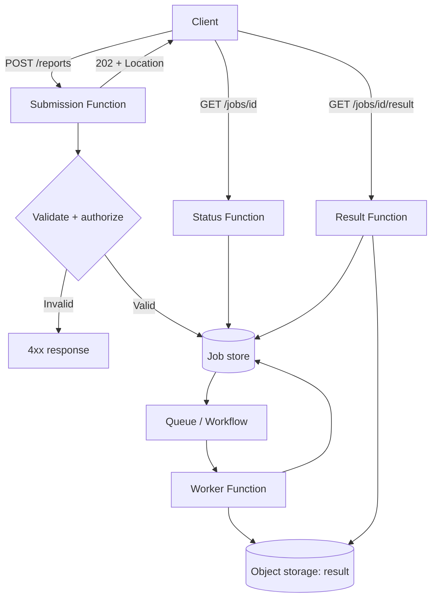
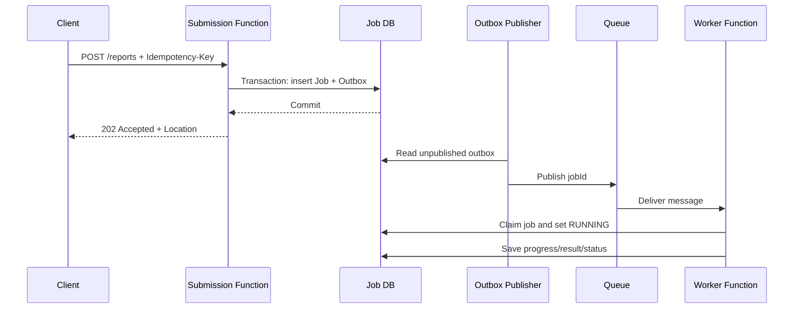

# Xử lý tác vụ dài qua HTTP 202 và endpoint theo dõi trạng thái

Một HTTP request thường phù hợp với công việc có thể hoàn tất trong thời gian ngắn: client gửi yêu cầu, server xử lý và trả kết quả ngay trong cùng một lượt gọi. Nhưng nhiều nghiệp vụ cần nhiều thời gian hơn giới hạn chờ của client, API gateway hoặc serverless function. Ví dụ: tạo báo cáo lớn, nhập dữ liệu, xử lý ảnh, tổng hợp hóa đơn, đồng bộ nhiều hệ thống hoặc chạy một quy trình gồm nhiều bước.

Nếu giữ kết nối HTTP mở trong suốt quá trình, client có thể timeout dù công việc vẫn đang chạy. Function có thể bị kết thúc bởi giới hạn thời gian của nền tảng. Người gọi cũng khó biết tác vụ đã được tiếp nhận, đang xử lý hay đã hoàn thành. Một mẫu thiết kế phổ biến là **tiếp nhận bất đồng bộ bằng HTTP 202 Accepted**, tạo một tài nguyên đại diện cho công việc (job resource), rồi cung cấp endpoint để client theo dõi trạng thái và lấy kết quả.

Mẫu này đặc biệt hữu ích với Java FaaS: function HTTP xác thực và tiếp nhận yêu cầu, lưu trạng thái bền vững, đưa job vào queue hoặc workflow; các worker function xử lý từng phần; một endpoint khác đọc trạng thái để client tra cứu. HTTP request ban đầu kết thúc nhanh, còn vòng đời nghiệp vụ được quản lý bằng trạng thái có thể khôi phục.

## 1. Vì sao không nên giữ HTTP request mở cho tác vụ dài?

Trong một luồng đồng bộ, nhiều thành phần cùng tham gia vào thời gian chờ:

- Trình duyệt hoặc service gọi API có client timeout.
- API gateway, load balancer hoặc proxy có giới hạn thời gian chờ backend.
- Function có giới hạn thời gian thực thi của nền tảng.
- Các dịch vụ phụ thuộc như database, object storage hoặc API bên ngoài cũng có timeout riêng.

Nếu tổng thời gian xử lý vượt giới hạn của một lớp, kết nối có thể bị đóng hoặc client nhận lỗi timeout. Điều đó không chứng minh rằng công việc phía server đã bị hủy. Function có thể tiếp tục chạy, ghi dữ liệu hoặc gọi dịch vụ thanh toán sau khi client đã ngừng chờ. Khi client gửi lại request, tác động nghiệp vụ có thể bị lặp nếu không có idempotency.

Giữ kết nối mở còn khiến tài nguyên bị chiếm dụng trong thời gian chờ. Với FaaS, một invocation dài có thể tiêu thụ thời gian compute, chạm giới hạn timeout và khó phục hồi nếu runtime bị kết thúc giữa chừng. Với queue, worker có thể xử lý theo từng bước và ghi checkpoint; với workflow engine, trạng thái từng bước có thể được lưu và retry riêng.

Mẫu bất đồng bộ tách hai câu hỏi:

1. **Yêu cầu đã được tiếp nhận chưa?** API trả lời nhanh bằng `202 Accepted` sau khi ghi nhận công việc một cách bền vững.
2. **Công việc đã đi đến đâu?** Client đọc job resource qua endpoint trạng thái; khi hoàn tất, client lấy kết quả từ tài nguyên kết quả.

## 2. Ý nghĩa của HTTP 202 Accepted

`202 Accepted` cho biết server đã chấp nhận yêu cầu để xử lý, nhưng việc xử lý chưa hoàn tất. Phản hồi này không khẳng định tác vụ chắc chắn sẽ thành công. Công việc có thể đang nằm trong queue, đang chạy, chờ retry hoặc thất bại sau đó vì quy tắc nghiệp vụ hay lỗi kỹ thuật.

Một phản hồi tiếp nhận có thể có dạng:

```http
HTTP/1.1 202 Accepted
Location: /v1/jobs/job_7f31a2
Retry-After: 3
Content-Type: application/json
Cache-Control: no-store

{
  "jobId": "job_7f31a2",
  "status": "QUEUED",
  "statusUrl": "/v1/jobs/job_7f31a2",
  "submittedAt": "2026-11-17T12:30:00Z"
}
```

Trong ví dụ này:

- `202 Accepted` cho biết yêu cầu đã được tiếp nhận để xử lý bất đồng bộ.
- `Location` trỏ đến tài nguyên theo dõi trạng thái.
- `Retry-After` là gợi ý khoảng thời gian client nên chờ trước lần kiểm tra tiếp theo; giá trị cụ thể phụ thuộc API.
- `jobId` là định danh công việc để client liên hệ ở các request sau.
- `Cache-Control: no-store` tránh lưu phản hồi chứa trạng thái hoặc dữ liệu riêng tư vào cache không phù hợp.

API có thể trả thêm `resultUrl` khi đã hoàn tất hoặc một liên kết tài liệu mô tả cách tra cứu. Không nên trả toàn bộ kết quả lớn trong phản hồi tiếp nhận. Nếu hệ thống chỉ trả `202` mà không có định danh hoặc cách tra cứu, client sẽ khó biết phải theo dõi công việc nào.

Điều kiện quan trọng là **chỉ trả 202 sau khi server đã ghi nhận công việc đủ bền vững để có thể tiếp tục**. Nếu API trả 202 rồi process chết trước khi lưu job hoặc gửi message, client tin rằng công việc đã được nhận nhưng không có worker nào xử lý.

## 3. Thiết kế job resource và endpoint trạng thái

Job resource đại diện cho vòng đời của một tác vụ. Client không cần biết function nào đang chạy, queue nào chứa message hay worker đang ở máy chủ nào. Client chỉ cần một ID ổn định và một hợp đồng trạng thái rõ ràng.

Một API đơn giản có thể gồm:

| Method và endpoint | Mục đích | Phản hồi thường gặp |
| --- | --- | --- |
| `POST /v1/reports` | Tạo yêu cầu xuất báo cáo | `202 Accepted` và URL theo dõi |
| `GET /v1/jobs/{jobId}` | Đọc trạng thái công việc | `200 OK` với job resource |
| `GET /v1/jobs/{jobId}/result` | Lấy kết quả khi công việc thành công | `200 OK`, redirect hoặc URL tải xuống |
| `DELETE /v1/jobs/{jobId}` | Yêu cầu hủy nếu loại công việc hỗ trợ | `202 Accepted`, `200 OK` hoặc lỗi phù hợp với trạng thái |

`DELETE` ở đây biểu diễn yêu cầu hủy công việc theo hợp đồng API. Nó không đảm bảo một side effect đã xảy ra có thể được hoàn tác. Nếu không hỗ trợ hủy, không cần cung cấp endpoint này.

Ví dụ client gửi yêu cầu tạo báo cáo:

```http
POST /v1/reports HTTP/1.1
Authorization: Bearer <access-token>
Idempotency-Key: report-2026-11-customer-42
Content-Type: application/json

{
  "reportType": "MONTHLY_USAGE",
  "from": "2026-10-01",
  "to": "2026-10-31",
  "format": "CSV"
}
```

Sau khi tiếp nhận, client nhận job ID và dùng URL trong `Location` để tra cứu. Đường dẫn job resource nên ổn định trong suốt vòng đời công việc, kể cả khi job được retry hoặc worker thay đổi.

### Trạng thái của job

Một state machine đơn giản có thể dùng các trạng thái sau:

| Trạng thái | Ý nghĩa | Trạng thái tiếp theo có thể có |
| --- | --- | --- |
| `QUEUED` | Đã lưu yêu cầu, đang chờ worker | `RUNNING`, `CANCELLED`, `FAILED` |
| `RUNNING` | Worker đang thực hiện | `SUCCEEDED`, `RETRY_WAIT`, `FAILED`, `CANCELLED` |
| `RETRY_WAIT` | Đang chờ lần thử tiếp theo | `QUEUED`, `FAILED`, `CANCELLED` |
| `SUCCEEDED` | Công việc đã hoàn tất thành công | Trạng thái kết thúc |
| `FAILED` | Công việc thất bại và không còn retry tự động | Trạng thái kết thúc |
| `CANCELLED` | Công việc đã được hủy theo chính sách | Trạng thái kết thúc |

`SUCCEEDED`, `FAILED` và `CANCELLED` là trạng thái kết thúc trong mô hình này. Không chuyển một job đã kết thúc về `RUNNING` chỉ vì message bị giao lại. Nếu cần chạy lại nghiệp vụ sau khi đã kết thúc, hãy tạo job mới hoặc có thao tác retry được định nghĩa rõ, với lịch sử lần chạy riêng.

Không phải hệ thống nào cũng cần `RETRY_WAIT` hiển thị cho client. Có thể giữ retry nội bộ và chỉ công bố `QUEUED` hoặc `RUNNING`. Điều quan trọng là state transition phải được xác định rõ, có điều kiện và được ghi bền vững.

### Nội dung job status

Khi job đang chạy, endpoint có thể trả:

```http
HTTP/1.1 200 OK
Content-Type: application/json
Cache-Control: no-store
ETag: "job_7f31a2-v4"

{
  "jobId": "job_7f31a2",
  "status": "RUNNING",
  "submittedAt": "2026-11-17T12:30:00Z",
  "startedAt": "2026-11-17T12:30:02Z",
  "updatedAt": "2026-11-17T12:30:08Z",
  "progress": {
    "completed": 420,
    "total": 1000,
    "percent": 42
  }
}
```

Khi thành công:

```json
{
  "jobId": "job_7f31a2",
  "status": "SUCCEEDED",
  "submittedAt": "2026-11-17T12:30:00Z",
  "startedAt": "2026-11-17T12:30:02Z",
  "completedAt": "2026-11-17T12:31:14Z",
  "resultUrl": "/v1/jobs/job_7f31a2/result"
}
```

Khi thất bại:

```json
{
  "jobId": "job_7f31a2",
  "status": "FAILED",
  "completedAt": "2026-11-17T12:31:14Z",
  "error": {
    "code": "SOURCE_FILE_INVALID",
    "message": "Tệp đầu vào không đúng định dạng.",
    "retryable": false
  }
}
```

Thông tin lỗi nên đủ để client quyết định bước tiếp theo nhưng không tiết lộ stack trace, SQL, tên host nội bộ, token hoặc dữ liệu nhạy cảm. Lỗi nghiệp vụ có thể không retry được; lỗi hạ tầng tạm thời có thể đã được retry nội bộ trước khi job chuyển sang `FAILED`.

## 4. Mã HTTP của endpoint theo dõi

Phân biệt lỗi của request tạo job với kết quả của chính job:

- `POST /v1/reports` có thể trả `400 Bad Request` nếu payload sai, `401 Unauthorized` nếu chưa xác thực, `403 Forbidden` nếu không có quyền, `409 Conflict` nếu cùng idempotency key được dùng cho nội dung khác, hoặc `202 Accepted` khi đã tiếp nhận.
- `GET /v1/jobs/{jobId}` trả `200 OK` khi job tồn tại và caller được phép xem, kể cả job đang `QUEUED`, `RUNNING` hay `FAILED`. Trạng thái thất bại là dữ liệu của job resource, không phải lỗi của thao tác đọc resource.
- `GET /v1/jobs/{jobId}` có thể trả `404 Not Found` nếu không tồn tại hoặc API chủ động không phân biệt tài nguyên không tồn tại với tài nguyên caller không được phép xem. Chính sách phải nhất quán để tránh rò rỉ sự tồn tại của job.
- `GET /v1/jobs/{jobId}/result` chỉ trả kết quả khi job thành công và kết quả còn hạn. Nếu chưa sẵn sàng, API có thể trả `409 Conflict` hoặc `404` theo hợp đồng đã công bố; không được giả vờ trả kết quả rỗng như một thành công.
- Khi job đã hết thời hạn lưu giữ, API có thể trả `410 Gone` để cho biết tài nguyên đã hết hạn, nếu hệ thống muốn phân biệt với job ID chưa từng tồn tại.

Các mã trên là lựa chọn thiết kế thường gặp. Hãy ghi rõ hành vi của API để client không phải suy đoán trạng thái chỉ từ một mã HTTP.

## 5. Luồng kiến trúc với Java Function, queue và job store

Một kiến trúc điển hình gồm ba nhóm function:

1. **Submission function:** nhận HTTP request, xác thực, kiểm tra đầu vào, áp dụng idempotency, ghi job và gửi tín hiệu xử lý.
2. **Worker function:** nhận job ID hoặc message, đọc dữ liệu công việc, xử lý theo từng bước, cập nhật progress và trạng thái.
3. **Status/result function:** đọc job store, kiểm tra quyền truy cập và trả trạng thái hoặc kết quả cho client.



Job store thường là database có khả năng cập nhật có điều kiện. Kết quả lớn nên được lưu ở object storage và job resource chỉ giữ tham chiếu đến kết quả. Queue hoặc workflow engine đảm nhiệm giao việc và điều phối; job store là nguồn trạng thái mà API đọc.

Không nên để status endpoint đọc trực tiếp trạng thái nội bộ của runtime function. Invocation có thể đã kết thúc, worker có thể được thay thế và nhiều lần thử có thể xảy ra. Trạng thái cần tồn tại độc lập với vòng đời của một container hoặc process.

## 6. Tiếp nhận bền vững và khoảng hở giữa database với queue

Một lỗi phổ biến là thực hiện hai thao tác rời nhau:

1. Ghi job vào database.
2. Gửi message vào queue.

Nếu database commit thành công nhưng gửi queue thất bại, job bị mắc ở `QUEUED` mà không có worker xử lý. Nếu gửi queue thành công nhưng database ghi thất bại, worker nhận một job ID không tồn tại hoặc không có trạng thái chính thức.

Có thể xử lý bằng transactional outbox:

- Trong một database transaction, ghi job record và outbox record.
- Commit cả hai cùng nhau.
- Publisher function đọc outbox, gửi message chứa job ID vào queue và đánh dấu đã publish.
- Nếu publisher timeout sau khi gửi nhưng trước khi đánh dấu, message có thể được gửi lại; worker phải idempotent.

Một lựa chọn khác là dùng dịch vụ điều phối hoặc API tạo execution có cơ chế tiếp nhận bền vững tích hợp sẵn. Dù chọn cách nào, API chỉ nên trả `202` sau khi có bằng chứng bền vững rằng job đã được lưu và có thể được phát đi xử lý.



Nếu publish queue thất bại tạm thời, outbox record vẫn còn để publisher thử lại. Nếu message bị giao nhiều lần, worker kiểm tra trạng thái và khóa xử lý trước khi chạy. Không cần yêu cầu broker giao đúng một lần để có một quy trình đáng tin cậy.

## 7. Idempotency khi client gửi lại POST

Một tình huống thường gặp: client gửi `POST /v1/reports`, server đã tạo job nhưng phản hồi 202 bị mất trên mạng. Client không biết yêu cầu đã được tiếp nhận hay chưa và gửi lại. Nếu mỗi request tạo job mới, cùng một báo cáo có thể chạy hai lần, tiêu tốn tài nguyên và tạo kết quả trùng.

Client có thể gửi `Idempotency-Key` duy nhất cho một ý định nghiệp vụ. Server lưu khóa cùng với caller/tenant, loại thao tác, hash của request, job ID và kết quả tiếp nhận. Khi nhận lại cùng khóa:

- Nếu request có cùng nội dung và cùng phạm vi caller, trả lại job ID hiện có và URL theo dõi.
- Nếu khóa đã được dùng với nội dung khác, trả `409 Conflict`.
- Nếu khóa chưa tồn tại, tạo job mới và ghi khóa trong cùng transaction.

Khóa phải được giới hạn theo người dùng hoặc tenant để hai khách hàng không vô tình dùng chung không gian idempotency. Thời hạn lưu khóa phải ít nhất bao phủ cửa sổ retry của client và thời gian mà việc tạo job trùng lặp có thể gây hại.

Ví dụ response khi request được gửi lại:

```http
HTTP/1.1 202 Accepted
Location: /v1/jobs/job_7f31a2
Idempotency-Replayed: true
Content-Type: application/json

{
  "jobId": "job_7f31a2",
  "status": "QUEUED",
  "statusUrl": "/v1/jobs/job_7f31a2"
}
```

Header `Idempotency-Replayed` chỉ là ví dụ của hợp đồng API; không phải header chuẩn bắt buộc. Điều quan trọng là request lặp không tạo thêm công việc ngoài ý muốn.

Idempotency ở bước tiếp nhận không thay thế idempotency ở worker. Queue vẫn có thể giao cùng message nhiều lần, và worker có thể timeout sau khi ghi một phần kết quả. Cần kiểm soát cả hai tầng.

## 8. Java implementation: tạo job và trả HTTP 202

Ví dụ sau dùng Spring Web để minh họa hợp đồng controller. Phần lưu trữ và publish được đặt sau interface để có thể triển khai bằng database, transactional outbox và queue cụ thể. Các lớp này là cấu trúc minh họa, không phụ thuộc một nhà cung cấp cloud.

```java
import java.net.URI;
import java.time.Instant;

public record CreateReportRequest(
        String reportType,
        String from,
        String to,
        String format
) {}

public record JobAcceptedResponse(
        String jobId,
        String status,
        URI statusUrl,
        Instant submittedAt
) {}

public record AcceptedJob(
        String jobId,
        String status,
        Instant submittedAt
) {}
```

Controller có thể trả `202` cùng `Location`:

```java
import java.net.URI;
import org.springframework.http.HttpHeaders;
import org.springframework.http.ResponseEntity;
import org.springframework.web.bind.annotation.PostMapping;
import org.springframework.web.bind.annotation.RequestBody;
import org.springframework.web.bind.annotation.RequestHeader;
import org.springframework.web.bind.annotation.RequestMapping;
import org.springframework.web.bind.annotation.RestController;

@RestController
@RequestMapping("/v1/reports")
public class ReportSubmissionController {
    private final ReportJobService jobService;

    public ReportSubmissionController(ReportJobService jobService) {
        this.jobService = jobService;
    }

    @PostMapping
    public ResponseEntity<JobAcceptedResponse> submit(
            @RequestBody CreateReportRequest request,
            @RequestHeader("Idempotency-Key") String idempotencyKey
    ) {
        // Principal/tenant nên được lấy từ security context đã xác thực.
        String tenantId = CurrentTenant.requireId();
        AcceptedJob job = jobService.accept(tenantId, idempotencyKey, request);

        URI statusUrl = URI.create("/v1/jobs/" + job.jobId());
        JobAcceptedResponse body = new JobAcceptedResponse(
                job.jobId(), job.status(), statusUrl, job.submittedAt());

        return ResponseEntity.accepted()
                .location(statusUrl)
                .header(HttpHeaders.RETRY_AFTER, "3")
                .header(HttpHeaders.CACHE_CONTROL, "no-store")
                .body(body);
    }
}
```

`CurrentTenant` ở đây là placeholder cho thành phần lấy tenant từ security context. Không lấy tenant ID do client tự khai báo trong body làm căn cứ phân quyền. Trong ứng dụng thật, controller cần validate request, giới hạn kích thước payload, kiểm tra quyền tạo loại báo cáo và xử lý trường hợp thiếu hoặc sai `Idempotency-Key`.

Service tiếp nhận cần bảo đảm lưu job và yêu cầu phát message một cách nhất quán. Pseudocode dưới đây cho thấy trách nhiệm, không phải một repository implementation hoàn chỉnh:

```java
public interface ReportJobService {
    AcceptedJob accept(
            String tenantId,
            String idempotencyKey,
            CreateReportRequest request
    );
}

// Trong implementation:
// 1. Validate request và tạo canonical request hash.
// 2. Tìm idempotency record theo tenant + operation + key.
// 3. Nếu đã tồn tại: so hash, trả job cũ hoặc báo conflict.
// 4. Nếu chưa có: trong cùng transaction insert Job,
//    insert IdempotencyRecord và insert OutboxRecord.
// 5. Commit rồi trả AcceptedJob.
```

Không nên gọi queue từ controller rồi mới ghi job, hoặc ghi job rồi gửi queue mà không có cơ chế phục hồi. Transactional outbox giúp việc tiếp nhận không mất công việc khi một trong hai hệ thống tạm thời lỗi.

## 9. Java implementation: đọc trạng thái job

Status endpoint đọc từ job store. Nó cần xác minh caller được phép xem job thuộc tenant nào, sau đó trả snapshot trạng thái nhất quán.

```java
import java.time.Instant;
import java.net.URI;

public record JobStatusResponse(
        String jobId,
        String status,
        Instant submittedAt,
        Instant startedAt,
        Instant updatedAt,
        Instant completedAt,
        Integer progressPercent,
        URI resultUrl,
        JobError error
) {}

public record JobError(
        String code,
        String message,
        boolean retryable
) {}
```

Controller minh họa:

```java
import org.springframework.http.CacheControl;
import org.springframework.http.ResponseEntity;
import org.springframework.web.bind.annotation.GetMapping;
import org.springframework.web.bind.annotation.PathVariable;
import org.springframework.web.bind.annotation.RequestMapping;
import org.springframework.web.bind.annotation.RestController;

@RestController
@RequestMapping("/v1/jobs")
public class JobStatusController {
    private final JobQueryService queryService;

    public JobStatusController(JobQueryService queryService) {
        this.queryService = queryService;
    }

    @GetMapping("/{jobId}")
    public ResponseEntity<JobStatusResponse> getStatus(
            @PathVariable String jobId
    ) {
        String tenantId = CurrentTenant.requireId();
        JobStatusResponse status = queryService.getForTenant(tenantId, jobId);

        return ResponseEntity.ok()
                .cacheControl(CacheControl.noStore())
                .body(status);
    }
}
```

`JobQueryService` phải kiểm tra cả job ID và tenant. Biết hoặc đoán được job ID không đồng nghĩa có quyền đọc công việc. Nếu API hỗ trợ ETag, có thể tính version từ `updatedAt` hoặc version tăng đơn điệu của job và trả `304 Not Modified` khi client gửi `If-None-Match` phù hợp. ETag giúp giảm payload khi trạng thái chưa đổi, nhưng không thay thế xác thực và phân quyền.

## 10. Worker function và cập nhật trạng thái an toàn

Worker không nên giả định message chỉ đến một lần. Khi nhận `jobId`, worker cần:

1. Đọc job và kiểm tra trạng thái hiện tại.
2. Dùng conditional update hoặc lease để claim công việc, ví dụ chỉ chuyển từ `QUEUED` sang `RUNNING` nếu chưa có worker khác claim.
3. Đọc input từ nơi lưu trữ phù hợp; tránh đưa payload lớn vào queue.
4. Xử lý theo từng phần, ghi progress hoặc checkpoint có kiểm soát.
5. Lưu kết quả bền vững, sau đó cập nhật `SUCCEEDED` cùng tham chiếu kết quả.
6. Nếu lỗi tạm thời, ghi thông tin lần thử và để retry policy đưa job trở lại queue; nếu lỗi không thể phục hồi, cập nhật `FAILED` và lưu mã lỗi an toàn.

Nếu worker bị timeout, lease có thể hết hạn và message được giao lại. Worker mới phải kiểm tra job state, attempt và checkpoint để tiếp tục an toàn. Nếu worker cũ vẫn còn chạy trong lúc lease hết, conditional update và idempotency phải ngăn hai worker cùng ghi kết quả cuối không nhất quán.

Các cập nhật progress nên có version hoặc điều kiện để một worker cũ không ghi đè trạng thái mới hơn. Không tăng phần trăm tùy tiện nếu không có cách xác định tổng công việc. Với tác vụ không thể đo chính xác tiến độ, có thể trả `progress: null` hoặc chỉ công bố các phase như `VALIDATING`, `PROCESSING`, `UPLOADING`.

## 11. Polling hiệu quả và lựa chọn thông báo đẩy

Cách đơn giản nhất để client theo dõi là polling: gọi `GET /v1/jobs/{jobId}` theo khoảng thời gian. Nhưng polling quá thường xuyên tạo tải không cần thiết lên API, database và hệ thống tính phí.

Một chiến lược phù hợp có thể là:

- Chờ khoảng thời gian do `Retry-After` gợi ý sau phản hồi 202.
- Nếu chưa hoàn tất, tăng dần khoảng chờ (exponential backoff) và thêm jitter để các client không đồng loạt polling.
- Đặt khoảng chờ tối thiểu/tối đa và giới hạn tổng thời gian client theo dõi trong một phiên.
- Dừng polling khi job ở trạng thái kết thúc; cung cấp hành động tiếp theo để lấy kết quả hoặc hiển thị lỗi.
- Dùng ETag/`If-None-Match` nếu API hỗ trợ để tránh gửi lại toàn bộ representation khi chưa thay đổi.

Ví dụ lịch polling có thể là 3 giây, 5 giây, 10 giây, 20 giây rồi giữ ở 30 giây. Đây chỉ là giá trị minh họa; chọn khoảng chờ dựa trên thời gian xử lý thông thường, SLA, chi phí và khả năng chịu tải của API.

Với ứng dụng cần cập nhật gần thời gian thực, có thể dùng Server-Sent Events, WebSocket hoặc webhook callback thay cho polling liên tục. Dù dùng push, job resource vẫn nên là nguồn trạng thái chính thức để client có thể khôi phục khi mất kết nối hoặc bỏ lỡ thông báo.

Webhook callback có thêm một vòng đời giao nhận riêng: endpoint nhận callback có thể lỗi, phản hồi chậm hoặc nhận trùng. Producer cần retry có giới hạn, ký thông điệp hoặc xác thực nguồn gửi, gắn event ID và yêu cầu consumer idempotent. Không nên gọi một URL callback tùy ý do người dùng nhập mà không có kiểm soát SSRF, danh sách domain cho phép hoặc biện pháp xác minh đích đến.

## 12. Kết quả lớn, thời hạn lưu trữ và dọn dẹp

Với báo cáo CSV, file nén hoặc dữ liệu xuất lớn, job resource chỉ nên giữ metadata và tham chiếu đến kết quả. Worker ghi file vào object storage; API kết quả kiểm tra quyền truy cập rồi trả file stream hoặc URL tải xuống có thời hạn.

Hãy xác định rõ:

- Kết quả được giữ trong bao lâu và khi nào bị xóa.
- Job status còn tồn tại bao lâu sau khi kết quả hết hạn.
- Client nhận `410 Gone` hay trạng thái `EXPIRED` khi kết quả đã bị dọn.
- URL tải xuống có thời hạn bao lâu và có ràng buộc quyền truy cập phù hợp không.
- Dữ liệu đầu vào, output, log và bản sao có cùng chính sách retention hay không.

Một scheduled cleanup function có thể xóa kết quả quá hạn và đánh dấu job hết thời gian lưu giữ. Việc dọn dẹp nên idempotent vì lịch chạy có thể retry. Cũng cần bảo đảm không xóa file đang được worker ghi hoặc job chưa kết thúc.

## 13. Bảo mật và giới hạn tài nguyên

Job ID không phải secret và không thay thế xác thực. Endpoint submit, status, result và cancel đều phải áp dụng quyền truy cập theo người dùng hoặc tenant. Một tenant không được đọc kết quả của tenant khác chỉ vì biết ID.

Các biện pháp quan trọng:

- Xác thực caller ở mọi endpoint và kiểm tra quyền trên từng job resource.
- Sinh job ID khó đoán, nhưng vẫn luôn kiểm tra quyền sở hữu hoặc quyền chia sẻ.
- Validate input, giới hạn kích thước file, số dòng, thời gian truy vấn và loại báo cáo.
- Đặt quota số job đang chờ/chạy, giới hạn tốc độ submit và concurrency để tránh một caller làm cạn tài nguyên.
- Không cho client quyết định tùy ý queue, tên bucket, role hoặc URL nội bộ mà worker sẽ gọi.
- Lưu secret trong secret manager hoặc dịch vụ cấu hình an toàn; không đưa secret vào job payload hay status response.
- Mã hóa dữ liệu, giới hạn quyền đọc object storage và tạo URL tải xuống có thời hạn.
- Ghi audit cho việc tạo job, xem kết quả, hủy và thao tác quản trị.

Với Java worker, nên truyền job ID và các tham số tối thiểu trong message. Dữ liệu đầu vào lớn có thể lưu trước ở object storage hoặc database rồi truyền một tham chiếu đã được kiểm soát. Worker phải xác minh tham chiếu thuộc tenant và job tương ứng trước khi đọc.

## 14. Quan sát, vận hành và chi phí

Một job có thể đi qua API function, database, outbox publisher, queue, nhiều worker và object storage. Chỉ log request HTTP ban đầu sẽ không đủ để lần theo toàn bộ vòng đời. Hãy gắn `jobId`, `correlationId`, `tenantId` đã được kiểm soát và `attempt` vào log/trace ở mọi bước; tránh đưa thông tin định danh nhạy cảm vào metric label có cardinality cao.

Các chỉ số nên theo dõi:

| Chỉ số | Ý nghĩa vận hành |
| --- | --- |
| Job submission rate | Số công việc mới được tiếp nhận |
| Queue depth và age of oldest message | Mức backlog và thời gian chờ trước khi bắt đầu |
| Queued-to-running latency | Thời gian từ tiếp nhận đến khi worker bắt đầu |
| Job duration p50/p95/p99 | Thời gian hoàn tất theo loại tác vụ |
| Success/failure/timeout rate | Chất lượng xử lý và độ tin cậy |
| Retry count và DLQ depth | Công việc gặp lỗi lặp hoặc không thể xử lý |
| Stale RUNNING jobs | Job bị kẹt do worker chết hoặc lease không được gia hạn |
| Result storage size và age | Dung lượng và hiệu quả dọn dẹp |
| Cost per successful job | Chi phí để hoàn tất một công việc thành công |

Chi phí không chỉ nằm ở invocation của submission function. Cần tính cả worker invocation, queue operations, database reads/writes, outbox relay, object storage, truyền dữ liệu, log và polling status. Polling quá dày có thể khiến chi phí status API tăng theo số client đang theo dõi.

Để tối ưu:

1. Chọn batch size và concurrency dựa trên khả năng của database và downstream.
2. Dùng backoff và jitter cho retry, đồng thời giới hạn số lần thử.
3. Giảm polling bằng `Retry-After`, backoff và ETag.
4. Lưu kết quả lớn ở object storage thay vì truyền qua nhiều function.
5. Đặt retention cho job, result và log; tự động dọn dữ liệu hết hạn.
6. Đo chi phí trên mỗi job thành công, không chỉ chi phí trên invocation.

## 15. Khi nào nên dùng HTTP 202 và job status resource?

Mẫu này phù hợp khi công việc không thể hoàn tất trong ngân sách chờ HTTP thông thường, có thể xử lý độc lập sau khi tiếp nhận và có một trạng thái hoặc kết quả mà caller cần tra cứu. Nó cũng phù hợp khi cần retry, chia nhỏ công việc, điều phối nhiều bước hoặc xử lý tải tăng giảm không đều.

Không cần dùng job resource cho mọi endpoint. Nếu thao tác thường hoàn tất nhanh và có kết quả nhỏ, HTTP đồng bộ đơn giản hơn. Nếu caller cần phản hồi tức thời để quyết định có tiếp tục hay không, hãy giữ phần kiểm tra hoặc quyết định cần thiết trong request đồng bộ, rồi chuyển phần việc dài sang queue sau khi đã chấp nhận. Nếu công việc kéo dài vượt giới hạn tối đa của một function, chia nhỏ hoặc dùng workflow engine; đừng chỉ tăng timeout đến mức chạm trần nền tảng.

Trước khi triển khai, hãy xác nhận:

- [ ] `202 Accepted` chỉ được trả sau khi job và tín hiệu xử lý đã được lưu bền vững.
- [ ] Response có `jobId`, `Location` hoặc `statusUrl` rõ ràng.
- [ ] State machine và trạng thái kết thúc được định nghĩa.
- [ ] `GET` status hoạt động độc lập với vòng đời runtime worker.
- [ ] Kết quả chỉ có thể đọc khi job thành công và caller có quyền.
- [ ] POST có idempotency để client retry không tạo job trùng.
- [ ] Worker xử lý duplicate, timeout, retry và checkpoint an toàn.
- [ ] Database-to-queue gap được bảo vệ bằng outbox hoặc cơ chế tương đương.
- [ ] Polling có backoff, jitter và cache validation phù hợp.
- [ ] Có retention, cleanup, quota, observability và cảnh báo backlog/DLQ.

Với Java FaaS, HTTP 202 và job status resource tạo ra một ranh giới rõ ràng giữa việc tiếp nhận yêu cầu và việc hoàn thành công việc. API có thể phản hồi nhanh; queue hoặc workflow điều phối worker; job store giữ trạng thái bền vững; client theo dõi qua một URL ổn định và lấy kết quả khi sẵn sàng. Khi kết hợp idempotency, outbox, retry có giới hạn, phân quyền theo tenant và quan sát xuyên suốt, mô hình này xử lý được tác vụ dài mà vẫn giữ hành vi API dễ hiểu và có thể phục hồi.
