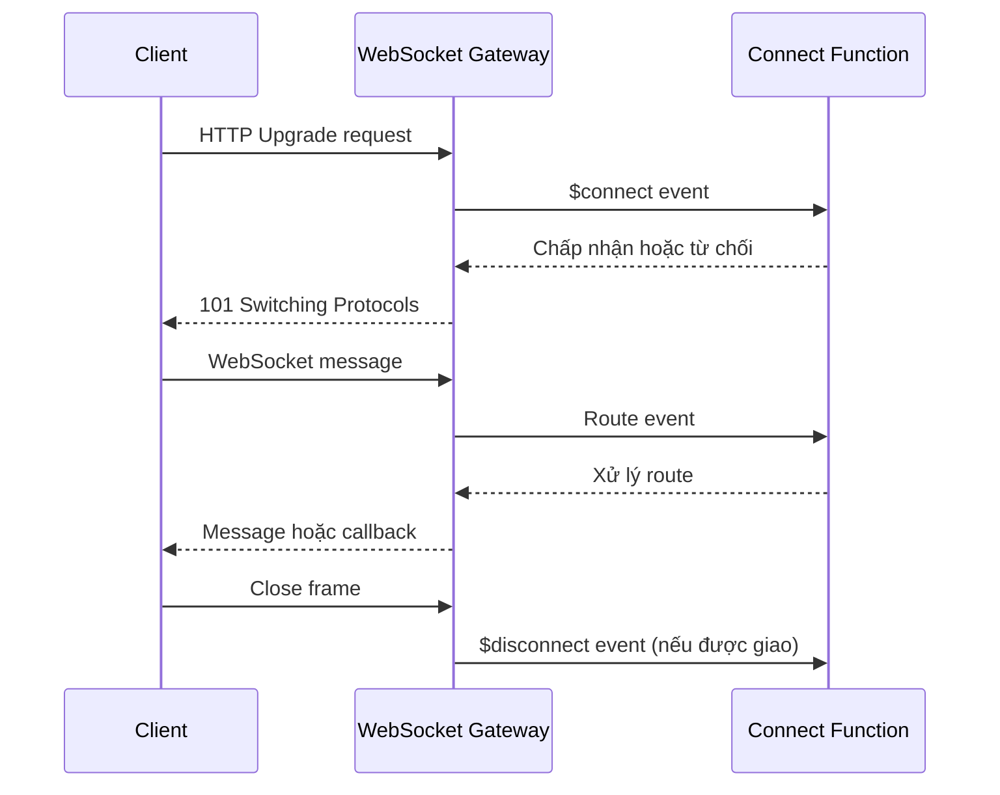
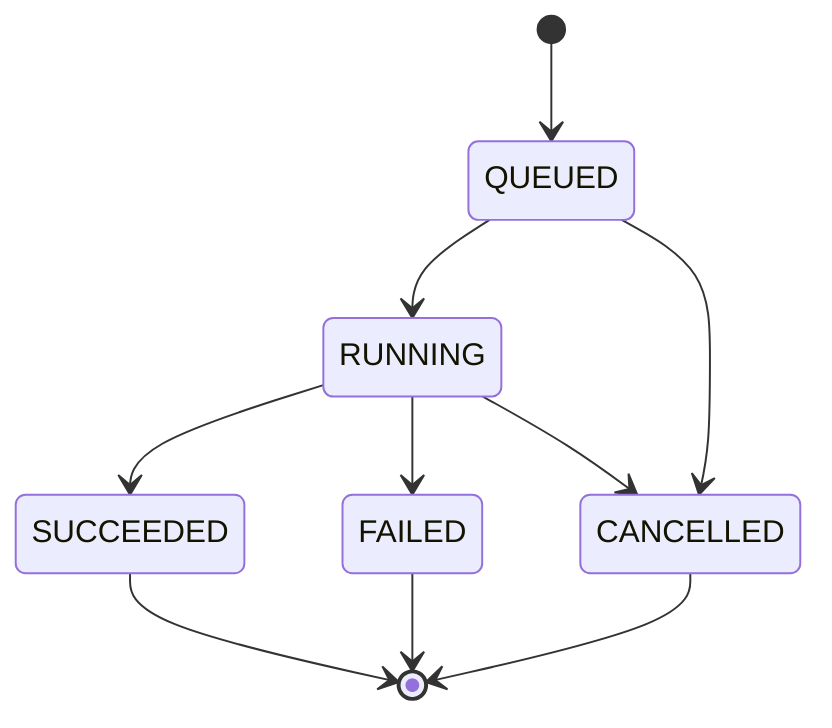
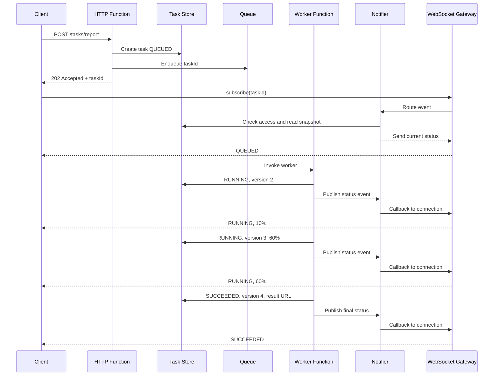

# WebSocket và cập nhật trạng thái tác vụ cho client

HTTP request/response phù hợp với các thao tác có kết quả trả về trong thời gian ngắn. Tuy nhiên, một số nghiệp vụ cần nhiều thời gian để hoàn tất: tạo báo cáo lớn, xử lý video, nhập dữ liệu, chạy workflow hoặc chờ nhiều dịch vụ bên ngoài. Nếu client phải giữ một HTTP request mở trong suốt quá trình, kết nối có thể hết thời gian chờ, tài nguyên bị giữ lâu và trải nghiệm người dùng kém ổn định.

WebSocket cho phép client và server trao đổi dữ liệu hai chiều trên một kết nối lâu dài. Trong kiến trúc serverless, WebSocket thường được kết hợp với một API quản lý kết nối, các Java function xử lý từng route hoặc message, một hàng đợi cho công việc nền và kho dữ liệu lưu trạng thái tác vụ. Function vẫn có vòng đời ngắn; trạng thái kết nối và trạng thái nghiệp vụ được quản lý bên ngoài function.

Bài học thuộc phạm vi **CLOUD_SERVERLESS**, tập trung vào Java function được kích hoạt bởi HTTP hoặc message/event để quản lý kết nối, khởi chạy tác vụ và gửi cập nhật tiến độ đến client. Mục tiêu là chọn đúng giao thức, thiết kế luồng cập nhật có thể phục hồi, bảo vệ kết nối và kiểm soát độ trễ cũng như chi phí.

## 1. WebSocket giải quyết vấn đề gì?

Với HTTP thông thường, client gửi request và nhận response. Server thường kết thúc trao đổi sau khi trả kết quả. Nếu muốn biết tác vụ nền đã chạy đến đâu, client có thể gọi API định kỳ (*polling*), hoặc server có thể gửi dữ liệu đến client qua một kết nối hai chiều như WebSocket.

WebSocket hữu ích khi ứng dụng cần:

- Cập nhật tiến độ hoặc trạng thái tác vụ ngay khi có thay đổi.
- Trao đổi hai chiều liên tục, ví dụ client gửi lệnh điều khiển và server phản hồi.
- Phát thông báo đến nhiều client đang kết nối, như bảng điều khiển vận hành hoặc cộng tác trực tuyến.
- Giảm số request polling lặp lại khi có nhiều cập nhật trong một phiên làm việc.

Ví dụ, client gửi yêu cầu tạo báo cáo. Server nhận yêu cầu, trả về `202 Accepted` cùng `taskId`, rồi xử lý báo cáo ở worker nền. Khi tác vụ chuyển từ `QUEUED` sang `RUNNING`, đạt 50%, hoàn tất hoặc thất bại, server gửi thông báo qua WebSocket. Client cập nhật giao diện mà không cần liên tục hỏi server.

WebSocket không thay thế mọi API HTTP. HTTP vẫn phù hợp để tạo tác vụ, truy vấn trạng thái hiện tại, tải kết quả và thực hiện các thao tác CRUD. WebSocket phù hợp cho thông báo hai chiều hoặc cập nhật tức thời. Kết hợp cả hai thường tạo ra thiết kế dễ kiểm soát hơn.

## 2. WebSocket handshake và vòng đời kết nối

WebSocket bắt đầu bằng một HTTP handshake. Client gửi request có các header yêu cầu nâng cấp giao thức, thường gồm `Upgrade: websocket` và `Connection: Upgrade`. Nếu server chấp nhận, nó trả về `101 Switching Protocols`; từ đó hai bên trao đổi frame WebSocket trên kết nối TCP đã thiết lập.



Với serverless, cần phân biệt **kết nối WebSocket** và **lần thực thi function**:

- Gateway hoặc dịch vụ WebSocket được quản lý duy trì socket, xử lý frame, ping/pong và định tuyến message theo khả năng của dịch vụ.
- Function được gọi khi có sự kiện như kết nối mới, ngắt kết nối hoặc message đến một route. Function xử lý sự kiện rồi kết thúc.
- Nếu muốn server chủ động gửi message sau khi function đã kết thúc, function thường gọi API quản lý kết nối/callback của gateway bằng connection ID.
- Connection ID và thông tin đăng ký của client cần được lưu trong kho dữ liệu bên ngoài nếu nhiều function hoặc worker phải tra cứu.

Do đó, không nên giữ một Java function chạy mãi để chờ socket như cách có thể làm với một server ứng dụng truyền thống. Mô hình serverless tách phần giữ kết nối do gateway đảm nhận khỏi phần xử lý nghiệp vụ do function đảm nhận. Chi tiết handshake, thời hạn kết nối, idle timeout và API callback phụ thuộc nhà cung cấp.

## 3. Các route thường gặp trong WebSocket API

Một WebSocket API quản lý thường định tuyến message đến function dựa trên route key. Tên route cụ thể do ứng dụng hoặc nhà cung cấp quy định. Một số route phổ biến:

| Route | Thời điểm | Trách nhiệm thường gặp |
|---|---|---|
| `$connect` | Client bắt đầu handshake | Xác thực, kiểm tra quyền, ghi nhận connection ID và metadata |
| `$disconnect` | Kết nối đóng hoặc bị ngắt | Dọn đăng ký, đánh dấu kết nối không còn hoạt động |
| `$default` | Message không khớp route cụ thể | Từ chối message không hỗ trợ hoặc xử lý theo quy ước mặc định |
| `subscribe` | Client đăng ký nhận cập nhật | Kiểm tra quyền truy cập task/channel và lưu quan hệ subscription |
| `unsubscribe` | Client hủy đăng ký | Xóa quan hệ subscription |
| `cancelTask` | Client yêu cầu hủy tác vụ | Xác thực quyền sở hữu và gửi yêu cầu hủy đến worker |

Ví dụ message client gửi để đăng ký theo dõi một tác vụ:

```json
{
  "action": "subscribe",
  "taskId": "task-73f2"
}
```

Message server gửi lại có thể mang trạng thái hiện tại:

```json
{
  "type": "task.status",
  "eventId": "evt-901",
  "taskId": "task-73f2",
  "version": 4,
  "status": "RUNNING",
  "progressPercent": 35,
  "updatedAt": "2026-11-17T10:15:00Z"
}
```

Không nên tin `taskId` hoặc channel do client gửi chỉ vì client đã kết nối thành công. Route `subscribe` phải xác minh người dùng hiện tại có quyền xem tác vụ đó. Một client không được đăng ký nhận trạng thái tác vụ của người dùng khác bằng cách đoán ID.

## 4. Kiến trúc serverless cho tác vụ chạy nền

Một thiết kế phổ biến tách việc nhận yêu cầu, thực thi tác vụ và phát trạng thái thành các thành phần riêng:

```mermaid
flowchart TD
    C[Web or mobile client] -->|HTTP POST /tasks| A[HTTP API]
    C <-->|WebSocket| W[WebSocket Gateway]
    A --> F[Java API function]
    F --> S[(Task status store)]
    F --> Q[Work queue]
    Q --> R[Java worker function]
    R --> S
    R --> E[Status event or outbox]
    E --> P[Notifier function]
    P --> S
    P -->|Post to connection IDs| W
    W -->|task.status| C
    C -->|GET /tasks/{id}| A
```

Các thành phần có trách nhiệm rõ ràng:

- **HTTP API function:** xác thực request, kiểm tra dữ liệu, tạo task ID, ghi trạng thái ban đầu và gửi message vào queue.
- **Task store:** lưu trạng thái bền vững, tiến độ, thời điểm cập nhật, người sở hữu và kết quả hoặc thông tin lỗi phù hợp.
- **Queue/event source:** tách thời điểm nhận yêu cầu khỏi thời điểm thực thi; hấp thụ tải và giao công việc cho worker theo cơ chế dịch vụ.
- **Worker function:** thực hiện công việc theo từng lần invocation, cập nhật trạng thái và phát sự kiện tiến độ.
- **Notifier function:** tìm các connection ID đã đăng ký, gửi message qua API quản lý kết nối và xử lý kết nối đã hết hiệu lực.
- **WebSocket gateway:** duy trì socket và chuyển message đến client.

Task store là nguồn dữ liệu chuẩn về trạng thái. WebSocket chỉ là kênh thông báo rằng trạng thái đã thay đổi. Nếu client mất mạng hoặc message push thất bại, client vẫn có thể gọi HTTP GET để lấy trạng thái mới nhất.

## 5. Thiết kế vòng đời và trạng thái tác vụ

Trạng thái tác vụ cần có quy tắc chuyển đổi rõ ràng. Một state machine đơn giản có thể gồm:



Trạng thái kết thúc có thể đạt từ `RUNNING`; quy tắc hủy khi task còn `QUEUED` cần được định nghĩa riêng.

`QUEUED`, `RUNNING`, `SUCCEEDED`, `FAILED` và `CANCELLED` là các trạng thái minh họa. Tùy nghiệp vụ có thể cần `RETRYING`, `WAITING_FOR_INPUT` hoặc `PARTIALLY_COMPLETED`. Cần tránh tạo quá nhiều trạng thái không có hành vi cụ thể.

Mỗi lần cập nhật trạng thái nên có:

- `taskId`: định danh tác vụ.
- `status`: trạng thái hiện tại.
- `version` hoặc `sequence`: số tăng đơn điệu cho mỗi thay đổi.
- `progressPercent` hoặc thông tin tiến độ có ý nghĩa; không phải tác vụ nào cũng đo được phần trăm chính xác.
- `updatedAt`: thời điểm cập nhật theo UTC.
- `eventId`: định danh thông báo để client loại bỏ message trùng.
- `message` hoặc `errorCode` an toàn để hiển thị; không gửi stack trace hay bí mật nội bộ.

Các chuyển đổi phải được kiểm soát ở kho dữ liệu. Ví dụ, worker chỉ được chuyển task từ `QUEUED` sang `RUNNING` nếu chưa có worker khác nhận xử lý. Có thể dùng conditional update, optimistic locking hoặc transaction để tránh hai invocation cùng ghi đè trạng thái.

## 6. Tạo tác vụ qua HTTP và đăng ký nhận cập nhật

Một API khởi tạo tác vụ dài nên trả về nhanh, thường dùng `202 Accepted` thay vì giữ request mở đến khi hoàn tất.

Ví dụ request:

```http
POST /tasks/report
Authorization: Bearer <access-token>
Idempotency-Key: report-2026-11-user-42
Content-Type: application/json

{
  "reportType": "MONTHLY",
  "month": "2026-10"
}
```

Response minh họa:

```http
HTTP/1.1 202 Accepted
Location: /tasks/task-73f2
Content-Type: application/json

{
  "taskId": "task-73f2",
  "status": "QUEUED",
  "statusUrl": "/tasks/task-73f2"
}
```

`Idempotency-Key` giúp client gửi lại request khi bị timeout mà không tạo nhiều task cho cùng một yêu cầu. Server cần lưu key cùng chủ sở hữu, hash của request và `taskId` đã tạo trong một khoảng thời gian xác định. Nếu key được dùng lại với payload khác, trả lỗi thay vì âm thầm dùng lại task cũ.

Việc ghi task và gửi message vào queue cũng có thể gặp lỗi một phần: task đã được lưu nhưng enqueue thất bại, hoặc message đã vào queue nhưng HTTP function không nhận được xác nhận. Nếu cần bảo đảm không mất công việc, có thể ghi task cùng một bản ghi outbox trong cùng transaction; dispatcher đọc outbox và gửi message vào queue theo cơ chế retry. Worker phải idempotent vì dispatcher có thể gửi lại cùng task. Nếu không dùng outbox, cần có cơ chế phát hiện task `QUEUED` quá lâu và đưa vào quy trình khôi phục.

Sau khi nhận `taskId`, client có thể gửi message `subscribe` qua WebSocket. Để tránh bỏ lỡ cập nhật xảy ra giữa lúc tạo task và lúc đăng ký, client nên gọi API lấy trạng thái snapshot sau khi đăng ký thành công. Server trả về `version` hiện tại; mọi message push có version thấp hơn hoặc bằng version đã xử lý có thể được bỏ qua.

Một trình tự khác là mở WebSocket và đăng ký nhận thông báo trước, sau đó mới gửi request tạo task. Cả hai cách đều cần một cơ chế đồng bộ để xử lý race condition. Cách đơn giản và đáng tin cậy là dùng trạng thái bền vững làm nguồn chuẩn, có API snapshot và số version để phát hiện message thiếu hoặc đến sai thứ tự.

## 7. Quản lý connection ID và subscription

Khi gateway chấp nhận một kết nối, nó thường cấp connection ID. Function `$connect` có thể lưu một bản ghi như:

| Trường | Mục đích |
|---|---|
| `connectionId` | Địa chỉ callback của kết nối ở gateway |
| `principalId` | Người dùng hoặc service đã xác thực |
| `connectedAt` | Thời điểm kết nối được ghi nhận |
| `expiresAt` | Thời hạn dọn bản ghi cũ nếu dùng TTL |
| `tenantId` | Phạm vi tenant nếu ứng dụng đa tenant |

Quan hệ subscription có thể lưu riêng theo cặp `taskId` và `connectionId`, hoặc dùng một mô hình truy vấn phù hợp với kho dữ liệu. Cần có index để tìm nhanh các kết nối theo task, đồng thời hỗ trợ dọn subscription khi kết nối hết hiệu lực.

Không nên lưu connection ID trong biến static hoặc bộ nhớ của function. Instance có thể bị thu hồi, nhiều instance không chia sẻ bộ nhớ và worker xử lý tác vụ có thể chạy ở một môi trường hoàn toàn khác. Dùng kho dữ liệu bền vững hoặc cache dùng chung có TTL phù hợp.

Sự kiện `$disconnect` hữu ích để dọn dữ liệu nhưng không phải lúc nào cũng được giao khi mạng hoặc thiết bị mất đột ngột. Vì vậy, cần thêm TTL, tác vụ dọn định kỳ hoặc cơ chế phát hiện kết nối stale khi gửi callback. Khi gateway báo connection không còn tồn tại, notifier nên xóa subscription tương ứng và không retry vô hạn.

## 8. Java function xử lý route và cập nhật trạng thái

Các adapter và SDK cụ thể khác nhau giữa nhà cung cấp. Ví dụ dưới đây mô tả các interface nghiệp vụ để tách logic ứng dụng khỏi API gateway:

```java
public record SubscribeCommand(String taskId) {}

public record ConnectionContext(
        String connectionId,
        String principalId) {}

public record TaskStatusMessage(
        String type,
        String taskId,
        long version,
        String status,
        Integer progressPercent,
        String eventId) {}

public interface TaskAccessPolicy {
    void assertCanRead(String principalId, String taskId);
}

public interface SubscriptionStore {
    void add(String taskId, String connectionId);
}

public interface TaskStatusRepository {
    TaskStatusMessage getCurrent(String taskId);
}

public interface WebSocketPublisher {
    void send(String connectionId, TaskStatusMessage message);
}
```

Handler route `subscribe` có thể phối hợp các thành phần trên:

```java
public final class SubscribeHandler {
    private final TaskAccessPolicy accessPolicy;
    private final SubscriptionStore subscriptions;
    private final TaskStatusRepository tasks;
    private final WebSocketPublisher publisher;

    public SubscribeHandler(
            TaskAccessPolicy accessPolicy,
            SubscriptionStore subscriptions,
            TaskStatusRepository tasks,
            WebSocketPublisher publisher) {
        this.accessPolicy = accessPolicy;
        this.subscriptions = subscriptions;
        this.tasks = tasks;
        this.publisher = publisher;
    }

    public void handle(
            ConnectionContext connection,
            SubscribeCommand command) {
        accessPolicy.assertCanRead(
                connection.principalId(), command.taskId());

        subscriptions.add(
                command.taskId(), connection.connectionId());

        TaskStatusMessage snapshot = tasks.getCurrent(command.taskId());
        publisher.send(connection.connectionId(), snapshot);
    }
}
```

Đây là ví dụ minh họa, không phải handler có thể triển khai nguyên trạng trên mọi nền tảng. Adapter của nhà cung cấp cần chuyển route event thành `ConnectionContext` và `SubscribeCommand`, xác thực payload, gọi handler, rồi dùng callback API để gửi message. Trong production, thao tác đăng ký và lấy snapshot cần được thiết kế để tránh race condition; ví dụ có thể đăng ký trước rồi đọc trạng thái mới nhất như trên, kèm version để client loại bỏ message cũ.

## 9. Worker phát tiến độ và notifier gửi message

Worker không nên gửi trực tiếp đến một socket cụ thể nếu tác vụ có thể được theo dõi từ nhiều thiết bị hoặc nhiều client. Worker cập nhật trạng thái bền vững và phát một status event. Notifier độc lập đọc event, tìm subscription và gửi đến từng connection ID.

Một event tiến độ có thể trông như sau:

```json
{
  "eventId": "evt-task-73f2-v5",
  "type": "task.status",
  "taskId": "task-73f2",
  "version": 5,
  "status": "RUNNING",
  "progressPercent": 70,
  "updatedAt": "2026-11-17T10:18:00Z"
}
```

Nếu worker cập nhật database rồi mới phát event, có thể xảy ra trường hợp database ghi thành công nhưng việc publish thất bại. Nếu publish trước rồi ghi database, client có thể nhận một trạng thái chưa được lưu. Để tránh mất thông báo trong các hệ thống yêu cầu độ tin cậy cao, có thể dùng **transactional outbox**: ghi trạng thái task và bản ghi outbox trong cùng transaction; một publisher riêng đọc outbox và phát message, sau đó đánh dấu đã gửi. Consumer/outbox publisher vẫn cần idempotency vì cùng một outbox record có thể được xử lý lại.

Với cập nhật tiến độ không quan trọng, có thể chấp nhận bỏ lỡ một số intermediate update và chỉ bảo đảm trạng thái cuối cùng được lưu. Ví dụ, client có thể nhận 10%, 40%, 90% hoặc chỉ nhận 90% rồi `SUCCEEDED`; điều quan trọng là API snapshot luôn trả về trạng thái mới nhất. Hãy xác định rõ cam kết delivery trước khi chọn mức độ phức tạp của outbox.

## 10. Reconnect, message trùng và thứ tự cập nhật

Kết nối WebSocket có thể bị mất khi người dùng chuyển mạng, thiết bị ngủ, proxy đóng kết nối hoặc gateway áp dụng giới hạn thời gian. Client cần có chiến lược reconnect:

1. Phát hiện socket đóng hoặc heartbeat thất bại.
2. Kết nối lại với backoff tăng dần và jitter để nhiều client không đồng loạt reconnect.
3. Xác thực lại theo chính sách của hệ thống.
4. Đăng ký lại các task/channel mà người dùng còn quyền theo dõi.
5. Lấy snapshot mới nhất qua HTTP hoặc message subscribe có snapshot.
6. So sánh version/sequence để bỏ qua message trùng và phát hiện khoảng trống.

WebSocket không mặc nhiên cung cấp bảo đảm exactly-once cho logic nghiệp vụ. Gateway có thể giao lại message, notifier có thể retry callback và client có thể reconnect sau khi đã xử lý một message nhưng chưa kịp ghi nhận. Mỗi status event nên có `eventId` ổn định; client lưu version mới nhất đã áp dụng cho từng task. Nếu `version` nhỏ hơn hoặc bằng version hiện tại, bỏ qua message. Nếu version nhảy từ 5 lên 8, client có thể gọi snapshot để đồng bộ.

Không nên giả định thứ tự giữa nhiều function hoặc nhiều luồng gửi callback luôn giống thứ tự cập nhật database. Nếu thứ tự có ý nghĩa, dùng sequence được cấp khi ghi trạng thái và chỉ áp dụng bản cập nhật mới hơn. Với tác vụ có nhiều bước song song, tiến độ có thể không tăng tuyến tính; hãy định nghĩa cách tính và cách hiển thị thay vì để client tự suy đoán.

## 11. Heartbeat, timeout và giới hạn kết nối

WebSocket là kết nối lâu dài nhưng không đồng nghĩa kết nối luôn sống. Một số gateway hoặc proxy đóng kết nối nhàn rỗi sau một khoảng thời gian; thiết bị di động cũng có thể tạm dừng ứng dụng nền.

Các điểm cần xác định theo tài liệu dịch vụ:

- Thời gian kết nối tối đa và idle timeout.
- Cơ chế ping/pong hoặc heartbeat được hỗ trợ và tần suất hợp lý.
- Kích thước frame/message tối đa và giới hạn tốc độ gửi/nhận.
- Số kết nối đồng thời, số message và quota theo tài khoản hoặc khu vực.
- Timeout của route integration và thời gian xử lý function.
- Hành vi khi client gửi message quá nhanh hoặc function không xử lý kịp.

Heartbeat quá dày làm tăng chi phí và pin thiết bị; heartbeat quá thưa có thể không phát hiện kết nối chết kịp thời. Cần chọn chu kỳ dựa trên idle timeout của gateway, đặc tính mạng và yêu cầu phát hiện mất kết nối. Không nên dùng heartbeat để cố kéo dài một kết nối vượt giới hạn tối đa do dịch vụ áp dụng.

Function xử lý từng message cần hoàn tất trong timeout của integration. Công việc lâu nên được đẩy vào queue hoặc workflow và tiếp tục chạy nền; route chỉ xác nhận đã nhận yêu cầu. Không để route giữ invocation trong lúc chờ một tác vụ kéo dài nhiều phút.

## 12. Bảo mật WebSocket và quyền xem trạng thái

Kết nối lâu dài làm cho việc xác thực và thu hồi quyền cần được thiết kế cẩn thận. Các nguyên tắc quan trọng:

1. **Dùng WSS:** mã hóa kết nối bằng TLS; không truyền token hoặc dữ liệu nhạy cảm qua kết nối không mã hóa.
2. **Xác thực lúc connect:** kiểm tra danh tính bằng cơ chế mà gateway hỗ trợ, ví dụ authorizer hoặc token được xác minh trong handshake. Tránh đưa secret dài hạn vào query string vì URL có thể xuất hiện trong log.
3. **Kiểm tra quyền theo task:** route `subscribe`, `cancelTask` và mọi thao tác nhạy cảm phải kiểm tra quyền trên tài nguyên cụ thể. Đã xác thực không đồng nghĩa được quyền xem mọi task.
4. **Kiểm tra Origin:** nếu chỉ chấp nhận ứng dụng web thuộc domain xác định, cấu hình allowlist Origin phù hợp. Origin không thay thế xác thực người dùng.
5. **Xử lý token hết hạn:** quy định thời gian sống của socket, cách refresh hoặc yêu cầu reconnect. Không giả định token hết hạn sẽ tự động đóng mọi kết nối đang mở.
6. **Giới hạn message:** kiểm tra kích thước, schema, tốc độ và loại message; áp dụng rate limit để giảm spam và chi phí.
7. **Không gửi dữ liệu thừa:** status message chỉ nên chứa thông tin client được phép xem; không phát stack trace, credential, nội dung hồ sơ nhạy cảm hoặc dữ liệu của tenant khác.
8. **Audit:** ghi nhận principal, task ID, hành động subscribe/cancel và kết quả kiểm tra quyền mà không ghi token hoặc payload bí mật.

Nếu quyền người dùng bị thu hồi trong khi socket vẫn mở, hệ thống cần cơ chế vô hiệu subscription hoặc đóng kết nối phù hợp. Với dữ liệu nhạy cảm, có thể kiểm tra lại quyền trước khi phát từng status event hoặc dùng subscription có thời hạn ngắn.

## 13. Xử lý lỗi callback và kết nối stale

Notifier gửi message đến connection ID có thể gặp lỗi vì client đã ngắt kết nối, gateway không còn nhận diện connection hoặc dịch vụ tạm thời quá tải.

Nên phân loại lỗi:

- **Connection gone/stale:** xóa connection và subscription tương ứng; không retry vô hạn.
- **Rate limit hoặc throttling:** retry có giới hạn với backoff và jitter; cân nhắc xếp message vào queue.
- **Lỗi mạng hoặc lỗi dịch vụ tạm thời:** retry theo chính sách có giới hạn, có metric và log.
- **Message quá lớn hoặc không hợp lệ:** sửa schema/payload; không retry cùng payload lỗi mãi.
- **Không có quyền callback:** kiểm tra IAM role của notifier, API endpoint và quyền gọi đúng gateway.

Khi broadcast đến nhiều client, không nên gửi tuần tự trong một invocation nếu số lượng kết nối lớn. Có thể chia lô, dùng queue, giới hạn concurrency và kiểm soát tốc độ để tránh vượt quota. Một client chậm hoặc lỗi không nên làm chặn toàn bộ các client còn lại.

## 14. Hủy tác vụ và các cập nhật cuối cùng

Client có thể gửi yêu cầu hủy qua HTTP hoặc route WebSocket. Hủy là một yêu cầu nghiệp vụ, không phải bảo đảm rằng công việc đã dừng ngay lập tức. Worker có thể đang ở giữa một thao tác không thể đảo ngược hoặc một lời gọi dịch vụ bên ngoài.

Một thiết kế an toàn:

- Xác thực client và kiểm tra quyền sở hữu task.
- Ghi `cancelRequested=true` hoặc chuyển sang trạng thái `CANCEL_REQUESTED` bằng cập nhật có điều kiện.
- Worker kiểm tra cờ hủy tại các điểm an toàn giữa các bước xử lý.
- Nếu có thể dừng, worker hoàn tất chuyển trạng thái sang `CANCELLED`; nếu đã xong, giữ `SUCCEEDED`; nếu không thể hủy, trả kết quả phù hợp theo contract.
- Gửi status event cuối cùng và lưu thời điểm hoàn tất.

Không nên chuyển task sang `CANCELLED` ngay khi nhận yêu cầu nếu worker vẫn có thể tiếp tục ghi dữ liệu hoặc gọi dịch vụ bên ngoài. Tách `CANCEL_REQUESTED` khỏi `CANCELLED` giúp client hiểu rằng yêu cầu hủy đang được xử lý.

## 15. Khi nào chọn WebSocket, SSE hoặc polling?

Không phải ứng dụng nào cũng cần WebSocket. Chọn cơ chế đơn giản đáp ứng được nhu cầu và giới hạn vận hành.

| Cơ chế | Hướng dữ liệu | Phù hợp khi | Điểm cần cân nhắc |
|---|---|---|---|
| Polling HTTP | Client chủ động hỏi server | Cập nhật thưa, quy mô nhỏ, cần API đơn giản | Có request lặp, độ trễ phụ thuộc chu kỳ polling |
| Long polling | Client giữ HTTP request đến khi có dữ liệu hoặc timeout | Muốn gần realtime nhưng chưa cần kênh hai chiều liên tục | Quản lý timeout và request đang chờ phức tạp hơn polling thường |
| Server-Sent Events (SSE) | Server đẩy dữ liệu một chiều đến client | Dashboard hoặc tiến độ chỉ cần server-to-client | Client gửi lệnh qua HTTP riêng; cần kiểm tra hỗ trợ streaming của nền tảng |
| WebSocket | Hai chiều trên một kết nối | Chat, cộng tác, điều khiển và cập nhật realtime có tương tác | Cần quản lý kết nối, reconnect, subscription, quota và bảo mật kỹ hơn |

Nếu client chỉ cần nhận tiến độ tác vụ và không gửi lệnh qua kênh realtime, SSE có thể đơn giản hơn. Nếu cập nhật chỉ vài lần trong một phút, polling với backoff có thể đủ. WebSocket phù hợp khi lợi ích của kênh hai chiều và độ trễ thấp lớn hơn chi phí quản lý kết nối.

## 16. Chi phí và khả năng mở rộng

Chi phí của kiến trúc WebSocket serverless không chỉ là số lần function được gọi. Tùy dịch vụ, có thể phát sinh phí theo thời gian kết nối, số message, số lần route invocation, dữ liệu truyền, request callback, lưu trữ connection/subscription và queue.

Các yếu tố cần đo:

- Số kết nối đồng thời và thời gian kết nối trung bình.
- Số message trên mỗi kết nối và kích thước payload.
- Số route invocation, notifier invocation và lần retry.
- Số subscription trên mỗi task và fan-out trung bình.
- Tỷ lệ connection stale, callback lỗi và message bị throttling.
- Dung lượng task store, outbox, queue và thời gian giữ dữ liệu.

Để kiểm soát chi phí và tải:

- Chỉ gửi cập nhật khi trạng thái thực sự thay đổi; gộp các cập nhật tiến độ quá dày.
- Tránh broadcast cho mọi kết nối nếu chỉ một nhóm client đăng ký task.
- Giữ message nhỏ, không gửi lại toàn bộ kết quả lớn qua WebSocket; gửi URL tải kết quả có quyền truy cập phù hợp.
- Dùng queue và giới hạn concurrency cho fan-out lớn.
- Dọn connection/subscription hết hạn và đặt TTL cho dữ liệu tạm.
- Thiết lập quota, rate limit và cảnh báo ngân sách.
- Đo chi phí theo task hoàn tất hoặc theo người dùng để so sánh với polling/SSE.

Khả năng tự mở rộng của gateway không đồng nghĩa mọi thành phần phía sau có thể mở rộng vô hạn. Task store, notifier, queue, API callback và dịch vụ nghiệp vụ đều có giới hạn riêng. Cần kiểm thử tải đầu cuối, đặc biệt ở tình huống nhiều task hoàn tất cùng lúc và hàng nghìn client cùng reconnect.

## 17. Ví dụ luồng hoàn chỉnh: tạo và theo dõi báo cáo

Giả sử người dùng chọn tháng cần lập báo cáo. Client gọi `POST /tasks/report`, nhận `taskId`, sau đó subscribe qua WebSocket. API function lưu task ở trạng thái `QUEUED` và gửi message vào queue. Worker đọc message, chuyển trạng thái sang `RUNNING`, xử lý dữ liệu theo từng giai đoạn, cập nhật tiến độ và cuối cùng lưu URL kết quả.



Trong ví dụ, worker có thể bị retry sau lỗi tạm thời. Vì vậy, thao tác cập nhật tiến độ cần gắn với task ID và version; thao tác tạo báo cáo cần idempotency key hoặc cơ chế chống chạy trùng nếu việc chạy lại gây chi phí hay tác động lặp. Client coi `SUCCEEDED`/`FAILED`/`CANCELLED` là trạng thái kết thúc và có thể gọi API HTTP để lấy chi tiết hoặc tải kết quả.

Nếu client mất kết nối ở mức 60%, worker vẫn tiếp tục. Khi client reconnect, nó subscribe lại và lấy snapshot hiện tại. Nếu task đã hoàn tất, client nhận ngay trạng thái cuối cùng; không cần server giữ lại toàn bộ lịch sử message trong socket. Nếu sản phẩm yêu cầu xem lịch sử tiến độ, lưu status event vào event store hoặc bảng lịch sử riêng và cung cấp API truy vấn.

## 18. Checklist trước khi đưa WebSocket và task updates vào production

| Câu hỏi | Bằng chứng hoặc cấu hình cần có |
|---|---|
| WebSocket có thực sự cần thiết? | So sánh yêu cầu hai chiều, độ trễ và tần suất cập nhật với SSE/polling |
| Ai được phép kết nối? | TLS, xác thực handshake, Origin policy và rate limit |
| Ai được theo dõi task? | Kiểm tra quyền trên từng `taskId` ở route subscribe/cancel |
| Connection ID được lưu ở đâu? | Kho dữ liệu dùng chung, index subscription và TTL |
| Nếu `$disconnect` không đến thì sao? | Dọn stale connection qua TTL hoặc lỗi callback |
| Trạng thái chuẩn được lưu ở đâu? | Task store bền vững và quy tắc chuyển state có điều kiện |
| Client bỏ lỡ message thì sao? | API snapshot, version/sequence và quy trình resubscribe |
| Message trùng hoặc sai thứ tự thì sao? | `eventId`, version đơn điệu và xử lý idempotent ở client |
| Worker bị retry thì sao? | Idempotency cho tác vụ và cập nhật trạng thái |
| Publish status thất bại thì sao? | Chính sách retry; outbox nếu cần bảo đảm phát event |
| Callback lỗi được xử lý ra sao? | Phân loại stale connection, throttling, retry và DLQ |
| Kết nối hoặc message vượt giới hạn? | Kiểm tra quota, idle timeout, payload size và concurrency |
| Có thể hủy tác vụ an toàn? | `CANCEL_REQUESTED`, điểm kiểm tra hủy và trạng thái kết thúc |
| Chi phí được theo dõi thế nào? | Metric kết nối, message, invocation, fan-out, storage và cảnh báo ngân sách |

## 19. Cách vận hành ổn định theo thời gian

WebSocket chỉ là một phần của luồng realtime. Độ tin cậy của trải nghiệm phụ thuộc vào task store, queue, worker, notifier, gateway và khả năng phục hồi của client. Khi thiết kế, hãy bảo đảm client luôn có cách lấy lại trạng thái chuẩn kể cả khi socket không còn hoạt động.

Ba hoạt động nên được duy trì thường xuyên:

- **Quan sát:** theo dõi kết nối đồng thời, tỷ lệ reconnect, độ trễ từ lúc task đổi trạng thái đến lúc client nhận được, callback lỗi, queue depth và task bị kẹt.
- **Kiểm thử lỗi:** mô phỏng mất mạng, client reconnect, message trùng, callback bị throttling, worker retry, `$disconnect` bị bỏ lỡ và task hoàn tất trước khi client subscribe.
- **Rà soát bảo mật và chi phí:** kiểm tra quyền subscription, dữ liệu gửi qua socket, thời hạn connection, fan-out, quota và chi phí theo workload.

Trong mô hình serverless, gateway quản lý kết nối lâu dài còn Java function xử lý từng sự kiện ngắn. Lưu trạng thái task và subscription ở nơi bền vững, dùng WebSocket để thông báo thay đổi và dùng HTTP để truy vấn lại trạng thái giúp ứng dụng vừa có trải nghiệm realtime vừa phục hồi được khi kết nối gián đoạn.
