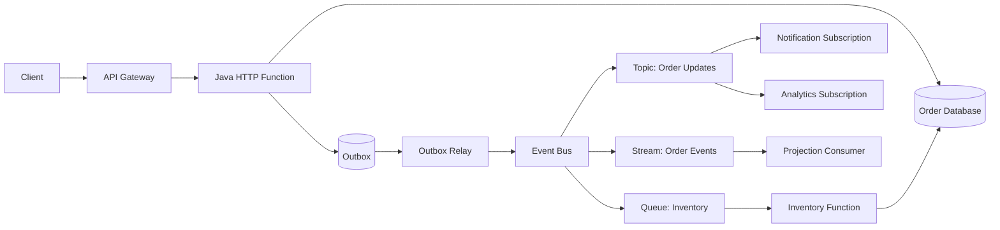

# Lựa chọn queue, topic, event bus và stream

Trong kiến trúc serverless, function thường cần trao đổi công việc qua message hoặc sự kiện thay vì gọi trực tiếp function khác. Cách giao tiếp này giúp các thành phần hoạt động độc lập, hấp thụ tải tăng đột biến và tiếp tục xử lý khi một consumer tạm thời không sẵn sàng. Tuy nhiên, queue, topic, event bus và stream có mô hình lưu trữ, phân phối và tiêu thụ khác nhau. Chọn sai mô hình có thể dẫn đến mất khả năng phát lại, xử lý trùng, sai thứ tự hoặc chi phí vận hành không cần thiết.

Điểm cần xác định trước khi chọn dịch vụ là bản chất của dữ liệu đang truyền: đó là **một công việc cần một worker xử lý**, **một thông báo cần gửi đến nhiều subscriber**, **một sự kiện cần định tuyến theo điều kiện**, hay **một bản ghi trong dòng dữ liệu cần được lưu và đọc lại theo vị trí**. Các mô hình có thể kết hợp với nhau; ví dụ event bus định tuyến một sự kiện đến nhiều queue, còn stream lưu lại lịch sử để phân tích và phát lại.

## 1. Bốn mô hình truyền thông điệp

### Queue: hàng đợi công việc

Queue giữ các message cho đến khi một consumer nhận và xử lý. Nhiều worker có thể cùng đọc một queue theo mô hình competing consumers; thông thường mỗi message được giao cho một worker tại một thời điểm xử lý. Sau khi xử lý thành công, consumer xác nhận (acknowledge/delete) message để queue loại nó khỏi danh sách chờ. Nếu consumer lỗi hoặc không xác nhận trong thời hạn lease/visibility timeout, message có thể được giao lại.

Queue phù hợp với các công việc độc lập như tạo thumbnail, gửi email, xử lý hóa đơn hoặc đồng bộ dữ liệu. Producer chỉ cần gửi công việc vào queue, không cần biết worker nào sẽ nhận. Queue cũng tạo bộ đệm giữa tốc độ tiếp nhận và tốc độ xử lý: nếu producer gửi nhanh hơn consumer, backlog tăng lên thay vì buộc consumer phải xử lý ngay lập tức.

Queue thường có một số đặc điểm:

- Message được giữ cho đến khi xử lý, hết thời hạn lưu hoặc bị chuyển sang dead-letter queue (DLQ), tùy cấu hình.
- Có cơ chế xác nhận, visibility timeout hoặc lease để quản lý việc giao và xử lý lại.
- Có thể hỗ trợ retry, delay, dead-letter và giới hạn số lần nhận.
- Thứ tự không phải lúc nào cũng được bảo đảm. Một số dịch vụ cung cấp FIFO hoặc ordering theo nhóm message với giới hạn throughput riêng.
- Nhiều worker thường chia nhau xử lý message; mỗi worker không mặc nhiên nhận được bản sao riêng.

### Topic: kênh publish-subscribe

Topic cung cấp một điểm publish cho producer và một hoặc nhiều subscription cho subscriber. Khi producer gửi message vào topic, broker phân phối bản sao hoặc bản tham chiếu của message đến từng subscription. Mỗi subscription có thể có backlog, chính sách retry và consumer riêng. Subscriber A xử lý thông báo, subscriber B cập nhật tìm kiếm, subscriber C ghi dữ liệu phân tích; việc một subscriber chậm không nhất thiết ngăn các subscriber khác tiến hành.

Topic phù hợp khi cùng một thông báo cần đến nhiều hệ thống. Producer không phải gọi trực tiếp từng subscriber và không cần biết danh sách subscriber đang hoạt động. Nếu một subscription cần nhiều worker chia tải, subscription đó có thể được nối với một queue hoặc được triển khai bằng consumer group tùy broker.

Từ “topic” có thể chỉ hai kiểu triển khai khác nhau:

- Trong pub/sub broker, topic là điểm phát thông báo và mỗi subscription nhận bản sao độc lập. Đây là cách dùng thường thấy ở dịch vụ notification topic.
- Trong hệ sinh thái log phân tán, chẳng hạn Kafka, topic là một log được chia partition và lưu giữ theo retention. Consumer đọc theo offset; nhiều consumer group có thể đọc cùng dữ liệu độc lập. Kiểu topic này mang đặc tính của stream.

Vì vậy, khi thiết kế cần hỏi topic đang nói đến subscription fan-out hay append-only log. Tên gọi giống nhau không có nghĩa là semantics giao nhận giống nhau.

### Event bus: định tuyến sự kiện theo luật

Event bus nhận event từ nhiều producer, áp dụng rule để lọc theo loại sự kiện hoặc thuộc tính payload rồi chuyển đến các target. Target có thể là function, queue, topic, workflow hoặc một bus khác. Bus giúp các miền nghiệp vụ công bố sự kiện mà không cần biết consumer cụ thể.

Ví dụ, event `OrderSubmitted` có thể được định tuyến đến queue tồn kho nếu `region` thuộc một vùng nhất định, đến function chống gian lận nếu tổng tiền vượt ngưỡng và đến topic thông báo cho các hệ thống quan tâm. Một bus có thể có nhiều rule và nhiều target; mỗi target cần chính sách lỗi, retry và lưu trữ phù hợp với khả năng của nền tảng.

Event bus phù hợp với tích hợp hướng sự kiện giữa nhiều service hoặc nhiều miền nghiệp vụ. Bus thường tập trung vào nhận, lọc và định tuyến event. Không nên mặc định event bus là một kho lưu lịch sử dài hạn hoặc một log có thể đọc lại tùy ý. Khả năng lưu event, archive, replay, retry và DLQ phụ thuộc dịch vụ cụ thể; nếu cần các khả năng đó, phải kiểm tra và cấu hình riêng.

### Stream: dòng sự kiện có vị trí đọc

Stream là một chuỗi record được ghi nối tiếp vào log, thường được chia thành nhiều partition. Record được giữ theo chính sách retention hoặc dung lượng đã cấu hình. Consumer đọc dữ liệu theo offset/sequence number và có thể lưu checkpoint để tiếp tục từ vị trí trước đó.

Stream phù hợp với telemetry, clickstream, audit feed, thay đổi dữ liệu (change data capture), phân tích thời gian thực và các trường hợp cần nhiều consumer đọc lại cùng lịch sử. Một consumer group có thể chia partition cho nhiều worker để tăng throughput. Nhiều consumer group độc lập có thể đọc cùng stream ở vị trí riêng, vì vậy một dữ liệu có thể phục vụ phân tích, cảnh báo và xây dựng read model.

Đặc điểm thường gặp:

- Record được lưu trong log trong một khoảng thời gian hoặc theo giới hạn dung lượng, kể cả sau khi một consumer đã đọc.
- Consumer tự quản lý offset hoặc checkpoint; đọc lại bằng cách quay về offset cũ trong giới hạn retention.
- Thứ tự thường được bảo đảm trong một partition, không phải toàn bộ stream khi có nhiều partition.
- Throughput thường được mở rộng bằng partition và consumer song song.
- Consumer phải xử lý việc đọc lặp, checkpoint và rebalance; một record đã đọc không tự động biến mất khỏi stream.

## 2. So sánh semantics

| Tiêu chí | Queue | Topic pub/sub | Event bus | Stream/log |
|---|---|---|---|---|
| Mục tiêu | Phân phối công việc | Fan-out một thông báo đến nhiều subscription | Lọc và định tuyến sự kiện | Lưu dòng record để đọc theo offset |
| Mô hình consumer | Nhiều worker chia việc | Mỗi subscription nhận bản riêng; worker trong subscription có thể chia tải | Một hoặc nhiều target theo rule | Consumer group chia partition; group khác đọc độc lập |
| Sau khi consumer đọc | Thường ack để xóa/hoàn tất | Theo trạng thái của từng subscription | Theo cơ chế delivery của target | Record vẫn còn theo retention |
| Replay | Thường redrive từ DLQ hoặc gửi lại | Tùy broker và subscription retention | Chỉ khi có archive/replay hoặc nguồn phát lại | Đọc lại offset trong retention |
| Thứ tự | Tùy queue; FIFO có thể giới hạn phạm vi | Tùy broker và subscription | Không nên giả định thứ tự toàn cục | Thường chỉ theo partition |
| Backpressure | Backlog tăng trong queue | Backlog theo subscription hoặc queue phía sau | Theo target, retry và giới hạn dịch vụ | Lag tăng khi consumer chậm hơn producer |
| Phù hợp nhất | Work item cần xử lý | Một thông báo cần nhiều hệ thống nhận | Tích hợp service theo loại/thuộc tính event | Lịch sử dữ liệu, replay, analytics, CDC |

Các dòng trong bảng mô tả semantics phổ biến, không phải cam kết giống nhau ở mọi nhà cung cấp. Luôn kiểm tra giới hạn message, retention, ordering, retry, batch, throughput, kích thước payload và DLQ của dịch vụ thực tế.

## 3. Cách phối hợp các mô hình

Một hệ thống đặt hàng có thể dùng cả bốn mô hình, mỗi mô hình giải quyết một phần khác nhau:



HTTP function xác nhận yêu cầu và lưu đơn hàng. Outbox relay phát `OrderSubmitted` sau khi giao dịch database commit. Event bus lọc và định tuyến event đến queue tồn kho, topic thông báo và stream lưu lịch sử. Queue giúp worker tồn kho chia công việc; topic phân phối cập nhật cho nhiều subscription; stream giữ record để projection hoặc analytics đọc theo offset.

Không phải kiến trúc nào cũng cần cả bốn. Một dịch vụ gửi email có thể chỉ cần queue. Một hệ thống cần gửi một thông báo cho ba subscriber có thể chỉ cần topic. Event bus hữu ích khi cần nhiều rule định tuyến giữa các service. Stream có giá trị khi cần retention, replay hoặc nhiều consumer xử lý lịch sử độc lập.

## 4. Tiêu chí lựa chọn

Hãy bắt đầu từ yêu cầu nghiệp vụ và vận hành, không bắt đầu từ tên dịch vụ cloud.

### Một công việc hay nhiều bản sao?

Nếu mỗi work item chỉ cần một worker xử lý thành công, chọn queue. Nếu cùng một thông báo cần được nhiều subscriber độc lập nhận, chọn topic pub/sub hoặc event bus fan-out. Nếu cần cả fan-out lẫn điều tiết từng consumer, có thể route event bus đến một queue riêng cho mỗi subscriber.

### Có cần phát lại lịch sử không?

Nếu chỉ cần retry message lỗi trong một khoảng thời gian ngắn, queue cùng DLQ thường đủ. Nếu cần nhiều consumer đọc lại lịch sử từ một vị trí tùy chọn, stream phù hợp hơn. Nếu muốn lưu event từ event bus để phát lại khi có sự cố, phải cấu hình archive hoặc một event store riêng; không giả định bus giữ dữ liệu vô thời hạn.

### Có cần thứ tự không?

Nếu công việc của cùng một đối tượng phải theo thứ tự, chọn dịch vụ hỗ trợ FIFO hoặc partition/group key. Queue FIFO thường nhóm thứ tự theo message group; stream giữ thứ tự trong partition. Với event bus và topic, kiểm tra rõ semantics ordering của broker và subscription. Nếu thứ tự là yêu cầu nghiệp vụ, hãy đưa aggregate ID vào khóa phân vùng/nhóm phù hợp và kiểm tra version để phát hiện event đến trễ.

### Tải có đột biến hay liên tục?

Queue phù hợp để hấp thụ burst và điều tiết số worker. Stream phù hợp với luồng record liên tục, throughput cao và consumer chạy song song theo partition. Topic/event bus hỗ trợ fan-out nhưng mỗi target vẫn có giới hạn riêng. Giới hạn concurrency của function theo năng lực database và API phụ thuộc; autoscaling không làm cho hệ thống phía sau mở rộng vô hạn.

### Consumer có tốc độ và chính sách lỗi khác nhau không?

Nếu subscriber có tốc độ, thời hạn hoặc yêu cầu retry khác nhau, tạo subscription/queue riêng để cô lập backlog và chính sách lỗi. Nếu nhiều consumer dùng chung một queue, một nhóm worker chậm hoặc message lỗi có thể ảnh hưởng đến toàn bộ nhóm. Nếu nhiều consumer đọc stream, dùng consumer group riêng để giữ offset độc lập.

## 5. Ma trận chọn nhanh

| Tình huống | Mô hình nên cân nhắc | Lý do |
|---|---|---|
| Gửi email sau khi đơn hàng được tạo | Queue | Mỗi email là một công việc, có thể retry và chia tải |
| Gửi `OrderSubmitted` cho thông báo, tìm kiếm và phân tích | Topic hoặc event bus | Nhiều subscriber cần nhận cùng sự kiện |
| Định tuyến `PaymentFailed` đến workflow chăm sóc, còn `PaymentCaptured` đến kế toán | Event bus | Rule lọc theo loại event và thuộc tính |
| Thu thập clickstream với nhiều consumer phân tích | Stream | Retention, partition và offset cho phép đọc độc lập/replay |
| Xử lý file lớn theo từng phần với worker song song | Queue hoặc stream tùy mô hình công việc | Queue cho work item; stream khi cần log record và checkpoint |
| Xây dựng read model từ thay đổi dữ liệu | Stream hoặc event bus + queue | Stream hữu ích khi cần rebuild; queue phù hợp xử lý tác vụ từng event |
| Một subscriber phải được bảo vệ khỏi subscriber khác đang chậm | Queue riêng sau fan-out | Backlog, retry và concurrency được cô lập |

## 6. Giao nhận, xác nhận và xử lý trùng

Hệ thống phân tán thường cung cấp giao ít nhất một lần (at-least-once) ở một hoặc nhiều chặng. Điều này có nghĩa một message có thể được giao lại sau timeout, lỗi function hoặc mất acknowledgement. Một số nền tảng cung cấp chế độ at-most-once hoặc tính năng chống trùng trong một phạm vi, nhưng không nên suy ra toàn bộ quy trình end-to-end là exactly-once.

### Queue

Consumer nhận message, thực hiện side effect bền vững rồi mới xác nhận message. Nếu xác nhận trước khi commit database, function có thể dừng sau ack và công việc bị mất. Nếu commit database xong nhưng ack thất bại, message có thể được giao lại; do đó consumer cần idempotency.

Visibility timeout hoặc lease phải dài hơn thời gian xử lý dự kiến, có thêm khoảng đệm cho network và shutdown. Nếu lease hết khi function vẫn chạy, worker khác có thể nhận cùng message. Với batch trigger, cần hiểu cơ chế partial batch failure của nền tảng: nếu chỉ một phần batch thất bại, cấu hình phù hợp giúp retry đúng các item lỗi thay vì xử lý lại toàn bộ batch, khi dịch vụ hỗ trợ.

### Topic và event bus

Mỗi subscription hoặc target có trạng thái delivery riêng. Việc một target nhận thành công không có nghĩa mọi target khác đã hoàn tất. Cần theo dõi retry, DLQ và delivery failure theo từng subscription/target. Nếu một target gọi function trực tiếp và function lỗi, nền tảng có thể retry theo chính sách riêng; nếu target là queue, queue tiếp quản backlog và retry sau đó.

### Stream

Consumer đọc record và cập nhật offset/checkpoint. Chỉ commit offset sau khi side effect đã bền vững. Nếu commit trước khi xử lý xong, record có thể bị bỏ qua sau restart. Nếu xử lý xong nhưng chưa commit offset, record có thể được đọc lại. Vì vậy, ghi dữ liệu và checkpoint cần được phối hợp hoặc xử lý idempotent. Với nhiều partition, offset được quản lý riêng theo partition.

### Mẫu idempotency

Một cách phổ biến là dùng bảng inbox/processed-message có unique key `(consumer_name, message_id)`. Trong cùng transaction database, consumer ghi nhận message ID và cập nhật trạng thái nghiệp vụ. Nếu message ID đã tồn tại, consumer bỏ qua side effect đã hoàn tất và xác nhận message. Với side effect bên ngoài database, hãy dùng idempotency key của API đích khi có hỗ trợ hoặc thiết kế quy trình bù trừ.

## 7. Retry, DLQ và poison message

Retry phù hợp với lỗi tạm thời như timeout, throttling hoặc lỗi dịch vụ 5xx. Dùng exponential backoff và jitter để tránh nhiều worker thử lại đồng thời. Không retry vô hạn lỗi không thể tự hết như schema không hợp lệ, thiếu trường bắt buộc hoặc vi phạm quy tắc nghiệp vụ.

Sau số lần nhận hoặc khoảng thời gian retry tối đa, chuyển message lỗi sang DLQ hoặc kho lỗi tương đương. DLQ giúp tách poison message khỏi luồng chính, nhưng cần quy trình vận hành:

1. Theo dõi số message và tuổi message cũ nhất trong DLQ.
2. Thu thập event ID, loại event, correlation ID, lỗi và số lần nhận; không log secret hoặc toàn bộ payload nhạy cảm.
3. Phân loại lỗi do dữ liệu, code, cấu hình hay dependency.
4. Sửa nguyên nhân và xác định consumer có thể xử lý lại an toàn hay cần thao tác bù trừ.
5. Redrive có kiểm soát, giữ nguyên định danh message nếu đó vẫn là cùng event.

Đối với stream, message lỗi có thể làm consumer group không tiến được ở một partition nếu ứng dụng không có chiến lược bỏ qua hoặc cách ly record. Cần quyết định rõ: retry tại chỗ, ghi lỗi sang dead-letter topic/stream, lưu offset lỗi và tiếp tục, hay dừng partition để bảo toàn thứ tự. Bỏ qua record có thể làm mất tính đầy đủ của projection; quyết định này phải được ghi nhận và có khả năng sửa/replay sau đó.

## 8. Thứ tự, partition và khả năng mở rộng

Không nên giả định thứ tự toàn cục khi dùng nhiều queue worker, topic subscription hoặc stream partition. Trong nhiều hệ thống, chỉ có thứ tự trong một nhóm hoặc partition.

Với stream, partition key thường được chọn theo aggregate ID hoặc khóa nghiệp vụ để các record của cùng đối tượng đi vào một partition. Consumer group phân chia partition giữa các worker; số worker hữu ích thường bị giới hạn bởi số partition. Tăng partition có thể thay đổi cách phân bố key và ảnh hưởng thứ tự của dữ liệu cũ/mới, tùy broker.

Với queue FIFO, message group ID có thể giữ thứ tự trong từng nhóm và cho phép các nhóm khác xử lý song song. Nếu một message đầu nhóm bị lỗi và phải retry, các message sau trong cùng nhóm có thể bị chặn. Đây là trade-off giữa thứ tự và throughput.

Với event bus, rule có thể gửi nhiều event đến các target khác nhau và thời điểm xử lý giữa target không nhất thiết đồng bộ. Nếu nghiệp vụ yêu cầu bước B chỉ chạy sau khi bước A hoàn tất, biểu diễn dependency bằng workflow state, event tiếp theo hoặc orchestration; không dựa vào thứ tự publish đơn thuần.

## 9. Replay, retention và schema evolution

Queue thường giữ message trong một khoảng thời gian giới hạn và xóa message sau acknowledgement. Muốn chạy lại một công việc đã hoàn tất, cần tạo command mới, khôi phục từ DLQ hoặc lưu audit/outbox/event journal riêng. Topic pub/sub có thể giữ message theo retention của từng subscription, nhưng khả năng tua lại phụ thuộc broker.

Stream giữ record theo retention và consumer có thể đọc lại từ offset cũ khi record còn tồn tại. Replay hữu ích để xây dựng lại read model, kiểm thử consumer mới hoặc phân tích dữ liệu lịch sử. Tuy nhiên, replay sẽ lặp lại side effect nếu consumer gửi email, thu tiền hoặc gọi hệ thống ngoài. Consumer replay nên có chế độ chỉ cập nhật projection, môi trường tách biệt hoặc idempotency/guard nghiệp vụ để tránh thực hiện side effect lần nữa.

Event bus có thể hỗ trợ archive và replay, nhưng khả năng này khác nhau theo nền tảng. Nếu lịch sử event là yêu cầu nghiệp vụ hoặc kiểm toán, cần xác định nơi lưu bền vững, retention, mã hóa, quyền truy cập và quy trình replay độc lập với bus.

Schema của message cần có version và quy tắc tương thích. Producer nên bổ sung field tùy chọn theo hướng tương thích ngược; consumer nên bỏ qua field chưa biết khi hợp đồng cho phép và xử lý rõ field bắt buộc bị thiếu. Khi đổi kiểu dữ liệu hoặc ý nghĩa field, có thể cần event type/version mới hoặc giai đoạn chuyển tiếp có cả producer và consumer tương thích.

## 10. Ví dụ Java: envelope dùng chung cho queue, topic, bus và stream

Tầng nghiệp vụ nên dùng kiểu event độc lập với SDK của nhà cung cấp. Adapter riêng sẽ chuyển kiểu này thành message body/attributes, bus event hoặc stream record.

```java
import java.time.Instant;

public record EventEnvelope<T>(
        String id,
        String type,
        int schemaVersion,
        Instant occurredAt,
        String aggregateId,
        String correlationId,
        T data) {}

public record OrderSubmitted(
        String orderId,
        String customerId,
        long total) {}

public interface EventPublisher {
    void publish(EventEnvelope<?> event);
}

public final class OrderEvents {
    private final EventPublisher publisher;

    public OrderEvents(EventPublisher publisher) {
        this.publisher = publisher;
    }

    public void publishSubmitted(
            String eventId,
            String correlationId,
            OrderSubmitted data) {
        EventEnvelope<OrderSubmitted> event = new EventEnvelope<>(
                eventId,
                "OrderSubmitted",
                1,
                Instant.now(),
                data.orderId(),
                correlationId,
                data);
        publisher.publish(event);
    }
}
```

Trong production, event nên được ghi vào outbox cùng transaction với thay đổi đơn hàng. Một relay đọc outbox rồi gọi adapter `EventPublisher`. Khi relay publish thành công nhưng lỗi trước khi đánh dấu outbox, nó có thể publish lại cùng event ID; consumer phải idempotent.

## 11. Ví dụ Java: consumer idempotent

Đoạn mã sau minh họa cách bảo vệ projection khi message được giao lại. Repository inbox và projection phải tham gia cùng một transaction database. Chi tiết xử lý unique constraint tùy hệ quản trị dữ liệu.

```java
import java.util.function.Supplier;

public interface TransactionRunner {
    <T> T execute(Supplier<T> work);
}

public interface InboxRepository {
    // Insert a unique (consumerName, messageId) marker.
    // Return false when this message was already committed.
    boolean insertIfAbsent(String consumerName, String messageId);
}

public interface OrderProjectionRepository {
    void markSubmitted(String orderId, long total);
}

public final class OrderSubmittedHandler {
    private static final String CONSUMER = "order-projection-v1";

    private final TransactionRunner transactions;
    private final InboxRepository inbox;
    private final OrderProjectionRepository projection;

    public OrderSubmittedHandler(
            TransactionRunner transactions,
            InboxRepository inbox,
            OrderProjectionRepository projection) {
        this.transactions = transactions;
        this.inbox = inbox;
        this.projection = projection;
    }

    public void handle(EventEnvelope<OrderSubmitted> event) {
        transactions.execute(() -> {
            if (!inbox.insertIfAbsent(CONSUMER, event.id())) {
                return null;
            }

            projection.markSubmitted(
                    event.data().orderId(), event.data().total());
            return null;
        });
    }
}
```

Queue adapter chỉ xác nhận message sau khi `handle` commit thành công. Stream adapter chỉ checkpoint offset sau khi xử lý record thành công. Nếu function bị dừng sau commit nhưng trước acknowledgement/checkpoint, lần giao hoặc đọc lại sẽ gặp inbox marker và không áp dụng projection lần nữa.

Đoạn mã trên phù hợp với side effect nằm trong cùng database. Nếu handler gửi email hoặc gọi payment API, transaction database không thể tự rollback side effect bên ngoài. Khi đó cần idempotency key được API ngoài hỗ trợ, outbox cho lệnh gửi, hoặc workflow có bước bù trừ.

## 12. Tích hợp với Java function runtime

Một function có thể được kích hoạt bởi HTTP, queue, topic subscription, event bus target hoặc stream consumer. Adapter đầu vào khác nhau nhưng tầng nghiệp vụ nên nhận một envelope hoặc command đã chuẩn hóa.

| Trigger | Dữ liệu function nhận | Hoàn tất xử lý được xác nhận bằng |
|---|---|---|
| HTTP | Request, header, path/query, body | HTTP response; client có thể retry nếu timeout |
| Queue | Một message hoặc batch message | Ack/delete hoặc phản hồi batch item thành công theo nền tảng |
| Topic subscription | Bản message của subscription | Ack/response theo giao thức subscriber |
| Event bus | Event envelope/target payload | Kết quả invocation hoặc delivery response theo nền tảng |
| Stream | Record, partition, offset/sequence | Checkpoint/commit offset sau xử lý |

Với queue hoặc stream trigger, nền tảng có thể gửi một batch trong một invocation. Function cần xác định từng record thành công hay thất bại và dùng partial batch response nếu được hỗ trợ. Nếu chỉ trả lỗi chung cho cả batch, các record đã xử lý có thể bị chạy lại; idempotency giúp giảm tác động nhưng vẫn tiêu tốn compute và truy vấn database.

Function thường có timeout hữu hạn. Nếu công việc kéo dài hơn giới hạn, chia nhỏ thành các message, lưu trạng thái workflow và phát event cho bước tiếp theo. Không giữ một invocation mở để chờ một chuỗi tác vụ dài nếu queue/workflow có thể biểu diễn tiến trình bền vững hơn.

## 13. Backpressure và giới hạn concurrency

Backpressure là cách ngăn producer tạo tải vượt khả năng xử lý của consumer hoặc dependency. Queue tạo bộ đệm rõ ràng qua backlog. Stream thể hiện áp lực qua consumer lag. Topic và event bus có thể tạo nhiều nhánh tải; mỗi subscription hoặc target cần giới hạn và giám sát riêng.

Một function consumer có thể scale theo số message hoặc độ trễ xử lý. Nếu concurrency tăng quá nhanh, database có thể cạn connection, API bên ngoài bị throttling hoặc chi phí tăng mạnh. Cần:

- Đặt maximum concurrency theo năng lực của dependency.
- Điều chỉnh batch size và số message mỗi invocation dựa trên thời gian xử lý và bộ nhớ.
- Theo dõi queue depth, age of oldest message hoặc consumer lag.
- Dùng queue để điều tiết các thao tác ghi vào database hoặc API có quota thấp.
- Áp dụng rate limit, timeout và circuit breaker cho dependency bên ngoài.
- Tách queue/subscription theo loại công việc có SLA hoặc tốc độ khác nhau.

Độ sâu queue thấp không phải lúc nào cũng đồng nghĩa hệ thống khỏe: message có thể bị retry liên tục hoặc consumer xử lý sai nhưng vẫn ack. Cần kết hợp backlog với tỷ lệ lỗi, tuổi message, throughput hoàn tất và chỉ số nghiệp vụ.

## 14. Bảo mật và hợp đồng dữ liệu

Producer chỉ nên có quyền publish vào queue/topic/bus/stream cần thiết; consumer chỉ có quyền consume và truy cập dữ liệu nghiệp vụ mà nó sở hữu. Dùng IAM hoặc cơ chế quyền tương đương theo từng function, mã hóa khi truyền và khi lưu, quản lý secret bằng secret manager và giới hạn quyền đọc DLQ vì message lỗi có thể chứa payload nhạy cảm.

Không coi message trong broker là đáng tin cậy chỉ vì nó đến từ mạng nội bộ. Consumer cần xác minh schema, event type, nguồn phát và điều kiện nghiệp vụ. Kiểm tra tenant và quyền sở hữu tài nguyên ở tầng nghiệp vụ; correlation ID hoặc aggregate ID không phải thông tin xác thực.

Giữ payload nhỏ và chỉ chứa trường consumer cần. Với file lớn, lưu file ở object storage rồi gửi object key hoặc URL có thời hạn trong message. Cần kiểm tra quyền truy cập, thời hạn URL và vòng đời file. Tránh gửi token, mật khẩu hoặc secret trong event body.

## 15. Quan sát và chi phí

Các mô hình cần metric khác nhau:

| Mô hình | Metric nên theo dõi |
|---|---|
| Queue | Queue depth, tuổi message cũ nhất, số message nhận lại, số message trong DLQ, thời gian xử lý |
| Topic | Delivery success/failure theo subscription, backlog/retention của từng subscription, retry và DLQ |
| Event bus | Số event nhận, số event khớp rule, số lần target invocation lỗi, retry, throttling và archive/replay nếu có |
| Stream | Records in/out, consumer lag theo group/partition, offset age, rebalance, partition skew và retention usage |

Log nên có event ID, event type, correlation ID, causation ID, consumer name, attempt/offset và kết quả xử lý. Dùng distributed tracing để nối producer với consumer khi có thể. Không đưa ID có cardinality cao vào metric label; dùng chúng trong log và trace có kiểm soát.

Chi phí cần tính cả request hoặc operation của broker, dung lượng và retention, số lần delivery/retry, số partition, throughput, function invocation/duration, log/trace, truyền dữ liệu và dịch vụ đích. Fan-out làm tăng số lần giao hoặc số subscription cần lưu dữ liệu. Stream retention dài và nhiều partition tăng dung lượng cũng như chi phí vận hành. Queue backlog lớn kéo dài có thể làm tăng chi phí lưu và khiến SLA xử lý không đạt.

Đo chi phí theo một đơn vị nghiệp vụ như một đơn hàng hoàn tất, một tệp xử lý xong hoặc một sự kiện được phân tích thường hữu ích hơn chỉ nhìn tổng số message. Tối ưu bằng cách lọc event sớm, giảm payload, đặt retention phù hợp, giới hạn retry, batch khi có thể và tắt consumer không còn sử dụng.

## 16. Các câu hỏi cần trả lời trước khi triển khai

1. Message là work item, notification, domain event hay record trong một log dữ liệu?
2. Có một consumer xử lý hay nhiều subscriber độc lập cần nhận?
3. Có cần replay từ lịch sử, và cần giữ dữ liệu trong bao lâu?
4. Thứ tự cần bảo đảm ở phạm vi nào: toàn cục, theo aggregate hay không cần?
5. Hệ thống chấp nhận at-least-once không; idempotency được thực hiện ở đâu?
6. Retry bao nhiêu lần, dùng backoff nào và DLQ được vận hành ra sao?
7. Consumer có thể xử lý batch không; checkpoint/ack xảy ra sau thao tác bền vững nào?
8. Concurrency tối đa nào an toàn cho database và dịch vụ phụ thuộc?
9. Schema được version hóa và thay đổi tương thích như thế nào?
10. Ai sở hữu quyền publish, consume, replay và đọc DLQ?
11. Metric nào phát hiện backlog, lag, lỗi delivery và workflow bị kẹt?
12. Chi phí retention, partition, fan-out, retry và function đã được tính theo tải dự kiến chưa?

## 17. Checklist lựa chọn

- [ ] Dùng queue khi cần phân phối work item cho một nhóm worker cạnh tranh.
- [ ] Dùng topic pub/sub khi nhiều subscription cần nhận bản thông báo độc lập.
- [ ] Dùng event bus khi cần lọc và định tuyến domain event theo rule đến nhiều target.
- [ ] Dùng stream khi cần log có retention, offset, consumer group và replay.
- [ ] Phân biệt rõ topic pub/sub với topic dạng partitioned log.
- [ ] Xác minh semantics ack, retry, retention, ordering, batch và DLQ của dịch vụ cụ thể.
- [ ] Consumer idempotent và chỉ ack/checkpoint sau khi side effect bền vững.
- [ ] Đặt giới hạn concurrency và batch theo khả năng dependency.
- [ ] Có chính sách poison message, DLQ và redrive có kiểm soát.
- [ ] Có schema version, event ID và metadata truy vết nhất quán.
- [ ] Có metric cho backlog/lag, tuổi message, delivery failure và thời gian xử lý.
- [ ] Đã tính chi phí broker, retention, fan-out, function, network và observability.

## Kết luận

Queue phân phối công việc cho worker; topic pub/sub phát một thông báo đến nhiều subscription; event bus lọc và định tuyến sự kiện theo rule; stream lưu record theo log, partition và offset để nhiều consumer đọc hoặc phát lại. Khi hiểu rõ semantics của từng mô hình và kết hợp chúng đúng chỗ, ứng dụng serverless có thể tách producer khỏi consumer, hấp thụ tải, phục hồi sau lỗi và hỗ trợ phân tích lịch sử. Quyết định cuối cùng phải dựa trên số consumer, yêu cầu ordering, retention/replay, retry, khả năng dependency và chi phí thực tế của workload.
