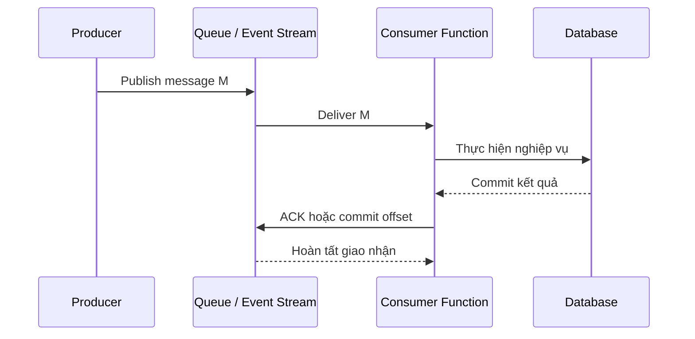
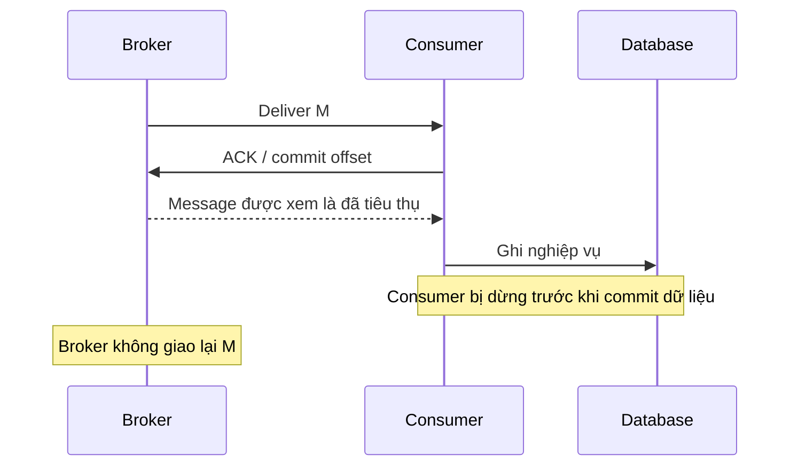
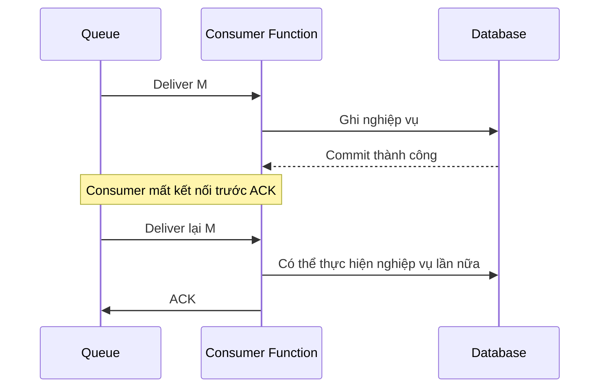
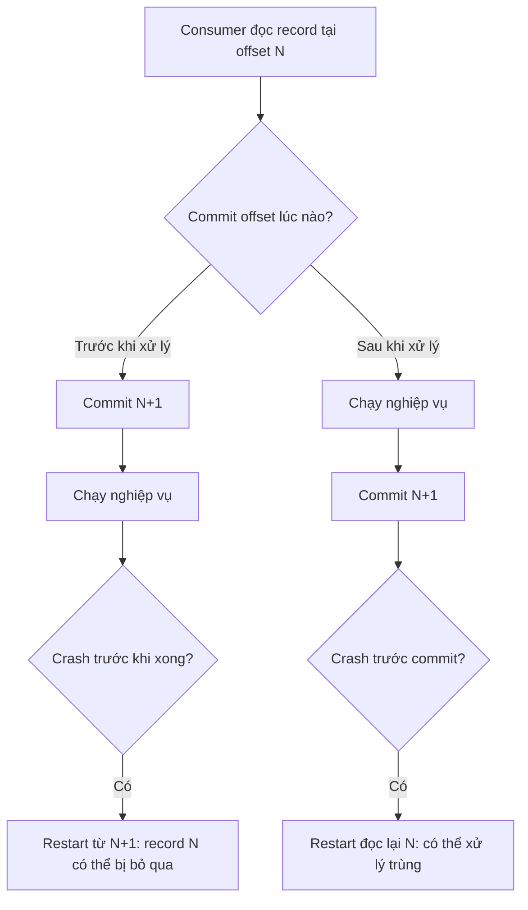

# Ngữ nghĩa giao nhận at-most-once và at-least-once

Khi một Java function nhận message từ queue hoặc event stream, hệ thống phải quyết định điều gì xảy ra nếu consumer bị dừng, xử lý lỗi hoặc mất kết nối đúng lúc xác nhận message. Quyết định đó được mô tả bằng **delivery semantics** (ngữ nghĩa giao nhận). Hai mô hình thường gặp là **at-most-once** và **at-least-once**.

At-most-once ưu tiên tránh xử lý lặp: một message được giao không quá một lần, nhưng có thể bị mất nếu lỗi xảy ra ở thời điểm không thuận lợi. At-least-once ưu tiên giao lại cho đến khi được xác nhận: message ít có nguy cơ bị bỏ sót hơn trong phạm vi chính sách lưu giữ và retry, nhưng consumer có thể nhận cùng message nhiều lần. Vì vậy, thiết kế consumer idempotent là điều kiện quan trọng khi dùng at-least-once.

## 1. Delivery semantics nói về điều gì?

Một message thường đi qua các bước: producer gửi message, broker lưu hoặc ghi message, consumer nhận message, thực hiện nghiệp vụ rồi xác nhận (acknowledge) hoặc commit vị trí đã đọc. Broker dùng acknowledgement, trạng thái message hoặc offset để quyết định có giao lại hay tiếp tục.



Điểm quan trọng là acknowledgement không nhất thiết có nghĩa nghiệp vụ đã hoàn tất theo đúng cách ứng dụng mong muốn. Ý nghĩa chính xác phụ thuộc vào việc consumer xác nhận lúc nào, dữ liệu đã được ghi bền vững ở đâu và broker sử dụng cơ chế nào để theo dõi message.

Delivery semantics cũng không tự mô tả việc producer gửi message có trùng hay không, thứ tự message có được giữ hay không, hoặc kết quả của một lời gọi dịch vụ bên ngoài có được thực hiện đúng một lần hay không. Đây là các thuộc tính riêng cần thiết kế và kiểm tra.

## 2. At-most-once: giao không quá một lần

Với at-most-once, broker hoặc consumer không thử giao lại message sau khi đã coi message đó là được tiêu thụ. Message có thể được giao một lần hoặc không được giao lần nào. Nếu consumer thất bại sau khi message đã được xác nhận hoặc offset đã được commit, message không được phát lại theo cơ chế đó.

Một cách tạo ra at-most-once là xác nhận message hoặc commit offset trước khi xử lý nghiệp vụ:



Trong tình huống này, message có thể mất khỏi góc nhìn của consumer dù nghiệp vụ chưa được thực hiện. Cách làm này có thể phù hợp với dữ liệu mà mất một vài mẫu không ảnh hưởng đáng kể, chẳng hạn một số telemetry hoặc chỉ số tạm thời, nếu hệ thống chấp nhận rõ ràng rủi ro mất dữ liệu.

Ưu điểm của at-most-once là giảm khả năng xử lý lặp và có thể giảm chi phí retry. Nhược điểm là không có cơ hội tự phục hồi khi consumer lỗi sau thời điểm xác nhận. Nếu message đại diện cho giao dịch, đơn hàng, thanh toán hoặc lệnh cần thực thi, nguy cơ mất message thường không chấp nhận được.

At-most-once không có nghĩa là message chắc chắn được xử lý một lần. Tên gọi *at most* có nghĩa là **không quá một lần**, nên số lần xử lý có thể bằng không.

## 3. At-least-once: giao ít nhất một lần

Với at-least-once, broker giữ message cho đến khi nhận được xác nhận hợp lệ hoặc chính sách giao nhận kết thúc. Nếu consumer không xác nhận, bị dừng hoặc hết thời gian xử lý, broker có thể giao lại message. Điều này tăng khả năng message được xử lý, nhưng cũng tạo ra khả năng trùng lặp.



Trong ví dụ, database đã commit nhưng broker chưa nhận được acknowledgement. Broker không thể biết chắc nghiệp vụ đã hoàn tất, nên giao lại message. Nếu consumer không nhận diện lần giao lại, nó có thể gửi thêm email, trừ tiền lần nữa hoặc tạo bản ghi trùng.

At-least-once thường phù hợp với công việc nghiệp vụ cần tránh mất message, với điều kiện consumer được thiết kế để chịu được giao trùng. Hệ thống cần có retry hữu hạn hoặc chính sách lưu giữ phù hợp, DLQ để cô lập message lỗi và metric để phát hiện message bị tồn đọng.

## 4. So sánh hai mô hình

| Tiêu chí | At-most-once | At-least-once |
|---|---|---|
| Số lần giao | 0 hoặc 1 | 1 hoặc nhiều lần trong phạm vi chính sách giao nhận |
| Nguy cơ mất message do lỗi consumer | Có thể xảy ra | Giảm đáng kể nếu broker còn giữ message và retry còn hiệu lực |
| Nguy cơ giao trùng | Thấp theo cơ chế giao nhận | Có; consumer phải xử lý được |
| Xác nhận thường gặp | Trước khi xử lý hoặc không retry sau lỗi | Sau khi xử lý thành công |
| Độ phức tạp ở consumer | Có thể đơn giản hơn, nhưng phải chấp nhận mất message | Cần idempotency, deduplication và xử lý retry |
| Trường hợp cân nhắc | Telemetry hoặc dữ liệu có thể bỏ qua | Đơn hàng, tác vụ nền, cập nhật nghiệp vụ cần độ tin cậy |

Không có lựa chọn đúng cho mọi hệ thống. Cần dựa vào hậu quả khi mất message, chi phí của xử lý lặp, khả năng lưu trữ, yêu cầu độ trễ và mức độ quan trọng của nghiệp vụ.

## 5. Acknowledgement trong queue

Với queue, broker thường quản lý trạng thái message cho đến khi consumer xác nhận. Cách thực hiện phụ thuộc dịch vụ, nhưng có thể hình dung qua hai thao tác: nhận message và xác nhận/xóa message.

### 5.1. Visibility timeout

Một số queue dùng cơ chế *visibility timeout*. Khi consumer nhận message, message tạm thời không hiển thị cho consumer khác trong một khoảng thời gian. Nếu consumer xác nhận trước khi hết thời gian, broker loại message khỏi queue. Nếu timeout hết mà chưa có xác nhận, message có thể xuất hiện lại và được giao cho consumer khác.

Visibility timeout phải được thiết lập dựa trên thời gian xử lý thực tế, batch size và giới hạn timeout của function. Nếu thời gian xử lý thường dài hơn visibility timeout, message có thể bị giao trùng ngay cả khi consumer vẫn đang chạy. Với công việc có thời lượng biến động, một số dịch vụ cho phép gia hạn visibility trong khi xử lý.

Không nên tăng timeout vô hạn để che giấu consumer bị treo. Cần đặt giới hạn thời gian xử lý, theo dõi message age và bảo đảm function có thể kết thúc hoặc gia hạn có kiểm soát.

### 5.2. Xác nhận sau khi nghiệp vụ hoàn tất

Với at-least-once, consumer chỉ nên xác nhận message sau khi thay đổi nghiệp vụ đã được commit bền vững. Nếu xác nhận trước rồi mới ghi database, lỗi giữa hai bước có thể làm mất message.

Tuy nhiên, xác nhận sau khi commit vẫn có một cửa sổ lỗi: database đã commit nhưng acknowledgement bị mất. Message được giao lại. Đây là lý do consumer vẫn cần idempotency ngay cả khi thứ tự xử lý và ACK có vẻ chính xác.

### 5.3. Batch message

Một lần gọi function có thể nhận nhiều message. Nếu handler chỉ trả một kết quả thành công/thất bại cho cả batch, một record lỗi có thể khiến toàn batch được giao lại. Các record đã xử lý thành công sẽ xuất hiện lần nữa.

Nếu nền tảng hỗ trợ partial batch response, handler có thể báo chính xác record nào thất bại để chỉ những record đó được giao lại. Cần bật tính năng tương ứng trong cấu hình event source mapping và trả đúng định dạng mà runtime yêu cầu. Dù dùng batch response, mỗi record vẫn cần idempotent vì lỗi có thể xảy ra sau khi commit nhưng trước khi xác nhận.

## 6. Commit offset trong event stream

Event stream như Apache Kafka thường lưu các bản ghi theo partition và theo thứ tự offset. Consumer group theo dõi offset đã đọc hoặc đã xử lý để tiếp tục từ vị trí phù hợp sau khi restart hoặc rebalance.

Thời điểm commit offset ảnh hưởng đến delivery semantics:

- **Commit trước khi xử lý:** nếu consumer dừng sau commit nhưng trước khi hoàn tất nghiệp vụ, khi khởi động lại consumer có thể tiếp tục từ offset kế tiếp. Record chưa được xử lý bị bỏ qua, tạo hành vi gần với at-most-once.
- **Commit sau khi xử lý:** nếu consumer dừng sau khi nghiệp vụ hoàn tất nhưng trước khi commit offset, record có thể được đọc lại. Đây là hành vi at-least-once; consumer cần idempotent.



Trong Kafka, commit offset có thể được quản lý tự động hoặc thủ công tùy client và cấu hình. Nếu cần at-least-once, hãy chỉ commit offset sau khi kết quả nghiệp vụ đã được lưu bền vững. Với xử lý batch, cần quản lý offset sao cho không đánh dấu các record phía sau đã hoàn tất khi còn record phía trước chưa xử lý thành công.

Event stream thường cho phép đọc lại dữ liệu trong thời gian retention còn hiệu lực bằng cách đặt lại offset. Khả năng replay này khác với queue: queue thường xóa message sau acknowledgement, trong khi stream giữ record theo retention và mỗi consumer group theo dõi vị trí đọc riêng. Dù vậy, replay stream cũng có thể tạo tác động nghiệp vụ lặp nếu consumer không có cơ chế deduplication.

## 7. Exactly-once có thực sự có nghĩa là xử lý đúng một lần?

Khái niệm *exactly-once* thường được dùng trong tài liệu của broker hoặc nền tảng, nhưng phải xác định rõ phạm vi. Có thể có bảo đảm exactly-once trong một ranh giới kỹ thuật cụ thể, ví dụ producer idempotent hoặc giao dịch giữa việc đọc/ghi trong cùng một hệ thống stream. Điều đó không tự động bảo đảm một tác động bên ngoài như ghi vào database khác, gửi email hoặc trừ tiền chỉ xảy ra một lần.

Ví dụ: consumer đọc event, gọi cổng thanh toán thành công rồi bị dừng trước khi commit offset. Khi restart, event được đọc lại. Broker không thể tự biết cổng thanh toán đã trừ tiền ở lần trước. Nếu consumer gọi lại mà không có idempotency key, khách hàng có thể bị trừ tiền hai lần.

Vì vậy, khi nghe một dịch vụ hỗ trợ exactly-once, hãy hỏi:

- Bảo đảm áp dụng cho producer, broker, consumer hay cả pipeline?
- Có bao gồm transaction với database hoặc API bên ngoài không?
- Khi consumer restart hoặc rebalance, trạng thái giao dịch được khôi phục thế nào?
- Bảo đảm có giới hạn trong một transaction, một partition, một consumer group hay một thời gian nhất định không?

Với nghiệp vụ bên ngoài broker, cách thực tế thường là at-least-once kết hợp idempotency ở consumer, transaction tại kho dữ liệu và cơ chế outbox/inbox khi cần phát hoặc nhận sự kiện nhất quán.

## 8. Idempotency: nền tảng để chịu được giao trùng

Một thao tác idempotent có thể được thực hiện nhiều lần với cùng một định danh đầu vào mà kết quả nghiệp vụ cuối cùng vẫn tương đương với việc thực hiện một lần.

Ví dụ, đặt trạng thái đơn hàng thành `SHIPPED` là thao tác có thể idempotent nếu việc lặp lại không tạo thêm vận đơn. Ngược lại, thao tác cộng thêm 100.000 đồng vào số dư không idempotent nếu mỗi lần gọi đều cộng tiếp.

### 8.1. Dùng event ID và ràng buộc duy nhất

Mỗi event nên có một ID ổn định. Consumer lưu event ID đã xử lý với ràng buộc unique để nhận diện lần giao lại. Thao tác ghi dấu đã xử lý và thay đổi nghiệp vụ cần nằm trong cùng một transaction database.

```java
public final class OrderPlacedHandler {
    private final ProcessedEventRepository processedEvents;
    private final OrderRepository orders;

    public OrderPlacedHandler(
            ProcessedEventRepository processedEvents,
            OrderRepository orders) {
        this.processedEvents = processedEvents;
        this.orders = orders;
    }

    @Transactional
    public void handle(OrderPlacedEvent event) {
        // insertIfAbsent phải nguyên tử và dựa trên UNIQUE(event_id).
        boolean firstDelivery = processedEvents.insertIfAbsent(event.eventId());
        if (!firstDelivery) {
            return;
        }

        orders.markPlaced(event.orderId());
    }
}
```

`@Transactional` minh họa transaction của ứng dụng, chẳng hạn Spring. `insertIfAbsent` là thao tác repository cần được triển khai bằng cơ chế nguyên tử của database và ràng buộc unique trên `event_id`; không nên triển khai bằng cách `SELECT` rồi `INSERT` riêng rẽ mà không khóa, vì hai invocation đồng thời có thể cùng vượt qua bước kiểm tra. Nếu transaction thất bại, bản ghi đã xử lý và cập nhật đơn hàng cùng rollback. Nếu transaction commit nhưng ACK bị mất, lần giao lại tìm thấy event ID đã tồn tại và bỏ qua thay đổi lặp.

### 8.2. Tác động bên ngoài database

Transaction database không thể tự rollback một email đã gửi, một API bên ngoài đã gọi hoặc một giao dịch thanh toán đã thành công. Với các tác động này:

- Dùng idempotency key do API bên ngoài hỗ trợ, thường dựa trên event ID hoặc business operation ID.
- Ghi trạng thái công việc và kết quả gọi bên ngoài để có thể xác định lần thử trước đã thành công hay chưa.
- Dùng transactional outbox để phát sự kiện sau khi transaction nghiệp vụ commit.
- Dùng inbox hoặc bảng processed-event ở consumer để deduplicate message đến.
- Với quy trình nhiều bước không thể có transaction phân tán, thiết kế saga và thao tác bù trừ phù hợp.

Idempotency key cần có phạm vi và thời gian lưu phù hợp. Nếu dịch vụ ngoài chỉ giữ key trong 24 giờ nhưng message có thể được replay sau 30 ngày, hệ thống cần một cơ chế kiểm tra trạng thái dài hạn của riêng mình.

## 9. Retry, backoff và dead-letter queue

At-least-once thường đi cùng retry. Khi consumer trả lỗi hoặc không xác nhận, broker có thể giao lại message ngay lập tức hoặc sau một khoảng chờ. Retry có thể phục hồi lỗi tạm thời, nhưng retry liên tục một message không thể xử lý sẽ gây nghẽn và tăng chi phí.

Một chính sách retry cần xác định:

- Số lần giao hoặc thời gian retry tối đa.
- Khoảng chờ giữa các lần thử; thường dùng exponential backoff và jitter để tránh nhiều consumer thử lại cùng lúc.
- Visibility timeout hoặc thời gian xử lý tối đa cho từng invocation.
- Cách phân loại lỗi tạm thời và lỗi không thể khắc phục.
- Số lần nhận tối đa trước khi chuyển message sang DLQ.
- Thời gian lưu queue và DLQ, cùng quy trình redrive sau khi sửa lỗi.

DLQ giúp cô lập message lỗi để điều tra, nhưng không tự giải quyết nguyên nhân. Cần cảnh báo khi DLQ có message mới, lưu event ID và mã lỗi có kiểm soát, xác định ai được phép replay và bảo đảm consumer idempotent trước khi redrive.

Không nên retry mọi lỗi như nhau. Lỗi mạng hoặc throttling có thể thử lại với backoff. Payload sai schema, thiếu trường bắt buộc hoặc vi phạm quy tắc nghiệp vụ thường cần xử lý riêng. Nếu retry vô hạn, một message lỗi có thể chiếm tài nguyên và chặn các message khác.

## 10. Chọn semantics cho ứng dụng serverless Java

| Tình huống | Hướng lựa chọn | Điều cần triển khai |
|---|---|---|
| Telemetry không quan trọng, có thể bỏ mẫu | Cân nhắc at-most-once | Đo tỷ lệ mất mẫu; xác nhận sớm nếu chấp nhận rủi ro |
| Gửi email thông báo từ event | Thường at-least-once | Idempotency key hoặc bảng trạng thái gửi để tránh gửi lặp |
| Xử lý đơn hàng hoặc cập nhật tồn kho | At-least-once | Transaction, event ID duy nhất, xử lý trạng thái idempotent |
| Consumer đọc event stream và cập nhật database | At-least-once thường thực tế | Commit offset sau khi database commit; deduplicate theo event ID |
| Thanh toán hoặc gọi API tạo tác động không thể đảo ngược | At-least-once kèm idempotency phía dịch vụ | Idempotency key, lưu kết quả và đối soát khi timeout không rõ kết quả |

Khi triển khai Java function, cần xem xét cả timeout của function và thời hạn giao nhận của broker. Function có thể hết thời gian sau khi database đã commit nhưng trước khi runtime xác nhận message. Đây là một đường dẫn tạo duplicate điển hình. Hãy thiết kế transaction và idempotency để lần giao lại an toàn.

Đối với queue, theo dõi số message đang chờ, tuổi message cũ nhất, số lần nhận, thời gian xử lý và số message trong DLQ. Đối với stream, theo dõi consumer lag, offset commit, tốc độ đọc/ghi và số lần rebalance. Những chỉ số này giúp phát hiện consumer chậm hoặc lỗi trước khi message tồn đọng quá lâu.

## 11. Checklist thiết kế

Trước khi chọn hoặc cấu hình delivery semantics, hãy trả lời:

1. Nếu message bị mất, hậu quả nghiệp vụ là gì? Nếu message bị giao lại, hậu quả là gì?
2. Broker xác nhận message hoặc commit offset ở thời điểm nào?
3. Điều gì xảy ra nếu consumer dừng trước khi xử lý, trong khi xử lý, sau khi commit nghiệp vụ hoặc trước ACK?
4. Event có ID ổn định không? Consumer có ràng buộc unique hoặc cơ chế idempotency không?
5. Thay đổi nghiệp vụ và dấu processed-event có nằm trong cùng transaction không?
6. Với API bên ngoài, có idempotency key hoặc cách đối soát kết quả timeout không rõ ràng không?
7. Retry có giới hạn, backoff, DLQ và quy trình replay không?
8. Visibility timeout, function timeout, batch size và thời gian xử lý có tương thích không?
9. Với stream, offset được commit sau khi trạng thái nghiệp vụ đã bền vững chưa?
10. Metric và log có cho biết message age, duplicate, retry, DLQ và consumer lag không?

## Kết luận

At-most-once giao message không quá một lần và chấp nhận khả năng mất message khi lỗi xảy ra sau xác nhận. At-least-once giao lại khi chưa nhận được xác nhận, giảm nguy cơ mất message nhưng có thể tạo duplicate. Với đa số nghiệp vụ serverless cần độ tin cậy, at-least-once kết hợp consumer idempotent, transaction, retry có giới hạn và DLQ là lựa chọn thực tế. Hãy luôn xác định phạm vi của mọi tuyên bố exactly-once, đặc biệt khi luồng xử lý chạm đến database hoặc dịch vụ bên ngoài broker.
