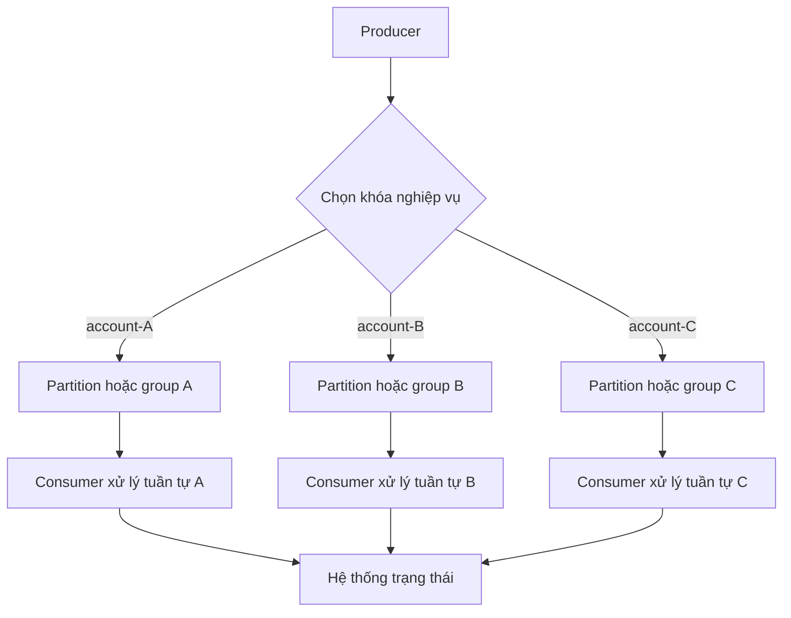

# Ordering, partition và message group

Trong hệ thống serverless, queue và event stream giúp tách producer khỏi consumer, hấp thụ tải đột biến và cho phép xử lý bất đồng bộ. Khi nhiều message được gửi gần nhau, hệ thống còn phải trả lời một câu hỏi quan trọng: message nào cần được xử lý trước message nào? Nếu thứ tự bị thay đổi, nghiệp vụ có thể sai dù từng message riêng lẻ đều hợp lệ.

Ví dụ, một tài khoản có ba lệnh `Deposit`, `Withdraw` và `CloseAccount`. Nếu `CloseAccount` được xử lý trước `Deposit`, số dư cuối cùng có thể khác với ý định của người dùng. Tương tự, một đơn hàng có các sự kiện `OrderCreated`, `PaymentAuthorized` và `OrderShipped`; xử lý `OrderShipped` trước khi xác nhận thanh toán có thể đưa trạng thái đơn vào một tình huống không hợp lệ.

Để kiểm soát thứ tự mà vẫn giữ khả năng mở rộng, các hệ thống queue và stream thường chia message thành **partition** hoặc **message group**. Các message có cùng khóa nghiệp vụ được định tuyến vào cùng một luồng thứ tự; các nhóm khác nhau có thể được xử lý song song. Thiết kế tốt bắt đầu bằng việc xác định chính xác phạm vi cần giữ thứ tự, sau đó chọn khóa phân vùng, cách producer phát message và cách consumer xác nhận kết quả.

## 1. Ordering có nghĩa là gì?

Ordering là quy tắc xác định thứ tự giữa các message liên quan. Cần phân biệt ít nhất ba khái niệm:

- **Thứ tự gửi:** thứ tự producer gọi thao tác gửi hoặc ghi message.
- **Thứ tự được broker chấp nhận:** thứ tự broker ghi nhận message sau khi nhận từ producer.
- **Thứ tự xử lý/hoàn tất:** thứ tự consumer bắt đầu và hoàn thành công việc.

Ba thứ tự này có thể khác nhau. Hai thread Java có thể gửi cùng lúc; request thứ hai có thể đến broker trước request thứ nhất. Một consumer có thể nhận message theo đúng thứ tự nhưng đưa chúng vào hai thread khác nhau, khiến message sau hoàn tất trước. Retry cũng có thể làm một message cũ xuất hiện lại sau khi các message mới đã được xử lý.

Vì vậy, nói “queue giữ thứ tự” vẫn chưa đủ. Cần hỏi thứ tự được đảm bảo ở phạm vi nào, tại thời điểm nào và với điều kiện nào. Một dịch vụ có thể bảo đảm thứ tự trong một FIFO group hoặc một partition, nhưng không bảo đảm thứ tự toàn cục giữa các group/partition. Cơ chế đó cũng không tự bảo đảm side effect trong hệ thống ngoài hoàn tất đúng thứ tự.

### Thứ tự toàn cục và thứ tự theo thực thể

**Thứ tự toàn cục (global ordering)** nghĩa là mọi message đều phải đi qua một chuỗi duy nhất. Cách này đơn giản để suy luận nhưng thường yêu cầu một luồng tuần tự, giới hạn concurrency và tạo nút thắt khi tải tăng.

**Thứ tự theo thực thể (per-entity ordering)** chỉ yêu cầu các message liên quan đến cùng một thực thể được xử lý theo thứ tự. Ví dụ:

- Các thay đổi của cùng một `accountId` cần theo thứ tự để bảo toàn số dư.
- Các sự kiện của cùng một `orderId` cần theo thứ tự để bảo toàn vòng đời đơn hàng.
- Các telemetry của cùng một `deviceId` cần theo thứ tự nếu phép tính phụ thuộc mẫu trước đó.

Những tài khoản, đơn hàng hoặc thiết bị khác nhau có thể được xử lý đồng thời. Đây thường là phạm vi cân bằng tốt giữa tính đúng đắn và khả năng mở rộng.



Trong sơ đồ, thứ tự được giữ riêng cho từng tài khoản. Không có cam kết rằng message của account-A hoàn tất trước hoặc sau message của account-B.

### Thứ tự nghiệp vụ không đồng nghĩa timestamp

Timestamp trong payload hữu ích cho audit và phân tích, nhưng không luôn xác định được thứ tự nghiệp vụ. Đồng hồ của hai producer có thể lệch nhau; timestamp có thể được tạo trước khi gửi, trong khi message đến broker muộn hơn; một retry có thể giữ timestamp cũ.

Nếu nghiệp vụ yêu cầu thứ tự chặt, hãy dùng sequence number hoặc version tăng đơn điệu theo thực thể, được tạo tại nơi sở hữu trạng thái. Timestamp có thể bổ sung ngữ cảnh, nhưng không nên là căn cứ duy nhất để áp dụng thay đổi trạng thái.

## 2. Partition và cách định tuyến message

Partition là một phần luồng dữ liệu có thứ tự riêng. Trong hệ thống log/stream phân vùng, mỗi partition thường lưu message theo offset tăng dần. Consumer đọc các record trong partition theo thứ tự offset. Một consumer group có thể phân công các partition cho nhiều consumer để xử lý song song; trong cùng consumer group, một partition thường chỉ được gán cho một consumer tại một thời điểm.

Producer chọn một **partition key**. Broker hoặc client partitioner dùng khóa đó để xác định partition, thường thông qua hàm băm. Khi các message cùng khóa được gửi vào cùng partition, chúng có thể được đọc theo thứ tự ghi nhận của partition.

Ví dụ:

| Event | Partition key | Kết quả định tuyến mong muốn |
|---|---|---|
| `OrderCreated(order-17)` | `order-17` | Cùng partition với event của đơn 17 |
| `PaymentAuthorized(order-17)` | `order-17` | Cùng partition với event của đơn 17 |
| `OrderShipped(order-17)` | `order-17` | Cùng partition với event của đơn 17 |
| `OrderCreated(order-18)` | `order-18` | Có thể ở partition khác |

Nếu partition key là `orderId`, các thay đổi của một đơn hàng được gom lại. Nếu dùng một UUID ngẫu nhiên mới cho từng message, các message cùng đơn hàng có thể rơi vào partition khác nhau và không còn bảo đảm thứ tự theo đơn.

### Chọn partition key theo bất biến nghiệp vụ

Khóa nên đại diện cho đơn vị dữ liệu mà các thay đổi cần được tuần tự hóa. Một số ví dụ:

| Bất biến cần bảo vệ | Khóa thường phù hợp |
|---|---|
| Không xử lý đồng thời các thay đổi số dư của một tài khoản | `accountId` |
| Cập nhật trạng thái đơn theo vòng đời | `orderId` |
| Duy trì thứ tự mẫu đo của thiết bị | `deviceId` |
| Cập nhật hồ sơ của một khách hàng theo chuỗi | `customerId` |
| Tuần tự hóa mọi thao tác của một tenant | `tenantId`, nếu nghiệp vụ thực sự yêu cầu |

Không nên chọn khóa quá rộng nếu các thực thể con có thể xử lý độc lập. Ví dụ, dùng `tenantId` cho toàn bộ message của một khách hàng doanh nghiệp có thể làm tất cả hoạt động của tenant bị tuần tự hóa, dù mỗi đơn hàng độc lập. Ngược lại, khóa quá hẹp như `eventId` sẽ không giữ được thứ tự cho cùng một đơn hàng.

Hãy xác định phạm vi dữ liệu được cập nhật cùng nhau trước khi chọn key. Nếu một giao dịch thay đổi nhiều tài khoản hoặc nhiều aggregate, một partition key đơn không thể tự tạo ra thứ tự toàn cục cho toàn bộ giao dịch; cần transaction, workflow hoặc cơ chế phối hợp phù hợp ở tầng nghiệp vụ.

### Hash partitioning và giới hạn của nó

Với cách phân vùng theo hash, các khóa khác nhau được phân phối trên các partition. Hash giúp phân bố tương đối đều khi khóa có phân bố tốt, nhưng không bảo đảm tải đều. Một vài khóa xuất hiện nhiều hơn hẳn có thể tạo **hot partition**.

Ví dụ, nếu hầu hết message đều thuộc về một `tenantId` lớn và tenant đó là partition key, partition chứa tenant này có thể trở thành nút thắt. Tăng tổng số partition không tự chia nhỏ một khóa duy nhất nếu mọi message của khóa vẫn phải ở cùng partition để giữ thứ tự.

Có thể giảm hot partition bằng cách:

- Chọn khóa có cardinality và phân bố phù hợp với phạm vi thứ tự cần bảo vệ.
- Nếu nghiệp vụ cho phép, chia một thực thể lớn thành các nhóm con độc lập, ví dụ `accountId + ledgerType` hoặc `tenantId + shardId`.
- Tách luồng công việc không cần thứ tự chung.
- Đặt giới hạn tốc độ hoặc dùng queue trung gian để hấp thụ burst.
- Theo dõi tải từng partition thay vì chỉ nhìn tổng throughput.

Không thêm suffix ngẫu nhiên vào partition key một cách tùy tiện. Việc này có thể phân tán tải nhưng cũng phá vỡ thứ tự giữa các message của cùng thực thể. Chỉ dùng sharding theo sub-key khi có thể chứng minh các phần đó độc lập hoặc có một bước tổng hợp/điều phối phía sau.

### Thay đổi số partition

Với một số broker, partition được xác định bằng phép tính gần dạng `hash(key) mod partitionCount`. Khi tăng số partition, cùng một key có thể được ánh xạ sang partition mới. Nếu message cũ còn trong partition cũ trong khi message mới đi sang partition mới, thứ tự của key có thể bị chia đôi trong giai đoạn chuyển đổi.

Trước khi tăng partition, cần kiểm tra hành vi partitioner và chính sách của broker. Có thể cần dừng producer, drain dữ liệu cũ, đổi routing version, dùng key mapping ổn định hoặc tạo topic/stream mới rồi chuyển đổi có kiểm soát. Không nên giả định tăng partition luôn an toàn với luồng cần thứ tự chặt.

## 3. Message group trong FIFO queue

Một số queue hỗ trợ FIFO và cho producer gắn `MessageGroupId` (hoặc tên tương đương) cho mỗi message. Message có cùng group được xử lý theo thứ tự gửi mà dịch vụ chấp nhận; các group khác nhau có thể được phân phối cho consumer song song.

Ví dụ, với queue xử lý đơn hàng:

- `MessageGroupId = order-17` cho mọi message liên quan đến đơn 17.
- `MessageGroupId = order-18` cho mọi message liên quan đến đơn 18.
- Consumer có thể xử lý hai group đồng thời, nhưng các message trong một group phải theo đúng thứ tự mà queue cung cấp.

Đây là ý tưởng gần với partition key, nhưng không phải mọi queue và stream có cùng ngữ nghĩa. Message group là khái niệm định tuyến/tuần tự hóa của một số FIFO queue. Partition là cấu trúc lưu trữ và phân phối của một số log/stream. Khi chọn dịch vụ, cần đọc rõ bảo đảm về group, thứ tự, visibility, batch, retry và consumer concurrency của dịch vụ cụ thể.

### Message group và mức song song

Nếu chỉ có một group, hệ thống có thể bị giới hạn gần như một luồng xử lý tuần tự, dù queue hỗ trợ nhiều consumer. Nếu có nhiều group độc lập, nhiều consumer có thể xử lý cùng lúc. Tuy nhiên, số group không tự đảm bảo số consumer hoạt động: còn phụ thuộc backlog, giới hạn concurrency, số message đang khả dụng và quy tắc phân phối của dịch vụ.

| Thiết kế group | Tính thứ tự | Khả năng song song |
|---|---|---|
| Một group cho toàn hệ thống | Thứ tự chung | Thấp, dễ thành nút thắt |
| Một group cho mỗi đơn hàng | Thứ tự theo đơn | Cao giữa các đơn khác nhau |
| Một group cho mỗi tenant | Thứ tự theo tenant | Có thể thấp nếu tenant có tải lớn |
| Một group cho mỗi message | Hầu như không có thứ tự giữa các message | Cao nhưng không bảo vệ thứ tự nghiệp vụ |

Chọn group theo cùng nguyên tắc chọn partition key: group đại diện cho đơn vị cần được xử lý tuần tự. Nếu một tenant có nhiều tài khoản độc lập, `accountId` có thể cho concurrency tốt hơn `tenantId`, miễn là nghiệp vụ không yêu cầu thứ tự chung giữa các tài khoản.

### Visibility timeout và xử lý tuần tự

Với queue dùng cơ chế visibility timeout, message sau khi được nhận sẽ tạm thời ẩn khỏi consumer khác trong một khoảng thời gian. Nếu consumer xử lý quá thời hạn mà không gia hạn hoặc xác nhận, message có thể xuất hiện lại. Với FIFO group, dịch vụ thường kiểm soát việc giao message tiếp theo trong group để giữ thứ tự, nhưng chi tiết phụ thuộc provider.

Đặt visibility timeout lớn hơn thời gian xử lý dự kiến và có cơ chế gia hạn nếu tác vụ dài. Timeout quá ngắn làm message bị giao lại khi consumer vẫn đang chạy; timeout quá dài khiến phục hồi chậm khi consumer chết. Dù có FIFO, consumer vẫn cần idempotency vì message có thể được giao lại sau lỗi hoặc timeout.

## 4. Producer phải phát message đúng thứ tự

Broker chỉ có thể bảo vệ thứ tự mà nó nhận được. Nếu hai thread gửi hai sự kiện cùng aggregate đồng thời, broker có thể chấp nhận event mới trước event cũ. Nếu producer gửi lại một request cũ sau timeout mà không có cơ chế idempotent/sequence, message trùng hoặc sai thứ tự có thể xuất hiện.

Các cách giảm rủi ro:

1. **Tuần tự hóa gửi theo khóa:** với mỗi aggregate, chỉ có một luồng producer phát message tại một thời điểm. Các aggregate khác vẫn có thể gửi song song.
2. **Sequence/version nghiệp vụ:** gắn số thứ tự tăng dần theo aggregate vào mỗi event. Consumer có thể phát hiện trùng hoặc thiếu phiên bản.
3. **Transactional outbox:** ghi thay đổi nghiệp vụ và outbox record trong cùng giao dịch database; publisher phát record theo sequence của aggregate.
4. **Idempotent producer hoặc deduplication của broker:** dùng tính năng của nền tảng khi có, nhưng vẫn hiểu phạm vi và thời hạn deduplication.
5. **Một partition key ổn định:** tất cả event của cùng aggregate phải dùng cùng key trong suốt vòng đời luồng.

### Transactional outbox và sequence

Giả sử một lệnh thay đổi đơn hàng cập nhật trạng thái từ `CREATED` sang `PAID` và cần phát `PaymentAuthorized`. Nếu database commit thành công nhưng publish thất bại, trạng thái đã đổi mà consumer không nhận được event. Nếu publish trước rồi database rollback, consumer lại nhận một event mô tả thay đổi chưa được commit.

Transactional outbox ghi cả thay đổi aggregate và event vào cùng một transaction cục bộ. Publisher đọc outbox và gửi sau đó. Mỗi aggregate có thể tăng `aggregateVersion` trong cùng transaction:

```text
BEGIN TRANSACTION
  UPDATE orders
     SET status = 'PAID', version = version + 1
   WHERE order_id = 'order-17'
     AND version = 4;

  INSERT INTO outbox(event_id, aggregate_id, aggregate_version, event_type, payload)
  VALUES ('evt-501', 'order-17', 5, 'PaymentAuthorized', ...);
COMMIT
```

Publisher cần giữ thứ tự các record của cùng aggregate. Nếu nhiều publisher đọc các hàng outbox cùng lúc mà không có khóa/claim phù hợp, event version 6 có thể được gửi trước version 5. Có thể phân công publisher theo shard của aggregate, claim theo thứ tự version hoặc dùng một cơ chế đảm bảo chỉ phát event tiếp theo sau khi event trước đã được chấp nhận. Broker key/group nên dùng chính `aggregate_id`.

Outbox thường cung cấp giao nhận ít nhất một lần từ publisher đến broker, không tự tạo exactly-once end-to-end. Publisher có thể gửi event thành công nhưng chết trước khi đánh dấu outbox đã gửi; lần chạy sau sẽ gửi lại. Consumer vẫn phải idempotent theo `event_id` hoặc aggregate version.

## 5. Consumer xử lý song song mà không phá thứ tự

Consumer có thể chạy nhiều invocation để tăng throughput, nhưng không nên xử lý đồng thời hai message cùng partition/group nếu nghiệp vụ cần thứ tự nghiêm ngặt. Cách phổ biến là tuần tự trong cùng partition/group và song song giữa các partition/group.

Với stream chia partition, một consumer trong cùng consumer group thường sở hữu một hoặc nhiều partition. Nếu số consumer lớn hơn số partition, một số consumer sẽ không được gán dữ liệu. Nếu số partition lớn hơn consumer, một consumer có thể xử lý nhiều partition. Việc tăng consumer chỉ tăng song song đến giới hạn số partition và tài nguyên downstream.

Với queue FIFO theo message group, nhiều group có thể được xử lý đồng thời. Consumer không nên tự đưa message của cùng group vào executor không giới hạn rồi ack ngay, vì thứ tự hoàn tất có thể bị đảo. Nếu cần bất đồng bộ nội bộ, phải có hàng đợi tuần tự riêng cho từng group và chỉ xác nhận message sau khi side effect bền vững hoàn tất.

### Ví dụ consumer kiểm tra aggregate version bằng Java

Một cách phòng vệ ở tầng nghiệp vụ là gắn version tăng dần vào event. Consumer lưu version cuối cùng đã áp dụng cho từng aggregate. Ví dụ sau minh họa cách phân loại event cũ, event kế tiếp và event bị thiếu phiên bản.

```java
public record OrderEvent(
        String eventId,
        String orderId,
        long aggregateVersion,
        String eventType
) {}

public enum ApplyResult {
    APPLIED,
    DUPLICATE_OR_OLD,
    GAP_DETECTED
}

public interface OrderEventStore {
    long currentVersion(String orderId);

    // Phải kiểm tra expectedVersion và ghi thay đổi trong cùng transaction.
    boolean applyIfVersionMatches(OrderEvent event, long expectedVersion);
}

public final class OrderedOrderConsumer {
    private final OrderEventStore store;

    public OrderedOrderConsumer(OrderEventStore store) {
        this.store = store;
    }

    public ApplyResult handle(OrderEvent event) {
        long current = store.currentVersion(event.orderId());

        if (event.aggregateVersion() <= current) {
            return ApplyResult.DUPLICATE_OR_OLD;
        }

        if (event.aggregateVersion() != current + 1) {
            return ApplyResult.GAP_DETECTED;
        }

        boolean applied = store.applyIfVersionMatches(event, current);
        return applied ? ApplyResult.APPLIED : ApplyResult.GAP_DETECTED;
    }
}
```

Ví dụ giả định version đầu tiên là 1 và `applyIfVersionMatches` kiểm tra version kỳ vọng một cách nguyên tử. Nếu chỉ đọc version rồi cập nhật ở hai thao tác riêng, hai invocation có thể cùng đọc version 4 và cùng áp dụng event version 5. Cần transaction, compare-and-set hoặc conditional write để tránh race condition.

Khi `GAP_DETECTED`, consumer không nên bỏ qua event và tiếp tục áp dụng event sau. Có thể retry có giới hạn, lưu event vào vùng chờ theo aggregate, yêu cầu replay từ broker hoặc tải snapshot mới rồi đối soát. Chọn cách nào phụ thuộc vào khả năng replay, thời gian giữ dữ liệu và yêu cầu độ trễ.

### Xác nhận offset và batch

Với log/stream, offset là vị trí record trong partition. Nếu consumer xử lý song song nhiều record rồi commit offset cao nhất khi một record trước đó chưa hoàn tất, broker có thể xem record chưa xử lý là đã tiêu thụ. Khi restart, record đó có thể bị bỏ qua.

Chỉ commit offset đến vị trí liên tục cao nhất mà mọi record trước đó đã xử lý bền vững. Có thể xử lý song song giữa partition; trong một partition, giữ thứ tự xử lý hoặc dùng cơ chế theo dõi completion để commit đúng. Nếu dùng framework quản lý offset/checkpoint, hiểu rõ khi nào framework xác nhận batch và cách nó xử lý lỗi một record.

Với queue giao batch, batch có thể chứa message của nhiều group. Consumer cần giữ thứ tự trong từng group và tuân thủ giao thức báo lỗi từng message nếu nền tảng hỗ trợ partial batch response. Nếu một message của group bị lỗi, các message sau trong cùng group có thể phải chờ retry hoặc xử lý phục hồi; message thuộc group khác vẫn có thể tiếp tục nếu dịch vụ cho phép. Với FIFO queue, một số nền tảng yêu cầu dừng xử lý các message tiếp theo trong cùng batch sau lỗi đầu tiên và trả lại cả message lỗi lẫn những message cùng thứ tự chưa xử lý. Hãy theo đúng semantics của provider.

## 6. Retry, poison message và DLQ có thể ảnh hưởng thứ tự

Retry làm message xuất hiện lại, do đó có thể ảnh hưởng đến thứ tự. Một message cũ bị lỗi kéo dài có thể chặn cả group nếu hệ thống bảo toàn FIFO nghiêm ngặt. Đây là hành vi có chủ đích để không cho các thay đổi sau vượt qua một thay đổi chưa hoàn tất, nhưng nó có thể làm backlog của group tăng.

Nếu chuyển message lỗi sang dead-letter queue (DLQ) rồi tiếp tục xử lý message sau, thứ tự nghiệp vụ có thể bị gián đoạn. Ví dụ, event version 5 bị chuyển DLQ nhưng version 6 được áp dụng. Khi phát lại version 5, consumer phải phát hiện version cũ hoặc khoảng trống và có chính sách phục hồi rõ ràng.

Nhóm cần chọn một trong các chiến lược theo nghiệp vụ:

- **Block group:** giữ các message sau chờ đến khi message lỗi được sửa và xử lý. Phù hợp khi bỏ qua message sẽ làm sai trạng thái.
- **Skip có kiểm soát:** chỉ bỏ qua khi có quyết định nghiệp vụ rõ ràng, ghi nhận lý do và có thể phát event bù hoặc điều chỉnh trạng thái.
- **Cách ly aggregate:** tạm ngừng một entity bị lỗi, tiếp tục xử lý entity khác. Cần cơ chế theo dõi và khôi phục riêng cho entity đó.
- **Rebuild từ nguồn sự thật:** tải snapshot hoặc replay log để tái tạo trạng thái khi một chuỗi event bị thiếu hoặc hỏng.

Không nên tự động đưa mọi lỗi vào DLQ rồi coi luồng đã hoàn tất. DLQ chỉ lưu giữ lỗi để xử lý; nó không tự giải quyết khoảng trống thứ tự. Quy trình replay cần kiểm tra sequence, idempotency và side effect đã xảy ra trước đó.

## 7. Chọn giữa FIFO queue và partitioned stream

Queue FIFO và partitioned stream có thể cùng cung cấp thứ tự theo group/key, nhưng phục vụ các mô hình sử dụng khác nhau.

| Khía cạnh | FIFO queue có message group | Partitioned event stream/log |
|---|---|---|
| Mô hình tiêu thụ | Message thường được xóa/ack sau xử lý thành công | Record được giữ theo retention; consumer theo dõi offset |
| Thứ tự | Theo group theo semantics của queue | Theo thứ tự record trong từng partition |
| Song song | Giữa các message group | Giữa các partition và consumer group |
| Replay | Thường cần DLQ hoặc cơ chế gửi lại riêng | Có thể đọc lại từ offset nếu record còn trong retention |
| Consumer độc lập | Thường cạnh tranh nhận message trong cùng queue | Nhiều consumer group có thể đọc cùng log độc lập |
| Phù hợp | Công việc cần phân phối và xử lý xong thì ack | Event log, nhiều consumer, replay và xử lý luồng liên tục |

Tên gọi và giới hạn cụ thể khác nhau giữa các nhà cung cấp. Một queue có thể hỗ trợ FIFO theo group; một stream có thể cung cấp ordering theo partition; không nên suy ra mọi queue đều FIFO hoặc mọi stream đều có thể replay vô hạn. Hãy xác minh giới hạn message size, retention, throughput, số group/partition, batch và cơ chế retry của dịch vụ đang chọn.

## 8. Đo lường ordering và partition health

Chỉ đo tổng số message và tỷ lệ lỗi sẽ không phát hiện được hot partition hoặc thứ tự bị phá vỡ. Nên quan sát các chỉ số sau:

| Chỉ số | Dấu hiệu cần chú ý |
|---|---|
| Lag theo partition/consumer group | Một partition tụt xa dù tổng throughput vẫn bình thường |
| Tuổi message lâu nhất theo group | Một group bị chặn bởi message lỗi hoặc consumer chậm |
| Throughput và độ trễ theo key/group | Một vài key chiếm phần lớn tải |
| Số lần retry và redelivery | Message cũ liên tục quay lại, gây chặn group |
| Sequence gap hoặc out-of-order count | Producer/consumer có thể đang làm sai thứ tự |
| Rebalance và partition reassignment | Consumer bị gián đoạn hoặc mất quyền sở hữu partition tạm thời |
| DLQ depth và tuổi message trong DLQ | Lỗi thứ tự chưa được xử lý có thể tích tụ |
| Consumer processing duration | Một loại message làm nghẽn partition/group |

Log nên có `eventId`, `aggregateId` hoặc partition key, `aggregateVersion`, correlation ID và kết quả xử lý. Tránh ghi dữ liệu nhạy cảm trong log. Trace có thể nối producer, broker và consumer để xác định message bị chậm ở đâu.

## 9. Các lỗi thiết kế thường gặp

| Lỗi | Hệ quả | Cách điều chỉnh |
|---|---|---|
| Giả định toàn queue/stream có thứ tự toàn cục | Event của các partition/group có thể hoàn tất theo thứ tự khác | Xác định rõ ordering scope và dùng key/group ổn định |
| Chọn random message ID làm partition key | Event cùng aggregate đi vào các partition khác nhau | Dùng khóa của thực thể nghiệp vụ |
| Dùng một group cho mọi tenant/entity | Giảm throughput và tạo nút thắt | Chọn group nhỏ nhất vẫn bảo vệ được bất biến |
| Chia một entity nóng bằng suffix ngẫu nhiên | Phá thứ tự giữa các phần | Chỉ sharding khi các phần độc lập hoặc có bước tổng hợp |
| Tăng partition mà không lập kế hoạch | Key có thể đổi partition và bị chia thứ tự | Chuyển đổi routing có kiểm soát |
| Consumer xử lý song song message cùng group | Side effect hoàn tất sai thứ tự | Tuần tự trong group, song song giữa group |
| Commit offset trước khi xử lý bền vững | Có thể mất record khi restart | Commit offset liên tục đã hoàn tất |
| Chuyển poison message sang DLQ rồi bỏ qua | Tạo khoảng trống trong chuỗi version | Block, cách ly, skip có kiểm soát hoặc rebuild |
| Dùng timestamp thay sequence | Đồng hồ lệch hoặc retry làm sai thứ tự | Dùng version/sequence do aggregate owner tạo |
| Không idempotent khi redelivery | Side effect lặp dù thứ tự được giữ | Deduplicate và ghi kết quả có điều kiện |

## 10. Quy trình thiết kế ordering cho một luồng Java serverless

Khi bắt đầu thiết kế, có thể đi theo trình tự sau:

1. **Xác định bất biến nghiệp vụ.** Viết rõ điều gì sẽ sai nếu hai message của cùng thực thể bị xử lý ngược thứ tự.
2. **Chọn ordering scope.** Quyết định cần thứ tự toàn cục, theo aggregate, tài khoản, đơn hàng, thiết bị hay tenant.
3. **Chọn partition key/message group.** Dùng khóa ổn định đại diện cho thực thể sở hữu trạng thái.
4. **Kiểm tra phân bố tải.** Đo cardinality, tần suất theo key và nguy cơ hot partition; xác định giới hạn concurrency.
5. **Bảo đảm producer có thứ tự.** Dùng tuần tự hóa theo key, sequence/version và outbox nếu cần đồng bộ database với publish.
6. **Thiết kế consumer.** Xử lý tuần tự trong partition/group, song song giữa các nhóm; ack/commit sau khi kết quả bền vững.
7. **Thiết kế retry và phục hồi.** Chọn chính sách block, DLQ, replay, sequence gap và idempotency.
8. **Đo và kiểm thử.** Theo dõi lag, group backlog, hot key, out-of-order và thử lỗi giữa chừng.

Một bộ tình huống kiểm thử nên gồm: hai message cùng key gửi đồng thời; producer timeout sau khi broker đã nhận message; message đầu tiên lỗi trong khi message tiếp theo đã có sẵn; consumer chết sau khi ghi database nhưng trước khi ack; một group có tải cao bất thường; thay đổi số partition; rebalance trong lúc xử lý; và replay message từ DLQ. Với mỗi trường hợp, xác định trạng thái cuối cùng mong muốn và cách chứng minh thứ tự được giữ.

## Kết luận

Ordering cần được xác định theo phạm vi nghiệp vụ. Partition key và message group giúp gom các message liên quan vào cùng một chuỗi có thứ tự, đồng thời cho phép xử lý song song giữa các thực thể độc lập. Chọn khóa theo aggregate hoặc đơn vị trạng thái cần bảo vệ; tránh một group toàn cục gây nghẽn và tránh chia khóa tùy tiện làm mất thứ tự. Producer cần phát message theo sequence ổn định, consumer cần xử lý tuần tự trong từng nhóm, commit sau khi hoàn tất bền vững và idempotent khi retry. Khi có poison message hoặc DLQ, phải xử lý khoảng trống thứ tự một cách có chủ đích. Trong Java serverless, thiết kế đúng ordering scope giúp giữ tính đúng đắn mà vẫn khai thác được khả năng mở rộng của queue và event stream.
