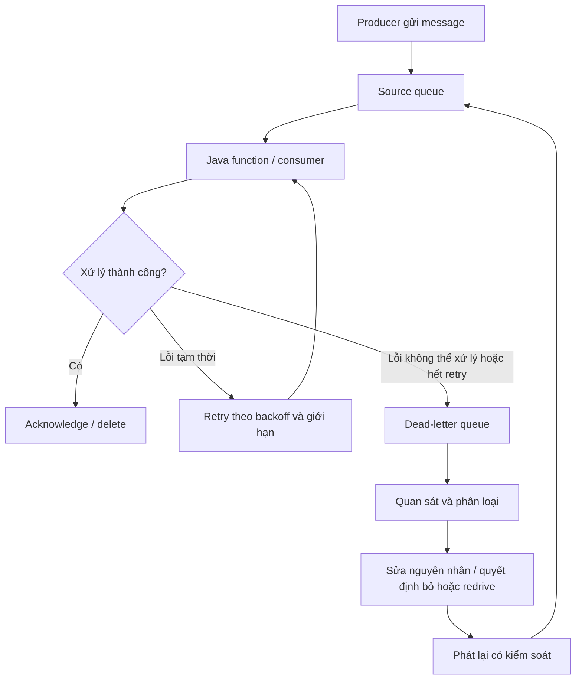

# Dead-letter queue và phân loại thông điệp không xử lý được

Trong hệ thống xử lý bất đồng bộ, một thông điệp có thể thất bại vì dữ liệu không hợp lệ, dịch vụ phụ trợ tạm thời ngừng hoạt động, function timeout hoặc lỗi lập trình. Nếu consumer cứ nhận lại cùng một thông điệp mà không có giới hạn, một thông điệp lỗi có thể tiêu tốn tài nguyên liên tục, làm chậm các thông điệp khác và che khuất sự cố thật.

Dead-letter queue (DLQ) là nơi tiếp nhận những thông điệp không thể xử lý thành công sau chính sách retry hoặc điều kiện chuyển tiếp đã cấu hình. DLQ giúp cô lập thông điệp lỗi để điều tra, sửa nguyên nhân và phát lại có kiểm soát. Nó không tự sửa dữ liệu, không bảo đảm xử lý đúng một lần và cũng không thay thế việc thiết kế consumer có khả năng retry an toàn.

Trong module **CLOUD_SERVERLESS**, Java function thường được kích hoạt bởi message queue hoặc event stream. Người phát triển cần biết lỗi nào nên retry, lỗi nào nên chuyển sang DLQ, cách ghi lại ngữ cảnh để điều tra, và cách redrive thông điệp mà không tạo hiệu ứng nghiệp vụ trùng lặp.

## 1. DLQ giải quyết vấn đề gì?

Một queue thường giữ thông điệp cho đến khi consumer xử lý thành công và xác nhận (acknowledge/delete) theo giao thức của broker. Nếu xử lý thất bại, thông điệp có thể được giao lại sau visibility timeout, thời gian retry hoặc theo cơ chế của event source. Điều này hữu ích khi lỗi chỉ tạm thời, nhưng nguy hiểm khi thông điệp luôn thất bại.

Thông điệp gây lỗi lặp đi lặp lại thường được gọi là **poison message**. Ví dụ:

- JSON bị cắt cụt hoặc sai cú pháp nên parser luôn ném exception.
- Message dùng schema version mà consumer không hỗ trợ.
- Một trường bắt buộc bị thiếu hoặc giá trị không thể chuyển đổi.
- Một thao tác nghiệp vụ luôn vi phạm invariant, chẳng hạn số lượng âm.
- Một payload quá lớn khiến function luôn hết bộ nhớ.
- Một bug trong code làm cùng một loại message luôn kích hoạt lỗi.

Nếu không có giới hạn, poison message có thể được giao lại vô hạn. Với queue có thứ tự, nó còn có thể chặn các message phía sau. DLQ tạo một lối thoát cho message không thể tiếp tục xử lý theo luồng thông thường.



DLQ tách message lỗi khỏi hàng đợi chính để consumer tiếp tục xử lý công việc khác. Việc một message đi vào DLQ là tín hiệu cần xem xét, không phải bằng chứng rằng lỗi đã được giải quyết.

## 2. Phân biệt retry, DLQ và nơi lưu trữ lỗi

Các cơ chế dưới đây có mục đích khác nhau:

| Cơ chế | Mục đích | Khi dùng |
|---|---|---|
| Retry tại consumer hoặc broker | Thử lại cùng công việc khi lỗi có khả năng tạm thời | Timeout, throttling, lỗi mạng, dependency 503 |
| Delay / backoff queue | Trì hoãn lần thử tiếp theo để giảm áp lực | Dịch vụ phụ trợ cần thời gian phục hồi hoặc có `Retry-After` |
| Dead-letter queue | Cô lập message đã vượt ngưỡng retry hoặc không thể xử lý | Poison message, schema không hỗ trợ, lỗi đã hết số lần thử |
| Quarantine / parking-lot queue | Giữ message cần con người hoặc quy trình riêng quyết định | Payload đáng ngờ, vi phạm chính sách, cần điều tra bảo mật |
| Error log / telemetry | Ghi lại dấu vết phục vụ chẩn đoán | Mọi lỗi cần quan sát, kể cả lỗi được retry thành công |
| Event archive / object storage | Lưu bản ghi dài hạn để audit hoặc replay dữ liệu lớn | Yêu cầu lưu trữ, điều tra hoặc tái dựng lịch sử |

Log không thay thế DLQ: log thường không đủ để khôi phục payload và đưa message trở lại luồng xử lý. Ngược lại, DLQ không thay thế log/metric: một message nằm trong DLQ cần có mã lỗi, request ID, timestamp và dấu vết để biết vì sao nó đến đó.

Một số nền tảng có DLQ gắn trực tiếp với source queue; nền tảng khác cấu hình retry và destination ở event source mapping hoặc consumer. Với event stream, DLQ thường là một topic hoặc kho lưu trữ do consumer ghi vào, chứ không phải tính năng tự động có sẵn của mọi broker. Hãy đọc đúng semantics của dịch vụ đang dùng.

## 3. Phân loại lỗi trước khi retry

Không phải exception nào cũng nên xử lý giống nhau. Consumer cần phân biệt lỗi có thể tự hết khi thử lại, lỗi không thể hết nếu payload không đổi và lỗi hệ thống/cấu hình cần dừng hoặc báo động.

### Lỗi tạm thời (transient / retryable)

Những lỗi này có khả năng thành công nếu chờ một khoảng thời gian rồi thử lại:

- Timeout khi gọi database hoặc HTTP service.
- Kết nối mạng bị reset hoặc DNS tạm thời không phân giải được.
- Dịch vụ phụ trợ trả `429 Too Many Requests`, `502`, `503` hoặc `504`.
- Database deadlock hoặc lỗi transaction có thể thử lại.
- Rate limit, throttling hoặc giới hạn concurrency tạm thời.
- Lỗi tài nguyên ngắn hạn như connection pool đang cạn do tải tăng.

Retry cần có backoff, giới hạn và jitter. Nếu downstream trả `Retry-After`, có thể dùng thông tin đó trong giới hạn chính sách của ứng dụng. Không retry ngay lập tức trong vòng lặp chặt vì điều đó làm tăng tải lên hệ thống đang gặp sự cố.

### Lỗi vĩnh viễn theo message (permanent / non-retryable)

Những lỗi này thường không thể sửa bằng cách giao lại cùng payload:

- JSON/XML/Avro không hợp lệ hoặc payload bị hỏng.
- Thiếu trường bắt buộc, sai kiểu dữ liệu hoặc giá trị nằm ngoài miền cho phép.
- Schema version không được consumer hỗ trợ và không có cơ chế tương thích.
- Message vi phạm quy tắc nghiệp vụ không thể thay đổi bằng thời gian chờ.
- Định dạng file hoặc loại event không được endpoint hỗ trợ.
- Chữ ký message không hợp lệ hoặc nguồn gửi không được tin cậy.

Có thể chuyển thẳng các lỗi này vào DLQ/quarantine sau khi ghi lại lý do. Nếu broker chỉ hỗ trợ retry rồi mới chuyển DLQ, đặt ngưỡng retry nhỏ và tránh trì hoãn không cần thiết.

### Lỗi vận hành hoặc cấu hình diện rộng

Một số lỗi không thuộc riêng message mà thuộc consumer hoặc môi trường:

- IAM role bị thu hồi quyền đọc database hoặc ghi object storage.
- Secret sai hoặc hết hạn do quy trình rotation lỗi.
- Cấu hình endpoint downstream sai.
- Consumer triển khai nhầm phiên bản hoặc thiếu dependency.
- Database đang ngừng hoạt động trên diện rộng.

Nếu mọi message đều thất bại vì một cấu hình sai, chuyển tất cả message hợp lệ vào DLQ sẽ làm mất khả năng xử lý tự động sau khi cấu hình được sửa. Nên phát hiện lỗi hệ thống, mở circuit breaker, tạm dừng consumer hoặc giảm concurrency, cảnh báo người vận hành và chỉ tiếp tục khi dependency/configuration phục hồi. Chính sách cụ thể tùy mức độ rủi ro và khả năng giữ message của broker.

### Bảng quyết định ban đầu

| Tình huống | Phân loại thường gặp | Hành động đề xuất |
|---|---|---|
| HTTP downstream trả 503 | Transient | Retry với backoff và giới hạn |
| Downstream trả 429 cùng `Retry-After` | Transient / throttling | Chờ theo `Retry-After`, giảm concurrency |
| JSON không parse được | Permanent theo message | Ghi lỗi validation và chuyển DLQ |
| Schema version chưa hỗ trợ | Permanent hoặc cần phối hợp triển khai | Quarantine/DLQ; kiểm tra tương thích producer-consumer |
| Database timeout một lần | Transient | Retry; thao tác phải idempotent |
| IAM bị thiếu quyền trên toàn bộ consumer | Lỗi cấu hình diện rộng | Dừng/giảm consumer, cảnh báo và sửa quyền |
| Email address sai định dạng | Permanent nếu hợp đồng không cho phép | DLQ hoặc luồng sửa dữ liệu |
| Đơn hàng chưa ở trạng thái cho phép vì event đến sai thứ tự | Phụ thuộc nghiệp vụ | Có thể trì hoãn/retry nếu event trước sẽ đến; nếu trạng thái không thể hợp lệ thì DLQ |
| Lỗi không xác định | Chưa rõ | Retry hữu hạn, ghi đầy đủ ngữ cảnh an toàn, sau ngưỡng chuyển DLQ và cảnh báo |

Đây là điểm khởi đầu, không phải bảng phân loại tuyệt đối. Ví dụ, `404` từ một API có thể là lỗi vĩnh viễn do resource không tồn tại, nhưng cũng có thể là eventual consistency nếu tài nguyên vừa được tạo ở hệ thống khác. Quy tắc phải dựa trên hợp đồng của dependency và nghiệp vụ.

## 4. Thiết kế retry và ngưỡng chuyển vào DLQ

Một chính sách retry cần trả lời bốn câu hỏi:

1. **Retry lỗi nào?** Chỉ retry lỗi có khả năng phục hồi; không retry vô hạn lỗi validation hoặc authorization.
2. **Thử lại bao nhiêu lần?** Đặt giới hạn theo khả năng chịu lỗi, thời gian message còn hiệu lực và timeout của toàn chuỗi.
3. **Chờ bao lâu giữa các lần thử?** Dùng exponential backoff hoặc delay phù hợp, cộng jitter để tránh nhiều consumer retry cùng lúc.
4. **Khi hết retry thì làm gì?** Chuyển message vào DLQ, ghi metadata và phát cảnh báo; không âm thầm xóa message.

### Exponential backoff và jitter

Một công thức backoff có giới hạn thường dùng:

\[
delay_n = \min(delay_{max}, delay_{base} \times 2^{n-1} + jitter)
\]

Trong đó `n` là số lần thử tiếp theo và jitter là khoảng ngẫu nhiên nhỏ để phân tán tải. Có thể dùng full jitter:

\[
delay_n = random(0, \min(delay_{max}, delay_{base} \times 2^{n-1}))
\]

Ví dụ `delay_base = 1s`, `delay_max = 30s`: các khoảng chờ tối đa tăng theo 1, 2, 4, 8, 16 rồi 30 giây, trước khi thêm jitter theo chiến lược đã chọn. Con số thật phải dựa vào latency của dependency, SLA và tuổi tối đa của message.

### Số lần giao không luôn đồng nghĩa số lần thực thi

Broker có thể đếm số lần message được nhận, số lần handler được gọi, số lần batch thất bại hoặc số lần giao lại theo quy tắc riêng. Visibility timeout, function timeout và cơ chế acknowledgement có thể làm số lần giao khác với số lần code thực sự bắt đầu xử lý. Hãy hiểu cách dịch vụ định nghĩa `receive count`, retry attempt và ngưỡng redrive trước khi cấu hình `maxReceiveCount`.

Đặt ngưỡng quá thấp có thể đưa message vào DLQ chỉ vì một lỗi mạng thoáng qua. Đặt quá cao có thể giữ poison message trong queue quá lâu, gây chi phí và làm tăng tuổi của công việc. Theo dõi số lần thử thực tế và thời gian message nằm trong queue để điều chỉnh.

### Visibility timeout và thời gian xử lý

Với queue dùng visibility timeout, sau khi consumer nhận message, broker tạm ẩn message khỏi consumer khác trong một khoảng thời gian. Nếu consumer chưa xác nhận trước khi thời gian đó hết, message có thể được giao lại dù lần xử lý đầu vẫn đang chạy.

- Visibility timeout cần dài hơn thời gian xử lý dự kiến và có biên an toàn cho network/ack.
- Nếu công việc có thời lượng biến động, consumer có thể gia hạn visibility theo cơ chế broker hỗ trợ.
- Function timeout, visibility timeout và thời gian retry cần được cấu hình cùng nhau.
- Không giữ message ở trạng thái invisible quá lâu nếu có thể chia nhỏ công việc hoặc chuyển sang workflow.

Ngay cả khi timeout được cấu hình đúng, consumer vẫn có thể xử lý xong nghiệp vụ nhưng thất bại khi gửi acknowledgement. Message sau đó được giao lại. Vì vậy, retry và DLQ luôn cần đi cùng idempotency.

## 5. DLQ chứa gì để có thể điều tra?

Một DLQ record nên giữ được message gốc và đủ metadata để trả lời: message đến từ đâu, lỗi gì, đã thử bao nhiêu lần, phiên bản consumer nào xử lý và ai có thể phát lại.

Các trường hữu ích:

| Trường | Mục đích |
|---|---|
| Original payload / body | Dữ liệu gốc để phân tích và replay |
| Original message ID / event ID | Định danh ổn định để deduplicate và đối chiếu |
| Source queue/topic/stream | Biết message đến từ luồng nào |
| Original enqueue/publish timestamp | Tính tuổi message và thời gian chờ trước khi lỗi |
| DLQ timestamp | Biết thời điểm message bị chuyển sang DLQ |
| Receive count / attempt count | Đánh giá message đã thất bại bao nhiêu lần theo semantics của broker |
| Error category / error code | Phân biệt validation, dependency, timeout, business conflict hoặc configuration |
| Sanitized error summary | Mô tả lỗi ngắn, không chứa secret hoặc payload nhạy cảm |
| Consumer/function version | Biết code nào đã xử lý message |
| Schema version | Chọn parser hoặc migration phù hợp khi replay |
| Correlation/trace ID | Nối message với log và trace của producer/consumer |
| Tenant / partition / ordering key | Điều tra đúng tenant hoặc thứ tự xử lý nếu được phép lưu |

Không phải broker nào cũng tự thêm đủ metadata. Có thể cần bọc message trong một envelope khi publish hoặc tạo DLQ record ở consumer. Hãy giữ nguyên payload gốc hoặc lưu tham chiếu bất biến đến payload nếu dữ liệu lớn; metadata không được làm thay đổi ý nghĩa của message.

Không đưa access token, password, secret, raw authorization header hoặc dữ liệu cá nhân không cần thiết vào error field. DLQ thường chứa message có lỗi và có thể có thông tin nhạy cảm; bảo vệ bằng IAM least privilege, mã hóa khi lưu/truyền, audit access và retention phù hợp. Người có quyền đọc DLQ thường có thể đọc dữ liệu nghiệp vụ gốc.

## 6. Cách chuyển message sang DLQ

Có ba kiểu triển khai thường gặp:

### Broker-managed redrive

Source queue được cấu hình destination DLQ và ngưỡng số lần nhận/thất bại. Khi message vượt ngưỡng theo quy tắc broker, broker tự chuyển message sang DLQ. Đây thường là lựa chọn đơn giản với queue service có redrive policy.

Ưu điểm là broker đảm nhiệm việc chuyển message và giảm code điều phối trong consumer. Nhược điểm là metadata lỗi chi tiết có thể chỉ gồm receive count và thông tin broker; cần log/metric riêng để tìm nguyên nhân. Cũng cần kiểm tra retention, quyền truy cập và hành vi FIFO/order của dịch vụ.

### Event-source hoặc platform-managed failure destination

Một số nền tảng serverless cấu hình retry policy và destination cho invocation/event source mapping. Function có thể được gọi lại theo chính sách của nền tảng, sau đó event được gửi đến destination khi hết retry hoặc quá tuổi. Destination có thể là queue, topic hoặc object storage tùy dịch vụ.

Phải phân biệt lỗi của function với lỗi của event source mapping. Ví dụ, một batch event có thể thất bại toàn bộ nếu handler trả exception, dù chỉ một record có lỗi. Nếu nền tảng hỗ trợ partial batch response, consumer có thể báo chính xác record nào cần retry để tránh xử lý lại những record đã thành công.

### Consumer-managed dead-letter publish

Consumer tự phân loại lỗi, tạo DLQ record, publish vào DLQ rồi mới acknowledge message gốc. Cách này cho phép thêm error code, stack trace đã lọc, consumer version và metadata nghiệp vụ.

Thứ tự thao tác rất quan trọng:

1. Xác định lỗi là permanent theo chính sách.
2. Tạo DLQ record có original message ID và metadata an toàn.
3. Publish DLQ record và chờ xác nhận thành công từ broker.
4. Chỉ sau khi publish được xác nhận mới acknowledge/delete message gốc.
5. Nếu publish DLQ thất bại, không acknowledge message gốc; để broker giao lại hoặc báo lỗi để retry.

Không có giao dịch nguyên tử giữa hai queue trong nhiều hệ thống. Nếu consumer publish DLQ thành công nhưng crash trước khi acknowledge source, cùng message có thể được publish vào DLQ lần nữa. Vì vậy, DLQ consumer và công cụ điều tra nên deduplicate bằng original message ID. Nếu hệ thống hỗ trợ transaction giữa source và destination, vẫn cần hiểu rõ phạm vi transaction và semantics của broker.

## 7. Ví dụ Java: phân loại lỗi và chuyển vào DLQ

Ví dụ dưới đây mô tả consumer queue tổng quát. Các interface `Message`, `QueueClient`, `OrderService` và `DlqRecord` là abstraction của ứng dụng; API acknowledgement/publish thực tế tùy nhà cung cấp.

```java
public final class OrderMessageHandler {
    private final OrderService orderService;
    private final QueueClient queueClient;

    public OrderMessageHandler(
            OrderService orderService,
            QueueClient queueClient) {
        this.orderService = orderService;
        this.queueClient = queueClient;
    }

    public void handle(Message message) {
        try {
            OrderPaid event = parseAndValidate(message.body());
            orderService.markPaidIfNotProcessed(
                    event.orderId(), event.eventId());

            // Chỉ ack sau khi nghiệp vụ đã commit thành công.
            queueClient.acknowledge(message);
        } catch (PermanentMessageException error) {
            DlqRecord record = DlqRecord.from(
                    message,
                    "PERMANENT_MESSAGE_ERROR",
                    safeMessage(error));

            // Publish phải được broker xác nhận trước khi ack source.
            queueClient.publishToDlq(record);
            queueClient.acknowledge(message);
        } catch (RetryableDependencyException error) {
            // Không ack: broker/platform sẽ giao lại theo retry policy.
            throw error;
        }
    }
}
```

Ví dụ giả định `publishToDlq` chỉ trả về khi broker xác nhận publish; nếu API bất đồng bộ, phải await kết quả hoặc dùng callback tương đương. Nếu publish DLQ lỗi, exception phải được truyền ra để message nguồn không bị acknowledge. Trong triển khai thật, cần xử lý cả lỗi không mong đợi bằng retry hữu hạn và chính sách fallback; không để lỗi không phân loại thoát ra vô hạn mà không có cảnh báo.

Một điểm tinh tế: `orderService.markPaidIfNotProcessed` cần bảo đảm idempotency ở database. Nếu database commit thành công nhưng function timeout trước khi ack, message sẽ được giao lại. Lần sau, service nhận ra event ID đã xử lý và trả thành công mà không lặp hiệu ứng nghiệp vụ.

### Phân loại exception trong Java

Có thể xây dựng taxonomy rõ ràng:

```java
public abstract class MessageProcessingException extends RuntimeException {
    protected MessageProcessingException(String message, Throwable cause) {
        super(message, cause);
    }
}

public final class PermanentMessageException
        extends MessageProcessingException {
    public PermanentMessageException(String message, Throwable cause) {
        super(message, cause);
    }
}

public final class RetryableDependencyException
        extends MessageProcessingException {
    public RetryableDependencyException(String message, Throwable cause) {
        super(message, cause);
    }
}
```

Parser có thể chuyển JSON hỏng thành `PermanentMessageException`; HTTP client có thể chuyển timeout hoặc `503` thành `RetryableDependencyException`. Không nên bọc mọi exception thành retryable hoặc permanent một cách máy móc. Cần giữ nguyên cause để log/trace nội bộ, đồng thời chỉ đưa thông điệp đã lọc vào DLQ.

Nếu dùng Java function nhận batch, hãy kiểm tra cơ chế partial batch failure của nền tảng. Trả exception cho toàn batch có thể khiến mọi record được giao lại. Khi có partial failure, chỉ đánh dấu các record thất bại; record đã commit phải idempotent vì nền tảng vẫn có thể giao lại trong một số tình huống.

## 8. Queue và event stream có hành vi DLQ khác nhau

Không nên giả định queue và stream có cùng cơ chế retry:

| Đặc điểm | Message queue | Event stream / log phân vùng |
|---|---|---|
| Đơn vị tiêu thụ | Message được broker giao cho consumer | Record theo partition/shard và offset/sequence |
| Xác nhận | Thường ack/delete từng message hoặc theo batch | Consumer commit offset/checkpoint sau khi xử lý |
| Retry | Broker có thể giao lại message sau visibility timeout hoặc delay | Consumer/platform có thể retry batch/record trước khi commit checkpoint |
| DLQ | Thường là queue riêng gắn với source queue hoặc do consumer publish | Thường là topic/stream/quarantine store do consumer hoặc connector ghi vào |
| Poison record | Có thể nhận lặp và cuối cùng chuyển DLQ | Có thể chặn checkpoint/partition nếu record lỗi không được xử lý hoặc bỏ qua |
| Thứ tự | Tùy queue; FIFO có thể giữ thứ tự theo group | Thứ tự thường được bảo đảm trong một partition, không phải toàn stream |

Với queue FIFO hoặc queue theo message group, chuyển message lỗi ra DLQ có thể làm luồng phía sau tiếp tục nhưng tạo khoảng trống trong thứ tự nghiệp vụ. Ví dụ, `OrderCreated` bị chuyển DLQ trong khi `OrderPaid` tiếp tục xử lý có thể khiến trạng thái không hợp lệ. Cần quyết định có cho phép bỏ qua message đó không, có phải giữ các message cùng group lại không và cách khôi phục thứ tự khi redrive.

Với event stream, nếu consumer không commit offset vì một record lỗi, các record phía sau cùng partition có thể bị xử lý lại hoặc bị chặn. Ghi poison record vào DLQ rồi tiếp tục commit offset giúp stream tiến lên, nhưng có nghĩa hệ thống chấp nhận bỏ qua record lỗi trong luồng chính. Hãy ghi rõ quyết định đó và có quy trình replay để khôi phục trạng thái sau khi sửa lỗi. Một số nền tảng hỗ trợ partial batch response, retry theo record hoặc bisect batch; hành vi cần được xác minh theo nền tảng.

## 9. Redrive: phát lại message từ DLQ

Redrive là quá trình đưa message từ DLQ trở lại source queue hoặc một luồng xử lý phục hồi sau khi nguyên nhân lỗi đã được hiểu và xử lý. Không nên redrive hàng loạt ngay khi thấy DLQ có message.

Quy trình an toàn:

1. **Xác định phạm vi:** đếm message, nhóm theo error code, source, schema version, consumer version và thời điểm phát sinh.
2. **Tìm nguyên nhân gốc:** phân biệt payload sai, bug code, lỗi dependency, cấu hình IAM, schema rollout hoặc thứ tự event.
3. **Sửa và triển khai:** sửa consumer/parser hoặc dữ liệu theo quy trình có kiểm soát; xác minh bằng một vài message đại diện.
4. **Chọn tập message:** chỉ chọn message đã đủ điều kiện replay; message độc hại, không hợp lệ hoặc hết hạn có thể cần giữ lại, sửa thủ công hoặc loại bỏ theo chính sách.
5. **Giới hạn tốc độ:** redrive theo batch nhỏ và có rate limit để không tạo retry storm hoặc làm quá tải database/downstream.
6. **Giữ định danh gốc:** giữ original message ID/event ID và metadata nguồn để idempotency, audit và tracing vẫn hoạt động.
7. **Theo dõi kết quả:** quan sát success/failure, message age, backlog, DLQ depth và lỗi mới phát sinh; dừng redrive nếu tỷ lệ lỗi tăng.
8. **Đóng sự cố:** lưu lại nguyên nhân, cách sửa, số message đã replay, message bị bỏ và quyết định của người chịu trách nhiệm.

Một số broker có chức năng redrive tự động. Chức năng đó vẫn cần giới hạn số message mỗi giây, số lượng mỗi lần chạy, khoảng thời gian, đích đến và khả năng dừng. Nếu cần sửa payload trước khi replay, hãy tạo một bản ghi mới có liên kết tới message gốc và audit trail; không âm thầm thay đổi lịch sử.

### Idempotency khi redrive

Message được redrive có thể mang lại cùng event ID. Consumer cần xác định hành vi mong muốn:

- Nếu event đã được xử lý thành công trước khi acknowledgement thất bại, lần replay phải trở thành no-op.
- Nếu event chưa từng commit, lần replay cần thực hiện nghiệp vụ bình thường.
- Nếu payload đã được sửa, phải có quy tắc xác định đó là cùng event được sửa hay một event mới; không chỉ thay event ID tùy tiện để vượt qua deduplication.

Một cách phổ biến là lưu `event_id` trong bảng `processed_events` với unique constraint và cập nhật trạng thái nghiệp vụ trong cùng transaction database. Nếu xử lý kéo theo gửi email hoặc gọi API ngoài, cần outbox/inbox hoặc idempotency key ở downstream để tránh trường hợp database đã commit nhưng side effect bị lặp.

## 10. Retention, giám sát và cảnh báo DLQ

DLQ chỉ hữu ích nếu message còn tồn tại đủ lâu để điều tra và có người hoặc quy trình xử lý. Cần cấu hình retention phù hợp với thời gian phát hiện sự cố, thời gian phản ứng, yêu cầu audit và giới hạn lưu trữ. Hành vi retention giữa source queue và DLQ khác nhau theo nhà cung cấp; có dịch vụ tính tuổi message từ lúc enqueue ban đầu, có dịch vụ dùng timestamp khi chuyển vào DLQ. Hãy xác minh semantics cụ thể để không mất message trước khi kịp điều tra.

Các metric nên theo dõi:

- Số lượng message trong DLQ (DLQ depth).
- Tuổi của message cũ nhất trong DLQ.
- Tốc độ message mới đi vào DLQ theo phút/giờ.
- Tỷ lệ lỗi theo error category, source, consumer version và schema version.
- Số lần retry trung bình và phân bố attempt count.
- Tuổi message trong source queue, backlog và throughput của consumer.
- Tốc độ redrive và tỷ lệ thành công sau redrive.
- Lỗi khi publish vào DLQ hoặc khi DLQ consumer không hoạt động.

Đừng chỉ cảnh báo khi DLQ depth lớn. Một message lỗi duy nhất có thể đại diện cho sự cố bảo mật hoặc một loại giao dịch quan trọng. Với luồng có giá trị cao, cảnh báo ngay khi DLQ nhận message đầu tiên; với luồng khối lượng lớn, có thể dùng ngưỡng theo số lượng, tốc độ tăng và tuổi message. Cần có dashboard và runbook chỉ rõ ai điều tra, cách xem payload an toàn, cách redrive và cách đóng sự cố.

## 11. Những sai lầm thường gặp

| Sai lầm | Hậu quả | Cách tránh |
|---|---|---|
| Retry mọi exception vô hạn | Poison message tiêu tốn tài nguyên và giữ backlog | Phân loại lỗi, đặt retry limit và DLQ |
| Đưa mọi lỗi vào DLQ ngay lần đầu | Lỗi mạng thoáng qua biến thành message lỗi cần can thiệp | Retry có giới hạn với lỗi transient |
| Dùng DLQ để che lỗi IAM hoặc dependency toàn hệ thống | Message hợp lệ bị cách ly hàng loạt | Circuit breaker, pause/scale down consumer và cảnh báo |
| Ack source trước khi publish DLQ | Message có thể mất nếu publish DLQ thất bại | Chỉ ack sau khi publish được xác nhận |
| Nghĩ publish DLQ rồi crash sẽ không tạo duplicate | DLQ có thể chứa nhiều bản ghi cùng message | Deduplicate bằng original message ID |
| Redrive toàn bộ DLQ không giới hạn | Tạo retry storm và làm downstream quá tải | Chọn nhóm message, canary và rate limit |
| Không giữ schema/consumer version | Khó tái hiện và chọn parser phù hợp | Ghi metadata phiên bản vào DLQ record |
| Log toàn bộ payload hoặc exception nhạy cảm | Lộ token, PII và bí mật nghiệp vụ | Log có cấu trúc, lọc dữ liệu và giới hạn quyền truy cập |
| Chuyển poison record khỏi stream rồi commit mà không audit | Mất khả năng tái dựng trạng thái và thứ tự | Lưu record, quyết định skip rõ ràng và có replay procedure |
| Không theo dõi tuổi message và retention | Message hết hạn trước khi được xử lý | Cảnh báo theo oldest age và cấu hình retention có chủ đích |

## 12. Checklist triển khai cho Java serverless consumer

Trước khi đưa consumer vào production, hãy kiểm tra:

- **Phân loại:** validation, business, dependency, timeout, throttling và configuration errors đã có quy tắc riêng chưa?
- **Retry:** có số lần tối đa, backoff, jitter, timeout và giới hạn tổng thời gian không?
- **DLQ:** destination tồn tại, đúng region/account/namespace, có quyền ghi và retention phù hợp chưa?
- **Acknowledgement:** message chỉ được ack sau khi nghiệp vụ commit hoặc DLQ publish thành công chưa?
- **Idempotency:** xử lý lại cùng event ID có tránh lặp side effect không?
- **Batch:** khi một record lỗi, có thể báo partial failure hay phải retry cả batch; hành vi này đã được kiểm thử chưa?
- **Ordering:** DLQ có làm đứt thứ tự theo message group hoặc partition không; có cần chặn các event sau không?
- **Metadata:** original ID, source, timestamps, attempts, error category, consumer version và schema version có được giữ không?
- **Security:** DLQ có mã hóa, IAM least privilege, audit access và lọc secrets/PII không?
- **Operations:** có metric, alert, dashboard, runbook và người chịu trách nhiệm xử lý không?
- **Redrive:** có thể replay theo batch nhỏ, giới hạn tốc độ, giữ ID gốc và dừng khi lỗi tăng không?
- **Retention:** message có được giữ đủ lâu theo thời gian phản ứng và yêu cầu lưu trữ không?

Nên kiểm thử ít nhất các tình huống: message hợp lệ, JSON hỏng, schema không hỗ trợ, downstream timeout, downstream 429/503, consumer crash sau commit nhưng trước ack, DLQ publish thất bại, message trùng, batch có một record lỗi, redrive khi downstream đang quá tải và message có thứ tự trong cùng group/partition.

## 13. Kết luận

DLQ là cơ chế cô lập message không thể xử lý theo luồng bình thường sau khi áp dụng retry policy. Muốn DLQ hữu ích, Java consumer phải phân loại lỗi đúng: retry lỗi tạm thời với backoff và giới hạn; đưa poison message hoặc lỗi không thể sửa bằng retry vào DLQ; xử lý lỗi cấu hình diện rộng bằng cách giảm/dừng consumer và cảnh báo.

Hãy giữ payload gốc cùng metadata đủ để điều tra, bảo vệ DLQ như dữ liệu nghiệp vụ, acknowledge đúng thứ tự và thiết kế idempotency cho cả retry lẫn redrive. Với event stream, cần đặc biệt chú ý checkpoint, partition và thứ tự khi bỏ qua record lỗi. Redrive chỉ nên diễn ra sau khi nguyên nhân đã được sửa, với tốc độ kiểm soát và khả năng theo dõi kết quả.
