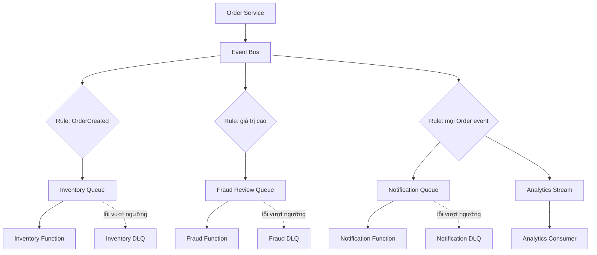

# Lọc sự kiện và định tuyến đến nhiều consumer

## 1. Vì sao cần lọc và định tuyến sự kiện?

Trong ứng dụng serverless, một sự kiện nghiệp vụ thường có nhiều bên quan tâm. Khi một đơn hàng được tạo, hệ thống kho cần giữ hàng, dịch vụ chống gian lận cần đánh giá rủi ro, dịch vụ thông báo có thể gửi email xác nhận và hệ thống phân tích cần ghi nhận dữ liệu. Nếu producer phải biết địa chỉ và giao thức của từng consumer, các dịch vụ sẽ phụ thuộc chặt vào nhau. Khi thêm hoặc thay đổi consumer, producer cũng phải thay đổi theo.

Event bus, topic hoặc một lớp định tuyến sự kiện giúp tách producer khỏi consumer. Producer phát một sự kiện mô tả điều đã xảy ra. Broker nhận sự kiện, đánh giá các rule và chuyển bản sao phù hợp đến một hoặc nhiều đích. Mỗi consumer xử lý phần việc của mình theo nhịp độ và chính sách lỗi riêng.

**Lọc sự kiện (event filtering)** xác định sự kiện nào phù hợp với một consumer hoặc subscription. **Định tuyến sự kiện (event routing)** chọn đích nhận sự kiện đó. Hai thao tác thường được cấu hình cùng nhau: rule vừa mô tả điều kiện khớp, vừa chỉ ra queue, function, topic hoặc stream consumer cần nhận dữ liệu.

Trong phạm vi CLOUD_SERVERLESS, Java function có thể được kích hoạt bởi thông điệp hoặc sự kiện. Thiết kế cần làm rõ hợp đồng event, điều kiện lọc, cách fan-out đến nhiều consumer, trạng thái xử lý, retry, idempotency, quyền truy cập, khả năng mở rộng và chi phí.

## 2. Phân biệt queue, topic/event bus và stream

Các cơ chế truyền thông điệp có thể cùng xuất hiện trong một kiến trúc nhưng không có cùng ngữ nghĩa.

| Cơ chế | Mục đích chính | Khi nhiều consumer cùng quan tâm |
| --- | --- | --- |
| Queue | Lưu công việc chờ xử lý và phân phối cho worker | Các worker cạnh tranh nhận thông điệp; mỗi thông điệp thường được một worker xử lý thành công theo cơ chế của queue |
| Topic / Pub-sub | Phát một thông điệp đến nhiều subscription | Mỗi subscription nhận một bản giao riêng; nhiều consumer có thể cùng nhận một sự kiện |
| Event bus | Định tuyến sự kiện theo type, source hoặc nội dung | Nhiều rule có thể khớp cùng một event và gửi đến nhiều target |
| Event stream | Lưu chuỗi sự kiện theo thứ tự trong partition và cho phép consumer đọc theo offset | Các consumer group độc lập có thể đọc cùng luồng; trong một group, partition được phân phối giữa các consumer |

Điểm dễ nhầm nhất là **nhiều worker dùng chung một queue** và **nhiều subscription nhận cùng một event**:

- Nếu ba worker cùng đọc một queue xử lý ảnh, mục tiêu thường là chia tải. Một thông điệp được một worker nhận tại một thời điểm theo cơ chế phân phối của queue.
- Nếu kho hàng, thanh toán và phân tích đều cần biết `OrderCreated`, cần ba subscription hoặc ba queue đích độc lập. Đây là fan-out; mỗi consumer có thể nhận cùng một event.

Không nên dùng một queue duy nhất rồi để mọi worker tự bỏ qua thông điệp không liên quan nếu broker có thể định tuyến trước. Cách đó làm các worker tiêu thụ công việc của nhau, tăng số lần nhận lại và khiến thông điệp có thể bị xác nhận trước khi consumer phù hợp xử lý.

## 3. Hợp đồng sự kiện là cơ sở của bộ lọc

### 3.1. Cấu trúc event

Rule lọc chỉ đáng tin cậy khi producer và consumer thống nhất ý nghĩa các field. Một event nên có envelope gồm định danh duy nhất, loại sự kiện, nguồn phát, thời điểm và payload nghiệp vụ. Có thể dùng một chuẩn như CloudEvents hoặc một schema nội bộ được quản lý phiên bản.

Ví dụ envelope đơn giản cho sự kiện tạo đơn:

```json
{
  "id": "evt-8f31",
  "type": "com.example.orders.created",
  "source": "/order-service",
  "subject": "orders/ord-42",
  "time": "2026-11-17T10:15:30Z",
  "schemaVersion": 1,
  "correlationId": "req-7f2a",
  "data": {
    "orderId": "ord-42",
    "customerId": "cus-81",
    "region": "south",
    "total": 1850000,
    "currency": "VND",
    "paymentMethod": "CARD",
    "priority": "NORMAL"
  }
}
```

Đây là envelope minh họa, không phải định dạng bắt buộc của mọi broker. Nếu sử dụng CloudEvents, cần tuân thủ đúng tên và ngữ nghĩa các thuộc tính chuẩn của phiên bản CloudEvents đang dùng; không tự ý đổi tên trường chuẩn.

Các trường nên được phân biệt rõ:

- **Metadata định tuyến:** `type`, `source`, `subject`, `region`, tenant hoặc loại nghiệp vụ. Chúng giúp broker xác định consumer phù hợp.
- **Metadata vận hành:** `id`, `time`, `correlationId`, schema version. Chúng phục vụ deduplication, tracing, replay và tương thích schema.
- **Payload nghiệp vụ (`data`):** dữ liệu mà consumer cần để thực hiện công việc.

Không đưa bí mật, token truy cập hoặc dữ liệu cá nhân không cần thiết vào event chỉ để tiện viết rule. Broker và các subscription có thể phân phối payload đến nhiều hệ thống; mỗi consumer phải được cấp quyền phù hợp với dữ liệu thực sự cần đọc.

### 3.2. Chọn field ổn định để định tuyến

Nên lọc theo loại sự kiện và thuộc tính nghiệp vụ ổn định, chẳng hạn `type`, `region`, `priority` hoặc `paymentMethod`. Tránh dựa vào chuỗi mô tả dành cho giao diện, tên hiển thị hoặc field thường xuyên thay đổi.

Ví dụ, `com.example.orders.created` mô tả một sự kiện đã xảy ra. Consumer tồn kho có thể quan tâm mọi event loại này. Consumer kiểm tra gian lận có thể chỉ quan tâm đơn có tổng tiền cao hoặc dùng phương thức thanh toán rủi ro. Consumer phân tích có thể nhận tất cả event liên quan đến đơn hàng.

Tên event nên mô tả sự kiện trong quá khứ (`OrderCreated`, `PaymentCaptured`) thay vì lệnh yêu cầu (`CreateOrder`, `CapturePayment`). Event thông báo điều đã xảy ra; command yêu cầu một bên thực hiện hành động. Phân biệt hai loại này giúp consumer không hiểu nhầm event như một lệnh bắt buộc phải thi hành.

### 3.3. Phiên bản và khả năng tương thích schema

Rule có thể phụ thuộc vào field payload. Nếu producer đổi tên field, đổi kiểu số thành chuỗi hoặc chuyển field sang vị trí khác, rule cũ có thể không còn khớp. Cần quản lý schema cùng với rule và consumer:

- Ưu tiên thay đổi tương thích như thêm field tùy chọn có giá trị mặc định rõ ràng.
- Không đổi ý nghĩa của field hiện có mà không tăng version hoặc công bố thay đổi tương thích.
- Xác định cách xử lý khi field dùng để lọc bị thiếu hoặc có kiểu dữ liệu sai.
- Kiểm thử producer mới với consumer cũ và ngược lại trước khi triển khai.
- Theo dõi event version đang được phát và được tiêu thụ để có kế hoạch loại bỏ phiên bản cũ.

Nếu rule phụ thuộc `data.total`, cần thống nhất đơn vị tiền tệ và kiểu số. Không so sánh tổng tiền giữa các currency khác nhau như thể cùng một đơn vị. Có thể định tuyến theo currency riêng, hoặc chuẩn hóa giá trị trước khi phát event nếu nghiệp vụ yêu cầu.

## 4. Các kiểu lọc sự kiện phổ biến

### 4.1. Lọc theo loại và nguồn phát (type/source-based)

Đây là cách lọc đơn giản và thường ổn định nhất. Rule kiểm tra event type hoặc source:

- `com.example.orders.created` đến consumer tồn kho.
- `com.example.payments.captured` đến consumer lập hóa đơn.
- Event từ `/identity-service` đến consumer kiểm toán danh tính.

Kiểu lọc này tạo ranh giới rõ giữa miền nghiệp vụ. Nếu một consumer chỉ cần một loại event, không cần đưa nhiều điều kiện payload vào rule.

### 4.2. Lọc theo thuộc tính (attribute/header-based)

Broker có thể kiểm tra metadata hoặc message attributes như tenant, region, priority, event category hoặc content type. Ví dụ, một subscription khu vực chỉ nhận event có `region = south`.

Thuộc tính dùng để lọc cần được producer gắn một cách đáng tin cậy. Nếu client bên ngoài có thể tự điền `tenantId` hoặc `region` mà không được xác minh, họ có thể khiến event được chuyển sang consumer ngoài phạm vi dự kiến.

### 4.3. Lọc theo nội dung (content-based)

Content-based filtering kiểm tra field trong payload, ví dụ:

- `data.total >= 10000000` để chuyển đơn giá trị lớn đến consumer kiểm tra bổ sung.
- `data.paymentMethod = "CARD"` để gọi quy trình xác minh thẻ.
- `data.priority = "EXPRESS"` để đưa công việc vào queue ưu tiên.
- `data.region IN ["north", "central"]` để chuyển đến một nhóm xử lý theo vùng.

Các biểu thức thực tế tùy broker. Một số hỗ trợ toán tử bằng/khác, số, prefix, tồn tại field, mảng hoặc kết hợp AND/OR; số toán tử và cách xử lý field lồng nhau không giống nhau giữa nhà cung cấp.

Ví dụ rule dạng giả mã:

```yaml
rules:
  inventory-consumer:
    when:
      type: com.example.orders.created
    target: inventory-queue

  high-value-review:
    when:
      all:
        - type: com.example.orders.created
        - data.total: greater-than-or-equal 10000000
    target: fraud-review-queue

  south-region-analytics:
    when:
      all:
        - type-prefix: com.example.orders.
        - data.region: south
    target: south-analytics-queue
```

Đây là pseudoconfiguration để minh họa ý tưởng. Cần chuyển sang cú pháp filter policy hoặc event pattern mà nền tảng thực tế hỗ trợ; không sao chép trực tiếp như cấu hình triển khai.

### 4.4. Kết hợp điều kiện và xử lý field thiếu

Một rule có thể kết hợp nhiều điều kiện. Chẳng hạn chỉ chuyển đơn giá trị cao ở miền Nam đến hàng đợi đánh giá:

\[
\text{type} = \text{OrderCreated}
\land \text{region} = \text{south}
\land \text{total} \geq 10{,}000{,}000
\]

Phải xác định rõ cách xử lý khi `region` hoặc `total` không có trong payload. Tùy broker, field thiếu có thể khiến điều kiện không khớp, được xử lý như null hoặc cần một toán tử tồn tại riêng. Không nên giả định field thiếu tương đương chuỗi rỗng, số 0 hoặc giá trị mặc định.

Nếu field là bắt buộc theo schema, producer và consumer cần kiểm tra điều đó ở hợp đồng. Nếu field là tùy chọn, rule phải có hành vi rõ ràng khi nó vắng mặt. Với các điều kiện phức tạp, có thể đưa logic vào một routing function chuyên biệt, nhưng cần cân nhắc độ trễ, chi phí và điểm lỗi bổ sung.

### 4.5. Lọc ở broker hay ở consumer?

| Vị trí lọc | Cách hoạt động | Ưu điểm và giới hạn |
| --- | --- | --- |
| Broker/event bus | Rule được đánh giá trước khi giao đến target | Giảm invocation và lưu lượng không cần thiết; phụ thuộc khả năng biểu đạt của broker và dễ bỏ sót nếu rule sai |
| Subscription/topic | Mỗi subscription chỉ nhận message khớp policy | Cô lập nhu cầu từng nhóm nhận; semantics phụ thuộc dịch vụ pub-sub |
| Consumer function | Function nhận event rồi tự quyết định có xử lý hay bỏ qua | Linh hoạt với logic phức tạp; vẫn tốn invocation, đọc message và có nguy cơ xác nhận nhầm message |
| Routing function riêng | Một function đọc event, đánh giá điều kiện rồi phát đến nhiều queue | Biểu đạt được logic tùy chỉnh; thêm một hop, chi phí, độ trễ và trách nhiệm vận hành |

Ưu tiên lọc tại broker cho điều kiện đơn giản, ổn định và có thể biểu diễn trực tiếp. Lọc trong consumer phù hợp với quyết định cần dữ liệu ngoài event hoặc quy tắc phức tạp. Nếu consumer nhận event rồi bỏ qua, vẫn phải xử lý acknowledgement đúng cách để tránh nhận lại liên tục.

Lọc ở broker không thay thế validation và authorization trong function. Function vẫn cần xác minh schema, nguồn phát đáng tin cậy và quyền trên tài nguyên trước khi tạo tác động nghiệp vụ.

## 5. Định tuyến một sự kiện đến nhiều consumer

### 5.1. Fan-out với nhiều rule hoặc subscription

Fan-out là cách phát một event đến nhiều nhánh xử lý độc lập. Ví dụ `OrderCreated` được gửi đến:

- `inventory-queue`: giữ hàng và kiểm tra tồn kho.
- `fraud-review-queue`: đánh giá rủi ro với các đơn đáp ứng điều kiện.
- `notification-queue`: gửi xác nhận cho khách hàng.
- `analytics-stream`: ghi nhận sự kiện phục vụ báo cáo.

Mỗi nhánh có consumer, tốc độ xử lý, retry và dead-letter destination riêng. Một consumer chậm hoặc lỗi không nên chặn các consumer khác nếu broker và cấu hình đích được thiết kế độc lập.



Trong sơ đồ, một event có thể khớp nhiều rule. Nếu hai rule cùng khớp và cùng trỏ đến một target, broker có thể tạo nhiều lần giao tùy semantics của dịch vụ. Cần kiểm tra hành vi trùng target và deduplication của nền tảng, không giả định broker tự loại bỏ mọi bản sao.

### 5.2. Consumer độc lập và cô lập lỗi

Không nên để mọi consumer đọc chung một queue khi mỗi consumer cần nhận bản sao của cùng event. Một queue thường phân phối công việc giữa các worker; worker nhận message có thể xác nhận message trước khi consumer khác nhìn thấy nó. Fan-out cần subscription hoặc queue riêng cho từng nhóm nhận.

Việc tách queue giúp mỗi consumer có thể:

- Điều chỉnh concurrency và batch size theo năng lực riêng.
- Chọn timeout, visibility timeout hoặc lease phù hợp.
- Retry lỗi tạm thời mà không ảnh hưởng nhánh khác.
- Chuyển message lỗi sang DLQ riêng và điều tra theo nghiệp vụ.
- Phát lại message sau khi khắc phục mà không phải chạy lại các nhánh đã thành công.

Tách queue cũng có chi phí lưu trữ và request. Chỉ tạo nhánh khi có nhu cầu nghiệp vụ rõ ràng; tránh fan-out đến nhiều consumer chỉ để mỗi consumer lại bỏ qua phần lớn event.

### 5.3. Phân biệt broadcast, competing consumers và partitioned stream

| Mô hình | Cách phân phối | Trường hợp phù hợp |
| --- | --- | --- |
| Broadcast/pub-sub | Mỗi subscription nhận bản sao | Nhiều hệ thống độc lập cùng phản ứng với một event |
| Competing consumers | Nhiều worker chia sẻ một queue và chia nhau message | Tăng throughput cho cùng một loại công việc |
| Consumer groups trên stream | Mỗi group có vị trí đọc riêng; trong group, partition được chia cho worker | Xử lý luồng dữ liệu liên tục, cần replay hoặc giữ thứ tự trong phạm vi partition |

Một consumer group mới trên stream thường có thể đọc lại dữ liệu theo chính sách offset/retention. Một queue truyền thống có thể xóa message sau khi được xác nhận. Vì thế cần chọn cơ chế theo nhu cầu replay, retention, thứ tự và mức độ độc lập của consumer.

### 5.4. Một event cho nhiều nhánh nhưng không phải mọi nhánh đều cần toàn bộ payload

Nếu event chứa nhiều dữ liệu, mỗi consumer có thể chỉ cần một phần. Có thể dùng schema chung tối thiểu, filter theo thuộc tính hoặc phát các event chuyên biệt cho từng miền. Một số broker hỗ trợ input transformation để định dạng payload cho target; một số khác chỉ lọc và chuyển tiếp message gốc.

Không nên tạo một event tổng quát với hàng trăm field tùy chọn cho mọi consumer. Hợp đồng quá rộng khiến producer và consumer khó phối hợp, tăng nguy cơ lộ dữ liệu và làm rule khó kiểm thử. Hãy giữ event tập trung vào một sự kiện nghiệp vụ và chỉ đưa dữ liệu cần thiết để consumer xử lý hoặc tham chiếu đến dữ liệu lưu trữ có kiểm soát.

## 6. Consumer Java: xử lý event đã được định tuyến

### 6.1. Ranh giới giữa broker và function

Broker chịu trách nhiệm nhận event, đánh giá rule và giao đến queue/subscription. Adapter của Java function chuyển message từ định dạng runtime thành kiểu ứng dụng. Handler kiểm tra event, xác minh các bất biến cần thiết, gọi domain service và trả kết quả theo giao thức acknowledgement của nền tảng.

Ví dụ sau minh họa consumer tồn kho. Đây là mã Java độc lập với cloud provider; `EventEnvelope`, `OrderCreated`, `InventoryService` và `IdempotencyStore` là kiểu ứng dụng. Adapter thực tế cần chuyển đổi từ event object của nhà cung cấp sang các kiểu này.

```java
public record EventEnvelope<T>(
        String id,
        String type,
        String source,
        int schemaVersion,
        T data) {}

public record OrderCreated(
        String orderId,
        String customerId,
        String region) {}

public interface InventoryService {
    void reserveForOrder(String orderId);
}

public interface IdempotencyStore {
    boolean alreadyProcessed(String consumer, String eventId);
    void markProcessed(String consumer, String eventId);
}

public final class InventoryEventHandler {
    private static final String CONSUMER = "inventory";

    private final InventoryService inventoryService;
    private final IdempotencyStore idempotencyStore;

    public InventoryEventHandler(
            InventoryService inventoryService,
            IdempotencyStore idempotencyStore) {
        this.inventoryService = inventoryService;
        this.idempotencyStore = idempotencyStore;
    }

    public void handle(EventEnvelope<OrderCreated> event) {
        if (!"com.example.orders.created".equals(event.type())) {
            throw new IllegalArgumentException("Unexpected event type");
        }
        if (event.id() == null || event.id().isBlank()) {
            throw new IllegalArgumentException("Missing event id");
        }
        if (event.schemaVersion() != 1) {
            throw new IllegalArgumentException("Unsupported schema version");
        }

        if (idempotencyStore.alreadyProcessed(CONSUMER, event.id())) {
            return;
        }

        inventoryService.reserveForOrder(event.data().orderId());
        idempotencyStore.markProcessed(CONSUMER, event.id());
    }
}
```

Ví dụ minh họa ý tưởng deduplication, chưa phải một triển khai idempotency an toàn khi có nhiều invocation đồng thời. Trong production, kiểm tra và ghi dấu xử lý cần thao tác nguyên tử, chẳng hạn dùng unique key `(consumer, eventId)` trong database hoặc một transaction phù hợp. Cũng phải xử lý trường hợp service đã giữ hàng thành công nhưng function lỗi trước khi ghi dấu event. Tốt nhất, tác động nghiệp vụ có idempotency key riêng hoặc được thực hiện trong cùng ranh giới transaction khi có thể.

### 6.2. Không dùng bộ lọc để thay thế kiểm tra đầu vào

Rule broker giúp giảm event không liên quan, nhưng consumer vẫn cần kiểm tra:

- Event ID có tồn tại và đúng định dạng không?
- Event type và schema version có được hỗ trợ không?
- Payload có đầy đủ field bắt buộc và giá trị hợp lệ không?
- Source có thuộc producer được phép không?
- Consumer có quyền thực hiện tác động trên tài nguyên được chỉ ra không?

Nếu event không hợp lệ, cần phân loại lỗi. Event không hỗ trợ do sai schema có thể chuyển DLQ để điều tra; lỗi tạm thời khi gọi database nên được retry. Không retry vô hạn một payload sai định dạng.

### 6.3. Acknowledgement và thời điểm xác nhận

Với queue, message chỉ nên được xác nhận sau khi tác động cần thiết đã hoàn tất hoặc đã được ghi nhận bền vững theo thiết kế. Nếu xác nhận trước khi ghi dữ liệu, lỗi sau đó có thể làm mất công việc. Nếu lỗi sau khi đã hoàn tất tác động nhưng trước acknowledgement, message có thể được giao lại; vì vậy idempotency là bắt buộc trong nhiều hệ thống.

Với stream, consumer thường lưu offset/checkpoint sau khi xử lý một bản ghi hoặc batch. Commit offset quá sớm có thể bỏ qua dữ liệu chưa xử lý; commit quá muộn có thể khiến bản ghi được xử lý lại. Cách commit theo batch, partition và retry phụ thuộc nền tảng.

## 7. Retry, DLQ và phát lại cho từng consumer

### 7.1. Chính sách retry

Lỗi tạm thời như timeout mạng, throttling hoặc dịch vụ phụ thuộc gián đoạn có thể được thử lại. Nên cấu hình số lần thử tối đa, backoff tăng dần, jitter và thời hạn xử lý. Cần phân biệt lỗi tạm thời với lỗi vĩnh viễn như schema không hợp lệ hoặc thiếu field bắt buộc.

Với fan-out, retry thường thuộc từng subscription hoặc target. Nếu consumer thông báo lỗi, message ở queue thông báo được thử lại theo chính sách của queue đó; consumer tồn kho vẫn có thể hoàn tất độc lập. Cần xác minh nền tảng cụ thể có retry độc lập theo target hay dùng một cơ chế chung.

### 7.2. Dead-letter queue

Khi message vượt quá ngưỡng retry hoặc hết thời hạn, có thể chuyển nó sang dead-letter queue (DLQ). DLQ nên được tách theo consumer hoặc loại công việc để dễ xác định chủ sở hữu và tránh một nhóm message lỗi che khuất nhóm khác.

Quy trình vận hành DLQ cần trả lời:

- Ai nhận cảnh báo khi DLQ có message?
- Làm sao xem event ID, type, source, lỗi cuối cùng và số lần giao mà không lộ dữ liệu nhạy cảm?
- Nguyên nhân là dữ liệu sai, bug consumer, quyền truy cập hay dịch vụ phụ thuộc?
- Sau khi sửa lỗi, phát lại toàn bộ hay chỉ một tập message đã chọn?
- Làm thế nào bảo đảm replay không lặp tác động nghiệp vụ?

Không nên tự động phát lại vô hạn từ DLQ về queue chính. Việc đó có thể tạo vòng lặp lỗi và tăng tải. Replay cần có kiểm soát, giới hạn tốc độ và audit trail.

### 7.3. Phát lại và retention

Stream thường hỗ trợ retention và đọc lại theo offset hoặc thời gian lưu giữ. Khả năng replay hữu ích khi consumer mới cần xây dựng lại trạng thái hoặc khi cần xử lý lại dữ liệu sau khi sửa bug. Tuy nhiên, replay có thể tạo lại tác động bên ngoài như gửi email hoặc thu tiền. Consumer phải phân biệt việc tái dựng dữ liệu với việc thực hiện lại tác động không thể đảo ngược.

Queue có thể không giữ message sau khi xác nhận, trừ khi có cơ chế archive hoặc lưu trữ riêng. Nếu cần replay dài hạn, hãy lưu event vào kho archive hoặc dùng event stream phù hợp với retention mong muốn.

## 8. Thứ tự, partition và tính nhất quán

Không nên giả định nhiều event được xử lý theo đúng thứ tự phát toàn cục. Queue có thể không bảo đảm thứ tự tuyệt đối; broker có thể giao song song; nhiều consumer có thời gian xử lý khác nhau. Một số dịch vụ hỗ trợ FIFO hoặc thứ tự trong một nhóm message/partition, nhưng phạm vi bảo đảm và giới hạn throughput khác nhau.

Nếu thứ tự quan trọng theo từng đơn hàng, có thể dùng `orderId` làm message group ID hoặc partition key. Các event cùng key được xử lý theo thứ tự trong phạm vi mà nền tảng bảo đảm. Những event thuộc các key khác nhau vẫn có thể xử lý song song.

Ví dụ `OrderCreated`, `OrderPaid`, `OrderShipped` cho cùng `orderId` cần được áp dụng theo đúng trạng thái. Consumer nên kiểm tra sequence/version hoặc trạng thái hiện tại để phát hiện event đến muộn. Nếu nhận `OrderShipped` trước `OrderPaid`, có thể trì hoãn, lưu event chờ hoặc phát cảnh báo theo quy tắc nghiệp vụ.

Khi fan-out, mỗi consumer có thể xử lý cùng một event ở thời điểm khác nhau. Không nên yêu cầu các consumer hoàn tất đồng thời nếu nghiệp vụ không cần transaction phân tán. Nếu một quy trình phải chờ nhiều nhánh, dùng workflow/orchestrator hoặc một cơ chế tổng hợp kết quả có timeout và trạng thái rõ ràng.

## 9. Bảo mật và quyền truy cập khi định tuyến

Định tuyến đến nhiều consumer làm tăng số nơi nhận dữ liệu. Mỗi subscription, queue, stream và function cần quyền tối thiểu:

- Producer chỉ được phát loại event vào bus/topic cần thiết.
- Event bus chỉ được gửi đến target đã khai báo.
- Consumer chỉ được đọc queue hoặc stream thuộc trách nhiệm của mình.
- Function chỉ được gọi dịch vụ và truy cập dữ liệu cần cho công việc.
- Quyền quản trị rule và quyền phát event nên tách khỏi quyền runtime của consumer.

Không xem rule filter là ranh giới bảo mật. Một rule có thể bị thay đổi hoặc cấu hình sai; function phải xác thực nguồn phát và kiểm tra quyền trên tài nguyên. Nếu payload chứa dữ liệu chỉ một số consumer được phép xem, hãy cân nhắc phát các event riêng hoặc tham chiếu dữ liệu có kiểm soát thay vì gửi một payload đầy đủ đến mọi target.

Ghi log định tuyến cần tránh chứa token, dữ liệu cá nhân hoặc toàn bộ payload nhạy cảm. Dùng event ID và correlation ID để tra cứu chi tiết ở kho được phân quyền. Cấu hình rule cũng cần được review như mã nguồn vì thay đổi một điều kiện có thể làm dữ liệu đi đến thêm hoặc thiếu consumer.

## 10. Khả năng mở rộng và chi phí fan-out

Fan-out tăng mức độ độc lập nhưng cũng nhân số lần giao message và invocation. Một event gửi đến bốn queue có thể tạo bốn lượt lưu trữ/giao nhận và nhiều function invocation hơn. Nếu một rule quá rộng, số consumer nhận event tăng ngoài dự kiến.

Để kiểm soát tải:

- Đặt concurrency riêng cho từng function theo khả năng của database và dịch vụ phụ thuộc.
- Điều chỉnh batch size, polling hoặc tốc độ consumer để tránh dồn tải.
- Theo dõi backlog và tuổi message lâu nhất ở từng queue.
- Dùng partition key hợp lý để vừa giữ thứ tự cần thiết vừa tránh một partition nóng.
- Chỉ chuyển payload cần thiết và cân nhắc lưu tệp lớn ở object storage rồi truyền reference.
- Ước lượng chi phí broker, queue, stream retention, function, log/trace, truyền dữ liệu và replay.

Lọc sớm ở broker có thể giảm số invocation và chi phí xử lý, nhưng filter phức tạp, quá nhiều rule hoặc routing function trung gian cũng tạo chi phí. Hãy đo số event phát, số event khớp mỗi rule, số lần giao, số lần retry và số invocation của từng consumer.

## 11. Quan sát và kiểm thử rule định tuyến

### 11.1. Chỉ số cần theo dõi

Nên theo dõi riêng từng rule và từng target:

- Số event nhận vào bus/topic/stream.
- Số event khớp mỗi rule và số lần gửi đến target.
- Số event không khớp rule nào hoặc bị loại do filter.
- Tỷ lệ giao thành công/thất bại, retry và throttling.
- Queue depth, tuổi message lâu nhất, consumer lag và tốc độ xử lý.
- Số message trong DLQ và thời gian tồn tại trong DLQ.
- Độ trễ từ lúc phát event đến khi từng consumer hoàn tất.

Nếu broker không cung cấp metric cho event không khớp, có thể phát metric ở producer hoặc dùng một route archive/audit có kiểm soát. Cần phân biệt event không khớp do chủ đích với event bị bỏ sót vì rule sai.

### 11.2. Ma trận kiểm thử filter

Với rule chuyển đơn giá trị cao đến hàng đợi kiểm tra, nên kiểm tra ít nhất:

| Dữ liệu đầu vào | Kết quả mong đợi |
| --- | --- |
| `type=OrderCreated`, `total=12000000` | Khớp rule giá trị cao |
| `type=OrderCreated`, `total=500000` | Không khớp rule giá trị cao; vẫn có thể khớp rule tồn kho |
| `type=OrderCancelled`, `total=12000000` | Không khớp rule chỉ dành cho OrderCreated |
| Thiếu `total` | Theo chính sách field thiếu đã định nghĩa; không suy đoán là 0 |
| `total` là chuỗi thay vì số | Bị từ chối bởi schema hoặc không khớp theo semantics đã kiểm thử |
| `region` viết sai giá trị | Không khớp rule vùng; phát cảnh báo nếu giá trị đó không hợp lệ |
| Một event khớp hai rule | Được giao đến cả hai target theo thiết kế |

Ngoài unit test cho biểu thức lọc, cần integration test với broker hoặc môi trường tương đương để xác nhận cú pháp filter thực tế, cách xử lý field lồng nhau, kiểu dữ liệu, nhiều rule cùng khớp và hành vi khi target lỗi.

### 11.3. Kiểm thử consumer và replay

Kiểm thử consumer với message hợp lệ, message trùng event ID, event type không hỗ trợ, schema version cũ/mới, lỗi tạm thời và lỗi vĩnh viễn. Kiểm tra acknowledgement chỉ xảy ra sau khi công việc được ghi nhận đúng cách. Với replay, xác nhận event cũ không tạo lại tác động không mong muốn và vẫn có thể tái dựng trạng thái khi mục đích là rebuild.

## 12. Quy trình thiết kế lọc và định tuyến

Khi thêm một consumer mới, có thể thực hiện theo trình tự:

1. **Xác định nhu cầu nghiệp vụ:** consumer cần loại event nào và cần dữ liệu gì để xử lý?
2. **Chốt hợp đồng event:** định nghĩa event type, source, schema, event ID, correlation ID và version.
3. **Chọn cơ chế phân phối:** queue cho competing workers, pub-sub/event bus cho fan-out hoặc stream khi cần retention/replay.
4. **Viết rule tối thiểu:** bắt đầu bằng event type/source; chỉ thêm điều kiện payload khi thực sự cần.
5. **Xác định semantics field thiếu:** field bắt buộc hay tùy chọn, kiểu dữ liệu, đơn vị và giá trị hợp lệ.
6. **Tạo target riêng:** queue/subscription/consumer group với retry, DLQ, retention và concurrency phù hợp.
7. **Thiết kế consumer idempotent:** deduplicate theo consumer và event ID; xác định acknowledgement/checkpoint.
8. **Cấp quyền tối thiểu:** giới hạn producer, broker, target và function theo đúng trách nhiệm.
9. **Kiểm thử overlap và no-match:** xác nhận event có thể khớp nhiều rule, không khớp rule nào và không bị chuyển nhầm.
10. **Thiết lập quan sát và replay:** metric theo rule/target, cảnh báo backlog/DLQ và quy trình phát lại có kiểm soát.

## 13. Lỗi thiết kế thường gặp

| Lỗi | Hậu quả | Cách khắc phục |
| --- | --- | --- |
| Nhiều consumer nghiệp vụ dùng chung một queue | Consumer này lấy mất message của consumer khác | Dùng subscription hoặc queue riêng cho từng nhóm cần nhận bản sao |
| Rule dựa trên field không ổn định | Event bị định tuyến sai sau khi producer đổi schema | Dùng event type và thuộc tính nghiệp vụ ổn định; version schema |
| Không xác định hành vi khi field thiếu | Rule bỏ sót event hoặc xử lý ngoài dự kiến | Định nghĩa field required/optional và kiểm thử null/missing |
| Cho rằng một event chỉ khớp một rule | Một event được giao nhiều lần đến target hoặc tạo tác động lặp | Thiết kế overlap có chủ đích và idempotency theo consumer |
| Dùng filter như cơ chế phân quyền | Dữ liệu hoặc hành động bị truy cập trái phép khi rule sai | Kiểm tra source, identity và quyền ở consumer/function |
| Retry vô hạn message lỗi schema | Tốn chi phí và làm nghẽn queue | Phân loại lỗi, giới hạn retry và chuyển DLQ |
| Xác nhận message trước khi lưu kết quả | Mất công việc khi function lỗi | Chỉ acknowledgement sau khi hoàn tất hoặc ghi nhận bền vững |
| Replay event mà không xét tác động phụ | Gửi email, thu tiền hoặc giữ hàng lặp lại | Dùng idempotency, chế độ rebuild và replay có kiểm soát |
| Không theo dõi event không khớp | Không phân biệt lọc đúng với rule cấu hình sai | Theo dõi unmatched event, rule match và schema validation |

## 14. Kết luận

Lọc sự kiện và định tuyến nhiều consumer giúp ứng dụng serverless tách producer khỏi các dịch vụ xử lý phía sau. Event bus hoặc pub-sub có thể fan-out một event đến nhiều subscription; queue chia công việc giữa các worker; stream hỗ trợ consumer group, retention và replay. Chọn đúng ngữ nghĩa phân phối là bước đầu tiên để tránh consumer lấy mất message của nhau hoặc xử lý trùng ngoài ý muốn.

Một thiết kế đáng tin cậy cần hợp đồng event ổn định, rule dễ hiểu, target độc lập, consumer idempotent, retry và DLQ theo từng nhánh, quyền tối thiểu và metric cho cả event khớp lẫn không khớp. Khi các yếu tố đó được kiểm soát, có thể thêm consumer mới mà không phải sửa producer và vẫn giữ khả năng mở rộng, quan sát và quản lý chi phí.
