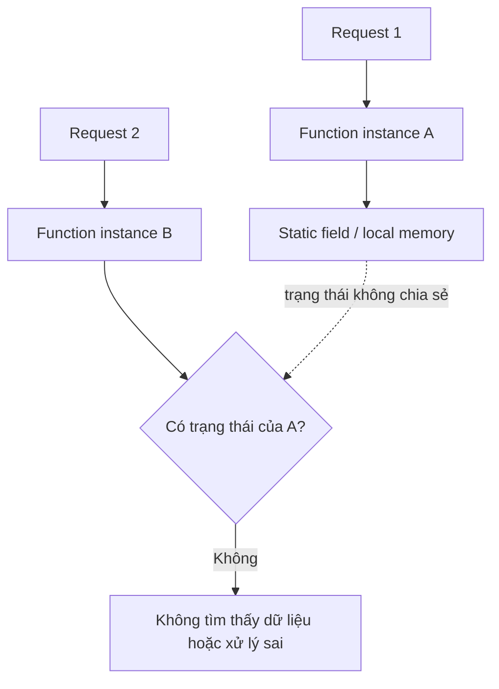
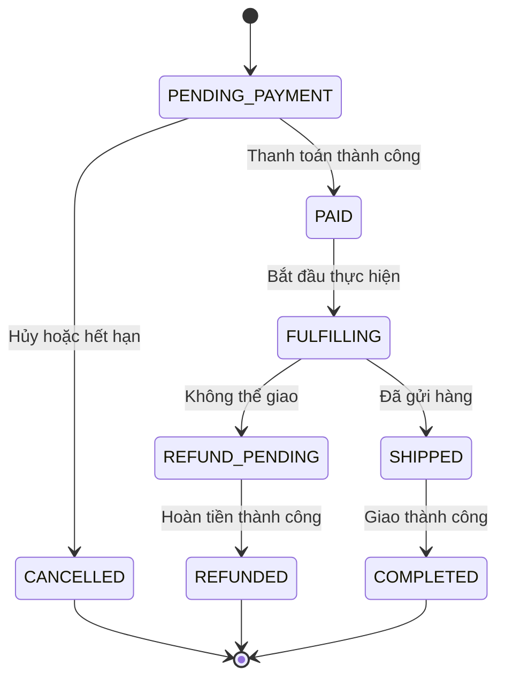
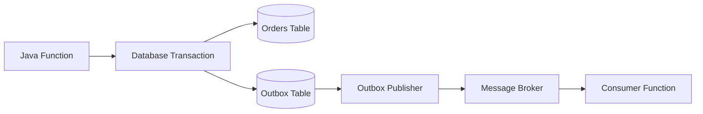
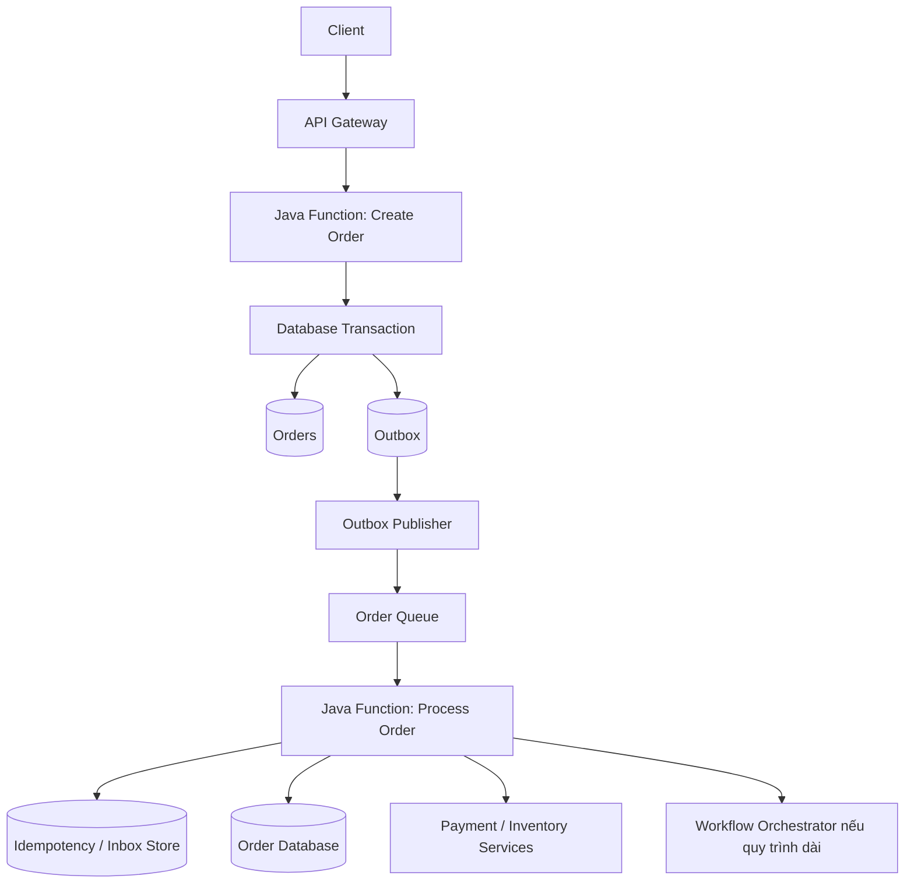

# Thiết kế stateless function và lưu trạng thái bên ngoài

Function serverless thường được tạo ra để xử lý một invocation rồi trả kết quả. Nền tảng có thể tái sử dụng môi trường thực thi cho invocation tiếp theo, tạo môi trường mới khi tải tăng hoặc thu hồi môi trường khi không còn cần thiết. Vì vậy, ứng dụng không thể giả định một function instance sẽ tồn tại liên tục, luôn nhận cùng một người dùng hoặc giữ nguyên bộ nhớ giữa các lần gọi.

Thiết kế **stateless function** nghĩa là kết quả xử lý không phụ thuộc vào trạng thái chỉ tồn tại trong bộ nhớ của một instance. Nếu nghiệp vụ cần nhớ giỏ hàng, tiến độ xử lý, trạng thái đơn hàng hoặc kết quả đã tạo, function phải đọc và ghi trạng thái đó vào một hệ thống lưu trữ bên ngoài có độ bền và mô hình nhất quán phù hợp.

Stateless không có nghĩa là ứng dụng không có trạng thái. Nó có nghĩa là trạng thái nghiệp vụ được quản lý ở nơi có thể truy cập độc lập với vòng đời của function. Cách tổ chức này cho phép invocation chạy trên instance khác, được retry, xử lý song song và phục hồi sau khi môi trường thực thi bị thu hồi.

## 1. Vì sao function nên stateless?

### 1.1. Vòng đời instance không phải vòng đời nghiệp vụ

Một nền tảng FaaS có thể giữ môi trường thực thi ấm để giảm cold start, nhưng việc tái sử dụng chỉ là tối ưu của nền tảng. Ứng dụng không có cam kết rằng invocation tiếp theo sẽ chạy trong cùng một process, cùng một máy hoặc cùng một vùng nhớ.

Ví dụ, người dùng gửi request đầu tiên để tạo giỏ hàng. Invocation có thể chạy trên instance A và lưu giỏ hàng vào biến static. Request thứ hai được định tuyến đến instance B; instance B không có dữ liệu đó. Nếu instance A bị thu hồi trước request tiếp theo, dữ liệu cũng biến mất.



Vấn đề không chỉ là dữ liệu bị mất khi instance bị thu hồi. Khi nền tảng mở rộng ngang, nhiều instance có bộ nhớ riêng. Khi retry, invocation có thể chạy ở instance khác. Khi triển khai phiên bản mới, toàn bộ môi trường cũ có thể bị thay thế. Trạng thái trong process không thể làm nguồn dữ liệu chính cho nghiệp vụ cần tồn tại qua các lần gọi.

### 1.2. Những loại trạng thái cần phân biệt

| Loại trạng thái | Ví dụ | Nơi lưu phù hợp |
| --- | --- | --- |
| Trạng thái nghiệp vụ lâu dài | Đơn hàng, thanh toán, hồ sơ, tồn kho | Relational database hoặc NoSQL database phù hợp với truy vấn và transaction |
| Dữ liệu lớn hoặc tệp | Ảnh gốc, báo cáo, tệp export, tài liệu | Object storage; database chỉ lưu metadata và tham chiếu |
| Trạng thái ngắn hạn | Session, mã xác nhận tạm thời, cache kết quả | Cache hoặc kho key-value có TTL, tùy yêu cầu độ bền |
| Tiến độ workflow | Bước hiện tại, kết quả từng bước, thời điểm retry | Workflow orchestrator hoặc state store bền vững |
| Dấu vết xử lý sự kiện | Event ID đã xử lý, idempotency key, trạng thái nhận message | Bảng inbox/deduplication hoặc kho dữ liệu có thao tác nguyên tử |
| Dữ liệu cấu hình và bí mật | Endpoint, secret, credential | Configuration service và secret manager; không lưu trong biến static như nguồn quản trị |

Không phải mọi dữ liệu đều cần database. Chọn nơi lưu dựa trên cách đọc/ghi, kích thước, yêu cầu transaction, thời hạn tồn tại, độ trễ, độ bền, khả năng phục hồi và chi phí.

### 1.3. Stateless vẫn có thể dùng bộ nhớ cục bộ

Biến local trong một lần gọi, object tạm, buffer và dữ liệu tính toán trung gian là bình thường. Một instance cũng có thể giữ cache trong bộ nhớ để giảm việc tạo client hoặc tải cấu hình lặp lại, miễn là cache đó chỉ là tối ưu có thể mất và có cách làm mới an toàn.

Điểm cần tránh là dựa vào cache hoặc biến static như nguồn sự thật duy nhất cho trạng thái nghiệp vụ. Ví dụ, lưu danh sách quyền người dùng trong static map mà không có TTL hoặc cơ chế invalidation có thể khiến quyền đã thu hồi vẫn được chấp nhận. Nếu dùng cache cục bộ, cần xác định rõ dữ liệu nào được cache, thời hạn, cách xử lý cache miss và mức độ chấp nhận dữ liệu cũ.

## 2. Các nguyên tắc thiết kế stateless function

### 2.1. Đầu vào phải mang đủ ngữ cảnh để xử lý

Function nên nhận một request hoặc event có định danh và dữ liệu cần thiết để thực hiện công việc. Với dữ liệu lớn, truyền tham chiếu đến object thay vì nhúng toàn bộ nội dung vào payload.

Ví dụ event xử lý ảnh có thể chứa:

```json
{
  "eventId": "evt-8a71",
  "bucket": "incoming-images",
  "objectKey": "tenant-42/uploads/photo-123.jpg",
  "objectVersion": "v17",
  "tenantId": "tenant-42",
  "requestedVariant": "thumbnail"
}
```

`eventId` giúp nhận diện lần phát sự kiện; `objectKey` và `objectVersion` chỉ đến dữ liệu cần xử lý. Function không cần nhớ request trước đó để biết mình đang làm việc gì.

Không tin mọi trường do client gửi. Danh tính và quyền truy cập phải đến từ cơ chế xác thực đáng tin cậy; function phải xác minh người gọi có quyền đọc object hoặc tenant được nêu trong event. Với event nội bộ, cần kiểm soát principal có quyền phát event và xác thực nguồn event theo khả năng của nền tảng.

### 2.2. Đọc trạng thái trước khi quyết định

Khi nghiệp vụ phụ thuộc vào trạng thái hiện tại, function cần đọc trạng thái từ kho dữ liệu có thẩm quyền. Ví dụ, trước khi xác nhận thanh toán, cần kiểm tra đơn hàng đang ở trạng thái `PENDING_PAYMENT`, số tiền và currency phù hợp.

Không nên dựa vào một bản sao trạng thái cũ được giữ trong instance. Nếu cần cache để giảm độ trễ, phải có chính sách về độ mới dữ liệu và cách xử lý khi cache không đồng bộ.

### 2.3. Ghi trạng thái theo thao tác nguyên tử

Nhiều invocation có thể cùng đọc một giá trị rồi cùng cập nhật. Nếu thao tác không có điều kiện hoặc transaction phù hợp, dữ liệu có thể bị ghi đè hoặc mất cập nhật.

Ví dụ, hai function cùng đọc số lượng tồn kho là 1 và mỗi function đều tạo đơn hàng. Nếu cả hai ghi số lượng còn 0 mà không có điều kiện nguyên tử, hệ thống có thể bán vượt tồn kho. Hãy dùng transaction, conditional update, optimistic locking hoặc cơ chế tương ứng với database.

### 2.4. Có thể chạy lại mà không tạo tác động lặp

Nền tảng hoặc nguồn sự kiện có thể giao cùng một event nhiều lần. Function cũng có thể hoàn tất một tác động phụ nhưng thất bại trước khi trả kết quả. Khi retry, thao tác phải an toàn với cùng một event hoặc khóa nghiệp vụ.

Đây là lý do stateless thường đi cùng idempotency. Function không dựa vào bộ nhớ để nhớ rằng đã xử lý event; nó ghi dấu xử lý trong kho bền vững bằng thao tác nguyên tử.

### 2.5. Không giữ giao dịch mở qua nhiều invocation

Một transaction database thường chỉ tồn tại trong thời gian kết nối và phạm vi transaction được mở. Không thể giữ một transaction SQL đang mở trong khi chờ người dùng phản hồi hoặc chờ event đến vào ngày hôm sau. Hãy chia quy trình thành các bước có trạng thái bền vững, mỗi bước mở transaction ngắn, commit rồi kết thúc invocation.

Với quy trình dài, dùng workflow orchestration hoặc state machine để lưu tiến độ và điều phối các bước. Nếu một bước đã tạo tác động nhưng bước tiếp theo thất bại, có thể cần hành động bù trừ (compensation) theo mô hình Saga.

## 3. Chọn kho lưu trữ bên ngoài

### 3.1. Relational database

Relational database phù hợp khi dữ liệu có quan hệ rõ, cần transaction nhiều bản ghi, constraint, join hoặc truy vấn linh hoạt. Các ví dụ gồm đơn hàng, thanh toán, tồn kho và hồ sơ khách hàng.

Ưu điểm:

- Transaction ACID giúp bảo vệ invariant nghiệp vụ.
- Unique constraint hỗ trợ chống trùng và bảo đảm tính duy nhất.
- Conditional update và optimistic locking giúp xử lý cập nhật đồng thời.
- SQL hỗ trợ truy vấn và báo cáo linh hoạt.

Điểm cần lưu ý trong serverless:

- Nhiều instance có thể tạo nhiều kết nối đồng thời, làm cạn connection limit.
- Connection pool riêng trong mỗi instance có thể nhân lên theo concurrency.
- Kết nối cần timeout hữu hạn và được đóng hoặc tái sử dụng đúng cách.
- Có thể cần database proxy, connection broker hoặc data API nếu nhà cung cấp hỗ trợ.
- Truy vấn dài và transaction kéo dài làm tăng chi phí, lock contention và độ trễ invocation.

### 3.2. NoSQL database hoặc key-value store

NoSQL phù hợp khi access pattern chủ yếu là đọc/ghi theo key, cần mở rộng ngang và có thể thiết kế partition key rõ ràng. Ví dụ: trạng thái session, trạng thái job, metadata sự kiện hoặc hồ sơ được truy cập theo `tenantId` và `entityId`.

Trước khi chọn, hãy xác định:

- Partition key có phân bố đều hay tạo hot partition?
- Truy vấn cần hỗ trợ là gì? Có phải tạo secondary index không?
- Consistency model là eventual hay strong/transactional ở phạm vi nào?
- Conditional write và atomic counter có đáp ứng invariant không?
- TTL được thực thi chính xác đến mức nào và dữ liệu hết hạn có thể còn tồn tại thêm bao lâu?

NoSQL không tự động đơn giản hơn relational database. Nếu truy vấn cần join phức tạp hoặc transaction xuyên nhiều aggregate, thiết kế có thể trở nên khó hơn.

### 3.3. Object storage

Object storage phù hợp với dữ liệu lớn, tệp bất biến hoặc artifact như ảnh, video, báo cáo, bản export và tài liệu. Function nhận object key/version, đọc nội dung khi cần và ghi object kết quả.

Thông thường database giữ metadata như owner, trạng thái xử lý, kích thước, checksum và đường dẫn object. Không nên lưu toàn bộ tệp lớn trong một bản ghi database nếu object storage phù hợp hơn.

Hãy chú ý quyền truy cập theo tenant, encryption, versioning, lifecycle policy, kích thước object và event loop. Nếu function ghi kết quả vào cùng bucket/prefix đang kích hoạt trigger, có thể vô tình tạo vòng lặp sự kiện. Dùng prefix riêng hoặc điều kiện lọc event.

### 3.4. Cache và kho dữ liệu ngắn hạn

Cache như Redis hoặc managed key-value cache phù hợp cho dữ liệu có thể tạo lại, session ngắn hạn, rate limit counter hoặc kết quả truy vấn được cache. Cache thường không nên là nguồn duy nhất cho dữ liệu nghiệp vụ quan trọng trừ khi dịch vụ được thiết kế và vận hành như một kho dữ liệu bền vững theo yêu cầu cụ thể.

Thiết kế cache cần trả lời:

- TTL bao lâu và ai quyết định thời hạn?
- Cache miss thì đọc từ đâu?
- Khi dữ liệu gốc thay đổi, cache được invalidation như thế nào?
- Nếu cache tạm thời không sẵn sàng, nghiệp vụ có thể fallback không?
- Có nguy cơ cache stampede khi nhiều function cùng làm mới một key không?
- Có cần phân biệt giá trị không tồn tại với cache miss không?

Không dùng cache để lưu trạng thái cần chính xác tuyệt đối nếu không có cơ chế đồng bộ và phục hồi phù hợp.

### 3.5. Workflow state store

Với quy trình kéo dài qua nhiều invocation, workflow orchestrator có thể lưu trạng thái bước, dữ liệu đầu ra, retry, timeout và nhánh điều kiện. Ví dụ, quy trình xử lý đơn hàng có các bước kiểm tra tồn kho, thu tiền, tạo vận đơn và gửi thông báo. Mỗi bước có thể chạy bằng function riêng.

Workflow state store giúp theo dõi tiến độ và tiếp tục sau lỗi. Tuy nhiên, cần chú ý giới hạn kích thước state payload, thời hạn workflow, chi phí transition, cách lưu dữ liệu lớn và khả năng xử lý side effect trùng. State của workflow không nhất thiết thay thế database nghiệp vụ; nó quản lý tiến trình điều phối, còn database vẫn giữ nguồn sự thật của đơn hàng.

### 3.6. So sánh lựa chọn

| Nhu cầu | Lựa chọn thường phù hợp | Điểm cần đánh giá |
| --- | --- | --- |
| Transaction và ràng buộc nghiệp vụ | Relational database | Kết nối, lock, transaction duration và query plan |
| Đọc/ghi theo key với quy mô lớn | NoSQL/key-value | Partition, index, consistency và conditional write |
| Tệp lớn và artifact | Object storage | Versioning, quyền, lifecycle và event notification |
| Cache hoặc session ngắn hạn | Cache/key-value có TTL | Eviction, invalidation, availability và nguồn dữ liệu gốc |
| Quy trình nhiều bước, kéo dài | Workflow orchestrator | Retry, compensation, state size và chi phí transition |
| Chống xử lý event trùng | Inbox/idempotency store | Unique key, transaction và thời hạn giữ dấu vết |

Một hệ thống thường kết hợp nhiều loại kho. Chẳng hạn, relational database lưu đơn hàng, object storage lưu hóa đơn PDF, cache giữ kết quả tra cứu ngắn hạn và workflow orchestrator theo dõi các bước xử lý.

## 4. Mô hình hóa trạng thái nghiệp vụ

### 4.1. Dùng state machine thay cho cờ rời rạc

Trạng thái nghiệp vụ nên được định nghĩa bằng các trạng thái và chuyển tiếp hợp lệ. Ví dụ đơn hàng:



Mỗi chuyển tiếp nên có điều kiện và tác nhân rõ ràng. Không cho phép một event `PaymentSucceeded` chuyển đơn hàng `CANCELLED` thành `PAID` nếu nghiệp vụ không cho phép. Một update có điều kiện có thể bảo đảm trạng thái cũ đúng trước khi đổi sang trạng thái mới.

### 4.2. Phân biệt trạng thái nghiệp vụ và trạng thái xử lý

Một bản ghi có thể có trạng thái nghiệp vụ như `PAID`, đồng thời có trạng thái xử lý kỹ thuật như `notificationStatus=PENDING`. Không nên gộp hai khái niệm này vào một trường `status` chung nếu chúng có vòng đời khác nhau.

Ví dụ, thanh toán đã hoàn tất nhưng gửi email xác nhận đang retry. Trạng thái đơn hàng vẫn là `PAID`; notification có thể là `PENDING`, `SENT` hoặc `FAILED`. Điều này giúp lỗi gửi email không làm sai trạng thái thanh toán.

### 4.3. Lưu timestamp, version và correlation ID

Các trường thường hữu ích:

- `createdAt`, `updatedAt`: thời điểm tạo và cập nhật, dùng định dạng thời gian nhất quán như UTC.
- `version`: số phiên bản tăng khi cập nhật, hỗ trợ optimistic locking.
- `correlationId`: liên kết các bước trong một quy trình.
- `lastEventId`: định danh event gần nhất nếu phù hợp với mô hình.
- `expiresAt`: thời điểm hết hạn cho dữ liệu có vòng đời giới hạn.

Không dùng timestamp của client làm nguồn sự thật duy nhất cho thứ tự sự kiện. Đồng hồ client có thể sai lệch; thứ tự cần thiết nên được bảo đảm bằng version, sequence hoặc cơ chế ordering của nguồn sự kiện.

## 5. Cập nhật đồng thời và tính nhất quán

### 5.1. Race condition khi đọc rồi ghi

Giả sử số dư ví là 100. Hai invocation cùng đọc 100. Invocation A trừ 80 và ghi 20; invocation B trừ 50 và ghi 50. Nếu cả hai đều ghi mà không kiểm tra giá trị cũ, kết quả cuối có thể là 20 hoặc 50, trong khi hai giao dịch đã cùng được chấp nhận.

Đây là lost update. Cần thực hiện kiểm tra và cập nhật trong một transaction hoặc một thao tác có điều kiện nguyên tử.

### 5.2. Optimistic locking

Optimistic locking phù hợp khi xung đột không quá thường xuyên. Bản ghi có trường `version`; function đọc version hiện tại rồi cập nhật với điều kiện version chưa thay đổi.

Ví dụ SQL:

```sql
UPDATE orders
SET status = 'PAID',
    version = version + 1,
    updated_at = CURRENT_TIMESTAMP
WHERE order_id = :order_id
  AND status = 'PENDING_PAYMENT'
  AND version = :expected_version;
```

Nếu số hàng được cập nhật bằng 1, chuyển trạng thái thành công. Nếu bằng 0, trạng thái hoặc version đã thay đổi; function cần đọc lại và quyết định đó là event trùng, xung đột hay chuyển tiếp không hợp lệ.

### 5.3. Pessimistic locking và distributed lock

Pessimistic lock có thể hữu ích khi xung đột cao và database hỗ trợ khóa phù hợp. Tuy nhiên, giữ lock lâu trong invocation làm tăng contention và có thể gây deadlock. Transaction nên ngắn, có timeout và chỉ khóa những bản ghi cần thiết.

Distributed lock trong Redis hoặc kho key-value cần được thiết kế cẩn thận. Lease có thể hết hạn trong khi function cũ vẫn đang chạy; một function mới có thể lấy lock rồi cả hai cùng ghi dữ liệu. Nếu dùng lease, cân nhắc fencing token hoặc version tăng đơn điệu để hệ thống đích từ chối thao tác từ chủ thể có token cũ. Không coi việc có một key `lock=true` là bảo đảm đầy đủ cho tính loại trừ.

### 5.4. Chọn consistency phù hợp

Một số hệ thống cần đọc thấy ngay dữ liệu vừa ghi; một số khác chấp nhận eventual consistency. Ví dụ:

- Số dư ví, tồn kho và trạng thái thanh toán thường cần kiểm soát nhất quán chặt hơn.
- Bộ đếm lượt xem, số liệu phân tích và chỉ mục tìm kiếm có thể chấp nhận độ trễ đồng bộ.
- Metadata object có thể được cập nhật sau khi tệp đã ghi thành công, miễn là quy trình có trạng thái trung gian và phục hồi.

Hãy xác định invariant nghiệp vụ trước khi chọn database consistency. Không chọn eventual consistency cho một thao tác tài chính chỉ vì nó có thông lượng cao.

## 6. Transaction, event và quy trình nhiều bước

### 6.1. Transaction chỉ bảo vệ phạm vi của nó

Transaction database có thể bảo đảm một nhóm thao tác trong database cùng commit hoặc rollback. Nó không tự động bao gồm việc gửi email, gọi cổng thanh toán hoặc ghi object storage. Nếu function commit đơn hàng rồi gửi event thất bại, database và message broker có thể lệch trạng thái.

### 6.2. Transactional outbox

Transactional outbox giúp ghi thay đổi nghiệp vụ và event cần phát trong cùng transaction database:

1. Function mở transaction.
2. Cập nhật đơn hàng.
3. Ghi event vào bảng outbox trong cùng transaction.
4. Commit transaction.
5. Một publisher/worker đọc outbox và gửi event đến broker.
6. Đánh dấu event đã phát; publisher có thể gửi lặp nên consumer vẫn cần idempotency.



Outbox tránh trường hợp cập nhật database thành công nhưng event bị mất trước khi phát. Nó không loại bỏ duplicate delivery; publisher có thể gửi lại sau khi broker nhận message nhưng trước khi outbox được đánh dấu đã gửi. Consumer cần idempotency theo event ID.

### 6.3. Saga và compensation

Quy trình nhiều dịch vụ thường không thể nằm trong một transaction phân tán duy nhất. Saga chia quy trình thành các bước cục bộ, mỗi bước commit riêng. Nếu bước sau thất bại, hệ thống chạy hành động bù trừ cho các bước trước khi có thể hoàn tác về mặt nghiệp vụ.

Ví dụ tạo đơn hàng:

1. Giữ hàng trong kho.
2. Thu tiền.
3. Tạo vận đơn.
4. Gửi thông báo.

Nếu thu tiền thất bại sau khi đã giữ hàng, hành động bù trừ có thể giải phóng hàng. Nếu tạo vận đơn thất bại sau khi thu tiền, quy trình có thể retry hoặc hoàn tiền tùy chính sách. Compensation không phải rollback kỹ thuật hoàn hảo; nó là một thao tác nghiệp vụ mới có thể thất bại và cần theo dõi.

### 6.4. Workflow orchestration

Workflow orchestrator phù hợp khi quy trình có nhiều bước, chờ callback, timeout, nhánh điều kiện hoặc cần retry theo từng bước. Function nên làm một đơn vị công việc có giới hạn; workflow giữ tiến độ và gọi bước tiếp theo.

Không đưa dữ liệu lớn hoặc secret vào state payload của workflow nếu không cần. Lưu dữ liệu trong database/object storage và truyền định danh tham chiếu giữa các bước. Giữ state machine có phiên bản hoặc kế hoạch tương thích khi quy trình đang chạy mà workflow definition được cập nhật.

## 7. Idempotency và lưu dấu xử lý

### 7.1. Idempotency key

Idempotency key là định danh ổn định cho một thao tác nghiệp vụ. Client có thể gửi `Idempotency-Key` khi tạo thanh toán hoặc đơn hàng. Với event, có thể dùng `eventId` do nguồn phát cấp. Cùng một key phải đại diện cho cùng một yêu cầu và payload tương ứng.

Hệ thống nên lưu:

- idempotency key;
- chủ thể hoặc tenant sở hữu key;
- hash của payload hoặc thông tin kiểm tra request;
- trạng thái `IN_PROGRESS`, `COMPLETED` hoặc `FAILED` theo mô hình;
- kết quả cần trả lại nếu thao tác đã hoàn tất;
- thời điểm tạo và thời điểm hết hạn.

Nếu cùng key được gửi với payload khác, cần từ chối hoặc xử lý theo hợp đồng rõ ràng; không trả kết quả cũ cho một yêu cầu khác nội dung.

### 7.2. Ghi dấu nguyên tử

Ví dụ SQL đơn giản:

```sql
CREATE TABLE idempotency_records (
    tenant_id       VARCHAR(100) NOT NULL,
    idempotency_key VARCHAR(200) NOT NULL,
    request_hash    VARCHAR(128) NOT NULL,
    status          VARCHAR(30) NOT NULL,
    response_body   TEXT,
    created_at      TIMESTAMP NOT NULL,
    expires_at      TIMESTAMP NOT NULL,
    PRIMARY KEY (tenant_id, idempotency_key)
);
```

Unique key ngăn hai invocation cùng tạo hai bản ghi cho một thao tác. Tuy nhiên, chỉ insert một record chưa đủ để bảo đảm toàn bộ side effect được thực hiện đúng một lần. Cần đặt việc claim key, cập nhật nghiệp vụ và ghi outbox trong transaction phù hợp; gọi dịch vụ bên ngoài cần truyền idempotency key của chính dịch vụ đó nếu hỗ trợ.

### 7.3. Xử lý trạng thái IN_PROGRESS

Nếu invocation A claim key rồi bị dừng giữa chừng, invocation B có thể thấy `IN_PROGRESS`. Cần định nghĩa lease hoặc timeout để có thể phục hồi claim bị bỏ dở. Việc chiếm lại phải bảo đảm invocation cũ không thể tiếp tục ghi sau khi quyền sở hữu đã chuyển sang invocation mới; có thể dùng lease token/version và kiểm tra fencing ở bước commit.

Không xóa ngay record khi xử lý lỗi. Có thể cần giữ thông tin để retry, audit hoặc trả kết quả phù hợp. TTL phải dài hơn cửa sổ retry và thời gian client có thể gửi lại yêu cầu theo hợp đồng.

### 7.4. Ví dụ Java: handler stateless dùng repository

Ví dụ dưới đây dùng interface giả định để minh họa. Repository chịu trách nhiệm thực hiện thao tác nguyên tử trong database; handler không giữ giỏ hàng hoặc trạng thái đơn hàng trong field mutable.

```java
public final class CreateOrderHandler {
    private final OrderRepository orders;
    private final IdempotencyRepository idempotency;

    public CreateOrderHandler(
            OrderRepository orders,
            IdempotencyRepository idempotency) {
        this.orders = orders;
        this.idempotency = idempotency;
    }

    public CreateOrderResult handle(CreateOrderCommand command) {
        String key = command.idempotencyKey();
        String requestHash = command.stablePayloadHash();

        return idempotency.executeOnce(
                command.tenantId(),
                key,
                requestHash,
                () -> orders.create(command));
    }
}
```

`executeOnce()` là một abstraction, không phải API chuẩn. Trong triển khai thật, cần xác định transaction boundary, unique constraint, trạng thái in-progress, cách xử lý timeout và kết quả đã hoàn tất. Nếu `orders.create()` gọi dịch vụ thanh toán hoặc gửi email, những tác động đó phải có idempotency riêng hoặc được điều phối qua outbox/workflow.

## 8. Java FaaS và quản lý tài nguyên kết nối

### 8.1. Tạo client có thể tái sử dụng, nhưng không giữ state nghiệp vụ trong field

Một function Java có thể được runtime tái sử dụng trong cùng process. Việc tạo HTTP client hoặc database client dùng chung có thể giảm overhead, nếu thư viện thread-safe và vòng đời phù hợp. Nhưng field dùng chung không được lưu dữ liệu theo người dùng hoặc invocation.

```java
public final class ProductHandler {
    // Client bất biến/thread-safe có thể dùng chung nếu thư viện hỗ trợ.
    private final ProductRepository repository;

    public ProductHandler(ProductRepository repository) {
        this.repository = repository;
    }

    public ProductResponse handle(ProductRequest request) {
        // Trạng thái của request chỉ nằm trong biến local.
        Product product = repository.findById(request.productId());
        return ProductResponse.from(product);
    }
}
```

Không nên dùng field mutable như `currentUser`, `currentOrder` hoặc `lastRequest` trong handler singleton. Nhiều invocation có thể dùng chung instance hoặc chạy song song tùy runtime; field mutable có thể làm rò rỉ dữ liệu giữa request và tạo race condition.

### 8.2. Connection pool và scale-out

Giả sử mỗi instance có pool tối đa 10 kết nối và nền tảng tạo 100 instance. Database có thể nhận đến khoảng 1.000 kết nối từ workload này, chưa tính service khác. Pool “nhỏ” trong từng instance vẫn có thể tạo tổng tải lớn khi scale-out.

Hãy xác định concurrency tối đa, pool size, thời gian idle, timeout kết nối và giới hạn của database. Dùng proxy hoặc cơ chế kết nối do nhà cung cấp hỗ trợ khi phù hợp. Không mở một kết nối mới cho mỗi truy vấn nếu thư viện hỗ trợ tái sử dụng client an toàn; cũng không giữ transaction mở trong suốt thời gian sống của instance.

### 8.3. Local file và `/tmp`

Thư mục tạm có thể hữu ích để tải tệp, giải nén hoặc xử lý trung gian trong một invocation. Tuy nhiên, nội dung có thể biến mất khi môi trường bị thu hồi, có thể còn sót lại giữa các invocation được tái sử dụng và thường không được chia sẻ giữa các instance.

Không dùng `/tmp` làm nơi lưu hồ sơ, session hoặc trạng thái nghiệp vụ. Đặt giới hạn kích thước, xóa tệp tạm sau khi xử lý, tránh ghi secret hoặc dữ liệu nhạy cảm nếu không có biện pháp bảo vệ, và lưu kết quả bền vững vào object storage/database.

## 9. Bảo mật và vòng đời dữ liệu trạng thái

### 9.1. Quyền tối thiểu

Function chỉ nên có quyền đọc/ghi đúng bảng, bucket, key prefix hoặc queue cần thiết. Tách role giữa function xử lý ảnh, function thanh toán và function tạo báo cáo nếu các quyền khác nhau. Không dùng một role quản trị rộng cho mọi workload.

### 9.2. Mã hóa và dữ liệu nhạy cảm

Mã hóa dữ liệu khi truyền và khi lưu theo khả năng của dịch vụ. Quản lý khóa bằng KMS hoặc dịch vụ tương ứng; kiểm soát ai có thể giải mã. Không ghi access token, refresh token, password hoặc secret vào state payload, event, log hay workflow history nếu không có lý do và cơ chế bảo vệ rõ ràng.

### 9.3. TTL, retention và xóa dữ liệu

Session, idempotency record và trạng thái tạm thời cần thời hạn lưu phù hợp. TTL quá ngắn có thể khiến retry đến muộn tạo thao tác lặp; TTL quá dài làm tăng chi phí và lưu dữ liệu không cần thiết. Dữ liệu nghiệp vụ có thể phải giữ theo quy định hoặc yêu cầu audit, không được áp dụng TTL chung cho mọi bảng.

Khi xóa dữ liệu, cần tính đến bản sao, backup, replica, event archive và object version. Nếu có yêu cầu xóa theo tenant hoặc người dùng, cần thiết kế định danh và quan hệ dữ liệu để thực hiện đầy đủ.

### 9.4. Không tin dữ liệu state chỉ vì nó nằm trong database

State store có thể chứa dữ liệu do client gửi trước đó hoặc do một service khác ghi. Khi đọc lại, vẫn phải kiểm tra schema, tenant, trạng thái hợp lệ và quyền thao tác. Không dùng dữ liệu state để nâng quyền người gọi nếu dữ liệu đó không được bảo vệ bằng quy trình tin cậy.

## 10. Chẩn đoán và vận hành state store

Theo dõi cả function lẫn kho lưu trữ. Một function có thể chạy đúng nhưng database chậm, connection pool cạn hoặc cache không sẵn sàng.

Các metric nên theo dõi:

- latency đọc/ghi và percentile cao;
- số kết nối đang mở, connection acquire wait và pool exhaustion;
- transaction rollback, deadlock và optimistic lock conflict;
- lỗi conditional write và tỷ lệ retry;
- cache hit/miss, eviction, timeout và cache stampede;
- queue backlog, outbox age và số event chưa phát;
- số idempotency key trùng, claim bị bỏ dở và trạng thái `IN_PROGRESS` quá hạn;
- dung lượng storage, số object, request rate và chi phí truyền dữ liệu.

Log nên có `requestId`, `eventId`, `correlationId`, `tenantId` ở dạng được phép ghi, định danh entity và operation. Không ghi payload nhạy cảm hoặc credential. Dùng tracing để nối invocation với database, queue, object storage và dịch vụ bên ngoài.

Khi state store không sẵn sàng, cần quyết định theo nghiệp vụ:

- Với thanh toán hoặc tồn kho, thường phải từ chối hoặc trì hoãn thao tác nếu không thể xác minh trạng thái có thẩm quyền.
- Với cache có thể tạo lại, có thể fallback sang database nếu dependency chịu được tải.
- Với event bất đồng bộ, có thể để message retry theo chính sách và giữ backlog trong giới hạn.
- Với HTTP API, trả lỗi tạm thời phù hợp và hướng dẫn client retry có backoff; không trả thành công khi chưa lưu bền vững yêu cầu.

Không fallback bằng cách lưu tạm state vào static field hoặc file local rồi coi như đã commit. Khi instance bị thu hồi, dữ liệu có thể mất và hệ thống không thể biết yêu cầu đã được tiếp nhận hay chưa.

## 11. Quy trình thiết kế state cho một workload

1. **Xác định state nghiệp vụ.** Liệt kê dữ liệu cần tồn tại qua invocation, chủ sở hữu, vòng đời và invariant phải bảo vệ.
2. **Xác định access pattern.** Ai đọc/ghi, theo key nào, tần suất bao nhiêu, có truy vấn theo tenant hoặc thời gian không?
3. **Chọn nơi lưu.** Database cho dữ liệu giao dịch, object storage cho tệp, cache cho dữ liệu ngắn hạn có thể tạo lại, workflow store cho tiến độ điều phối.
4. **Định nghĩa consistency.** Thao tác nào cần transaction/strong consistency, thao tác nào chấp nhận eventual consistency?
5. **Thiết kế concurrency.** Dùng unique constraint, conditional write, optimistic locking hoặc transaction; chỉ dùng distributed lock khi có lease/fencing rõ ràng.
6. **Thiết kế retry và idempotency.** Xác định key, thời gian lưu dấu, trạng thái in-progress và cách xử lý tác động phụ.
7. **Thiết kế phục hồi.** Xác định outbox, workflow, compensation, DLQ, replay và backup/restore.
8. **Bảo vệ dữ liệu.** Quyền tối thiểu, mã hóa, quản lý secret, TTL, retention và audit.
9. **Đo tải và chi phí.** Ước lượng concurrency, kết nối, read/write units, storage, network và log.
10. **Kiểm thử lỗi.** Thử instance bị dừng giữa chừng, duplicate event, hai invocation cập nhật cùng bản ghi, database timeout, cache mất dữ liệu và key hết hạn.

## 12. Ví dụ tổng hợp: xử lý đơn hàng theo sự kiện

Một client gửi yêu cầu tạo đơn hàng qua HTTP API. Java function xác thực người gọi, kiểm tra request và ghi đơn hàng cùng event `OrderCreated` trong một transaction thông qua outbox. Function trả mã đơn hàng sau khi commit. Publisher gửi event vào queue. Consumer function đọc event, claim idempotency key, xử lý từng bước và cập nhật trạng thái đơn hàng. Workflow có thể điều phối các bước thanh toán, giữ hàng và vận chuyển.



Các function không cần giữ state đơn hàng trong bộ nhớ. Mỗi invocation nhận event có định danh, đọc trạng thái mới nhất, thực hiện thao tác có điều kiện và ghi kết quả vào kho dữ liệu. Nếu event được giao lại, inbox/idempotency store giúp nhận diện thao tác đã hoàn tất. Nếu function bị dừng sau khi gọi dịch vụ thanh toán, idempotency key cần được truyền đến dịch vụ đó hoặc quy trình cần có bước đối soát/compensation.

Thiết kế này có nhiều thành phần và cần quan sát xuyên suốt. Với một workload đơn giản, một transaction database và một function có thể đủ. Chỉ thêm outbox, queue hoặc workflow khi yêu cầu độ tin cậy, tách tải hoặc quy trình nhiều bước cần đến chúng.

## 13. Checklist trước khi triển khai

- [ ] Không có trạng thái nghiệp vụ chỉ tồn tại trong biến static, field mutable hoặc local file.
- [ ] Mỗi invocation có đầu vào đủ ngữ cảnh và định danh để xử lý độc lập.
- [ ] Nguồn sự thật của từng loại state được xác định rõ.
- [ ] Database/object storage/cache/workflow được chọn theo access pattern và yêu cầu độ bền.
- [ ] Cập nhật đồng thời dùng transaction, conditional write hoặc optimistic locking phù hợp.
- [ ] Retry và duplicate event không tạo side effect lặp.
- [ ] Idempotency record được lưu nguyên tử và có retention đủ dài.
- [ ] Transaction ngắn; không giữ transaction qua nhiều invocation hoặc chờ callback.
- [ ] Quy trình nhiều bước có outbox/workflow/Saga khi cần.
- [ ] Connection pool và concurrency không vượt sức chịu tải của database.
- [ ] Cache chỉ là nguồn tối ưu nếu dữ liệu có thể mất hoặc được làm mới.
- [ ] `/tmp` chỉ dùng cho dữ liệu tạm, có giới hạn và dọn dẹp.
- [ ] Quyền truy cập state store theo nguyên tắc tối thiểu; dữ liệu được mã hóa và quản lý vòng đời.
- [ ] Có metric và cảnh báo cho latency, connection, conflict, backlog, retry và DLQ.
- [ ] Đã thử lỗi giữa chừng, duplicate event, concurrent update và state store outage.

## Kết luận

Stateless function không giữ trạng thái nghiệp vụ phụ thuộc vào một instance cụ thể. Mỗi invocation nhận đủ ngữ cảnh, đọc trạng thái có thẩm quyền từ hệ thống bên ngoài, thực hiện thay đổi bằng thao tác an toàn với concurrency và kết thúc mà không cần giữ bộ nhớ cho lần gọi sau.

Relational database, NoSQL, object storage, cache và workflow state store giải quyết các nhu cầu khác nhau. Lựa chọn phải dựa trên access pattern, transaction, consistency, độ bền, kích thước dữ liệu, thời hạn lưu và chi phí. Khi có retry hoặc nhiều invocation chạy đồng thời, cần idempotency, conditional write, versioning và cơ chế điều phối phù hợp.

Với Java FaaS, có thể tái sử dụng client thread-safe để giảm cold start và chi phí khởi tạo, nhưng không dùng field mutable hoặc local storage làm nguồn sự thật nghiệp vụ. Đặt trạng thái ở nơi bền vững và thiết kế đường phục hồi ngay từ đầu giúp function mở rộng, retry và thay thế instance mà vẫn giữ dữ liệu nhất quán.
