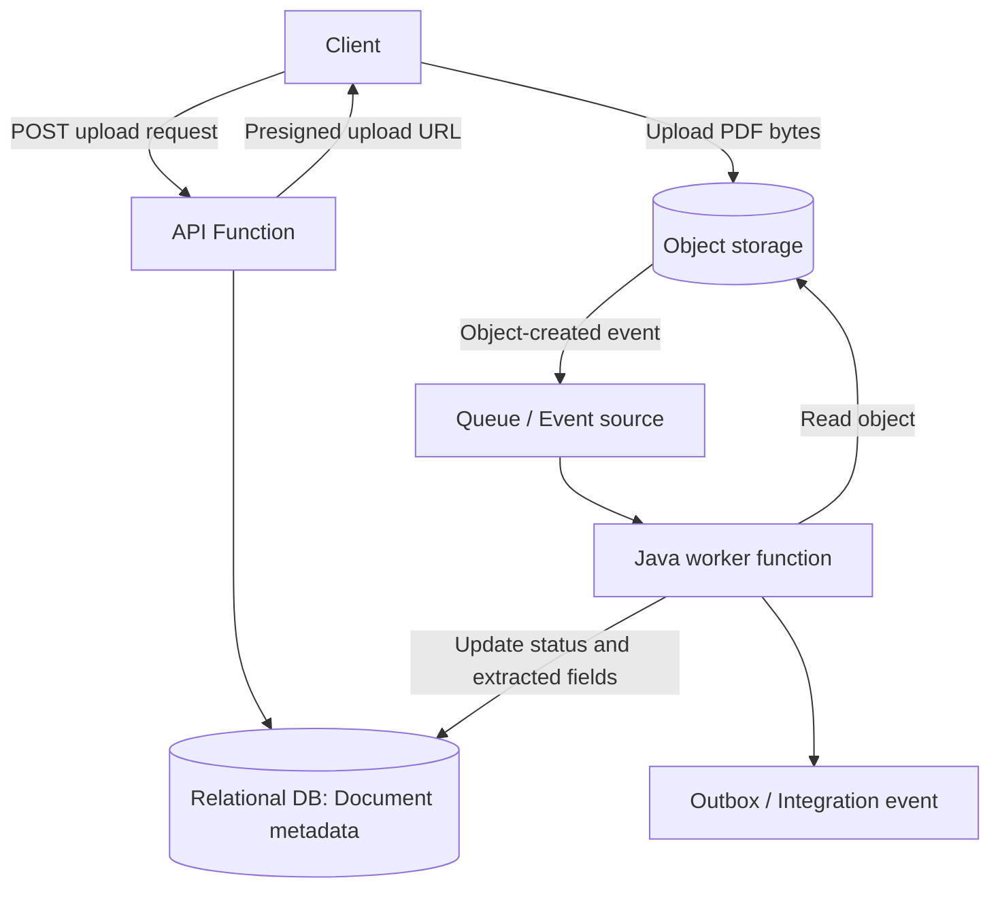

# Chọn object storage, cơ sở dữ liệu quan hệ và NoSQL

Một Java function trong môi trường serverless thường xử lý dữ liệu có nhiều hình dạng: thông tin đơn hàng, trạng thái công việc, hồ sơ người dùng, ảnh tải lên, tệp CSV, log hoặc dữ liệu sự kiện. Không có một loại lưu trữ phù hợp cho tất cả những dữ liệu này. Chọn sai nơi lưu trữ có thể khiến function phải đọc quá nhiều dữ liệu, tạo truy vấn phức tạp, mở quá nhiều kết nối hoặc phát sinh chi phí lớn.

Ba nhóm dịch vụ thường gặp là **object storage**, **cơ sở dữ liệu quan hệ (relational database)** và **cơ sở dữ liệu NoSQL**. Object storage phù hợp với nội dung dạng object/file có kích thước lớn. Relational database phù hợp với dữ liệu có quan hệ, ràng buộc và giao dịch nhiều bản ghi. NoSQL phù hợp khi mô hình truy cập rõ ràng cần mở rộng theo key, document, partition hoặc cấu trúc chuyên biệt. Quyết định nên dựa trên cách ứng dụng đọc, ghi, cập nhật và giữ dữ liệu, chứ không chỉ dựa vào tên gọi của công nghệ.

## 1. Bắt đầu từ dữ liệu và cách ứng dụng sử dụng dữ liệu

Trước khi chọn dịch vụ, hãy mô tả từng nhóm dữ liệu bằng các câu hỏi sau:

1. Dữ liệu là file/blob hay các thuộc tính có cấu trúc cần truy vấn?
2. Ứng dụng đọc theo ID, theo quan hệ, theo khoảng thời gian, theo thuộc tính hay theo toàn bộ nội dung?
3. Một thao tác cần cập nhật một bản ghi hay nhiều bản ghi phải cùng thành công/thất bại?
4. Có cần join, unique constraint, foreign key hoặc truy vấn ad hoc không?
5. Lưu lượng đọc/ghi có đều không, có đột biến lớn hoặc nhiều tenant không?
6. Độ nhất quán cần mạnh đến mức nào? Dữ liệu có chấp nhận độ trễ đồng bộ giữa các bản sao không?
7. Dữ liệu cần giữ bao lâu, có cần version, backup, khôi phục hoặc xóa theo yêu cầu không?
8. Kích thước dữ liệu, kích thước payload và tốc độ tăng trưởng dự kiến là bao nhiêu?

Ví dụ, một hệ thống nhập hồ sơ có thể cần ba cách lưu trữ cùng lúc: thông tin hồ sơ và trạng thái xử lý trong relational database; file PDF gốc và bản xem trước trong object storage; trạng thái tiến độ tạm thời hoặc dữ liệu tra cứu theo key trong NoSQL. Việc kết hợp không phải là phức tạp hóa kiến trúc nếu mỗi loại dữ liệu có một nguồn sự thật và trách nhiệm rõ ràng.

## 2. Object storage: lưu file và blob theo object key

Object storage lưu dữ liệu dưới dạng object trong bucket hoặc container. Mỗi object thường gồm nội dung bytes, key định danh và một tập metadata. Ứng dụng thao tác qua API hoặc SDK như PUT, GET, HEAD, DELETE và các thao tác multipart upload.

Các ví dụ phù hợp:

- Ảnh, video, audio, tài liệu PDF và file đính kèm.
- File CSV/JSON/Parquet dùng cho import, export hoặc phân tích.
- Bản sao lưu, gói dữ liệu, artifact và nội dung tĩnh.
- Kết quả của tác vụ serverless kéo dài, được worker ghi ra sau khi xử lý.

Object storage phù hợp với dữ liệu lớn, truy cập theo key và cần lưu trữ bền vững với khả năng mở rộng dung lượng. Nó không thay thế relational database: object key không tự cung cấp join, unique constraint nghiệp vụ hay transaction cập nhật nhiều object. Metadata object thường hữu ích cho thuộc tính đơn giản, nhưng truy vấn phức tạp theo nhiều thuộc tính thường cần catalog, database hoặc hệ thống tìm kiếm riêng.

### Cách tổ chức object

Một object thường được xác định bằng bucket và key. Ví dụ:

```text
bucket: customer-documents
key: tenant-42/invoices/2026/11/invoice-8391.pdf

metadata:
  content-type: application/pdf
  document-id: invoice-8391
  tenant-id: tenant-42
```

Key có thể chứa các đoạn giống thư mục, nhưng trong nhiều dịch vụ đây chỉ là một chuỗi định danh chứ không phải cây thư mục kiểu filesystem. Thiết kế key nên hỗ trợ định tuyến, phân quyền, lifecycle và tìm kiếm theo quy tắc đã định. Tránh dùng tên file do người dùng gửi trực tiếp làm key duy nhất; tên có thể trùng, chứa ký tự bất thường hoặc tiết lộ thông tin riêng tư. Thường nên tạo key ở server bằng ID ngẫu nhiên hoặc ID nghiệp vụ đã chuẩn hóa.

### Những khả năng cần cân nhắc

- **Multipart upload:** chia file lớn thành nhiều phần để upload/resume, nhưng cần dọn các upload dang dở.
- **Range read và streaming:** đọc một phần object hoặc stream nội dung để tránh nạp toàn bộ file vào heap Java.
- **Versioning:** giữ các phiên bản khi object bị ghi đè hoặc xóa nhầm.
- **Lifecycle policy:** chuyển object ít truy cập sang lớp lưu trữ rẻ hơn hoặc xóa sau thời hạn.
- **Retention/Object Lock:** đáp ứng yêu cầu lưu trữ bất biến hoặc thời gian lưu giữ theo chính sách.
- **Checksum:** kiểm tra tính toàn vẹn của dữ liệu tải lên/tải xuống; không chỉ dựa vào tên file hay kích thước.
- **Event notification:** kích hoạt function khi object được tạo hoặc thay đổi; event có thể được giao lại nên handler cần idempotent.

Tính nhất quán sau PUT/GET, cách xử lý version và khả năng phát event phụ thuộc dịch vụ cụ thể. Một số nền tảng cung cấp read-after-write mạnh cho một số thao tác, nhưng không nên suy rộng tính chất của một nhà cung cấp sang mọi object storage. Hãy kiểm tra tài liệu dịch vụ và thiết kế consumer chịu được event trùng hoặc đến trễ.

### Không chuyển file lớn qua function nếu không cần thiết

Một function HTTP không nên nhận file lớn rồi giữ toàn bộ bytes trong bộ nhớ chỉ để ghi sang object storage. Cách này làm tăng memory, duration, chi phí và nguy cơ chạm giới hạn payload của gateway/function. Một mẫu thường dùng là:

1. Client gọi API để xin quyền upload.
2. Submission function xác thực người dùng, tạo upload record và sinh URL upload có thời hạn.
3. Client upload trực tiếp lên object storage.
4. Object-created event hoặc callback báo upload hoàn tất.
5. Worker function kiểm tra object, xác minh kích thước/checksum/định dạng và xử lý.

URL ký sẵn (presigned URL hoặc cơ chế tương đương) giới hạn quyền và thời gian sử dụng cho một thao tác cụ thể. Nó vẫn là bearer capability: ai có URL có thể dùng nó trong thời hạn hiệu lực. Không ghi URL này vào log công khai hoặc gửi qua kênh không an toàn.

## 3. Cơ sở dữ liệu quan hệ: dữ liệu có quan hệ và giao dịch

Relational database tổ chức dữ liệu thành bảng với hàng, cột, kiểu dữ liệu và các quan hệ. SQL cho phép truy vấn, lọc, join, tổng hợp và cập nhật theo điều kiện. Các hệ quản trị quan hệ phổ biến cung cấp transaction, constraint và index để bảo vệ tính đúng đắn của dữ liệu.

Thường phù hợp với:

- Đơn hàng, thanh toán, hóa đơn và tồn kho.
- Tài khoản, hồ sơ, quyền sở hữu và quan hệ giữa các thực thể.
- Dữ liệu cần unique constraint, foreign key và kiểm tra tính hợp lệ ở database.
- Nghiệp vụ cần cập nhật nhiều bảng trong một transaction.
- Truy vấn ad hoc hoặc báo cáo theo nhiều chiều có thể thay đổi.

### Transaction và tính nhất quán

Giả sử một đơn hàng cần tạo header, tạo các order line và giảm số lượng tồn kho. Nếu các thay đổi này phải cùng thành công hoặc cùng rollback, transaction quan hệ là lựa chọn tự nhiên:

```sql
BEGIN;

INSERT INTO orders (order_id, customer_id, status)
VALUES ('O-9021', 'C-1042', 'PLACED');

INSERT INTO order_lines (order_id, product_id, quantity)
VALUES ('O-9021', 'P-18', 2);

UPDATE inventory
SET available_quantity = available_quantity - 2
WHERE product_id = 'P-18'
  AND available_quantity >= 2;

-- Ứng dụng phải kiểm tra số hàng bị cập nhật là 1.
COMMIT;
```

Đây là ví dụ rút gọn. Trong triển khai thực tế, ứng dụng cần kiểm tra kết quả UPDATE, xử lý trường hợp tồn kho không đủ, khóa/đồng bộ phù hợp và có thể ghi outbox event trong cùng transaction. Không được COMMIT nếu một điều kiện nghiệp vụ bắt buộc không đạt.

Transaction không tự giải quyết mọi vấn đề phân tán. Nếu transaction database đã commit nhưng function timeout trước khi trả HTTP response, client có thể gửi lại. Cần idempotency key hoặc unique business key để lần gọi sau nhận ra thao tác đã hoàn tất và trả kết quả cũ.

### Index và mô hình truy vấn

Relational database cho phép truy vấn linh hoạt, nhưng truy vấn không tự động nhanh. Index cần được thiết kế theo điều kiện lọc, thứ tự sắp xếp và join thực tế. Index giúp đọc nhanh hơn nhưng tăng dung lượng, chi phí ghi và công việc bảo trì. Dùng `EXPLAIN` hoặc công cụ phân tích truy vấn của hệ quản trị để xác minh kế hoạch thực thi trên dữ liệu gần với production.

### Vấn đề kết nối trong serverless

FaaS có thể mở rộng nhiều invocation cùng lúc. Nếu mỗi invocation mở một connection mới đến database, số kết nối có thể tăng đột ngột và vượt giới hạn database, kể cả khi mỗi function chạy rất ngắn.

Ví dụ, 200 invocation đồng thời, mỗi invocation tạo pool 5 connection, có thể tạo nhu cầu tới 1.000 kết nối. Đây là phép nhân minh họa; số thực tế phụ thuộc pool, thời điểm tạo connection và mức dùng đồng thời bên trong function.

Các biện pháp thường dùng:

- Dùng connection pool nhỏ và giới hạn tổng concurrency theo khả năng database.
- Đóng connection/statement/result set sau thao tác để trả connection về pool; không giữ connection mở xuyên suốt thời gian chờ không cần thiết.
- Tái sử dụng `DataSource` hoặc client an toàn giữa các invocation trong cùng runtime khi nền tảng cho phép, nhưng không giả định runtime luôn sống.
- Cân nhắc managed connection proxy/pooler nếu nhà cung cấp hỗ trợ.
- Giảm số truy vấn, gom thao tác hoặc dùng batch khi phù hợp.
- Đặt timeout cho connection acquisition, query và transaction.
- Dùng read replica cho tải đọc nếu mô hình consistency cho phép.

Một biến `static Connection` sống lâu không phải pool an toàn. Connection có thể bị database đóng, hết hạn hoặc ở trạng thái không hợp lệ sau khi runtime bị đóng băng và tái sử dụng. Hãy dùng pool/client có khả năng kiểm tra và tạo lại kết nối.

## 4. NoSQL: tối ưu cho mẫu truy cập cụ thể

NoSQL là tên gọi chung cho nhiều mô hình dữ liệu không dựa chủ yếu vào bảng quan hệ và join SQL. Không có một mô hình NoSQL duy nhất. Một số nhóm thường gặp:

| Loại | Cách tổ chức | Ví dụ sử dụng |
| --- | --- | --- |
| Key-value | Tra cứu giá trị bằng key | Session, idempotency record, cấu hình theo ID |
| Document | Lưu document như JSON với cấu trúc linh hoạt | Hồ sơ, catalog, cấu hình có thuộc tính thay đổi |
| Wide-column | Nhóm dữ liệu theo partition và clustering key | Event/time-series, dữ liệu lớn phân vùng theo tenant hoặc thời gian |
| Graph | Node và edge biểu diễn quan hệ | Mạng quan hệ, đề xuất, phát hiện đường đi |

NoSQL thường có lợi khi workload có mẫu truy cập ổn định, cần thông lượng lớn hoặc mở rộng theo partition. Nhưng không nên chọn chỉ vì “schema linh hoạt” hay vì nghe nói NoSQL luôn nhanh hơn. Thiết kế sai partition key, truy vấn không phù hợp hoặc cần join nhiều có thể làm hệ thống phức tạp và tốn kém.

### Thiết kế theo access pattern

Với một key-value/document database, hãy liệt kê truy vấn trước khi thiết kế key. Ví dụ, ứng dụng quản lý job có thể cần:

- Lấy job theo `jobId`.
- Liệt kê job theo `tenantId` và thời điểm tạo.
- Tìm job đang chạy để kiểm tra lease.
- Cập nhật trạng thái nếu version hiện tại vẫn là `RUNNING`.

Một thiết kế có thể dùng partition key theo tenant và sort key chứa thời gian + job ID cho truy vấn lịch sử theo tenant; một bảng hoặc index khác hỗ trợ lookup theo job ID. Cách cụ thể tùy hệ thống và khả năng index của dịch vụ. Nếu partition key chỉ là một giá trị nóng (ví dụ tất cả dữ liệu dùng key `JOBS`), nhiều request có thể dồn vào một partition và tạo hot partition.

Denormalization thường được dùng để tránh join: lưu một phần dữ liệu lặp trong document hoặc item để đọc nhanh theo access pattern. Đổi lại, khi dữ liệu gốc thay đổi, các bản sao cần được cập nhật hoặc chấp nhận eventual consistency. Hãy xác định nguồn sự thật và quy trình sửa sai trước khi nhân bản dữ liệu.

### Consistency và transaction trong NoSQL

Không thể kết luận mọi NoSQL đều eventual consistency. Một số dịch vụ cung cấp strong consistency cho một số thao tác, configurable consistency, conditional write hoặc transaction nhiều item với phạm vi giới hạn. Mức hỗ trợ khác nhau giữa dịch vụ, vùng và API.

Hãy kiểm tra cụ thể:

- Đọc ngay sau ghi có thấy giá trị mới không?
- Có thể đọc nhất quán mạnh trên một key hay trên nhiều item không?
- Conditional update có thể đảm bảo chỉ một worker claim job không?
- Transaction bao phủ bao nhiêu item/partition và có giới hạn kích thước nào?
- Global replication có độ trễ hoặc xung đột ghi như thế nào?

Nếu nghiệp vụ cần transaction phức tạp nhiều thực thể và join linh hoạt, relational database thường đơn giản hơn. Nếu các thao tác độc lập theo key và có thể mô hình hóa bằng conditional update hoặc transaction nhỏ, NoSQL có thể phù hợp.

### TTL và dữ liệu tạm thời

Một số NoSQL database hỗ trợ TTL để tự động loại bỏ item hết hạn, phù hợp với session, cache metadata hoặc idempotency record có thời hạn. TTL thường là cơ chế dọn bất đồng bộ; không nên giả định item biến mất chính xác tại giây hết hạn. Nếu logic bảo mật hoặc nghiệp vụ cần từ chối dữ liệu ngay khi hết hạn, ứng dụng vẫn phải kiểm tra timestamp hết hạn khi đọc.

## 5. So sánh ba nhóm lưu trữ

| Tiêu chí | Object storage | Relational database | NoSQL database |
| --- | --- | --- | --- |
| Đơn vị dữ liệu | Object/blob theo key | Hàng trong bảng có schema | Item/document/column/graph tùy mô hình |
| Truy cập chính | GET/PUT/DELETE theo object key, stream/range | SQL, index, join, transaction | Lookup/query theo key, partition, index hoặc graph traversal |
| Dữ liệu phù hợp | File, media, export, backup, payload lớn | Dữ liệu nghiệp vụ quan hệ và giao dịch | Workload có access pattern rõ, key/document và quy mô lớn |
| Giao dịch | Không có transaction nghiệp vụ nhiều object phổ quát | ACID transaction theo phạm vi hệ quản trị | Tùy dịch vụ; conditional write/transaction có giới hạn riêng |
| Truy vấn nhiều thuộc tính | Cần catalog/search/database bổ sung | Mạnh với SQL và join | Phụ thuộc index và data model |
| Mở rộng | Dung lượng object quy mô lớn | Vertical/read replica/sharding tùy hệ quản trị | Thường partition/horizontal scaling theo thiết kế |
| Vấn đề serverless nổi bật | Payload lớn, URL ký sẵn, event trùng, lifecycle | Connection storm, pool, transaction và concurrency | Partition key, hot key, consistency, index và denormalization |
| Chi phí thường gặp | Dung lượng, request, retrieval tier, egress | Compute/instance, storage, I/O, connection và backup | Read/write units hoặc throughput, storage, index, replication |

Đây là xu hướng chung, không phải cam kết cho mọi sản phẩm. Một số dịch vụ có tính năng lai hoặc bổ sung khả năng truy vấn, transaction và cache. Hãy so sánh bảng giá, giới hạn và SLA của dịch vụ cụ thể.

## 6. Mô hình kết hợp: database giữ metadata, object storage giữ nội dung

Một mẫu rất phổ biến là lưu file ở object storage và lưu thông tin mô tả/trạng thái trong database. Ví dụ hệ thống nhận hóa đơn:

1. Client yêu cầu tạo upload session.
2. API function xác thực tenant và tạo record `Document` với trạng thái `PENDING_UPLOAD` trong relational database.
3. API trả URL upload có thời hạn và object key do server sinh.
4. Client tải PDF lên object storage.
5. Object-created event kích hoạt worker function.
6. Worker kiểm tra object, cập nhật record thành `PROCESSING`, trích xuất dữ liệu và lưu kết quả.
7. Worker cập nhật metadata/trạng thái trong database và có thể phát integration event `InvoiceProcessed` qua outbox.



Trong mô hình này:

- Object storage là nguồn nội dung file gốc và file kết quả.
- Relational database là nguồn sự thật cho quyền sở hữu, metadata, trạng thái và quan hệ nghiệp vụ.
- Queue/event source chỉ vận chuyển tín hiệu xử lý; message nên chứa object key, document ID, version hoặc event ID thay vì toàn bộ file.
- Worker phải xác minh tenant, object key và trạng thái record trước khi xử lý.

Nếu cần NoSQL, có thể dùng nó cho dữ liệu tra cứu theo key, trạng thái có thông lượng lớn hoặc session; nhưng phải quyết định database nào là nguồn sự thật cho từng trường. Tránh để cùng một trạng thái nghiệp vụ được ghi độc lập vào hai database mà không có cơ chế đồng bộ và đối soát.

## 7. Java: thao tác object storage theo hướng streaming

Ví dụ dưới đây dùng AWS SDK for Java v2 để minh họa API object storage. Các nhà cung cấp khác có SDK và cách ký URL riêng; nguyên tắc quan trọng là stream dữ liệu, tạo key phía server và không biến function thành proxy truyền file lớn nếu client có thể upload trực tiếp.

```java
import java.nio.file.Path;
import software.amazon.awssdk.core.sync.RequestBody;
import software.amazon.awssdk.services.s3.S3Client;
import software.amazon.awssdk.services.s3.model.PutObjectRequest;

public final class DocumentObjectStore {
    private final S3Client s3;
    private final String bucket;

    public DocumentObjectStore(S3Client s3, String bucket) {
        this.s3 = s3;
        this.bucket = bucket;
    }

    public void upload(Path file, String objectKey, String contentType) {
        PutObjectRequest request = PutObjectRequest.builder()
                .bucket(bucket)
                .key(objectKey)
                .contentType(contentType)
                .build();

        s3.putObject(request, RequestBody.fromFile(file));
    }
}
```

`RequestBody.fromFile` cho phép SDK đọc file từ đường dẫn thay vì ứng dụng tự đọc toàn bộ nội dung vào một `byte[]`. Với file rất lớn, hãy dùng multipart upload hoặc API streaming phù hợp. Trong production, cần bổ sung checksum, mã hóa, quyền IAM tối thiểu, xử lý lỗi/retry, timeout và chính sách ghi đè/version. `contentType` do client gửi không phải bằng chứng đáng tin về định dạng thực; worker nên kiểm tra signature hoặc nội dung theo yêu cầu nghiệp vụ.

Nếu object-created event có thể được giao nhiều lần, hãy lưu trạng thái xử lý theo tổ hợp phù hợp như bucket + key + version ID hoặc event ID. Không dùng riêng object key nếu cùng key có thể bị ghi đè và tạo phiên bản mới.

## 8. Java: thao tác relational database an toàn

Với JDBC, `DataSource` quản lý pool connection. Mỗi invocation mượn connection trong khoảng cần thiết và trả lại bằng try-with-resources. Ví dụ sau cập nhật trạng thái có điều kiện:

```java
import java.sql.Connection;
import java.sql.PreparedStatement;
import javax.sql.DataSource;

public final class JobRepository {
    private final DataSource dataSource;

    public JobRepository(DataSource dataSource) {
        this.dataSource = dataSource;
    }

    public boolean markRunning(String jobId, long expectedVersion)
            throws Exception {
        String sql = """
                UPDATE jobs
                   SET status = 'RUNNING', version = version + 1
                 WHERE job_id = ?
                   AND status = 'QUEUED'
                   AND version = ?
                """;

        try (Connection connection = dataSource.getConnection();
             PreparedStatement statement = connection.prepareStatement(sql)) {
            statement.setString(1, jobId);
            statement.setLong(2, expectedVersion);
            return statement.executeUpdate() == 1;
        }
    }
}
```

Điều kiện `status = 'QUEUED'` và `version = ?` giúp chỉ một worker claim được trạng thái kỳ vọng. Worker nhận `false` cần đọc trạng thái hiện tại để quyết định job đã được claim, đã kết thúc hay không còn tồn tại. Không nên coi `false` luôn là lỗi hạ tầng.

Trong môi trường serverless, cấu hình pool cần tính đến số runtime và concurrency tổng thể. Nếu mỗi runtime giữ pool tối đa 5 connection và có thể mở rộng lên 100 runtime, database có thể nhận nhu cầu tới 500 connection. Hãy đặt concurrency/pool size phù hợp hoặc dùng proxy/pooler để bảo vệ database.

## 9. Java: NoSQL và conditional write

Với NoSQL, hãy thiết kế key theo access pattern và dùng conditional write để bảo vệ các chuyển đổi trạng thái. Ví dụ dưới đây dùng DynamoDB SDK v2 để minh họa một thao tác chỉ tạo item nếu partition key chưa tồn tại:

```java
import java.util.Map;
import software.amazon.awssdk.services.dynamodb.DynamoDbClient;
import software.amazon.awssdk.services.dynamodb.model.AttributeValue;
import software.amazon.awssdk.services.dynamodb.model.ConditionalCheckFailedException;
import software.amazon.awssdk.services.dynamodb.model.PutItemRequest;

public final class IdempotencyStore {
    private final DynamoDbClient dynamoDb;
    private final String tableName;

    public IdempotencyStore(DynamoDbClient dynamoDb, String tableName) {
        this.dynamoDb = dynamoDb;
        this.tableName = tableName;
    }

    public boolean createIfAbsent(String key, String jobId) {
        try {
            dynamoDb.putItem(PutItemRequest.builder()
                    .tableName(tableName)
                    .item(Map.of(
                            "pk", AttributeValue.builder().s(key).build(),
                            "jobId", AttributeValue.builder().s(jobId).build()
                    ))
                    .conditionExpression("attribute_not_exists(pk)")
                    .build());
            return true;
        } catch (ConditionalCheckFailedException alreadyExists) {
            return false;
        }
    }
}
```

Đây là ví dụ theo DynamoDB, không phải API chung của mọi NoSQL. Trong hệ thống thực tế, idempotency record thường cần thêm tenant, operation, request hash, thời điểm tạo/hết hạn và trạng thái/kết quả. Nếu key đã tồn tại, đọc record để so request hash; không được mặc định mọi request trùng key đều có cùng nội dung.

## 10. Trigger từ object storage và xử lý event an toàn

Khi một object được tạo, storage service có thể phát event để kích hoạt Java function. Event thường chứa bucket, key, version hoặc metadata định danh. Worker sau đó đọc object và xử lý.

Các tình huống cần dự liệu:

- Event được giao nhiều lần do retry hoặc không nhận được ACK.
- Event đến trễ hoặc thứ tự event không giống thứ tự upload.
- Object bị ghi đè hoặc xóa trước khi worker đọc.
- Worker timeout sau khi ghi một phần kết quả.
- Nhiều object được upload đồng thời cho cùng một business record.

Handler nên kiểm tra object version/checksum và trạng thái nghiệp vụ, dùng idempotency key ổn định, ghi checkpoint và cập nhật trạng thái có điều kiện. Nếu worker tạo output object, dùng key riêng cho output hoặc ghi version rõ ràng để lần retry không phá hủy file gốc.

Không nên chỉ dựa vào tên object để kết luận quyền sở hữu. Đối chiếu key với record đã được tạo ở API và tenant đã xác thực. Event notification là dữ liệu đầu vào cần validate; không tin bất kỳ bucket/key nào chỉ vì message đến từ event bus.

## 11. Bảo mật và quản trị vòng đời dữ liệu

Storage là nơi dữ liệu có thể tồn tại lâu hơn invocation rất nhiều. Thiết kế cần bao gồm quyền truy cập, mã hóa, retention và khôi phục ngay từ đầu.

### Object storage

- Bucket/container private theo mặc định; không bật public access chỉ để tiện chia sẻ file.
- Dùng IAM role theo function và quyền tối thiểu trên prefix/bucket cần thiết.
- Mã hóa khi truyền và khi lưu; quản lý khóa mã hóa theo yêu cầu tổ chức.
- Dùng URL ký sẵn có thời hạn ngắn, giới hạn thao tác và phạm vi object.
- Kiểm tra kích thước, checksum, định dạng thật và malware nếu loại file yêu cầu.
- Bật versioning/retention khi cần khôi phục hoặc đáp ứng yêu cầu lưu trữ; cấu hình lifecycle để dọn dữ liệu hết hạn.
- Tránh ghi nội dung nhạy cảm hoặc URL ký sẵn vào log.

### Relational và NoSQL database

- Xác thực bằng role/secret an toàn; không nhúng mật khẩu trong source hoặc environment không được bảo vệ.
- Dùng TLS, encryption at rest, network policy và private connectivity khi phù hợp.
- Giới hạn quyền theo database/schema/table hoặc resource tương ứng.
- Có backup, point-in-time recovery hoặc snapshot và thường xuyên kiểm tra khả năng restore.
- Đặt retention và quy trình xóa dữ liệu theo chính sách; nhớ cả bản sao, index, backup và log.
- Theo dõi connection count, throttling, query latency, capacity và lỗi conditional write.

Mã hóa không thay thế phân quyền. Một function có thể đọc object trong bucket nhưng không nên được cấp quyền xóa toàn bộ bucket nếu chỉ cần đọc một prefix.

## 12. Chi phí và hiệu năng

Không có loại lưu trữ nào luôn rẻ nhất. Cần ước tính chi phí theo workload thật và bao gồm cả request từ function.

| Nhóm | Thành phần chi phí cần kiểm tra | Cách tối ưu thường gặp |
| --- | --- | --- |
| Object storage | Dung lượng, PUT/GET/LIST, retrieval, lớp lưu trữ, egress, version và lifecycle | Chọn storage class theo tần suất truy cập, stream file, cache hợp lý, dọn multipart dang dở và dữ liệu hết hạn |
| Relational DB | Compute/instance, storage, I/O, backup, read replica, connection proxy | Tối ưu query/index, pool nhỏ, giới hạn concurrency, batch và scale theo nhu cầu |
| NoSQL | Read/write throughput, storage, index, replication, backup và request bị retry | Thiết kế partition key, giảm hot key, dùng projection/index vừa đủ và cache khi phù hợp |

Trong serverless, chi phí có thể tăng do một sự kiện kích hoạt nhiều function, retry lặp, polling quá dày hoặc function đọc/ghi quá nhiều lần. Hãy đo chi phí trên một tác vụ nghiệp vụ thành công, không chỉ trên một invocation.

Các chỉ số nên quan sát:

- Object: bytes stored, request count, egress, retrieval, tuổi object, lỗi upload và multipart còn dang dở.
- Relational: active/max connections, pool wait time, query latency p95/p99, lock wait, transaction rollback và I/O.
- NoSQL: read/write units hoặc throughput, throttling, hot partition, conditional check failure, item size và replication lag.
- Toàn luồng: số lần retry, thời gian xử lý, tỷ lệ thành công và chi phí trên mỗi kết quả nghiệp vụ.

## 13. Những lỗi thiết kế thường gặp

1. **Lưu file lớn trong database chỉ vì tiện.** BLOB có thể phù hợp ở một số hệ thống, nhưng file lớn thường dễ quản lý và phân phối hơn ở object storage; database giữ metadata và tham chiếu.
2. **Lưu dữ liệu nghiệp vụ quan trọng chỉ trong object metadata.** Metadata object không thay thế ràng buộc và truy vấn của database.
3. **Chọn NoSQL trước khi liệt kê truy vấn.** Không có access pattern rõ, schema/key dễ dẫn đến scan tốn kém hoặc hot partition.
4. **Tạo connection pool lớn trong mỗi function runtime.** Tổng connection có thể tăng theo số runtime và vượt giới hạn database.
5. **Để function proxy toàn bộ file lớn.** Payload và memory tăng; nên cân nhắc upload trực tiếp bằng URL ký sẵn.
6. **Tin rằng object-created event chỉ đến một lần.** Event trùng hoặc đến trễ có thể khiến worker xử lý lại; cần idempotency.
7. **Dùng hai database làm nguồn sự thật ngang nhau.** Nếu không có cơ chế đồng bộ, version và đối soát, trạng thái sẽ phân kỳ.
8. **Không thiết kế backup/restore và retention.** Dữ liệu có thể khôi phục nhầm, lưu quá hạn hoặc mất mà không có quy trình phục hồi.
9. **Không tính chi phí truy xuất và egress.** Lớp lưu trữ rẻ có thể đắt khi truy xuất thường xuyên hoặc truyền dữ liệu liên vùng.

## 14. Quy trình chọn nơi lưu trữ

Có thể áp dụng quy trình sau cho mỗi nhóm dữ liệu:

1. **Xác định nguồn sự thật.** Trường hoặc nội dung nào là dữ liệu chuẩn? Service nào sở hữu nó?
2. **Liệt kê access pattern.** Ghi các thao tác đọc, ghi, lọc, sắp xếp, join, cập nhật và tần suất dự kiến.
3. **Xác định ranh giới transaction.** Những thay đổi nào phải cùng thành công hoặc rollback?
4. **Chọn mô hình dữ liệu.** File/blob theo key gợi ý object storage; quan hệ và transaction gợi ý relational; truy cập theo key/partition/document gợi ý NoSQL.
5. **Kiểm tra consistency và scale.** Xác định độ trễ chấp nhận được, concurrency, hot key, connection limit và kích thước payload.
6. **Thiết kế bảo mật và vòng đời.** Phân quyền, mã hóa, version, backup, retention, xóa và restore.
7. **Ước tính chi phí toàn luồng.** Bao gồm request, compute, index, replication, egress, retry và quan sát.
8. **Thử với dữ liệu/tải đại diện.** Đo latency p95/p99, throughput, lỗi, chi phí và khả năng phục hồi.

### Bảng gợi ý nhanh

| Nếu dữ liệu/chức năng chủ yếu là… | Hướng lựa chọn ban đầu |
| --- | --- |
| Ảnh, video, PDF, file import/export hoặc backup | Object storage |
| Đơn hàng, thanh toán, hóa đơn, quan hệ nhiều bảng, transaction nhiều bước | Relational database |
| Session hoặc tra cứu theo một key ổn định | Key-value NoSQL hoặc cache tùy yêu cầu bền vững |
| Document có thuộc tính linh hoạt và truy vấn theo key/index xác định | Document database |
| Dữ liệu rất lớn phân vùng theo tenant/thời gian với truy vấn theo partition | Wide-column hoặc NoSQL phù hợp workload |
| Quan hệ nhiều bước cần traversal như mạng kết nối | Graph database |
| Metadata nghiệp vụ cùng file lớn | Relational/NoSQL cho metadata + object storage cho file |

Đây là điểm bắt đầu để đánh giá, không phải quyết định tự động. Một ứng dụng có thể dùng nhiều loại lưu trữ, nhưng nên giới hạn số nguồn sự thật và định nghĩa rõ cách đồng bộ.

## 15. Checklist cho Java serverless

- [ ] Đã liệt kê dữ liệu, access pattern, kích thước và tần suất đọc/ghi chưa?
- [ ] File/blob có được lưu trong object storage với key do server quản lý không?
- [ ] Metadata, trạng thái và quan hệ nghiệp vụ có nguồn sự thật rõ ràng không?
- [ ] Transaction có được đặt trong relational DB khi cần bảo đảm nhiều thay đổi cùng thành công không?
- [ ] NoSQL có partition key, index và conditional write phù hợp với truy vấn thực tế không?
- [ ] Function có tránh đưa payload lớn qua HTTP/queue và tránh nạp file lớn toàn bộ vào heap không?
- [ ] Connection pool và concurrency tổng thể có nằm trong giới hạn database không?
- [ ] Event từ object storage/queue có được xử lý idempotent và chịu được redelivery không?
- [ ] Quyền IAM, encryption, URL ký sẵn và quyền truy cập theo tenant đã được giới hạn chưa?
- [ ] Có backup, restore test, versioning, retention và cleanup phù hợp không?
- [ ] Đã tính request, storage, retrieval, egress, index, replication và retry vào chi phí chưa?
- [ ] Có dashboard/cảnh báo cho connection, throttling, latency, storage growth và chi phí trên tác vụ thành công không?

Trong ứng dụng serverless, object storage, relational database và NoSQL giải quyết các nhu cầu khác nhau. Object storage giữ nội dung dạng file; relational database bảo vệ dữ liệu có quan hệ và giao dịch; NoSQL phục vụ các mẫu truy cập theo key, document hoặc partition ở quy mô phù hợp. Khi chọn dựa trên access pattern, transaction, consistency, giới hạn concurrency và vòng đời dữ liệu, Java function có thể lưu trữ hiệu quả mà vẫn dễ mở rộng, phục hồi và kiểm soát chi phí.
