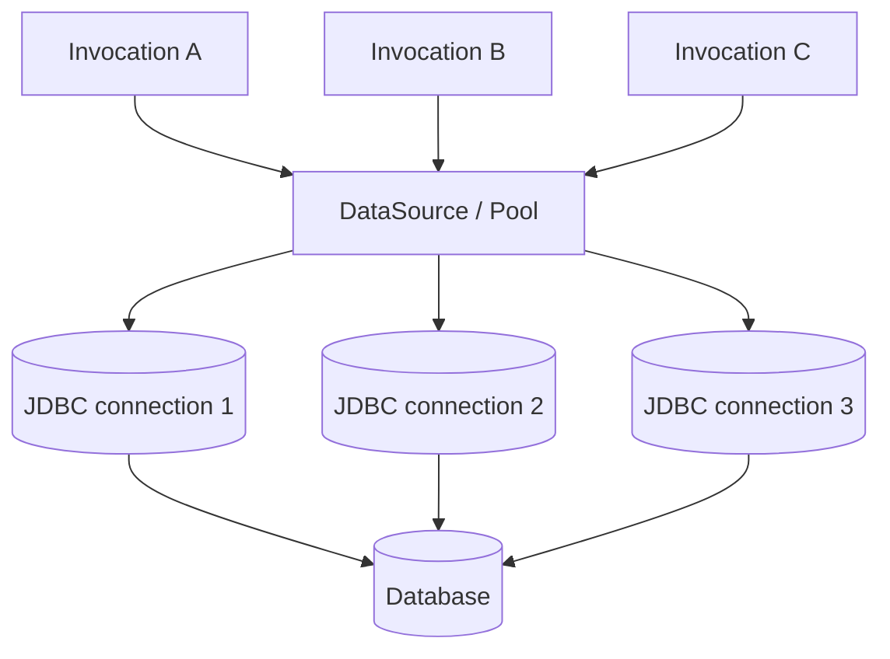
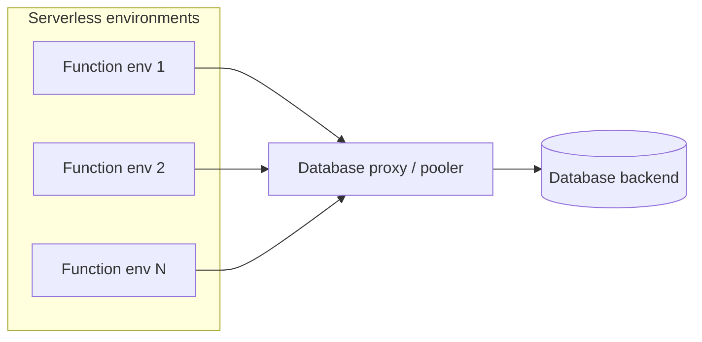

# Kết nối cơ sở dữ liệu từ function và rủi ro cạn kết nối

Java function thường được khởi chạy theo nhu cầu. Khi lưu lượng tăng, nền tảng có thể tạo thêm nhiều execution environment để xử lý đồng thời; khi tải giảm, một số environment có thể được giữ lại để tái sử dụng hoặc bị thu hồi. Cách mở rộng này giúp ứng dụng phản hồi linh hoạt, nhưng tạo áp lực đặc biệt lên cơ sở dữ liệu: mỗi function instance có thể mở một hoặc nhiều kết nối riêng, trong khi database thường có giới hạn kết nối hữu hạn.

Nếu không kiểm soát, một đợt tăng traffic có thể làm số kết nối vượt `max_connections`, khiến function chờ lấy connection, truy vấn timeout hoặc database từ chối cả các ứng dụng khác. Vì vậy, kết nối database là một phần của thiết kế concurrency và capacity planning, không chỉ là chi tiết cấu hình JDBC.

Trong phạm vi **CLOUD_SERVERLESS**, bài học tập trung vào Java function được kích hoạt bởi HTTP, message hoặc event, cách sử dụng JDBC connection pool, vòng đời execution environment và các giải pháp bảo vệ database khi function scale-out.

## 1. Vì sao serverless dễ tạo áp lực lên database?

Trong một ứng dụng server truyền thống, số process hoặc instance thường được kiểm soát tương đối ổn định. Connection pool của mỗi instance có thể được tính dựa trên số instance dự kiến. Với FaaS, số execution environment có thể tăng nhanh theo concurrency và giới hạn của nền tảng.

Giả sử một API bình thường chỉ có 5 function environment. Mỗi environment mở tối đa 2 kết nối database, tổng số kết nối từ function có thể lên đến khoảng 10. Khi traffic tăng, nền tảng mở rộng lên 150 environment; nếu mỗi environment vẫn giữ pool 2 connection, riêng function có thể tạo đến 300 kết nối.

Database không biết rằng các kết nối đó đến từ những function instance tạm thời. Nó chỉ thấy các client đang mở session và phải phân bổ bộ nhớ, worker, file descriptor hoặc tài nguyên nội bộ cho chúng. Khi giới hạn bị chạm, kết nối mới có thể bị từ chối dù một số function chỉ đang giữ connection nhàn rỗi.

Các yếu tố khiến rủi ro tăng:

- Function scale-out nhanh hơn khả năng mở rộng của database.
- Mỗi environment tạo pool quá lớn hoặc giữ nhiều connection idle.
- Nhiều function khác nhau cùng sử dụng một database.
- Connection được mở trong mỗi invocation nhưng không được đóng đúng cách.
- Query hoặc transaction kéo dài làm connection bị chiếm dụng.
- Cold start tạo đồng loạt kết nối mới khi có burst traffic.
- Retry dồn dập khiến nhiều invocation cùng thử kết nối lại trong lúc database đang quá tải.

Điểm cần nhớ: **pool được tạo trong một execution environment không phải pool dùng chung cho toàn bộ ứng dụng**. Khi nền tảng tạo thêm environment, mỗi environment có thể tạo pool riêng.

## 2. Vòng đời của function và JDBC connection

Một execution environment có thể sống qua nhiều invocation, nhưng thời gian tồn tại và việc tái sử dụng do nền tảng quyết định. Một environment có thể được khởi tạo mới, xử lý một hoặc nhiều invocation theo mô hình dịch vụ, tạm thời không hoạt động rồi được tái sử dụng, hoặc bị thu hồi.

Với Java function, cần phân biệt ba vòng đời:

| Thành phần | Vòng đời | Cách quản lý phù hợp |
|---|---|---|
| Execution environment | Do nền tảng khởi tạo, tái sử dụng hoặc thu hồi | Không giả định tồn tại vĩnh viễn |
| `DataSource`/connection pool | Thường được khởi tạo một lần trong environment và tái sử dụng | Có thể đặt ở phạm vi ứng dụng nếu thư viện thread-safe và mô hình concurrency cho phép |
| JDBC `Connection`, `Statement`, `ResultSet` | Thuê theo thao tác hoặc transaction | Mượn khi cần và đóng ngay sau khi hoàn tất |

Một mẫu thường dùng là khởi tạo `DataSource` dùng chung ở phạm vi environment, sau đó mượn connection trong mỗi lần xử lý. `DataSource` của pool như HikariCP được thiết kế để dùng đồng thời; đối tượng `Connection` cụ thể thì không nên được chia sẻ tùy tiện giữa các thread hoặc invocation.

Không nên giữ một JDBC `Connection` trong biến static để dùng mãi. Connection có thể bị database đóng do idle timeout, network reset, failover hoặc thay đổi cấu hình. Một function environment được giữ ấm lâu không bảo đảm connection bên trong vẫn còn hợp lệ.

`DataSource` cũng không nên được tạo mới trong mọi invocation nếu mục tiêu là tái sử dụng pool. Tạo pool mới liên tục sẽ tạo thêm handshake, xác thực, thread quản lý và connection, làm tăng cold start cũng như áp lực lên database.

## 3. Dùng JDBC đúng cách trong Java function

Với JDBC, `Connection`, `PreparedStatement` và `ResultSet` đều là tài nguyên cần đóng. Dùng try-with-resources để bảo đảm tài nguyên được trả lại pool ngay cả khi câu lệnh phát sinh exception.

```java
public final class CustomerRepository {
    private final DataSource dataSource;

    public CustomerRepository(DataSource dataSource) {
        this.dataSource = dataSource;
    }

    public Optional<Customer> findById(String customerId)
            throws SQLException {
        String sql = "SELECT id, name FROM customers WHERE id = ?";

        try (Connection connection = dataSource.getConnection();
             PreparedStatement statement = connection.prepareStatement(sql)) {
            statement.setString(1, customerId);

            try (ResultSet resultSet = statement.executeQuery()) {
                if (!resultSet.next()) {
                    return Optional.empty();
                }

                return Optional.of(new Customer(
                        resultSet.getString("id"),
                        resultSet.getString("name")));
            }
        }
    }
}
```

Khi `Connection` lấy từ pool được đóng bằng `close()`, thông thường nó được trả về pool thay vì đóng TCP socket ngay lập tức. Đây là lý do cần đóng connection ở cuối thao tác: `close()` trả lại quyền sử dụng connection cho invocation khác.

Các nguyên tắc cơ bản:

- Mượn connection càng muộn càng tốt và trả lại càng sớm càng tốt.
- Không giữ connection trong lúc gọi HTTP service, gửi email hoặc chờ một tác vụ không liên quan đến database.
- Dùng `PreparedStatement` để bind dữ liệu và tránh ghép chuỗi SQL từ input người dùng.
- Đóng cả `ResultSet` và `Statement` bằng try-with-resources.
- Không lưu connection vào field static hoặc dùng chung connection cho nhiều thread.
- Đặt timeout rõ ràng cho việc lấy connection và truy vấn.
- Giữ transaction ngắn, tránh chờ người dùng hoặc dịch vụ bên ngoài trong khi transaction còn mở.

## 4. Connection pool hoạt động như thế nào?

Connection pool duy trì một tập hợp JDBC connection đã được tạo và xác thực. Khi function cần truy vấn, nó lấy một connection rảnh từ pool. Sau khi xử lý xong, connection được trả lại pool để invocation khác dùng tiếp.



Pool thường cung cấp các cấu hình sau:

| Cấu hình | Ý nghĩa | Rủi ro nếu đặt không phù hợp |
|---|---|---|
| `maximumPoolSize` | Số connection tối đa trong một pool | Quá lớn làm tăng tổng connection khi scale-out |
| `minimumIdle` | Số connection nhàn rỗi tối thiểu muốn duy trì | Quá cao khiến nhiều environment giữ connection dù ít tải |
| `connectionTimeout` | Thời gian chờ mượn connection | Quá dài làm invocation bị treo; quá ngắn có thể fail khi tải tăng ngắn hạn |
| `idleTimeout` | Thời gian connection không hoạt động trước khi pool có thể loại bỏ | Không phù hợp với idle timeout của database hoặc proxy |
| `maxLifetime` | Tuổi thọ tối đa của connection trong pool | Dài hơn giới hạn phía server có thể giữ connection sắp bị đóng |
| `validationTimeout` | Thời gian tối đa kiểm tra connection | Quá cao làm tăng thời gian phát hiện connection lỗi |
| Leak detection | Phát hiện connection bị mượn quá lâu | Ngưỡng quá thấp có thể tạo cảnh báo giả |

Pool giúp tái sử dụng connection bên trong một environment, nhưng không tự giới hạn số pool được tạo khi function scale-out. Giới hạn tổng thể cần được thiết kế ở concurrency của FaaS, pool size và/hoặc lớp proxy database.

## 5. Khởi tạo pool phù hợp với execution environment

Với nền tảng cho phép tái sử dụng environment, có thể tạo `DataSource` một lần ở phạm vi ứng dụng. Ví dụ sau minh họa cấu hình HikariCP với pool nhỏ. Các giá trị chỉ mang tính khởi đầu, cần điều chỉnh theo concurrency, database và giới hạn của nhà cung cấp.

```java
public final class Database {
    private static final HikariDataSource DATA_SOURCE = createDataSource();

    private Database() {}

    public static DataSource dataSource() {
        return DATA_SOURCE;
    }

    private static HikariDataSource createDataSource() {
        HikariConfig config = new HikariConfig();
        config.setJdbcUrl(requiredEnv("JDBC_URL"));
        config.setUsername(requiredEnv("DB_USERNAME"));
        config.setPassword(requiredEnv("DB_PASSWORD"));

        config.setPoolName("orders-function-pool");
        config.setMaximumPoolSize(1);
        config.setMinimumIdle(0);
        config.setConnectionTimeout(3_000);
        config.setValidationTimeout(1_000);
        config.setIdleTimeout(120_000);
        config.setMaxLifetime(1_500_000);

        return new HikariDataSource(config);
    }

    private static String requiredEnv(String name) {
        String value = System.getenv(name);
        if (value == null || value.isBlank()) {
            throw new IllegalStateException("Missing configuration: " + name);
        }
        return value;
    }
}
```

Trong ví dụ, `maximumPoolSize=1` là lựa chọn thận trọng cho function xử lý một thao tác database tại một thời điểm trong mỗi environment. Nếu một invocation thực sự chạy nhiều truy vấn song song, hoặc nền tảng cho phép nhiều request đồng thời dùng cùng environment, cần tính lại pool size theo concurrency nội bộ. Không sao chép giá trị này cho mọi ứng dụng.

`minimumIdle=0` giúp environment mới không nhất thiết mở connection ngay khi khởi tạo pool. Connection được tạo khi có nhu cầu, giảm lượng kết nối nhàn rỗi khi có nhiều environment. `maxLifetime` phải nhỏ hơn giới hạn tuổi thọ connection của database/proxy nếu hệ thống có giới hạn đó. `idleTimeout` và các giá trị timeout cũng cần căn cứ vào cấu hình thực tế.

Không đóng `DataSource` sau mỗi invocation; làm vậy sẽ phá hủy pool và buộc invocation sau tạo lại toàn bộ connection. Chỉ đóng pool khi môi trường chạy có một lifecycle shutdown đáng tin cậy hoặc trong ứng dụng chạy lâu dài có quy trình shutdown rõ ràng. FaaS có thể thu hồi environment mà không bảo đảm hook dọn dẹp luôn được chạy.

Không giữ `Connection` trong biến static. Hãy chỉ giữ `DataSource`/pool và lấy connection theo từng thao tác bằng try-with-resources.

## 6. Tính connection budget trước khi scale

Để tránh cạn connection, cần ước lượng tổng số connection mà tất cả function và ứng dụng khác có thể sử dụng đồng thời.

Một công thức ước lượng bảo thủ:

\[
C_{total} \approx N_{env} \times P_{env} + C_{other}
\]

Trong đó:

- `N_env`: số execution environment có thể hoạt động đồng thời ở mức concurrency đã cấu hình.
- `P_env`: số connection tối đa mỗi environment có thể mở.
- `C_other`: connection từ ứng dụng khác, migration, admin, monitoring, batch job và các client không đi qua pool này.

Ví dụ, nếu FaaS được phép chạy tối đa 120 environment và mỗi environment có pool tối đa 2 connection, function có thể chiếm đến 240 connection. Nếu database có giới hạn 400 connection nhưng cần dành 80 cho hệ thống khác và vận hành, ngân sách còn lại chỉ là 320; function có vẻ nằm trong ngân sách ở ví dụ này. Nhưng nếu còn hai function khác cũng có thể chạy 120 environment với pool 2 connection, tổng của ba function là 720 và vượt giới hạn.

Khi tính toán, đừng dùng riêng số connection trung bình. Hãy xét tình huống đỉnh tải, retry, deployment rolling, nhiều function scale đồng thời và connection được giữ trong thời gian idle. Cũng cần dành phần dự phòng cho failover, truy vấn quản trị và các kết nối nội bộ database.

Một cách kiểm soát là giới hạn concurrency tối đa của function. Nếu database chỉ có thể dành 150 connection cho workload serverless và mỗi environment có thể dùng tối đa 2 connection, concurrency của function cần được đặt sao cho tổng connection không vượt ngân sách sau khi tính các workload khác. Với nhiều function, cần phân bổ ngân sách theo từng nhóm thay vì để mỗi function tự dùng toàn bộ giới hạn.

## 7. Vì sao connection pool không giải quyết hết vấn đề?

Pool chỉ tái sử dụng connection trong phạm vi process/environment. Khi nền tảng scale từ 10 lên 200 environment, ứng dụng có thể có 200 pool độc lập. Nếu mỗi pool giữ 5 connection, database có thể nhìn thấy đến 1.000 connection.

Pool cũng có thể tạo ra các vấn đề khác:

- Nhiều environment cùng khởi tạo pool trong cold start tạo connection storm.
- `minimumIdle` lớn giữ nhiều connection không cần thiết.
- `maximumPoolSize` quá thấp khiến invocation chờ connection dù database còn capacity.
- `maximumPoolSize` quá cao làm database cạn connection khi scale-out.
- Connection bị database đóng trong lúc environment ngủ; lần mượn tiếp theo gặp lỗi stale connection.
- Pool bị rò rỉ connection nếu code không đóng connection hoặc giữ transaction quá lâu.

Vì vậy, cần kết hợp pool size nhỏ, concurrency limit, timeout, proxy hoặc mô hình truy cập database phù hợp. Không nên chỉ tăng pool size khi thấy lỗi “connection timeout”; trước hết cần xác định database có thật sự còn capacity hay pool đang bị giữ connection quá lâu.

## 8. Dùng database proxy hoặc pooler dùng chung

Một database proxy/pooler nằm giữa function và database có thể giảm số kết nối backend trực tiếp. Mỗi execution environment kết nối đến proxy; proxy quản lý một tập connection đến database và có thể chia sẻ chúng giữa các client theo cơ chế của sản phẩm.



Lợi ích thường gặp:

- Hấp thụ số lượng client connection lớn hơn số backend connection.
- Quản lý connection backend tập trung và giảm connection storm.
- Hỗ trợ failover hoặc chuyển hướng kết nối theo khả năng của dịch vụ.
- Có thể tích hợp xác thực, TLS và quản lý secret.

Proxy không làm database có capacity vô hạn. Backend connection vẫn có giới hạn và proxy có thể trả lỗi hoặc xếp hàng khi hết capacity. Một số thao tác giữ session state, temporary table, session variable, prepared statement hoặc transaction dài có thể làm giảm khả năng multiplexing vì proxy phải ghim client vào một backend connection (*session pinning*). Cần đọc rõ hành vi của proxy và kiểm thử với driver/ORM đang sử dụng.

Khi chọn proxy, hãy xem số client connection tối đa, số backend connection, timeout, transaction behavior, hỗ trợ IAM/TLS, giới hạn theo vùng và cách tính phí. Với PostgreSQL, PgBouncer là một ví dụ pooler phổ biến; nhiều nền tảng cloud cũng cung cấp proxy được quản lý riêng.

## 9. Các lựa chọn khác ngoài JDBC connection trực tiếp

Không phải workload nào cũng cần mở JDBC socket trực tiếp từ function. Tùy database và đặc tính truy cập, có thể cân nhắc:

| Cách truy cập | Phù hợp khi | Điểm cần đánh giá |
|---|---|---|
| JDBC trực tiếp + pool nhỏ | Tải vừa phải, kiểm soát được concurrency và connection budget | Tổng pool tăng theo số environment |
| JDBC qua managed proxy/pooler | Nhiều environment ngắn hạn cần chia sẻ backend connection | Chi phí proxy, giới hạn session pinning và behavior của driver |
| HTTP-based Data API | Database hỗ trợ API truy cập qua HTTPS và workload phù hợp | Latency, giới hạn payload, transaction và feature khác JDBC |
| Database serverless/autoscaling | Workload biến động và database có cơ chế scale phù hợp | Scale database có độ trễ, mức tối thiểu, giới hạn và chi phí riêng |
| Queue + worker có concurrency giới hạn | Chấp nhận xử lý bất đồng bộ và cần điều tiết tải database | Thời gian chờ hàng đợi và yêu cầu nghiệp vụ |

Nếu dùng HTTP Data API, function không giữ JDBC socket trực tiếp, nhưng vẫn phải quản lý rate limit, transaction, retry và số request đồng thời. “Không có connection TCP từ function” không đồng nghĩa không có giới hạn tài nguyên ở database.

## 10. Timeout và xử lý lỗi kết nối

Kết nối database có nhiều giai đoạn có thể timeout khác nhau:

- DNS lookup và thiết lập TCP.
- TLS handshake và xác thực.
- Chờ lấy connection từ pool.
- Chờ query hoặc lock trong database.
- Đọc kết quả và truyền dữ liệu qua network.
- Commit hoặc rollback transaction.

Không nên dùng một timeout rất dài cho tất cả các giai đoạn. Tổng thời gian của các bước phải nằm trong timeout của function và SLA của request/message. Nếu HTTP function có timeout 10 giây, việc chờ pool 8 giây rồi mới bắt đầu query gần như không còn thời gian xử lý nghiệp vụ.

Khi gặp lỗi, phân biệt:

| Loại lỗi | Ví dụ | Hướng xử lý |
|---|---|---|
| Hết connection trong pool | `Connection is not available, request timed out` | Kiểm tra leak, query/transaction dài, pool size và concurrency |
| Database từ chối connection | Vượt `max_connections`, too many clients | Giảm concurrency/pool, dùng proxy, giải phóng connection |
| Connection stale | Socket bị đóng khi environment idle hoặc DB failover | Loại connection lỗi, cấu hình lifetime/validation và retry có kiểm soát |
| Query timeout | Lock lâu, truy vấn chậm hoặc database quá tải | Phân tích query plan, index, lock và giới hạn thời gian |
| Authentication failure | Secret sai/hết hạn hoặc IAM token không hợp lệ | Kiểm tra cơ chế cấp credential và refresh; không retry vô hạn |
| Network failure | Route, security group, DNS hoặc endpoint lỗi | Kiểm tra network path và health của dịch vụ |

Chỉ retry các lỗi có khả năng tạm thời và retry với backoff có jitter, giới hạn số lần. Không retry ngay lập tức trong vòng lặp dày đặc khi database đang quá tải vì sẽ làm tăng connection storm. Lỗi schema, quyền hoặc dữ liệu không hợp lệ thường không được giải quyết bằng retry.

## 11. Transaction ngắn và tránh giữ connection khi gọi dịch vụ ngoài

Một transaction nên bao quanh các thao tác database cần tính nguyên tử. Không nên mở transaction, đọc một bản ghi rồi gọi HTTP service trong vài giây trước khi commit. Trong thời gian chờ network, connection và lock vẫn bị giữ; nếu nhiều function cùng làm như vậy, pool sẽ nhanh chóng bị cạn.

Ví dụ, với quy trình đặt hàng cần cập nhật đơn và yêu cầu thanh toán:

1. Mở transaction, kiểm tra và cập nhật trạng thái đơn, ghi một outbox event.
2. Commit transaction để trả connection về pool.
3. Một worker riêng đọc outbox và gọi payment service.
4. Ghi nhận kết quả thanh toán trong transaction ngắn khác.

Mô hình outbox giúp tách thao tác database khỏi lời gọi mạng dài và giảm rủi ro ghi dữ liệu thành công nhưng không phát được event. Tuy vậy, worker vẫn cần idempotency và xử lý trạng thái nhất quán khi payment service timeout.

Nếu một tác vụ cần nhiều bước và không thể nằm trong một transaction ngắn, hãy dùng workflow/saga với các trạng thái bền vững, timeout và bước bù trừ phù hợp. Không giữ một connection mở xuyên suốt workflow.

## 12. Bảo mật kết nối database

Kết nối hoạt động tốt nhưng không an toàn vẫn là một lỗi production. Các nguyên tắc cần áp dụng:

- **Network private:** đặt database trong mạng riêng khi phù hợp; chỉ mở đường từ security group hoặc workload được phép.
- **TLS:** mã hóa kết nối JDBC và xác minh chứng chỉ server; không tắt kiểm tra hostname/certificate để xử lý lỗi tạm thời.
- **Credential management:** lưu username/password hoặc thông tin xác thực trong secret manager, không commit vào repository hoặc đóng gói trong artifact.
- **Least privilege:** mỗi function chỉ có quyền trên schema, bảng và thao tác cần thiết. Function đọc báo cáo không cần quyền quản trị database.
- **Credential rotation:** thiết kế để lấy credential mới khi tạo connection mới; tránh giữ secret cũ vô thời hạn trong biến static hoặc cấu hình pool.
- **IAM database authentication:** nếu sử dụng token có thời hạn, bảo đảm pool tạo connection mới bằng token còn hiệu lực; không mặc định token dùng để xác thực connection có thể được tái sử dụng mãi.
- **Audit và log:** không ghi password, access token, JDBC URL chứa secret hoặc dữ liệu nhạy cảm vào log.

Khi xoay vòng credential, cần xét connection đang mở. Một số database chỉ kiểm tra password lúc tạo session; connection cũ có thể vẫn tồn tại, nhưng connection mới sẽ thất bại nếu pool còn dùng secret đã hết hiệu lực. Cần phối hợp thời gian rotation, cập nhật secret và cách pool lấy credential mới.

## 13. Kết nối database trong VPC hoặc mạng riêng

Nhiều database không được công khai Internet. Function cần có network path phù hợp để truy cập, ví dụ được gắn vào private subnet hoặc sử dụng cơ chế kết nối riêng của nền tảng.

Khi cấu hình, kiểm tra:

1. Function và database có route mạng hai chiều phù hợp không.
2. Security group/firewall cho phép đúng port từ đúng nguồn.
3. DNS phân giải endpoint database trong đúng mạng và vùng.
4. Function có đường ra cần thiết nếu phải lấy secret, gọi API quản lý hoặc truy cập dịch vụ khác.
5. Số lượng địa chỉ IP/subnet đủ cho concurrency và các network interface mà nền tảng tạo.
6. Không mở database ra Internet công khai chỉ để function kết nối dễ hơn.

Đặt function trong VPC có thể ảnh hưởng cold start, thời gian thiết lập network và khả năng truy cập dịch vụ công cộng tùy nền tảng. Hãy đo trên đúng cấu hình triển khai. Nếu dùng database proxy, xác minh proxy nằm trong network path mà function truy cập được và policy chỉ cho phép các workload cần thiết.

## 14. Quan sát pool và database

Chỉ theo dõi số lần function chạy là chưa đủ. Cần biết connection đang được sử dụng, đang chờ hay bị giữ quá lâu.

Các metric nên quan sát:

| Nhóm | Metric gợi ý | Điều cần phát hiện |
|---|---|---|
| Pool | Active, idle, total, pending/waiting borrowers | Pool cạn, leak hoặc pool size quá nhỏ |
| Acquisition | Thời gian lấy connection, timeout count | Invocation chờ connection lâu |
| Connection health | Creation rate, validation failure, connection error | Stale connection hoặc connection storm |
| Query | Query latency p50/p95/p99, timeout, rows scanned | Query chậm và transaction kéo dài |
| Database | Current connections, max connections, CPU, memory, locks | Database gần giới hạn hoặc nghẽn tài nguyên |
| FaaS | Concurrent executions, throttles, duration, cold starts | Scale-out vượt connection budget |
| Proxy/pooler | Client connections, backend connections, queue/wait, pinning | Proxy trở thành nút nghẽn hoặc multiplexing giảm |

Log nên có function name, request/correlation ID, thời gian lấy connection, thời gian query và loại lỗi. Không ghi thông tin xác thực hoặc payload nhạy cảm. Có thể thêm cảnh báo khi pool waiting tăng, database connection usage vượt ngưỡng hoặc tỷ lệ timeout tăng đột biến.

Để tìm connection leak, dùng leak detection của pool trong môi trường phù hợp, phân tích stack trace và kiểm tra mọi nhánh exception có đóng tài nguyên hay không. Leak detection là công cụ chẩn đoán; không thay thế try-with-resources.

## 15. Ví dụ tính capacity cho một Java function

Giả sử một function xử lý event đơn hàng có các đặc điểm:

- FaaS được cấu hình concurrency tối đa 80.
- Mỗi execution environment có pool tối đa 1 connection.
- Các service khác đã dùng hoặc được phân bổ 90 connection.
- Database có giới hạn 250 connection, trong đó cần dành 40 connection cho admin, monitoring và dự phòng.

Ngân sách còn lại cho function là:

\[
C_{budget}=250-90-40=120
\]

Nhu cầu tối đa ước lượng của function:

\[
C_{function}=80\times1=80
\]

Theo giả định này, 80 connection nằm trong ngân sách 120. Tuy nhiên, nếu pool size tăng lên 2, nhu cầu thành 160 và vượt ngân sách. Nếu có thêm một function khác cùng scale đến 80 environment với pool size 1, tổng nhu cầu cũng tăng lên 160.

Kết quả tính toán cần được kiểm chứng bằng tải thực tế. Có thể đặt concurrency thấp hơn, dùng proxy, giới hạn tốc độ consumer hoặc tăng capacity database. Khi dùng queue, giảm concurrency worker là một cách backpressure tự nhiên: message chờ trong queue thay vì tạo thêm function invocation và connection.

## 16. Các lỗi thường gặp và cách phòng tránh

| Triệu chứng | Nguyên nhân có thể | Cách xử lý |
|---|---|---|
| `Too many connections` | Tổng pool của nhiều environment vượt database limit | Tính connection budget, giảm pool/concurrency, dùng proxy |
| Connection timeout trong pool | Connection bị giữ lâu, leak hoặc pool quá nhỏ | Kiểm tra active/pending, query latency và try-with-resources |
| Lỗi sau thời gian function idle | Connection bị đóng bởi DB/network khi environment được tái sử dụng | Cấu hình lifetime/validation và kiểm thử resume sau idle |
| Lỗi tăng khi traffic burst | Nhiều cold start tạo connection đồng thời | Giới hạn concurrency, pool nhỏ, proxy và backoff |
| Database quá tải dù connection chưa đạt max | Query nặng, lock, CPU/IO hoặc transaction dài | Phân tích query, index, transaction và database metrics |
| Function bị throttling nhưng DB vẫn quá tải | Retry hoặc workload khác vẫn tạo tải | Điều chỉnh retry, queue concurrency và budget chung |
| Secret rotation làm lỗi kết nối mới | Pool vẫn dùng credential cũ | Refresh credential và kiểm tra cơ chế tạo connection mới |
| Proxy có nhiều backend connection hơn dự kiến | Session pinning hoặc transaction dài | Kiểm tra tính năng pinning và tối ưu cách sử dụng session |

Không nên khắc phục mọi lỗi bằng cách tăng `maximumPoolSize`. Cần xác định bottleneck nằm ở pool, database, network hay query trước khi thay đổi cấu hình.

## 17. Checklist trước khi triển khai function có truy cập database

| Câu hỏi | Bằng chứng hoặc cấu hình cần có |
|---|---|
| Tổng connection tối đa là bao nhiêu? | Công thức concurrency × pool size cho mọi function liên quan |
| Database còn bao nhiêu connection budget? | Giới hạn server, workload khác và phần dự phòng |
| Pool được tạo ở đâu? | DataSource dùng lại theo environment; không tạo pool mới mỗi invocation |
| Connection có được đóng? | Try-with-resources cho connection, statement và result set |
| Pool size có phù hợp? | Dựa trên concurrency nội bộ và connection budget |
| Timeout có nhất quán? | Connection timeout, query timeout và function timeout được phối hợp |
| Connection stale được xử lý? | Lifetime/validation, proxy behavior và kiểm thử sau idle/failover |
| Transaction có ngắn? | Không giữ connection khi gọi dịch vụ bên ngoài hoặc chờ workflow |
| Burst traffic có được điều tiết? | Reserved/max concurrency, queue backpressure và retry có giới hạn |
| Credential và network an toàn? | Secret manager, TLS, least privilege, private routing và rotation |
| Có quan sát pool? | Active/idle/pending, acquisition latency, timeout và DB connections |
| Có phương án khi database quá tải? | Giảm concurrency, circuit breaker phù hợp, queue và quy trình phục hồi |

## 18. Cách duy trì kết nối ổn định trong production

Quản lý kết nối database trong serverless cần phối hợp ba lớp. Ở lớp function, dùng `DataSource` có thể tái sử dụng trong environment, mượn connection đúng lúc và đóng tài nguyên ngay sau thao tác. Ở lớp nền tảng, giới hạn concurrency và dùng queue để điều tiết burst. Ở lớp database, đặt connection budget, theo dõi tải và cân nhắc proxy hoặc cơ chế truy cập phù hợp.

Hãy kiểm thử ít nhất các tình huống sau trước khi phát hành: cold start đồng loạt, traffic burst, environment được tái sử dụng sau idle, database failover, secret rotation, query chậm và database gần chạm giới hạn connection. Đo cả thời gian lấy connection, query latency, số connection và tỷ lệ lỗi.

Trong FaaS, scale-out của function không đồng nghĩa database có thể scale theo cùng tốc độ. Khi tính connection budget theo concurrency tối đa, giữ pool nhỏ, xử lý connection stale và điều tiết tải bằng queue hoặc proxy, Java function có thể tận dụng khả năng mở rộng serverless mà không làm cạn tài nguyên kết nối của database.
