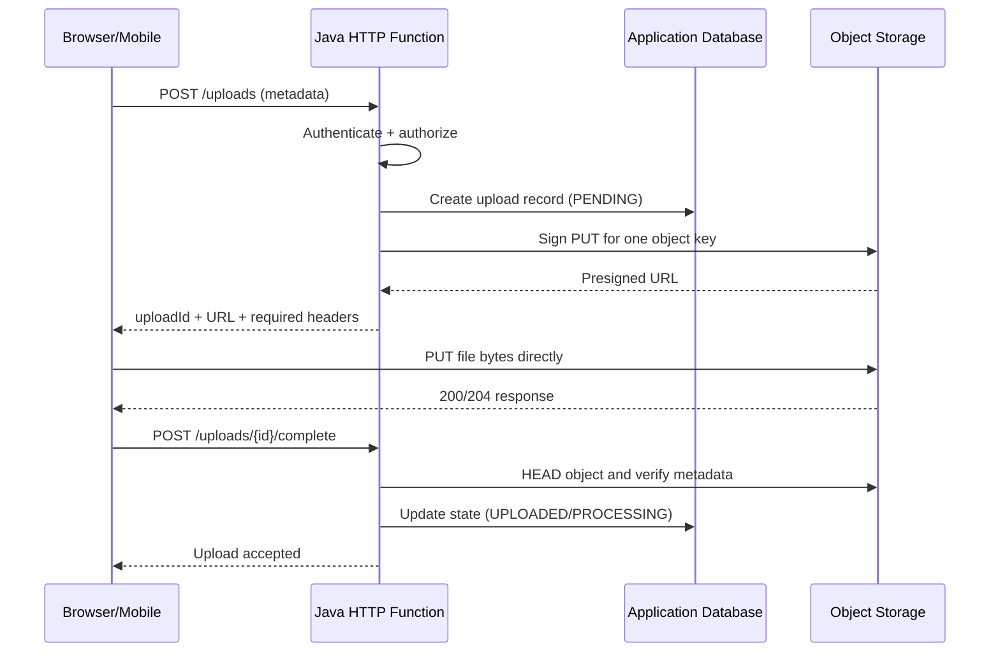
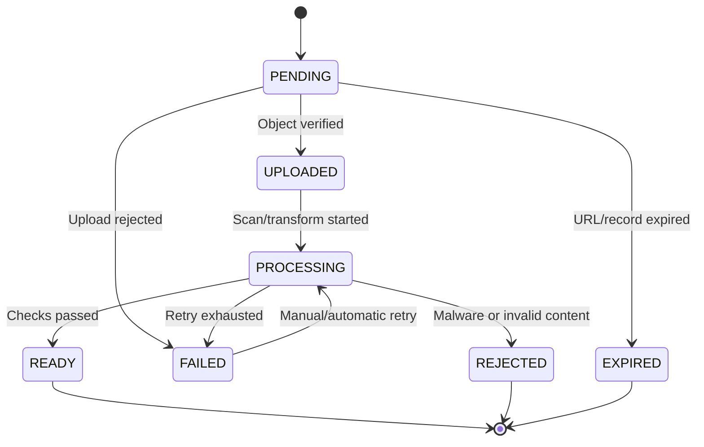

# Upload trực tiếp vào object storage bằng URL ký sẵn

Upload tệp là tác vụ phổ biến trong ứng dụng serverless: người dùng tải ảnh đại diện, tài liệu, video hoặc tệp dữ liệu lên hệ thống. Nếu mọi byte của tệp đều đi qua API và Java function, function phải nhận rồi chuyển tiếp dữ liệu lớn. Cách này làm tăng thời gian thực thi, bộ nhớ, băng thông và chi phí.

Một lựa chọn phổ biến là **upload trực tiếp vào object storage bằng URL ký sẵn** (presigned URL hoặc signed URL). Backend xác thực người dùng, quyết định object key và tạo URL có chữ ký cùng thời hạn ngắn. Client dùng URL đó để tải tệp thẳng lên dịch vụ lưu trữ. Java function chỉ xử lý việc cấp quyền upload và xác nhận trạng thái; dữ liệu tệp không cần đi xuyên qua function.

Bài học tập trung vào luồng upload trực tiếp, cách tạo presigned URL bằng Java, các giới hạn bảo mật, xác minh object sau upload và quản lý trạng thái trong hệ thống serverless.

## 1. Object storage và URL ký sẵn

Object storage lưu dữ liệu dưới dạng object trong bucket hoặc container. Mỗi object thường có:

- **Object key:** tên định danh trong phạm vi bucket, thường có dạng đường dẫn logic.
- **Data:** nội dung byte của tệp.
- **Metadata:** thông tin như content type, kích thước, thời gian cập nhật và metadata tùy chỉnh.
- **Version (nếu bật):** định danh phiên bản của object khi dịch vụ hỗ trợ versioning.

Object storage phù hợp với ảnh, video, tài liệu, bản sao lưu và dữ liệu phi cấu trúc. Dịch vụ thường được thiết kế để lưu lượng tải lên và tải xuống lớn mà không cần backend trung gian xử lý từng byte.

URL ký sẵn được tạo bằng thông tin xác thực của một danh tính có quyền trên object storage. Chữ ký ràng buộc một số thành phần của request, chẳng hạn phương thức HTTP, bucket, object key, thời hạn và một số header. Người giữ URL có thể thực hiện thao tác được cho phép trong khoảng thời gian hiệu lực mà không cần nhận secret của backend.

Các dịch vụ có khái niệm tương tự:

- Amazon S3 presigned URL.
- Google Cloud Storage signed URL.
- Azure Blob Storage SAS (Shared Access Signature).

Cách ký, tên tham số, quyền và giới hạn khác nhau giữa nhà cung cấp. Ví dụ Java trong bài sử dụng AWS SDK for Java 2.x và S3; khi dùng dịch vụ khác, cần thay bằng SDK và giao thức tương ứng.

### URL ký sẵn là một quyền truy cập tạm thời

Presigned URL thường chứa thông tin xác thực trong query string. Vì vậy, bất kỳ ai có URL đều có thể sử dụng quyền được cấp cho đến khi URL hết hạn hoặc quyền nền tảng bị thu hồi. Hãy xem URL này như một bearer token:

- Không ghi URL đầy đủ vào log, analytics hoặc hệ thống theo dõi lỗi.
- Không gửi URL qua kênh công khai hoặc lưu ở nơi người dùng khác có thể đọc.
- Dùng thời hạn ngắn, vừa đủ cho thao tác upload.
- Chỉ cấp quyền cho một object key cụ thể và một phương thức cần thiết.
- Không đưa secret access key vào trình duyệt hoặc ứng dụng mobile.

URL ký sẵn không thay thế bước xác thực người dùng tại backend. Backend vẫn phải kiểm tra ai đang yêu cầu upload, họ có quyền tải tệp lên tài nguyên đó không và họ được cấp loại tệp, dung lượng nào.

## 2. Luồng upload trực tiếp

Một luồng upload đơn giản gồm ba bước chính:

1. Client gọi API backend để xin quyền upload.
2. Java function xác thực và cấp một URL ký sẵn cho một object key cụ thể.
3. Client gửi nội dung tệp trực tiếp đến object storage bằng URL đó.

Sau khi tải lên, ứng dụng cần một bước xác nhận để đánh dấu object đã sẵn sàng hoặc chuyển sang xử lý tiếp theo.



Vai trò của từng thành phần:

- **Client:** chọn tệp, yêu cầu URL, gửi byte và thông báo hoàn tất.
- **Java function:** xác thực, kiểm tra quota và metadata, tạo object key, ký URL và xác minh kết quả.
- **Database:** lưu trạng thái upload, chủ sở hữu, object key, giới hạn và thời hạn.
- **Object storage:** nhận và lưu byte trực tiếp.
- **Worker/event function:** quét virus, tạo thumbnail, trích xuất metadata hoặc chuyển object sang vùng lưu trữ chính thức.

Function không nhận body chứa toàn bộ tệp trong luồng upload thông thường. Nó xử lý control plane (cấp quyền và trạng thái), còn object storage xử lý data plane (truyền byte).

## 3. Vì sao không chuyển tệp qua Java function?

Giả sử người dùng tải lên video 500 MB. Nếu client gửi video đến API, function phải nhận dữ liệu, có thể giữ dữ liệu trong bộ nhớ hoặc tệp tạm, rồi gọi object storage để upload tiếp. Việc này tạo thêm một chặng truyền dữ liệu và tiêu thụ tài nguyên compute.

Upload trực tiếp có các lợi ích:

- Giảm băng thông đi qua backend.
- Tránh giữ payload lớn trong bộ nhớ của function.
- Rút ngắn thời gian HTTP invocation.
- Giảm nguy cơ chạm giới hạn body hoặc timeout của API Gateway và runtime.
- Cho phép object storage xử lý lưu lượng upload lớn theo khả năng của dịch vụ.
- Backend chỉ cần thực hiện các thao tác nhỏ như xác thực, ký URL và xác nhận.

Tuy nhiên, upload trực tiếp không loại bỏ mọi chi phí. Hệ thống vẫn có thể phát sinh phí request, dung lượng lưu trữ, truyền dữ liệu, kiểm tra virus, xử lý ảnh/video và tải xuống. Cần tính cả chi phí object storage lẫn các dịch vụ hậu xử lý.

Upload qua backend vẫn có thể phù hợp nếu cần biến đổi dữ liệu ngay khi nhận, kiểm tra nội dung trước khi lưu, dùng giao thức đặc biệt hoặc có yêu cầu mà object storage không hỗ trợ. Với tệp lớn, hãy cân nhắc streaming thay vì đọc toàn bộ vào bộ nhớ nếu bắt buộc phải qua backend.

## 4. Cấp quyền upload ở backend

Client không nên tự chọn bucket và object key tùy ý. Backend cần tạo object key và ràng buộc URL với đúng vị trí được phép.

Một request xin upload có thể chứa:

```json
{
  "fileName": "avatar.png",
  "contentType": "image/png",
  "sizeBytes": 245760,
  "purpose": "PROFILE_IMAGE"
}
```

Đây chỉ là metadata do client khai báo, chưa phải bằng chứng rằng tệp thực sự là PNG hoặc có đúng kích thước. Backend dùng dữ liệu này để kiểm tra sơ bộ và đặt giới hạn; sau upload cần xác minh object thực tế.

API backend nên thực hiện:

1. Xác thực access token hoặc session của người dùng.
2. Xác định userId từ danh tính đã xác thực, không tin userId client tự gửi.
3. Kiểm tra người dùng có quyền upload vào tài nguyên đích không.
4. Kiểm tra purpose, loại tệp được phép, dung lượng khai báo và quota.
5. Tạo uploadId và object key duy nhất do server kiểm soát.
6. Ghi upload record với trạng thái PENDING và thời hạn.
7. Tạo URL ký sẵn cho đúng phương thức, object key, header và thời hạn.
8. Trả URL cùng các header client phải gửi.

Ví dụ response:

```json
{
  "uploadId": "upl_7f12a9",
  "uploadUrl": "https://storage.example/...",
  "method": "PUT",
  "requiredHeaders": {
    "Content-Type": "image/png"
  },
  "expiresAt": "2026-11-17T12:40:00Z"
}
```

Trong thực tế, uploadUrl sẽ là URL dài có chữ ký. Không nên lưu URL đó trong database nếu không có nhu cầu rõ ràng; thường chỉ cần lưu uploadId, object key, thời hạn, chủ sở hữu và metadata kỳ vọng.

### Object key nên do server tạo

Không dùng nguyên fileName của client làm object key. Tên tệp có thể chứa ký tự đặc biệt, đường dẫn giả, thông tin cá nhân hoặc trùng với object hiện có.

Có thể tạo key theo cấu trúc:

```text
quarantine/{userId}/{uploadId}
```

hoặc:

```text
incoming/{tenantId}/{yyyy}/{MM}/{randomId}
```

Dùng UUID hoặc ID ngẫu nhiên đủ mạnh để tránh đoán key. userId và tenantId phải lấy từ context đã xác thực. File name gốc có thể lưu riêng dưới dạng metadata đã được làm sạch nếu nghiệp vụ cần hiển thị lại cho người dùng.

Không nên đưa tên người dùng, email hoặc dữ liệu nhạy cảm vào object key nếu không cần thiết, vì key có thể xuất hiện trong log, event hoặc công cụ vận hành.

## 5. Tạo presigned PUT URL bằng Java

Ví dụ dưới đây sử dụng AWS SDK for Java 2.x. Backend có một S3Presigner được cấu hình bằng region và credential provider của môi trường. Trong Lambda, role của function có quyền PutObject giới hạn vào prefix được phép.

```java
import java.time.Duration;
import java.util.UUID;
import software.amazon.awssdk.services.s3.model.PutObjectRequest;
import software.amazon.awssdk.services.s3.presigner.S3Presigner;
import software.amazon.awssdk.services.s3.presigner.model.PutObjectPresignRequest;

public final class UploadUrlService {

    private final S3Presigner presigner;
    private final String bucket;

    public UploadUrlService(S3Presigner presigner, String bucket) {
        this.presigner = presigner;
        this.bucket = bucket;
    }

    public PresignedUpload createUpload(
            String trustedUserId,
            String contentType) {

        String uploadId = UUID.randomUUID().toString();
        String objectKey = "quarantine/" + trustedUserId + "/" + uploadId;

        PutObjectRequest putObjectRequest = PutObjectRequest.builder()
                .bucket(bucket)
                .key(objectKey)
                .contentType(contentType)
                .build();

        PutObjectPresignRequest presignRequest =
                PutObjectPresignRequest.builder()
                        .signatureDuration(Duration.ofMinutes(10))
                        .putObjectRequest(putObjectRequest)
                        .build();

        var signedRequest = presigner.presignPutObject(presignRequest);

        return new PresignedUpload(
                uploadId,
                objectKey,
                signedRequest.url().toExternalForm(),
                contentType
        );
    }

    public record PresignedUpload(
            String uploadId,
            String objectKey,
            String uploadUrl,
            String contentType
    ) {}
}
```

Đoạn code tập trung vào thao tác ký URL. Một ứng dụng hoàn chỉnh còn cần kiểm tra user, quota, content type allow-list, lưu upload record và xử lý lỗi.

### Cấu hình presigner

Có thể tạo S3Presigner khi ứng dụng khởi động và tái sử dụng trong vòng đời môi trường thực thi:

```java
import software.amazon.awssdk.regions.Region;
import software.amazon.awssdk.services.s3.presigner.S3Presigner;

S3Presigner presigner = S3Presigner.builder()
        .region(Region.AP_SOUTHEAST_1)
        .build();
```

SDK có thể dùng credential provider chain của môi trường, ví dụ IAM role của Lambda. Không truyền access key và secret key cố định trong mã nguồn. Nếu tự tạo presigner trong ứng dụng chạy lâu dài, hãy đóng nó khi ứng dụng kết thúc. Với Lambda, có thể tái sử dụng đối tượng được khởi tạo ở giai đoạn khởi tạo môi trường nếu việc quản lý vòng đời phù hợp.

IAM role của function cần quyền tối thiểu để ký request cho prefix dự kiến. Cần kiểm tra bucket policy, encryption policy và các điều kiện của tổ chức. Người dùng cuối không nhận role hoặc credential AWS; họ chỉ nhận URL ký sẵn với quyền rất hẹp.

### Header được ký phải khớp

Trong ví dụ, content type được đưa vào PutObjectRequest nên có thể nằm trong danh sách signed headers. Khi upload, client phải gửi đúng giá trị Content-Type đã dùng lúc ký. Nếu backend ký image/png nhưng client gửi application/octet-stream, storage có thể từ chối request vì chữ ký không khớp.

Các header khác như checksum hoặc metadata tùy chỉnh cũng có thể được ràng buộc vào chữ ký. Chỉ yêu cầu client gửi những header mà backend trả về và tài liệu SDK/provider xác nhận là cần thiết. Không tự ý sửa header sau khi URL được ký.

URL có thời hạn 10 phút trong ví dụ. Thời gian thực tế nên đủ cho người dùng tải tệp trên kết nối chậm nhưng càng ngắn càng tốt. URL cũng có thể hết hiệu lực sớm hơn nếu credential dùng để ký hết hạn hoặc bị thu hồi.

## 6. Client upload trực tiếp

Sau khi nhận uploadUrl, browser có thể gửi file bằng fetch:

```javascript
async function uploadFile(file, upload) {
  const response = await fetch(upload.uploadUrl, {
    method: "PUT",
    headers: {
      "Content-Type": upload.requiredHeaders["Content-Type"]
    },
    body: file
  });

  if (!response.ok) {
    throw new Error("Object storage rejected the upload");
  }

  return response;
}
```

Đoạn code minh họa giả định backend đã trả requiredHeaders và URL tương ứng. Client không cần gửi access token ứng dụng đến object storage; URL ký sẵn đã mang quyền tạm thời cho thao tác cụ thể. Access token vẫn được dùng khi gọi API backend để xin URL và xác nhận upload.

Nếu upload thất bại do URL hết hạn, client cần xin URL mới qua backend. Không tự sửa query string hoặc thay object key trong URL cũ.

### Cấu hình CORS cho browser

Khi browser upload sang domain object storage khác với domain ứng dụng, trình duyệt áp dụng Cross-Origin Resource Sharing (CORS). Bucket hoặc storage container cần cho phép origin của ứng dụng, method và các header cần thiết.

Ví dụ cấu hình khái niệm:

```text
AllowedOrigins:
  - https://app.example.com
AllowedMethods:
  - PUT
AllowedHeaders:
  - Content-Type
  - x-amz-checksum-sha256
ExposeHeaders:
  - ETag
```

Cấu hình thực tế phụ thuộc dịch vụ. Chỉ cho phép origin ứng dụng cần thiết và các method/header cần dùng. CORS không phải cơ chế xác thực: request từ script ngoài browser hoặc công cụ HTTP vẫn có thể gọi URL nếu có URL hợp lệ. Chữ ký và quyền object mới quyết định request có được chấp nhận hay không.

Nếu client cần đọc ETag hoặc checksum header, phải khai báo expose header phù hợp. Không mặc định ETag luôn là MD5 của object; multipart upload và các cấu hình mã hóa có thể khiến cách diễn giải khác.

## 7. PUT URL và POST policy khác nhau thế nào?

Có hai cách thường gặp để upload bằng URL ký sẵn:

| Tiêu chí | Presigned PUT | Presigned POST |
|---|---|---|
| Cách gửi | HTTP PUT với body là object | HTTP POST multipart/form-data |
| Điều kiện | Ràng buộc method, key và các header đã ký | Có thể khai báo policy conditions |
| Giới hạn kích thước | Cần thiết kế kiểm tra phù hợp; không nên giả định mọi header size được ký như mong muốn | Với S3 POST policy có thể dùng content-length-range |
| Client | Gửi byte file trực tiếp | Gửi các form fields và file |
| Phù hợp | Luồng PUT đơn giản, upload object cụ thể | Cần policy điều kiện như dải kích thước |

Nếu cần ràng buộc kích thước ngay ở storage, S3 presigned POST policy có thể phù hợp hơn vì hỗ trợ điều kiện content-length-range. Với PUT URL, hãy xác minh giới hạn mà dịch vụ và SDK thực sự áp dụng; không giả định rằng metadata size do client khai báo hoặc Content-Length tự gửi đã được ký và cưỡng chế.

Dù dùng PUT hay POST, backend vẫn phải kiểm tra object sau upload. Một client có thể khai báo size nhỏ hơn thực tế hoặc content type giả. Kiểm tra sau upload giúp bảo vệ trạng thái nghiệp vụ; giới hạn tại storage giúp giảm nguy cơ tiêu tốn tài nguyên trước khi kiểm tra.

## 8. Xác minh object sau upload

Nhận được HTTP 200 hoặc 204 từ object storage cho biết thao tác PUT được chấp nhận theo giao thức storage. Điều đó chưa có nghĩa tệp an toàn hoặc hợp lệ theo nghiệp vụ.

Khi client gọi API complete, backend nên:

1. Xác thực người dùng và kiểm tra uploadId thuộc về họ.
2. Đọc upload record và xác nhận trạng thái hiện tại còn cho phép hoàn tất.
3. Kiểm tra object tồn tại bằng HEAD hoặc API metadata tương đương.
4. So sánh bucket, key, kích thước và metadata với kỳ vọng.
5. Kiểm tra checksum nếu luồng upload đã khai báo checksum đáng tin cậy.
6. Chuyển trạng thái sang UPLOADED hoặc PROCESSING trong transaction.
7. Phát công việc scan/processing qua event hoặc outbox.

Ví dụ thông tin cần đối chiếu:

| Thuộc tính | Nguồn kỳ vọng | Nguồn thực tế |
|---|---|---|
| Object key | Upload record do backend tạo | Key được truy vấn trong storage |
| Kích thước | Giới hạn hoặc size client khai báo | Content-Length/metadata từ storage |
| Content type | Loại cho phép theo nghiệp vụ | Metadata storage và kết quả kiểm tra nội dung |
| Checksum | Checksum client gửi và backend đã ràng buộc nếu có | Checksum do storage xác nhận |
| Chủ sở hữu | Upload record gắn với user/tenant | Backend xác định qua uploadId và key |

Không tin uploadId, objectKey, sizeBytes hoặc contentType do client gửi ở bước complete nếu backend chưa đối chiếu với bản ghi đã tạo khi cấp URL.

### Kiểm tra checksum

Checksum giúp phát hiện nội dung bị thay đổi hoặc truyền không đầy đủ. Có thể dùng SHA-256 nếu dịch vụ hỗ trợ và giao thức upload cho phép khai báo checksum trước khi ký URL.

Một checksum do client cung cấp không chứng minh tệp an toàn; nó chỉ giúp xác minh byte được lưu khớp với byte mà client đã tính. Backend có thể tính lại hoặc yêu cầu storage xác nhận checksum để bảo đảm dữ liệu nhất quán.

Không dùng ETag như một checksum tổng quát nếu chưa biết semantics của dịch vụ. Với S3 multipart upload, ETag thường không phải MD5 của toàn bộ object.

## 9. Quản lý trạng thái upload

Upload là một quy trình có nhiều bước và có thể bị gián đoạn. Nên lưu trạng thái trong database để client và worker biết object đang ở giai đoạn nào.



Các trạng thái có thể gồm:

- **PENDING:** backend đã tạo upload record và URL, object chưa được xác minh.
- **UPLOADED:** object tồn tại và vượt qua kiểm tra cơ bản.
- **PROCESSING:** đang quét virus, đọc metadata hoặc tạo bản dẫn xuất.
- **READY:** tệp đã được kiểm tra và được phép sử dụng.
- **REJECTED:** tệp vi phạm chính sách hoặc không an toàn.
- **FAILED:** xử lý thất bại sau chính sách retry.
- **EXPIRED:** upload không hoàn tất trong thời hạn.

Trạng thái nên được chuyển bằng điều kiện có kiểm soát, ví dụ cập nhật từ PENDING sang UPLOADED chỉ khi bản ghi vẫn đang PENDING. Điều này tránh hai request complete hoặc hai event cùng lúc ghi đè trạng thái mới hơn.

### Không chỉ dựa vào callback của client

Client có thể gọi /complete sau khi PUT thành công, nhưng callback đó không phải bằng chứng duy nhất. Client có thể bị đóng tab, mất mạng hoặc cố ý gửi callback giả. Backend phải kiểm tra object trực tiếp.

Một lựa chọn khác là dùng object-created event từ storage để kích hoạt function. Event có thể đến trước hoặc sau callback client và có thể bị gửi lại. Vì vậy, cả hai luồng nên cập nhật cùng một state machine idempotent.

Nếu dùng event storage làm tín hiệu hoàn tất, worker cần xác định event thuộc upload record nào bằng bucket/key/version, kiểm tra trạng thái record và xác minh object. Không tin payload event một cách mù quáng nếu có thể đối chiếu metadata với storage.

## 10. Bảo vệ object chưa được tin cậy

Tệp được upload trực tiếp từ client là dữ liệu không tin cậy, kể cả khi URL được ký hợp lệ. Chữ ký chỉ chứng minh quyền upload theo URL, không chứng minh nội dung an toàn.

Nên sử dụng vùng quarantine hoặc prefix riêng cho object mới:

```text
quarantine/{tenantId}/{uploadId}
```

Sau khi xử lý và kiểm tra thành công, hệ thống có thể copy object sang vùng chính thức:

```text
approved/{tenantId}/{assetId}
```

Các bước kiểm tra có thể gồm:

- So sánh kích thước với giới hạn nghiệp vụ.
- Kiểm tra file signature/magic bytes thay vì chỉ tin extension hoặc Content-Type.
- Quét malware bằng dịch vụ phù hợp.
- Giải mã hoặc phân tích file bằng parser an toàn và cập nhật thư viện thường xuyên.
- Tạo thumbnail hoặc preview trong môi trường cách ly.
- Từ chối file có định dạng không được hỗ trợ, cấu trúc lỗi hoặc nội dung vượt chính sách.
- Đặt Content-Disposition phù hợp khi tải xuống; không phục vụ nội dung tùy ý dưới origin nhạy cảm.

Một file có tên photo.png và header image/png vẫn có thể chứa nội dung khác. Không dựa vào tên file hoặc Content-Type do client khai báo để quyết định an toàn.

Không bật public access cho bucket chỉ để browser upload được. Dùng bucket private và presigned URL có quyền giới hạn. Nếu tệp được tải xuống, backend có thể cấp presigned GET sau khi xác nhận người dùng có quyền đọc object ở trạng thái READY.

## 11. Hạn chế của URL ký sẵn

Presigned URL thường là quyền bearer có thời hạn, không phải token dùng một lần. Trong thời gian hiệu lực, URL có thể được dùng lại. Với PUT vào cùng key, request mới có thể ghi đè object hiện tại nếu policy và versioning cho phép.

Do đó:

- Tạo object key ngẫu nhiên và riêng cho mỗi upload.
- Không cấp URL lâu hơn mức cần thiết.
- Không tái sử dụng key giữa nhiều người dùng hoặc nhiều phiên upload.
- Kiểm tra upload record và trạng thái trước khi chấp nhận complete.
- Cân nhắc bucket versioning hoặc điều kiện ghi nếu cần phát hiện/giữ lại phiên bản bị ghi đè.
- Dùng checksum đã ràng buộc nếu cần xác nhận nội dung cụ thể.
- Hạn chế quyền ký URL và quyền ghi ở IAM/bucket policy.

Không nên tuyên bố URL là one-time nếu storage không cung cấp cơ chế đó. Nếu yêu cầu nghiệp vụ là chỉ được ghi đúng một lần, cần thiết kế thêm điều kiện lưu trữ, versioning hoặc quy trình kiểm soát hoàn tất phù hợp.

Một URL đã phát hành thường khó thu hồi riêng lẻ ngay lập tức. Có thể chờ hết hạn, thu hồi credential hoặc thay đổi policy, nhưng các cách đó có thể có phạm vi ảnh hưởng rộng hơn. Vì vậy, thời hạn ngắn và object key riêng rất quan trọng.

## 12. Upload tệp lớn bằng multipart upload

PUT đơn giản phù hợp với object nhỏ hoặc vừa. Với tệp lớn, multipart upload chia tệp thành nhiều part. Client upload từng part độc lập, có thể retry một part bị lỗi mà không phải gửi lại toàn bộ tệp.

Luồng tổng quát:

1. Backend tạo multipart upload trong object storage.
2. Backend cấp URL ký sẵn cho từng part hoặc từng nhóm part.
3. Client chia tệp thành các part và upload song song theo giới hạn.
4. Client thu thập ETag/checksum của từng part theo giao thức.
5. Backend xác minh danh sách part và gọi CompleteMultipartUpload.
6. Storage ghép các part thành object hoàn chỉnh.
7. Backend kiểm tra object và chuyển trạng thái upload.

Backend nên kiểm soát uploadId của storage, số part tối đa, kích thước part, thứ tự và thời hạn. Không để client tự hoàn tất multipart upload nếu cần kiểm soát chặt.

Nếu người dùng bỏ dở, multipart upload có thể để lại các part chưa hoàn tất và phát sinh chi phí lưu trữ. Cấu hình lifecycle rule để tự động abort multipart upload không hoàn tất sau một khoảng thời gian phù hợp. Với upload thường, cũng nên có job dọn các record PENDING đã hết hạn và object quarantine không còn được tham chiếu.

## 13. CORS, mạng và trải nghiệm người dùng

Upload trực tiếp cần chú ý đến môi trường mạng của client:

- Browser phải vượt qua CORS preflight khi gửi PUT hoặc custom header.
- Mạng di động có thể gián đoạn; client cần hiển thị tiến độ và hỗ trợ retry.
- URL có thể hết hạn trong khi người dùng đang chọn tệp hoặc chờ mạng; client cần xin URL mới.
- Với multipart, chỉ retry part thất bại thay vì tải lại toàn bộ file.
- Client cần phân biệt lỗi từ backend cấp URL và lỗi từ object storage.
- Không hiển thị presigned URL đầy đủ trong thông báo lỗi hoặc log phía client.

Cấu hình CORS chỉ ảnh hưởng browser. Ứng dụng mobile native hoặc command-line client không bị browser enforcement, nhưng vẫn phải có URL hợp lệ và chữ ký đúng.

Nếu object storage nằm ở region xa người dùng, thời gian upload có thể tăng. Có thể cân nhắc bucket region gần người dùng, acceleration hoặc cơ chế upload resumable nếu nhà cung cấp hỗ trợ và chi phí phù hợp.

## 14. Tích hợp event và xử lý sau upload

Object storage thường có thể phát event khi object được tạo. Event này có thể kích hoạt Java function để xử lý:

- Quét virus.
- Tạo thumbnail hoặc preview.
- Trích xuất metadata.
- Kiểm tra định dạng hoặc kích thước.
- Tính checksum.
- Copy object sang prefix chính thức.
- Cập nhật upload record thành READY hoặc REJECTED.

Luồng event cần có idempotency. Một object-created event có thể được gửi lại hoặc đến ngoài thứ tự. Dùng bucket, key, version ID hoặc event ID làm khóa xử lý phù hợp. Trước khi chuyển trạng thái, kiểm tra trạng thái hiện tại và phiên bản object đang xử lý.

Nếu function xử lý ảnh bị lỗi tạm thời, có thể retry với backoff. Nếu file sai định dạng hoặc malware được phát hiện, retry không giải quyết được; chuyển sang REJECTED hoặc DLQ theo chính sách. Theo dõi tuổi event và queue để phát hiện object bị kẹt ở PROCESSING.

Khi copy object từ quarantine sang approved, thao tác copy và cập nhật database có thể không nằm trong cùng transaction. Hãy thiết kế bước xử lý có thể chạy lại: nếu object đích đã tồn tại với đúng version/checksum thì tiếp tục cập nhật trạng thái thay vì tạo tác dụng phụ mới.

## 15. Chi phí và giới hạn vận hành

Upload trực tiếp thường giảm chi phí compute và truyền dữ liệu qua backend, nhưng cần xem xét toàn bộ luồng:

| Thành phần | Yếu tố chi phí hoặc giới hạn |
|---|---|
| Java function cấp URL | Số invocation, thời gian chạy, bộ nhớ và truy cập secret |
| Object storage | PUT/POST/HEAD request, dung lượng, versioning và lifecycle |
| Network | Data transfer, region, acceleration và tải xuống |
| Processing | Malware scan, thumbnail, transcode và metadata extraction |
| Database | Upload record, trạng thái, idempotency và truy vấn |
| Queue/event | Request, retry, lưu message và DLQ |
| Monitoring | Log, metric, trace và thời gian lưu giữ |

Đặt quota theo user hoặc tenant để tránh một người dùng tạo quá nhiều upload URL hoặc object. Có thể giới hạn số upload đang PENDING, tổng dung lượng theo ngày và số object được phép lưu.

Cần theo dõi object orphan, multipart upload chưa hoàn tất, upload record hết hạn và tệp bị REJECTED. Lifecycle policy giúp xóa dữ liệu tạm sau thời gian lưu giữ phù hợp. Không xóa object đang được xử lý hoặc cần lưu bằng chứng theo chính sách nghiệp vụ.

## 16. Những lỗi triển khai thường gặp

- **Để client tự chọn object key:** có thể ghi đè object của người khác hoặc tạo key không kiểm soát; backend nên sinh key.
- **Đưa cloud credentials xuống browser:** lộ credential có thể mở rộng quyền ngoài một object; chỉ trả URL ký sẵn.
- **Coi URL là one-time:** URL thường dùng lại được đến khi hết hạn; cần key riêng và kiểm tra trạng thái.
- **Tin Content-Type hoặc tên file:** metadata client khai báo có thể giả; cần kiểm tra nội dung thực tế.
- **Bỏ qua CORS:** browser có thể chặn request dù chữ ký đúng; cấu hình origin, method và header cần thiết.
- **Dùng CORS làm bảo mật:** CORS không ngăn client ngoài browser; vẫn phải xác minh chữ ký và quyền.
- **Trả READY ngay sau HTTP PUT:** object có thể chưa được scan hoặc xác minh; dùng trạng thái UPLOADED/PROCESSING/READY.
- **Tin callback complete của client:** backend phải xác minh object trong storage.
- **Không xử lý event trùng:** storage event có thể được gửi lại; worker cần idempotent.
- **Không dọn upload dở:** record PENDING, object tạm và multipart part có thể gây chi phí kéo dài.
- **Không kiểm soát kích thước:** metadata do client khai báo không đủ; giới hạn ở storage nếu có thể và xác minh sau upload.

## 17. Quy trình triển khai thực tế

Khi xây dựng chức năng upload trực tiếp cho một ứng dụng serverless Java, có thể đi theo các bước:

1. Xác định loại tệp, mục đích, giới hạn kích thước và quota theo user/tenant.
2. Thiết kế upload record với owner, object key, trạng thái, content type kỳ vọng, size, checksum và thời hạn.
3. Tạo API xin upload; xác thực người dùng và kiểm tra quyền trước khi ký URL.
4. Tạo object key ngẫu nhiên do server kiểm soát và ghi trạng thái PENDING.
5. Tạo presigned PUT hoặc POST policy với quyền và thời hạn tối thiểu.
6. Trả URL cùng method và các header client bắt buộc.
7. Cấu hình CORS cho browser và giới hạn request ở gateway/storage.
8. Client upload byte trực tiếp đến object storage.
9. Backend xác minh object bằng HEAD hoặc metadata API khi client báo hoàn tất.
10. Chuyển trạng thái sang PROCESSING và kích hoạt worker/event.
11. Quét, xác minh nội dung, tạo bản dẫn xuất và chuyển sang READY hoặc REJECTED.
12. Dọn upload hết hạn, object orphan và multipart upload chưa hoàn tất.
13. Theo dõi tỷ lệ upload thành công, lỗi, dung lượng, thời gian upload, event retry và chi phí.

## 18. Ghi nhớ

Presigned URL cho phép backend cấp quyền upload có giới hạn để client gửi tệp trực tiếp đến object storage. Cách này giảm tải cho Java function và phù hợp với tệp lớn hoặc lưu lượng upload cao.

Backend vẫn phải xác thực người dùng, tạo object key, giới hạn phương thức và thời hạn, bảo vệ URL như bearer token và kiểm tra object sau khi upload. Tệp mới nên ở trạng thái chưa tin cậy cho đến khi được xác minh và xử lý. Kết hợp upload record, event-driven worker, idempotency, lifecycle cleanup và monitoring để quy trình chịu được retry, gián đoạn mạng và scale serverless.

