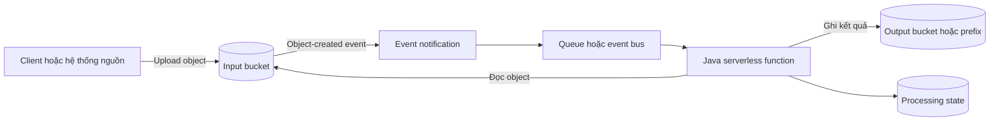
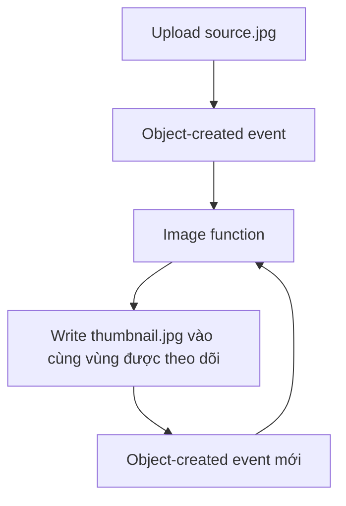
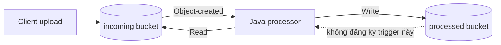

# Trigger từ object storage và phòng tránh vòng lặp xử lý

Object storage thường là nơi lưu ảnh, tài liệu, video, bản xuất dữ liệu và các tệp đầu vào cho tác vụ nền. Nhiều nền tảng cloud có thể phát event khi một object được tạo, ghi đè, hoàn tất multipart upload hoặc bị xóa. Event đó có thể kích hoạt Java function để kiểm tra, chuyển đổi, lập chỉ mục hoặc tạo bản dẫn xuất mà không cần một dịch vụ khác liên tục dò tìm bucket.

Trigger từ object storage rất tiện, nhưng cũng có một rủi ro đặc biệt: **function xử lý object rồi ghi object mới vào chính vùng được theo dõi, khiến event mới lại kích hoạt function đó**. Nếu không giới hạn nguồn event và đích ghi, function có thể tự gọi lặp vô hạn, tạo thêm object, invocation, log và chi phí. Một vòng lặp tương tự có thể xảy ra khi function ghi đè lại tệp nguồn hoặc khi nhiều function kích hoạt lẫn nhau qua các bucket.

Để dùng object storage event an toàn, cần hiểu event notification, thiết kế ranh giới input/output, lọc sự kiện theo bucket/prefix/suffix, xử lý event trùng và đến sai thứ tự, đồng thời quan sát được toàn bộ vòng đời object. Bài học này tập trung vào các nguyên tắc đó trong ứng dụng Java serverless.

## 1. Object storage event hoạt động như thế nào?

Object storage thường phát notification khi một thao tác nhất định xảy ra. Tùy nhà cung cấp, event có thể mô tả object được tạo, ghi đè, hoàn tất upload nhiều phần, xóa hoặc thay đổi metadata. Event thường chứa tên bucket/container, object key, loại thao tác, thời điểm, version/generation nếu có và một số metadata liên quan.

Một luồng cơ bản:



Producer chỉ cần tải object lên storage. Storage phát event đến một đích đã cấu hình như queue, event bus hoặc trực tiếp tới function. Consumer nhận event rồi dùng object reference để đọc nội dung. Event notification thường là thông báo về thay đổi đã xảy ra, không phải bản sao của object và cũng không thay thế trạng thái nghiệp vụ trong database.

### Các loại event cần phân biệt

| Loại thao tác | Ý nghĩa | Lưu ý khi xử lý |
|---|---|---|
| Object created / finalized | Object mới đã được tạo hoặc upload hoàn tất | Với multipart upload, chỉ xử lý sau khi hoàn tất toàn bộ upload |
| Object overwritten | Nội dung tại key đã được thay thế | Cần version/generation để biết chính xác phiên bản nào phát event |
| Object deleted | Object hoặc một version bị xóa | Không giả định object còn đọc được khi consumer nhận event |
| Metadata/tag updated | Metadata hoặc tag thay đổi | Có thể tạo event riêng; tránh để cập nhật metadata kích hoạt lại cùng luồng ngoài ý muốn |
| Restore/copy/replication | Object được khôi phục hoặc sao chép | Cần quyết định có xem đây là đầu vào mới hay không |

Tên event và semantics khác nhau giữa các cloud provider. Có nền tảng phát event cho thao tác hoàn tất upload, có nền tảng phát event theo generation/version, và có nền tảng hỗ trợ cấu hình event type riêng. Khi triển khai, phải xác minh loại thao tác nào thực sự tạo notification và các trường định danh nào có sẵn.

### Notification không đồng nghĩa với exactly-once

Consumer cần giả định event có thể được giao nhiều lần, đến trễ hoặc không theo thứ tự. Một số hệ thống có thể gửi lại notification khi endpoint tạm thời lỗi; queue ở giữa cũng có thể redeliver khi function timeout trước khi xác nhận. Event của cùng object có thể đến theo thứ tự khác nhau nếu object bị cập nhật liên tiếp.

Vì vậy, handler không nên chỉ dựa vào việc “đã nhận event” để kết luận object chưa được xử lý. Nó cần một khóa xử lý ổn định, trạng thái bền vững và thao tác ghi kết quả có thể retry an toàn.

## 2. Vòng lặp trigger hình thành ra sao?

Vòng lặp phổ biến nhất xảy ra khi một function được kích hoạt bởi object mới trong bucket, sau đó ghi kết quả trở lại cùng bucket mà không có bộ lọc phù hợp.



Mỗi lần function ghi thumbnail, storage lại phát event. Function nhận thumbnail như một đầu vào mới, tạo thumbnail của thumbnail, rồi tiếp tục tạo event. Tùy logic, vòng lặp có thể sinh ra chuỗi object không ngừng, ghi đè qua lại hoặc tạo lượng invocation tăng rất nhanh.

Vòng lặp cũng có thể xuất hiện trong các tình huống khác:

- Function đọc object trong bucket A, ghi kết quả vào bucket B, nhưng cả A và B đều được cấu hình gửi event tới cùng function.
- Function cập nhật tag hoặc metadata; thao tác cập nhật này lại thuộc nhóm event đang được đăng ký.
- Function đổi tên hoặc copy object trong cùng prefix được theo dõi; thao tác copy tạo object mới và kích hoạt lại handler.
- Hai function A và B theo dõi output của nhau: A ghi vào bucket B, B ghi vào bucket A.
- Một pipeline tạo manifest hoặc tệp trạng thái vào cùng thư mục với dữ liệu đầu vào, khiến manifest cũng bị xử lý như dữ liệu nghiệp vụ.
- Function ghi lại object nguồn sau khi xử lý, làm phát sinh notification mới cho chính key đó.

### Tác động của vòng lặp

Vòng lặp không chỉ gây lãng phí invocation. Nó còn có thể làm:

- Tăng đột biến số object và dung lượng lưu trữ.
- Tăng request, queue depth, retry và chi phí truyền dữ liệu.
- Làm function đạt concurrency limit, gây throttling cho cả luồng hợp lệ.
- Ghi đè dữ liệu nguồn hoặc tạo output sai nhiều lần.
- Tạo log và trace khổng lồ, làm khó tìm nguyên nhân ban đầu.
- Kích hoạt các pipeline downstream ngoài dự kiến.

Không nên trông chờ concurrency limit hoặc timeout tự dừng vòng lặp. Các giới hạn đó chỉ làm chậm hoặc giới hạn tốc độ, trong khi event vẫn có thể tiếp tục được tạo và tích lũy.

## 3. Thiết kế ranh giới input và output

Biện pháp dễ hiểu nhất là tách rõ nơi nhận object đầu vào và nơi lưu kết quả. Có thể dùng bucket riêng hoặc prefix riêng trong cùng bucket, tùy khả năng cấu hình notification và yêu cầu bảo mật.

### Cách 1: Dùng bucket riêng



Bucket `incoming` chỉ nhận dữ liệu nguồn và phát event tới function xử lý. Bucket `processed` lưu thumbnail, tệp đã chuẩn hóa hoặc kết quả. Notification đầu vào không đăng ký trên bucket output. Đây là cách tách rõ ràng, thuận tiện khi hai vùng có chính sách IAM, retention hoặc mã hóa khác nhau.

### Cách 2: Dùng prefix riêng

Nếu dùng cùng bucket, quy ước đường dẫn có thể là:

```text
media-bucket/
  incoming/
    tenant-42/2026/11/source-123.jpg
  processed/
    tenant-42/2026/11/source-123.webp
  quarantine/
    tenant-42/2026/11/source-999.bin
  manifests/
    batch-2026-11-17.json
```

Notification chỉ theo dõi prefix `incoming/`. Function đọc từ `incoming/`, ghi bản dẫn xuất vào `processed/` và object không hợp lệ vào `quarantine/`. Các prefix output không nằm trong phạm vi trigger nên không kích hoạt lại cùng handler.

Prefix filter là bộ lọc định tuyến, không phải cơ chế bảo mật. Người dùng hoặc function khác vẫn có thể ghi vào prefix đó nếu IAM cho phép. Cần phối hợp cả cấu hình notification và quyền ghi để bảo vệ ranh giới.

### So sánh hai cách

| Tiêu chí | Bucket riêng | Prefix riêng trong cùng bucket |
|---|---|---|
| Cách ly trigger | Rõ ràng ở cấp bucket | Phụ thuộc cấu hình prefix filter chính xác |
| Quyền truy cập | Dễ tách role và policy | Cần policy theo prefix hoặc điều kiện phù hợp |
| Retention/lifecycle | Có thể cấu hình độc lập | Cần rule theo prefix nếu provider hỗ trợ |
| Chi phí/quản trị | Có thể thêm bucket và cấu hình | Ít tài nguyên cấu hình hơn |
| Rủi ro cấu hình sai | Thấp hơn khi chỉ bucket input có notification | Có thể lọt output nếu filter quá rộng |

Chọn cách phù hợp với nền tảng và mức cách ly cần thiết. Với dữ liệu nhạy cảm hoặc pipeline nhiều nhóm sở hữu, bucket riêng thường giúp quyền và vòng đời rõ hơn. Với hệ thống nhỏ, prefix riêng có thể đủ nếu filter và IAM được kiểm soát tốt.

## 4. Cấu hình event filter có chủ đích

Chỉ đăng ký các event type thực sự cần xử lý. Ví dụ, một function tạo ảnh thu nhỏ thường chỉ cần event hoàn tất tạo object trong prefix `incoming/` với phần mở rộng ảnh được hỗ trợ. Nó không cần chạy khi object bị xóa, tag thay đổi hoặc thumbnail được tạo.

Các lớp lọc có thể kết hợp:

1. **Bucket/container:** chỉ nhận từ vùng chứa đầu vào.
2. **Prefix:** chỉ nhận object nằm dưới `incoming/`.
3. **Suffix:** chỉ nhận phần mở rộng hoặc kiểu tên cần xử lý, ví dụ `.jpg`, `.png`.
4. **Event type:** chỉ nhận thao tác tạo/hoàn tất upload, bỏ qua delete hoặc metadata update nếu không cần.
5. **Quy tắc nghiệp vụ trong handler:** kiểm tra trạng thái upload, loại object, tenant, version và marker xử lý.

Ví dụ cấu hình khái niệm:

```yaml
notification:
  source: media-bucket
  eventTypes:
    - ObjectCreated
  filters:
    prefix: incoming/
    suffixes:
      - .jpg
      - .jpeg
      - .png
  target: image-processor-function
```

Đây là pseudoconfiguration để thể hiện ý tưởng, không phải cú pháp triển khai của một cloud provider cụ thể. Một số dịch vụ không hỗ trợ nhiều suffix trong cùng rule hoặc có cách biểu diễn filter khác. Nếu cần nhiều loại tệp, có thể tạo nhiều rule hoặc dùng một rule rộng hơn rồi kiểm tra loại tệp trong handler.

### Không chỉ dựa vào suffix

Phần mở rộng tên file do client cung cấp và có thể giả mạo. Object `malware.exe` có thể được đặt tên `photo.jpg`. Suffix filter giúp giảm event không liên quan nhưng không thay thế xác minh nội dung. Function cần kiểm tra kích thước, định dạng thực, chữ ký tệp và quét malware nếu dữ liệu yêu cầu.

### Filter phải khớp với đích ghi

Nếu function ghi `processed/source.jpg` nhưng filter chỉ loại trừ `.webp`, output vẫn có thể khớp suffix `.jpg` và tạo vòng lặp. Hãy thiết kế prefix input/output rõ ràng và kiểm thử bằng chính object key đầu ra. Đừng giả định filter loại trừ chỉ dựa vào một vài tên file sẽ bao phủ mọi trường hợp.

## 5. Phòng vệ trong Java handler

Filter ở storage/broker là lớp bảo vệ đầu tiên. Handler vẫn nên xác minh event trước khi xử lý, vì event có thể được chuyển qua nhiều nguồn, cấu hình có thể thay đổi hoặc một message không hợp lệ có thể được gửi trực tiếp vào queue.

Một handler có thể kiểm tra:

- Bucket phải nằm trong allowlist cấu hình.
- Object key phải nằm trong prefix input được phép.
- Object key phải được giải mã/chuẩn hóa theo định dạng event của provider trước khi so khớp prefix.
- Event type phải thuộc nhóm đã đăng ký.
- Object version/generation phải có định dạng hợp lệ nếu nền tảng cung cấp.
- Object phải thuộc upload intent hoặc tenant hợp lệ theo dữ liệu server-side.
- Object size phải nằm trong giới hạn trước khi mở stream.

Ví dụ Java dưới đây dùng kiểu event trung lập với nhà cung cấp. Adapter nhận event thật từ Lambda, Cloud Functions, Azure Functions hoặc một consumer queue rồi ánh xạ sang `ObjectCreatedEvent`.

```java
import java.util.Set;

public record ObjectCreatedEvent(
        String eventId,
        String eventType,
        String bucket,
        String key,
        String versionId,
        long sizeBytes
) {}

public enum HandleResult {
    PROCESSED,
    IGNORED,
    ALREADY_PROCESSED
}

public enum ClaimStatus {
    CLAIMED,
    ALREADY_COMPLETED,
    BUSY
}

public record ProcessingClaim(ClaimStatus status, String leaseToken) {}

public interface ObjectProcessor {
    void process(String bucket, String key, String versionId);
}

public interface ProcessingLedger {
    // Claim nguyên tử và tạo lease; token xác định invocation đang sở hữu lease.
    ProcessingClaim claim(String objectIdentity);
    // Chỉ đánh dấu hoàn tất nếu leaseToken vẫn là lease hiện hành.
    void markCompleted(String objectIdentity, String leaseToken);
}

public final class RetryableProcessingException extends RuntimeException {
    public RetryableProcessingException(String message) {
        super(message);
    }
}

public final class ObjectCreatedHandler {
    private static final String INPUT_PREFIX = "incoming/";
    private static final Set<String> ALLOWED_TYPES = Set.of(
            "ObjectCreated", "ObjectFinalized"
    );
    private static final long MAX_BYTES = 100L * 1024 * 1024;

    private final String expectedBucket;
    private final ObjectProcessor processor;
    private final ProcessingLedger ledger;

    public ObjectCreatedHandler(
            String expectedBucket,
            ObjectProcessor processor,
            ProcessingLedger ledger
    ) {
        this.expectedBucket = expectedBucket;
        this.processor = processor;
        this.ledger = ledger;
    }

    public HandleResult handle(ObjectCreatedEvent event) {
        if (!ALLOWED_TYPES.contains(event.eventType())) {
            return HandleResult.IGNORED;
        }
        if (!expectedBucket.equals(event.bucket())) {
            return HandleResult.IGNORED;
        }
        if (event.key() == null || !event.key().startsWith(INPUT_PREFIX)) {
            return HandleResult.IGNORED;
        }
        if (event.sizeBytes() < 0 || event.sizeBytes() > MAX_BYTES) {
            throw new IllegalArgumentException("Object size is outside allowed range");
        }

        String version = event.versionId() == null ? "unversioned" : event.versionId();
        String identity = event.bucket() + "/" + event.key() + "#" + version;
        ProcessingClaim claim = ledger.claim(identity);
        if (claim.status() == ClaimStatus.ALREADY_COMPLETED) {
            return HandleResult.ALREADY_PROCESSED;
        }
        if (claim.status() == ClaimStatus.BUSY) {
            throw new RetryableProcessingException("Another invocation holds the processing lease");
        }

        processor.process(event.bucket(), event.key(), event.versionId());
        ledger.markCompleted(identity, claim.leaseToken());
        return HandleResult.PROCESSED;
    }
}
```

Ví dụ minh họa cấu trúc kiểm tra và idempotency; adapter cần chuẩn hóa cách giải mã object key theo đúng định dạng event của provider trước khi tạo `ObjectCreatedEvent`. `claim` phải dùng conditional write hoặc unique constraint để hai invocation đồng thời không cùng sở hữu công việc. Nếu kết quả là `BUSY`, handler yêu cầu retry sau; nếu là `ALREADY_COMPLETED`, có thể xác nhận event trùng. Lease token giúp chỉ invocation đang giữ lease mới được đánh dấu hoàn tất. Ví dụ dùng `record`, cần Java 16 trở lên (thường triển khai với Java 17).

Phần quan trọng nhất vẫn là quy ước đường dẫn và filter ở nguồn: handler chỉ chấp nhận prefix input, còn processor ghi output vào prefix khác. Trong dự án thật, nên gom các prefix vào cấu hình tập trung để cấu hình notification, IAM và handler không lệch nhau.

### Ghi output ở đường dẫn khác

Processor nên nhận rõ input reference và tạo output key theo quy tắc riêng. Không ghi đè object nguồn trừ khi có lý do nghiệp vụ rõ ràng và đã xử lý event overwrite.

```java
public record DerivedObjectKey(String value) {}

public final class ImageKeyPolicy {
    public DerivedObjectKey thumbnailKey(String inputKey) {
        if (!inputKey.startsWith("incoming/")) {
            throw new IllegalArgumentException("Unexpected input prefix");
        }
        String relative = inputKey.substring("incoming/".length());
        return new DerivedObjectKey("processed/" + relative + ".webp");
    }
}
```

Đây là quy tắc minh họa. Cần chuẩn hóa key, giới hạn ký tự và tránh path traversal khi chuyển đổi tên. Với object storage, key thường là chuỗi phẳng chứ không phải đường dẫn filesystem, nhưng các ký tự phân tách vẫn có ý nghĩa với filter và quy ước prefix. Không dùng trực tiếp đường dẫn do người dùng gửi làm đích ghi.

## 6. Idempotency và xử lý event trùng

Event notification có thể được giao lại. Nếu cùng object/version được xử lý hai lần, handler không nên tạo hai kết quả hoặc thực hiện side effect lặp. Khóa idempotency nên đại diện cho phiên bản object, không chỉ tên key.

Một khóa thường dùng:

```text
bucket + objectKey + versionId
```

Nếu versioning không được bật, có thể dùng key kết hợp event ID ổn định hoặc checksum/metadata của lần upload, nhưng cần hiểu giới hạn. Không phải ETag nào cũng là MD5 của nội dung; multipart upload hoặc mã hóa có thể làm semantics ETag khác. Nếu nội dung cùng key có thể bị ghi đè, bật versioning hoặc dùng key duy nhất cho mỗi lần upload là lựa chọn an toàn hơn.

### Trạng thái xử lý bền vững

Một bảng ledger có thể lưu:

| Trường | Mục đích |
|---|---|
| `object_identity` | Khóa duy nhất cho bucket/key/version |
| `status` | `PROCESSING`, `COMPLETED`, `FAILED` |
| `lease_owner` | Invocation đang xử lý |
| `lease_expires_at` | Thời điểm có thể reclaim sau crash |
| `attempt_count` | Số lần thử |
| `output_reference` | Object đầu ra nếu đã tạo |
| `last_error` | Mã lỗi đã phân loại, không chứa secret |
| `updated_at` | Thời điểm cập nhật trạng thái |

Claim nên dùng thao tác nguyên tử. Khi trạng thái `COMPLETED`, event trùng có thể được bỏ qua. Khi đang `PROCESSING` và lease còn hạn, invocation khác không nên chạy cùng công việc. Khi lease hết hạn, một invocation mới có thể reclaim và tiếp tục theo chính sách.

Không giữ trạng thái xử lý chỉ trong biến static hoặc bộ nhớ của function. Execution environment có thể bị thay thế và nhiều instance có thể chạy đồng thời. Trạng thái chống trùng cần nằm trong database, key-value store hoặc kho bền vững có conditional write.

### Khoảng trống giữa ghi output và đánh dấu hoàn tất

Giả sử function tạo output thành công nhưng bị dừng trước khi ghi `COMPLETED`. Event sẽ được giao lại và function có thể tạo output lần nữa. Có thể giảm tác động bằng cách:

- Tạo output key xác định từ input identity và phiên bản xử lý để lần retry ghi cùng một đích.
- Dùng conditional create hoặc kiểm tra output đã tồn tại với metadata phù hợp.
- Ghi trạng thái output reference cùng kết quả nghiệp vụ trong transaction cục bộ nếu cùng database.
- Dùng outbox cho event tiếp theo, để trạng thái hoàn tất và thông báo downstream không bị lệch nhau.
- Bảo đảm thao tác downstream idempotent theo cùng processing identity.

Không có một transaction nguyên tử chung giữa object storage, database và event bus trong hầu hết thiết kế thông thường. Vì vậy, phải xác định trạng thái phục hồi cho từng khoảng trống lỗi.

## 7. Versioning, overwrite và event đến sai thứ tự

Một key có thể được upload nhiều lần. Ví dụ `incoming/customer-42/profile.json` được ghi lúc 10:00 rồi cập nhật lúc 10:05. Hai event có thể đến consumer theo thứ tự 10:05 rồi 10:00. Nếu handler đọc object mới nhất theo key cho cả hai event, event cũ có thể xử lý nội dung mới và sau đó ghi kết quả cũ đè lên kết quả mới.

Để xử lý đúng:

1. Bật object versioning/generation nếu storage hỗ trợ.
2. Lưu version/generation trong event và đọc chính xác phiên bản đó.
3. Ghi phiên bản nguồn vào metadata output hoặc ledger.
4. Khi cập nhật trạng thái nghiệp vụ, chỉ áp dụng kết quả nếu version mới hơn version đã xử lý.
5. Nếu không thể đọc đúng version, dùng key bất biến cho mỗi lần upload.

Không nên dùng thời gian event làm thứ tự duy nhất. Dùng generation/version do storage cấp hoặc sequence nghiệp vụ do hệ thống sở hữu tạo ra. Với provider không có versioning, hãy thiết kế object key duy nhất cho mỗi lần upload và dùng database để trỏ tới phiên bản hiện hành.

### Delete event và object đã biến mất

Delete notification có thể đến sau khi object đã không còn đọc được. Nếu consumer cần audit, event phải chứa đủ metadata hoặc hệ thống phải lưu snapshot metadata trong database trước khi xóa. Không thiết kế delete handler dựa trên giả định rằng nó luôn có thể tải lại nội dung object.

Với versioned storage, thao tác xóa có thể tạo delete marker thay vì xóa mọi version. Cần phân biệt xóa một version với xóa marker/đối tượng hiện hành theo semantics của provider.

## 8. Quyền truy cập và bảo mật

Function được kích hoạt từ object storage thường cần quyền đọc nguồn và ghi output. Hãy cấp quyền riêng theo trách nhiệm:

- Role của processor chỉ đọc prefix input cần thiết.
- Quyền ghi chỉ áp dụng cho prefix/bucket output.
- Chỉ cấp quyền xóa khi luồng thực sự cần xóa object.
- Quyền đọc ledger/database chỉ giới hạn vào bảng hoặc key cần thiết.
- Quyền publish event downstream chỉ cấp cho function có nhiệm vụ phát event đó.

Bucket/container nên private. Không coi object key khó đoán là biện pháp authorization. Nếu notification chứa bucket/key do bên ngoài có thể kiểm soát, handler phải kiểm tra allowlist bucket và prefix trước khi gọi storage SDK. Không tạo URL từ event rồi fetch tùy ý; điều đó có thể tạo SSRF hoặc truy cập endpoint nội bộ.

Kiểm tra nội dung tệp theo threat model: giới hạn kích thước, xác minh định dạng thực, chống archive bomb, quét malware khi cần và xử lý dữ liệu nhạy cảm theo retention policy. Không ghi nội dung, access token hoặc pre-signed URL vào log. Correlation ID và object identity thường đủ để truy vết.

## 9. Quan sát và dừng vòng lặp sớm

Một pipeline có thể bắt đầu tạo event lặp trước khi số invocation trở nên rõ ràng. Cần theo dõi metric gắn với object identity và luồng xử lý.

| Chỉ số | Dấu hiệu bất thường |
|---|---|
| Invocation theo bucket/prefix | Output prefix bất ngờ kích hoạt function |
| Số event trên mỗi object identity | Cùng object/version bị thông báo hoặc xử lý quá nhiều lần |
| Số object được tạo theo prefix | Output tăng liên tục hoặc tạo ra chuỗi tên lặp |
| Queue depth và message age | Consumer bị ngập hoặc không theo kịp event |
| Tỷ lệ duplicate/ignored event | Filter quá rộng hoặc nguồn gửi event trùng |
| Retry và DLQ depth | Object không đọc được, lỗi quyền hoặc xử lý thất bại |
| Invocation duration và bytes read/written | Một vòng lặp đang xử lý dữ liệu lặp lại hoặc quá lớn |
| Concurrency và throttling | Function bị kích hoạt vượt khả năng downstream |

Log có cấu trúc nên chứa event ID, bucket, object key đã chuẩn hóa, version/generation, processing identity, output key, correlation ID và kết quả. Tránh log URL ký tạm thời hoặc dữ liệu nhạy cảm.

### Circuit breaker và biện pháp khẩn cấp

Nếu phát hiện số event trên một object hoặc prefix tăng bất thường, có thể tạm dừng consumer, vô hiệu hóa notification rule hoặc chặn prefix output khỏi trigger. Nên có runbook chỉ rõ ai được quyền thay đổi cấu hình và cách khôi phục queue sau khi sửa lỗi.

Đặt concurrency cap và cảnh báo chi phí là biện pháp giảm tác động, không thay thế thiết kế chống vòng lặp. Khi dừng consumer, cần hiểu queue retention và retry policy để tránh mất event hợp lệ hoặc tạo backlog quá lớn. Sau khi sửa filter, có thể cần lọc/redrive message đã tích lũy thay vì phát lại toàn bộ một cách mù quáng.

## 10. Quy trình thiết kế và kiểm thử

Khi xây dựng một pipeline object storage-triggered, có thể làm theo các bước sau:

1. **Xác định event đầu vào.** Chọn bucket/container, event type và thao tác cụ thể cần kích hoạt function.
2. **Phân vùng đường dẫn.** Quy ước prefix input, output, quarantine và manifest; dùng bucket riêng nếu cần cách ly mạnh.
3. **Cấu hình filter.** Lọc theo bucket, prefix, suffix và event type; xác minh output không khớp rule.
4. **Xác định object identity.** Dùng version/generation hoặc key bất biến; ghi rõ checksum và metadata cần thiết.
5. **Thiết kế handler idempotent.** Validate event, claim processing state nguyên tử, xử lý và lưu output theo key xác định.
6. **Cấp quyền tối thiểu.** Tách quyền đọc input, ghi output, cập nhật ledger và publish event.
7. **Thiết kế lỗi và replay.** Xác định retry, DLQ, lease, output đã tồn tại và trạng thái khi function chết giữa các bước.
8. **Đo và cảnh báo.** Theo dõi event rate, duplicate, prefix output, queue age, concurrency và chi phí.

Các tình huống kiểm thử tối thiểu:

- Upload một object hợp lệ vào prefix input: function chạy đúng một lần về mặt side effect.
- Function tạo output: output không kích hoạt lại chính function.
- Upload object vào prefix output: không có notification xử lý đầu vào.
- Upload tệp có suffix hợp lệ nhưng nội dung sai: handler từ chối hoặc cách ly.
- Gửi cùng event hai lần: kết quả không bị tạo trùng.
- Hai event của cùng key/version đến đồng thời: chỉ một invocation claim được công việc.
- Upload hai version liên tiếp rồi đảo thứ tự event: kết quả cuối cùng phản ánh version đúng theo chính sách.
- Function timeout sau khi ghi output nhưng trước khi đánh dấu hoàn tất: retry không tạo side effect sai.
- Object bị xóa trước khi consumer đọc: lỗi được phân loại và xử lý theo runbook.
- Event từ bucket hoặc prefix ngoài allowlist: handler bỏ qua hoặc từ chối an toàn.

## Kết luận

Object storage trigger giúp tự động hóa xử lý tệp khi có object mới hoặc thay đổi. Rủi ro lớn là function ghi output vào vùng đang được theo dõi và tự kích hoạt lại. Hãy tách input/output bằng bucket hoặc prefix, lọc đúng event type, kiểm tra lại bucket/key trong handler và dùng object identity theo version để chống xử lý trùng hoặc sai thứ tự. Kết hợp quyền tối thiểu, ledger bền vững, output key xác định, retry có kiểm soát và metric theo prefix để pipeline Java serverless vận hành an toàn và có thể phục hồi.
