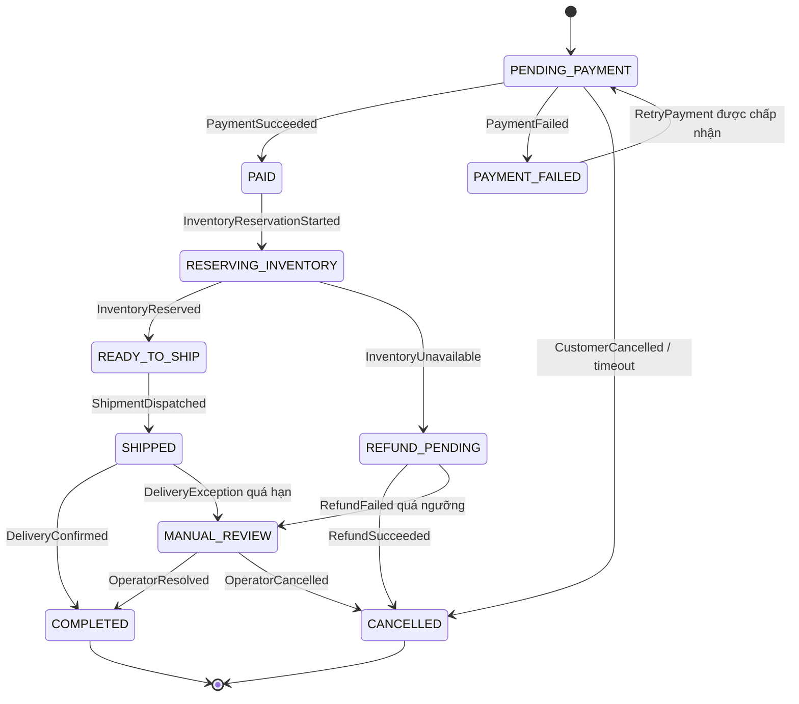

# Mô hình state machine cho quy trình nghiệp vụ

Một quy trình nghiệp vụ thường đi qua nhiều bước và có thể kéo dài từ vài giây đến nhiều ngày. Ví dụ, một đơn hàng được tạo, chờ thanh toán, giữ hàng, đóng gói, giao cho đơn vị vận chuyển rồi hoàn tất. Ở mỗi bước, hệ thống cần biết đơn hàng đang ở trạng thái nào, sự kiện nào được phép xảy ra tiếp theo, điều kiện nào phải thỏa mãn và cần gọi dịch vụ nào.

State machine (máy trạng thái hữu hạn) là cách mô hình hóa quy trình bằng một tập trạng thái và các chuyển tiếp có điều kiện. Khi kết hợp với workflow orchestration, state machine giúp điều phối các Java function, API, queue và dịch vụ cloud thành một quy trình có tiến độ được lưu bền vững. Nếu function bị timeout hoặc môi trường thực thi bị thu hồi, workflow có thể tiếp tục từ trạng thái đã lưu thay vì phải dựa vào bộ nhớ của function.

Trong module **CLOUD_SERVERLESS**, mô hình này đặc biệt hữu ích khi một nghiệp vụ cần nhiều trigger HTTP, message hoặc event, có bước chờ, retry, timeout, nhánh xử lý và hành động bù trừ. Bài viết xây dựng mô hình từ khái niệm cơ bản đến ví dụ đơn hàng và cách áp dụng trong Java serverless.

## 1. State machine là gì?

State machine mô tả một hệ thống bằng các trạng thái có thể có và quy tắc chuyển từ trạng thái này sang trạng thái khác khi nhận một sự kiện. Một state machine cơ bản có:

- **State (trạng thái):** mô tả vị trí hiện tại của đối tượng hoặc quy trình, ví dụ `PENDING_PAYMENT` hoặc `SHIPPED`.
- **Event (sự kiện):** điều xảy ra khiến hệ thống xem xét chuyển trạng thái, ví dụ `PaymentSucceeded` hoặc `DeliveryConfirmed`.
- **Transition (chuyển trạng thái):** quy tắc đi từ trạng thái nguồn sang trạng thái đích khi nhận event phù hợp.
- **Guard (điều kiện):** biểu thức phải đúng để transition được phép xảy ra, ví dụ số tiền đã thanh toán bằng tổng tiền đơn hàng.
- **Action (hành động):** công việc được thực hiện khi transition được chọn hoặc khi state được vào/rời, ví dụ ghi nhận thanh toán hoặc gửi yêu cầu giữ hàng.
- **Initial state (trạng thái bắt đầu):** trạng thái mà quy trình bắt đầu.
- **Terminal state (trạng thái kết thúc):** trạng thái không còn transition nghiệp vụ tiếp theo, ví dụ `COMPLETED` hoặc `CANCELLED`.

Một mô hình đơn giản có thể biểu diễn bằng bộ:

\[
M = (S, E, T, s_0, F)
\]

Trong đó `S` là tập trạng thái, `E` là tập sự kiện, `T` là tập quy tắc chuyển trạng thái, `s₀` là trạng thái bắt đầu và `F` là tập trạng thái kết thúc. Guard và action là thông tin gắn với mỗi quy tắc trong `T`.

Ví dụ, một đơn hàng có thể chuyển từ `PENDING_PAYMENT` sang `PAID` khi nhận `PaymentSucceeded`. Nếu nhận `PaymentFailed`, đơn hàng có thể chuyển sang `PAYMENT_FAILED`. Không nên cho phép `SHIPPED` quay về `PENDING_PAYMENT` chỉ vì một message thanh toán cũ được giao lại; state machine cần từ chối event không hợp lệ theo trạng thái hiện tại.

## 2. Trạng thái, sự kiện và chuyển trạng thái

### Trạng thái phải mô tả sự thật nghiệp vụ

Tên trạng thái nên thể hiện điều đã đúng tại thời điểm đó, không chỉ tên hàm hoặc tên kỹ thuật. Ví dụ:

| Tên trạng thái | Ý nghĩa nghiệp vụ |
|---|---|
| `PENDING_PAYMENT` | Đơn hàng đã được tạo và đang chờ thanh toán |
| `PAID` | Thanh toán đã được xác nhận |
| `RESERVING_INVENTORY` | Hệ thống đang giữ hàng |
| `READY_TO_SHIP` | Hàng đã được giữ và sẵn sàng giao |
| `SHIPPED` | Đơn vị vận chuyển đã nhận hàng |
| `COMPLETED` | Quy trình giao hàng đã hoàn tất |
| `CANCELLED` | Đơn hàng đã bị hủy theo quy tắc nghiệp vụ |
| `MANUAL_REVIEW` | Quy trình cần người có thẩm quyền xem xét |

Tránh tạo quá nhiều trạng thái chỉ để phản ánh chi tiết triển khai như `CALLING_PAYMENT_API` hoặc `JSON_SERIALIZED`, trừ khi những bước đó có ý nghĩa về phục hồi, timeout, giám sát hoặc cần quan sát riêng. Mặt khác, không gộp các trạng thái có quyền chuyển tiếp hoặc hành động tiếp theo khác nhau thành một trạng thái chung.

### Event biểu diễn điều đã xảy ra

Event nên đặt tên theo sự kiện đã xảy ra, thường ở dạng quá khứ: `OrderCreated`, `PaymentSucceeded`, `InventoryReserved`, `ShipmentDispatched`. Phân biệt event với command:

- **Command:** yêu cầu hệ thống thực hiện điều gì đó, ví dụ `ReserveInventory`.
- **Event:** thông báo một việc đã xảy ra, ví dụ `InventoryReserved`.

Command có thể bị từ chối hoặc thất bại; event biểu diễn sự thật đã được xác nhận. Phân biệt hai khái niệm này giúp workflow không chuyển sang `READY_TO_SHIP` chỉ vì đã gửi command giữ hàng. Nó chỉ nên chuyển sau khi nhận được kết quả thành công hoặc bằng chứng xác nhận phù hợp.

### Transition có nguồn, đích và điều kiện

Một transition thường được mô tả bằng:

`trạng thái nguồn + event + guard -> action + trạng thái đích`.

Ví dụ:

| Trạng thái hiện tại | Event | Guard | Action | Trạng thái tiếp theo |
|---|---|---|---|---|
| `PENDING_PAYMENT` | `PaymentSucceeded` | Số tiền và tiền tệ khớp đơn hàng | Ghi nhận giao dịch thanh toán | `PAID` |
| `PENDING_PAYMENT` | `PaymentFailed` | Giao dịch được xác nhận thất bại | Ghi lý do thất bại | `PAYMENT_FAILED` |
| `PAID` | `ReserveInventory` | Tất cả SKU còn đủ hàng | Gửi yêu cầu giữ hàng | `RESERVING_INVENTORY` |
| `RESERVING_INVENTORY` | `InventoryReserved` | Reservation hợp lệ và chưa hết hạn | Lưu reservation ID | `READY_TO_SHIP` |
| `RESERVING_INVENTORY` | `InventoryUnavailable` | Không thể giữ đủ hàng | Khởi động quy trình hoàn tiền | `REFUND_PENDING` |
| `READY_TO_SHIP` | `ShipmentDispatched` | Có mã vận đơn hợp lệ | Lưu tracking number | `SHIPPED` |
| `SHIPPED` | `DeliveryConfirmed` | Bằng chứng giao hàng hợp lệ | Ghi thời điểm giao thành công | `COMPLETED` |

Một event không có transition hợp lệ ở trạng thái hiện tại cần được xử lý có chủ đích. Tùy loại event, hệ thống có thể bỏ qua event trùng đã xử lý, ghi nhận event đến sai thứ tự, đưa vào hàng chờ chờ điều kiện hoặc chuyển sang manual review. Không nên mặc định mọi event không hợp lệ đều là lỗi retryable.

## 3. Sơ đồ state machine cho đơn hàng

Sơ đồ dưới đây mô tả một quy trình minh họa. Các trạng thái và nhánh thực tế phụ thuộc chính sách bán hàng, thanh toán, kho và vận chuyển.



Sơ đồ cho thấy state machine không chỉ mô tả đường đi thành công. Nó còn mô tả lỗi, hủy, timeout, hoàn tiền và xử lý thủ công. Nhờ vậy, đội phát triển có thể xác định rõ mọi nhánh phải kết thúc ở đâu và cần lưu thông tin gì để tiếp tục.

## 4. Vì sao state machine phù hợp với serverless workflow?

Một Java function thường được thiết kế để xử lý một invocation: nhận request/event, thực hiện một phần công việc và trả kết quả. Function có thể bị dừng sau khi trả response, môi trường thực thi có thể bị thu hồi và lần gọi tiếp theo có thể chạy trên một môi trường khác. Vì vậy, bộ nhớ static, biến cục bộ hoặc file tạm không thể là nơi duy nhất lưu tiến độ của quy trình kéo dài.

Workflow orchestrator giữ trạng thái và điều phối các bước. Tùy nền tảng, nó có thể lưu execution history, input/output của từng bước, timer, retry policy, nhánh song song và callback token. Khi một bước thất bại, orchestrator có thể retry, đi sang nhánh lỗi hoặc chờ sự kiện tiếp theo.

| Thành phần | Trách nhiệm chính |
|---|---|
| Producer / API | Khởi tạo quy trình bằng command hoặc event |
| Workflow orchestrator | Lưu state, quyết định transition, điều phối bước, timer, retry và nhánh lỗi |
| Java function | Thực hiện một tác vụ cụ thể, không tự giữ toàn bộ vòng đời quy trình |
| Queue / event bus | Chuyển sự kiện hoặc command giữa các thành phần |
| Database | Lưu dữ liệu nghiệp vụ và các invariant cần bảo đảm |
| External service | Thanh toán, kho hàng, email, vận chuyển hoặc hệ thống đối tác |
| Monitoring / audit | Theo dõi execution, transition, lỗi và hành động thủ công |

Orchestrator lưu tiến độ của workflow, còn database nghiệp vụ lưu dữ liệu chuẩn của ứng dụng. Không nên biến execution history thành database nghiệp vụ duy nhất. Workflow state có thể chứa ID, kết quả bước và metadata cần để điều phối; dữ liệu lớn hoặc nhạy cảm nên được lưu ở kho phù hợp rồi truyền tham chiếu.

## 5. State machine và workflow orchestration khác nhau thế nào?

State machine là mô hình logic để mô tả trạng thái và chuyển tiếp. Workflow orchestration là cách điều phối việc thực thi các bước theo mô hình đó. Một workflow engine có thể thực thi state machine trực tiếp; ứng dụng cũng có thể tự triển khai state machine trong code và lưu trạng thái ở database.

Orchestration có một thành phần trung tâm giữ tiến độ và gọi các participant. Choreography dựa trên các participant phát và nhận event, mỗi participant tự quyết định hành động tiếp theo. Hai cách có thể cùng tồn tại:

| Tiêu chí | Orchestration | Choreography |
|---|---|---|
| Điều khiển luồng | Một orchestrator quyết định bước tiếp theo | Các service phản ứng với event của nhau |
| Theo dõi tiến độ | Thường tập trung theo execution ID | Phải tổng hợp trace/event giữa nhiều service |
| Thay đổi quy trình | Thường chỉnh workflow definition | Thay đổi contract và hành vi của nhiều participant |
| Phụ thuộc trung tâm | Có orchestrator cần sẵn sàng và được vận hành | Ít điều phối trung tâm hơn nhưng luồng phân tán khó quan sát |
| Phù hợp | Quy trình dài, nhiều nhánh, timeout, compensation và audit | Luồng event đơn giản, các service ít phụ thuộc thứ tự toàn cục |

Ví dụ, một order workflow có thể được orchestrator gọi `PaymentFunction`, chờ `PaymentSucceeded`, rồi gọi `InventoryFunction`. Bản thân payment service vẫn có thể phát event `PaymentCaptured` cho các consumer khác như analytics hoặc notification. Orchestration điều khiển quy trình đơn hàng; event choreography lan truyền sự thật nghiệp vụ cho các hệ thống quan tâm.

## 6. Các cấu trúc điều khiển thường gặp

Workflow engine thường cung cấp các cấu trúc tương tự ngôn ngữ lập trình:

### Sequence — thực hiện tuần tự

Các bước chạy theo thứ tự. Ví dụ: xác thực đơn hàng, tính phí, thu tiền, giữ hàng và tạo vận đơn. Kết quả của bước trước có thể làm input cho bước sau. Nếu một bước thất bại, workflow áp dụng retry hoặc nhánh lỗi đã định nghĩa.

### Choice — rẽ nhánh theo điều kiện

Chọn nhánh theo dữ liệu hoặc state. Ví dụ, đơn hàng giá trị cao cần kiểm tra thủ công; đơn hàng thông thường đi thẳng sang thanh toán. Guard nên dựa trên dữ liệu đã xác thực và quy tắc nghiệp vụ có phiên bản.

### Parallel — thực hiện song song

Một số bước độc lập có thể chạy đồng thời, ví dụ kiểm tra tồn kho ở nhiều kho hoặc gửi yêu cầu kiểm tra fraud và tính thuế. Workflow có thể chờ tất cả nhánh, hoặc áp dụng chính sách như chờ một số kết quả tối thiểu. Cần xác định rõ điều gì xảy ra khi chỉ một nhánh thất bại và nhánh còn lại vẫn đang chạy.

### Map / fan-out — lặp qua danh sách

Một bước có thể tạo nhiều tác vụ cho từng item, ví dụ kiểm tra từng dòng hàng trong đơn. Cần giới hạn concurrency, xử lý lỗi từng item và quyết định có tiếp tục các item còn lại khi một item thất bại hay không.

### Wait / callback — chờ thời gian hoặc sự kiện ngoài

Workflow có thể chờ đến một thời điểm hoặc chờ đối tác phản hồi. Ví dụ, sau khi gửi yêu cầu thanh toán, workflow chờ webhook `PaymentSucceeded` với correlation ID. Không cần giữ một Java function chạy suốt thời gian chờ; orchestrator lưu trạng thái và đánh thức execution khi timer hoặc event đến.

### Retry / Catch — thử lại hoặc xử lý lỗi

Retry mô tả lỗi nào được thử lại, số lần, khoảng chờ và backoff. Catch định tuyến lỗi sau khi hết retry sang nhánh như hoàn tiền, manual review hoặc kết thúc thất bại. Không retry tất cả lỗi theo cùng chính sách.

## 7. Thiết kế state machine đúng cho nghiệp vụ

### Xác định aggregate và ranh giới quy trình

Trước khi vẽ state machine, xác định đối tượng nghiệp vụ nào sở hữu trạng thái: đơn hàng, khoản thanh toán, chuyến giao hay hồ sơ. Một quy trình có thể chứa nhiều state machine con. Ví dụ, order có state `PAID`, trong khi payment có state riêng `AUTHORIZED`, `CAPTURED`, `REFUNDED`. Không nên ép nhiều vòng đời khác nhau vào một field trạng thái duy nhất.

### Xác định invariant

Invariant là điều kiện luôn phải đúng. Ví dụ:

- Đơn hàng chỉ được chuyển sang `SHIPPED` khi đã thanh toán hoặc có chính sách thanh toán khi nhận hàng.
- Tổng số tiền capture không vượt số tiền được authorize.
- Một reservation chỉ được release nếu reservation đó tồn tại và chưa được consume.
- Một order chỉ có một kết quả terminal hợp lệ theo quy tắc hủy/hoàn tất.
- Event của tenant A không được phép thay đổi order của tenant B.

Invariant cần được bảo vệ tại nơi dữ liệu chuẩn được cập nhật, thường là database transaction hoặc service sở hữu aggregate. Guard ở workflow giúp điều phối và tránh gọi bước vô ích, nhưng không thay thế constraint hoặc kiểm tra nguyên tử ở database vì trạng thái có thể thay đổi đồng thời.

### Xác định event đến trùng hoặc sai thứ tự

Queue và event bus thường có thể giao event nhiều lần. Event có thể đến trễ hoặc không đúng thứ tự toàn cục. Mỗi event nên có `eventId`, `aggregateId`, `eventType`, `occurredAt`, `schemaVersion` và correlation/causation ID phù hợp.

Consumer nên kiểm tra event ID đã xử lý và version của aggregate. Nếu event có version cũ hơn state hiện tại, có thể bỏ qua như duplicate/stale event theo quy tắc. Nếu event đến trước event tiền đề, có thể lưu chờ, retry có giới hạn hoặc chuyển manual review. Không tự suy diễn thứ tự chỉ từ timestamp vì đồng hồ giữa producer có thể lệch.

### Xác định terminal state và timeout

Mỗi quy trình cần biết khi nào hoàn tất, bị hủy hoặc cần can thiệp. Nếu trạng thái chờ có thời hạn, hãy định nghĩa timer và hành động khi hết hạn. Ví dụ, `PENDING_PAYMENT` có thể hết hạn sau 30 phút; nhưng timer hết hạn và webhook thanh toán có thể đến gần như đồng thời. Cần có transition nguyên tử hoặc optimistic concurrency để chỉ một kết quả thắng theo chính sách.

## 8. Ví dụ Java: kiểm soát transition ở tầng nghiệp vụ

Có thể mô hình hóa trạng thái và event bằng enum hoặc sealed types. Ví dụ đơn giản dưới đây thể hiện quy tắc transition; trong hệ thống thực, cần bổ sung persistence, transaction, authorization và idempotency.

```java
public enum OrderState {
    PENDING_PAYMENT,
    PAID,
    RESERVING_INVENTORY,
    READY_TO_SHIP,
    SHIPPED,
    COMPLETED,
    PAYMENT_FAILED,
    REFUND_PENDING,
    CANCELLED,
    MANUAL_REVIEW
}

public enum OrderEventType {
    PAYMENT_SUCCEEDED,
    PAYMENT_FAILED,
    INVENTORY_RESERVED,
    INVENTORY_UNAVAILABLE,
    SHIPMENT_DISPATCHED,
    DELIVERY_CONFIRMED,
    CANCEL_REQUESTED
}
```

Một transition function có thể nhận state hiện tại và event rồi trả state kế tiếp:

```java
public OrderState transition(OrderState current, OrderEvent event) {
    return switch (current) {
        case PENDING_PAYMENT -> switch (event.type()) {
            case PAYMENT_SUCCEEDED -> {
                requireMatchingAmount(event);
                yield OrderState.PAID;
            }
            case PAYMENT_FAILED -> OrderState.PAYMENT_FAILED;
            case CANCEL_REQUESTED -> OrderState.CANCELLED;
            default -> throw new InvalidTransitionException(current, event.type());
        };
        case PAID -> switch (event.type()) {
            case INVENTORY_RESERVED -> OrderState.READY_TO_SHIP;
            case INVENTORY_UNAVAILABLE -> OrderState.REFUND_PENDING;
            default -> throw new InvalidTransitionException(current, event.type());
        };
        case READY_TO_SHIP -> switch (event.type()) {
            case SHIPMENT_DISPATCHED -> OrderState.SHIPPED;
            default -> throw new InvalidTransitionException(current, event.type());
        };
        case SHIPPED -> switch (event.type()) {
            case DELIVERY_CONFIRMED -> OrderState.COMPLETED;
            default -> throw new InvalidTransitionException(current, event.type());
        };
        default -> throw new InvalidTransitionException(current, event.type());
    };
}
```

Đây là phần minh họa, không bao quát mọi trạng thái trong sơ đồ. Nó thể hiện một số nhánh quan trọng, nhưng implementation thực tế còn phải xác định rõ cách xử lý event trùng, event đến sai thứ tự và các state terminal. `requireMatchingAmount` phải kiểm tra currency, amount và transaction reference từ nguồn tin cậy; không chỉ dựa trên dữ liệu do client gửi.

Không cập nhật database bằng cách đọc state, tính state mới rồi ghi vô điều kiện. Hai event đồng thời có thể cùng đọc `PENDING_PAYMENT` và ghi đè kết quả của nhau. Hãy dùng transaction và optimistic locking, ví dụ cập nhật có điều kiện theo version:

```sql
UPDATE orders
SET state = ?, version = version + 1
WHERE order_id = ? AND state = ? AND version = ?;
```

Nếu số dòng cập nhật bằng 0, state đã thay đổi hoặc điều kiện không còn đúng; đọc lại và áp dụng quy tắc duplicate/conflict thay vì giả định transition thành công.

## 9. Workflow definition và execution state

Trong workflow engine, thường có hai loại dữ liệu cần phân biệt:

- **Workflow definition:** mô tả các state/task, input/output mapping, transition, retry, timeout, nhánh và quyền gọi dịch vụ. Đây là định nghĩa được triển khai theo phiên bản.
- **Execution state:** dữ liệu của một lần chạy cụ thể, gồm execution ID, state hiện tại, input cần thiết, kết quả bước, timer, retry count và trạng thái lỗi.

Ví dụ pseudo-definition độc lập nhà cung cấp:

```yaml
name: OrderFulfillment
startAt: ValidateOrder
states:
  ValidateOrder:
    type: task
    handler: ValidateOrderFunction
    next: ChargePayment
    retry:
      errors: [TransientDependencyError]
      maxAttempts: 3
      backoff: exponential
  ChargePayment:
    type: task
    handler: ChargePaymentFunction
    onSuccess: ReserveInventory
    onPermanentFailure: PaymentFailed
  ReserveInventory:
    type: task
    handler: ReserveInventoryFunction
    onSuccess: CreateShipment
    onFailure: RefundPayment
  CreateShipment:
    type: task
    handler: CreateShipmentFunction
    next: WaitForDelivery
  WaitForDelivery:
    type: waitForEvent
    event: DeliveryConfirmed
    timeout: PT72H
    onTimeout: ManualReview
  RefundPayment:
    type: task
    handler: RefundPaymentFunction
    next: Cancelled
  PaymentFailed:
    type: terminal
    outcome: failed
  ManualReview:
    type: terminal
    outcome: needs-attention
  Cancelled:
    type: terminal
    outcome: cancelled
```

Đây là pseudo-YAML để giải thích ý tưởng, không phải file cấu hình có thể triển khai trực tiếp. Mỗi workflow engine có cú pháp, loại state, semantics retry, callback và cách truyền dữ liệu riêng. Đặc biệt, phải xác minh liệu `onFailure` bắt mọi lỗi hay chỉ một nhóm lỗi, và workflow có tự retry trước khi chuyển nhánh hay không.

Execution state nên lưu vừa đủ để tiếp tục quy trình. Tránh đưa toàn bộ file, access token, dữ liệu cá nhân không cần thiết hoặc object quá lớn vào history. Với payload lớn, lưu object ở object storage và truyền object key/version/checksum. Execution history thường có giới hạn kích thước, thời gian lưu và quyền truy cập riêng.

## 10. Retry, timeout và idempotency trong workflow

### Retry theo loại lỗi

Workflow có thể retry một task khi gặp lỗi transient như timeout, throttling hoặc HTTP 503. Lỗi validation hoặc business rule thường cần đi sang nhánh xử lý khác thay vì retry vô hạn. Chính sách nên gồm:

- Danh sách lỗi được retry và lỗi không được retry.
- Số lần thử tối đa và thời gian backoff.
- Jitter để tránh nhiều execution cùng retry tại một thời điểm.
- Timeout riêng cho mỗi task và timeout tổng của workflow.
- Nhánh xử lý sau khi hết retry, ví dụ compensation, manual review hoặc terminal failure.

Retry có thể gọi lại function sau khi function đã thực hiện side effect nhưng workflow không nhận được kết quả vì timeout. Do đó, task phải idempotent hoặc có cách tra cứu kết quả lần chạy trước.

### Idempotency key theo bước nghiệp vụ

Không chỉ dùng execution ID cho mọi thao tác. Mỗi side effect nên có khóa ổn định theo nghiệp vụ, ví dụ `orderId + actionType` hoặc `paymentAttemptId`. Khi workflow retry `CapturePayment`, payment service phải nhận ra capture đã thành công và trả kết quả cũ thay vì thu tiền lần nữa.

Một pattern phổ biến:

1. Workflow tạo `operationId` ổn định cho task.
2. Function gửi `operationId` đến service downstream dưới dạng idempotency key.
3. Downstream lưu key và kết quả trong kho bền vững với unique constraint.
4. Nếu nhận lại key, downstream trả kết quả đã lưu hoặc trạng thái đang xử lý.
5. Workflow tiếp tục từ kết quả đó.

Nếu side effect nằm trong cùng database với trạng thái nghiệp vụ, có thể ghi trạng thái và bản ghi processed operation trong cùng transaction. Nếu gọi dịch vụ ngoài, cần idempotency contract, outbox/inbox hoặc bước reconciliation.

### Timeout không đồng nghĩa thất bại

Khi function timeout, orchestrator có thể không biết side effect đã hoàn tất hay chưa. Ví dụ, payment provider đã capture nhưng response bị mất. Nếu workflow lập tức chuyển sang `PAYMENT_FAILED`, trạng thái nghiệp vụ sẽ sai. Hãy dùng operation ID để truy vấn trạng thái giao dịch, hoặc chờ webhook xác nhận. Timeout có thể đưa execution sang `PAYMENT_STATUS_UNKNOWN`/reconciliation thay vì khẳng định thất bại.

## 11. Saga và hành động bù trừ

Một workflow gồm nhiều service/database thường không thể dùng một transaction ACID xuyên suốt. Saga chia quy trình thành các transaction cục bộ; nếu bước sau thất bại, hệ thống thực hiện các hành động bù trừ để đưa nghiệp vụ về trạng thái chấp nhận được.

Ví dụ đặt hàng:

| Bước thành công | Side effect | Hành động bù trừ có thể có |
|---|---|---|
| Tạo order | Ghi đơn hàng ở trạng thái chờ | Hủy order nếu chưa có side effect khác |
| Capture payment | Thu tiền | Refund payment |
| Reserve inventory | Giữ số lượng hàng | Release reservation |
| Create shipment | Tạo vận đơn | Cancel shipment nếu hãng vận chuyển cho phép |
| Send notification | Gửi email/SMS | Thường không thể thu hồi; có thể gửi thông báo đính chính |

Compensation không phải rollback cơ sở dữ liệu theo nghĩa xóa mọi dấu vết. Refund là một giao dịch mới; nó không xóa lịch sử capture. Release reservation cũng là một hành động nghiệp vụ mới. Vì vậy, mỗi compensation cần idempotent, có trạng thái riêng, có retry và có nhánh manual review khi không thể hoàn tất.

Saga có thể theo kiểu orchestration, trong đó orchestrator gọi các bước và compensation, hoặc choreography, trong đó các service phát event và phản ứng với nhau. Orchestration thường dễ nhìn thấy tiến độ và nhánh bù trừ; choreography có thể giảm phụ thuộc vào một điều phối trung tâm nhưng cần quản lý correlation và quan sát toàn luồng tốt hơn.

## 12. Event correlation, callback và chờ bên ngoài

Quy trình có thể chờ một event từ webhook, queue hoặc event bus. Khi bắt đầu chờ, workflow cần tạo correlation token hoặc business key để ghép callback với execution đúng.

Ví dụ:

1. `OrderWorkflow` gửi yêu cầu thanh toán với `paymentAttemptId`.
2. Payment provider xử lý và gửi webhook `PaymentSucceeded` hoặc `PaymentFailed`.
3. Webhook endpoint xác minh chữ ký, kiểm tra timestamp và lưu event bền vững.
4. Adapter tìm execution đang chờ theo `paymentAttemptId` rồi gửi signal/callback.
5. Workflow kiểm tra event có đúng order, payment attempt và state hiện tại không trước khi chuyển tiếp.

Không nên đưa execution ID nội bộ vào URL công khai nếu nó có thể bị đoán hoặc dùng để truy cập dữ liệu. Callback token phải có entropy đủ mạnh, thời hạn, phạm vi quyền và cơ chế chống replay. Một event đến sau khi workflow đã hết hạn cần được xử lý theo quy tắc: bỏ qua có audit, mở quy trình reconciliation hoặc chuyển manual review.

## 13. Phiên bản workflow và thay đổi quy trình

Quy trình nghiệp vụ thay đổi theo thời gian. Một workflow execution có thể đang chạy khi phiên bản definition mới được triển khai. Nếu execution cũ tiếp tục chạy với logic mới một cách không kiểm soát, nó có thể gặp state không còn tồn tại hoặc thực hiện sai hành động.

Các chiến lược phổ biến:

- **Versioned definition:** mỗi execution gắn với phiên bản workflow đã bắt đầu nó.
- **Pinned task contract:** giữ tương thích input/output của function mà execution cũ đang gọi.
- **Explicit migration:** chuyển execution đang chạy sang phiên bản mới bằng migration có kiểm tra và audit.
- **Backward-compatible evolution:** thêm state/field theo cách phiên bản cũ có thể bỏ qua khi phù hợp; không đổi ý nghĩa field hiện có.
- **Drain old executions:** ngừng tạo execution mới ở phiên bản cũ và chờ các execution đang chạy hoàn tất trước khi loại bỏ dependency.

State machine nên có `definitionVersion`, `schemaVersion` và event version cần thiết. Khi thay đổi transition, phải xác định state cũ sẽ được xử lý ra sao. Không chỉ đổi tên enum hoặc xóa state rồi kỳ vọng execution đang chạy tự thích nghi.

## 14. Quan sát và vận hành workflow

Một workflow cần được quan sát ở cả cấp execution và cấp bước:

- Execution ID, business ID, definition version và thời điểm bắt đầu/kết thúc.
- State hiện tại, transition vừa thực hiện và event kích hoạt transition.
- Thời lượng từng task, số lần retry, timeout và kết quả cuối.
- Số execution đang chạy, đang chờ callback, thất bại hoặc ở manual review.
- Tỷ lệ compensation thành công/thất bại và số execution cần reconciliation.
- Chi phí invocation, thời gian chờ, dữ liệu history và dịch vụ phụ trợ.

Log nên có cấu trúc và dùng correlation ID xuyên suốt. Tránh ghi token, payment card data, secret hoặc payload nhạy cảm. Audit transition cần đủ để trả lời ai/điều gì đã làm quy trình đổi trạng thái, khi nào, theo phiên bản nào và kết quả ra sao.

Các cảnh báo hữu ích gồm: execution ở một state quá lâu, callback gần hết hạn, retry tăng bất thường, compensation thất bại, backlog tăng, nhiều execution vào manual review và workflow failure rate vượt ngưỡng. Cần có runbook để retry, resume, cancel hoặc reconcile execution theo quyền và quy trình kiểm soát.

## 15. Những lỗi thiết kế thường gặp

| Lỗi | Hậu quả | Cách tránh |
|---|---|---|
| Lưu tiến độ workflow trong biến static của function | Mất tiến độ khi môi trường bị thu hồi hoặc scale out | Dùng orchestrator hoặc persistence bền vững |
| Chuyển state ngay sau khi gửi command | Workflow nghĩ side effect đã hoàn tất dù service có thể thất bại | Chờ kết quả hoặc event xác nhận |
| Retry side effect không có idempotency | Thu tiền, gửi email hoặc tạo vận đơn nhiều lần | Dùng operation ID/idempotency key và deduplication |
| Dùng timestamp để suy ra thứ tự event tuyệt đối | Event đến trễ hoặc đồng hồ lệch làm state sai | Dùng sequence/version và quy tắc nghiệp vụ |
| Guard chỉ kiểm tra ở workflow | Race condition vẫn có thể xảy ra ở database | Bảo vệ invariant bằng transaction/conditional update |
| Một workflow chứa payload lớn hoặc secret | History phình to và tăng rủi ro lộ dữ liệu | Truyền reference, giới hạn dữ liệu và phân quyền |
| Timeout bị xem là side effect thất bại | Thực hiện lại thao tác đã thành công | Tra cứu bằng operation ID và reconciliation |
| Compensation được xem như rollback hoàn hảo | Lịch sử giao dịch sai hoặc side effect không thể đảo ngược | Thiết kế compensation như hành động nghiệp vụ riêng |
| Không quản lý version definition | Execution cũ lỗi khi workflow thay đổi | Pin version, migration hoặc drain execution |
| Không có manual review | Quy trình mắc kẹt khi không thể tự phục hồi | Định nghĩa state ngoại lệ, người xử lý và audit |

## 16. Quy trình xây dựng state machine cho một nghiệp vụ mới

Có thể bắt đầu theo các bước sau:

1. **Xác định mục tiêu và ranh giới:** chọn aggregate hoặc quy trình cần điều phối, xác định lúc bắt đầu và điều kiện hoàn tất.
2. **Liệt kê trạng thái:** mô tả sự thật nghiệp vụ, bao gồm trạng thái lỗi, hủy, chờ và cần can thiệp.
3. **Liệt kê event và command:** tách yêu cầu thực hiện khỏi sự kiện đã xảy ra; xác định nguồn event và schema version.
4. **Vẽ transition:** với mỗi state, liệt kê event hợp lệ, guard, action và state đích; quyết định event không hợp lệ được xử lý ra sao.
5. **Viết invariant:** xác định điều kiện không được vi phạm và nơi bảo vệ nguyên tử trong database/service.
6. **Chọn orchestration hay choreography:** dựa trên độ phức tạp luồng, nhu cầu audit, callback, timer và khả năng vận hành.
7. **Thiết kế lỗi:** đặt retry, timeout, DLQ, idempotency, compensation và manual review.
8. **Thiết kế persistence và versioning:** quyết định state nào nằm trong workflow history, state nào nằm trong database nghiệp vụ, cách nâng phiên bản khi execution còn chạy.
9. **Kiểm thử transition:** kiểm thử mọi đường đi hợp lệ, event trùng, event sai thứ tự, timeout đồng thời, crash sau side effect và compensation thất bại.
10. **Đo lường và vận hành:** thiết lập metric, trace, audit, cảnh báo và runbook cho execution bị kẹt hoặc cần phục hồi.

Một state machine tốt phải mô tả được cả đường đi bình thường lẫn các tình huống không bình thường. Nếu không thể trả lời “đang ở trạng thái nào?”, “event nào được phép tiếp theo?” và “nếu bước này thất bại thì làm gì?”, mô hình chưa đủ rõ để triển khai an toàn.

## 17. Kết luận

State machine biểu diễn quy trình nghiệp vụ bằng trạng thái, event, transition, guard và action. Workflow orchestration sử dụng mô hình đó để điều phối Java function và dịch vụ cloud qua nhiều bước, đồng thời lưu tiến độ để tiếp tục sau retry, timeout hoặc gián đoạn môi trường thực thi.

Khi thiết kế, hãy đặt tên state theo ý nghĩa nghiệp vụ, phân biệt command với event, bảo vệ invariant tại nơi lưu dữ liệu chuẩn, xử lý event trùng/sai thứ tự, và thiết kế retry, timeout, idempotency cùng compensation ngay từ đầu. Với quy trình dài hoặc có nhiều nhánh, callback và hành động bù trừ, một workflow state machine rõ ràng giúp hệ thống dễ quan sát, phục hồi và thay đổi hơn.
