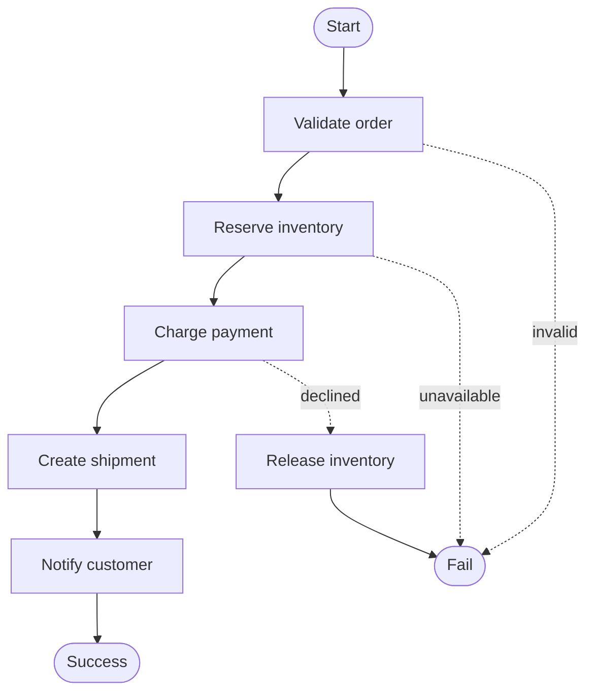
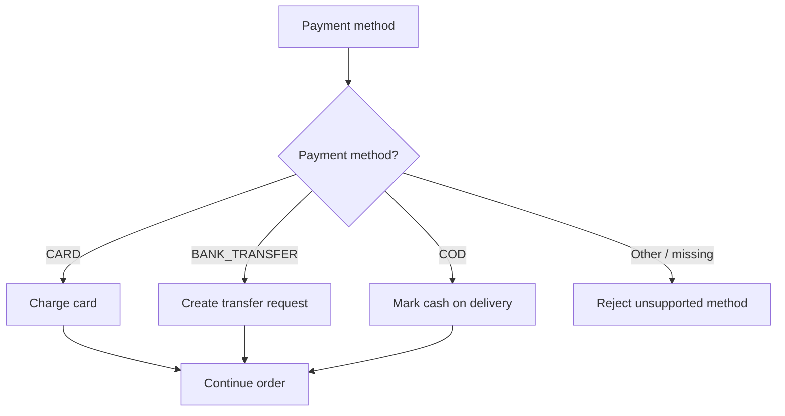
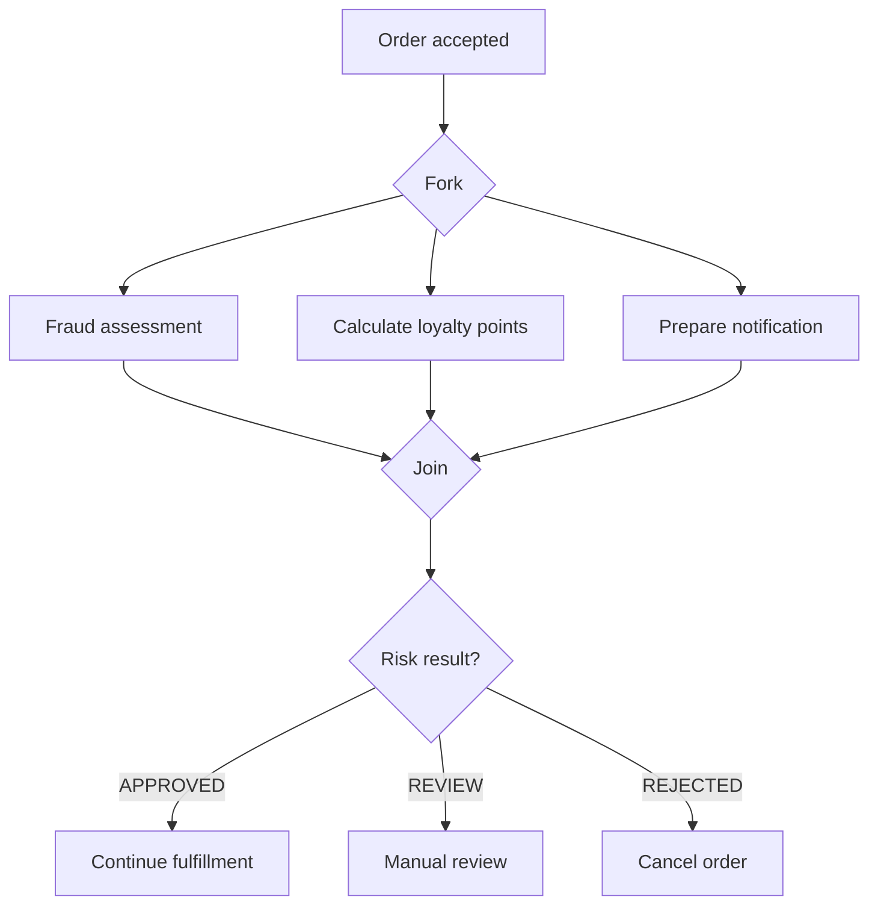
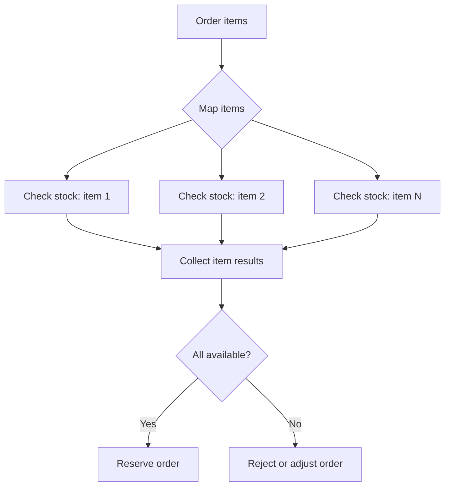
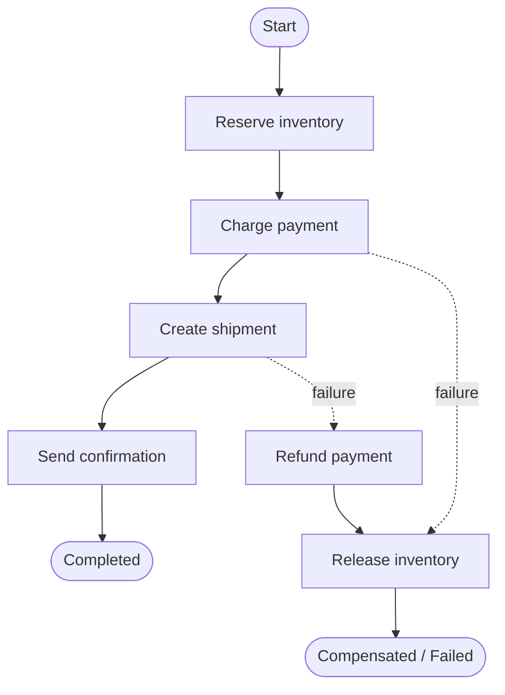

# Thiết kế bước tuần tự, nhánh điều kiện và xử lý song song

## 1. Workflow và vai trò của orchestration

Một nghiệp vụ thường gồm nhiều bước có quan hệ phụ thuộc. Khi xử lý đơn hàng, hệ thống có thể kiểm tra dữ liệu, giữ hàng, thu tiền, tạo vận đơn và gửi thông báo. Có bước chỉ được chạy sau khi bước trước thành công; có bước chỉ chạy khi điều kiện thỏa mãn; cũng có các bước độc lập có thể chạy đồng thời.

Nếu mỗi function tự gọi function tiếp theo, logic điều phối sẽ bị phân tán trong mã ứng dụng. Khó nhìn thấy toàn bộ tiến trình, khó biết workflow đang dừng ở đâu và khó khôi phục khi một bước lỗi hoặc một lần chạy kéo dài. Dịch vụ workflow/orchestration giải quyết vấn đề này bằng cách quản lý trạng thái và chuyển tiếp giữa các bước.

**Workflow** là mô tả có cấu trúc về các bước, điều kiện, nhánh, thời gian chờ và cách xử lý lỗi của một quy trình. **Orchestrator** là thành phần thực thi mô tả đó: khởi chạy task, lưu trạng thái, đánh giá điều kiện và quyết định bước kế tiếp. Task thường là Java function, HTTP endpoint hoặc dịch vụ cloud được quản lý.

Trong ứng dụng serverless, workflow engine thường lưu tiến trình một cách bền vững. Khi một task hoàn tất, engine ghi nhận kết quả và chuyển sang trạng thái tiếp theo. Nếu cần chờ một sự kiện hoặc đến một thời điểm trong tương lai, engine có thể giữ trạng thái chờ mà không cần một Java function giữ thread hoạt động liên tục. Cách triển khai cụ thể phụ thuộc nhà cung cấp, nhưng các khái niệm tuần tự, rẽ nhánh và song song có thể áp dụng rộng rãi.

## 2. Mô hình hóa workflow như một state machine

### 2.1. Trạng thái, task và transition

Workflow có thể được mô hình hóa như một máy trạng thái (state machine). Mỗi state biểu diễn một bước hoặc một điểm điều khiển. Transition xác định trạng thái tiếp theo dựa trên kết quả task, điều kiện hoặc tín hiệu bên ngoài.

Một workflow thường có các thành phần:

- **Start:** điểm bắt đầu khi có request, event hoặc lịch chạy.
- **Task:** thực thi công việc, ví dụ gọi Java function để giữ hàng.
- **Choice/Decision:** đánh giá dữ liệu để chọn một nhánh.
- **Parallel:** khởi chạy nhiều nhánh độc lập.
- **Map/For each:** lặp qua danh sách phần tử, có thể giới hạn số phần tử chạy đồng thời.
- **Wait/Callback:** tạm dừng cho đến thời điểm hoặc tín hiệu tiếp tục.
- **Success/Fail/End:** kết thúc thành công, thất bại hoặc hoàn tất một nhánh.
- **Retry/Catch:** chính sách thử lại và chuyển hướng khi task lỗi.

Ví dụ, quy trình đơn hàng có thể có các trạng thái `ValidateOrder`, `ReserveInventory`, `CheckPaymentMethod`, `ChargePayment`, `CreateShipment` và `NotifyCustomer`. Tên state nên thể hiện hành động hoặc mục đích rõ ràng để log và lịch sử thực thi dễ đọc.

### 2.2. Workflow state khác với trạng thái nghiệp vụ

Workflow engine lưu trạng thái điều phối như “đang chờ giữ hàng”, “đã hoàn tất nhánh thanh toán” hoặc “đang đợi đối tác xác nhận”. Hệ thống nghiệp vụ vẫn cần lưu dữ liệu chuẩn của đơn hàng, thanh toán và tồn kho trong database riêng.

Không nên xem trạng thái của workflow là nguồn dữ liệu chuẩn duy nhất cho toàn bộ domain. Workflow có thể kết thúc hoặc bị dọn theo retention trong khi đơn hàng vẫn cần được tra cứu nhiều năm. Ngược lại, database nghiệp vụ không nhất thiết phải chứa toàn bộ lịch sử chuyển tiếp chi tiết của workflow.

Hãy xác định rõ dữ liệu nào nằm trong execution state, dữ liệu nào nằm trong database nghiệp vụ và dữ liệu nào chỉ là kết quả tạm thời. State của workflow nên chứa các định danh và dữ liệu cần thiết để điều phối; payload lớn hoặc dữ liệu nhạy cảm có thể lưu ở kho riêng và truyền tham chiếu có kiểm soát.

## 3. Thiết kế các bước tuần tự

### 3.1. Khi nào cần thực thi tuần tự?

Các bước phải chạy tuần tự khi bước sau phụ thuộc vào kết quả hoặc tác động của bước trước. Ví dụ:

1. Kiểm tra đơn hàng có hợp lệ.
2. Giữ số lượng hàng trong kho.
3. Thu tiền sau khi giữ hàng thành công.
4. Tạo vận đơn sau khi thanh toán thành công.
5. Gửi thông báo khi đã có kết quả phù hợp.

Nếu tạo vận đơn trước khi thanh toán, hệ thống có thể phát sinh vận đơn cho đơn không đủ điều kiện. Nếu gửi email “đơn hàng đã xác nhận” trước khi giữ hàng, thông báo có thể không phản ánh kết quả thực tế. Thứ tự workflow phải thể hiện quan hệ phụ thuộc nghiệp vụ, không chỉ thứ tự các dòng code.

### 3.2. Truyền kết quả giữa các bước

Một task có thể nhận input từ execution context và trả output để bước sau sử dụng. Nên định nghĩa contract rõ ràng cho từng task, ví dụ:

```json
{
  "orderId": "ord-42",
  "customerId": "cus-81",
  "items": [
    { "sku": "BK-7", "quantity": 2 }
  ],
  "currency": "VND",
  "total": 1850000
}
```

Task `ReserveInventory` có thể nhận `orderId` và `items`, sau đó trả:

```json
{
  "reservationId": "res-92",
  "reserved": true
}
```

Task `ChargePayment` chỉ cần `orderId`, `reservationId`, `total` và thông tin thanh toán được tham chiếu an toàn. Tránh truyền toàn bộ execution payload qua mọi task nếu mỗi bước chỉ cần một phần nhỏ. Input/output mapping giúp giữ contract gọn và giảm nguy cơ một task vô tình phụ thuộc vào field nội bộ của task khác.

### 3.3. Ví dụ workflow tuần tự



Sơ đồ chỉ ra đường đi thành công và một đường xử lý bù minh họa. Trong hệ thống thực tế, mỗi lỗi cần được phân loại và có trạng thái nghiệp vụ phù hợp; không phải lỗi nào cũng kết thúc ngay bằng `Fail`.

### 3.4. Pseudoconfiguration cho chuỗi task

```yaml
workflow: CreateOrder
startAt: ValidateOrder
states:
  ValidateOrder:
    type: task
    function: validate-order
    next: ReserveInventory

  ReserveInventory:
    type: task
    function: reserve-inventory
    next: ChargePayment

  ChargePayment:
    type: task
    function: charge-payment
    next: CreateShipment

  CreateShipment:
    type: task
    function: create-shipment
    next: NotifyCustomer

  NotifyCustomer:
    type: task
    function: notify-customer
    end: true
```

Đây là cấu hình khái niệm để minh họa state machine, không phải cú pháp triển khai cho một workflow engine cụ thể. Tên trường, loại state và cách khai báo transition khác nhau giữa các nhà cung cấp.

## 4. Nhánh điều kiện (conditional branching)

### 4.1. Khi nào cần rẽ nhánh?

Choice/Decision state đánh giá một hoặc nhiều điều kiện rồi chọn đường đi. Ví dụ:

- Nếu đơn bị đánh dấu rủi ro cao, chuyển sang kiểm tra thủ công.
- Nếu phương thức thanh toán là thẻ, gọi cổng thẻ; nếu là chuyển khoản, chờ xác nhận giao dịch.
- Nếu đơn giao nhanh, chọn dịch vụ vận chuyển ưu tiên.
- Nếu khách hàng thuộc nhóm doanh nghiệp, áp dụng bước xác minh bổ sung.

Điều kiện nên dựa trên dữ liệu đã được xác thực và có kiểu rõ ràng. Không nên lấy một field do client tự khai báo làm căn cứ cấp quyền hoặc bỏ qua kiểm soát rủi ro.

### 4.2. Nhánh loại trừ lẫn nhau

Một decision thường chọn đúng một nhánh. Các điều kiện nên được thiết kế để không mơ hồ hoặc có thứ tự ưu tiên rõ ràng. Ví dụ:



Nhánh mặc định (default) rất quan trọng. Nếu không có default, một giá trị mới hoặc field bị thiếu có thể khiến workflow không có transition hợp lệ. Default có thể từ chối dữ liệu, chuyển sang kiểm tra thủ công hoặc áp dụng hành vi an toàn đã được định nghĩa.

### 4.3. Pseudoconfiguration cho Choice

```yaml
CheckPaymentMethod:
  type: choice
  choices:
    - when: "payment.method == 'CARD'"
      next: ChargeCard
    - when: "payment.method == 'BANK_TRANSFER'"
      next: CreateTransfer
    - when: "payment.method == 'COD'"
      next: MarkCashOnDelivery
  default: RejectPaymentMethod
```

Biểu thức điều kiện trong ví dụ là giả mã. Khi triển khai, cần dùng ngôn ngữ biểu thức mà workflow engine hỗ trợ và kiểm tra semantics của field thiếu, null, kiểu số, chuỗi và boolean. Nếu điều kiện có thể lỗi khi truy cập field không tồn tại, hãy kiểm tra sự tồn tại trước hoặc dùng schema validation ở bước trước.

### 4.4. Nhánh có điều kiện nghiệp vụ phức tạp

Nếu quyết định cần gọi nhiều dịch vụ, tính điểm rủi ro hoặc truy vấn dữ liệu, không nên nhồi toàn bộ logic vào biểu thức Choice. Tạo một task quyết định như `EvaluateOrderRisk`, trả kết quả đã chuẩn hóa:

```json
{
  "riskLevel": "REVIEW",
  "reasonCodes": ["HIGH_VALUE", "NEW_CUSTOMER"]
}
```

Workflow chỉ cần rẽ nhánh theo `riskLevel`. Cách này giữ rule điều phối dễ đọc và cho phép kiểm thử thuật toán nghiệp vụ độc lập. Cũng cần ghi nhận phiên bản chính sách đã dùng nếu quyết định phải có khả năng giải thích hoặc kiểm toán về sau.

## 5. Xử lý song song (parallel execution)

### 5.1. Khi nào có thể chạy đồng thời?

Các bước có thể chạy song song khi chúng không phụ thuộc kết quả của nhau và không tranh chấp một tài nguyên theo cách làm sai nghiệp vụ. Sau khi đơn hàng hợp lệ và đã được lưu, hệ thống có thể đồng thời:

- Đánh giá rủi ro.
- Tính điểm khách hàng.
- Chuẩn bị nội dung thông báo.
- Ghi nhận sự kiện cho phân tích.

Nếu mọi nhánh đều cần `orderId` và dữ liệu đơn hàng đã tồn tại, chúng có thể chạy cùng lúc. Nếu một nhánh phải chờ kết quả nhánh khác, quan hệ đó cần được biểu diễn bằng bước tuần tự hoặc một workflow con.

### 5.2. Fork và join

Parallel state tạo nhiều nhánh (fork). Mỗi nhánh chạy độc lập, sau đó workflow có thể chờ các nhánh hoàn tất (join) rồi hợp nhất kết quả để đi tiếp. Nhiều workflow engine mặc định đợi tất cả nhánh thành công; một số nền tảng hỗ trợ điều kiện hoàn tất nâng cao. Không được giả định mọi engine đều có cùng semantics.



Join là điểm đồng bộ: workflow chỉ đi tiếp khi điều kiện hoàn tất đã định nghĩa được đáp ứng. Nếu một nhánh lỗi, cần quyết định các nhánh còn lại sẽ tiếp tục, bị hủy, được chờ timeout hay được xử lý bù. Việc hủy một nhánh không tự động đảo ngược tác động mà nhánh đó đã thực hiện.

### 5.3. Pseudoconfiguration cho Parallel

```yaml
EnrichOrder:
  type: parallel
  branches:
    - startAt: AssessFraud
      states:
        AssessFraud:
          type: task
          function: assess-fraud
          end: true
    - startAt: CalculateLoyalty
      states:
        CalculateLoyalty:
          type: task
          function: calculate-loyalty
          end: true
    - startAt: PrepareNotification
      states:
        PrepareNotification:
          type: task
          function: prepare-notification
          end: true
  next: DecideFulfillment
```

Đây là pseudoconfiguration. Một engine cụ thể có thể yêu cầu mỗi branch là state machine con, có cú pháp khác cho input/output, timeout, retry và result selector.

### 5.4. Hợp nhất kết quả nhánh

Kết quả của các nhánh cần có cấu trúc dễ hiểu và không ghi đè lẫn nhau. Ví dụ:

```json
{
  "fraud": {
    "riskLevel": "APPROVED"
  },
  "loyalty": {
    "points": 120
  },
  "notification": {
    "templateId": "order-confirmation-v2"
  }
}
```

Nên gắn kết quả với tên nhánh thay vì chỉ dựa vào vị trí phần tử trong một mảng nếu contract cho phép. Khi một nhánh trả dữ liệu lớn, chỉ đưa phần kết quả cần cho bước sau vào workflow state; lưu nội dung lớn ở kho phù hợp và truyền reference.

## 6. Lặp qua danh sách và giới hạn concurrency (Map)

### 6.1. Map state

Map/For each state áp dụng cùng một bước xử lý cho từng phần tử trong danh sách. Ví dụ một đơn hàng có nhiều dòng sản phẩm; hệ thống có thể kiểm tra giá hoặc tồn kho cho từng dòng. Với danh sách lớn, chạy tuần tự có thể chậm; chạy tất cả cùng lúc có thể làm quá tải dịch vụ phụ thuộc.

Map state thường cho phép chọn chế độ tuần tự hoặc song song và giới hạn concurrency. Giới hạn này giúp cân bằng thời gian hoàn tất với khả năng chịu tải của database, API đối tác và quota function.

### 6.2. Ví dụ xử lý từng item



Ví dụ cấu hình khái niệm:

```yaml
CheckOrderItems:
  type: map
  itemsPath: $.items
  maxConcurrency: 8
  itemProcessor:
    startAt: CheckStock
    states:
      CheckStock:
        type: task
        function: check-stock
        end: true
  next: EvaluateStockResults
```

`maxConcurrency: 8` chỉ là ví dụ về giới hạn đồng thời. Giá trị phù hợp phải dựa trên quota và khả năng của dịch vụ phụ thuộc, không phải chọn càng lớn càng tốt.

### 6.3. Xử lý danh sách rỗng, lỗi một phần và kết quả tổng hợp

Cần định nghĩa hành vi khi danh sách rỗng, có phần tử sai định dạng hoặc chỉ một số item thất bại. Một workflow có thể:

- Dừng toàn bộ nếu bất kỳ item nào không hợp lệ.
- Thu thập lỗi theo từng item rồi trả kết quả một phần.
- Retry riêng item lỗi tạm thời.
- Đưa item lỗi vĩnh viễn vào danh sách cần xử lý thủ công.

Không nên để lỗi của một item vô tình làm mất kết quả đã xử lý thành công của các item khác nếu nghiệp vụ cho phép partial success. Ngược lại, nếu phải bảo đảm toàn bộ đơn được giữ hàng, cần có bước tổng hợp và cơ chế bù để giải phóng các reservation đã thành công khi một item khác không thể giữ.

## 7. Timeout, retry và xử lý lỗi trong workflow

### 7.1. Timeout cho từng task và toàn workflow

Task nên có timeout phù hợp với loại công việc và SLA. Timeout quá ngắn làm lỗi giả khi dịch vụ chậm; timeout quá dài giữ tài nguyên và làm chậm phát hiện sự cố. Workflow cũng cần deadline tổng thể để tránh execution kéo dài vô hạn.

Khi task gọi dịch vụ bên ngoài, timeout ở client, function, gateway và workflow engine cần tương thích. Ví dụ, nếu workflow timeout task sau 20 giây nhưng HTTP client chờ 60 giây, function có thể vẫn chạy hoặc tiếp tục tác động sau khi orchestrator đã coi task thất bại. Cần hiểu cơ chế cancellation của nền tảng và thiết kế tác động bên ngoài có idempotency.

### 7.2. Retry lỗi tạm thời

Retry phù hợp với lỗi có khả năng tự hết như timeout mạng, throttling hoặc lỗi dịch vụ tạm thời. Chính sách nên xác định:

- Loại lỗi nào được retry.
- Số lần thử tối đa hoặc thời hạn retry.
- Khoảng chờ tăng dần (exponential backoff) và jitter.
- Giới hạn tổng thời gian workflow.
- Hành vi khi hết số lần thử.

Không retry mọi lỗi. Dữ liệu sai schema, thiếu quyền hoặc vi phạm quy tắc nghiệp vụ thường cần sửa dữ liệu/cấu hình hoặc chuyển nhánh xử lý khác. Retry một lỗi vĩnh viễn chỉ làm tăng chi phí và tạo tải không cần thiết.

### 7.3. Catch và nhánh lỗi

Catch/Error handler chuyển lỗi của task sang một nhánh xử lý đã định nghĩa. Nhánh đó có thể ghi nhận thất bại, thông báo vận hành, giải phóng tài nguyên đã giữ hoặc yêu cầu con người kiểm tra.

Không nên chỉ bắt mọi lỗi rồi trả success. Điều đó làm workflow báo hoàn tất trong khi nghiệp vụ chưa đạt kết quả. Nếu có thể tiếp tục với kết quả một phần, hãy biểu diễn trạng thái đó rõ ràng như `PARTIALLY_COMPLETED` hoặc `PENDING_REVIEW`.

### 7.4. Compensation và Saga

Workflow phân tán thường không có một transaction ACID bao trùm nhiều function và dịch vụ. Nếu bước giữ hàng thành công nhưng thanh toán thất bại, có thể cần gọi `ReleaseInventory` để bù tác động. Nếu đã thu tiền nhưng không tạo được vận đơn, có thể cần hoàn tiền hoặc chuyển sang xử lý thủ công.

Mô hình Saga mô tả mỗi bước nghiệp vụ cùng hành động bù tương ứng:

| Bước thuận | Tác động | Hành động bù có thể có |
| --- | --- | --- |
| Reserve inventory | Giữ hàng | Release inventory |
| Charge payment | Thu tiền | Refund payment |
| Create shipment | Tạo vận đơn | Cancel shipment nếu hãng vận chuyển hỗ trợ |
| Apply loyalty points | Cộng điểm | Reverse points |

Hành động bù không phải lúc nào cũng đảo ngược hoàn toàn tác động ban đầu. Email đã gửi không thể “thu hồi” chắc chắn; một kiện hàng đã bàn giao cho hãng vận chuyển có thể cần quy trình hủy riêng. Workflow cần theo dõi kết quả bù, retry có kiểm soát và cho phép chuyển sang trạng thái cần can thiệp thủ công.

### 7.5. Sơ đồ Saga đơn giản



Sơ đồ là trường hợp đơn giản. Thực tế phải xác định lỗi ở mỗi bước, trạng thái tác động đã hoàn tất hay chưa, và hành động bù có thể retry/idempotent như thế nào. Nếu kết quả gọi dịch vụ không rõ do timeout, trước khi bù cần đối soát trạng thái để tránh hoàn tiền khi thanh toán chưa xảy ra.

## 8. Idempotency và tính an toàn khi chạy lại

Workflow engine có thể retry task, khôi phục execution hoặc giao lại callback. Một task vì thế có thể được gọi nhiều lần. Không nên giả định mỗi state chỉ thực thi đúng một lần.

Task có tác động bên ngoài cần idempotency key ổn định, thường được tạo từ execution ID, business ID và tên bước. Ví dụ khóa `order:ord-42:charge-payment` giúp cùng một bước thu tiền không tạo giao dịch thứ hai khi retry. Nếu nhà cung cấp thanh toán hỗ trợ idempotency key, hãy gửi cùng key cho mọi lần thử lại của cùng một nghiệp vụ.

Không dùng một key mới cho mỗi lần retry vì như vậy mỗi lần gọi sẽ trở thành một yêu cầu mới. Cũng không dùng execution ID làm key duy nhất nếu một execution có thể xử lý nhiều đơn hàng hoặc nhiều item; phạm vi key phải tương ứng với tác động nghiệp vụ.

Task nên lưu kết quả đã hoàn tất và xử lý trạng thái “đang thực hiện” để hai invocation cạnh tranh không cùng tạo tác động. Có thể dùng unique constraint, conditional write hoặc transaction trong kho dữ liệu. Với tác động đến nhiều hệ thống, cần cơ chế đối soát hoặc Saga vì idempotency ở một dịch vụ không tự tạo transaction phân tán.

## 9. Ví dụ Java cho task trong workflow

Workflow engine thường gọi function qua adapter của nền tảng. Mã nghiệp vụ Java nên nhận một input rõ ràng, gọi service và trả kết quả có cấu trúc. Ví dụ sau minh họa task giữ hàng; các interface là kiểu ứng dụng, không phải SDK của cloud provider.

```java
public record ReserveInventoryInput(
        String executionId,
        String orderId,
        String idempotencyKey) {}

public record ReserveInventoryResult(
        String orderId,
        String reservationId,
        boolean reserved) {}

public interface InventoryReservationService {
    Reservation reserve(String orderId, String idempotencyKey);
}

public record Reservation(String id, boolean successful) {}

public final class ReserveInventoryTask {
    private final InventoryReservationService reservationService;

    public ReserveInventoryTask(InventoryReservationService reservationService) {
        this.reservationService = reservationService;
    }

    public ReserveInventoryResult handle(ReserveInventoryInput input) {
        if (input == null
                || input.orderId() == null
                || input.orderId().isBlank()
                || input.idempotencyKey() == null
                || input.idempotencyKey().isBlank()) {
            throw new IllegalArgumentException("Invalid reserve inventory input");
        }

        Reservation reservation = reservationService.reserve(
                input.orderId(), input.idempotencyKey());

        return new ReserveInventoryResult(
                input.orderId(), reservation.id(), reservation.successful());
    }
}
```

Task này không tự quyết định bước kế tiếp. Nó chỉ thực hiện một hành động nghiệp vụ và trả kết quả; workflow engine sẽ đánh giá kết quả để chuyển state. Cách tách này giúp test task độc lập và tái sử dụng service ngoài workflow.

## 10. Workflow con, callback và chờ sự kiện

### 10.1. Workflow con

Một nhóm bước có thể được đóng gói thành workflow con (nested workflow/subworkflow). Ví dụ quy trình `VerifyCustomer` có thể được dùng trong tạo tài khoản, cấp hạn mức và xử lý đơn giá trị cao. Workflow cha gọi workflow con, truyền input và nhận output hoặc lỗi theo contract.

Nên tạo workflow con khi nhóm bước có ý nghĩa nghiệp vụ riêng, được tái sử dụng hoặc cần quyền vận hành/version độc lập. Không nên chia quá nhỏ đến mức mọi task đều phải gọi workflow con vì sẽ làm tăng độ phức tạp điều phối.

### 10.2. Callback và wait for external signal

Một số nghiệp vụ cần chờ bên ngoài: khách hàng xác nhận, đối tác vận chuyển cập nhật, nhân viên duyệt hoặc ngân hàng xác nhận thanh toán. Workflow có thể chuyển sang trạng thái chờ và tiếp tục khi nhận callback hoặc event tương ứng.

Callback cần token hoặc correlation identifier khó đoán, có thời hạn và được bảo vệ. Khi callback đến, cần xác minh nguồn gửi, execution còn chờ đúng bước hay không và event có bị phát lại không. Không nên để một URL callback công khai có thể tiếp tục bất kỳ execution nào chỉ bằng cách biết execution ID.

Nếu chờ quá thời hạn, workflow cần timeout và nhánh xử lý như hết hạn, nhắc lại, hủy hoặc chuyển thủ công. Trạng thái chờ nên được lưu bền vững bởi engine để không cần giữ function sống trong suốt thời gian chờ.

## 11. Thiết kế dữ liệu và giới hạn execution state

Execution state được truyền qua nhiều bước có thể tăng nhanh. Payload lớn làm tăng chi phí lưu trạng thái, truyền dữ liệu và có thể vượt giới hạn của workflow engine. Hãy:

- Chỉ truyền các field bước tiếp theo cần dùng.
- Dùng ID hoặc object reference thay vì nhúng tệp lớn.
- Không đưa secret, token hoặc dữ liệu nhạy cảm vào execution history nếu không cần.
- Xác định schema input/output cho từng task.
- Có version cho workflow và payload để tương thích execution đang chạy.
- Tránh ghi đè dữ liệu context quan trọng khi hợp nhất kết quả từ nhánh song song.

Execution history hữu ích cho điều tra, nhưng cũng có thể lưu payload lâu hơn dự kiến. Cần thiết lập retention, quyền đọc lịch sử và chính sách che dữ liệu theo yêu cầu bảo mật.

## 12. Quan sát, kiểm thử và vận hành workflow

### 12.1. Quan sát execution

Mỗi execution nên có execution ID; các task cần truyền correlation ID và business ID qua log. Theo dõi tối thiểu:

- Số execution bắt đầu, thành công, thất bại, timeout và bị hủy.
- Thời gian hoàn tất toàn workflow và thời gian của từng task.
- Tỷ lệ retry, số lần retry trung bình và lỗi cuối cùng theo state.
- Số execution đang chờ callback hoặc quá hạn.
- Thời gian hoàn tất của các nhánh song song và nhánh chậm nhất.
- Số item Map, concurrency thực tế và tỷ lệ lỗi theo item.
- Số lần chạy compensation thành công/thất bại.

Log cần thể hiện state name, execution ID, business ID và mã lỗi; không ghi secret hoặc payload nhạy cảm. Trace phân tán giúp nối workflow engine với function và dịch vụ bên ngoài.

### 12.2. Kiểm thử luồng thành công và lỗi

Không chỉ kiểm thử đường đi thành công. Mỗi workflow nên có test cho:

- Điều kiện đúng, sai, null và field thiếu tại mỗi Choice.
- Từng nhánh song song hoàn tất, một nhánh lỗi và nhiều nhánh lỗi.
- Map với danh sách rỗng, một phần tử, nhiều phần tử và một item lỗi.
- Timeout, retry hết số lần và lỗi không được retry.
- Callback đến đúng hạn, trễ, trùng hoặc sai execution.
- Compensation thành công, thất bại và được retry.
- Task được gọi lại với cùng idempotency key.
- Execution được triển khai phiên bản mới trong khi execution cũ còn chạy.

Contract test cho input/output từng task giúp phát hiện workflow và function không còn tương thích. Integration test với workflow engine hoặc môi trường giả lập sát thực tế cần xác nhận semantics của retry, cancellation, join và callback.

### 12.3. Versioning và triển khai

Thay đổi workflow definition có thể ảnh hưởng execution đang chạy. Một số engine giữ definition/version gắn với execution; một số cách triển khai khác có thể khiến execution tiếp tục theo logic mới hoặc cần migrate. Cần hiểu semantics của nền tảng, triển khai version mới có kiểm soát và tránh xóa task/function cũ khi execution cũ còn tham chiếu đến chúng.

Infrastructure as Code nên quản lý workflow definition, quyền gọi task, event trigger, timeout, retry và log/metric. Pipeline CI/CD cần validate definition, test state transitions và triển khai theo môi trường. Có phương án rollback và quy trình xử lý execution đang chạy khi thay đổi không tương thích.

## 13. Khi nào dùng tuần tự, Choice, Parallel hay Map?

| Kiểu điều khiển | Dùng khi | Ví dụ |
| --- | --- | --- |
| Tuần tự | Bước sau cần kết quả hoặc tác động của bước trước | Giữ hàng rồi mới thu tiền |
| Choice | Chỉ một trong nhiều đường đi được chọn theo điều kiện | Chọn luồng thanh toán theo phương thức |
| Parallel | Nhiều công việc độc lập cần chạy cùng lúc và có điểm tổng hợp | Đánh giá rủi ro, tính điểm và chuẩn bị thông báo |
| Map | Cùng một công việc cần áp dụng cho từng item trong danh sách | Kiểm tra tồn kho từng dòng sản phẩm |
| Wait/Callback | Cần chờ thời gian hoặc tín hiệu bên ngoài | Chờ khách hàng xác nhận hoặc đối tác cập nhật |
| Subworkflow | Một quy trình con có contract và vòng đời riêng | Xác minh khách hàng dùng lại ở nhiều nghiệp vụ |

Không nên chọn Parallel chỉ vì muốn giảm thời gian. Trước tiên phải xác nhận các nhánh độc lập về dữ liệu và tác động. Nếu hai nhánh cùng cập nhật một bản ghi hoặc gọi một API có giới hạn concurrency, cần kiểm soát cạnh tranh hoặc tuần tự hóa phần xung đột.

## 14. Lỗi thiết kế thường gặp

| Lỗi | Hậu quả | Cách khắc phục |
| --- | --- | --- |
| Dồn mọi logic điều phối vào function gọi nhau | Khó xem trạng thái tổng thể và khôi phục khi lỗi | Mô hình hóa transition trong workflow engine |
| Chạy song song các bước có phụ thuộc | Dữ liệu hoặc tác động xảy ra sai thứ tự | Xác định dependency trước khi tạo fork |
| Không có nhánh default trong Choice | Giá trị mới hoặc field thiếu làm execution không có đường đi | Định nghĩa default an toàn và kiểm tra schema |
| Join mà không xác định hành vi khi một nhánh lỗi | Workflow chờ vô hạn hoặc báo thành công sai | Đặt timeout, retry, catch và chính sách partial result |
| Map không giới hạn concurrency | Quá tải database/API và tăng throttling | Đặt max concurrency theo capacity thực tế |
| Retry task có side effect nhưng không idempotent | Thu tiền, giữ hàng hoặc gửi thông báo trùng | Dùng idempotency key ổn định và lưu trạng thái xử lý |
| Coi workflow state là database nghiệp vụ | Khó tra cứu dài hạn và mất dữ liệu khi history hết retention | Lưu trạng thái nghiệp vụ ở kho bền vững riêng |
| Bù tác động mà không đối soát kết quả bước thuận | Hoàn tiền hoặc giải phóng hàng sai | Kiểm tra trạng thái thực tế trước compensation |
| Truyền payload lớn qua mọi state | Tăng chi phí và có thể vượt giới hạn engine | Truyền định danh/reference và giữ output gọn |

## 15. Kết luận

Thiết kế workflow là việc biểu diễn đúng quan hệ phụ thuộc và cách xử lý các kết quả có thể xảy ra. Bước tuần tự phù hợp khi cần kết quả trước đó; Choice chọn một nhánh theo điều kiện; Parallel chạy các nhánh độc lập rồi tổng hợp; Map áp dụng cùng logic cho danh sách với concurrency được kiểm soát. Wait, callback và subworkflow mở rộng mô hình cho quy trình dài hoặc có sự tham gia của hệ thống bên ngoài.

Một workflow serverless đáng tin cậy cần state và contract rõ ràng, timeout, retry có phân loại, idempotency cho task có side effect, compensation cho quy trình phân tán, giới hạn concurrency và quan sát theo execution. Khi các quy tắc này được mô tả tường minh, nhóm phát triển có thể hiểu tiến trình, xử lý lỗi và thay đổi nghiệp vụ mà không làm mất kiểm soát toàn hệ thống.
