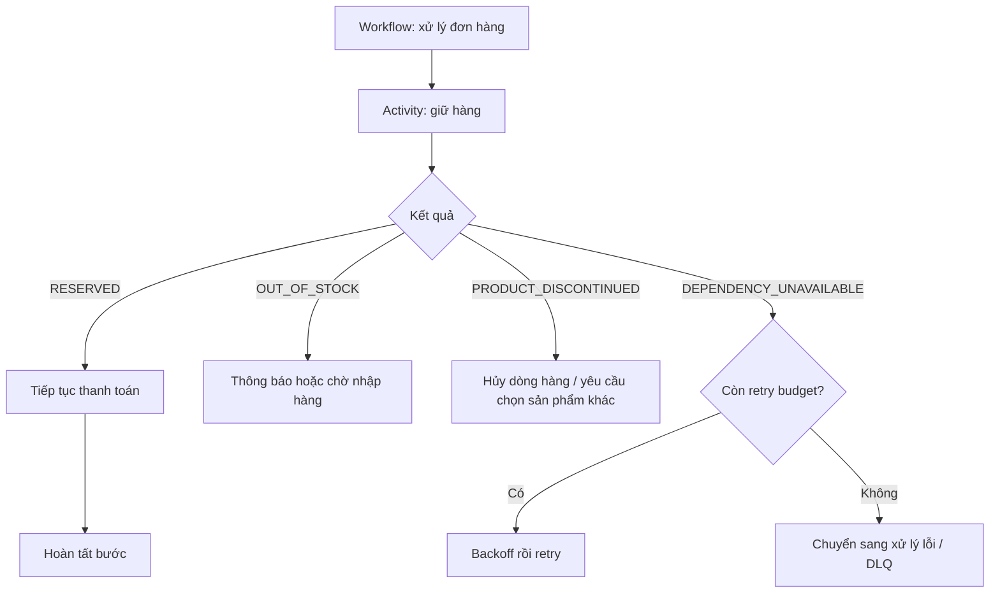
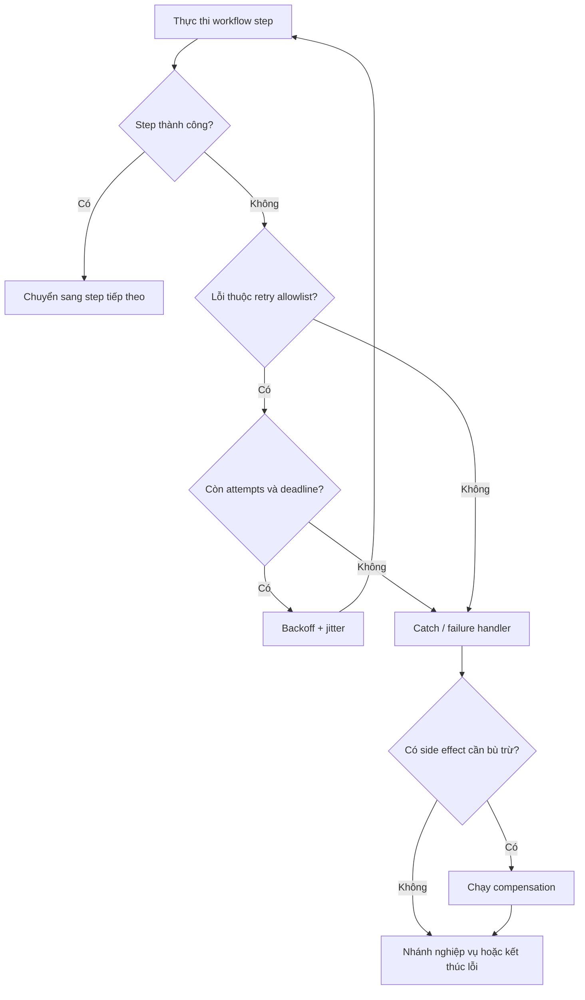
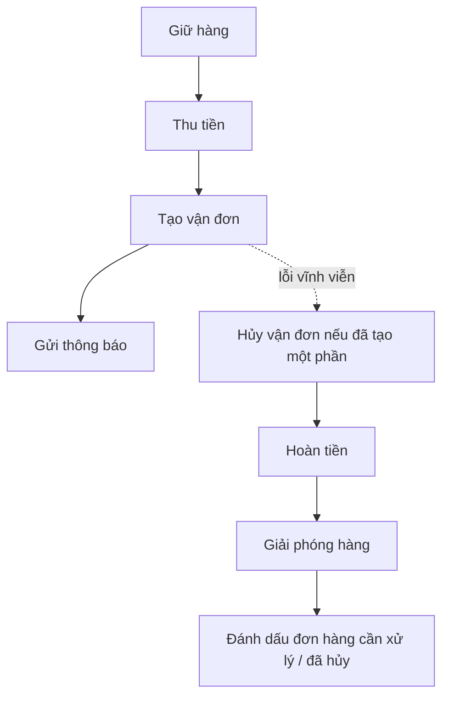
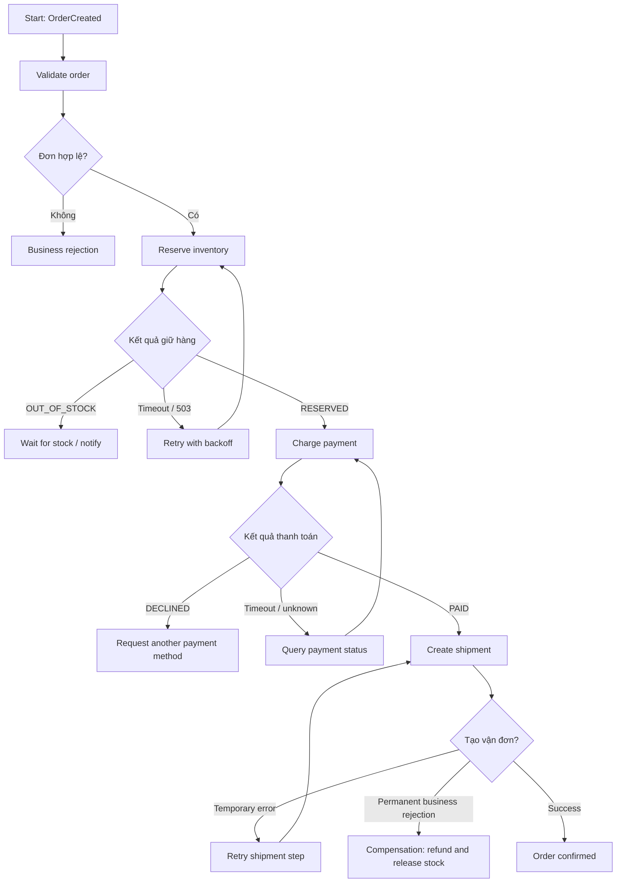

# Phân biệt lỗi kỹ thuật có thể retry và lỗi nghiệp vụ

Trong một workflow serverless, một bước có thể thất bại vì dịch vụ bên ngoài tạm thời không sẵn sàng, vì dữ liệu đầu vào sai, hoặc vì yêu cầu không thỏa điều kiện nghiệp vụ. Những trường hợp này cần cách xử lý khác nhau. Nếu retry mọi lỗi, workflow có thể lặp vô ích, tạo tải lớn và thực hiện tác động phụ nhiều lần. Nếu không retry lỗi tạm thời, một sự cố ngắn của database hoặc API có thể làm hỏng cả quy trình.

Điểm quan trọng là **loại lỗi** và **khả năng retry** là hai câu hỏi liên quan nhưng không đồng nhất. Lỗi kỹ thuật có thể không thể khắc phục bằng retry, chẳng hạn thiếu quyền hoặc sai schema. Một điều kiện nghiệp vụ thường không cần retry ngay, nhưng có thể được đánh giá lại sau khi một sự kiện khác làm thay đổi trạng thái. Quyết định phải dựa trên nguyên nhân, trạng thái đã thay đổi hay chưa, tính an toàn khi chạy lại và thời hạn hoàn thành của workflow.

Bài học này trình bày cách phân loại lỗi, thiết kế retry policy và xử lý các nhánh nghiệp vụ trong workflow có nhiều Java function hoặc dịch vụ tham gia.

## 1. Phân biệt lỗi kỹ thuật và lỗi nghiệp vụ

### 1.1. Lỗi kỹ thuật

Lỗi kỹ thuật xảy ra khi hệ thống không thể thực hiện một thao tác vì thành phần kỹ thuật gặp vấn đề. Ví dụ:

- Kết nối database bị reset hoặc timeout.
- API phụ thuộc trả HTTP 503 vì đang quá tải.
- Queue hoặc object storage tạm thời không truy cập được.
- Dịch vụ trả HTTP 429 và yêu cầu client giảm tốc độ.
- Một worker bị dừng giữa chừng do runtime hoặc môi trường thực thi gặp sự cố.

Một số lỗi kỹ thuật có tính tạm thời và có thể tự hết sau một khoảng thời gian. Đây là ứng viên cho retry. Nhưng lỗi kỹ thuật cũng có thể mang tính cấu hình hoặc không thể tự hết:

- Credential sai hoặc đã hết hạn nhưng không có cơ chế làm mới.
- Function thiếu quyền đọc bảng hoặc gọi API.
- Payload không tương thích với schema hiện tại.
- URL endpoint sai hoặc thư viện không tương thích runtime.
- Request vượt giới hạn kích thước cố định của dịch vụ.

Retry ngay các lỗi này thường chỉ lặp lại cùng một thất bại. Cần sửa cấu hình, quyền, dữ liệu hoặc triển khai.

### 1.2. Lỗi nghiệp vụ

Lỗi nghiệp vụ xảy ra khi hệ thống hiểu request nhưng yêu cầu không thỏa quy tắc hoặc điều kiện của domain. Ví dụ:

- Tài khoản không đủ số dư để thanh toán.
- Đơn hàng đã bị hủy nên không thể chuyển sang `SHIPPED`.
- Sản phẩm hiện không còn hàng.
- Người dùng không có quyền sở hữu tài nguyên đang yêu cầu.
- Mã giảm giá đã hết hạn hoặc không áp dụng cho đơn hàng này.

Những trường hợp này thường là kết quả nghiệp vụ có thể dự đoán, không phải sự cố hạ tầng. Workflow có thể cần kết thúc nhánh hiện tại, thông báo cho người dùng, chọn phương án thay thế hoặc chạy một hành động bù trừ.

Không phải mọi điều kiện nghiệp vụ đều vĩnh viễn. Ví dụ, hàng chưa đủ có thể trở nên khả dụng khi kho nhập thêm; một phê duyệt đang chờ có thể hoàn tất sau đó. Tuy nhiên, việc thử lại nên được kích hoạt bởi một sự kiện hoặc thời điểm có ý nghĩa, thay vì retry liên tục như khi gặp lỗi mạng.

### 1.3. Bốn nhóm quyết định thực tế

| Nhóm | Ví dụ | Retry tự động ngay? | Hành động phù hợp |
| --- | --- | --- | --- |
| Kỹ thuật tạm thời | Timeout, connection reset, HTTP 503 | Thường có, nếu thao tác an toàn và còn thời hạn | Retry có giới hạn, backoff và jitter |
| Kỹ thuật do cấu hình hoặc hợp đồng | Sai credential, thiếu quyền, schema không tương thích | Không | Sửa cấu hình/quyền/schema rồi chạy lại có kiểm soát |
| Nghiệp vụ bị từ chối | Không đủ số dư, đơn đã hủy, coupon không hợp lệ | Không retry mù quáng | Trả kết quả nghiệp vụ hoặc chuyển nhánh xử lý |
| Nghiệp vụ đang chờ điều kiện | Chờ hàng nhập, chờ phê duyệt, chờ hạn mức được bổ sung | Không retry liên tục | Chờ event, timer hoặc tín hiệu làm điều kiện thay đổi rồi đánh giá lại |

Ma trận này là điểm bắt đầu. Một lỗi cụ thể vẫn cần được đánh giá theo hợp đồng của dependency và nghiệp vụ. Chẳng hạn, HTTP 409 có thể là xung đột tạm thời cần đọc lại trạng thái, hoặc là chuyển tiếp nghiệp vụ không hợp lệ. Không thể chỉ dựa vào mã HTTP để quyết định retry.

## 2. Phân biệt loại lỗi với quyết định retry

Một quyết định retry tốt cần trả lời bốn câu hỏi:

1. **Nguyên nhân có khả năng tự hết không?** Timeout ngắn có thể tự hết; thiếu quyền thường không.
2. **Thao tác đã tạo tác động phụ chưa?** Nếu thanh toán đã được ghi nhận nhưng response bị mất, chạy lại có thể thu tiền lần hai.
3. **Có thể chạy lại an toàn không?** Cần idempotency key, conditional update hoặc cơ chế đối soát.
4. **Còn đủ thời gian và ngân sách retry không?** Retry sau khi deadline nghiệp vụ đã qua có thể vô ích hoặc gây tác động sai thời điểm.

Vì vậy, retry không chỉ là phản ứng với exception. Nó là một quyết định có chính sách, có ngân sách và có hiểu biết về trạng thái nghiệp vụ.

### 2.1. Lỗi tạm thời và lỗi vĩnh viễn

**Lỗi tạm thời (transient)** thường liên quan đến tình trạng ngắn hạn: dịch vụ quá tải, kết nối gián đoạn, throttling hoặc một node đang failover. Retry sau một khoảng chờ có thể thành công.

**Lỗi vĩnh viễn (permanent)** thường không thay đổi nếu gửi lại cùng một request: dữ liệu sai định dạng, thiếu quyền, endpoint không tồn tại, token sai audience hoặc thao tác không hợp lệ theo trạng thái hiện tại. Cần sửa nguyên nhân trước khi chạy lại.

Một lỗi có thể thay đổi nhóm khi bối cảnh thay đổi. Ví dụ, `401` do access token hết hạn có thể được khắc phục bằng cách refresh token rồi gửi lại một lần. `403` do thiếu scope không nên retry; cần cấp đúng quyền. Một `404` có thể là tài nguyên không tồn tại thật, hoặc là read-after-write chưa nhất quán tùy hệ thống. Hãy hiểu hợp đồng trước khi phân loại.

### 2.2. Lỗi không xác định

Khi không đủ thông tin để kết luận, hãy coi lỗi là `UNKNOWN`, ghi log và giới hạn số lần retry. Không nên mặc định mọi exception chưa biết đều là transient. Nếu lỗi lặp lại, workflow nên chuyển sang nhánh xử lý thủ công hoặc dead-letter queue thay vì tiếp tục tạo tải.

Một chính sách an toàn có thể dùng quy tắc:

- Chỉ retry các loại lỗi đã được xác nhận là transient.
- Không retry lỗi validation, authorization hoặc business rejection theo mặc định.
- Với lỗi không xác định, chỉ cho phép số lần retry nhỏ nếu hợp đồng hệ thống yêu cầu, sau đó dừng và cảnh báo.
- Mọi lần retry phải giữ nguyên định danh nghiệp vụ và idempotency key của thao tác gốc.

## 3. Retry policy trong workflow

Workflow orchestrator thường hỗ trợ khai báo retry cho từng bước. Chính sách nên được đặt ở bước có đủ ngữ cảnh để biết lỗi nào có thể phục hồi và có thể chạy lại an toàn.

Một retry policy thường có các tham số:

| Tham số | Ý nghĩa |
| --- | --- |
| Initial interval | Khoảng chờ trước lần retry đầu tiên |
| Backoff coefficient | Hệ số tăng khoảng chờ sau mỗi lần thất bại |
| Maximum interval | Khoảng chờ tối đa giữa hai lần thử |
| Maximum attempts | Số lần thực thi tối đa, cần ghi rõ có tính lần đầu hay không |
| Maximum elapsed time | Tổng thời gian tối đa dành cho retry |
| Jitter | Độ ngẫu nhiên thêm vào thời gian chờ để phân tán tải |
| Retryable error types | Các loại lỗi được phép retry |
| Non-retryable error types | Các lỗi phải chuyển sang nhánh xử lý khác ngay |

Ví dụ cấu hình minh họa, không thuộc cú pháp của một nhà cung cấp cụ thể:

```yaml
retryPolicy:
  retryableErrors:
    - DependencyTimeout
    - DependencyUnavailable
    - RateLimited
  nonRetryableErrors:
    - InvalidRequest
    - AccessDenied
    - InsufficientBalance
    - InvalidStateTransition
  initialInterval: 1s
  backoffCoefficient: 2
  maximumInterval: 30s
  maximumAttempts: 5
  maximumElapsedTime: 2m
  jitter: full
```

Trong ví dụ này, workflow thử lại timeout, dịch vụ không sẵn sàng và rate limit. Lỗi dữ liệu, quyền và điều kiện nghiệp vụ bị từ chối được chuyển sang nhánh xử lý khác. Giá trị thực tế phải dựa trên timeout của dependency, SLA, giới hạn retry của provider và yêu cầu nghiệp vụ.

### 3.1. Exponential backoff

Exponential backoff tăng khoảng chờ sau mỗi lần thất bại. Một công thức đơn giản là:

\[
delay_n = \min(maxDelay, initialDelay \times factor^{n-1})
\]

Ví dụ với khoảng đầu 1 giây, hệ số 2 và giới hạn 30 giây:

| Lần retry | Khoảng chờ trước retry (chưa tính jitter) |
| --- | ---: |
| 1 | 1 giây |
| 2 | 2 giây |
| 3 | 4 giây |
| 4 | 8 giây |
| 5 | 16 giây |
| 6 | 30 giây (đã chạm giới hạn) |

Backoff giảm tần suất gọi khi dependency đang gặp sự cố. Nó cũng tạo thời gian cho hệ thống phụ trợ phục hồi.

### 3.2. Jitter

Nếu hàng nghìn workflow cùng retry theo lịch 1, 2, 4, 8 giây, chúng có thể dồn request vào cùng thời điểm. Hiện tượng này gọi là retry synchronization hoặc thundering herd.

Jitter thêm yếu tố ngẫu nhiên vào khoảng chờ. Ví dụ, *full jitter* chọn ngẫu nhiên một giá trị từ 0 đến khoảng backoff đã tính. Cách cụ thể phụ thuộc thư viện hoặc orchestrator. Mục tiêu là phân tán request để dependency không bị quá tải lần nữa.

### 3.3. Retry budget và deadline

Không retry vô hạn. Mỗi workflow nên có:

- số lần thử tối đa;
- tổng thời gian retry tối đa;
- deadline nghiệp vụ;
- ngân sách request hoặc chi phí có thể chấp nhận;
- hành động khi hết ngân sách.

Ví dụ, đơn hàng chỉ được giữ giá trong 10 phút. Retry thanh toán sau 30 phút có thể không còn đúng với giá hoặc chính sách ban đầu. Khi hết deadline, workflow cần chuyển sang trạng thái chờ xử lý, hủy hoặc đối soát theo nghiệp vụ.

`Maximum attempts` cần được hiểu nhất quán. Một số nền tảng tính cả lần chạy đầu, số khác mô tả số lần retry bổ sung. Ghi rõ cách đếm để tránh cấu hình nhiều lần thử hơn dự kiến.

## 4. Timeout, retry và circuit breaker

Retry chỉ có ý nghĩa khi một lần thử có giới hạn thời gian. Nếu function chờ API ngoài vô hạn, workflow có thể giữ execution lâu, chiếm concurrency và làm tăng chi phí.

### 4.1. Sắp xếp timeout theo tầng

Một request thường đi qua nhiều tầng: client, API Gateway, function, HTTP client và dịch vụ phụ trợ. Timeout cần được thiết kế sao cho mỗi tầng có thể kết thúc và trả lỗi trong thời gian dự đoán được.

Ví dụ minh họa:

| Tầng | Timeout |
| --- | ---: |
| HTTP call đến inventory service | 2 giây |
| Một lần thực thi activity | 5 giây |
| Một bước workflow | 8 giây |
| API đồng bộ bên ngoài | 10 giây |
| Tổng deadline nghiệp vụ | 2 phút |

Các con số chỉ minh họa quan hệ. Timeout của mỗi lần gọi phải nhỏ hơn thời hạn của lớp bao ngoài đủ để xử lý, ghi log và trả kết quả. Cần tính cả thời gian kết nối, TLS handshake, đọc response và thời gian xử lý sau khi nhận response.

### 4.2. Circuit breaker

Circuit breaker ngăn hệ thống tiếp tục gọi một dependency đang thất bại liên tục. Khi tỷ lệ lỗi vượt ngưỡng, breaker chuyển sang trạng thái open và từ chối gọi trong một khoảng thời gian. Sau đó, nó có thể cho một số request thử nghiệm (half-open) để xác định dependency đã phục hồi chưa.

Circuit breaker và retry giải quyết hai vấn đề khác nhau:

- Retry thử lại một thao tác có khả năng thành công sau lỗi tạm thời.
- Circuit breaker giảm request đến dependency đang không khỏe để bảo vệ cả hai phía.

Không nên đặt retry dày bên trong circuit breaker rồi lại để workflow retry thêm nhiều vòng mà không tính tổng số request. Hãy xác định một nơi chịu trách nhiệm retry chính và phối hợp circuit breaker với retry budget.

### 4.3. Tránh retry lồng tầng

Giả sử HTTP client retry 3 lần, Java function retry 3 lần và workflow retry 5 lần. Một thao tác nghiệp vụ có thể tạo tối đa 45 lần gọi dependency (tùy cách đếm). Điều này làm tăng tải, độ trễ và nguy cơ side effect lặp.

Hãy chọn retry ở tầng có đủ ngữ cảnh:

- HTTP client có thể retry một số lỗi kết nối an toàn và rất ngắn.
- Function có thể xử lý một retry cục bộ nếu có thể phân biệt lỗi dependency.
- Workflow nên quản lý retry của cả bước nghiệp vụ và thời gian chờ dài.

Không để mọi tầng tự retry mà không có giới hạn tổng thể. Ghi nhận số lần thử ở từng tầng và đưa chúng vào metric.

## 5. Idempotency: điều kiện để retry an toàn

Retry có thể chạy lại một bước sau khi tác động phụ đã hoàn tất nhưng phản hồi chưa đến workflow. Ví dụ, cổng thanh toán đã thu tiền nhưng function timeout trước khi ghi trạng thái `PAID`. Workflow retry và gửi yêu cầu thu tiền lần nữa. Nếu không có idempotency, khách hàng có thể bị tính tiền hai lần.

### 5.1. Dùng khóa ổn định

Mỗi thao tác có tác động phụ nên có idempotency key ổn định. Ví dụ:

- `payment:{orderId}` cho thao tác thu tiền của một đơn hàng;
- `reserve-stock:{orderId}:{sku}` cho giữ một mặt hàng;
- `send-invoice:{invoiceId}` cho phát hành hóa đơn.

Không tạo key mới mỗi lần retry. Key phải đại diện cho cùng một thao tác nghiệp vụ xuyên suốt các lần thử.

### 5.2. Lưu kết quả và trạng thái xử lý

Một idempotency store có thể lưu key, payload hash, trạng thái xử lý và kết quả. Nếu key đã hoàn tất với cùng payload, trả lại kết quả đã lưu. Nếu key đang được xử lý, chờ hoặc trả trạng thái đang chạy theo hợp đồng. Nếu key đã tồn tại nhưng payload khác, từ chối vì cùng một key không được đại diện cho hai yêu cầu khác nhau.

Việc claim key và ghi trạng thái nghiệp vụ cần được phối hợp bằng transaction hoặc thao tác nguyên tử. Chỉ lưu key sau khi gọi dịch vụ ngoài không đủ để ngăn hai invocation chạy song song. Nếu dependency hỗ trợ idempotency key, hãy truyền cùng key xuống dependency.

### 5.3. At-least-once và giới hạn của exactly-once

Nhiều nguồn event và workflow đảm bảo giao nhận ít nhất một lần hoặc có thể phát lại khi không nhận được xác nhận. Vì vậy, consumer nên giả định event có thể lặp.

“Exactly once” thường không phải thuộc tính tự động của toàn bộ chuỗi nhiều dịch vụ. Một broker có thể bảo đảm một phạm vi xử lý cụ thể, nhưng side effect ở database, payment gateway và email provider vẫn cần cơ chế riêng. Thiết kế thực tế thường là at-least-once delivery kết hợp idempotent processing và đối soát.

## 6. Lỗi nghiệp vụ nên trở thành nhánh workflow

Không phải kết quả nghiệp vụ bất lợi nào cũng nên ném exception. Nếu điều kiện từ chối là kết quả dự kiến, biểu diễn nó bằng kết quả có kiểu hoặc trạng thái rõ ràng để workflow có thể chọn nhánh.

Ví dụ, thao tác giữ hàng có thể trả một trong các kết quả:

- `RESERVED`: giữ hàng thành công.
- `OUT_OF_STOCK`: không đủ tồn kho; có thể thông báo hoặc chờ nhập hàng.
- `PRODUCT_DISCONTINUED`: sản phẩm ngừng kinh doanh; không retry.
- `DEPENDENCY_UNAVAILABLE`: kho hàng không truy cập được; đây là lỗi kỹ thuật có thể retry.



Nếu `OUT_OF_STOCK` được ném thành exception chung, workflow có thể retry liên tục dù kho không có hàng. Nếu nó được biểu diễn thành kết quả, workflow có thể chọn nhánh chờ event `InventoryRestocked` hoặc kết thúc yêu cầu hiện tại.

### 6.1. Khi nào nên chờ rồi đánh giá lại?

Một số điều kiện nghiệp vụ có thể thay đổi theo thời gian. Ví dụ:

- Chờ người quản lý phê duyệt.
- Chờ kho nhập thêm hàng.
- Chờ khách hàng bổ sung giấy tờ.
- Chờ hạn mức hoặc quota nghiệp vụ được giải phóng.

Trong các trường hợp này, workflow có thể chuyển sang `WAITING_FOR_APPROVAL`, `WAITING_FOR_STOCK` hoặc `PENDING_CUSTOMER_INPUT`. Sau khi nhận event tương ứng hoặc đến thời điểm hẹn, workflow đọc lại trạng thái có thẩm quyền và quyết định bước tiếp theo.

Không nên dùng vòng lặp polling ngắn liên tục để chờ điều kiện. Dùng callback, event, timer hoặc lịch kiểm tra thưa có giới hạn. Cần đặt deadline và xác định kết quả nếu điều kiện không xảy ra kịp thời.

### 6.2. Kết quả nghiệp vụ và lỗi hệ thống phải tách biệt

Ví dụ một thanh toán bị từ chối vì thẻ không hợp lệ là kết quả nghiệp vụ từ payment provider. Payment API trả 503 là lỗi kỹ thuật. Hai trường hợp có thể cùng làm bước thanh toán không hoàn tất, nhưng workflow cần phản ứng khác nhau:

- `PAYMENT_DECLINED`: thông báo người dùng, yêu cầu phương thức thanh toán khác hoặc hủy đơn theo chính sách.
- `PAYMENT_PROVIDER_UNAVAILABLE`: retry có giới hạn hoặc chuyển sang trạng thái chờ.
- `PAYMENT_STATUS_UNKNOWN`: không gửi lại thao tác thu tiền ngay; trước tiên truy vấn trạng thái giao dịch bằng idempotency/reference ID để tránh thu tiền trùng.

Trạng thái `UNKNOWN` rất quan trọng với thao tác tài chính. Timeout không chứng minh thao tác thất bại. Nó chỉ cho biết caller chưa nhận được kết quả. Cần đối soát trạng thái trước khi quyết định retry.

## 7. Phân loại lỗi trong Java

Java code nên giữ ranh giới giữa lỗi nghiệp vụ và lỗi kỹ thuật. Có thể dùng domain result cho kết quả dự kiến và exception có kiểu cho lỗi hạ tầng.

### 7.1. Dùng domain result cho điều kiện nghiệp vụ

Ví dụ minh họa:

```java
public enum ReservationStatus {
    RESERVED,
    OUT_OF_STOCK,
    PRODUCT_DISCONTINUED
}

public record ReservationResult(
        ReservationStatus status,
        String reservationId) {
}

public final class InventoryActivity {
    private final InventoryClient inventory;

    public InventoryActivity(InventoryClient inventory) {
        this.inventory = inventory;
    }

    public ReservationResult reserve(ReserveCommand command) {
        InventoryResponse response = inventory.reserve(
                command.sku(),
                command.quantity(),
                command.idempotencyKey());

        return switch (response.code()) {
            case "RESERVED" -> new ReservationResult(
                    ReservationStatus.RESERVED,
                    response.reservationId());
            case "OUT_OF_STOCK" -> new ReservationResult(
                    ReservationStatus.OUT_OF_STOCK,
                    null);
            case "DISCONTINUED" -> new ReservationResult(
                    ReservationStatus.PRODUCT_DISCONTINUED,
                    null);
            default -> throw new IllegalStateException(
                    "Unexpected inventory response code");
        };
    }
}
```

Đoạn mã giả định `InventoryClient` trả response hợp lệ. Nếu client gặp timeout hoặc HTTP 503, nó nên ném exception kỹ thuật có kiểu để workflow áp dụng retry. Nếu dịch vụ trả `OUT_OF_STOCK`, đó là kết quả nghiệp vụ và không nên biến thành lỗi kỹ thuật chỉ để kích hoạt retry.

### 7.2. Dùng exception có kiểu cho lỗi kỹ thuật

```java
public abstract class DependencyException extends RuntimeException {
    protected DependencyException(String message, Throwable cause) {
        super(message, cause);
    }
}

public final class DependencyTimeoutException
        extends DependencyException {
    public DependencyTimeoutException(Throwable cause) {
        super("Dependency call timed out", cause);
    }
}

public final class DependencyUnavailableException
        extends DependencyException {
    private final Duration retryAfter;

    public DependencyUnavailableException(
            Duration retryAfter,
            Throwable cause) {
        super("Dependency is temporarily unavailable", cause);
        this.retryAfter = retryAfter;
    }

    public Duration retryAfter() {
        return retryAfter;
    }
}

public final class InvalidDependencyConfigurationException
        extends RuntimeException {
    public InvalidDependencyConfigurationException(String message) {
        super(message);
    }
}
```

Lớp adapter của HTTP client có trách nhiệm chuyển lỗi transport và response status thành exception phù hợp. Không nên chuyển mọi HTTP 4xx hoặc 5xx thành cùng một `RuntimeException`, vì workflow sẽ mất thông tin để chọn hành động.

### 7.3. Bộ phân loại lỗi

Một bộ phân loại có thể tạo quyết định rõ ràng thay vì để từng activity tự phỏng đoán:

```java
public enum FailureKind {
    TRANSIENT_TECHNICAL,
    PERMANENT_TECHNICAL,
    BUSINESS_REJECTION,
    UNKNOWN
}

public record RetryDecision(
        FailureKind kind,
        boolean retry,
        Duration retryAfter,
        String reason) {
}

public final class FailureClassifier {
    public RetryDecision classify(Throwable error) {
        if (error instanceof DependencyTimeoutException) {
            return new RetryDecision(
                    FailureKind.TRANSIENT_TECHNICAL,
                    true,
                    Duration.ofSeconds(1),
                    "Dependency timeout");
        }

        if (error instanceof DependencyUnavailableException unavailable) {
            return new RetryDecision(
                    FailureKind.TRANSIENT_TECHNICAL,
                    true,
                    unavailable.retryAfter(),
                    "Dependency unavailable");
        }

        if (error instanceof InvalidDependencyConfigurationException) {
            return new RetryDecision(
                    FailureKind.PERMANENT_TECHNICAL,
                    false,
                    Duration.ZERO,
                    "Configuration must be corrected");
        }

        if (error instanceof BusinessRuleException) {
            return new RetryDecision(
                    FailureKind.BUSINESS_REJECTION,
                    false,
                    Duration.ZERO,
                    "Business condition was not satisfied");
        }

        return new RetryDecision(
                FailureKind.UNKNOWN,
                false,
                Duration.ZERO,
                "Unclassified failure");
    }
}
```

Đây là ví dụ về cấu trúc mã, không phải thư viện retry hay API workflow cụ thể. Trong production, classifier cần xử lý exception được bọc lồng nhau, status code và mã lỗi của dependency. `retryAfter` chỉ nên dùng khi giá trị đến từ hợp đồng tin cậy, chẳng hạn header `Retry-After` đã được kiểm tra.

Không phân loại dựa trên message text của exception vì message có thể thay đổi theo phiên bản thư viện hoặc ngôn ngữ. Ưu tiên exception type, mã lỗi ổn định và metadata có cấu trúc.

## 8. Xử lý lỗi trong workflow orchestrator

### 8.1. Retry và Catch là hai nhánh khác nhau

Một bước workflow thường cần:

- **Retry:** thử lại cùng một bước khi lỗi có thể phục hồi.
- **Catch:** bắt lỗi không retry hoặc lỗi đã hết retry budget để chuyển sang nhánh xử lý khác.
- **Compensation:** thực hiện hành động bù trừ nếu các bước trước đã tạo tác động cần hoàn tác về mặt nghiệp vụ.
- **Fail:** kết thúc workflow khi không còn nhánh phục hồi phù hợp.



### 8.2. Chỉ retry đúng bước thất bại

Giả sử workflow gồm các bước:

1. Tạo đơn hàng.
2. Giữ hàng.
3. Thu tiền.
4. Tạo vận đơn.
5. Gửi email.

Nếu gửi email thất bại tạm thời, không nên chạy lại toàn bộ workflow từ bước tạo đơn hàng. Chỉ retry bước gửi email với idempotency key riêng. Nếu workflow engine không hỗ trợ retry riêng từng bước, cần thiết kế checkpoint hoặc chia workflow thành các state/child workflow có thể phục hồi độc lập.

### 8.3. Không để lỗi kỹ thuật che khuất trạng thái nghiệp vụ

Workflow có thể thất bại ở bước ghi trạng thái sau khi payment provider đã thu tiền. Khi đó, không được đánh dấu đơn hàng `PAYMENT_FAILED` chỉ vì function gặp exception. Trạng thái đúng có thể là `PAYMENT_UNKNOWN` hoặc `RECONCILIATION_REQUIRED` cho đến khi tra cứu được kết quả giao dịch.

Nên phân biệt:

- `FAILED`: đã xác định nghiệp vụ không hoàn tất và không có tác động cần đối soát.
- `RETRYING`: lỗi kỹ thuật tạm thời, đang chờ lần thử tiếp theo.
- `WAITING`: đang chờ một điều kiện hoặc event nghiệp vụ.
- `UNKNOWN`: chưa xác định được tác động phụ đã xảy ra hay chưa.
- `COMPENSATING`: đang chạy hành động bù trừ.
- `COMPLETED`: nghiệp vụ đã hoàn tất theo tiêu chí xác định.

Các trạng thái này cần có định nghĩa và chuyển tiếp hợp lệ trong domain, không nên chỉ phản ánh trạng thái kỹ thuật của workflow engine.

## 9. Dead-letter queue và xử lý thủ công

Khi một message hoặc workflow step thất bại quá số lần cho phép, hệ thống cần một nơi để giữ thông tin phục vụ điều tra. Dead-letter queue (DLQ) thường được dùng cho event/message không thể xử lý theo retry policy hiện tại.

Một DLQ hữu ích cần lưu đủ thông tin để xác định:

- event ID, correlation ID và workflow execution ID;
- loại lỗi, mã lỗi gốc và số lần thử;
- thời điểm đầu tiên và lần cuối xử lý;
- phiên bản function/workflow đã xử lý;
- tham chiếu đến payload gốc hoặc bản sao được bảo vệ;
- trạng thái tác động phụ nếu đã xác định.

Không đưa secret, bearer token hoặc dữ liệu nhạy cảm không cần thiết vào DLQ. Nếu payload chứa dữ liệu cá nhân, áp dụng mã hóa, kiểm soát truy cập và retention phù hợp.

### 9.1. Redrive không phải lúc nào cũng an toàn

Redrive là phát lại message từ DLQ hoặc chạy lại workflow sau khi sửa nguyên nhân. Trước khi redrive, cần xác định:

1. Nguyên nhân gốc đã được sửa chưa?
2. Payload có còn hợp lệ theo schema hiện tại không?
3. Side effect trước đó đã xảy ra chưa?
4. Idempotency key có còn được giữ và chưa hết hạn không?
5. Có thể phát lại theo tốc độ giới hạn để tránh tạo tải đột biến không?

Không redrive hàng loạt một DLQ lớn vào dependency vừa phục hồi mà không có rate limit. Hãy phát lại theo batch nhỏ, quan sát lỗi và tăng tốc độ từ từ.

### 9.2. Manual review

Một số lỗi cần con người quyết định, chẳng hạn giao dịch tài chính ở trạng thái không xác định, dữ liệu vi phạm quy tắc hoặc yêu cầu cần ngoại lệ. Workflow nên chuyển sang trạng thái `MANUAL_REVIEW`, lưu bằng chứng và thông báo qua kênh vận hành. Khi có quyết định, người xử lý phát một command hoặc event có audit trail để tiếp tục workflow.

Không sửa trực tiếp database để ép workflow đi tiếp mà không ghi nhận ai thực hiện, lý do và trạng thái trước/sau. Thao tác thủ công cũng cần idempotency và quyền tối thiểu.

## 10. Compensation và Saga khi không thể retry

Retry phù hợp khi có khả năng thực hiện lại cùng một thao tác. Nhưng nếu bước thất bại làm quy trình không thể tiếp tục, có thể cần bù trừ các bước đã hoàn tất.

Ví dụ Saga đặt hàng:

| Bước | Tác động | Compensation có thể có |
| --- | --- | --- |
| Giữ hàng | Giảm lượng hàng khả dụng | Giải phóng reservation |
| Thu tiền | Ghi nhận khoản thu | Hoàn tiền hoặc tạo yêu cầu hoàn tiền |
| Tạo vận đơn | Tạo shipment | Hủy shipment nếu hãng vận chuyển cho phép |
| Gửi email | Gửi thông báo | Thường không thể thu hồi; có thể gửi thông báo đính chính |

Compensation không xóa lịch sử đã xảy ra. Nó tạo một hành động nghiệp vụ mới để đưa hệ thống về trạng thái chấp nhận được. Hành động bù trừ cũng có thể timeout hoặc thất bại, nên phải có retry policy, idempotency và trạng thái riêng.



Thứ tự compensation thường ngược với thứ tự thực hiện, nhưng không phải lúc nào cũng có thể đảo ngược chính xác. Cần định nghĩa quy tắc domain và xử lý trường hợp compensation thất bại giữa chừng.

## 11. Quan sát retry và lỗi workflow

Chỉ có metric `workflow failed` là chưa đủ. Cần biết bước nào thất bại, loại lỗi nào, bao nhiêu lần retry và tác động nghiệp vụ đã xảy ra chưa.

### 11.1. Log có cấu trúc

Các trường hữu ích:

- `workflowId` hoặc execution ID;
- `stepName` và `attempt`;
- `eventId`, `correlationId` và business key;
- `failureKind`: `TRANSIENT_TECHNICAL`, `PERMANENT_TECHNICAL`, `BUSINESS_REJECTION` hoặc `UNKNOWN`;
- exception type, dependency và mã lỗi ổn định;
- thời gian bắt đầu, thời gian kết thúc và retry delay;
- idempotency key ở dạng an toàn để đối chiếu, không log credential;
- trạng thái side effect hoặc kết quả đối soát.

Không log nguyên payload nếu có dữ liệu nhạy cảm. Dùng correlation ID để nối log giữa workflow engine, Java function, database, queue và dependency.

### 11.2. Metric cần theo dõi

| Metric | Điều cần quan sát |
| --- | --- |
| Workflow started/completed/failed | Số workflow và tỷ lệ hoàn thành |
| Retry count theo step/error type | Bước nào retry nhiều và lỗi nào lặp lại |
| Retry exhaustion | Số workflow hết retry budget |
| Delay đến khi thành công | Tác động của retry đến SLA |
| DLQ depth và oldest message age | Khối lượng lỗi chưa xử lý và thời gian tồn đọng |
| Business rejection rate | Tỷ lệ yêu cầu bị từ chối hợp lệ theo nghiệp vụ |
| Unknown payment/side-effect count | Số giao dịch cần đối soát |
| Compensation success/failure | Khả năng phục hồi sau lỗi không thể retry |
| Dependency latency/error/throttle | Sức khỏe của dịch vụ phụ thuộc |

Phân biệt business rejection với technical failure trong dashboard. Nếu không, tỷ lệ lỗi có thể tăng dù hệ thống đang từ chối đúng các request không đủ điều kiện.

### 11.3. Cảnh báo có ý nghĩa

Nên cảnh báo khi retry count tăng bất thường, workflow hết retry budget, DLQ có message, tuổi message vượt SLA, dependency bị circuit breaker mở kéo dài hoặc số giao dịch ở trạng thái `UNKNOWN` tăng. Business rejection có thể cần dashboard hoặc cảnh báo riêng nếu tỷ lệ thay đổi bất thường, nhưng không nhất thiết phải xem từng lần từ chối là sự cố kỹ thuật.

## 12. Ví dụ tổng hợp: workflow thanh toán đơn hàng

Một workflow xử lý đơn hàng có các bước:

1. Xác minh đơn hàng và giá.
2. Giữ hàng.
3. Thu tiền.
4. Ghi trạng thái thanh toán.
5. Tạo vận đơn.

Các kết quả cần được phân biệt:

| Bước | Kết quả | Hành động workflow |
| --- | --- | --- |
| Xác minh đơn | Dữ liệu sai hoặc đơn đã hủy | Kết thúc nhánh nghiệp vụ, không retry |
| Giữ hàng | Không đủ hàng | Chờ nhập hàng hoặc báo người dùng chọn lại |
| Giữ hàng | Inventory API timeout | Retry có backoff và idempotency key |
| Thu tiền | Thẻ bị từ chối | Yêu cầu phương thức khác hoặc hủy đơn |
| Thu tiền | Payment API 503 | Retry theo policy, cùng payment idempotency key |
| Thu tiền | Timeout, chưa biết đã thu hay chưa | Tra cứu trạng thái giao dịch trước khi thử lại |
| Tạo vận đơn | Provider lỗi tạm thời | Retry riêng bước tạo vận đơn |
| Tạo vận đơn | Không thể giao đến địa chỉ | Compensation theo chính sách, có thể hoàn tiền và giải phóng hàng |



Trong sơ đồ, nhánh `Timeout / unknown` không gửi lệnh thu tiền lần nữa ngay lập tức. Workflow tra cứu giao dịch theo reference hoặc idempotency key. Nếu đã thu tiền, nó tiếp tục từ bước cập nhật trạng thái; nếu chưa thu, mới quyết định gửi lại theo chính sách.

### 12.1. Thiết kế trạng thái workflow

Một mô hình trạng thái có thể gồm:

- `VALIDATING`
- `WAITING_FOR_STOCK`
- `RESERVING_STOCK`
- `PAYMENT_PENDING`
- `PAYMENT_UNKNOWN`
- `PAID`
- `CREATING_SHIPMENT`
- `COMPENSATING`
- `COMPLETED`
- `CANCELLED`
- `MANUAL_REVIEW`

Trạng thái nghiệp vụ nên được lưu trong database nguồn sự thật; workflow engine lưu tiến độ điều phối. Hai nơi cần được cập nhật theo thiết kế nhất quán, có correlation ID và cơ chế phục hồi khi một bước commit nhưng workflow không nhận được phản hồi.

## 13. Checklist thiết kế retry và lỗi nghiệp vụ

- [ ] Có taxonomy phân biệt transient technical, permanent technical, business rejection và unknown.
- [ ] Điều kiện nghiệp vụ dự kiến được biểu diễn thành kết quả hoặc nhánh workflow.
- [ ] Không retry validation, authorization hoặc business rejection theo mặc định.
- [ ] Chỉ retry loại lỗi đã được xác nhận là có khả năng phục hồi.
- [ ] Mỗi lần gọi dependency có timeout hữu hạn.
- [ ] Retry policy có initial delay, backoff, maximum delay, jitter và giới hạn attempts.
- [ ] Có deadline và retry budget cho toàn workflow.
- [ ] Tránh retry lồng tầng không có giới hạn tổng.
- [ ] Thao tác có side effect dùng idempotency key ổn định.
- [ ] Timeout không được hiểu nhầm là thao tác chắc chắn thất bại.
- [ ] Có bước tra cứu/đối soát khi trạng thái side effect không xác định.
- [ ] Retry chỉ bước lỗi, không chạy lại toàn bộ workflow nếu không cần.
- [ ] Có Catch/failure handler, DLQ và quy trình redrive.
- [ ] Redrive được giới hạn tốc độ và kiểm tra idempotency trước khi chạy.
- [ ] Compensation có trạng thái, retry policy và audit trail riêng.
- [ ] Có metric riêng cho business rejection, technical failure, retry exhaustion và compensation.

## Kết luận

Lỗi kỹ thuật mô tả vấn đề ở runtime, mạng, dependency hoặc cấu hình; lỗi nghiệp vụ mô tả yêu cầu không thỏa điều kiện domain. Cả hai không tự động quyết định có retry hay không. Chỉ retry khi nguyên nhân có khả năng phục hồi, thao tác an toàn khi chạy lại và workflow còn trong deadline/budget.

Các điều kiện nghiệp vụ dự kiến nên trở thành kết quả hoặc nhánh workflow. Những điều kiện có thể thay đổi theo thời gian nên chờ event hoặc timer rồi đánh giá lại. Khi một bước đã tạo tác động phụ nhưng kết quả không rõ, hãy đối soát trước khi gửi lại. Khi không thể tiếp tục, dùng compensation/Saga hoặc manual review theo quy tắc domain.

Với Java FaaS, hãy dùng exception có kiểu cho lỗi kỹ thuật, domain result cho kết quả nghiệp vụ, idempotency cho side effect và retry policy tập trung ở tầng có đủ ngữ cảnh. Backoff, jitter, timeout, circuit breaker, DLQ và quan sát theo từng bước giúp workflow phục hồi có kiểm soát mà không biến một lỗi tạm thời thành sự cố dây chuyền.
