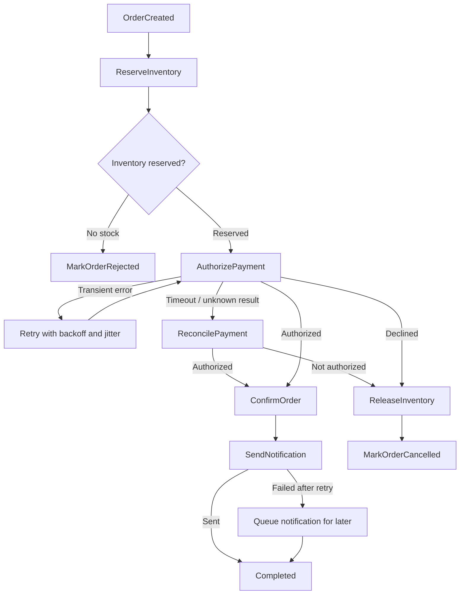

# Thiết lập retry, timeout và nhánh bắt lỗi của workflow

## 1. Vì sao workflow cần chính sách lỗi rõ ràng?

Một workflow serverless thường gọi nhiều Java function và dịch vụ bên ngoài để hoàn thành một quy trình nghiệp vụ. Ví dụ, xử lý đơn hàng có thể gồm kiểm tra thông tin, giữ hàng, thu tiền, tạo vận đơn và gửi thông báo. Mỗi bước có thời gian chạy, giới hạn tài nguyên và kiểu lỗi khác nhau. Một function có thể timeout; database có thể tạm thời từ chối kết nối; nhà cung cấp thanh toán có thể giới hạn tốc độ; hoặc yêu cầu có thể bị từ chối vì quy tắc nghiệp vụ.

Nếu workflow dừng ngay khi gặp lỗi đầu tiên, những lỗi tạm thời sẽ làm giảm độ tin cậy của toàn quy trình. Nếu workflow thử lại mọi lỗi vô hạn, nó có thể lặp lại một hành động đã thành công, tạo giao dịch trùng, làm quá tải dịch vụ phụ thuộc và tăng chi phí. Nếu workflow bắt mọi lỗi rồi kết thúc thành công, dữ liệu nghiệp vụ có thể bị bỏ dở mà không ai nhận ra.

Một chính sách lỗi tốt cần trả lời được:

- Lỗi nào có thể tự phục hồi bằng cách thử lại?
- Thử lại bao nhiêu lần, chờ bao lâu và có giới hạn tổng thời gian không?
- Khi nào một bước được xem là timeout? Khi nào cần heartbeat?
- Nếu một bước thất bại sau khi các bước trước đã hoàn tất, cần bù trừ điều gì?
- Lỗi nào được chuyển sang nhánh dự phòng, hàng đợi xử lý thủ công hoặc trạng thái thất bại cuối cùng?
- Làm thế nào để tránh tác động nghiệp vụ lặp khi workflow chạy lại?

Trong FaaS, orchestration engine thường giữ trạng thái workflow bên ngoài các function. Engine điều khiển lịch chạy, retry, timeout và nhánh tiếp theo; function thực hiện một tác vụ có phạm vi rõ ràng. Điều này cho phép từng function kết thúc sau khi làm xong việc, nhưng cũng yêu cầu thiết kế chính xác ranh giới giữa lỗi của function, lỗi của dịch vụ gọi và lỗi của chính workflow.

## 2. Phân loại lỗi trước khi cấu hình retry

Không nên quyết định retry chỉ dựa trên việc một exception có xuất hiện hay không. Hãy phân loại lỗi theo khả năng tự phục hồi và ý nghĩa nghiệp vụ.

| Nhóm lỗi | Ví dụ | Hướng xử lý thường phù hợp |
|---|---|---|
| Tạm thời (transient) | Timeout kết nối, HTTP 503, throttling, broker tạm mất kết nối | Retry có backoff và giới hạn |
| Dữ liệu hoặc yêu cầu không hợp lệ | Thiếu mã đơn, sai schema, định dạng tiền tệ không hỗ trợ | Dừng bước, trả lỗi rõ ràng hoặc đưa vào vùng cách ly |
| Từ chối nghiệp vụ | Không đủ tồn kho, thẻ bị từ chối, khách hàng không đủ điều kiện | Chuyển nhánh nghiệp vụ; thường không retry tự động |
| Lỗi cấu hình hoặc quyền | Thiếu IAM permission, secret sai, endpoint cấu hình sai | Báo động và sửa cấu hình; retry thường không giúp ích |
| Lỗi lập trình | Null ngoài dự kiến, vi phạm invariant, lỗi chuyển đổi dữ liệu | Giới hạn retry, ghi nhận lỗi và chuyển điều tra |
| Timeout với kết quả chưa rõ | Gửi yêu cầu thanh toán nhưng mất kết nối trước khi nhận phản hồi | Tra cứu trạng thái bằng idempotency key trước khi gửi lại |

Một lỗi có thể được phân loại khác nhau tùy nghiệp vụ. HTTP 404 khi đọc một tài nguyên tùy chọn có thể là kết quả hợp lệ; HTTP 404 do endpoint cấu hình sai là lỗi triển khai. HTTP 409 có thể biểu thị xung đột có thể giải quyết sau, hoặc một quy tắc nghiệp vụ đã bị vi phạm. Hãy chuyển mã lỗi của dependency thành các loại lỗi ổn định mà workflow hiểu được.

**Kết quả nghiệp vụ không phải lúc nào cũng là exception.** Ví dụ, thanh toán bị từ chối là một kết quả hợp lệ của quy trình. Java function có thể trả `{ "status": "DECLINED", "reason": "INSUFFICIENT_FUNDS" }`; workflow dùng nhánh `Choice` để đánh dấu đơn hàng bị từ chối. Cách này giúp phân biệt “hệ thống không thực hiện được bước” với “bước đã thực hiện và có kết quả từ chối”. Nếu tổ chức chọn biểu diễn từ chối bằng exception, cần có catcher riêng và không đưa loại lỗi đó vào chính sách retry.

## 3. Retry là gì và khi nào nên dùng?

Retry là việc thực hiện lại một bước sau khi lần chạy trước thất bại. Retry phù hợp khi lỗi có khả năng biến mất sau một khoảng chờ, chẳng hạn dịch vụ phụ thuộc vừa quá tải hoặc kết nối mạng tạm thời gián đoạn.

Retry không phù hợp khi:

- Dữ liệu đầu vào sai và không thay đổi giữa các lần thử.
- Người dùng hoặc hệ thống nghiệp vụ đã từ chối hành động.
- Thiếu quyền hoặc cấu hình sai cần được sửa.
- Tác động trước đó có thể đã xảy ra nhưng kết quả chưa rõ, và thao tác không có cơ chế chống trùng hoặc tra cứu trạng thái.
- Thời gian chờ thêm sẽ khiến workflow vượt SLA hoặc deadline nghiệp vụ.

Mỗi chính sách retry nên xác định rõ error type được phép retry, số lần thử lại, khoảng chờ ban đầu, hệ số tăng, khoảng chờ tối đa và cách tạo jitter. Không dùng một chính sách chung cho tất cả task vì database, API thanh toán và gửi email có đặc điểm phục hồi khác nhau.

## 4. Exponential backoff và jitter

Nếu nhiều workflow cùng gặp lỗi và retry ngay lập tức, chúng có thể tạo ra một đợt tải mới lên dịch vụ đang gặp sự cố. Exponential backoff làm thời gian chờ tăng dần sau mỗi lần thất bại.

Một công thức cơ bản:

\[
delay_n = \min(delay_{max}, delay_0 \times factor^{n-1})
\]

Trong đó:

- `delay_0` là thời gian chờ ban đầu.
- `factor` thường lớn hơn 1, ví dụ 2.
- `n` là số thứ tự lần retry.
- `delay_max` giới hạn thời gian chờ tối đa.

Ví dụ `delay_0 = 2 giây`, `factor = 2`, `delay_max = 20 giây` tạo chuỗi thời gian chờ tối đa là 2, 4, 8, 16, 20 giây. Tổng thời gian chờ sẽ là 50 giây nếu dùng đủ năm lần retry và không tính thời gian thực thi task.

Jitter thêm độ ngẫu nhiên vào khoảng chờ để các workflow không cùng thức dậy tại một thời điểm. Với full jitter, thời gian chờ được chọn ngẫu nhiên trong khoảng từ 0 đến giá trị backoff đã tính:

\[
delay = random(0, backoff_n)
\]

Jitter đặc biệt hữu ích khi có nhiều function hoặc workflow đồng thời gọi cùng một dependency. Nó giảm nguy cơ retry storm và giúp tải phục hồi phân tán hơn. Cần ghi rõ cách nền tảng định nghĩa jitter; một số nền tảng hỗ trợ full jitter, một số dùng equal jitter hoặc cách khác.

### Số lần retry và tổng thời gian

Trong một số workflow engine, `MaxAttempts` là số lần thử lại sau lần chạy đầu tiên; nền tảng khác có thể định nghĩa là tổng số lần thực thi. Không suy đoán từ tên thuộc tính. Ví dụ nếu có một lần đầu và tối đa ba lần retry, task có thể chạy tối đa bốn lần.

Tổng thời gian của task cần tính cả thời gian thực thi và khoảng chờ:

\[
T_{task} \approx \sum_{i=1}^{N} T_{attempt_i} + \sum delay_i
\]

Nếu mỗi lần gọi có thể chạy 15 giây, task thử tối đa bốn lần và có các khoảng chờ 2, 4, 8 giây, tổng thời gian xấp xỉ 74 giây. Workflow cần có timeout đủ lớn để chứa thời gian này, nhưng vẫn nằm trong deadline của quy trình. Khi dependency chậm hơn dự kiến, task timeout có thể làm tổng thời gian thực tế khác với ước lượng.

## 5. Retry phải đi cùng idempotency

Orchestration engine có thể giao lại một task sau timeout hoặc khi không nhận được kết quả rõ ràng. Một function cũng có thể đã gọi dịch vụ ngoài thành công rồi bị dừng trước khi trả response. Workflow không thể luôn biết tác động đã xảy ra hay chưa.

Ví dụ, function gửi lệnh thu 450.000 đồng đến cổng thanh toán. Cổng đã ghi nhận giao dịch nhưng response bị mất trên mạng. Workflow nhận timeout. Nếu retry bằng một yêu cầu mới, khách hàng có thể bị thu tiền hai lần.

Hãy dùng idempotency key ổn định cho một hành động nghiệp vụ:

```text
authorize-payment:ORD-2048:attempt-1
```

Mọi lần retry của cùng hành động phải dùng cùng khóa. Cổng thanh toán cần trả lại kết quả đã lưu cho khóa đó hoặc cho phép tra cứu giao dịch. Nếu người dùng chủ động bắt đầu một lần thanh toán mới, có thể tạo khóa mới theo một phiên bản nghiệp vụ mới.

Các nguyên tắc:

- Không tạo idempotency key ngẫu nhiên mới ở mỗi lần retry.
- Ghi khóa và trạng thái xử lý ở nơi bền vững.
- Nếu cập nhật database và ghi inbox/processed key cùng một cơ sở dữ liệu, thực hiện trong cùng transaction.
- Nếu gọi hệ thống ngoài, dùng idempotency key mà hệ thống đó hỗ trợ hoặc tra cứu trạng thái trước khi gửi lại.
- Lưu khóa lâu hơn khoảng thời gian workflow có thể retry, redrive hoặc replay.
- Phân biệt retry cùng hành động với một yêu cầu nghiệp vụ mới.

Timeout không có nghĩa là hành động bên ngoài chắc chắn thất bại. Khi kết quả chưa rõ, nhánh xử lý nên gọi bước `Reconcile` hoặc `GetOperationStatus` bằng khóa ổn định trước khi quyết định thử lại.

## 6. Timeout ở nhiều lớp

Một request serverless có thể chịu nhiều giới hạn thời gian. Không đặt tất cả timeout bằng nhau vì mỗi lớp có trách nhiệm khác nhau.

| Lớp | Giới hạn | Mục đích |
|---|---|---|
| HTTP client trong Java | Connect/read/request timeout | Giới hạn thời gian chờ dependency |
| Java function runtime | Function timeout | Giới hạn thời gian một invocation |
| API gateway | Integration/request timeout | Giới hạn thời gian gateway chờ function hoặc backend |
| Workflow task | Task/state timeout | Giới hạn thời gian orchestration chờ một bước |
| Workflow execution | Overall execution timeout/deadline | Giới hạn toàn quy trình |
| Heartbeat | Khoảng cách tối đa giữa hai heartbeat | Phát hiện task dài hạn không còn tiến triển |

Một thứ tự cấu hình thường hợp lý là: timeout của dependency nhỏ hơn timeout của function; timeout của function nhỏ hơn timeout của task; task và retry phải còn đủ thời gian trước deadline tổng thể. Tuy nhiên, API gateway có thể có giới hạn riêng thấp hơn function runtime, và một số tích hợp bất đồng bộ không giữ kết nối HTTP trong suốt workflow. Cần kiểm tra giới hạn của từng nền tảng.

Ví dụ, Java function gọi payment provider với connect timeout 2 giây và request timeout 8 giây; function timeout là 12 giây; task timeout là 90 giây để bao gồm retry và backoff; toàn workflow có deadline 5 phút. Các con số này chỉ minh họa quan hệ giữa các lớp, không phải giá trị mặc định phù hợp cho mọi hệ thống.

Timeout quá ngắn có thể tạo retry dù dependency chỉ chậm hơn bình thường một chút. Timeout quá dài giữ tài nguyên, làm người dùng chờ và trì hoãn phát hiện sự cố. Hãy đo p95/p99 latency, tính thời gian cold start và đặt timeout dựa trên SLA.

### Task timeout và workflow timeout

Task timeout xảy ra khi một bước không hoàn thành trong thời gian cho phép. Workflow engine có thể phát lỗi cho state đó để `Retry` hoặc `Catch` xử lý, tùy semantics nền tảng. Workflow timeout là deadline của toàn execution; nó có thể kết thúc toàn quy trình và không nhất thiết đi qua `Catch` cục bộ của một task. Hãy xác minh cách engine xử lý timeout ở cấp execution.

Một điểm quan trọng: workflow timeout không tự động hủy mọi side effect đã gửi đến hệ thống ngoài. Nếu function đã khởi tạo một giao dịch hoặc một job bất đồng bộ, job đó có thể tiếp tục chạy. Cần có cơ chế cancellation, idempotency hoặc đối soát ở dependency.

## 7. Heartbeat cho tác vụ kéo dài

Với một số loại task dài hạn, chỉ đặt timeout tổng thể là chưa đủ. Heartbeat cho phép worker báo rằng nó vẫn đang hoạt động. Nếu workflow không nhận heartbeat trong khoảng thời gian quy định, engine có thể xem task bị mất hoặc không còn tiến triển.

Heartbeat phù hợp với:

- Tác vụ xử lý tệp lớn hoặc batch kéo dài.
- Công việc do worker bên ngoài thực hiện qua callback/task token.
- Hoạt động cần theo dõi tiến độ và có thể kéo dài nhiều phút hoặc nhiều giờ.

Heartbeat không giống log “đang chạy”. Nó là tín hiệu điều khiển mà workflow engine dùng để xác định worker còn sống. Chỉ gửi heartbeat khi worker thực sự còn khả năng tiếp tục công việc; không gửi heartbeat vô hạn trong khi task bị treo.

Một số workflow integration không hỗ trợ heartbeat. Ví dụ, một lệnh gọi function đồng bộ có thể chỉ có timeout thực thi; heartbeat thường phù hợp hơn với activity worker hoặc callback task có giao thức token. Hãy dùng tính năng theo đúng loại task mà nền tảng hỗ trợ.

## 8. Catch và nhánh xử lý lỗi

Retry xử lý lỗi có thể tự phục hồi. Catch xử lý lỗi sau khi không retry nữa hoặc lỗi không thuộc nhóm được retry. Catch chuyển workflow sang một state khác, ví dụ ghi nhận đơn thất bại, giải phóng hàng, hoàn tiền, gửi cảnh báo hoặc chuyển yêu cầu sang hàng đợi xử lý thủ công.

Một nhánh bắt lỗi nên làm rõ:

1. Loại lỗi nào được bắt?
2. Có cần giữ input ban đầu để tiếp tục điều tra không?
3. Kết quả lỗi có chứa thông tin nhạy cảm không?
4. Có cần bù trừ các bước trước đó không?
5. Workflow kết thúc thất bại, hoàn tất với trạng thái nghiệp vụ khác hay chờ người vận hành?

Trong AWS Step Functions, `Retry` được đánh giá trước `Catch` của state. Khi lỗi khớp với một retrier, engine thử lại theo chính sách. Khi đã hết retry hoặc lỗi không khớp, engine xét các catcher theo thứ tự. `States.ALL` thường đặt cuối cùng và phải đứng một mình trong `ErrorEquals`. Một số lỗi runtime đặc biệt có thể không được bắt bởi wildcard; hãy kiểm tra danh sách lỗi không thể retry/catch của workflow engine.

### Giữ lại dữ liệu lỗi

Khi bắt lỗi, workflow thường nhận được error name và cause hoặc một object lỗi tương đương. Cần lưu thông tin này vào một trường có tên rõ ràng để các bước sau sử dụng. Không ghi đè toàn bộ input nếu nhánh xử lý còn cần `orderId`, `customerId`, correlation ID hoặc idempotency key.

Với Step Functions, `ResultPath` có thể đặt kết quả catcher vào một nhánh của state input, ví dụ `$.paymentError`. Sau đó workflow có thể chuyển đến state điều tra hoặc bù trừ mà vẫn giữ dữ liệu đầu vào. Cấu trúc output cụ thể phụ thuộc integration và cách state dùng `InputPath`, `Parameters`, `ResultSelector` hoặc `OutputPath`.

Không trả stack trace, access token, nội dung secret hoặc toàn bộ cause nội bộ cho người dùng. Lưu chi tiết kỹ thuật ở log có kiểm soát; workflow output chỉ nên mang error code ổn định, thông tin nghiệp vụ cần thiết và correlation ID.

## 9. Ví dụ Retry và Catch bằng AWS Step Functions

Đoạn Amazon States Language (ASL) sau minh họa một task gọi Java Lambda để ủy quyền thanh toán. Đây là một phần state machine; các state đích như `ConfirmOrder`, `MarkOrderRejected`, `ReconcilePayment` và `ManualReview` cần được định nghĩa ở phần còn lại của workflow.

```json
{
  "AuthorizePayment": {
    "Type": "Task",
    "Resource": "arn:aws:states:::lambda:invoke",
    "Parameters": {
      "FunctionName": "arn:aws:lambda:region:account:function:authorize-payment",
      "Payload.$": "$"
    },
    "TimeoutSeconds": 120,
    "Retry": [
      {
        "ErrorEquals": [
          "com.example.PaymentThrottledException",
          "com.example.PaymentProviderUnavailableException"
        ],
        "IntervalSeconds": 2,
        "BackoffRate": 2.0,
        "MaxAttempts": 3,
        "MaxDelaySeconds": 20,
        "JitterStrategy": "FULL"
      }
    ],
    "Catch": [
      {
        "ErrorEquals": ["com.example.PaymentDeclinedException"],
        "ResultPath": "$.paymentError",
        "Next": "MarkOrderRejected"
      },
      {
        "ErrorEquals": ["States.Timeout"],
        "ResultPath": "$.paymentTimeout",
        "Next": "ReconcilePayment"
      },
      {
        "ErrorEquals": ["States.ALL"],
        "ResultPath": "$.unexpectedError",
        "Next": "ManualReview"
      }
    ],
    "Next": "ConfirmOrder"
  }
}
```

Trong ví dụ:

- Chỉ lỗi throttling và provider tạm ngừng mới được retry tự động.
- `MaxAttempts: 3` trong Step Functions là tối đa ba lần retry sau lần gọi đầu tiên; tổng cộng có thể có bốn lần thực thi.
- Khoảng chờ tăng theo hệ số 2, bị chặn ở 20 giây và dùng full jitter.
- Thanh toán bị từ chối đi đến nhánh nghiệp vụ `MarkOrderRejected`.
- Timeout đi đến `ReconcilePayment` vì kết quả thanh toán có thể chưa rõ.
- Lỗi khác đi đến `ManualReview`; catcher wildcard được đặt cuối cùng.

Tên lỗi trong `ErrorEquals` phải khớp với tên lỗi mà integration thực tế trả về. Với Java Lambda, lỗi có thể mang tên exception class hoặc tên đã được adapter ánh xạ. Hãy kiểm tra execution history và payload lỗi thực tế khi tích hợp, không chỉ dựa trên tên class trong source code.

`TimeoutSeconds` của Task là giới hạn cho state theo semantics Step Functions; function Lambda cũng có timeout riêng. Hãy tính tổng thời gian chạy và khoảng chờ để task không tự timeout trước khi các lần retry có thể hoàn tất. Các thuộc tính như `MaxDelaySeconds` và `JitterStrategy` phụ thuộc phiên bản/capability của workflow service; khi dùng engine khác, cú pháp và hành vi sẽ khác.

## 10. Java Function nên phát ra lỗi có ý nghĩa

Workflow chỉ có thể chọn đúng nhánh nếu function phân loại lỗi nhất quán. Đừng biến mọi lỗi thành `RuntimeException` chung chung hoặc bắt exception rồi trả về response thành công giả.

Ví dụ Java:

```java
public record PaymentCommand(
        String orderId,
        String idempotencyKey,
        long amountMinor,
        String currency) {}

public record PaymentResult(
        String paymentId,
        String status) {}

public final class PaymentFunction {
    private final PaymentGateway gateway;

    public PaymentFunction(PaymentGateway gateway) {
        this.gateway = gateway;
    }

    public PaymentResult handle(PaymentCommand command) {
        validate(command);

        try {
            return gateway.authorize(
                    command.orderId(),
                    command.idempotencyKey(),
                    command.amountMinor(),
                    command.currency());
        } catch (ProviderRateLimitException ex) {
            throw new PaymentThrottledException(ex);
        } catch (ProviderUnavailableException ex) {
            throw new PaymentProviderUnavailableException(ex);
        }
    }

    private void validate(PaymentCommand command) {
        if (command == null
                || command.orderId() == null
                || command.idempotencyKey() == null
                || command.amountMinor() <= 0
                || command.currency() == null) {
            throw new InvalidPaymentCommandException();
        }
    }
}
```

Các exception như `PaymentThrottledException`, `PaymentProviderUnavailableException` và `InvalidPaymentCommandException` cần được định nghĩa với tên ổn định và được ánh xạ rõ với workflow. `InvalidPaymentCommandException` là lỗi đầu vào, không nên nằm trong danh sách retry. Nếu provider trả về từ chối thanh toán như một kết quả nghiệp vụ bình thường, có thể trả `PaymentResult` với trạng thái `DECLINED` thay vì ném exception.

Function không nên tự retry nhiều lớp một cách không kiểm soát. Nếu function retry ba lần và workflow retry function bốn lần, một thao tác có thể gọi dependency đến mười hai lần (hoặc nhiều hơn nếu có retry trong SDK). Hãy quyết định lớp nào chịu trách nhiệm retry, hoặc đặt ngân sách tổng và phối hợp các lớp. SDK retry cho kết nối ngắn có thể hữu ích, nhưng phải tính vào timeout và attempt budget của workflow.

## 11. Catch không phải là cách che giấu lỗi

Một catcher có thể chuyển sang nhánh kết thúc thành công, nhưng chỉ nên làm vậy khi workflow đã đạt một trạng thái nghiệp vụ được xác định. Ví dụ, gửi email thất bại sau nhiều lần thử có thể được ghi nhận là `NOTIFICATION_PENDING` và đưa vào queue gửi lại sau; đơn hàng vẫn có thể được xác nhận nếu thông báo không phải điều kiện bắt buộc.

Ngược lại, nếu thanh toán thất bại mà workflow vẫn đánh dấu đơn là `CONFIRMED`, đó là lỗi thiết kế. Hãy phân biệt:

- **Fallback:** tiếp tục bằng một phương án thay thế, ví dụ dùng nhà cung cấp dự phòng.
- **Compensation:** thực hiện hành động bù trừ cho bước trước đó, ví dụ giải phóng hàng đã giữ.
- **Escalation:** chuyển cho người hoặc hệ thống vận hành xử lý, ví dụ gửi thông tin vào hàng đợi manual review.
- **Terminal failure:** kết thúc workflow ở trạng thái thất bại vì không thể tiếp tục an toàn.
- **Business completion with warning:** quy trình hoàn tất nhưng một tác vụ phụ như gửi thông báo đang chờ xử lý.

Mỗi nhánh cần cập nhật trạng thái workflow hoặc aggregate để người dùng và hệ thống khác biết điều gì đã xảy ra. Không chỉ ghi log rồi kết thúc.

## 12. Compensation và Saga khi nhiều bước đã thành công

Workflow nhiều bước thường không có một transaction database duy nhất bao trùm tất cả dịch vụ. Nếu bước thứ tư thất bại sau khi ba bước trước đã commit, không thể rollback tự động mọi thay đổi như một transaction cục bộ.

Saga mô hình hóa mỗi bước nghiệp vụ cùng hành động bù trừ tương ứng:

| Bước thuận | Hành động | Bù trừ có thể dùng |
|---|---|---|
| Tạo đơn | Lưu đơn ở trạng thái `PENDING` | Hủy đơn nếu chưa phát sinh cam kết không thể đảo ngược |
| Giữ hàng | Giảm lượng tồn khả dụng hoặc tạo reservation | Giải phóng reservation |
| Thu tiền | Ủy quyền hoặc capture tiền | Void hoặc refund theo trạng thái giao dịch |
| Tạo vận đơn | Đặt chỗ vận chuyển | Hủy vận đơn nếu hãng vận chuyển cho phép |
| Gửi email | Gửi thông báo | Thường không thể thu hồi; có thể gửi thông báo đính chính |

Khi một bước thất bại không thể retry thành công, workflow chuyển sang các bước compensation theo thứ tự phù hợp. Bù trừ là một hành động nghiệp vụ mới, có thể thất bại và cũng cần retry, timeout, idempotency cùng quan sát.

Ví dụ, nếu giữ hàng thành công nhưng thanh toán bị từ chối, workflow gọi `ReleaseInventory`. Nếu thanh toán timeout, không nên giải phóng hàng ngay trước khi tra cứu giao dịch; thanh toán có thể đã thành công. Một bước `ReconcilePayment` cần xác định trạng thái trước khi quyết định tiếp tục xác nhận hay bù trừ.

Không phải mọi hành động đều có compensation hoàn hảo. Email đã gửi không thể “gửi ngược”; một sự kiện đã công bố không thể xóa khỏi consumer đã nhận. Trong trường hợp đó, compensation có thể là một sự kiện sửa sai hoặc một tác vụ nghiệp vụ tiếp theo.

## 13. Retry trong Parallel và Map/for-each

Workflow có thể chạy nhiều nhánh song song hoặc xử lý một danh sách item. Cần xác định retry áp dụng ở phạm vi nào:

- Retry một Task bên trong mỗi item giúp chỉ chạy lại item thất bại.
- Retry toàn bộ Map/Parallel state có thể chạy lại nhiều item hoặc nhánh đã thành công, tùy engine.
- Catch ở cấp nhánh có thể cho phép nhánh khác tiếp tục, nhưng kết quả tổng thể phải phản ánh chính xác nhánh nào thành công.
- Một item lỗi dữ liệu cố định không nên làm cả batch retry vô hạn.

Với danh sách lớn, hãy ưu tiên retry theo item hoặc theo batch nhỏ nếu workflow engine hỗ trợ. Ghi nhận item ID và trạng thái xử lý riêng. Nếu chạy lại cả batch, mọi item cần idempotent. Với giới hạn concurrency, tránh để một nhánh lỗi tạo quá nhiều retry đồng thời.

Trong AWS Step Functions, `Retry` và `Catch` được cấu hình trên state; với `Map` hoặc `Parallel`, vị trí đặt chính sách quyết định phạm vi state bị retry hoặc bắt lỗi. Cần đọc kỹ semantics của `ItemProcessor`, branch và state lồng nhau. Đừng đặt một catcher quá rộng ở cấp ngoài nếu nó khiến workflow mất thông tin item nào thất bại.

## 14. Retry budget và tránh retry storm

Retry ở nhiều lớp có thể nhân số lần gọi. Giả sử workflow thử một task bốn lần, function bên trong thử API ba lần và SDK tự retry hai lần, một execution có thể tạo tối đa 24 request đến dependency. Khi nhiều execution đồng thời, số request tăng rất nhanh.

Để kiểm soát:

- Xác định retry owner cho từng dependency: SDK, function hay workflow.
- Đặt số lần thử tối đa và deadline tổng cho toàn thao tác.
- Dùng exponential backoff và jitter.
- Tôn trọng `Retry-After` hoặc rate-limit guidance của dependency nếu có.
- Giới hạn concurrency của workflow và function.
- Dùng circuit breaker hoặc cơ chế tạm ngừng gọi dependency khi tỷ lệ lỗi vượt ngưỡng.
- Theo dõi tổng số attempt trên mỗi business operation, không chỉ số invocation.
- Dừng retry khi không còn đủ thời gian để hoàn tất trước SLA.

Circuit breaker có thể có các trạng thái closed, open và half-open. Khi dependency lỗi liên tục, breaker mở để từ chối hoặc trì hoãn các yêu cầu mới; sau thời gian chờ, một số yêu cầu thăm dò được phép đi qua. Trong workflow serverless, trạng thái breaker cần nằm ở thành phần dùng chung hoặc gateway nếu nhiều instance cùng phải tuân theo; không dùng biến static cục bộ làm nguồn trạng thái duy nhất.

## 15. Timeout và cancellation cho tác vụ bất đồng bộ

Một workflow có thể khởi chạy một job dài hạn rồi chờ callback hoặc event hoàn tất. Khi deadline hết, cần quyết định điều gì xảy ra với job:

- Gửi yêu cầu cancellation nếu worker hoặc dịch vụ hỗ trợ.
- Đánh dấu execution hết hạn để callback đến muộn không làm thay đổi trạng thái đã kết thúc.
- Dùng correlation ID hoặc task token để ghép callback với execution đúng.
- Bỏ qua hoặc cách ly callback trùng, callback đến muộn và callback không còn hợp lệ.
- Đối soát side effect nếu worker có thể đã hoàn tất nhưng callback bị mất.

Không giả định hủy workflow sẽ tự động dừng một function hoặc HTTP request đang chạy ở hệ thống ngoài. Cancellation cần được truyền đến worker và được xử lý hợp tác. Nếu không hỗ trợ cancellation, tác vụ phải idempotent và có cách kiểm tra trạng thái trước khi tiếp tục.

Với callback token, token là thông tin điều khiển nhạy cảm. Không ghi token vào log hoặc gửi cho client không tin cậy. Chỉ worker được xác thực mới có quyền gửi callback hoàn tất/thất bại. Cần đặt timeout và heartbeat cho thời gian chờ callback để workflow không treo vô hạn.

## 16. Dead-letter queue và manual review

Khi đã hết retry hoặc gặp lỗi dữ liệu không thể tự phục hồi, workflow có thể chuyển thông tin sang DLQ hoặc hàng đợi xử lý thủ công. Một message điều tra nên chứa tối thiểu:

- Workflow execution ID và correlation ID.
- Business entity ID, ví dụ `orderId`.
- Tên state/task thất bại và loại lỗi ổn định.
- Số lần thử, thời điểm lỗi và trạng thái các bước trước.
- Thông tin đầu vào đã được lọc dữ liệu nhạy cảm hoặc tham chiếu đến bản ghi lưu trữ an toàn.
- Hành động tiếp theo được đề xuất: retry, reconcile, compensate hoặc manual review.

DLQ không phải nơi để bỏ quên lỗi. Cần cảnh báo khi có message mới, theo dõi tuổi message cũ nhất và xác định nhóm chịu trách nhiệm. Trước khi redrive, phải sửa nguyên nhân, xác minh schema và bảo đảm thao tác idempotent. Không redrive hàng loạt khi dependency vẫn đang quá tải.

## 17. Theo dõi và chẩn đoán workflow

Mỗi workflow execution nên có correlation ID và business ID xuyên suốt các bước. Log có cấu trúc nên ghi:

- `executionId`, `stateName`, `attempt` và `correlationId`.
- `orderId` hoặc aggregate ID liên quan.
- `errorType`, thời gian chờ, timeout và thời gian thực thi.
- Nhánh Catch hoặc compensation được chọn.
- Kết quả idempotency/reconciliation và trạng thái nghiệp vụ cuối.

Không ghi token, secret, toàn bộ payload chứa dữ liệu cá nhân hoặc stack trace vào nơi người dùng có thể truy cập. Giữ error code ổn định để dashboard có thể nhóm lỗi qua các phiên bản triển khai.

Các metric quan trọng gồm tỷ lệ workflow thành công, số lần retry trung bình, số task timeout, số execution vượt deadline, thời gian ở từng state, số compensation, số manual review, độ sâu DLQ và chi phí mỗi execution. Một workflow có thể không thất bại nhưng vẫn có vấn đề nếu hầu hết execution phải retry nhiều lần hoặc thường xuyên đi qua nhánh degraded.

Khi điều tra một execution:

1. Xác định state đầu tiên thất bại.
2. Đọc error name và cause, kiểm tra chúng có bị che bởi exception chung hay không.
3. Xem số lần retry và khoảng chờ thực tế.
4. Xác định side effect có thể đã xảy ra trước timeout không.
5. Kiểm tra Catch branch, compensation và trạng thái dữ liệu.
6. Chỉ redrive sau khi hiểu rõ checkpoint/state và tác động của việc chạy lại.

## 18. Ví dụ thiết kế luồng xử lý đơn hàng

Một quy trình có thể gồm các state sau:



Các quyết định quan trọng:

1. `ReserveInventory` có idempotency key theo `orderId` và reservation version. Nếu retry, không giữ hàng hai lần.
2. `AuthorizePayment` dùng idempotency key ổn định. Lỗi throttling/provider unavailable có thể retry; decline là kết quả nghiệp vụ; timeout cần reconciliation.
3. Nếu thanh toán không được ủy quyền, workflow giải phóng reservation. Bước compensation này cũng idempotent và có retry riêng.
4. `ConfirmOrder` chỉ chạy khi điều kiện thanh toán và tồn kho đã thỏa mãn.
5. `SendNotification` là bước phụ. Nếu email provider tạm ngừng, có thể lưu notification job để xử lý sau mà không làm giao dịch đơn hàng bị thực hiện lại.
6. Nếu compensation thất bại sau retry, workflow chuyển sang manual review và giữ trạng thái cho đến khi được xử lý.

Không nên đánh dấu execution `Completed` chỉ vì mọi task đã trả về response. Trạng thái nghiệp vụ phải phản ánh kết quả thực tế: `CONFIRMED`, `REJECTED`, `CANCELLED`, `COMPENSATION_PENDING` hoặc `MANUAL_REVIEW`.

## 19. Quy trình thiết lập retry, timeout và Catch

Khi thêm một task vào workflow, hãy thực hiện theo thứ tự:

1. **Xác định hợp đồng task:** input, output, side effect và trạng thái nghiệp vụ mà task sở hữu.
2. **Liệt kê lỗi có thể phát sinh:** lỗi transient, business rejection, validation, permission, bug và timeout.
3. **Ánh xạ lỗi ổn định:** chuyển exception hoặc response của dependency thành error type mà workflow nhận diện được.
4. **Đánh giá idempotency:** xác định cùng task chạy lại có thể tạo hiệu ứng lặp hay không; thiết kế khóa và reconciliation.
5. **Đặt timeout theo lớp:** dependency, function, task và deadline tổng thể; tính cả cold start và thời gian backoff.
6. **Cấu hình retry hẹp:** chỉ retry lỗi transient, giới hạn attempts, backoff, max delay và jitter.
7. **Cấu hình Catch cụ thể trước:** business outcome, timeout cần reconcile, lỗi kỹ thuật cần fallback hoặc manual review; catcher chung đặt cuối.
8. **Thiết kế compensation:** xác định bước nào cần bù trừ và cách xử lý nếu chính compensation thất bại.
9. **Thiết kế DLQ/redrive:** lưu đủ ngữ cảnh để điều tra và chạy lại có kiểm soát.
10. **Kiểm thử fault injection:** mô phỏng timeout, throttling, response bị mất, function crash sau side effect, lỗi dữ liệu và dependency ngừng hoạt động.
11. **Quan sát sau triển khai:** theo dõi attempts, latency, timeout, catch path, compensation và trạng thái nghiệp vụ.

## 20. Checklist trước khi triển khai

- [ ] Lỗi transient, lỗi nghiệp vụ và lỗi không thể phục hồi được phân biệt rõ.
- [ ] Chỉ retry các lỗi có khả năng tự phục hồi.
- [ ] Retry có số lần tối đa, backoff, jitter và deadline.
- [ ] Đã tính tổng attempt khi SDK, function và workflow cùng có retry.
- [ ] Side effect có idempotency key ổn định qua retry và redrive.
- [ ] Timeout của dependency, function, task và workflow được phối hợp.
- [ ] Task dài hạn dùng heartbeat khi loại integration hỗ trợ.
- [ ] Timeout không rõ kết quả có bước reconciliation phù hợp.
- [ ] Catch cụ thể được đặt trước catcher chung; lỗi không bị nuốt âm thầm.
- [ ] Error output giữ được input cần thiết nhưng không lộ secret hoặc dữ liệu nhạy cảm.
- [ ] Compensation có idempotency, retry và nhánh xử lý khi thất bại.
- [ ] Parallel/Map có retry đúng phạm vi item hoặc batch.
- [ ] DLQ/manual review có người chịu trách nhiệm và quy trình redrive.
- [ ] Có correlation ID, execution history, metric và cảnh báo.
- [ ] Đã kiểm thử crash sau side effect, timeout, retry storm và callback đến muộn.

## Kết luận

Retry giúp workflow phục hồi trước lỗi tạm thời; timeout giới hạn thời gian một bước hoặc toàn quy trình; Catch điều hướng các lỗi còn lại sang nhánh nghiệp vụ, bù trừ hoặc xử lý thủ công. Ba cơ chế chỉ hoạt động an toàn khi dựa trên phân loại lỗi, idempotency, deadline và trạng thái bền vững. Trong ứng dụng Java serverless, function cần phát ra lỗi có ý nghĩa, workflow cần giới hạn retry và giữ ngữ cảnh lỗi, còn các tác động bên ngoài cần được đối soát khi timeout làm kết quả chưa rõ. Thiết kế những quy tắc này từ đầu giúp quy trình phục hồi có kiểm soát mà không tạo giao dịch trùng hoặc che giấu lỗi nghiệp vụ.
