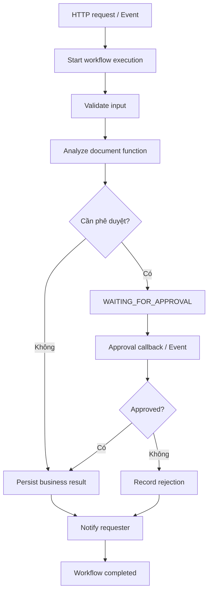
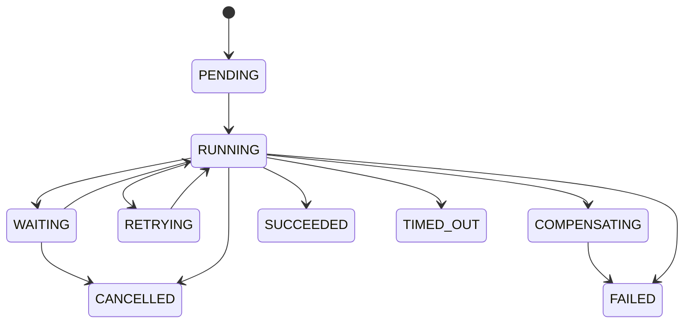
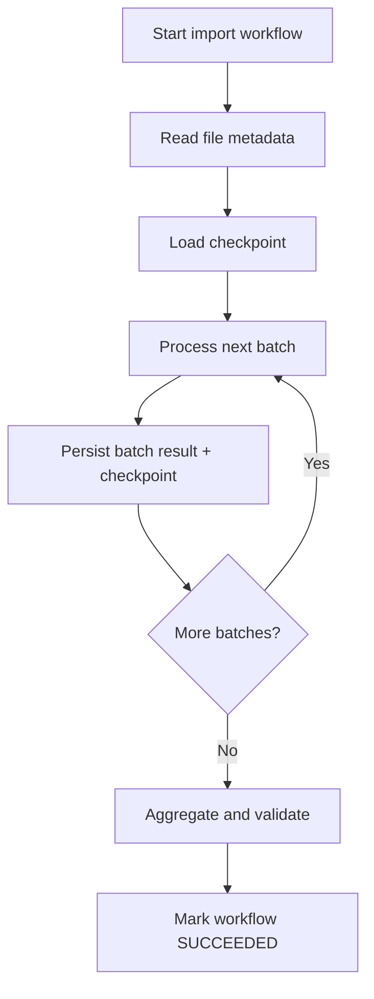
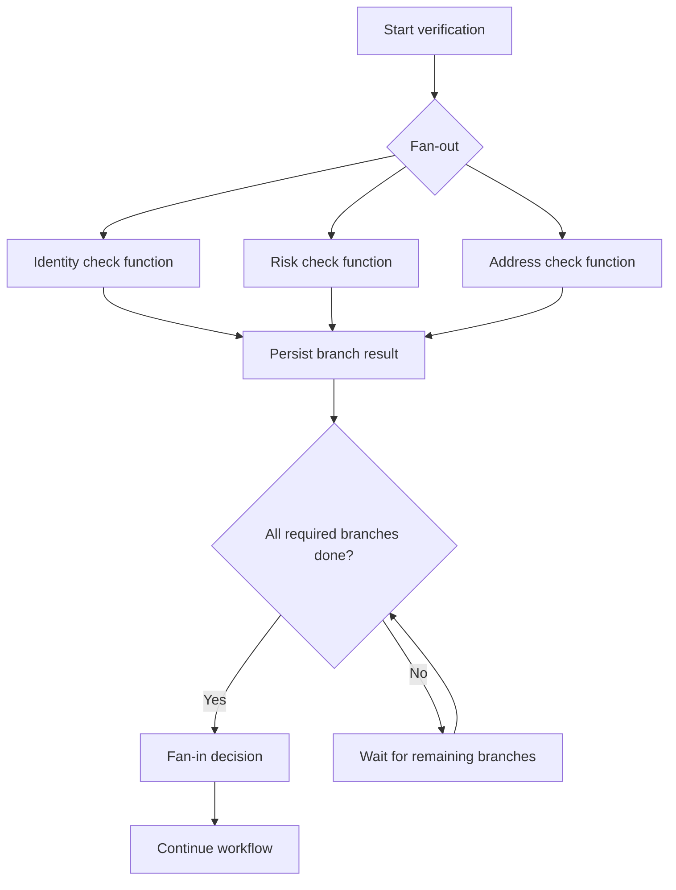

# Theo dõi workflow dài hạn và lưu trạng thái bền vững

Một serverless function thường được thiết kế để nhận một trigger, thực hiện một phần công việc rồi kết thúc. Nhưng nhiều nghiệp vụ không kết thúc trong một invocation: mở tài khoản, xử lý đơn hàng, phê duyệt hồ sơ, nhập dữ liệu, đối soát thanh toán hoặc triển khai một quy trình gồm nhiều service. Những công việc này có thể kéo dài vài phút, vài giờ hoặc chờ người dùng phản hồi trong nhiều ngày.

Nếu cố giữ một function chạy suốt quy trình, ứng dụng sẽ gặp giới hạn timeout, giữ tài nguyên trong lúc chờ và khó phục hồi khi runtime bị dừng. Thay vào đó, hãy mô hình hóa quy trình thành một **workflow execution** có trạng thái được lưu bền vững. Mỗi bước thực hiện trong một function hoặc service riêng; bộ điều phối lưu tiến độ, lịch sử, thời gian chờ và kết quả để có thể tiếp tục sau lỗi hoặc sau một khoảng chờ dài.

Trong mô hình này, function xử lý một bước công việc; workflow giữ vòng đời của toàn bộ quy trình. Trạng thái workflow phải tồn tại độc lập với bộ nhớ của invocation và có thể được đọc, giám sát, khôi phục hoặc xử lý thủ công khi cần.

## 1. Phân biệt invocation, job và workflow execution

Ba khái niệm thường bị dùng lẫn nhau:

| Khái niệm | Phạm vi | Ví dụ |
| --- | --- | --- |
| Function invocation | Một lần chạy function do HTTP, queue, event hoặc scheduler kích hoạt | Java function kiểm tra hồ sơ trong 800 ms |
| Job | Một đơn vị công việc nghiệp vụ cần hoàn thành | Tạo báo cáo tháng cho tenant A |
| Workflow execution | Một lần chạy cụ thể của quy trình nhiều bước, có trạng thái và lịch sử riêng | Tiếp nhận hồ sơ, kiểm tra, chờ phê duyệt, ghi kết quả và gửi thông báo |

Một job có thể tương ứng với một workflow execution; cũng có thể một workflow điều phối nhiều job hoặc một job có nhiều workflow con. Quan trọng là mỗi execution có định danh riêng và một nguồn trạng thái chính thức.

Function thường là stateless ở cấp invocation: không nên dựa vào biến `static`, heap hoặc file tạm để nhớ bước trước. Workflow execution thì stateful theo nghĩa trạng thái được lưu bền vững ở orchestration engine hoặc kho dữ liệu của ứng dụng. Khi function kết thúc, workflow vẫn có thể ở `WAITING`, `RETRYING` hoặc `RUNNING` tại một bước khác.

## 2. Workflow dài hạn là gì?

Workflow là mô hình mô tả các bước, điều kiện rẽ nhánh, vòng lặp, thời gian chờ và cách xử lý lỗi để hoàn thành một mục tiêu nghiệp vụ. Workflow execution là một lần thực thi cụ thể của định nghĩa đó, có input, trạng thái hiện tại, lịch sử sự kiện và output.

Ví dụ quy trình xử lý hồ sơ:

1. Nhận yêu cầu và tạo execution ID.
2. Kiểm tra dữ liệu và quyền truy cập.
3. Phân tích tài liệu bằng worker function.
4. Nếu cần, chuyển hồ sơ sang trạng thái chờ nhân viên phê duyệt.
5. Khi có quyết định, tiếp tục bước ghi kết quả.
6. Gửi thông báo và kết thúc execution.

Quy trình có thể chờ phê duyệt nhiều ngày mà không cần giữ một Java function sống suốt thời gian đó. Orchestrator lưu trạng thái chờ, rồi tiếp tục workflow khi nhận callback hoặc event phù hợp.



Workflow dài hạn thường có một hoặc nhiều đặc điểm: chờ sự kiện bên ngoài, retry một bước, thực hiện nhiều hoạt động tuần tự/song song, cần checkpoint, hoặc phải bù trừ một hành động đã hoàn tất nếu bước sau thất bại.

## 3. Orchestration và choreography

Có hai cách phổ biến để phối hợp các thành phần phân tán:

- **Orchestration:** một bộ điều phối giữ định nghĩa quy trình và quyết định bước tiếp theo. Nó biết execution đang ở đâu, khi nào retry, chờ event nào và điều kiện kết thúc.
- **Choreography:** các service phát và nhận event; mỗi service tự quyết định phản ứng và phát event tiếp theo. Không có một bộ điều phối trung tâm mô tả toàn bộ quy trình.

| Tiêu chí | Orchestration | Choreography |
| --- | --- | --- |
| Điều khiển luồng | Workflow engine hoặc coordinator | Quy tắc phản ứng trong từng service |
| Theo dõi tiến độ tổng thể | Có execution state và history tập trung | Cần ghép trace/event từ nhiều service |
| Phụ thuộc | Service phụ thuộc vào hợp đồng workflow hoặc command của orchestrator | Service phụ thuộc vào event contract của nhau |
| Phù hợp | Quy trình có thứ tự, nhánh, timeout, approval hoặc compensation rõ | Các phản ứng độc lập, fan-out và tích hợp lỏng |
| Thách thức | Workflow definition và version cần được quản lý | Khó thấy trạng thái toàn quy trình và điều tra chuỗi event |

Hai cách không loại trừ nhau. Một workflow có thể điều phối các bước nghiệp vụ chính, trong khi một bước phát integration event để nhiều subscriber độc lập xử lý. Hãy dùng orchestration khi cần quản lý rõ tiến độ và quyết định; dùng choreography khi các service chỉ cần phản ứng độc lập với sự kiện đã xảy ra.

## 4. Thành phần của một workflow bền vững

Một thiết kế thường có các thành phần sau:

| Thành phần | Trách nhiệm |
| --- | --- |
| Workflow definition | Mô tả các state, task, branch, wait, retry và transition |
| Execution ID | Định danh một lần chạy workflow |
| Orchestrator / Workflow engine | Lập lịch task, lưu tiến độ, đánh giá transition và khôi phục execution |
| Task / Activity function | Thực hiện một bước công việc cụ thể |
| Durable state/history | Lưu input cần thiết, kết quả bước, trạng thái và lịch sử chuyển tiếp |
| Event source / Queue | Đưa công việc hoặc tín hiệu tiếp tục vào workflow |
| External callback | Cho phép hệ thống/người dùng báo kết quả của bước đang chờ |
| Monitoring / Operator interface | Quan sát, cảnh báo, dừng, retry hoặc xử lý lỗi cần can thiệp |

Orchestrator có thể lưu state trong dịch vụ quản lý sẵn, hoặc ứng dụng tự triển khai coordinator và database. Dịch vụ quản lý sẵn thường cung cấp timer, retry, history và scale; coordinator tự xây dựng cho phép kiểm soát sâu nhưng đội phát triển phải tự giải quyết concurrency, recovery, deduplication và versioning.

Một execution thường có `executionId`, `workflowType`, `workflowVersion`, `status`, `currentStep`, `createdAt`, `updatedAt`, `deadline`, `inputRef`, `outputRef` và lịch sử sự kiện. Không phải mọi engine đều lưu các trường này theo cùng cách; đây là mô hình khái niệm để hiểu dữ liệu cần theo dõi.

## 5. Trạng thái workflow và state machine

Trạng thái nên diễn đạt tiến độ nghiệp vụ có ý nghĩa, không chỉ phản ánh function đang chạy hay không. Ví dụ:

| Trạng thái | Ý nghĩa | Có phải trạng thái kết thúc? |
| --- | --- | --- |
| `PENDING` | Execution đã được tạo, chưa bắt đầu task | Không |
| `RUNNING` | Có task đang được thực hiện | Không |
| `WAITING` | Đang chờ timer, callback hoặc event bên ngoài | Không |
| `RETRYING` | Một task lỗi tạm thời và sẽ được thử lại | Không |
| `COMPENSATING` | Đang chạy các hành động bù trừ | Không |
| `SUCCEEDED` | Workflow hoàn thành theo mục tiêu | Có |
| `FAILED` | Workflow thất bại và không còn tự retry | Có |
| `CANCELLED` | Workflow đã được hủy theo chính sách | Có |
| `TIMED_OUT` | Execution vượt deadline tổng thể | Có, trừ khi có quy trình resume được định nghĩa riêng |

State machine cần quy định transition hợp lệ. Ví dụ `WAITING` có thể chuyển về `RUNNING` khi nhận callback hợp lệ; `RUNNING` có thể chuyển `RETRYING` khi task lỗi tạm thời; `COMPENSATING` chỉ bắt đầu khi nghiệp vụ yêu cầu bù trừ. Không nên cho phép một event đến muộn đưa execution `SUCCEEDED` trở lại `RUNNING`.



Trong thực tế, state machine có thể có nhiều trạng thái nghiệp vụ chi tiết hơn như `PAYMENT_PENDING`, `AWAITING_CUSTOMER`, `DOCUMENT_REVIEW` hoặc `FULFILLMENT`. Nên chọn trạng thái mà operator và hệ thống gọi có thể hành động dựa trên đó.

## 6. Lưu trạng thái bền vững: engine state, business state và history

Không phải mọi dữ liệu cần theo dõi đều nên nằm trong một cột JSON hoặc trong lịch sử workflow. Hãy phân biệt ba nhóm:

1. **Orchestration state:** bước hiện tại, timer, task đang chờ, retry count và dữ liệu cần để engine tiếp tục execution.
2. **Business state:** đơn hàng, hồ sơ, thanh toán, quyền sở hữu và trạng thái nghiệp vụ chuẩn do service sở hữu.
3. **Execution history/audit:** các sự kiện như bắt đầu task, hoàn tất, lỗi, retry, callback nhận được và quyết định của operator.

Orchestration engine là nguồn sự thật cho tiến độ điều phối. Database nghiệp vụ là nguồn sự thật cho dữ liệu domain. History là dấu vết để điều tra và kiểm toán; không nhất thiết là nơi ứng dụng cập nhật trực tiếp trạng thái nghiệp vụ.

Ví dụ, workflow xử lý thanh toán có thể giữ trạng thái `WAITING_FOR_PAYMENT_CONFIRMATION`, nhưng trạng thái giao dịch thực tế phải được xác nhận từ Payment service hoặc database do Payment service quản lý. Không được kết luận đã thanh toán chỉ vì một task trong workflow trả về thành công nếu hệ thống thanh toán chưa xác nhận giao dịch.

### Lưu dữ liệu vừa đủ

State payload nên chứa các định danh và dữ liệu cần để bước tiếp theo chạy: `orderId`, `customerId`, `paymentId`, `documentRef`, version hoặc correlation ID. File lớn, ảnh, PDF, kết quả phân tích lớn nên được lưu trong object storage; workflow state giữ URI/object key và checksum.

Lưu toàn bộ payload qua mọi bước làm tăng chi phí lưu history, truyền dữ liệu, độ trễ và nguy cơ vượt giới hạn kích thước input/output của workflow engine. Cũng không nên đưa secret, access token hoặc dữ liệu cá nhân không cần thiết vào history vì lịch sử thường được lưu lâu và nhiều người vận hành có thể xem.

### Ví dụ execution state

Một snapshot trạng thái có thể được biểu diễn như sau:

```json
{
  "executionId": "exec-8c42",
  "workflowType": "DocumentOnboarding",
  "workflowVersion": 3,
  "status": "WAITING",
  "currentStep": "MANUAL_REVIEW",
  "businessKey": "document-2198",
  "inputRef": "s3://private-documents/tenant-42/document-2198.pdf",
  "startedAt": "2026-11-17T09:00:00Z",
  "updatedAt": "2026-11-17T09:05:12Z",
  "deadline": "2026-11-24T09:00:00Z",
  "correlationId": "req-4b61",
  "attempt": 1
}
```

Đây là ví dụ khái niệm; không nên đưa URI nội bộ hoặc thông tin nhạy cảm vào API public nếu caller không có quyền. Một API status có thể trả một projection đã lọc, trong khi engine giữ metadata điều phối đầy đủ.

## 7. Checkpoint và khả năng tiếp tục sau khi function kết thúc

Checkpoint là điểm mà workflow hoặc activity lưu lại tiến độ đủ để có thể tiếp tục sau lỗi. Với tác vụ chia nhỏ, checkpoint có thể là số bản ghi đã xử lý, trang tiếp theo, object key đầu ra hoặc phase đã hoàn tất.

Ví dụ nhập file một triệu dòng:

1. Đọc metadata file và xác định số phần cần xử lý.
2. Chia file thành các batch có kích thước giới hạn.
3. Worker xử lý một batch và lưu kết quả cùng checkpoint `nextBatch=5`.
4. Workflow kiểm tra còn batch không; nếu còn thì lập lịch task tiếp theo.
5. Sau batch cuối, workflow tổng hợp kết quả và đánh dấu hoàn tất.



Checkpoint phải được ghi theo cách an toàn khi retry. Nếu worker ghi kết quả batch nhưng timeout trước khi cập nhật checkpoint, batch có thể được xử lý lại. Hãy dùng batch ID ổn định, unique constraint hoặc upsert idempotent để lần chạy lại không nhân đôi kết quả.

Một checkpoint không nhất thiết là snapshot của toàn bộ state. Nhiều workflow engine lưu history các sự kiện và tái dựng state từ lịch sử. Một số engine lưu snapshot/checkpoint định kỳ để giảm thời gian khôi phục. Dù cơ chế nào, ứng dụng cần hiểu dữ liệu nào được engine bảo vệ và dữ liệu nào phải lưu trong database nghiệp vụ.

## 8. Chờ lâu mà không giữ function sống

Workflow có thể phải chờ một thời điểm, một event hoặc quyết định của con người. Không dùng `Thread.sleep()` trong Java function để chờ hàng giờ hoặc hàng ngày. Cách đó giữ invocation, tiêu thụ thời gian compute và vẫn có thể bị timeout.

Thay vào đó, dùng các cơ chế durable wait:

- **Timer/delay state:** engine lưu thời điểm cần tiếp tục và đánh thức execution khi đến hạn.
- **Wait for event:** execution chuyển sang `WAITING` và tiếp tục khi nhận event phù hợp.
- **Callback/task token:** workflow phát một yêu cầu ra ngoài và chờ callback mang token hoặc correlation ID tương ứng.
- **Scheduled continuation:** lưu trạng thái và lập lịch một message/tác vụ tiếp tục tại thời điểm sau.

Ví dụ quy trình nhắc thanh toán có thể chờ 24 giờ sau khi gửi thông báo. Engine lưu timer; function gửi thông báo kết thúc ngay. Khi hết thời gian, workflow tiếp tục kiểm tra trạng thái hóa đơn. Nếu khách hàng đã thanh toán, execution kết thúc; nếu chưa, workflow gửi nhắc lần tiếp theo hoặc chuyển sang bước xử lý khác.

### Callback từ hệ thống bên ngoài

Khi chờ một bên ngoài, workflow có thể tạo callback token hoặc một `correlationId` duy nhất và lưu liên kết với execution. Callback API nhận kết quả, xác thực nguồn gửi, kiểm tra token còn hiệu lực, xác minh execution đang chờ đúng bước và ghi nhận callback một cách idempotent.

Không coi một callback là hợp lệ chỉ vì biết `executionId`. Token callback có thể hoạt động như một bearer capability: ai sở hữu nó có thể tiếp tục workflow. Không để token trong URL công khai, log hoặc thông báo không bảo mật. Nên đặt thời hạn, giới hạn quyền, xác thực người gửi và chống replay.

Callback có thể đến trùng, đến trễ hoặc đến sau khi execution đã timeout. API cần xác định rõ hành vi: trả thành công cho callback trùng đã xử lý; từ chối callback sai bước; ghi nhận callback muộn để điều tra; không làm sống lại execution đã kết thúc nếu không có thao tác resume được kiểm soát.

## 9. Retry, timeout và heartbeat ở cấp workflow

Retry của một task và retry của toàn workflow là hai phạm vi khác nhau. Nếu bước `AnalyzeDocument` lỗi do API tạm thời không khả dụng, engine có thể thử lại riêng bước đó. Nếu workflow hết deadline tổng thể, toàn bộ execution có thể chuyển `TIMED_OUT` hoặc sang quy trình xử lý ngoại lệ.

Một chính sách retry nên chỉ rõ:

- Loại lỗi nào có thể retry (throttling, timeout, lỗi mạng tạm thời).
- Loại lỗi nào không retry (dữ liệu không hợp lệ, không đủ quyền, quy tắc nghiệp vụ từ chối).
- Số lần thử tối đa và tổng thời gian retry.
- Backoff, jitter và giới hạn tốc độ để tránh dồn tải.
- Timeout riêng của task và deadline tổng thể của workflow.
- Hành vi sau khi hết retry: fail, chuyển DLQ, chờ operator hoặc chạy compensation.

Với task chạy lâu, heartbeat có thể báo cho orchestrator rằng activity vẫn đang hoạt động. Nếu không nhận heartbeat trong thời gian quy định, engine có thể coi worker đã mất và cho phép retry. Heartbeat không thay thế checkpoint; worker có thể đang sống nhưng đã mất tiến độ, hoặc task có thể đã tạo side effect trước khi mất kết nối.

Nếu engine hỗ trợ timeout của từng state, hãy cấu hình rõ. Timeout task giới hạn thời gian chờ kết quả từ activity; heartbeat timeout phát hiện worker không còn phản hồi; execution timeout giới hạn toàn bộ workflow. Các tên và hành vi cụ thể tùy engine.

## 10. Side effect, idempotency và exactly-once

Một workflow engine có thể lưu task đã được lên lịch hoặc đã ghi nhận kết quả, nhưng không thể tự biến một lời gọi HTTP đến hệ thống bên ngoài thành giao dịch nguyên tử với state store của engine.

Ví dụ:

1. Workflow gọi Payment service để capture khoản tiền.
2. Payment service thực hiện thành công.
3. Worker bị timeout trước khi gửi kết quả về orchestrator.
4. Orchestrator không biết bước capture đã thành công hay chưa và retry.

Nếu request thứ hai tạo một giao dịch mới, khách hàng có thể bị trừ tiền hai lần. Đây là khoảng hở giữa side effect bên ngoài và việc ghi nhận kết quả trong workflow.

Các biện pháp cần dùng:

- Tạo idempotency key ổn định theo execution và step, ví dụ `exec-8c42:capture-payment`.
- Gửi cùng key trong mọi lần retry của cùng một thao tác nghiệp vụ.
- Payment service lưu key và kết quả, trả lại kết quả cũ khi nhận request trùng.
- Lưu `paymentId` hoặc business reference vào state sau khi xác nhận.
- Khi kết quả không rõ, truy vấn trạng thái theo idempotency key hoặc business reference trước khi thử lại.

Không nên tuyên bố workflow có exactly-once side effect chỉ vì engine lưu state bền vững. Delivery và activity invocation thường có thể lặp. Mục tiêu thực tế là xử lý at-least-once an toàn bằng idempotency, unique constraint, conditional write và đối soát.

## 11. Saga và hành động bù trừ

Một workflow có thể thực hiện nhiều thay đổi ở các service khác nhau. Không có một database transaction duy nhất bao phủ toàn bộ quy trình. Nếu bước sau thất bại, ứng dụng có thể cần một hành động bù trừ (compensation) để đưa nghiệp vụ về trạng thái chấp nhận được.

Ví dụ đặt hàng:

| Bước | Hành động chính | Hành động bù trừ có thể có |
| --- | --- | --- |
| 1 | Giữ hàng trong Inventory | Hủy giữ hàng |
| 2 | Capture thanh toán | Hoàn tiền hoặc void giao dịch theo trạng thái thanh toán |
| 3 | Tạo lệnh giao hàng | Hủy lệnh giao nếu chưa bàn giao |
| 4 | Gửi xác nhận cho khách | Gửi thông báo đính chính nếu nghiệp vụ yêu cầu |

Nếu bước 3 thất bại sau khi bước 1 và 2 hoàn tất, workflow có thể chạy compensation theo thứ tự ngược: hoàn tiền/void và hủy giữ hàng. Đây là Saga pattern.

Compensation không phải rollback database tự động. Một khoản tiền đã capture có thể phải hoàn tiền bằng giao dịch mới; kiện hàng đã giao cho đơn vị vận chuyển có thể không hủy được; email đã gửi không thể thu hồi. Vì vậy, compensation cần được định nghĩa theo ngữ nghĩa nghiệp vụ, có thể thất bại và có thể cần operator can thiệp.

Trạng thái `COMPENSATING` giúp quan sát rõ workflow đang phục hồi. Nếu một compensation lỗi, ghi lại bước đã hoàn tất, retry có giới hạn và đưa execution vào hàng đợi xử lý thủ công khi cần. Không đánh dấu `CANCELLED` hoặc `FAILED` trước khi ghi rõ những side effect nào đã xảy ra và kết quả bù trừ ra sao.

## 12. Song song, fan-out/fan-in và workflow con

Một workflow có thể chạy nhiều nhánh độc lập song song, ví dụ kiểm tra danh tính, kiểm tra danh sách rủi ro và xác minh địa chỉ. Sau khi các nhánh hoàn tất, workflow gom kết quả để quyết định bước tiếp theo.



Khi chạy song song, cần quy định:

- Số nhánh tối đa và giới hạn concurrency để bảo vệ downstream.
- Điều kiện hoàn tất: tất cả nhánh, một nhánh thành công, hay ngưỡng tối thiểu.
- Cách xử lý nhánh lỗi, timeout hoặc trả kết quả muộn.
- Cách ghép kết quả và lưu trạng thái từng nhánh.
- Có cần hủy các nhánh còn lại khi quyết định đã rõ không.

Workflow con (child workflow) hữu ích khi một quy trình con có thể tái sử dụng, có timeout/retry riêng hoặc cần tách quyền sở hữu. Execution cha cần lưu child execution ID và quy tắc xử lý khi child thành công, thất bại hoặc bị timeout. Không nên tạo hàng nghìn child execution mà không giới hạn concurrency và chi phí.

## 13. Java: mô hình trạng thái workflow trong ứng dụng

Nếu tự xây dựng một coordinator đơn giản, có thể bắt đầu bằng một bảng execution và bảng event history. Ví dụ SQL dưới đây minh họa cấu trúc; một workflow engine quản lý sẵn có thể lưu những thông tin tương đương theo cách riêng.

```sql
CREATE TABLE workflow_execution (
    execution_id       VARCHAR(80) PRIMARY KEY,
    workflow_type      VARCHAR(120) NOT NULL,
    workflow_version   INTEGER NOT NULL,
    business_key       VARCHAR(160) NOT NULL,
    status             VARCHAR(32) NOT NULL,
    current_step       VARCHAR(120),
    state_json         TEXT NOT NULL,
    version            BIGINT NOT NULL,
    created_at         TIMESTAMP NOT NULL,
    updated_at         TIMESTAMP NOT NULL,
    deadline_at        TIMESTAMP
);

CREATE TABLE workflow_history (
    event_id           VARCHAR(80) PRIMARY KEY,
    execution_id       VARCHAR(80) NOT NULL,
    sequence_no        BIGINT NOT NULL,
    event_type         VARCHAR(80) NOT NULL,
    step_name          VARCHAR(120),
    details_json       TEXT,
    occurred_at        TIMESTAMP NOT NULL,
    UNIQUE (execution_id, sequence_no)
);
```

`state_json` giữ dữ liệu điều phối nhỏ, không chứa file hoặc secret. `version` hỗ trợ optimistic locking để hai worker không ghi đè state của nhau. `workflow_history` lưu các chuyển tiếp quan trọng để điều tra; nếu cần bảo đảm lịch sử và snapshot cập nhật nguyên tử, hãy ghi chúng trong cùng transaction.

### Java record cho execution

```java
import java.time.Instant;
import java.util.Map;

public record WorkflowExecution(
        String executionId,
        String workflowType,
        int workflowVersion,
        String businessKey,
        WorkflowStatus status,
        String currentStep,
        Map<String, String> references,
        long version,
        Instant createdAt,
        Instant updatedAt,
        Instant deadlineAt
) {}

public enum WorkflowStatus {
    PENDING,
    RUNNING,
    WAITING,
    RETRYING,
    COMPENSATING,
    SUCCEEDED,
    FAILED,
    CANCELLED,
    TIMED_OUT
}
```

`references` chứa các ID hoặc object reference cần thiết. Với state phức tạp, dùng DTO có schema version rõ ràng thay vì `Map<String, Object>` tùy tiện; cách này giúp kiểm tra kiểu dữ liệu và nâng cấp state khi workflow definition thay đổi.

### Cập nhật state có optimistic locking

Ví dụ repository dùng version để chỉ cập nhật nếu execution chưa bị một worker khác thay đổi:

```java
import java.sql.Connection;
import java.sql.PreparedStatement;
import javax.sql.DataSource;

public final class WorkflowRepository {
    private final DataSource dataSource;

    public WorkflowRepository(DataSource dataSource) {
        this.dataSource = dataSource;
    }

    public boolean moveToWaiting(
            String executionId,
            long expectedVersion,
            String nextStep
    ) throws Exception {
        String sql = """
                UPDATE workflow_execution
                   SET status = 'WAITING',
                       current_step = ?,
                       version = version + 1,
                       updated_at = CURRENT_TIMESTAMP
                 WHERE execution_id = ?
                   AND version = ?
                   AND status = 'RUNNING'
                """;

        try (Connection connection = dataSource.getConnection();
             PreparedStatement statement = connection.prepareStatement(sql)) {
            statement.setString(1, nextStep);
            statement.setString(2, executionId);
            statement.setLong(3, expectedVersion);
            return statement.executeUpdate() == 1;
        }
    }
}
```

Nếu UPDATE không tác động hàng nào, worker phải đọc lại state để xác định execution đã được worker khác cập nhật, đã kết thúc hay không còn tồn tại. Không được ghi đè bằng snapshot cũ. Với hệ thống tự xây dựng, cần có thêm cơ chế lease/claim, atomic transition, timer, retry scheduler, deduplication và recovery; chỉ có bảng trên chưa tạo thành một workflow engine hoàn chỉnh.

## 14. Java activity: idempotency theo execution và step

Mỗi activity nên nhận execution ID, step name và input reference. Tạo khóa idempotency ổn định cho một side effect. Ví dụ:

```java
public record ActivityContext(
        String executionId,
        String stepName,
        String stepInstanceId,
        int attempt,
        String correlationId
) {
    public String idempotencyKey() {
        return executionId + ":" + stepName + ":" + stepInstanceId;
    }
}

public interface PaymentGateway {
    PaymentResult capture(String paymentId, String idempotencyKey);
}

public record PaymentResult(
        String transactionId,
        String status
) {}

public final class CapturePaymentActivity {
    private final PaymentGateway paymentGateway;

    public CapturePaymentActivity(PaymentGateway paymentGateway) {
        this.paymentGateway = paymentGateway;
    }

    public PaymentResult execute(
            ActivityContext context,
            String paymentId
    ) {
        return paymentGateway.capture(
                paymentId,
                context.idempotencyKey()
        );
    }
}
```

Ví dụ giả định Payment service hỗ trợ idempotency key và trả lại kết quả cũ cho request trùng. `stepInstanceId` phải ổn định qua các lần retry của cùng một lần thực hiện logic, nhưng khác nhau giữa các lần lặp hợp lệ của cùng step trong một workflow. Nếu dịch vụ không hỗ trợ idempotency, ứng dụng cần lưu operation record và đối soát trạng thái trước khi retry. Không tạo key mới theo `attempt`, vì như vậy mỗi lần thử sẽ trở thành một giao dịch khác.

## 15. Theo dõi execution và quan sát xuyên suốt

Một workflow dài hạn cần khả năng trả lời các câu hỏi: execution nào đang chờ, đang kẹt ở bước nào, bước nào retry nhiều, thời gian chờ ở đâu, và ai đã can thiệp vào quy trình?

Nên theo dõi tối thiểu:

| Chỉ số | Câu hỏi vận hành |
| --- | --- |
| Active executions theo status | Bao nhiêu execution đang `RUNNING`, `WAITING` hoặc `RETRYING`? |
| Execution age | Execution nào đã tồn tại lâu hơn SLA? |
| Step duration p50/p95/p99 | Bước nào thường chậm hoặc có đuôi latency lớn? |
| Wait duration | Workflow chờ người dùng, timer hay service bên ngoài bao lâu? |
| Retry count theo step/error | Bước nào thất bại lặp và nguyên nhân là gì? |
| Timeout/failure rate | Bao nhiêu execution kết thúc ngoài dự kiến? |
| Compensation failure | Có side effect nào chưa được bù trừ? |
| Stale activity/heartbeat | Worker nào không còn phản hồi hoặc mất lease? |
| History/state size | Execution có lưu quá nhiều payload hoặc event không? |

Gắn `executionId`, `businessKey`, `correlationId`, `stepName`, `attempt` và trace context vào log/trace của mỗi activity. Dùng execution ID để nối lịch sử của orchestrator với log function và event broker. Tránh đưa execution ID, customer ID hoặc business key có cardinality cao vào metric label; dùng chúng trong log hoặc trace thay thế.

History giúp giải thích điều đã xảy ra, nhưng cần retention và phân quyền. Lịch sử có thể chứa payload, lỗi và metadata nhạy cảm. Hãy lọc dữ liệu trước khi lưu, giới hạn quyền xem, mã hóa và quy định thời gian giữ history phù hợp.

## 16. Khôi phục, retry thủ công và xử lý execution bị kẹt

Một execution có thể ở trạng thái `RUNNING` lâu hơn dự kiến vì worker chết, message không được ACK, callback không đến hoặc downstream mất kết nối. Hệ thống cần phát hiện execution vượt SLA thay vì chỉ chờ người dùng báo lỗi.

Quy trình vận hành nên hỗ trợ:

1. Tìm execution theo ID, business key hoặc khoảng thời gian.
2. Xem trạng thái hiện tại và history của từng bước.
3. Xác định task đang chạy, chờ, retry hay đã tạo side effect.
4. Kiểm tra trạng thái thực tế ở service sở hữu nghiệp vụ trước khi retry.
5. Retry đúng bước hoặc resume theo checkpoint nếu an toàn.
6. Chạy compensation nếu quy trình đã thực hiện một phần và nghiệp vụ yêu cầu.
7. Ghi audit về người thao tác, lý do, thời điểm và kết quả.

Không nên xóa execution bị kẹt rồi tạo lại ngay. Execution cũ có thể vẫn có worker đang chạy hoặc side effect đã xảy ra. Trước khi retry, cần xác minh lease, idempotency key và trạng thái nghiệp vụ. Nếu phải tạo execution mới, liên kết execution cũ và mới bằng business key hoặc `restartedFromExecutionId` để có thể kiểm toán.

### Replay không đồng nghĩa chạy lại side effect

Một số workflow engine dùng event history để tái dựng trạng thái và kiểm tra logic điều phối. Replay history trong loại engine này phải cho kết quả quyết định giống trước đó; các hoạt động có side effect thường được thực hiện trong activity tách biệt. Khi replay, engine có thể phát lại quyết định mà không gọi lại activity đã ghi nhận kết quả.

Nếu tự triển khai replay hoặc chạy lại một đoạn workflow bằng code mới, không được gọi lại thanh toán, gửi email hay tạo đơn một cách vô điều kiện. Hãy dùng activity idempotent, lưu kết quả đã hoàn tất và phân biệt replay lịch sử với một lần chạy nghiệp vụ mới.

## 17. Versioning workflow và state đang chạy

Workflow definition có thể thay đổi theo thời gian: thêm bước kiểm tra, đổi tên state, thay đổi payload hoặc thay retry policy. Trong khi đó, execution cũ có thể vẫn đang chờ phê duyệt hoặc timer trong nhiều ngày.

Hãy lưu `workflowVersion` khi bắt đầu execution và có chiến lược tương thích:

- Execution đang chạy có thể tiếp tục theo version ban đầu nếu engine hỗ trợ giữ definition cũ.
- Nếu phải chuyển execution sang version mới, cần migration state có kiểm soát và có thể rollback.
- Không đổi ý nghĩa một field state mà không có schema version hoặc migration.
- Không xóa task/state mà execution cũ vẫn có thể quay lại.
- Giữ tương thích với callback/event được phát ra từ version cũ.
- Kiểm thử các nhánh retry, timeout và compensation khi thay đổi definition.

Một cách an toàn là định nghĩa workflow version rõ ràng và để execution mới dùng version mới, trong khi execution đang chạy tiếp tục version cũ đến khi hoàn tất. Cách triển khai cụ thể tùy engine; một số engine có cơ chế patch/versioning hoặc worker build compatibility riêng.

## 18. Bảo mật và quyền can thiệp workflow

Workflow state và history có thể chứa thông tin nhạy cảm. Cần phân biệt quyền bắt đầu execution, đọc trạng thái, gửi callback, hủy, retry và thực hiện compensation.

- API start chỉ cho phép caller tạo workflow type phù hợp với quyền của họ.
- Status API kiểm tra quyền trên execution và business resource; biết execution ID không có nghĩa được xem dữ liệu.
- Worker chỉ có quyền gọi service và đọc object cần cho các bước của nó.
- Callback endpoint xác thực nguồn gửi, kiểm tra chữ ký hoặc token, deadline và trạng thái chờ.
- Operator action như retry, cancel, skip hoặc compensate cần quyền riêng và audit.
- Không đưa credential, access token hoặc dữ liệu cá nhân không cần thiết vào workflow payload/history.
- Mã hóa state/history và đặt retention theo yêu cầu tổ chức.

Một thao tác `skip step` có thể phá vỡ invariant nghiệp vụ. Nếu hỗ trợ, cần định nghĩa rõ step nào được skip, điều kiện, người phê duyệt và cách ghi nhận kết quả thay thế.

## 19. Chi phí và giới hạn của workflow dài hạn

Workflow engine có thể tính phí theo số transition, step, request, thời gian lưu state, thời gian chạy activity hoặc mức concurrency. Worker function có chi phí compute riêng; database, queue, object storage, log và tracing cũng phát sinh chi phí. Cách tính khác nhau giữa dịch vụ orchestration và workflow engine.

Các yếu tố có thể làm chi phí tăng:

- Polling trạng thái quá thường xuyên hoặc workflow có quá nhiều transition nhỏ.
- Retry lặp do timeout quá ngắn hoặc downstream bị throttling.
- Lưu payload lớn trong state/history qua nhiều bước.
- Fan-out không giới hạn tạo nhiều child execution hoặc activity đồng thời.
- Workflow chờ lâu nhưng dùng compute/task thay vì durable timer.
- History và audit không có retention phù hợp.
- Compensation và redrive tạo thêm request đến service phụ trợ.

Để kiểm soát chi phí:

1. Dùng timer/wait state thay vì giữ function sống khi không có công việc.
2. Chỉ lưu dữ liệu cần thiết và tham chiếu object lớn.
3. Gom các thao tác rất nhỏ khi việc đó không làm giảm khả năng retry hoặc quan sát.
4. Đặt retry limit, backoff, jitter và deadline hợp lý.
5. Giới hạn concurrency của fan-out theo khả năng downstream.
6. Đặt retention cho execution history và business data theo yêu cầu.
7. Theo dõi chi phí trên một workflow thành công và theo từng loại execution.

Không phải mọi quy trình đều cần workflow engine. Một chuỗi hai bước nhanh, không có chờ lâu, retry phức tạp hay trạng thái cần truy vấn có thể chỉ cần một service điều phối đơn giản. Workflow engine trở nên có giá trị khi quy trình có nhiều nhánh, timer, callback, retry, compensation hoặc yêu cầu theo dõi lâu dài.

## 20. Khi nào chọn workflow engine và khi nào tự quản lý state?

| Nhu cầu | Hướng tiếp cận |
| --- | --- |
| Một function xử lý nhanh, không cần tiếp tục sau invocation | Xử lý trực tiếp trong function |
| Một job đơn giản, có thể queue và lưu status trong database | Queue + job table có thể đủ |
| Nhiều bước, rẽ nhánh, retry, wait, callback và timeout | Workflow engine/orchestrator thường phù hợp |
| Quy trình nhiều service cần compensation | Orchestration hỗ trợ Saga hoặc coordinator có state machine rõ |
| Nhiều service phản ứng độc lập với event | Event bus/choreography có thể phù hợp |
| Quy trình dài, cần audit và operator resume | Durable workflow với execution history và công cụ vận hành |

Nếu tự quản lý state, đội phát triển phải tự xây dựng atomic transition, optimistic locking, lease, timer scheduler, callback deduplication, retry, recovery, history, versioning và operator tooling. Hãy tính tổng chi phí vận hành và rủi ro trước khi quyết định tự viết một workflow engine.

## 21. Checklist thiết kế workflow dài hạn

- [ ] Mỗi execution có ID, business key và workflow version ổn định.
- [ ] State machine có trạng thái, transition và trạng thái kết thúc rõ ràng.
- [ ] Orchestration state được lưu bền vững ngoài heap của function.
- [ ] Business state vẫn do service nghiệp vụ sở hữu và có nguồn sự thật rõ ràng.
- [ ] File/payload lớn được lưu ngoài workflow state và chỉ truyền reference.
- [ ] Task có timeout, retry policy, backoff và giới hạn tổng thời gian.
- [ ] Side effect có idempotency key ổn định theo execution và step.
- [ ] Wait/timer/callback không giữ function sống trong thời gian chờ.
- [ ] Callback được xác thực, chống replay và xử lý event trùng/đến trễ.
- [ ] Checkpoint được ghi an toàn để batch hoặc activity có thể chạy lại.
- [ ] Saga compensation được định nghĩa cho các side effect cần bù trừ.
- [ ] Fan-out có giới hạn concurrency và quy tắc fan-in rõ ràng.
- [ ] Execution history, trace, metric và audit đủ để điều tra.
- [ ] Có cách phát hiện execution bị kẹt và quy trình retry/resume thủ công.
- [ ] Workflow definition và state schema có chiến lược versioning.
- [ ] Quyền start/read/callback/cancel/retry/compensate được phân tách.
- [ ] Retention, backup, recovery và chi phí trên workflow thành công đã được tính.

Workflow dài hạn giúp một ứng dụng serverless tiếp tục xử lý công việc qua nhiều invocation và nhiều khoảng chờ mà không phụ thuộc vào một function luôn sống. Orchestrator lưu trạng thái điều phối và lịch sử; activity function thực hiện từng bước; database nghiệp vụ giữ dữ liệu domain; queue và callback đánh thức workflow khi cần. Khi kết hợp checkpoint, idempotency, retry có giới hạn, compensation và quan sát execution, quy trình Java FaaS có thể phục hồi sau lỗi và cho operator biết chính xác công việc đang ở đâu.
