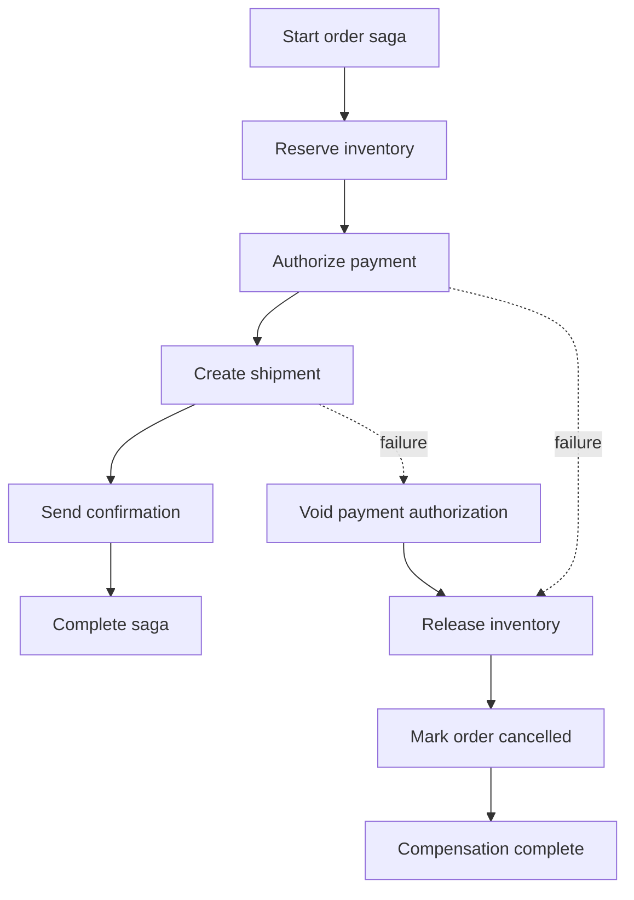
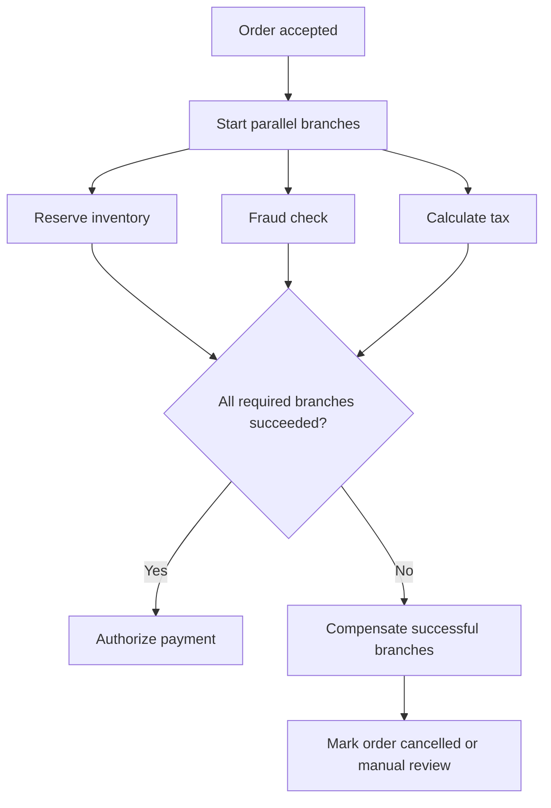

# Thiết kế tác vụ bù theo mẫu Saga

Trong ứng dụng serverless, một quy trình nghiệp vụ có thể đi qua nhiều function và nhiều dịch vụ dữ liệu độc lập. Ví dụ, tạo một đơn hàng có thể cần giữ chỗ tồn kho, xác nhận thanh toán, tạo vận đơn và gửi thông báo. Mỗi function thường thực hiện một giao dịch cục bộ rồi kết thúc; database của dịch vụ này không thể tự rollback giao dịch đã commit ở dịch vụ khác.

Mẫu **Saga** giải quyết bài toán đó bằng cách chia quy trình dài thành các giao dịch cục bộ. Mỗi bước thành công có thể có một hành động bù (compensating action) để xử lý khi một bước sau thất bại. Một bộ điều phối hoặc các event handler theo dõi tiến trình, retry bước lỗi và khởi chạy các hành động bù theo quy tắc nghiệp vụ.

Saga không tạo ra một transaction ACID xuyên nhiều dịch vụ. Nó tạo ra một quy trình có trạng thái bền vững và tính nhất quán cuối cùng (eventual consistency). Người dùng có thể thấy đơn hàng ở trạng thái `PROCESSING`, `CANCELLING` hoặc `COMPENSATION_REQUIRED` trong lúc hệ thống hoàn tất các bước tiếp theo.

## 1. Vấn đề mà Saga giải quyết

Giả sử quy trình đặt hàng gồm bốn thao tác:

1. Giữ chỗ sản phẩm trong kho.
2. Xác nhận thanh toán.
3. Tạo yêu cầu giao hàng.
4. Gửi thông báo xác nhận.

Mỗi thao tác có thể thuộc một service và một database riêng. Nếu giữ chỗ kho thành công, thanh toán thành công nhưng tạo vận đơn thất bại, hệ thống cần quyết định xử lý các tài nguyên đã được giữ như thế nào. Một transaction database thông thường không thể tự hoàn tác thao tác ở kho và cổng thanh toán.

Saga biểu diễn quy trình thành các local transaction và hành động bù tương ứng:

| Bước tiến | Local transaction | Hành động bù có thể có |
|---|---|---|
| T1 | Giữ chỗ tồn kho | Giải phóng reservation |
| T2 | Authorize/capture thanh toán | Void authorization hoặc hoàn tiền |
| T3 | Tạo vận đơn | Hủy shipment nếu nhà vận chuyển cho phép |
| T4 | Gửi thông báo | Gửi thông báo đính chính; thường không thể thu hồi email đã gửi |

Nếu T3 thất bại sau khi T1 và T2 thành công, Saga có thể chạy bù theo thứ tự phụ thuộc: hủy authorization/hoàn tiền, sau đó giải phóng tồn kho. T4 chưa chạy nên không cần bù. Mỗi hành động bù là một thao tác nghiệp vụ riêng, có thể thất bại và cần retry.

Thông báo thường là side effect phụ trợ. Nếu đơn hàng đã được xác nhận nhưng email provider tạm thời lỗi, hệ thống thường nên retry việc gửi thông báo độc lập thay vì hủy đơn hàng đã hoàn tất. Chỉ đưa thông báo thành bước bắt buộc của Saga khi nghiệp vụ thực sự yêu cầu điều đó.

### Luồng thành công và luồng bù



Sơ đồ là một luồng tuyến tính để minh họa. Trong thực tế, Saga có thể có nhánh điều kiện, nhiều nhánh song song, timeout, retry hoặc bước cần người vận hành xử lý.

## 2. Thành phần và ranh giới của một Saga

Một Saga thường có các thành phần logic sau:

- **Saga definition:** mô tả thứ tự bước, điều kiện, timeout, retry và hành động bù.
- **Orchestrator hoặc event choreography:** quyết định bước tiếp theo và phản ứng khi có lỗi.
- **Local transaction/activity:** thực hiện một thay đổi trong phạm vi một service/database.
- **Compensating action:** thực hiện thao tác nghiệp vụ để giảm hoặc đảo tác động của một bước đã thành công.
- **Saga state store:** lưu trạng thái workflow, kết quả bước, định danh thao tác và lịch sử chuyển trạng thái.
- **Message/event transport:** chuyển command và event giữa các function, service và workflow engine.
- **Observability:** ghi correlation ID, saga ID, step ID, attempt, kết quả và lỗi để điều tra.

`sagaId` nhận diện một lần chạy quy trình. `correlationId` có thể nhóm Saga với request hoặc hành trình nghiệp vụ rộng hơn. `commandId`/`eventId` nhận diện thông điệp. `stepId` nhận diện bước trong định nghĩa Saga. Các ID này không thay thế nhau.

Ranh giới quan trọng là local transaction. Ví dụ, Inventory Service có thể giữ chỗ và ghi reservation vào database trong cùng transaction. Sau khi commit, service trả `reservationId`. Saga lưu kết quả đó để sau này hành động bù biết chính xác reservation nào cần giải phóng. Saga không nên tự cập nhật trực tiếp bảng nội bộ của Inventory Service.

## 3. Giao dịch cục bộ và hành động bù

Local transaction phải bảo đảm invariant của chính service sở hữu dữ liệu. Inventory Service kiểm tra số lượng khả dụng và tạo reservation một cách nguyên tử. Payment Service kiểm tra giao dịch và tạo authorization hoặc capture theo chính sách thanh toán. Mỗi service chịu trách nhiệm bảo vệ dữ liệu của mình.

Compensating action không nhất thiết là phép đảo ngược toán học của thao tác ban đầu. Nó là hành động nghiệp vụ đưa hệ thống về một trạng thái chấp nhận được:

| Tác động đã xảy ra | Bù có thể thực hiện | Giới hạn |
|---|---|---|
| Giữ chỗ hàng | Giải phóng reservation | Có thể thất bại nếu reservation đã hết hạn hoặc đã được sử dụng |
| Authorize thẻ | Void authorization | Có thể cần kiểm tra trạng thái authorization |
| Capture tiền | Tạo refund | Tiền hoàn có thể về tài khoản sau một khoảng thời gian |
| Tạo shipment | Hủy shipment | Không thể hủy nếu hàng đã được bàn giao cho hãng vận chuyển |
| Gửi email | Gửi email đính chính | Email cũ vẫn đã được người nhận thấy |
| Tạo tài khoản đối tác | Đánh dấu inactive hoặc yêu cầu xóa | Dữ liệu có thể phải giữ vì kiểm toán hoặc pháp lý |

Do đó, khi thiết kế Saga cần hỏi: thao tác có thể đảo ngược không, bù bằng hành động nào, có giới hạn thời gian nào, có chi phí hay tác động bên ngoài nào, và nếu bù thất bại thì ai xử lý?

### Compensation không phải rollback

Database rollback hủy thay đổi chưa commit trong một transaction cục bộ. Compensation là một transaction mới, diễn ra sau khi thay đổi trước đó đã commit. Giữa hai thời điểm, các service khác hoặc người dùng có thể đã quan sát trạng thái trung gian. Compensation cũng có thể thất bại, bị retry hoặc cần can thiệp thủ công.

Ví dụ, hoàn tiền sau khi capture không xóa lịch sử charge. Nó tạo một giao dịch refund mới liên kết với giao dịch ban đầu. Audit trail nên giữ cả charge và refund để thể hiện chính xác những gì đã xảy ra.

## 4. Chọn orchestration hay choreography

Hai cách tổ chức Saga phổ biến là orchestration và choreography.

### Orchestration: bộ điều phối quản lý tiến trình

Một orchestrator giữ Saga state và quyết định command tiếp theo. Nó gửi `ReserveInventory`, chờ kết quả, sau đó gửi `AuthorizePayment`, tiếp tục đến `CreateShipment`. Nếu một bước thất bại, orchestrator chuyển sang nhánh compensation.

Ưu điểm:

- Thứ tự, timeout, retry và nhánh lỗi được mô tả tập trung.
- Dễ quan sát toàn bộ trạng thái và biết quy trình đang ở bước nào.
- Phù hợp với quy trình nhiều bước, nhiều nhánh hoặc cần thời gian chờ dài.
- Có thể dùng workflow engine để lưu checkpoint và khôi phục sau khi function runtime kết thúc.

Đổi lại, orchestrator cần được thiết kế để không trở thành một service chứa toàn bộ logic nghiệp vụ. Nó nên điều phối command và kết quả; từng service vẫn sở hữu local transaction và invariant của mình. Định nghĩa workflow cần được version hóa vì một Saga có thể còn chạy khi phiên bản mới được triển khai.

### Choreography: các service phản ứng với event

Trong choreography, mỗi service thực hiện local transaction rồi phát event. Service tiếp theo lắng nghe event đó và tự thực hiện bước của mình. Ví dụ Inventory Service phát `InventoryReserved`; Payment Service nhận event và authorize; Shipping Service nhận `PaymentAuthorized` và tạo shipment.

Ưu điểm:

- Các service ít phụ thuộc trực tiếp vào một bộ điều phối trung tâm.
- Hợp với chuỗi event ngắn, ít nhánh và các miền có thể phát triển độc lập.
- Event có thể được fan-out cho nhiều subscriber khác ngoài Saga.

Đổi lại, luồng nghiệp vụ phân tán qua nhiều handler và rule. Khi có nhiều nhánh, timeout, retry hoặc compensation, khó nhìn thấy trạng thái tổng thể. Cần correlation ID, event history, timeout monitor và cơ chế phát hiện Saga bị treo. Choreography không loại bỏ nhu cầu quản lý trạng thái; trạng thái có thể được duy trì bởi một service quản lý quy trình hoặc projection.

| Tiêu chí | Orchestration | Choreography |
|---|---|---|
| Ai chọn bước tiếp theo? | Orchestrator | Service tiêu thụ event |
| Mô tả quy trình | Tập trung trong workflow definition | Phân tán trong event handler và hợp đồng |
| Quan sát trạng thái toàn cục | Thường trực tiếp hơn | Cần tổng hợp event/state từ nhiều service |
| Mức liên kết | Service phụ thuộc vào command của workflow | Service phụ thuộc vào event contract |
| Phù hợp | Quy trình dài, nhiều nhánh, compensation phức tạp | Chuỗi event đơn giản, các service độc lập |

Không có lựa chọn đúng cho mọi hệ thống. Có thể dùng orchestration cho quy trình đặt hàng cốt lõi và choreography cho các subscriber phụ như analytics hoặc thông báo.

## 5. Thiết kế trạng thái Saga

Trạng thái workflow phải được lưu bền vững bên ngoài bộ nhớ của function. Một lần invocation có thể kết thúc giữa hai bước; function mới phải khôi phục được tiến trình từ workflow state hoặc checkpoint của engine.

Một mô hình trạng thái tối thiểu:

| Trạng thái Saga | Ý nghĩa |
|---|---|
| `STARTED` | Đã tạo workflow, chưa hoàn thành bước đầu |
| `RUNNING` | Đang thực hiện các bước tiến |
| `COMPENSATING` | Có lỗi cần bù các bước đã thành công |
| `COMPLETED` | Tất cả bước bắt buộc đã thành công |
| `COMPENSATED` | Các hành động bù cần thiết đã hoàn tất |
| `COMPENSATION_REQUIRED` | Có bước bù thất bại hoặc cần người vận hành |
| `MANUAL_REVIEW` | Cần quyết định nghiệp vụ hoặc can thiệp thủ công |
| `CANCELLED` | Quy trình đã dừng theo một kết quả hủy được xác định |

Trạng thái bước có thể gồm `PENDING`, `IN_PROGRESS`, `UNKNOWN`, `SUCCEEDED`, `FAILED`, `COMPENSATING`, `COMPENSATED` và `COMPENSATION_FAILED`. `UNKNOWN` biểu thị kết quả chưa xác định, chẳng hạn timeout sau khi service đích có thể đã commit. Cần phân biệt Saga đã thất bại với việc compensation đã hoàn tất: workflow có thể thất bại về nghiệp vụ nhưng tài nguyên đã được dọn dẹp thành công.

`COMPENSATED` mô tả kết quả kỹ thuật của Saga: mọi hành động bù bắt buộc đã hoàn tất. `CANCELLED` thường là trạng thái nghiệp vụ của đơn hàng hoặc quy trình. Một đơn hàng có thể ở trạng thái `CANCELLED` sau khi Saga đã `COMPENSATED`; nếu compensation chưa xong, đơn hàng có thể vẫn ở `CANCELLING` hoặc `MANUAL_REVIEW`.

Một record workflow nên lưu tối thiểu:

```json
{
  "sagaId": "saga-order-1052",
  "sagaType": "CreateOrder",
  "sagaVersion": 3,
  "correlationId": "flow-77",
  "orderId": "order-1052",
  "status": "RUNNING",
  "currentStep": "AUTHORIZE_PAYMENT",
  "steps": {
    "RESERVE_INVENTORY": {
      "status": "SUCCEEDED",
      "reservationId": "reservation-501"
    },
    "AUTHORIZE_PAYMENT": {
      "status": "IN_PROGRESS",
      "operationId": "payment-auth-order-1052"
    },
    "CREATE_SHIPMENT": {
      "status": "PENDING"
    }
  },
  "version": 8,
  "updatedAt": "2026-11-17T12:40:00Z"
}
```

Không nhất thiết lưu toàn bộ payload gốc trong workflow state. Chỉ lưu dữ liệu cần để khôi phục, định danh kết quả, trạng thái và tham chiếu tới dữ liệu lớn ở kho phù hợp. Cần bảo vệ dữ liệu nhạy cảm và xác định retention của workflow history.

### Chuyển trạng thái có điều kiện

Nhiều worker hoặc callback có thể cập nhật cùng một Saga. Dùng version/optimistic locking hoặc transaction của state store để tránh hai invocation cùng phát command tiếp theo. Ví dụ chỉ chuyển từ `RUNNING` sang `COMPENSATING` nếu version hiện tại vẫn bằng version đã đọc. Nếu điều kiện thất bại, worker đọc state mới và quyết định lại.

Không phát command rồi mới lưu rằng command đã được gửi mà không có cơ chế bảo vệ. Nếu function dừng giữa hai thao tác, workflow có thể bị kẹt hoặc gửi lặp. Một transactional outbox hoặc khả năng dispatch bền vững của workflow engine giúp kết hợp việc cập nhật state và lên lịch hành động tiếp theo.

## 6. Quy tắc thiết kế compensating action

Một compensation tốt cần đáp ứng các đặc tính sau:

1. **Có mục tiêu nghiệp vụ rõ:** biết chính xác tác động nào cần bù và trạng thái đích mong muốn.
2. **Idempotent:** cùng một compensation được gửi nhiều lần vẫn chỉ tạo một kết quả nghiệp vụ có hiệu lực.
3. **Có định danh tham chiếu:** dùng reservation ID, authorization ID hoặc shipment ID đã được lưu từ bước tiến.
4. **Có thể retry:** lỗi tạm thời có thể được thử lại với backoff và giới hạn phù hợp.
5. **Có thể quan sát:** ghi nhận bắt đầu, hoàn tất, lỗi, attempt và mã lỗi nghiệp vụ.
6. **Có chính sách khi không thể bù:** chuyển sang trạng thái cần xử lý thủ công, cảnh báo và giữ đủ dữ liệu để tiếp tục.
7. **Không giả định thao tác bên ngoài có thể rollback:** dùng API void/refund/cancel hoặc hành động điều chỉnh theo khả năng của đối tác.

### Bù theo thứ tự phụ thuộc

Với một chuỗi tuyến tính, compensation thường chạy theo thứ tự ngược với các bước tiến đã thành công. Nếu T1 giữ chỗ kho, T2 authorize payment, T3 tạo shipment, khi T3 thất bại thì bù T2 trước rồi T1. Thứ tự này tránh giải phóng hàng trong khi authorization vẫn còn hiệu lực nếu quy tắc nghiệp vụ yêu cầu hủy thanh toán trước.

Tuy nhiên, không phải mọi Saga đều có thứ tự đảo ngược đơn giản. Nếu các bước chạy song song, cần xác định dependency graph. Compensation chỉ được chạy khi các hành động phụ thuộc đã ở trạng thái phù hợp. Với nhánh độc lập, có thể bù song song; với nhánh có quan hệ, cần tuân thủ thứ tự topological ngược.

### Không phải bước nào cũng cần bù

Một số bước chỉ tạo log hoặc metric nội bộ, có thể không cần bù. Một số side effect không thể thu hồi, chẳng hạn email đã gửi hoặc thông báo SMS đã nhận. Với những bước này, có thể dùng thông báo đính chính, ghi nhận sự kiện điều chỉnh hoặc thiết kế để chỉ gửi thông báo sau khi các bước có rủi ro cao đã hoàn tất.

## 7. Timeout và kết quả không xác định

Timeout không đồng nghĩa thao tác phía service chắc chắn thất bại. Ví dụ Payment Service đã gửi yêu cầu authorize đến cổng thanh toán, cổng đã xử lý thành công nhưng response bị mất. Orchestrator thấy timeout nhưng không biết authorization có tồn tại hay không.

Nếu ngay lập tức gửi compensation hoặc tạo một authorization mới, hệ thống có thể tạo trạng thái sai hoặc giao dịch trùng. Cần thiết kế thao tác với một idempotency key ổn định, ví dụ `payment-auth-{orderId}`, và có API truy vấn trạng thái theo operation ID. Khi timeout:

1. Đánh dấu bước là `UNKNOWN` hoặc trạng thái tương đương, thay vì kết luận thất bại ngay.
2. Truy vấn service sở hữu thao tác bằng operation ID/idempotency key.
3. Nếu thao tác đã thành công, ghi kết quả vào Saga state và tiếp tục hoặc bù theo quyết định workflow.
4. Nếu thao tác chắc chắn chưa xảy ra, retry cùng idempotency key.
5. Nếu không thể xác định sau thời hạn, chuyển sang `MANUAL_REVIEW` hoặc cơ chế đối soát.

Đối với queue/event, cần phân biệt message đã được nhận với local transaction đã commit. Chỉ ack sau khi kết quả đã được lưu bền vững. Nếu mất ack, message có thể giao lại; activity phải idempotent.

## 8. Retry bước tiến và retry compensation

Retry của forward action và retry của compensation có ý nghĩa khác nhau.

- **Forward retry:** thử lại bước nghiệp vụ chưa hoàn thành, ví dụ gọi Inventory Service khi bị throttling. Dùng cùng operation ID để tránh tạo reservation trùng.
- **Compensation retry:** tiếp tục cố gắng bù một tác động đã xảy ra, ví dụ void authorization. Dùng cùng compensation ID hoặc khóa ổn định để không void/refund nhiều lần.
- **Workflow retry:** khôi phục execution sau khi orchestrator hoặc runtime bị dừng. Engine phải biết bước nào đã commit, bước nào đang chạy và bước nào chưa được dispatch.

Áp dụng exponential backoff, jitter, giới hạn attempt và deadline. Chỉ retry lỗi tạm thời như timeout, throttling hoặc lỗi 5xx. Lỗi nghiệp vụ như không đủ tồn kho, thẻ bị từ chối hoặc địa chỉ không hợp lệ thường cần chuyển sang nhánh xử lý nghiệp vụ, không retry vô hạn.

Compensation có thể cần retry lâu hơn forward action vì hệ thống đang ở trạng thái cần khôi phục. Cần xác định ngân sách retry, cảnh báo khi quá ngưỡng và quy trình can thiệp. Không đánh dấu Saga là `COMPENSATED` cho đến khi tất cả compensation bắt buộc được xác nhận thành công.

## 9. Ví dụ Saga đặt hàng

Một quy trình đặt hàng có thể được mô tả như sau:

| Bước | Command | Kết quả thành công | Compensation |
|---|---|---|---|
| 1 | `ReserveInventory` | `reservationId` | `ReleaseInventory` |
| 2 | `AuthorizePayment` | `authorizationId` | `VoidPaymentAuthorization` |
| 3 | `CreateShipment` | `shipmentId` | `CancelShipment` nếu còn khả thi |
| 4 | `ConfirmOrder` | Order chuyển `CONFIRMED` | Thường không bù; đây có thể là điểm kết thúc nghiệp vụ |
| 5 | `NotifyCustomer` | Thông báo được gửi | Gửi thông báo đính chính nếu cần |

Một lựa chọn thiết kế là authorize trước, capture sau khi đã chắc chắn có thể giao hàng. Khi đó nếu tạo shipment thất bại, void authorization thường đơn giản hơn hoàn tiền sau capture. Việc chọn authorize/capture phụ thuộc chính sách thanh toán, thời gian giữ authorization và quy định của payment provider.

Trạng thái đơn hàng nên phản ánh tiến trình, chẳng hạn `PENDING`, `RESERVING_INVENTORY`, `PAYMENT_AUTHORIZING`, `PREPARING_SHIPMENT`, `CONFIRMED`, `CANCELLING`, `CANCELLED` hoặc `MANUAL_REVIEW`. Không để client hiểu một đơn đã được tạo là đã hoàn tất mọi bước nếu Saga vẫn đang chạy.

## 10. Ví dụ Java: contract cho activity và compensation

Tầng ứng dụng nên mô tả command và kết quả nghiệp vụ độc lập với SDK cloud. Các function adapter nhận message, xác thực dữ liệu, gọi application service và trả kết quả cho workflow engine.

```java
public record ReserveInventoryCommand(
        String sagaId,
        String orderId,
        String operationId,
        String sku,
        int quantity) {}

public record InventoryReservation(
        String reservationId,
        String orderId) {}

public record ReleaseInventoryCommand(
        String sagaId,
        String reservationId,
        String compensationId) {}

public interface InventoryService {
    InventoryReservation reserve(ReserveInventoryCommand command);
    void release(ReleaseInventoryCommand command);
}
```

`operationId` được tạo ổn định từ Saga và step, ví dụ `saga-order-1052:reserve-inventory`. Inventory Service lưu operation ID với kết quả trong cùng transaction tạo reservation. Nếu command được giao lại, service trả kết quả đã lưu thay vì tạo reservation mới.

Compensation dùng reservation ID đã được lưu trong workflow state. `compensationId` có thể là `saga-order-1052:release-inventory`; Inventory Service ghi nhận khóa này để lần gọi lặp không giải phóng hoặc tạo side effect hai lần.

### Một implementation idempotent ở service sở hữu dữ liệu

```java
public interface InventoryRepository {
    InventoryReservation reserveOnce(
            String operationId, String orderId, String sku, int quantity);

    // Atomically record the compensation ID and release the reservation.
    void releaseOnce(String compensationId, String reservationId);
}

public final class InventoryApplicationService implements InventoryService {
    private final InventoryRepository repository;

    public InventoryApplicationService(InventoryRepository repository) {
        this.repository = repository;
    }

    @Override
    public InventoryReservation reserve(ReserveInventoryCommand command) {
        return repository.reserveOnce(
                command.operationId(),
                command.orderId(),
                command.sku(),
                command.quantity());
    }

    @Override
    public void release(ReleaseInventoryCommand command) {
        repository.releaseOnce(
                command.compensationId(), command.reservationId());
    }
}
```

Các method repository trên là contract minh họa. Trong triển khai thực tế, `releaseOnce` phải ghi marker và giảm reservation trong cùng transaction; nếu chỉ ghi marker rồi function dừng trước khi giảm reservation, lần retry sẽ bỏ qua thao tác còn thiếu. Tương tự, `reserveOnce` phải bảo đảm unique operation ID và tạo reservation cùng kết quả idempotency một cách nguyên tử.

## 11. Ví dụ Java: mô tả định nghĩa Saga

Một định nghĩa workflow có thể mô tả step tiến, step bù, retry policy và timeout. Workflow engine hoặc orchestrator adapter chịu trách nhiệm lưu trạng thái và dispatch activity.

```java
import java.time.Duration;
import java.util.List;

public record RetryPolicy(
        int maxAttempts,
        Duration initialDelay,
        Duration maxDelay) {}

public record SagaStep(
        String name,
        String forwardCommand,
        String compensationCommand,
        Duration timeout,
        RetryPolicy retryPolicy) {}

public final class CreateOrderSagaDefinition {
    public static final List<SagaStep> STEPS = List.of(
            new SagaStep(
                    "RESERVE_INVENTORY",
                    "ReserveInventory",
                    "ReleaseInventory",
                    Duration.ofSeconds(10),
                    new RetryPolicy(5, Duration.ofMillis(200), Duration.ofSeconds(10))),
            new SagaStep(
                    "AUTHORIZE_PAYMENT",
                    "AuthorizePayment",
                    "VoidPaymentAuthorization",
                    Duration.ofSeconds(20),
                    new RetryPolicy(4, Duration.ofSeconds(1), Duration.ofSeconds(20))),
            new SagaStep(
                    "CREATE_SHIPMENT",
                    "CreateShipment",
                    "CancelShipment",
                    Duration.ofSeconds(15),
                    new RetryPolicy(3, Duration.ofSeconds(1), Duration.ofSeconds(15)))
    );

    private CreateOrderSagaDefinition() {}
}
```

Đây là mô hình khai báo, không phải workflow engine hoàn chỉnh. Engine cần xử lý state transition, attempt, timer, deduplication, versioning, event delivery và phục hồi sau crash. Một `Duration` trong định nghĩa không tự tạo timeout bền vững; timer phải được quản lý bởi workflow engine hoặc scheduler có lưu trạng thái.

## 12. Orchestration bền vững trong môi trường serverless

Không nên viết orchestrator như một vòng lặp giữ một function invocation mở trong nhiều phút hoặc nhiều giờ. Runtime có timeout, có thể bị thu hồi và không bảo đảm giữ nguyên bộ nhớ. Một workflow serverless bền vững thường hoạt động theo cách:

1. HTTP function xác thực yêu cầu, tạo `sagaId` và ghi order ở trạng thái `PENDING`.
2. Trong cùng transaction, ghi workflow state ban đầu và outbox command `ReserveInventory`.
3. Dispatcher gửi command đến queue hoặc workflow engine.
4. Activity function thực hiện local transaction, lưu operation ID và kết quả.
5. Activity trả kết quả hoặc phát event; workflow engine cập nhật checkpoint và lên lịch bước tiếp theo.
6. Khi có lỗi, engine chuyển Saga sang `COMPENSATING` và dispatch compensation cho các bước đã thành công.
7. Khi hoàn tất, engine ghi trạng thái kết thúc và phát event nghiệp vụ phù hợp.

Workflow engine có thể là dịch vụ orchestration managed hoặc một state machine do ứng dụng tự xây. Nếu tự xây, cần xử lý durable timer, lease, concurrency, duplicate event, outbox/inbox, version state và recovery. Không nên dùng một bảng trạng thái đơn giản mà thiếu cơ chế đảm bảo command không bị mất giữa lần cập nhật state và lần gửi message.

### Transactional outbox và inbox

Outbox giúp service ghi thay đổi nghiệp vụ và message cần phát trong cùng transaction database. Dispatcher đọc outbox và gửi message; nếu gửi thành công nhưng chưa đánh dấu outbox, message có thể gửi lại. Consumer dùng inbox/idempotency để xử lý trùng.

Ở phía orchestrator, cần lưu trạng thái bước và command dispatch một cách nhất quán. Có thể dùng workflow engine có durable execution, hoặc ghi state update và outbox command trong cùng transaction. Khi activity hoàn thành, kết quả cũng cần được lưu trước khi ack event/command.

## 13. Saga có nhánh song song

Một đơn hàng có thể đồng thời kiểm tra gian lận, giữ chỗ kho và tính thuế. Chạy song song giảm tổng thời gian nhưng làm compensation phức tạp hơn.

Ví dụ:



Orchestrator phải biết mỗi nhánh đã bắt đầu, thành công, thất bại hay chưa có kết quả. Nếu fraud check thất bại nhưng inventory reservation thành công, chỉ reservation cần bù. Nếu một nhánh timeout không rõ kết quả, phải đối soát bằng operation ID trước khi quyết định bù.

Khi các nhánh độc lập, compensation có thể chạy song song để giảm thời gian khôi phục. Nếu một nhánh phụ thuộc kết quả của nhánh khác, hãy bù theo dependency graph. Không chỉ dựa vào thứ tự event đến vì message có thể trễ hoặc được giao lại.

## 14. Điểm không thể quay lại và hành động không thể bù

Một số workflow có **pivot transaction**: bước sau đó quy trình chuyển sang hướng hoàn tất và không còn dùng compensation thông thường cho các bước trước. Ví dụ, trước khi capture tiền, hệ thống có thể void authorization; sau khi hàng đã được giao, việc hủy đơn có thể cần quy trình trả hàng/refund thay vì rollback shipment.

Hãy phân loại các bước:

- **Reversible trước pivot:** có thể bù bằng thao tác rõ ràng như release reservation hoặc void authorization.
- **Pivot:** bước xác nhận nghiệp vụ khiến quy trình chuyển sang giai đoạn hoàn tất, ví dụ capture payment hoặc bàn giao hàng tùy mô hình.
- **Irreversible/externally visible:** side effect không thể thu hồi hoàn toàn như gửi email, SMS hoặc giao hàng đã hoàn tất.

Thiết kế thứ tự để trì hoãn các side effect khó bù cho đến khi các điều kiện quan trọng đã được kiểm tra. Nếu một side effect không thể bù, hãy định nghĩa cách điều chỉnh: thông báo đính chính, hoàn tiền, mở ticket hỗ trợ hoặc quy trình trả hàng.

## 15. Lỗi trong compensation và xử lý thủ công

Compensation có thể thất bại vì service không khả dụng, reservation đã hết hạn, payment provider không phản hồi hoặc shipment đã qua trạng thái không thể hủy. Không được âm thầm bỏ qua lỗi rồi đánh dấu Saga đã hoàn tất.

Một quy trình vận hành cần:

1. Giữ Saga ở `COMPENSATION_REQUIRED` hoặc `MANUAL_REVIEW`.
2. Ghi rõ step gốc, compensation tương ứng, operation ID, số lần thử và lỗi cuối.
3. Phát cảnh báo có `sagaId`, `orderId` và correlation ID để đội vận hành tra cứu.
4. Cung cấp công cụ kiểm tra trạng thái ở service sở hữu dữ liệu.
5. Cho phép retry compensation hoặc ghi nhận quyết định nghiệp vụ có thẩm quyền.
6. Lưu audit trail cho mọi thao tác thủ công.

Không để một nhân viên vận hành sửa trực tiếp nhiều database để “đưa mọi thứ về đúng”. Cung cấp command quản trị có kiểm tra quyền, idempotency và ghi nhận lịch sử, ví dụ `RetryCompensation`, `MarkShipmentReturned` hoặc `ApproveManualResolution`.

## 16. Timeout workflow và tác vụ theo lịch

Saga dài hạn cần durable timer cho các điều kiện như chờ thanh toán tối đa 15 phút, chờ đối tác xác nhận trong 24 giờ hoặc tự giải phóng reservation khi hết hạn. Timer phải được lưu bền vững; không dùng `Thread.sleep`, timer trong bộ nhớ function hoặc một invocation chờ lâu.

Khi timeout xảy ra, orchestrator cần kiểm tra trạng thái hiện tại và kết quả của bước đang chờ. Có thể event thành công đã đến nhưng xử lý chậm, hoặc service đã hoàn tất nhưng event bị thất lạc. Trước khi bù, hãy đối soát bằng operation ID và state của service sở hữu dữ liệu. Timeout là một tín hiệu để kiểm tra tiến trình, không phải bằng chứng chắc chắn rằng side effect chưa xảy ra.

## 17. Versioning và thay đổi Saga đang chạy

Workflow có thể tồn tại lâu hơn một lần deploy. Nếu thay đổi thứ tự step hoặc ý nghĩa compensation, các Saga đang chạy có thể tiếp tục bằng definition cũ trong khi Saga mới dùng definition mới.

Các nguyên tắc:

- Lưu `sagaVersion` khi khởi tạo workflow.
- Giữ handler tương thích với command/event của các version còn hoạt động.
- Tránh đổi ý nghĩa của một step hoặc compensation đang được tham chiếu bởi workflow cũ.
- Nếu cần migration workflow state, thực hiện bằng bước chuyển đổi có kiểm soát và có thể audit.
- Kiểm tra cả workflow đang chạy và workflow bị treo trước khi loại bỏ code handler cũ.

## 18. Quan sát và vận hành Saga

Log và trace của một Saga nên có:

| Trường | Mục đích |
|---|---|
| `sagaId` | Tìm toàn bộ một lần chạy workflow |
| `sagaType` / `sagaVersion` | Xác định định nghĩa workflow |
| `correlationId` | Liên kết với request hoặc hành trình nghiệp vụ lớn hơn |
| `stepId` | Xác định bước đang chạy |
| `operationId` | Đối soát thao tác ở service đích và bảo vệ idempotency |
| `compensationId` | Nhận diện một lần bù nghiệp vụ ổn định |
| `attempt` | Theo dõi retry |
| `status` | Theo dõi chuyển trạng thái |
| `duration` / `errorCode` | Đo độ trễ và phân loại lỗi |

Metric nên theo dõi số Saga đang chạy, tuổi Saga cũ nhất, thời gian hoàn tất p50/p95/p99, tỷ lệ thành công, tỷ lệ compensation, số compensation thất bại, số workflow cần manual review, retry count và độ trễ giữa các step. Tránh dùng `sagaId` hoặc `orderId` làm metric label có cardinality cao; các ID này phù hợp trong log/trace có kiểm soát.

Dashboard nên phân biệt forward failure và compensation failure. Nếu chỉ có một metric “Saga failed”, đội vận hành khó biết đơn hàng đã được dọn dẹp hoàn toàn hay còn reservation/authorization chưa xử lý.

## 19. Bảo mật và quyền truy cập

Mỗi activity function chỉ nên có quyền gọi service và đọc/ghi dữ liệu cần thiết cho step đó. Orchestrator có quyền dispatch command và cập nhật workflow state, nhưng không nên có quyền quản trị tất cả database nghiệp vụ. Compensation có thể có quyền nhạy cảm như void payment hoặc release inventory; cần phân quyền rõ và ghi audit.

Các nguyên tắc quan trọng:

- Xác thực nguồn command/event và kiểm tra schema trước khi thực thi.
- Không tin `sagaId`, `orderId` hoặc `correlationId` do client gửi để cấp quyền.
- Kiểm tra tenant và quyền trên resource ở service sở hữu dữ liệu.
- Dùng secret manager cho thông tin xác thực của payment provider hoặc đối tác.
- Không log payload nhạy cảm, token hoặc thông tin thanh toán đầy đủ.
- Giới hạn quyền đọc workflow history vì nó có thể chứa dữ liệu nghiệp vụ nhạy cảm.
- Bảo vệ các thao tác compensation bằng authorization, idempotency và audit trail.

## 20. Khi nào nên dùng Saga?

Saga phù hợp khi quy trình:

- Đi qua nhiều service hoặc database với transaction độc lập.
- Kéo dài hơn giới hạn hợp lý của một transaction hoặc function invocation.
- Có thể mô tả các bước tiến và hành động bù theo nghiệp vụ.
- Chấp nhận trạng thái trung gian và eventual consistency.
- Cần retry, timeout, theo dõi và khôi phục khi một bước thất bại.

Saga có thể không cần thiết cho một thay đổi nhỏ nằm hoàn toàn trong một database transaction. Nếu chỉ có một thao tác ghi, dùng transaction cục bộ sẽ đơn giản hơn. Nếu side effect không thể bù và nghiệp vụ không chấp nhận trạng thái trung gian, cần xem lại ranh giới dịch vụ hoặc thiết kế quy trình khác.

## 21. Checklist thiết kế

- [ ] Đã xác định các local transaction và service sở hữu dữ liệu của từng bước.
- [ ] Mỗi bước tiến có operation ID ổn định và xử lý idempotent.
- [ ] Mỗi bước có compensation hoặc ghi rõ vì sao không thể/không cần bù.
- [ ] Compensation tham chiếu đúng tài nguyên đã tạo ở bước tiến.
- [ ] Compensation idempotent và có retry policy riêng.
- [ ] Thứ tự compensation tuân theo dependency graph, thường đảo ngược bước tiến.
- [ ] Timeout được xử lý như kết quả có thể chưa xác định; có cách đối soát trạng thái service đích.
- [ ] Saga state được lưu bền vững và cập nhật có version/conditional write.
- [ ] State update và dispatch command được bảo vệ bằng durable workflow engine hoặc outbox.
- [ ] Consumer dùng inbox/idempotency và chỉ ack sau khi local transaction commit.
- [ ] Có trạng thái riêng cho compensation thất bại và manual review.
- [ ] Có durable timer cho workflow dài hạn.
- [ ] Nhánh song song có quy tắc join và compensation theo dependency.
- [ ] Saga definition được version hóa để hỗ trợ workflow đang chạy.
- [ ] Có metric/log/trace cho saga, step, attempt và compensation.
- [ ] IAM/quyền truy cập được giới hạn theo activity và thao tác bù.
- [ ] Đã kiểm thử lỗi sau commit, mất response, message trùng, timeout, retry và compensation failure.

Saga giúp phối hợp các giao dịch cục bộ thành một quy trình nghiệp vụ dài hạn. Giá trị của mẫu này phụ thuộc vào việc xác định đúng local transaction, thiết kế compensation có ý nghĩa nghiệp vụ, lưu workflow state bền vững và xử lý được timeout, retry cùng lỗi của chính compensation. Với Java function serverless, hãy để function thực hiện từng activity ngắn, còn workflow engine hoặc cơ chế điều phối bền vững quản lý trạng thái và thời gian sống của toàn bộ Saga.
