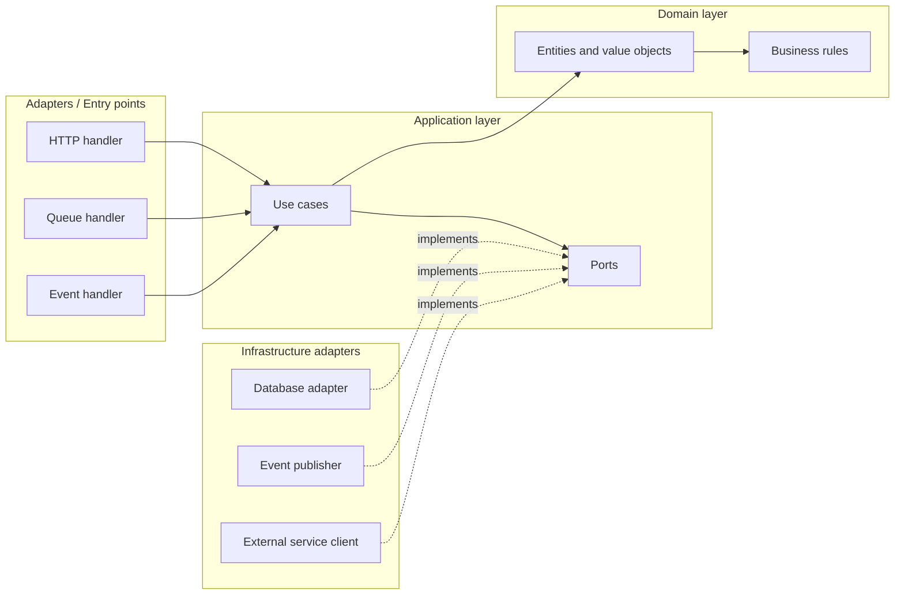

# Thiết kế handler Java và phân tách mã nghiệp vụ

Trong mô hình serverless, một Java function thường được gọi bởi nhiều loại trigger: HTTP request, thông điệp từ queue hoặc sự kiện do dịch vụ khác phát ra. Mỗi trigger có cách biểu diễn dữ liệu, cơ chế xác thực, quy tắc retry và cách phản hồi riêng. Nếu đưa toàn bộ những chi tiết này vào cùng một khối mã, handler sẽ nhanh chóng trở nên khó kiểm thử, khó tái sử dụng và khó thay đổi khi tích hợp thêm nguồn sự kiện.

Một thiết kế bền vững đặt handler ở vai trò **điểm tiếp nhận và chuyển đổi dữ liệu**, còn logic nghiệp vụ nằm trong các use case và domain model độc lập với nền tảng. Handler đọc input, xác thực ngữ cảnh kỹ thuật, chuyển dữ liệu thành lệnh nghiệp vụ, gọi use case rồi chuyển kết quả thành HTTP response hoặc kết quả xử lý message. Nhờ đó, cùng một nghiệp vụ có thể được gọi từ HTTP, queue, lịch chạy hoặc một luồng khác mà không phải sao chép quy tắc nghiệp vụ.

Trong phạm vi **CLOUD_SERVERLESS**, bài học tập trung vào cách phát triển và triển khai ứng dụng Java function kích hoạt bởi HTTP, thông điệp hoặc sự kiện; xử lý trigger, trạng thái, quyền truy cập, retry, idempotency, cold start, mở rộng và chi phí. Nội dung dưới đây trình bày cách tổ chức handler và phân tách mã để ứng dụng dễ kiểm thử, vận hành và thay đổi.

## 1. Handler trong Java function làm nhiệm vụ gì?

Handler là điểm vào (*entry point*) mà nền tảng FaaS gọi khi có invocation. Tên lớp, interface và chữ ký phương thức phụ thuộc nhà cung cấp hoặc framework adapter, nhưng trách nhiệm thường gồm:

- Nhận event/request và metadata do nền tảng chuyển vào.
- Đọc thông tin kỹ thuật như request ID, route, connection ID hoặc thông tin retry nếu có.
- Kiểm tra cấu trúc đầu vào và chuyển payload thành DTO phù hợp.
- Xác thực danh tính hoặc tiếp nhận principal đã được adapter xác minh; kiểm tra quyền ở đúng lớp.
- Chuyển dữ liệu transport thành command/query của ứng dụng.
- Gọi use case và chuyển kết quả thành response hoặc trạng thái xử lý.
- Chuyển lỗi thành HTTP status, retry signal, dead-letter flow hoặc log phù hợp với trigger.

Handler không nên tự quyết định các quy tắc như đơn hàng nào được xác nhận, số tiền có hợp lệ về nghiệp vụ hay trạng thái nào được phép chuyển đổi. Đó là trách nhiệm của application service và domain model.

Ví dụ, handler HTTP có thể nhận JSON tạo đơn hàng, trong khi handler queue nhận event `PaymentCaptured`. Hai handler có thể gọi các use case khác nhau, nhưng cả hai đều sử dụng cùng domain model và repository port. Khi đó, thay đổi tên header HTTP hoặc cấu trúc event không buộc phải sửa quy tắc tính tổng tiền của đơn hàng.

## 2. Phân tách adapter, application và domain

Một cách tổ chức phổ biến là kiến trúc ports-and-adapters (còn gọi là hexagonal architecture). Tên thư mục có thể khác nhau giữa dự án, nhưng ranh giới trách nhiệm nên rõ ràng.



| Lớp | Trách nhiệm | Ví dụ |
|---|---|---|
| Entry point/adapter | Hiểu giao thức và định dạng event của trigger | HTTP handler, SQS/queue handler, scheduled-event adapter |
| Application | Điều phối một hành động nghiệp vụ, quản lý ranh giới use case | `CreateOrderService`, `ConfirmPaymentService` |
| Domain | Quy tắc và trạng thái nghiệp vụ cốt lõi | `Order`, `Money`, quy tắc xác nhận đơn |
| Port | Khai báo khả năng bên ngoài mà use case cần | `OrderRepository`, `PaymentGateway`, `EventPublisher` |
| Infrastructure adapter | Triển khai port bằng dịch vụ cụ thể | JDBC repository, cloud SDK publisher, HTTP client |

Luồng phụ thuộc nên hướng vào phía trong: adapter biết application; application biết domain và port; infrastructure triển khai port. Domain không cần import SDK của nhà cung cấp cloud, lớp HTTP hay thư viện database.

Không nhất thiết phải tạo nhiều module Maven/Gradle cho mọi lớp. Với function nhỏ, các package Java riêng đã có thể tạo ranh giới đủ tốt. Chỉ tách module khi quy mô, nhóm phát triển hoặc yêu cầu build thực sự cần.

## 3. Phân biệt dữ liệu transport với dữ liệu nghiệp vụ

HTTP request, queue message và event có thể chứa các trường giống nhau nhưng không nhất thiết có cùng ý nghĩa hoặc vòng đời. Không nên truyền nguyên object của SDK vào domain service.

Ví dụ, HTTP request có thể chứa:

```json
{
  "customerId": "cus-1024",
  "items": [
    {"productId": "sku-17", "quantity": 2}
  ]
}
```

Adapter chuyển request thành command của ứng dụng:

```java
public record CreateOrderCommand(
        String customerId,
        List<OrderLineInput> items,
        String idempotencyKey) {}

public record OrderLineInput(
        String productId,
        int quantity) {}
```

`CreateOrderCommand` không chứa `APIGatewayProxyRequestEvent`, header map hay context object riêng của một nhà cung cấp. Nếu ngày mai ứng dụng nhận cùng yêu cầu từ message queue, queue adapter chỉ cần tạo cùng command từ event payload.

Nên phân biệt ít nhất bốn loại dữ liệu:

- **Transport DTO:** phản ánh JSON, header hoặc schema event trên đường truyền.
- **Command/query:** biểu diễn ý định mà application layer cần thực hiện.
- **Domain object:** biểu diễn thực thể và quy tắc nghiệp vụ.
- **Response/event DTO:** biểu diễn kết quả được công bố ra ngoài.

Việc tách các loại này tránh để thay đổi wire format lan vào domain. Nó cũng giúp kiểm soát dữ liệu nào được trả về client, dữ liệu nào được ghi vào event và dữ liệu nào phải giữ nội bộ.

## 4. Thiết kế use case độc lập với trigger

Use case mô tả một hành động mà hệ thống cung cấp. Nó nhận command hoặc query, phối hợp domain và các port cần thiết, rồi trả kết quả có ý nghĩa với ứng dụng.

Ví dụ khai báo port và use case:

```java
public interface OrderRepository {
    Optional<Order> findById(String orderId);
    void save(Order order);
}

public interface IdGenerator {
    String nextId();
}

public record CreateOrderResult(
        String orderId,
        String status,
        long totalMinor,
        String currency) {}

public interface CreateOrderUseCase {
    CreateOrderResult execute(CreateOrderCommand command);
}
```

Implementation của use case điều phối logic:

```java
public final class CreateOrderService implements CreateOrderUseCase {
    private final OrderRepository orders;
    private final IdGenerator ids;

    public CreateOrderService(OrderRepository orders, IdGenerator ids) {
        this.orders = orders;
        this.ids = ids;
    }

    @Override
    public CreateOrderResult execute(CreateOrderCommand command) {
        if (command.items() == null || command.items().isEmpty()) {
            throw new InvalidOrderException("Order must contain an item");
        }

        String orderId = ids.nextId();
        Order order = Order.create(orderId, command.customerId(), command.items());
        orders.save(order);

        return new CreateOrderResult(
                order.id(), order.status().name(),
                order.total().minorUnits(), order.total().currency());
    }
}
```

`Order`, `InvalidOrderException` và các value object là thành phần domain của ví dụ. `OrderRepository` là port, không nói rằng dữ liệu phải được lưu bằng JDBC hay một dịch vụ cụ thể. Infrastructure adapter có thể triển khai port bằng JDBC, ORM hoặc API lưu trữ khác.

Trong ứng dụng thực tế, thao tác tạo đơn có thể cần transaction, kiểm tra giá sản phẩm, tồn kho và idempotency. Các chi tiết đó thuộc use case/domain và các port tương ứng. Handler chỉ nên điều phối đầu vào và đầu ra.

## 5. HTTP handler: chuyển request thành command và response

HTTP adapter chịu trách nhiệm với các chi tiết của HTTP:

- Route, method, path parameter, query parameter và header.
- Deserialize body và kiểm tra content type/kích thước.
- Xác thực request hoặc nhận principal đã được authorizer xác minh.
- Chuyển request DTO thành command.
- Chuyển kết quả thành status code, response body và header.
- Ánh xạ lỗi thành HTTP response phù hợp.

Ví dụ dưới đây dùng các kiểu trung lập để thể hiện ranh giới. Adapter thật sẽ chuyển event của gateway vào `HttpRequest` và trả `HttpResponse` theo SDK tương ứng.

```java
public record HttpRequest(
        String method,
        String path,
        String body,
        String principalId,
        Map<String, String> headers) {}

public record HttpResponse(
        int statusCode,
        Map<String, String> headers,
        String body) {}

public record CreateOrderRequest(
        String customerId,
        List<OrderLineInput> items) {}
```

Handler có thể được viết như sau:

```java
public final class CreateOrderHttpHandler {
    private final JsonCodec json;
    private final CreateOrderUseCase createOrder;
    private final HttpErrorMapper errors;

    public CreateOrderHttpHandler(
            JsonCodec json,
            CreateOrderUseCase createOrder,
            HttpErrorMapper errors) {
        this.json = json;
        this.createOrder = createOrder;
        this.errors = errors;
    }

    public HttpResponse handle(HttpRequest request) {
        try {
            if (!"POST".equals(request.method())
                    || !"/orders".equals(request.path())) {
                return new HttpResponse(404, Map.of(), "");
            }

            CreateOrderRequest body = json.read(
                    request.body(), CreateOrderRequest.class);

            CreateOrderCommand command = new CreateOrderCommand(
                    body.customerId(), body.items(),
                    request.headers().get("Idempotency-Key"));

            CreateOrderResult result = createOrder.execute(command);
            return new HttpResponse(201, Map.of(
                    "Content-Type", "application/json"), json.write(result));
        } catch (Exception exception) {
            return errors.toResponse(exception);
        }
    }
}
```

Đây là ví dụ minh họa ranh giới, không phải adapter SDK hoàn chỉnh. Trong production cần kiểm tra `request`, `headers`, body rỗng, content type, giới hạn payload và principal; nên bắt các exception cụ thể thay vì bắt mọi `Exception` như ví dụ rút gọn. Không đưa exception message nội bộ hoặc stack trace vào response.

HTTP handler có thể trả `201 Created` cho thao tác tạo tài nguyên đồng bộ. Nếu use case chỉ nhận công việc dài và enqueue thành công, response phù hợp thường là `202 Accepted` cùng task ID hoặc URL truy vấn trạng thái.

## 6. Message/event handler: xử lý theo hợp đồng giao nhận

Message adapter có trách nhiệm hiểu envelope và quy tắc giao nhận của nguồn sự kiện. Một handler nhận message cần xác định:

- Event type và schema version.
- Message ID hoặc event ID dùng cho idempotency.
- Metadata retry/attempt nếu nguồn cung cấp.
- Cách xác nhận đã xử lý, trả lỗi hoặc chuyển message vào dead-letter queue.
- Quy tắc batch: một message lỗi có làm retry cả batch hay chỉ message đó.

Ví dụ một event thanh toán:

```json
{
  "eventId": "evt-501",
  "eventType": "PaymentCaptured",
  "schemaVersion": 1,
  "data": {
    "paymentId": "pay-92",
    "orderId": "ord-18",
    "amountMinor": 450000,
    "currency": "VND"
  }
}
```

Adapter chuyển payload thành command:

```java
public record PaymentCapturedCommand(
        String eventId,
        String paymentId,
        String orderId,
        long amountMinor,
        String currency) {}

public interface ConfirmPaymentUseCase {
    void execute(PaymentCapturedCommand command);
}

public final class PaymentCapturedHandler {
    private final ConfirmPaymentUseCase confirmPayment;

    public PaymentCapturedHandler(ConfirmPaymentUseCase confirmPayment) {
        this.confirmPayment = confirmPayment;
    }

    public void handle(PaymentCapturedCommand command) {
        confirmPayment.execute(command);
    }
}
```

`PaymentCapturedHandler` không cần biết message đến từ queue nào. Adapter cloud-specific đọc envelope, validate schema, tạo command và quyết định ack/retry dựa trên kết quả. Nếu cùng một use case được gọi từ một HTTP endpoint nội bộ, adapter HTTP có thể tạo cùng command sau khi xác thực quyền và dữ liệu.

## 7. Không để SDK của nhà cung cấp lan vào domain

SDK của nền tảng thường cung cấp event class, context, logger, client và exception riêng. Những kiểu này hữu ích ở biên hệ thống, nhưng không nên trở thành kiểu dữ liệu xuyên suốt domain.

Ví dụ, không nên viết domain service với chữ ký như:

```java
// Không nên để domain phụ thuộc trực tiếp vào SDK của FaaS
public Order create(APIGatewayProxyRequestEvent request,
                    Context lambdaContext) {
    // Quy tắc nghiệp vụ bị trộn với transport và runtime context
}
```

Thay vào đó, adapter đọc SDK event và chuyển thành command thuần Java. Domain không cần biết function được gọi bởi HTTP gateway, queue hay một test chạy trong JVM.

Một số thông tin runtime vẫn hữu ích cho application layer, ví dụ correlation ID, deadline hoặc principal. Hãy chuyển chúng thành kiểu trung lập và chỉ truyền phần use case thực sự cần. Tránh truyền toàn bộ context object của nhà cung cấp vì điều đó làm tăng coupling và khiến test phải dựng các object phức tạp.

## 8. Dependency injection và composition root

Use case thường cần repository, publisher, clock, ID generator hoặc client dịch vụ bên ngoài. Hãy khai báo các dependency qua constructor để thể hiện rõ yêu cầu của lớp và dễ thay thế khi kiểm thử.

```java
public final class ConfirmPaymentService implements ConfirmPaymentUseCase {
    private final OrderRepository orders;
    private final PaymentRepository payments;
    private final Clock clock;

    public ConfirmPaymentService(
            OrderRepository orders,
            PaymentRepository payments,
            Clock clock) {
        this.orders = orders;
        this.payments = payments;
        this.clock = clock;
    }

    @Override
    public void execute(PaymentCapturedCommand command) {
        // Tải aggregate, kiểm tra trạng thái và áp dụng quy tắc domain.
        // Ghi nhận thời gian bằng clock để test có thể kiểm soát.
    }
}
```

Composition root là nơi tạo infrastructure adapter, repository, use case và handler rồi nối chúng lại. Với ứng dụng nhỏ, có thể là một lớp `ApplicationFactory`; với framework DI, đó có thể là cấu hình module hoặc component graph.

Điểm quan trọng là object graph được tạo ở một nơi dễ nhìn và dễ kiểm thử. Handler nhận dependency đã được tạo qua constructor; không tự gọi `new DatabaseRepository()` bên trong mỗi lần xử lý. Điều này tránh giấu dependency và tránh tạo lại client/pool không cần thiết.

## 9. Tái sử dụng object an toàn giữa các invocation

Một số nền tảng tái sử dụng execution environment, vì vậy static field hoặc singleton có thể sống qua nhiều invocation. Điều này hữu ích cho các dependency bất biến hoặc thread-safe như JSON codec, HTTP client, SDK client và `DataSource` pool được cấu hình đúng.

Tuy nhiên, không được giả định environment luôn được giữ ấm hoặc một invocation chỉ chạy trên một instance. Khi scale-out, nhiều environment có object graph độc lập. Một số nền tảng hoặc cấu hình có thể cho phép nhiều request đồng thời dùng cùng environment, nên handler và dependency cần được xem xét về thread safety.

Các nguyên tắc:

- Có thể tái sử dụng client thread-safe và cấu hình bất biến ở phạm vi environment.
- Không lưu request, principal, event payload hoặc mutable domain object của một invocation vào static field.
- Không chia sẻ JDBC `Connection`, transaction hoặc `ResultSet` giữa invocation.
- Tránh singleton chứa mutable state không được đồng bộ.
- Không dựa vào biến static để lưu trạng thái nghiệp vụ, idempotency hoặc subscription.
- Nếu dependency có lifecycle cần đóng, xác định rõ nền tảng có cung cấp shutdown hook đáng tin cậy hay không.

Tái sử dụng object giúp giảm chi phí khởi tạo và cold start, nhưng chỉ an toàn khi vòng đời và tính đồng thời của dependency được hiểu rõ.

## 10. Validation và ranh giới bảo mật

Validation nên diễn ra ở nhiều lớp với mục tiêu khác nhau:

1. **Transport validation:** request có JSON hợp lệ, đúng content type, kích thước cho phép và các trường bắt buộc ở mức giao thức.
2. **Application validation:** use case nhận đủ dữ liệu cần thiết, kiểm tra điều kiện đầu vào của hành động.
3. **Domain invariant:** entity/value object bảo đảm quy tắc luôn đúng, ví dụ số lượng phải dương hoặc tổng tiền không âm.
4. **Authorization:** xác minh principal có quyền thực hiện hành động trên tài nguyên cụ thể.

Không nên chỉ dựa vào validation ở client. Client có thể gửi request trực tiếp hoặc bị sửa payload. Cũng không nên coi việc API gateway xác thực token là đủ cho mọi quyền nghiệp vụ; use case vẫn cần kiểm tra quyền trên order, account hoặc tenant cụ thể.

Có thể chuyển principal thành một kiểu ứng dụng trung lập:

```java
public record Actor(
        String subjectId,
        String tenantId,
        Set<String> authorities) {}

public record CancelOrderCommand(
        Actor actor,
        String orderId,
        String reason) {}
```

Nếu use case cần xác minh quyền sở hữu đơn hàng, hãy truyền `Actor` hoặc một port `OrderAccessPolicy` và thực hiện kiểm tra trong application/domain boundary phù hợp. Không truyền raw Authorization header vào domain.

## 11. Phân loại lỗi và chuyển lỗi theo trigger

Một lỗi nghiệp vụ không nhất thiết phải được xử lý giống lỗi hạ tầng. HTTP client cần nhận status code có ý nghĩa; message consumer cần quyết định ack, retry hoặc dead-letter. Vì vậy, nên định nghĩa nhóm lỗi ở application layer rồi để adapter ánh xạ theo giao thức.

| Nhóm lỗi | Ví dụ | HTTP adapter | Message/event adapter |
|---|---|---|---|
| Input không hợp lệ | JSON sai, thiếu trường bắt buộc | `400 Bad Request` | Từ chối payload, cách ly hoặc DLQ theo chính sách |
| Không xác thực | Token không hợp lệ | `401 Unauthorized` | Không xử lý nếu nguồn yêu cầu xác thực; ghi audit phù hợp |
| Không có quyền | Không được hủy đơn của tenant khác | `403 Forbidden` hoặc `404` theo chính sách chống dò tài nguyên | Đưa vào luồng lỗi vĩnh viễn, không retry vô hạn |
| Không tìm thấy | Order ID không tồn tại | `404 Not Found` | Xác định đây là lỗi dữ liệu hay sự kiện đến sai thứ tự |
| Xung đột trạng thái | Đơn đã hủy nhưng nhận yêu cầu xác nhận | `409 Conflict` | Xử lý idempotent hoặc cách ly theo quy tắc nghiệp vụ |
| Lỗi tạm thời | Database timeout, dịch vụ phụ thuộc quá tải | `503` hoặc lỗi có thể retry theo hợp đồng | Retry có giới hạn/backoff |
| Lỗi không mong đợi | Bug hoặc invariant bị vi phạm | `500` với mã lỗi an toàn | Đánh dấu lỗi, retry có kiểm soát hoặc DLQ theo loại lỗi |

Không nên bắt mọi exception rồi trả `200 OK` hoặc ack message. Điều đó khiến nền tảng nghĩ rằng sự kiện đã xử lý thành công dù nghiệp vụ chưa hoàn tất. Ngược lại, không nên retry lỗi vĩnh viễn như JSON sai định dạng vì sẽ tạo vòng lặp tốn chi phí.

Một `HttpErrorMapper` có thể ánh xạ exception nghiệp vụ thành response; một `MessageFailurePolicy` có thể phân loại retryable/permanent. Cả hai dùng cùng exception taxonomy nhưng thực hiện hành vi riêng theo trigger.

## 12. Idempotency và ranh giới retry

FaaS có thể thực thi lại function do timeout, retry của nguồn sự kiện, client gửi lại request hoặc lỗi xác nhận message. Vì vậy, không thể dựa vào giả định handler chỉ chạy đúng một lần.

Với HTTP, client có thể gửi `Idempotency-Key`. Với event, dùng event ID hoặc khóa nghiệp vụ ổn định. Application layer nên gọi một port idempotency có lưu trữ bền vững để bảo đảm nhiều environment cùng xử lý một key không tạo tác động lặp.

```java
public interface IdempotencyExecutor {
    <T> T executeOnce(String key, Supplier<T> action);
}

public final class CreateOrderIdempotently {
    private final IdempotencyExecutor idempotency;
    private final CreateOrderUseCase createOrder;

    public CreateOrderIdempotently(
            IdempotencyExecutor idempotency,
            CreateOrderUseCase createOrder) {
        this.idempotency = idempotency;
        this.createOrder = createOrder;
    }

    public CreateOrderResult execute(CreateOrderCommand command) {
        return idempotency.executeOnce(
                command.idempotencyKey(),
                () -> createOrder.execute(command));
    }
}
```

`IdempotencyExecutor` là port minh họa. Triển khai thực tế cần lưu key, chủ sở hữu, hash payload, trạng thái xử lý và kết quả; thao tác claim key phải nguyên tử hoặc có conditional write. Nếu hai invocation cùng nhận key, chỉ một invocation được thực hiện side effect; invocation còn lại nhận kết quả đã lưu hoặc trạng thái đang xử lý.

Idempotency không có nghĩa mọi lỗi đều được retry. Chỉ retry lỗi có khả năng tạm thời; đặt giới hạn, backoff và jitter. Với message batch, kiểm tra cơ chế partial batch failure của nguồn sự kiện để một record lỗi không buộc retry tất cả record đã xử lý thành công.

## 13. Transaction và side effect bên ngoài

Use case thường phối hợp database và dịch vụ bên ngoài. Không nên mở transaction database rồi giữ connection trong lúc gọi payment gateway hoặc một HTTP API chậm.

Một cách tiếp cận thường dùng:

1. Trong transaction ngắn, cập nhật dữ liệu nghiệp vụ và ghi outbox event.
2. Commit để trả connection về pool.
3. Worker riêng đọc outbox và gọi dịch vụ bên ngoài.
4. Ghi nhận kết quả trong transaction khác.

Outbox giúp tránh tình huống database commit thành công nhưng publish event thất bại. Publisher có thể gửi lại cùng record, nên consumer vẫn cần idempotency. Với quy trình nhiều bước, có thể dùng saga/workflow và các hành động bù trừ thay vì giữ một transaction dài qua nhiều function invocation.

Handler nên kết thúc sau khi use case đạt trạng thái mà trigger cần xác nhận. Ví dụ, HTTP handler tạo task nền chỉ cần bảo đảm task và thông điệp khởi chạy được ghi nhận bền vững trước khi trả `202`; nó không cần chờ toàn bộ workflow hoàn tất.

## 14. Context, timeout và cancellation

Nền tảng có thể cung cấp deadline hoặc thời gian còn lại của invocation. Adapter nên chuyển thông tin này thành một execution context trung lập nếu application cần giới hạn thời gian.

Không nên truyền nguyên object context của SDK vào domain. Có thể định nghĩa:

```java
public record ExecutionMetadata(
        String invocationId,
        String correlationId,
        Instant deadline) {}
```

Use case có thể dùng deadline để đặt timeout cho lời gọi dịch vụ phụ thuộc hoặc quyết định không bắt đầu một thao tác nếu không còn đủ thời gian. Tuy nhiên, deadline của invocation không phải cơ chế lưu trạng thái. Nếu công việc không thể hoàn tất trong giới hạn function, hãy chia nhỏ thành các bước hoặc chuyển sang queue/workflow.

Khi invocation sắp hết thời gian, cần tránh để transaction dở dang hoặc side effect không rõ kết quả. Dùng timeout cho JDBC/HTTP client ngắn hơn deadline tổng thể, commit/rollback có kiểm soát và lưu trạng thái tiến trình để invocation tiếp theo có thể tiếp tục hoặc đối soát.

## 15. Tổ chức package Java

Một cấu trúc package minh họa cho ứng dụng serverless có thể như sau:

```text
com.example.orders
├── domain
│   ├── model
│   │   ├── Order.java
│   │   └── Money.java
│   └── exception
├── application
│   ├── command
│   ├── result
│   ├── port
│   │   ├── OrderRepository.java
│   │   └── EventPublisher.java
│   └── service
│       └── CreateOrderService.java
├── adapter
│   ├── in
│   │   ├── http
│   │   │   └── CreateOrderHttpHandler.java
│   │   └── message
│   │       └── PaymentCapturedHandler.java
│   └── out
│       ├── persistence
│       │   └── JdbcOrderRepository.java
│       └── messaging
│           └── CloudEventPublisher.java
└── bootstrap
    └── ApplicationFactory.java
```

Đây là một cách tổ chức, không phải quy tắc tên thư mục bắt buộc. Điểm quan trọng là package `domain` không phụ thuộc `adapter` hoặc SDK cloud; `application` định nghĩa port; adapter bên ngoài triển khai port; bootstrap nối các thành phần.

Nếu mỗi function là một deployment artifact riêng, có thể dùng chung module domain/application và tạo adapter/handler riêng cho từng function. Cần cân nhắc kích thước package, thời gian build và mức độ coupling giữa các function. Không nên gom mọi function vào một artifact lớn nếu chúng có vòng đời phát hành, quyền và dependency khác nhau đáng kể.

## 16. Kiểm thử handler và use case

Phân tách lớp giúp kiểm thử đúng ở từng ranh giới:

| Loại test | Kiểm tra điều gì? | Phụ thuộc thường dùng |
|---|---|---|
| Domain unit test | Quy tắc entity/value object | Không cần cloud SDK hoặc database |
| Application unit test | Use case, điều phối port, lỗi nghiệp vụ | Fake/mock repository, clock, publisher |
| Handler/adapter test | Mapping HTTP/event sang command và kết quả sang response | JSON codec, event fixture, fake use case |
| Contract test | Payload tuân theo schema và consumer hiểu event đã công bố | Schema, payload mẫu, registry nếu có |
| Integration test | JDBC, queue, secret và SDK hoạt động với dịch vụ thật hoặc môi trường giả lập | Test database, container hoặc cloud test environment |
| Deployment smoke test | Handler được nền tảng gọi đúng, quyền và trigger đã cấu hình | Staging deployment |

Ví dụ test application service có thể dùng fake repository:

```java
final class InMemoryOrderRepository implements OrderRepository {
    private final Map<String, Order> data = new HashMap<>();

    @Override
    public Optional<Order> findById(String id) {
        return Optional.ofNullable(data.get(id));
    }

    @Override
    public void save(Order order) {
        data.put(order.id(), order);
    }
}
```

Test có thể kiểm tra một command hợp lệ tạo đúng order, command không hợp lệ ném exception phù hợp và repository nhận dữ liệu đúng. Không cần khởi chạy function runtime để kiểm tra quy tắc nghiệp vụ.

Với handler, tạo fixture cho HTTP event và message event, sau đó kiểm tra method/path, payload sai, header idempotency, principal và mapping lỗi. Với queue adapter, kiểm tra hành vi khi một record lỗi trong batch và kết quả ack/retry theo hợp đồng của nguồn.

## 17. Quan sát handler trong production

Khi function xử lý nhiều trigger, log cần cho biết invocation đến từ đâu và use case nào đã chạy. Nên ghi log có cấu trúc với các trường như:

- Function name, environment và trigger type.
- Invocation ID, request ID, event ID và correlation ID.
- Use case hoặc operation name.
- Thời gian xử lý, kết quả và mã lỗi phân loại.
- Số lần retry hoặc attempt nếu nguồn cung cấp.

Không ghi access token, password, secret, toàn bộ payload có dữ liệu nhạy cảm hoặc thông tin cá nhân không cần thiết. Với lỗi, log exception nội bộ ở nơi được bảo vệ và trả mã lỗi an toàn ra client.

Metric nên phân biệt lỗi do input, lỗi nghiệp vụ, lỗi hạ tầng, timeout và retry. Nếu chỉ theo dõi tổng tỷ lệ lỗi, nhóm vận hành khó biết cần sửa client, domain rule hay dependency bên ngoài. Trace context nên được truyền qua queue/event nếu nền tảng hỗ trợ để nối nhiều invocation thành một luồng nghiệp vụ.

## 18. Cold start, dependency và kích thước handler

Cold start là thời gian nền tảng cần để chuẩn bị execution environment trước khi xử lý invocation. Java có thể cần thời gian nạp class, khởi tạo framework, tạo SDK client, đọc cấu hình và khởi tạo connection pool.

Một số cách giảm overhead:

- Chỉ đưa dependency cần thiết vào artifact; tránh kéo cả framework lớn nếu function chỉ xử lý một thao tác nhỏ.
- Khởi tạo client thread-safe ở phạm vi environment khi có lợi và phù hợp với lifecycle.
- Trì hoãn khởi tạo thành phần đắt tiền cho đến khi use case thực sự cần, nếu điều đó không làm tăng latency của đường gọi phổ biến.
- Đo thời gian khởi tạo riêng với thời gian thực thi handler.
- Chọn runtime, memory/CPU và cơ chế giữ sẵn environment theo số liệu đo được.
- Kiểm thử artifact thực tế trên runtime đích, không chỉ chạy test trong IDE.

Không nên tối ưu bằng cách đưa state của request vào singleton hoặc bỏ validation. Hiệu năng không được làm mất tính cô lập giữa các invocation hoặc độ đúng của nghiệp vụ.

## 19. Những anti-pattern thường gặp

| Anti-pattern | Hệ quả | Cách cải thiện |
|---|---|---|
| Một handler chứa toàn bộ nghiệp vụ và truy cập DB | Khó test, khó tái sử dụng và khó đổi trigger | Tách adapter, use case, domain và repository port |
| Domain import SDK của cloud | Business logic bị khóa vào một nền tảng | Chuyển SDK event thành DTO/command thuần Java |
| Static mutable state lưu dữ liệu invocation | Dữ liệu rò giữa request hoặc sai khi scale-out | Dùng object cục bộ cho invocation và kho lưu trữ bền vững cho state |
| Tạo SDK client/pool mới mỗi invocation | Tăng cold start và connection storm | Tái sử dụng dependency thread-safe ở phạm vi environment |
| Chia sẻ JDBC Connection giữa invocation | Race condition, transaction lẫn nhau và lỗi driver | Mượn connection theo thao tác và đóng bằng try-with-resources |
| Bắt mọi exception rồi trả thành công | Mất retry và che giấu lỗi nghiệp vụ | Phân loại lỗi theo trigger và hợp đồng giao nhận |
| Dùng `Thread.sleep` để chờ tác vụ nền | Giữ invocation, tăng chi phí và có thể timeout | Đưa công việc vào queue/workflow |
| Dựa vào retry để xử lý mọi lỗi | Poison message và retry storm | Retry lỗi tạm thời; DLQ lỗi vĩnh viễn |
| Dùng biến trong bộ nhớ làm idempotency store | Không chống trùng giữa các environment | Dùng conditional write hoặc transaction trong store dùng chung |
| Truyền nguyên request/context vào domain | Coupling và test phức tạp | Chuyển thành command và metadata trung lập |

## 20. Checklist trước khi triển khai Java function

| Câu hỏi | Bằng chứng cần có |
|---|---|
| Handler có một nhiệm vụ rõ ràng? | Chỉ xử lý trigger, mapping và gọi use case |
| Business rule nằm ở đâu? | Domain/application service có thể test mà không cần cloud SDK |
| Dữ liệu trigger được chuyển đổi thế nào? | DTO và mapper cho HTTP/message/event |
| SDK cloud có bị rò vào domain? | Domain và application không phụ thuộc event class của provider |
| Dependency được tạo ở đâu? | Composition root và constructor injection |
| Object được tái sử dụng có thread-safe? | Không có mutable request state trong singleton/static field |
| Validation và authorization đủ chưa? | Kiểm tra transport, invariant và quyền trên tài nguyên |
| Lỗi được ánh xạ theo trigger? | HTTP mapper và message retry/failure policy riêng |
| Retry có an toàn? | Idempotency key/event ID lưu bền vững và retry có giới hạn |
| Transaction có ngắn? | Không giữ connection khi gọi dịch vụ ngoài |
| Timeout phù hợp? | Timeout dependency nằm trong deadline invocation |
| Có kiểm thử đúng ranh giới? | Domain, application, adapter, contract và integration tests |
| Có thể quan sát luồng xử lý? | Structured logs, metrics, correlation ID và trace |
| Artifact phù hợp runtime? | Dependency, handler config và smoke test trên staging |

## 21. Cách phát triển và mở rộng handler theo thời gian

Khi bắt đầu, một function có thể chỉ cần một adapter, một use case và một repository. Khi xuất hiện thêm trigger hoặc nghiệp vụ, hãy mở rộng theo ranh giới đã có: tạo adapter mới cho HTTP hoặc message, tái sử dụng use case khi ngữ nghĩa nghiệp vụ giống nhau, và tạo use case riêng khi hành động thực sự khác nhau.

Đừng chia sẻ use case chỉ vì hai payload có cùng tên trường. Một HTTP command `CreateOrder` và một event `OrderImported` có thể cùng chứa customer ID và danh sách sản phẩm nhưng có quy tắc quyền, idempotency và kết quả khác nhau. Hãy chuẩn hóa chúng thành cùng domain operation chỉ khi ý nghĩa nghiệp vụ thực sự tương đương.

Khi thay đổi handler, kiểm thử contract của trigger và use case độc lập. Theo dõi retry, cold start, thời gian xử lý và chi phí sau triển khai. Với công việc kéo dài, chuyển sang queue hoặc workflow và lưu trạng thái bền vững thay vì giữ invocation mở.

Thiết kế handler Java tốt giúp nền tảng serverless chỉ là cách kích hoạt ứng dụng. Adapter chịu trách nhiệm giao tiếp với HTTP, message hoặc event; application điều phối use case; domain giữ quy tắc nghiệp vụ; infrastructure kết nối database và dịch vụ ngoài. Ranh giới này giúp Java function dễ kiểm thử, dễ mở rộng và ít bị ràng buộc khi thay đổi nhà cung cấp hoặc cách triển khai.
