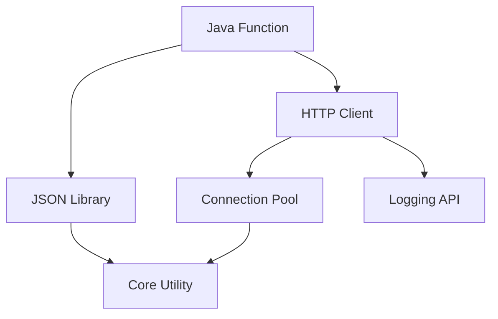

# Quản lý dependency, classpath và kích thước gói Java

## 1. Vì sao dependency và package quan trọng với Java FaaS?

Một Java function không chỉ gồm các file `.java` của ứng dụng. Khi biên dịch và chạy, nó còn cần thư viện bên ngoài, thư viện phụ thuộc gián tiếp, tài nguyên cấu hình, metadata của framework và đôi khi cả runtime Java hoặc thành phần native. Tập hợp những thành phần này phải được đóng gói đúng cách để nền tảng serverless có thể nạp handler và thực thi function.

Ba khái niệm liên hệ trực tiếp với nhau:

- **Dependency management:** xác định thư viện nào cần dùng, phiên bản nào được chọn và thư viện phụ thuộc gián tiếp được giải quyết ra sao.
- **Classpath:** danh sách thư mục và JAR mà Java runtime dùng để tìm class và resource khi nạp ứng dụng.
- **Deployment package:** artifact được triển khai, có thể là một JAR, ZIP chứa JAR và thư viện, hoặc container image tùy nền tảng.

Nếu dependency thiếu hoặc xung đột, function có thể biên dịch thành công nhưng lỗi khi khởi tạo hoặc xử lý request. Nếu package có cấu trúc sai, runtime không tìm thấy handler hoặc resource. Nếu package quá lớn, thời gian tải, giải nén, khởi tạo và phát hành có thể tăng; một số nền tảng còn áp dụng giới hạn kích thước riêng.

Trong phạm vi CLOUD_SERVERLESS, mục tiêu là tạo artifact Java có thể triển khai lặp lại, nạp được đúng class và resource, chứa đủ dependency runtime, đồng thời giữ kích thước hợp lý để kiểm soát cold start và chi phí vận hành.

## 2. Dependency graph và dependency bắc cầu

### 2.1. Dependency trực tiếp và gián tiếp

Dependency trực tiếp là thư viện mà mã ứng dụng khai báo và sử dụng. Dependency gián tiếp (transitive dependency) là thư viện được một dependency khác yêu cầu. Ví dụ, function dùng HTTP client; HTTP client có thể phụ thuộc vào thư viện logging, TLS hoặc serialization.



Dependency graph thực tế có thể có nhiều đường đi đến cùng một thư viện. Build tool phải chọn phiên bản phù hợp theo quy tắc resolution của Maven hoặc Gradle. Hai thư viện khác nhau có thể yêu cầu hai phiên bản của cùng một artifact; phiên bản được chọn có thể không tương thích với một bên.

Các lỗi thường gặp gồm:

- `ClassNotFoundException`: ứng dụng chủ động yêu cầu nạp một class nhưng classloader không tìm thấy class đó.
- `NoClassDefFoundError`: JVM không thể sử dụng một class cần thiết tại runtime; nguyên nhân có thể là class thiếu hoặc class khởi tạo thất bại trước đó.
- `NoSuchMethodError` hoặc `NoSuchFieldError`: class được nạp nhưng API thực tế không có method/field mà mã đã biên dịch mong đợi, thường do lệch phiên bản.
- `LinkageError`: lỗi liên kết class, có thể liên quan đến xung đột binary hoặc classloader.

Vì vậy, chỉ thấy build thành công chưa đủ chứng minh dependency graph phù hợp với môi trường chạy.

### 2.2. Chọn dependency có chủ đích

Chỉ thêm thư viện khi function thực sự cần khả năng đó. Một thư viện tiện ích lớn có thể kéo theo nhiều dependency khác. Ví dụ, nếu chỉ cần parse JSON, hãy cân nhắc dùng một JSON module nhỏ thay vì thêm toàn bộ framework web hoặc một starter lớn.

Trước khi thêm dependency, nên xác định:

1. Function sử dụng API nào của thư viện?
2. Thư viện có kéo theo dependency bắc cầu nào đáng kể?
3. Có thư viện khác đã cung cấp cùng khả năng không?
4. Thư viện có hỗ trợ Java runtime và kiến trúc CPU của deployment target không?
5. Có cần thư viện ở compile time, runtime hay chỉ trong test?
6. Phiên bản có được cập nhật bảo mật và có license phù hợp không?

Tránh đưa toàn bộ SDK của một dịch vụ vào mọi function nếu mỗi function chỉ dùng một vài API. Nếu SDK hỗ trợ module/artifact riêng theo dịch vụ, chọn đúng module cần thiết.

## 3. Scope và configuration trong Maven, Gradle

### 3.1. Maven dependency scope

Maven dùng scope để xác định dependency xuất hiện ở các classpath nào và có được đóng gói hay không. Các scope thường gặp:

| Scope | Compile | Test | Runtime | Đóng gói runtime thông thường |
| --- | --- | --- | --- | --- |
| `compile` (mặc định) | Có | Có | Có | Có |
| `provided` | Có | Có | Thường có trong test runtime | Không được Maven xem là dependency runtime cần đóng gói |
| `runtime` | Không cần cho compile source | Có | Có | Có |
| `test` | Không | Có | Không | Không |
| `system` | Có theo đường dẫn cục bộ | Có | Tùy cấu hình | Không nên dùng cho build có thể tái tạo |

Scope `provided` chỉ phù hợp khi môi trường triển khai thật sự cung cấp thư viện đó. Một số nền tảng có adapter/runtime API được cung cấp sẵn; khi đó dependency tương ứng có thể dùng `provided` theo hướng dẫn của nền tảng. Không được tự ý chuyển thư viện sang `provided` chỉ để giảm package size, vì function có thể lỗi `ClassNotFoundException` khi chạy.

Ví dụ khai báo Maven:

```xml
<dependencies>
    <dependency>
        <groupId>com.fasterxml.jackson.core</groupId>
        <artifactId>jackson-databind</artifactId>
        <version>${jackson.version}</version>
    </dependency>

    <dependency>
        <groupId>org.slf4j</groupId>
        <artifactId>slf4j-api</artifactId>
        <version>${slf4j.version}</version>
    </dependency>

    <dependency>
        <groupId>org.junit.jupiter</groupId>
        <artifactId>junit-jupiter</artifactId>
        <version>${junit.version}</version>
        <scope>test</scope>
    </dependency>
</dependencies>
```

Các property version nên được quản lý tập trung trong `properties`, parent POM hoặc BOM. Ví dụ trên chỉ minh họa cấu trúc; cần chọn phiên bản thực tế tương thích với JDK và thư viện đang dùng.

### 3.2. Gradle configuration

Gradle phân biệt các configuration như:

| Configuration | Ý nghĩa |
| --- | --- |
| `implementation` | Dependency cần cho compile và runtime của module |
| `api` | Dependency được công khai qua API của thư viện khi dùng Java Library plugin |
| `compileOnly` | Chỉ cần khi compile, runtime phải được cung cấp bằng cách khác |
| `runtimeOnly` | Chỉ cần khi chạy, ví dụ driver hoặc provider được nạp động |
| `testImplementation` | Chỉ dùng cho test compile/runtime |
| `testRuntimeOnly` | Chỉ dùng khi chạy test |

Ví dụ Gradle:

```kotlin
dependencies {
    implementation("com.fasterxml.jackson.core:jackson-databind:2.x.y")
    implementation("org.slf4j:slf4j-api:2.x.y")

    // Chỉ khai báo compileOnly nếu runtime thực sự cung cấp API này.
    compileOnly("com.example:function-runtime-api:1.x.y")

    testImplementation("org.junit.jupiter:junit-jupiter:5.x.y")
}
```

`2.x.y`, `1.x.y` và `5.x.y` là placeholder minh họa, không phải phiên bản để copy vào dự án. Hãy thay bằng phiên bản cụ thể đã được kiểm tra. Với build production, không nên dùng version động như `latest.release` vì cùng một commit có thể tạo artifact khác nhau ở những lần build khác nhau.

### 3.3. Quản lý version bằng BOM và constraints

Một BOM (Bill of Materials) giúp đồng bộ các phiên bản thư viện thuộc cùng hệ sinh thái. Maven thường dùng `dependencyManagement` để import BOM; Gradle có thể dùng `platform(...)` hoặc `enforcedPlatform(...)`. BOM giảm nguy cơ kết hợp các module được phát hành cùng nhau nhưng lệch phiên bản.

Không nên ép một phiên bản chỉ vì nó mới hơn. Cần xem dependency nào yêu cầu phiên bản cũ, release notes và binary compatibility. Nếu nâng một thư viện nền tảng như logging, JSON hoặc HTTP stack, hãy chạy test cho các function dùng chung module đó.

### 3.4. Exclusion và optional dependency

Exclusion loại một dependency bắc cầu khỏi graph. Chỉ dùng khi đã xác định dependency đó không cần thiết hoặc sẽ được thay thế bằng phiên bản tương thích khác. Nếu loại nhầm, build có thể vẫn thành công nhưng runtime thiếu class hoặc provider.

```xml
<dependency>
    <groupId>com.example</groupId>
    <artifactId>legacy-client</artifactId>
    <version>${legacy-client.version}</version>
    <exclusions>
        <exclusion>
            <groupId>commons-logging</groupId>
            <artifactId>commons-logging</artifactId>
        </exclusion>
    </exclusions>
</dependency>
```

Đoạn này chỉ minh họa cú pháp. Chỉ exclusion khi biết thư viện thay thế tương thích đã có trong graph và đã test đường logging thực tế. Dependency optional trong thư viện cũng không tự động có mặt ở ứng dụng tiêu thụ; nếu function gọi API của nó, module ứng dụng phải khai báo dependency cần thiết.

## 4. Quản lý xung đột và kiểm tra dependency graph

### 4.1. Quy tắc chọn phiên bản

Maven và Gradle có quy tắc resolution riêng. Không nên suy luận phiên bản runtime chỉ từ một dòng khai báo. Hãy xem graph sau khi build tool đã giải quyết tất cả dependency.

Các công cụ hữu ích:

```bash
# Maven: xem dependency tree
mvn dependency:tree

# Maven: xem các dependency có version conflict hoặc convergence issue
mvn dependency:analyze

# Gradle: xem dependency của runtime classpath
./gradlew dependencies --configuration runtimeClasspath

# Gradle: tìm lý do một version được chọn
./gradlew dependencyInsight --dependency jackson-databind --configuration runtimeClasspath
```

Các lệnh này là hướng dẫn để người phát triển chạy trong dự án tương ứng; worker không chạy build theo phạm vi STEP 4.

### 4.2. Dependency convergence

Dependency convergence nghĩa là các nhánh của graph không kéo những phiên bản không tương thích của cùng một thư viện. Có thể dùng Maven Enforcer hoặc dependency constraints/locking trong Gradle để phát hiện hoặc kiểm soát version.

Không phải mọi khác biệt phiên bản đều là lỗi, nhưng các thư viện có package/class giống nhau và API thay đổi cần được xem xét. Hãy xử lý ở nơi quản lý version tập trung thay vì thêm một bản JAR tùy tiện vào package để “chữa” lỗi.

### 4.3. Version lock và build tái tạo

Build tái tạo cần tạo cùng dependency graph từ cùng source và cấu hình. Với Gradle, dependency locking có thể ghi lại phiên bản đã chọn. Với Maven, dùng version cố định, BOM được quản lý và repository đáng tin cậy; tránh phụ thuộc snapshot không kiểm soát trong release.

Artifact nên được gắn với commit, build number hoặc checksum. Khi một function được triển khai lại, nhóm vận hành cần biết chính xác JAR nào đang chạy. Không sửa JAR sau khi build hoặc thay dependency bằng tay trong thư mục deploy.

### 4.4. Bảo mật dependency

Dependency là một phần của bề mặt tấn công. Cần theo dõi CVE, mức độ nghiêm trọng, trạng thái hỗ trợ và license. Có thể sinh SBOM (Software Bill of Materials) để liệt kê thư viện trong artifact, sau đó quét bằng công cụ phù hợp trong pipeline.

Không phải mọi cảnh báo đều có thể xử lý bằng cách nâng ngay phiên bản mới nhất. Cần kiểm tra bản vá tương thích, phạm vi code bị ảnh hưởng và khả năng nâng framework. Nếu chưa thể nâng, đánh giá mức độ phơi nhiễm và có kế hoạch khắc phục được theo dõi.

## 5. Classpath và cơ chế nạp class của Java

### 5.1. Classpath là gì?

Classpath là tập hợp vị trí mà Java runtime tìm class và resource. Mỗi phần tử có thể là thư mục chứa `.class` hoặc file JAR. Khi khởi động một ứng dụng Java truyền thống, classpath có thể được chỉ định bằng `-cp` hoặc `-classpath`:

```bash
java -cp "app.jar;lib/*" com.example.Main
```

Trên Windows, dấu phân cách classpath là `;`; trên Linux/macOS là `:`. Ví dụ này dùng dấu phân cách Windows. Wildcard `lib/*` cho phép JVM đưa các JAR trực tiếp trong thư mục `lib` vào classpath; không mặc định tìm JAR đệ quy trong mọi thư mục con.

Trong serverless, nền tảng thường tạo classpath hoặc launcher dựa trên cấu trúc package và cấu hình handler. Vì vậy, không phải lúc nào người phát triển cũng tự truyền `-cp`. Điều quan trọng là hiểu runtime đang tìm class ở những vị trí nào và artifact có đúng cấu trúc mà nền tảng yêu cầu hay không.

### 5.2. Classpath khác module path

Java Platform Module System (JPMS) giới thiệu module path bên cạnh classpath. JAR có `module-info.class` có thể được nạp như named module khi đặt trên module path; trên classpath, nội dung thường được xử lý như thành phần của unnamed module.

Nhiều runtime function và thư viện vẫn dùng classpath. Không nên thêm `module-info.java` hoặc chuyển artifact sang module path chỉ để “hiện đại hóa” nếu framework, reflection, service loading hoặc nền tảng triển khai chưa hỗ trợ đầy đủ. Hãy kiểm tra cách runtime khởi động ứng dụng và thử đúng artifact cuối cùng.

### 5.3. Classloader và lỗi nạp class

JVM dùng classloader để tìm và định nghĩa class. Mô hình delegation thường có parent delegation, nhưng ứng dụng serverless, framework hoặc container có thể dùng classloader riêng. Một số nền tảng cho phép chọn chế độ parent-first hoặc child-first; không nên giả định thứ tự này giống nhau ở mọi môi trường.

Các lỗi điển hình:

| Lỗi | Dấu hiệu thường gặp | Hướng kiểm tra |
| --- | --- | --- |
| `ClassNotFoundException` | `Class.forName` hoặc cơ chế nạp động không tìm thấy class | Kiểm tra JAR có trong runtime classpath và tên class có đúng không |
| `NoClassDefFoundError` | Class cần thiết không có hoặc khởi tạo class trước đó thất bại | Xem nguyên nhân gốc ở log, dependency runtime và static initializer |
| `NoSuchMethodError` | Runtime nạp bản thư viện không có method đã compile | Xem dependency tree, class trùng và version thực tế |
| `ClassCastException` giữa hai class có cùng tên | Hai class được nạp bởi classloader khác nhau | Kiểm tra plugin/framework classloader và ranh giới classloader |
| `ServiceConfigurationError` | Provider khai báo trong `META-INF/services` không nạp được | Kiểm tra service descriptor và provider JAR trong package |

Đừng xử lý các lỗi này bằng cách copy thêm JAR vào package một cách thử-sai. Trước hết xác định class nào được nạp từ JAR nào, version nào và classloader nào.

### 5.4. Resource và metadata cũng nằm trên classpath

Classpath không chỉ chứa class. Ứng dụng có thể cần `application.properties`, JSON schema, certificate bundle, template, migration metadata hoặc file trong `META-INF`. Nếu package thiếu resource, lỗi có thể xuất hiện dưới dạng cấu hình rỗng hoặc `getResource(...)` trả `null` dù class đã được nạp.

Ví dụ đọc resource từ classpath:

```java
import java.io.InputStream;
import java.nio.charset.StandardCharsets;

public final class SchemaLoader {
    public String load() throws Exception {
        try (InputStream input = getClass().getResourceAsStream("/schemas/order.json")) {
            if (input == null) {
                throw new IllegalStateException("Missing classpath resource: /schemas/order.json");
            }
            return new String(input.readAllBytes(), StandardCharsets.UTF_8);
        }
    }
}
```

Đường dẫn bắt đầu bằng `/` trong `Class.getResourceAsStream` được tính từ root classpath. Nếu bỏ `/`, đường dẫn tương đối với package của class. Nên kiểm tra resource trong artifact sau khi đóng gói, không chỉ trong `src/main/resources`.

## 6. Cách đóng gói dependency cho Java function

### 6.1. Thin JAR và thư mục thư viện

Thin JAR chỉ chứa class/resource của ứng dụng; dependency nằm trong các JAR riêng. Cấu trúc triển khai khái niệm:

```text
deployment.zip
├── function.jar
└── lib/
    ├── jackson-databind.jar
    ├── http-client.jar
    └── logging-api.jar
```

Ưu điểm là mỗi dependency vẫn là JAR riêng, dễ kiểm tra và không cần gộp nội dung. Đổi lại, phải bảo đảm launcher hoặc nền tảng đưa toàn bộ `lib/*.jar` vào classpath. Một số nền tảng quy định thư mục hoặc layout cụ thể; đặt thư viện sai vị trí có thể khiến runtime không tìm thấy chúng.

### 6.2. Fat JAR / shaded JAR

Fat JAR (còn gọi là uber JAR hoặc shaded JAR trong một số công cụ) gộp class/resource của ứng dụng và dependency vào một JAR. Cách này đơn giản hóa artifact và thường phù hợp khi nền tảng mong đợi một JAR chứa đầy đủ dependency runtime.

Shading có thể hỗ trợ relocation: đổi package của một thư viện để tránh xung đột với thư viện khác. Tuy nhiên, relocation có thể ảnh hưởng reflection, tên class nằm trong chuỗi, cấu hình framework, resource và native library. Không bật relocation hàng loạt nếu không có lý do cụ thể.

Ví dụ cấu hình Maven Shade Plugin rút gọn:

```xml
<build>
    <plugins>
        <plugin>
            <groupId>org.apache.maven.plugins</groupId>
            <artifactId>maven-shade-plugin</artifactId>
            <version>${maven-shade-plugin.version}</version>
            <executions>
                <execution>
                    <phase>package</phase>
                    <goals>
                        <goal>shade</goal>
                    </goals>
                    <configuration>
                        <createDependencyReducedPom>false</createDependencyReducedPom>
                        <transformers>
                            <transformer implementation="org.apache.maven.plugins.shade.resource.ServicesResourceTransformer"/>
                        </transformers>
                    </configuration>
                </execution>
            </executions>
        </plugin>
    </plugins>
</build>
```

Phiên bản plugin cần được quản lý rõ trong build. `ServicesResourceTransformer` minh họa việc gộp file `META-INF/services/*` từ nhiều dependency. Nếu bỏ qua bước này, một số SPI provider có thể biến mất khi nhiều JAR có cùng service descriptor.

Fat JAR không đồng nghĩa mọi JAR có thể được gộp an toàn. Cần kiểm tra các resource trùng tên, manifest, signature, service descriptor, multi-release JAR và thư viện native. Một số framework dùng nested JAR và launcher riêng; cấu trúc đó không nhất thiết tương đương shaded JAR mà Java classpath thông thường hiểu được.

### 6.3. ZIP chứa artifact và thư viện

Một số nền tảng yêu cầu upload ZIP gồm function JAR, thư viện, cấu hình hoặc file bổ trợ. Hãy giữ đúng root layout mà nền tảng quy định. Nếu archive có thêm một thư mục bao ngoài không được mong đợi, handler hoặc thư viện có thể không được tìm thấy.

Không đặt file build tạm, test report, source code, cache, `.git`, IDE metadata hoặc tài liệu phát triển vào deployment ZIP nếu runtime không cần. Các file đó làm package lớn hơn và có thể vô tình chứa thông tin nội bộ.

### 6.4. Container image

Nếu nền tảng serverless hỗ trợ container image, ứng dụng có thể được đóng gói cùng JRE, OS libraries và launcher. Container phù hợp khi cần kiểm soát môi trường hệ thống, dependency native hoặc cấu trúc runtime. Đổi lại, image có thể lớn và cần quy trình build, scan, publish, pull và rollout.

Nên dùng multi-stage build: stage đầu biên dịch và tạo artifact; stage cuối chỉ chứa runtime và file cần thiết. Chọn base image tương thích với kiến trúc CPU, JDK/JRE và thư viện native của function. Không copy toàn bộ build toolchain vào image production.

## 7. Kích thước package và tác động đến cold start

### 7.1. Package size ảnh hưởng những gì?

Package lớn có thể làm tăng thời gian upload, lưu trữ, phân phối, tải xuống, giải nén hoặc mount trước khi function sẵn sàng. Nó cũng làm chậm pipeline triển khai và tăng thời gian phát hành rollback. Trong một số môi trường, số lượng JAR và class trên classpath còn ảnh hưởng thời gian quét metadata, tìm provider hoặc khởi tạo framework.

Cold start là tổng hợp nhiều chi phí: chuẩn bị môi trường, tải hoặc mount artifact, khởi tạo runtime, nạp class, chạy static initializer, khởi tạo framework và thiết lập kết nối. Giảm package size có thể giúp một phần của cold start, nhưng không bảo đảm giảm theo tỷ lệ tuyến tính. Một function có JAR nhỏ nhưng khởi tạo framework nặng hoặc mở nhiều kết nối vẫn có thể cold start chậm.

Đo thời gian khởi tạo và thời gian xử lý riêng. Theo dõi p50/p95/p99 trong điều kiện tải thực tế, bao gồm lần khởi tạo mới và các lần gọi trên môi trường đã được tái sử dụng.

### 7.2. Loại bỏ dependency không cần thiết

Các bước thường có hiệu quả:

1. Xem runtime dependency tree để tìm thư viện không được sử dụng.
2. Thay starter lớn bằng module nhỏ khi chỉ cần một phần chức năng.
3. Loại dependency test khỏi package production bằng scope/configuration đúng.
4. Tránh đưa SDK đầy đủ nếu có module nhỏ hơn cho dịch vụ cần gọi.
5. Xóa resource, tài liệu hoặc file build không cần thiết khỏi deployment archive.
6. Kiểm tra dependency trùng chức năng như nhiều JSON parser, logging binding hoặc HTTP client không cần thiết.

Không loại dependency chỉ vì không thấy import trực tiếp trong source. Framework có thể nạp bằng reflection, annotation scanning hoặc `ServiceLoader`. Trước khi loại, kiểm tra runtime path, integration test và metadata.

### 7.3. Shrink, minimize và obfuscation

Một số công cụ có thể loại class không được tham chiếu tĩnh hoặc rút gọn bytecode. Việc này có thể giảm artifact nhưng dễ loại nhầm class được framework nạp qua reflection, dependency injection, annotation scanning hoặc service loader.

Nếu dùng shrinker/minimizer, cần khai báo keep rule cho handler, class được cấu hình bằng tên, constructor phản chiếu, serialization model, resource và SPI provider. Test phải chạy trên artifact đã shrink, không chỉ trên class output trước khi shrink.

Obfuscation nhằm làm khó việc đọc bytecode, không phải phương pháp chính để tối ưu package size hoặc bảo vệ secret. Không đóng gói secret vào artifact rồi kỳ vọng obfuscation bảo vệ được chúng.

### 7.4. Dependency layer hoặc shared library layer

Một số nền tảng hỗ trợ layer để chia sẻ dependency giữa nhiều function. Layer có thể giảm việc lặp lại cùng thư viện trong từng package và đơn giản hóa cập nhật thư viện dùng chung.

Layer chỉ có lợi khi nhiều function thực sự dùng cùng dependency, phiên bản tương thích và lịch phát hành có thể phối hợp. Cần tính cả kích thước layer, cách mount/giải nén, số layer được phép, classpath được tạo và độ phức tạp khi một function cần version khác. Một layer lớn có thể vẫn phải được tải hoặc mount khi cold start; không mặc định layer làm function khởi động nhanh hơn.

Nếu các function cần phiên bản thư viện khác nhau, dùng layer chung có thể tạo xung đột hoặc buộc nâng đồng loạt. Khi đó package độc lập có thể dễ quản lý hơn dù có lặp một phần dependency.

### 7.5. Custom runtime và native image

Một số môi trường cho phép đóng gói JRE riêng hoặc tạo native executable bằng GraalVM Native Image. Native image có thể giảm thời gian khởi tạo cho một số workload và loại bỏ nhu cầu runtime JVM đầy đủ, nhưng có giới hạn liên quan reflection, dynamic class loading, proxy, serialization, JNI và thư viện native.

Không phải mọi nền tảng FaaS đều hỗ trợ native executable theo cùng cách. Build native còn phụ thuộc OS, kiến trúc CPU và môi trường build tương thích. Cần so sánh cold start, memory, package size, build time, tính tương thích và chi phí bảo trì trước khi chọn.

## 8. Kiểm soát classpath và các resource đặc biệt

### 8.1. Trùng class và thứ tự nạp

Nếu hai JAR cùng chứa một class có cùng fully qualified name, classloader sẽ nạp một định nghĩa theo quy tắc tìm kiếm của môi trường. Kết quả có thể phụ thuộc thứ tự classpath hoặc classloader. Điều này dễ tạo lỗi khó tái hiện giữa local và cloud.

Không giải quyết xung đột bằng cách dựa vào thứ tự JAR ngẫu nhiên. Hãy xác định artifact nào sở hữu class, loại bản trùng hoặc dùng relocation có kiểm soát nếu thực sự cần giữ cả hai.

### 8.2. `META-INF/services` và ServiceLoader

Java SPI dùng file `META-INF/services/<fully-qualified-interface>` để khai báo provider. Nếu gộp nhiều JAR, các file này có thể cùng tên. Một công cụ shading phải merge descriptor thay vì ghi đè một file lên file khác.

Ví dụ tải provider:

```java
import java.util.ServiceLoader;

public final class CodecRegistry {
    public void listProviders() {
        ServiceLoader.load(Codec.class).forEach(codec ->
                System.out.println(codec.getClass().getName()));
    }
}
```

Nếu provider JAR không có trong package hoặc descriptor bị mất, `ServiceLoader` có thể không tìm thấy implementation dù interface đã tồn tại. Cần test đường nạp provider trên artifact production.

### 8.3. Logging provider và binding

Ứng dụng nên có API logging và provider tương thích. Nếu package vô tình chứa nhiều binding/provider xung đột, runtime có thể cảnh báo hoặc chọn implementation không mong muốn. Hãy xem dependency tree để xác định logging backend cuối cùng, loại binding không dùng và kiểm tra log trong môi trường triển khai.

Không loại `slf4j-api` hoặc provider chỉ để giảm vài file mà không biết framework nào cần nó. Cấu hình logging là một phần của runtime behavior.

### 8.4. Reflection và serialization

Framework có thể tìm class bằng tên cấu hình, annotation hoặc constructor mặc định. JSON serializer có thể cần truy cập constructor, field hoặc accessor. Khi dùng shrinker, native image hoặc relocation, các đường nạp động này cần cấu hình bổ sung và test thực tế.

Handler class cần đúng fully qualified name theo cấu hình nền tảng. Kiểu constructor và interface handler phụ thuộc runtime adapter. Nếu framework yêu cầu constructor không tham số hoặc public class, phải đáp ứng chính xác; không suy đoán từ một ví dụ của provider khác.

## 9. Kiểm tra artifact trước khi triển khai

### 9.1. Kiểm tra nội dung JAR và ZIP

Các lệnh sau giúp xem artifact thực sự chứa gì:

```bash
# Liệt kê nội dung JAR
jar tf target/function.jar

# Xem metadata và manifest
unzip -p target/function.jar META-INF/MANIFEST.MF

# Liệt kê nội dung deployment ZIP
unzip -l target/function.zip

# Xem kích thước file trên Linux
du -h target/function.jar target/function.zip
```

Trên Windows, có thể dùng `jar tf`, `Expand-Archive -List` hoặc công cụ archive tương ứng để kiểm tra. Cú pháp cụ thể phụ thuộc công cụ cài đặt.

Hãy xác minh:

- Handler class có trong JAR hoặc class directory đúng vị trí.
- Mọi runtime dependency cần thiết đều có trong classpath.
- Resource như config, schema và `META-INF/services` được giữ lại.
- Không có test class, source, cache, secret hoặc file build không cần thiết.
- Archive có đúng root layout mà nền tảng yêu cầu.
- Kích thước compressed và uncompressed nằm trong giới hạn deployment target.

### 9.2. Kiểm tra dependency bằng jdeps

`jdeps` phân tích dependency ở mức bytecode giữa class và package. Nó hữu ích để tìm phụ thuộc đến module JDK hoặc thư viện khác:

```bash
jdeps --summary target/function.jar
jdeps --recursive --multi-release 17 target/function.jar
```

Thay `17` bằng phiên bản Java phù hợp với artifact. `jdeps` không phát hiện đầy đủ mọi dependency được nạp động qua reflection, tên class trong cấu hình, JNI hoặc service loader. Kết quả của nó cần được kết hợp với dependency tree và integration test.

### 9.3. Chạy thử artifact cuối cùng

Kiểm thử source trong IDE hoặc test classpath có thể che giấu lỗi vì IDE thêm dependency và resource tự động. Cần có bước test artifact đã đóng gói:

1. Build từ workspace sạch bằng đúng JDK và build profile dùng cho production.
2. Tạo deployment package theo đúng layout nền tảng.
3. Chạy smoke test bằng runtime/adapter tương đương production.
4. Khởi tạo handler và nạp các resource cần thiết.
5. Thực hiện một request hoặc event mẫu cho từng loại trigger.
6. Kiểm tra log, exception, memory và thời gian khởi tạo.

Đối với container, chạy image cuối cùng với user, command, architecture và environment tương tự môi trường triển khai. Đừng chỉ test stage build.

## 10. Ví dụ quy trình build và package

### 10.1. Maven

Một quy trình khái quát có thể là:

```bash
# Xóa output build cũ và biên dịch/test
mvn clean verify

# Tạo artifact theo cấu hình package đã chọn
mvn package

# Kiểm tra dependency graph
mvn dependency:tree -Dscope=runtime

# Kiểm tra class/resource trong artifact
jar tf target/function.jar
```

Nếu dùng Maven Shade Plugin, cần xác định rõ artifact đầu ra và không vô tình triển khai cả JAR gốc lẫn JAR đã shade. Tên file và thư mục đầu ra phụ thuộc POM.

### 10.2. Gradle

Quy trình tương đương với Gradle:

```bash
# Build sạch và chạy verification tasks
./gradlew clean check

# Tạo archive
./gradlew build

# Kiểm tra runtime dependency graph
./gradlew dependencies --configuration runtimeClasspath

# Liệt kê nội dung JAR
jar tf build/libs/function.jar
```

Tên task đóng gói và JAR đầu ra phụ thuộc plugin đang dùng. Nếu dùng Shadow plugin hoặc plugin framework, hãy xác minh archive cuối cùng thay vì giả định `build/libs/*.jar` luôn là artifact triển khai.

Các lệnh trên là ví dụ tham khảo cho pipeline dự án; cần điều chỉnh theo build file, profile và runtime target thực tế.

## 11. Tối ưu package mà vẫn giữ tính đúng đắn

Nên tối ưu theo thứ tự có bằng chứng:

1. Đo kích thước package hiện tại và thời gian cold start.
2. Xem dependency tree để tìm thư viện lớn hoặc trùng lặp.
3. Loại test-only dependency khỏi runtime package.
4. Thay thư viện tổng quát lớn bằng module cần thiết nếu tương thích.
5. Bỏ resource và file build không dùng.
6. Kiểm tra có thể dùng layer hoặc shared dependency mà không gây xung đột version.
7. Chỉ dùng shrinker, relocation hoặc native image sau khi có test cho reflection, SPI và resource.
8. Đo lại p95/p99, memory, package size và lỗi runtime sau mỗi thay đổi.

Không tối ưu chỉ theo số MB. Một package nhỏ nhưng cần nhiều lần gọi dịch vụ để tải plugin hoặc cấu hình có thể tăng latency và chi phí. Ngược lại, một dependency lớn nhưng được dùng trong mọi request có thể hợp lý hơn việc tự viết giải pháp thay thế khó bảo trì.

## 12. Checklist cho Java serverless package

| Hạng mục | Câu hỏi xác minh |
| --- | --- |
| Java version | Artifact được compile bằng release tương thích với runtime chưa? |
| Dependency scope | Runtime dependency có được đóng gói; test-only dependency có bị loại? |
| Version resolution | Dependency tree có xung đột hoặc version không mong muốn không? |
| Reproducibility | Build dùng version cố định, BOM/lock và repository đáng tin cậy chưa? |
| Handler | Fully qualified class name và contract runtime có đúng không? |
| Classpath | Tất cả JAR cần thiết có ở vị trí runtime tìm kiếm không? |
| Resources | Config, schema, `META-INF/services` và metadata có được giữ? |
| Duplicate classes | Có class trùng hoặc logging provider xung đột không? |
| Archive layout | Root layout đúng yêu cầu nền tảng không? |
| Package size | Compressed/uncompressed size nằm trong giới hạn target không? |
| Cold start | Đã đo init duration và p95/p99 trên artifact cuối cùng chưa? |
| Security | Dependency đã được scan, license và SBOM được xem xét chưa? |
| Runtime test | Smoke/integration test chạy trên package cuối cùng chưa? |

## 13. Lỗi thường gặp và cách xử lý

| Lỗi | Nguyên nhân thường gặp | Cách xử lý |
| --- | --- | --- |
| Build pass nhưng function báo `ClassNotFoundException` | Dependency bị để ở test/provided hoặc không được đưa vào package | Kiểm tra runtime graph và classpath thực tế |
| `NoSuchMethodError` sau khi deploy | Runtime nạp phiên bản khác với phiên bản compile | Xem dependency convergence và JAR trùng |
| Handler không được tìm thấy | Sai tên class, package layout hoặc cấu hình handler | Kiểm tra FQCN và cấu trúc deployment archive |
| Framework không tìm thấy provider | `META-INF/services` bị ghi đè khi shade | Dùng transformer merge service descriptor và test ServiceLoader |
| Resource trả về `null` | File không nằm trong classpath hoặc mapping path sai | Kiểm tra JAR contents và cách gọi `getResourceAsStream` |
| Local chạy nhưng cloud lỗi | Classloader, runtime version, architecture hoặc environment khác | Test đúng artifact trong runtime tương đương production |
| Package quá lớn | Starter/SDK dư, dependency trùng hoặc file build bị đóng gói | Phân tích runtime tree và archive contents |
| Cold start vẫn chậm sau khi giảm JAR | Chi phí init framework, static initializer hoặc kết nối lớn | Đo từng phần khởi tạo và tối ưu theo số liệu |
| Shrinker làm mất class | Reflection hoặc SPI không được nhận diện tĩnh | Bổ sung keep rules và test artifact đã shrink |

## 14. Kết luận

Dependency management quyết định những thư viện nào được đưa vào ứng dụng và phiên bản nào sẽ chạy. Classpath quyết định JVM tìm class và resource ở đâu. Deployment package kết hợp ứng dụng, dependency và cấu trúc mà nền tảng serverless cần để khởi tạo function.

Để Java FaaS hoạt động ổn định, hãy quản lý dependency graph có chủ đích, dùng scope đúng, kiểm soát version, hiểu classloader và resource, chọn cách đóng gói phù hợp, rồi kiểm tra chính artifact cuối cùng. Tối ưu package size cần đi cùng đo cold start, kiểm thử runtime và kiểm soát bảo mật. Một artifact nhỏ chỉ có giá trị khi vẫn chứa đầy đủ thành phần mà function cần để thực thi đúng.
