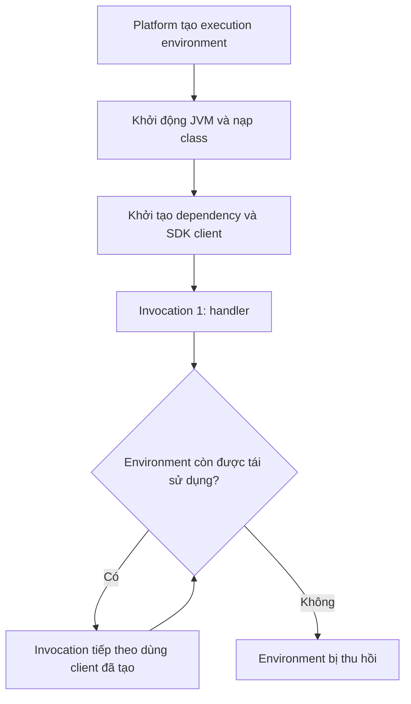

# Khởi tạo và tái sử dụng cloud SDK client an toàn

Ứng dụng Java serverless thường gọi object storage, database, queue, event bus, secrets manager hoặc API của một dịch vụ cloud khác. Mỗi lần gọi cần một SDK client để quản lý endpoint, xác thực, kết nối HTTP, retry và tuần tự hóa request. Cách khởi tạo client ảnh hưởng đến cold start, độ trễ, số kết nối, mức sử dụng bộ nhớ và độ tin cậy của function.

Một lỗi phổ biến là tạo SDK client mới trong mỗi lần invocation. Cách này lặp lại việc đọc cấu hình, tạo HTTP connection pool, khởi tạo TLS và các tài nguyên nền. Nếu function chạy thường xuyên, chi phí khởi tạo tích lũy đáng kể; nếu client không được đóng đúng cách, socket và thread có thể tồn tại lâu hơn dự kiến. Ở chiều ngược lại, dùng một client dùng chung không có nghĩa là có thể chia sẻ mọi trạng thái hoặc credential tùy ý giữa các request.

Nguyên tắc quan trọng là **tái sử dụng client cấp ứng dụng trong phạm vi một execution environment, đồng thời giữ dữ liệu nghiệp vụ và trạng thái của từng invocation tách biệt**. Cần hiểu client có an toàn khi nhiều thread dùng chung hay không, ai sở hữu vòng đời HTTP client, cách credential được làm mới và giới hạn kết nối cần thiết cho tải thực tế.

## 1. Vòng đời của một function serverless

Nền tảng FaaS thường tạo một execution environment để nạp runtime, khởi tạo ứng dụng và gọi handler. Sau invocation, môi trường có thể được giữ lại để xử lý request tiếp theo, nhưng nền tảng cũng có thể đóng nó bất cứ lúc nào. Một đợt tải tăng có thể tạo nhiều environment độc lập.



Client được khởi tạo ở phạm vi class hoặc application singleton có thể được dùng lại trong các invocation tiếp theo của cùng environment. Nhưng không có một client duy nhất cho toàn bộ ứng dụng đang chạy trên cloud: mỗi environment có JVM, bộ nhớ, client và connection pool riêng.

Ví dụ, khi nền tảng chạy 40 environment song song, một static client trong mỗi environment có thể tạo 40 bộ connection pool. Vì vậy, tái sử dụng client giúp giảm chi phí trong từng environment, nhưng không loại bỏ nhu cầu giới hạn concurrency và bảo vệ dịch vụ phía sau.

### Những gì có thể tái sử dụng

Thường phù hợp để tái sử dụng:

- SDK service client có tài liệu xác nhận thread-safe.
- HTTP client và connection pool được quản lý theo vòng đời của service client.
- Serializer, parser, validator và cấu hình bất biến.
- Các đối tượng dùng chung không chứa dữ liệu riêng của invocation.

Không nên lưu như trạng thái dùng chung:

- User ID, tenant ID, access token hoặc dữ liệu request hiện tại.
- Kết quả nghiệp vụ cần được cập nhật theo từng invocation.
- `InputStream`, response body hoặc transaction đang mở.
- Request builder hoặc đối tượng mutable được nhiều thread thay đổi.
- Thông tin xác thực tạm thời được sao chép thủ công vào biến static.

Một SDK client dùng chung là tài nguyên hạ tầng. Nó không phải nơi lưu session hoặc trạng thái nghiệp vụ.

## 2. Vì sao nên tạo client một lần?

Một cloud SDK client thường quản lý nhiều thành phần bên dưới: credential provider, endpoint và region, HTTP transport, connection pool, TLS, retry policy, serializer, metrics và thread nền nếu dùng client bất đồng bộ.

Nếu tạo client trong handler, các công việc khởi tạo có thể lặp lại ở mỗi invocation:

1. Đọc cấu hình và xác định region/endpoint.
2. Tìm hoặc lấy credential.
3. Khởi tạo HTTP transport và connection pool.
4. Thiết lập TLS, DNS và kết nối đến dịch vụ.
5. Tạo các đối tượng serializer và retry strategy.

Một số SDK trì hoãn mở kết nối mạng đến request đầu tiên, nhưng việc tạo client vẫn có thể cấp phát thread, pool hoặc tài nguyên quản lý kết nối. Tạo client mới liên tục cũng làm giảm hiệu quả keep-alive và tái sử dụng kết nối.

### So sánh cách khởi tạo

| Cách làm | Ưu điểm | Rủi ro hoặc chi phí |
|---|---|---|
| Tạo client trong mỗi handler invocation | Cấu hình có thể thay đổi theo lần gọi | Tốn thời gian khởi tạo, tạo nhiều pool/socket, khó quản lý đóng tài nguyên |
| Tạo client dùng chung ở cấp environment | Tái sử dụng kết nối và cấu hình, giảm công việc lặp | Phải xác nhận thread safety và giữ dữ liệu request bên ngoài client |
| Tạo client cho từng tenant/request | Có thể dùng identity hoặc endpoint riêng | Dễ tạo số client không giới hạn, tăng pool và nguy cơ rò rỉ credential |
| Tạo client singleton qua dependency injection | Quản lý cấu hình và vòng đời tập trung | Cần hiểu lifecycle của framework và thời điểm khởi tạo |

Với client có thể dùng chung an toàn, cách phổ biến là khởi tạo một lần ở cấp class hoặc application singleton. Nếu mỗi tenant cần cấu hình khác nhau, hãy thiết kế rõ ranh giới identity và giới hạn số client; không tạo một client mới theo request mà không có chính sách quản lý vòng đời.

## 3. Chọn đúng phạm vi khởi tạo trong Java

Có ba cách tổ chức thường gặp: static holder, instance singleton và dependency injection. Chọn cách phù hợp với runtime và framework đang dùng.

### Static holder

Static holder khởi tạo client khi class được sử dụng lần đầu. JVM bảo đảm khởi tạo class an toàn khi nhiều thread cùng truy cập lần đầu.

```java
import software.amazon.awssdk.auth.credentials.DefaultCredentialsProvider;
import software.amazon.awssdk.regions.Region;
import software.amazon.awssdk.services.s3.S3Client;

public final class CloudClients {
    private CloudClients() {}

    private static final class S3Holder {
        private static final S3Client INSTANCE = createS3Client();
    }

    public static S3Client s3() {
        return S3Holder.INSTANCE;
    }

    private static S3Client createS3Client() {
        String region = System.getenv("AWS_REGION");
        if (region == null || region.isBlank()) {
            throw new IllegalStateException("AWS_REGION is required");
        }

        return S3Client.builder()
                .region(Region.of(region))
                .credentialsProvider(DefaultCredentialsProvider.create())
                .build();
    }
}
```

Ví dụ dùng AWS SDK for Java 2.x. `S3Client` là service client đồng bộ và được thiết kế để dùng chung giữa nhiều thread. Mỗi environment có một instance riêng. Client được tạo khi `CloudClients.s3()` được gọi lần đầu, sau đó được tái sử dụng.

Nếu biến môi trường hoặc cấu hình bắt buộc bị thiếu, việc khởi tạo sẽ thất bại. Đây là lỗi cấu hình cần được phát hiện sớm. Trong một function chỉ dùng S3 ở một số nhánh, lazy holder tránh khởi tạo client khi nhánh đó chưa bao giờ được gọi; đổi lại, invocation đầu tiên đi vào nhánh S3 sẽ chịu chi phí khởi tạo.

### Khởi tạo ở cấp instance

Nếu runtime tạo một handler instance rồi tái sử dụng nó, có thể khởi tạo client trong constructor:

```java
public final class ReportFunction {
    private final S3Client s3;

    public ReportFunction() {
        this.s3 = S3Client.builder()
                .region(Region.of(System.getenv("AWS_REGION")))
                .build();
    }

    public void handle(ReportRequest request) {
        // Dùng this.s3 cho invocation hiện tại.
    }
}
```

Phạm vi này phù hợp nếu nền tảng quản lý instance theo vòng đời environment. Tuy nhiên, cần đọc contract của runtime: không phải mọi framework đều giữ cùng một handler instance và không phải mọi trigger đều có mô hình concurrency giống nhau.

### Dependency injection singleton

Trong framework có dependency injection, đăng ký client như singleton giúp framework quản lý một instance trong application context.

```java
@Configuration
public class CloudClientConfiguration {

    @Bean(destroyMethod = "close")
    public S3Client s3Client() {
        return S3Client.builder()
                .region(Region.of(System.getenv("AWS_REGION")))
                .build();
    }
}
```

Đây là ví dụ theo Spring. Bean mặc định có scope singleton trong application context. `destroyMethod = "close"` cho phép framework đóng client khi context được đóng trong môi trường hỗ trợ lifecycle shutdown. Trong FaaS, không nên giả định nền tảng luôn gọi shutdown hook hoặc đóng context một cách có trật tự khi thu hồi environment; việc tái sử dụng client trong thời gian environment còn sống vẫn là mục tiêu chính.

Framework như Micronaut hoặc Quarkus có cơ chế scope và lifecycle riêng. Hãy dùng scope application/singleton tương ứng, đồng thời xác minh thời điểm framework khởi tạo context vì khởi tạo toàn bộ ứng dụng có thể làm cold start dài hơn.

## 4. Thread safety và chia sẻ client đúng cách

Một client dùng chung chỉ an toàn khi SDK xác nhận nó thread-safe. AWS SDK for Java 2.x service clients được thiết kế để chia sẻ giữa thread. Nhiều client trong Google Cloud Java libraries và Azure SDK cũng được thiết kế immutable/thread-safe, nhưng phải kiểm tra tài liệu của đúng client và phiên bản thư viện.

Không suy rộng rằng mọi đối tượng trong SDK đều thread-safe. Builder thường chỉ dùng trong giai đoạn tạo client. Request builder, mutable collection, callback state hoặc parser riêng có thể cần tạo mới theo invocation.

Ví dụ:

```java
import software.amazon.awssdk.core.sync.ResponseTransformer;
import software.amazon.awssdk.services.s3.S3Client;
import software.amazon.awssdk.services.s3.model.GetObjectRequest;

public final class ObjectReader {
    private final S3Client s3;

    public ObjectReader(S3Client s3) {
        this.s3 = s3;
    }

    public byte[] readSmallObject(String bucket, String key) {
        GetObjectRequest request = GetObjectRequest.builder()
                .bucket(bucket)
                .key(key)
                .build();

        return s3.getObject(request, ResponseTransformer.toBytes()).asByteArray();
    }
}
```

Client được chia sẻ, còn request được tạo riêng cho mỗi lần gọi. Ví dụ đọc toàn bộ nội dung chỉ phù hợp với object nhỏ có giới hạn kích thước; với object lớn nên dùng streaming và đóng response stream đúng cách.

### Không chia sẻ mutable request context

Không lưu `currentTenant`, `currentUser`, `currentRequest` hoặc access token vào field của singleton. Nếu hai invocation chạy đồng thời, dữ liệu của invocation này có thể ghi đè dữ liệu của invocation khác. Truyền context qua tham số phương thức hoặc một context riêng cho mỗi request.

Tránh thay đổi endpoint, region hoặc credential provider của một client dùng chung theo từng invocation. Các thiết lập này thường được cố định khi client được xây dựng. Nếu cần phân vùng theo tenant, hãy truyền thông tin định danh nghiệp vụ vào request và để service kiểm tra quyền; chỉ tạo client riêng khi có yêu cầu identity/endpoint thực sự khác và có giới hạn cache rõ ràng.

## 5. Credential provider và làm mới thông tin xác thực

SDK client thường giữ một credential provider thay vì giữ cố định access key/secret key của một người dùng. Provider chịu trách nhiệm lấy credential khi cần và, với loại credential tạm thời, làm mới chúng trước khi hết hạn.

Trong môi trường serverless, nên dùng execution role hoặc managed identity của nền tảng. Ví dụ với AWS, `DefaultCredentialsProvider` tìm credential theo chuỗi mặc định, trong đó có cơ chế credential từ môi trường runtime và role. Khi dùng role, SDK provider có thể lấy credential tạm thời và xử lý refresh theo cơ chế của SDK.

Các nguyên tắc:

- Không hard-code access key hoặc secret trong source code.
- Không lưu credential tạm thời vào biến static để dùng mãi.
- Không tự gọi STS hoặc identity endpoint ở mỗi invocation nếu SDK provider đã quản lý việc lấy và refresh.
- Không ghi credential, token hoặc nội dung header Authorization vào log.
- Cấp quyền tối thiểu cho execution role/service identity của function.
- Nếu cần assume role theo tenant, thiết kế provider và cache có giới hạn theo identity, thời gian hết hạn và chính sách thu hồi.

### Credential cache khác với client cache

Client có thể tồn tại lâu hơn một credential tạm thời. Vì vậy, client dùng chung cần giữ provider có khả năng trả về credential hợp lệ mới nhất, không phải một object credential được lấy một lần rồi giữ cố định. Khi cấu hình custom provider, hãy xác minh cơ chế refresh và đồng bộ thread của nó.

Nếu credential hết hạn mà provider không refresh, lỗi xác thực có thể xuất hiện sau một thời gian chạy dù cold start ban đầu thành công. Đây là lý do nên dùng provider chính thức của SDK hoặc managed identity thay vì tự viết logic cache credential nếu không có yêu cầu đặc biệt.

## 6. Quản lý HTTP connection pool và tài nguyên nền

Service client thường sở hữu hoặc dùng một HTTP client để kết nối tới cloud API. HTTP transport có thể quản lý keep-alive, pool kết nối, TLS, proxy, timeout và thread I/O. Tạo service client mới liên tục có thể tạo nhiều pool nhỏ, giảm khả năng tái sử dụng TCP/TLS và làm tăng số socket.

Khi thiết kế cần xem xét:

- **Connection pool size:** đủ cho số request đồng thời trong một environment, nhưng không quá lớn.
- **Connection acquisition timeout:** giới hạn thời gian chờ lấy kết nối từ pool.
- **Connect/read/write timeout:** giới hạn thời gian kết nối và trao đổi dữ liệu.
- **Keep-alive và idle connection:** tận dụng kết nối tái sử dụng, nhưng cần phù hợp với proxy/NAT và chính sách idle timeout.
- **TLS và DNS:** kết nối lâu sống có thể bị đóng ở tầng mạng; SDK cần có khả năng phát hiện và mở lại kết nối.
- **Tài nguyên thread:** async client có thể tạo event loop hoặc executor; tránh tạo các pool mới cho mỗi invocation.

### Không đóng client sau mỗi request

Client dùng chung cần sống qua nhiều invocation trong cùng environment. Không gọi `close()` sau mỗi lần handler hoàn tất, vì invocation kế tiếp có thể nhận lại client đã bị đóng.

Với một ứng dụng Java server chạy liên tục, đóng client khi application context shutdown là hợp lý. Với FaaS, process có thể bị thu hồi mà không có callback shutdown đáng tin cậy; hãy để nền tảng kết thúc process và hệ điều hành thu hồi tài nguyên. Nếu runtime/framework có lifecycle hook được hỗ trợ, có thể đóng client tại đó, nhưng không dùng hook như điều kiện để bảo đảm tính đúng đắn nghiệp vụ.

### Khi dùng HTTP client chia sẻ riêng

Một số SDK cho phép cung cấp HTTP client riêng hoặc dùng chung giữa nhiều service client. Cách này có thể giảm số pool, nhưng phải hiểu quyền sở hữu tài nguyên: service client có thể đóng HTTP client do nó tự tạo, trong khi HTTP client được truyền từ bên ngoài có thể do ứng dụng chịu trách nhiệm đóng. Quy tắc cụ thể phụ thuộc SDK. Không đóng một transport đang được service client khác sử dụng.

Nếu không có yêu cầu đặc biệt, dùng HTTP client mặc định do service client quản lý thường ít rủi ro vòng đời hơn. Chỉ tùy chỉnh khi cần kiểm soát proxy, pool, TLS hoặc hiệu năng và có thể đo/kiểm thử cấu hình đó.

## 7. Cấu hình timeout và retry theo ngân sách invocation

SDK có thể retry request khi gặp lỗi tạm thời như throttling hoặc lỗi mạng. Nền tảng FaaS hoặc queue cũng có thể retry toàn bộ invocation. Nếu mỗi tầng tự retry nhiều lần, tổng số lần gọi dịch vụ ngoài có thể tăng theo cấp số nhân.

Hãy phân bổ ngân sách thời gian:

1. Xác định timeout tổng của function.
2. Dành thời gian cho parse event, kiểm tra quyền, xử lý dữ liệu và ghi trạng thái.
3. Đặt timeout của SDK nhỏ hơn thời gian còn lại của invocation.
4. Đặt timeout cho một attempt và tổng thời gian gọi API.
5. Chọn retry mode/số lần retry có giới hạn; không retry lỗi dữ liệu hoặc lỗi quyền cố định.
6. Đảm bảo queue visibility timeout hoặc ack deadline đủ dài so với thời gian xử lý và retry dự kiến.

Ví dụ cấu hình AWS SDK for Java 2.x:

```java
import java.time.Duration;
import software.amazon.awssdk.core.client.config.ClientOverrideConfiguration;
import software.amazon.awssdk.services.s3.S3Client;

S3Client s3 = S3Client.builder()
        .region(Region.of(System.getenv("AWS_REGION")))
        .overrideConfiguration(ClientOverrideConfiguration.builder()
                .apiCallAttemptTimeout(Duration.ofSeconds(5))
                .apiCallTimeout(Duration.ofSeconds(15))
                .build())
        .build();
```

Các con số chỉ minh họa. Timeout phải được chọn từ SLO, kích thước payload, độ trễ dịch vụ và timeout của function. `apiCallAttemptTimeout` giới hạn một lần thử; `apiCallTimeout` giới hạn toàn bộ lời gọi gồm các lần retry. Cần tránh để SDK tiếp tục chạy sau khi function gần hết thời gian.

### Retry và idempotency

Retry ở SDK chỉ xử lý giao tiếp với dịch vụ. Nó không tự làm side effect của nghiệp vụ trở nên an toàn. Ví dụ, nếu request tạo một tài nguyên thành công nhưng response bị mất, retry có thể tạo tài nguyên thứ hai nếu API không hỗ trợ idempotency token.

Với thao tác ghi, hãy dùng idempotency key hoặc conditional request nếu dịch vụ hỗ trợ. Với queue/event, lưu event ID hoặc business key trong kho trạng thái bền vững. Phân biệt lỗi tạm thời, lỗi throttling, lỗi xác thực và lỗi dữ liệu để chỉ retry khi có khả năng phục hồi.

## 8. Client đồng bộ và bất đồng bộ

SDK đồng bộ thường dễ sử dụng: lời gọi chỉ trả về khi kết quả có sẵn. SDK bất đồng bộ có thể dùng event loop và connection pool riêng, giúp tận dụng I/O không chặn khi một invocation cần gọi nhiều dịch vụ hoặc xử lý nhiều tác vụ đồng thời.

| Tiêu chí | Client đồng bộ | Client bất đồng bộ |
|---|---|---|
| Mô hình code | Gọi và chờ kết quả | Future/CompletionStage hoặc reactive API |
| Tài nguyên | Thread gọi có thể bị chặn | Có thể dùng thread I/O và event loop |
| Độ phức tạp | Thường đơn giản hơn | Cần quản lý callback, cancellation và exception |
| Phù hợp | Một vài lời gọi ngắn, flow tuyến tính | I/O đồng thời hoặc throughput cao nếu runtime hỗ trợ |
| Rủi ro | Giữ thread trong lúc chờ | Block event loop hoặc bỏ quên task khi invocation kết thúc |

Client async cũng nên được tái sử dụng ở cấp environment. Không tạo một event loop hoặc executor mới cho mỗi invocation. Không block event loop bằng thao tác đọc file hoặc xử lý CPU nặng. Nếu function sắp hết thời gian, phải xử lý cancellation và không để task nền tiếp tục ghi dữ liệu sau khi invocation đã trả kết quả.

Đừng chọn async chỉ vì nó có vẻ nhanh hơn. Với function ngắn và ít lời gọi, chi phí quản lý future và callback có thể không đem lại lợi ích. Hãy đo latency, throughput, CPU, memory và số thread trong runtime thật.

## 9. Cold start và thời điểm khởi tạo client

Khởi tạo client trước handler làm tăng phần công việc trong cold start, nhưng giảm chi phí ở các invocation sau. Lazy initialization có thể giảm thời gian khởi động cho các nhánh không sử dụng client, nhưng invocation đầu tiên gọi nhánh đó sẽ chịu thời gian tạo client.

Các yếu tố ảnh hưởng:

- Số SDK và module được nạp.
- Kích thước dependency và framework.
- Công việc static initialization.
- Tạo HTTP transport, credential provider và serializer.
- Kết nối mạng đầu tiên tới dịch vụ.
- Cấu hình bộ nhớ/CPU của function.

Để tối ưu:

- Chỉ thêm SDK module mà function thực sự sử dụng.
- Không tạo nhiều client trùng cấu hình cho cùng một dịch vụ.
- Khởi tạo lazy cho dependency chỉ dùng ở một nhánh hiếm nếu điều đó giúp cold start đáng kể.
- Đo cold start và warm invocation riêng biệt.
- Chỉ dùng provisioned concurrency, keep-warm hoặc biện pháp giữ sẵn khác khi yêu cầu latency và chi phí chứng minh cần thiết.

Môi trường warm không được bảo đảm tồn tại. Không dùng một lịch ping function như cách duy nhất để giữ kết nối hoặc bảo đảm dữ liệu trong bộ nhớ. Client phải có thể tự khôi phục kết nối khi environment được tái sử dụng sau một khoảng idle.

## 10. Giới hạn connection và concurrency toàn hệ thống

Một client singleton tồn tại trong một environment. Khi tải tăng, nền tảng tạo nhiều environment và mỗi environment có pool riêng. Nếu mỗi pool cho phép 20 kết nối và hệ thống tạo 100 environment, dịch vụ phía sau có thể nhận tới hàng nghìn kết nối tiềm năng.

Hãy tính gần đúng:

\[
\text{Tổng kết nối tiềm năng} \approx
\text{Số environment} \times \text{Pool size mỗi environment}
\]

Đây là giới hạn trên mang tính ước lượng; số kết nối thực tế phụ thuộc tải, HTTP transport và cách SDK mở kết nối. Tuy vậy, công thức giúp phát hiện nguy cơ trước khi triển khai.

Các biện pháp kiểm soát:

- Đặt reserved concurrency hoặc concurrency cap cho function.
- Chọn pool size phù hợp với số lời gọi đồng thời trong một environment.
- Dùng queue để điều tiết tốc độ tiêu thụ khi downstream có giới hạn.
- Dùng proxy hoặc connection pooling service nếu dịch vụ dữ liệu và nền tảng hỗ trợ.
- Theo dõi số kết nối, throttling, timeout và tỷ lệ lỗi downstream.
- Tránh tạo nhiều SDK client cùng kết nối đến một endpoint chỉ vì nhiều lớp trong code tự khởi tạo client.

Nếu function chạy trên nền tảng có thể xử lý nhiều invocation đồng thời trong cùng process, cần xem xét thêm concurrency nội bộ. Client phải thread-safe, còn pool phải đủ cho mức song song thực tế. Không dựa vào mô hình concurrency của một nhà cung cấp để suy ra hành vi của nền tảng khác.

## 11. Không biến client singleton thành cache vô hạn

Client thường được cấu hình cho một region, endpoint, identity và tập retry. Nếu mỗi tenant có credential hoặc endpoint riêng, một cách làm dễ mắc lỗi là tạo `Map<tenantId, Client>` tĩnh rồi thêm client mỗi khi có tenant mới. Trong môi trường lâu sống, map có thể tăng không giới hạn; mỗi client có thể giữ pool, thread hoặc credential provider riêng.

Trước khi dùng client theo tenant, hãy hỏi:

- Tenant thực sự cần identity riêng ở tầng SDK hay chỉ cần quyền nghiệp vụ được kiểm tra ở API?
- Có thể dùng một execution role với resource policy theo tenant không?
- Credential provider có thể chọn identity an toàn theo request mà không làm rò dữ liệu không?
- Nếu buộc phải có nhiều client, giới hạn số lượng, TTL, eviction và đóng tài nguyên thế nào?
- Có nguy cơ request của tenant này dùng nhầm client/credential của tenant khác không?

Không thay credential provider hoặc endpoint của client dùng chung theo request. Nếu cần nhiều cấu hình, dùng factory/cache có giới hạn và khóa theo identity đã xác thực, không theo chuỗi tenant do client tùy ý gửi. Mỗi client cần có lifecycle và chính sách đóng rõ ràng.

## 12. Kiểm thử và quan sát việc tái sử dụng client

Tái sử dụng client là quyết định về hiệu năng và độ tin cậy, nên cần kiểm chứng trong môi trường gần production. Không chỉ kiểm tra function trả về kết quả đúng ở một invocation.

### Các tình huống kiểm thử

- Gọi handler nhiều lần trong cùng environment và xác nhận client không bị tạo lại cho mỗi invocation.
- Chạy nhiều request/thread đồng thời để xác nhận client và code gọi nó an toàn khi dùng chung.
- Giả lập credential hết hạn hoặc refresh để xác nhận provider hoạt động.
- Ngắt kết nối hoặc tạo lỗi throttling để kiểm tra timeout, retry và phục hồi connection.
- Để environment idle rồi gọi lại để kiểm tra stale connection được phát hiện và mở lại.
- Tạo tải đồng thời nhiều environment để kiểm tra tổng connection và giới hạn downstream.
- Kiểm tra không có request data, tenant context hoặc token bị lưu trong singleton.
- Kiểm tra client/HTTP transport được đóng đúng ở môi trường ứng dụng liên tục và không bị đóng sau mỗi invocation FaaS.

### Metric hữu ích

| Metric | Ý nghĩa |
|---|---|
| Cold start duration | Chi phí khởi tạo runtime và dependency |
| Initialization duration của client | Phần thời gian dành cho tạo SDK client |
| API call latency p50/p95/p99 | Độ trễ thực tế của lời gọi cloud API |
| Connection pool pending/acquired/idle | Tình trạng chờ và sử dụng connection |
| Retry count và throttling | Dấu hiệu downstream hoặc cấu hình retry có vấn đề |
| Timeout và connection reset | Vấn đề mạng, pool hoặc thời gian gọi |
| Concurrent environment count | Quy mô pool được nhân lên theo fleet |
| Memory và thread count | Tài nguyên giữ bởi client và transport |

Log nên ghi tên dịch vụ, operation, latency, retry count và correlation ID. Không ghi credential hoặc payload nhạy cảm. Tránh tạo metric dimension có cardinality rất cao như object key, request ID hoặc tenant ID cho mọi phép đo tổng hợp.

## 13. Các lỗi thường gặp

| Lỗi | Hệ quả | Cách khắc phục |
|---|---|---|
| Tạo SDK client trong mỗi invocation | Tốn thời gian và tạo nhiều pool | Tái sử dụng client thread-safe ở cấp environment |
| Đóng client ở cuối handler | Invocation sau dùng client đã đóng | Chỉ đóng theo lifecycle ứng dụng được hỗ trợ |
| Chia sẻ mutable request context trong singleton | Dữ liệu giữa invocation có thể lẫn nhau | Giữ context ở biến cục bộ hoặc tham số |
| Cache access key tạm thời trong static field | Credential hết hạn và lỗi xác thực | Dùng credential provider có refresh |
| Tạo client cho mọi tenant không giới hạn | Tăng socket, thread, memory và nguy cơ rò quyền | Dùng identity phù hợp hoặc cache có giới hạn và TTL |
| Pool size quá lớn | Tổng kết nối vượt khả năng downstream | Tính theo số environment và concurrency |
| Timeout SDK dài hơn timeout function | Function hết hạn khi lời gọi vẫn chưa kết thúc | Phân bổ timeout theo ngân sách invocation |
| Retry chồng nhiều tầng | Tăng số request và tải lên dịch vụ lỗi | Thiết kế retry budget và idempotency end-to-end |
| Dùng async client nhưng block event loop | Mất lợi ích I/O không chặn và giảm throughput | Giữ event loop không bị block, quản lý cancellation |
| Dùng static field lưu trạng thái nghiệp vụ | Dữ liệu mất khi environment bị thu hồi hoặc lẫn giữa request | Lưu trạng thái bền vững trong storage/database |

## 14. Quy trình lựa chọn và triển khai

Khi tích hợp một cloud SDK vào Java function, có thể thực hiện theo trình tự:

1. **Xác định dịch vụ và quyền cần thiết.** Chọn SDK module tối thiểu và execution identity có quyền ít nhất.
2. **Kiểm tra thread safety.** Xác nhận service client có thể được dùng chung theo tài liệu của SDK và phiên bản đang dùng.
3. **Chọn lifecycle.** Dùng static holder, instance singleton hoặc dependency injection singleton phù hợp với runtime.
4. **Cấu hình region/endpoint và credential provider.** Không hard-code secret; dùng managed identity hoặc provider có refresh.
5. **Cấu hình HTTP transport.** Chọn pool, timeout và proxy theo concurrency và downstream quota.
6. **Thiết kế retry.** Phối hợp SDK retry với retry của function/queue; thêm idempotency cho thao tác ghi.
7. **Quản lý tài nguyên.** Không đóng client mỗi invocation; hiểu ai sở hữu HTTP transport và lifecycle shutdown.
8. **Đo và kiểm thử.** So sánh cold/warm latency, pool utilization, connection count, retry và lỗi khi tải tăng.

Trước khi phát hành, hãy trả lời được: client được tạo ở đâu, mỗi environment có bao nhiêu client, client có thread-safe không, credential có được refresh không, pool có thể tạo bao nhiêu kết nối khi scale out, timeout có nằm trong ngân sách invocation không và điều gì xảy ra nếu environment được giữ idle lâu rồi mới nhận request tiếp theo.

## Kết luận

Tái sử dụng cloud SDK client giúp Java serverless giảm chi phí khởi tạo và tận dụng connection pool trong mỗi execution environment. Hãy khởi tạo client thread-safe ở cấp environment hoặc application singleton, giữ request context ở phạm vi invocation, dùng credential provider có khả năng refresh và cấu hình timeout/retry theo ngân sách function. Tính cả việc mỗi environment có một pool riêng khi ước lượng tổng kết nối. Với client bất đồng bộ hoặc HTTP transport dùng chung, cần quản lý thread và quyền sở hữu tài nguyên đúng theo SDK. Đo cold start, latency, connection và lỗi trong tải thực tế để quyết định cấu hình phù hợp.
