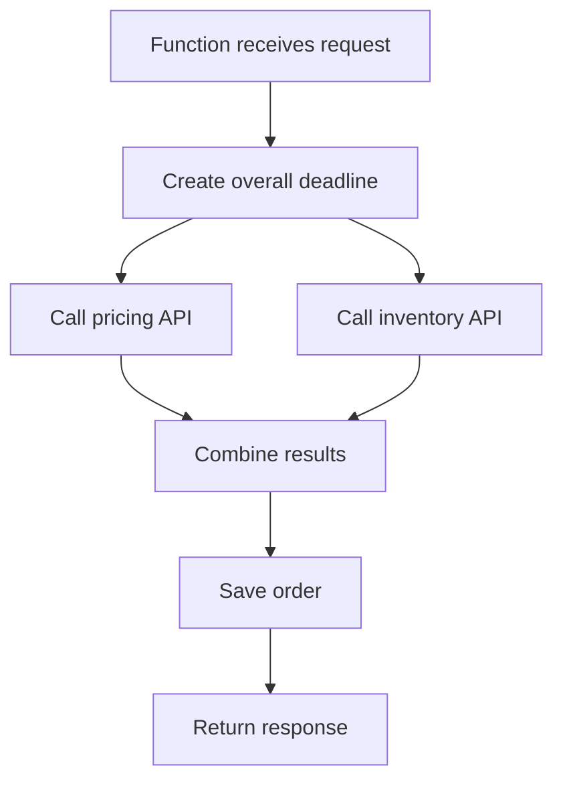

# Cấu hình HTTP client, connection timeout và request timeout

Java function trong môi trường serverless thường gọi các dịch vụ bên ngoài: REST API, dịch vụ thanh toán, database proxy, identity provider hoặc một microservice khác. Một lời gọi HTTP có thể chậm do DNS, thiết lập TCP/TLS, chờ kết nối trong pool, xử lý ở server đích hoặc truyền response. Nếu function chờ quá lâu, invocation có thể hết thời gian, giữ tài nguyên và làm các request tiếp theo bị dồn lại.

Vì vậy, HTTP client cần có timeout rõ ràng ở từng giai đoạn. Hai cấu hình cơ bản là **connection timeout** (thời gian tối đa để thiết lập kết nối) và **request timeout** (thời gian tối đa chờ một request hoàn tất theo contract của client). Trong hệ thống serverless, các timeout này phải nằm trong ngân sách thời gian còn lại của invocation và phối hợp với retry, connection pool và giới hạn concurrency.

Bài học dùng Java 11+ HttpClient làm ví dụ chính, đồng thời giải thích cách áp dụng cho client có connection pool và các lưu ý khi chạy trong Java function.

## 1. Vì sao HTTP timeout quan trọng trong serverless?

Giả sử một HTTP function nhận request tạo đơn hàng. Function cần gọi dịch vụ định giá và dịch vụ kho hàng trước khi trả response. Nếu một dịch vụ phụ thuộc ngừng phản hồi, function có thể chờ đến khi runtime hoặc gateway kết thúc invocation.

Việc không cấu hình timeout rõ ràng có thể dẫn đến:

- Invocation giữ CPU, bộ nhớ và kết nối trong thời gian dài.
- Số invocation đồng thời tăng trong khi các request cũ vẫn đang chờ.
- Connection pool bị chiếm hết, khiến request mới không lấy được kết nối.
- Gateway hoặc client bên ngoài timeout trước khi function kết thúc.
- Retry ở nhiều tầng làm số request gửi đến dịch vụ phụ thuộc tăng đột biến.
- Chi phí compute tăng dù function không hoàn thành công việc hữu ích.

Timeout giúp giới hạn thời gian chờ và giải phóng tài nguyên khi dịch vụ phụ thuộc gặp sự cố. Tuy nhiên, timeout không làm request ở server đích tự động dừng. Client có thể ngừng chờ trong khi server đã nhận và vẫn tiếp tục xử lý request. Đây là lý do cần kết hợp timeout với idempotency và kiểm tra trạng thái khi thao tác có tác dụng phụ.

## 2. Phân biệt các loại timeout

Một HTTP request có thể đi qua nhiều giai đoạn. Mỗi giai đoạn có một loại timeout hoặc giới hạn riêng.

| Loại timeout | Ý nghĩa | Tình huống thường gặp |
|---|---|---|
| DNS lookup timeout | Giới hạn thời gian phân giải tên miền thành địa chỉ IP | DNS chậm hoặc không phản hồi |
| Connection timeout | Giới hạn thời gian thiết lập kết nối TCP đến server | Server không reachable hoặc bắt tay kết nối bị treo |
| TLS handshake timeout | Giới hạn thời gian hoàn tất bắt tay TLS | Kết nối TLS chậm hoặc có vấn đề chứng chỉ |
| Connection request/pool timeout | Giới hạn thời gian chờ lấy một connection từ pool | Pool đã hết connection khả dụng |
| Request/response timeout | Giới hạn thời gian chờ request có response theo contract của HTTP client | Server xử lý lâu hoặc không trả response |
| Read/socket timeout | Giới hạn thời gian chờ dữ liệu đọc tiếp theo trên socket | Server gửi response từng phần rồi ngừng |
| Overall deadline | Giới hạn tổng thời gian cho toàn bộ thao tác, có thể gồm nhiều lần thử | Cần hoàn tất trước khi function hết thời gian |

Không phải HTTP client nào cũng cung cấp tất cả các timeout này dưới dạng cấu hình riêng. Ví dụ, JDK HttpClient cung cấp connect timeout ở cấp client và request timeout ở cấp request; Apache HttpClient có thêm các cấu hình cho việc lấy connection từ pool và response/socket.

Cần đọc đúng contract của thư viện đang dùng. Không nên đặt một giá trị timeout rồi giả định nó kiểm soát mọi giai đoạn mạng.

### Connection timeout

Connection timeout là giới hạn thời gian để client thiết lập kết nối mới đến server. Nếu không kết nối được trong khoảng thời gian đó, client phát sinh lỗi timeout kết nối.

Connection timeout không phải giới hạn tổng thời gian của request. Khi client đã có connection trong pool và tái sử dụng nó, giai đoạn thiết lập kết nối mới có thể không xảy ra. Vì vậy, connect timeout không thay thế request timeout.

### Request timeout

Request timeout giới hạn thời gian chờ một request hoàn tất theo cách thư viện định nghĩa. Nó giúp tránh việc client chờ vô hạn khi server không phản hồi.

Cần chú ý cách đọc response body. Với một body handler đọc toàn bộ response như BodyHandlers.ofString(), lời gọi send thường chỉ trả về sau khi body được nhận và chuyển thành String. Với BodyHandlers.ofInputStream(), send có thể trả về sau khi nhận headers và cung cấp stream; việc đọc stream tiếp tục diễn ra sau đó, nên ứng dụng phải có giới hạn thời gian đọc riêng và đóng stream đúng cách.

### Pool acquisition timeout

Nếu dùng connection pool, request có thể phải chờ một connection khả dụng trước khi bắt đầu gửi. Đây là giai đoạn khác với việc thiết lập TCP connection. Nếu pool đã đạt giới hạn, client có thể chờ hoặc thất bại vì hết thời gian lấy connection.

JDK HttpClient không cung cấp một tham số pool-acquisition timeout công khai như một số thư viện khác. Apache HttpClient 5 có cấu hình connection request timeout để giới hạn thời gian chờ lấy connection từ manager.

## 3. Cấu hình timeout bằng Java HttpClient

JDK HttpClient có sẵn từ Java 11. Có thể cấu hình connect timeout khi tạo client và request timeout trên từng HttpRequest.

Ví dụ:

```java
import java.net.URI;
import java.net.http.HttpClient;
import java.net.http.HttpRequest;
import java.net.http.HttpResponse;
import java.time.Duration;

public final class CatalogApiClient {

    private static final HttpClient HTTP = HttpClient.newBuilder()
            .connectTimeout(Duration.ofSeconds(2))
            .version(HttpClient.Version.HTTP_2)
            .build();

    public String getProduct(String productId)
            throws Exception {

        URI uri = URI.create(
                "https://catalog.example.com/products/" + productId);

        HttpRequest request = HttpRequest.newBuilder(uri)
                .timeout(Duration.ofSeconds(4))
                .header("Accept", "application/json")
                .GET()
                .build();

        HttpResponse<String> response = HTTP.send(
                request,
                HttpResponse.BodyHandlers.ofString());

        if (response.statusCode() < 200
                || response.statusCode() >= 300) {
            throw new IllegalStateException(
                    "Catalog API returned HTTP " + response.statusCode());
        }

        return response.body();
    }
}
```

Trong ví dụ:

- connect timeout là 2 giây và được cấu hình khi tạo HttpClient.
- request timeout là 4 giây và được cấu hình trên từng HttpRequest.
- HttpClient được tạo một lần và dùng lại cho các request.
- BodyHandlers.ofString() đọc response body thành String trước khi trả kết quả.
- HTTP status 4xx hoặc 5xx là response hợp lệ ở tầng HTTP; send không tự ném exception chỉ vì status không thuộc 2xx. Ứng dụng phải kiểm tra status code.

Request timeout mặc định không được đặt nếu ứng dụng không gọi builder.timeout(...). Vì vậy, hãy cấu hình rõ ràng cho các request cần có giới hạn thời gian.

### Xử lý lỗi timeout

JDK HttpClient có thể phát sinh HttpConnectTimeoutException khi không thiết lập được kết nối trong thời gian cho phép và HttpTimeoutException khi request vượt quá timeout. Các lỗi I/O khác như ConnectException cũng cần được xem xét theo chính sách của ứng dụng.

Ví dụ xử lý tối thiểu:

```java
import java.io.IOException;
import java.net.http.HttpConnectTimeoutException;
import java.net.http.HttpTimeoutException;

try {
    return client.getProduct("SKU-100");
} catch (HttpConnectTimeoutException ex) {
    // Không thiết lập được kết nối trong thời gian cho phép.
    throw new DependencyUnavailableException("Connect timeout", ex);
} catch (HttpTimeoutException ex) {
    // Request không hoàn tất trong thời gian đã cấu hình.
    throw new DependencyUnavailableException("Request timeout", ex);
} catch (IOException ex) {
    // Lỗi I/O khác: cần phân loại trước khi quyết định retry.
    throw new DependencyUnavailableException("HTTP I/O failure", ex);
} catch (InterruptedException ex) {
    Thread.currentThread().interrupt();
    throw new RequestCancelledException("HTTP call interrupted", ex);
}
```

Đây là đoạn minh họa cách phân loại exception; các lớp DependencyUnavailableException và RequestCancelledException là exception của ứng dụng. Không nên retry InterruptedException một cách tự động. Việc thread bị interrupt thường biểu thị yêu cầu hủy hoặc ứng dụng cần dừng xử lý; hãy khôi phục interrupt flag và kết thúc công việc.

## 4. Tái sử dụng HTTP client trong môi trường serverless

Trong Java function, việc tạo HTTP client mới cho từng invocation có thể làm mất lợi ích của connection pooling và tăng chi phí khởi tạo. JDK HttpClient là immutable và được thiết kế để có thể dùng đồng thời từ nhiều thread. Vì vậy, có thể khởi tạo client ở phạm vi static hoặc trong một object được tạo khi môi trường thực thi khởi động, rồi tái sử dụng qua nhiều invocation trên cùng execution environment.

Ví dụ:

```java
public final class FunctionClients {

    private FunctionClients() {}

    public static final HttpClient CATALOG_HTTP =
            HttpClient.newBuilder()
                    .connectTimeout(Duration.ofSeconds(2))
                    .build();
}
```

Handler có thể sử dụng FunctionClients.CATALOG_HTTP cho các invocation trên cùng môi trường. Khi nền tảng tái sử dụng execution environment, client có thể tái sử dụng connection đã mở và tránh một phần chi phí thiết lập kết nối mới.

Tuy nhiên, cần hiểu các giới hạn:

- Nền tảng có thể dừng execution environment bất kỳ lúc nào; không có bảo đảm client hoặc connection sẽ tồn tại giữa hai invocation.
- Mỗi execution environment có client và pool riêng. Chúng không phải một pool toàn cục cho tất cả instance của function.
- Khi concurrency tăng, nền tảng tạo thêm execution environment; tổng số connection đến dịch vụ phụ thuộc có thể tăng theo.
- Server, load balancer, NAT hoặc proxy có thể đóng connection idle. Client cần xử lý lỗi connection cũ và chỉ retry khi thao tác an toàn.
- Không lưu trạng thái nghiệp vụ trong biến static chỉ vì client được tái sử dụng.

Với JDK HttpClient, connection pooling được quản lý nội bộ và không có API phổ biến để cấu hình chi tiết số connection tối đa hoặc thời gian idle. Nếu cần kiểm soát pool chặt, có thể dùng Apache HttpClient 5 hoặc một thư viện có các tùy chọn phù hợp.

### Một client hay nhiều client?

Nếu các request có cùng chính sách TLS, proxy, authentication và connect timeout, có thể dùng chung một client. Nếu các dependency có yêu cầu kết nối khác nhau, có thể tạo client riêng cho từng nhóm, ví dụ một client cho dịch vụ nội bộ và một client cho API đối tác có timeout khác.

Không nên tạo client mới cho từng request chỉ để thay đổi request timeout. Với JDK HttpClient, request timeout có thể đặt riêng trên từng HttpRequest, còn connect timeout thuộc cấu hình client.

## 5. Đặt timeout theo ngân sách invocation

Serverless function thường có giới hạn thời gian chạy tối đa. Một HTTP call cần kết thúc đủ sớm để handler còn thời gian kiểm tra kết quả, ghi log, cập nhật trạng thái và trả response.

Giả sử function có ngân sách 10 giây. Nếu function dành 8 giây cho một HTTP request, phần còn lại có thể không đủ cho xử lý nghiệp vụ và trả response. Nếu có hai dependency tuần tự, mỗi dependency có request timeout 8 giây, tổng thời gian có thể vượt giới hạn function.

Hãy thiết kế theo **overall deadline**:

```text
invocation deadline
    = thời điểm bắt đầu + ngân sách invocation

remaining budget
    = invocation deadline - thời điểm hiện tại

HTTP attempt timeout
    <= remaining budget - thời gian dự phòng
```

Thời gian dự phòng dành cho parse response, ghi dữ liệu, đóng tài nguyên và trả kết quả. Cần tính cả thời gian chờ backoff giữa các lần retry.

Ví dụ một function có ngân sách 8 giây có thể phân bổ:

| Công việc | Ngân sách ví dụ |
|---|---:|
| Xác thực và kiểm tra request | 500 ms |
| Gọi dependency A | Tối đa 2.000 ms |
| Gọi dependency B | Tối đa 2.000 ms |
| Một lần retry có kiểm soát và backoff | Tối đa 1.000 ms |
| Ghi dữ liệu và tạo response | 1.000 ms |
| Thời gian dự phòng | 1.500 ms |
| **Tổng** | **8.000 ms** |

Đây là ví dụ lập ngân sách, không phải bộ giá trị dùng chung cho mọi hệ thống. Hãy đo p95/p99 latency của dependency và thử nghiệm dưới tải thực tế để chọn timeout.

### Deadline phải được truyền qua các tầng

Nếu API Gateway, function và dịch vụ phía sau đều có timeout riêng, cần tránh cấu hình tầng dưới lâu hơn thời gian tầng trên còn chờ. Ví dụ, gateway có thể ngắt kết nối sau 6 giây trong khi function vẫn tiếp tục chạy đến 10 giây. Khi đó, function có thể hoàn thành nhưng client không nhận được response.

Có thể truyền deadline hoặc thời gian còn lại qua context nội bộ, hoặc tính lại ngay trước mỗi lời gọi. Không nên chỉ dùng một hằng số request timeout cố định nếu function có thể đã tiêu tốn nhiều thời gian trước đó.

## 6. Timeout kết nối, TLS và DNS

Kết nối HTTP an toàn thường bao gồm nhiều bước:

1. Phân giải hostname qua DNS.
2. Thiết lập TCP connection.
3. Thực hiện TLS handshake nếu dùng HTTPS.
4. Gửi request.
5. Nhận response headers và body.

Connect timeout của một thư viện có thể bao phủ việc thiết lập kết nối mới theo cách implementation định nghĩa, nhưng không nên mặc định rằng nó cung cấp timeout riêng cho DNS hoặc mọi bước TLS. Cần xem tài liệu của client và đo hành vi trên runtime thực tế.

Nếu dependency dùng HTTPS, hãy giữ xác minh chứng chỉ TLS mặc định. Không tắt hostname verification hoặc trust-all certificate để giải quyết lỗi timeout hay lỗi chứng chỉ. Lỗi certificate là vấn đề cấu hình tin cậy và cần xử lý riêng.

Khi client tái sử dụng connection từ pool, DNS lookup, TCP connect và TLS handshake có thể không diễn ra cho từng request. Đây là một lý do connection reuse giúp giảm latency. Nhưng connection idle lâu có thể bị đóng ở một tầng mạng; request tiếp theo cần xử lý lỗi và retry theo chính sách idempotent.

## 7. Connection pool và giới hạn kết nối

Connection pool giữ các kết nối đã mở để tái sử dụng cho nhiều request. Pool giúp giảm chi phí DNS, TCP và TLS handshake, nhưng nếu giới hạn quá thấp thì request phải chờ connection; nếu quá cao thì hệ thống có thể tạo quá nhiều kết nối đến dependency.

Với thư viện hỗ trợ pool, cần cân nhắc:

- **Max total connections:** tổng số connection tối đa trong một client.
- **Max connections per route:** số connection tối đa đến một host hoặc route.
- **Connection request timeout:** thời gian tối đa chờ connection khả dụng.
- **Connect timeout:** thời gian tối đa thiết lập connection mới.
- **Response/socket timeout:** giới hạn chờ response hoặc dữ liệu theo contract thư viện.
- **Connection TTL:** tuổi tối đa của connection trước khi được thay thế.
- **Idle eviction:** đóng connection không hoạt động quá lâu.

Ví dụ, Apache HttpClient 5 có các khái niệm cấu hình như ConnectionConfig, RequestConfig và PoolingHttpClientConnectionManager. Tên API cụ thể phụ thuộc phiên bản thư viện, vì vậy hãy dùng tài liệu đúng phiên bản đang khai báo trong dự án.

### Ước lượng connection khi scale

Giả sử mỗi execution environment cho phép tối đa 10 connection đến một dependency. Khi function có 30 execution environment, tổng số connection tiềm năng có thể lên đến khoảng 300. Nếu nhiều function cùng gọi một dịch vụ, cần cộng cả số instance của các function đó.

Do đó, không thể chỉ nhìn max connection của một client. Cần tính theo concurrency toàn hệ thống và khả năng chịu tải của dịch vụ phụ thuộc.

Một số nguyên tắc:

- Giữ pool vừa đủ với số request đồng thời trong một execution environment.
- Đặt giới hạn concurrency của function nếu dependency có quota thấp.
- Dùng queue hoặc backpressure để làm phẳng tải khi phù hợp.
- Theo dõi connection pending, leased, idle và lỗi acquire timeout nếu thư viện cung cấp.
- Tránh mở connection mới cho mỗi invocation mà không đóng hoặc tái sử dụng đúng cách.

## 8. Retry và timeout phải được thiết kế cùng nhau

Timeout cho biết khi nào ngừng chờ. Retry quyết định có gửi lại request sau lỗi hay không. Retry có thể giúp vượt qua lỗi mạng tạm thời, nhưng nếu không giới hạn, nó làm tải tăng và kéo dài thời gian xử lý.

Một chính sách retry nên xác định:

- Loại lỗi được retry.
- Số lần retry tối đa.
- Backoff giữa các lần thử.
- Jitter để tránh nhiều client retry đồng loạt.
- Cách tôn trọng Retry-After khi server trả 429 hoặc 503.
- Overall deadline cho tất cả lần thử.
- Điều kiện idempotency của thao tác.

### Không retry mọi lỗi

| Lỗi | Hướng xử lý thường gặp |
|---|---|
| Connect timeout hoặc lỗi mạng tạm thời | Có thể retry có giới hạn nếu request an toàn |
| Request timeout | Kết quả có thể không rõ; chỉ retry khi thao tác idempotent hoặc có idempotency key |
| HTTP 429 | Tôn trọng Retry-After và backoff |
| HTTP 5xx | Có thể retry có giới hạn nếu dependency có khả năng phục hồi |
| HTTP 400/401/403/404 | Thường không retry nếu request hoặc quyền không thay đổi |
| HTTP 409 | Phụ thuộc ý nghĩa conflict và hợp đồng API |
| InterruptedException | Dừng và khôi phục interrupt flag; không retry tự động |

### Backoff và jitter

Một chiến lược thường dùng là exponential backoff: thời gian chờ tăng theo số lần thử. Jitter thêm một thành phần ngẫu nhiên để các client không cùng retry tại một thời điểm.

Ví dụ khái niệm:

```text
delay = random(0, min(maxDelay, baseDelay * 2^attempt))
```

Không được sleep lâu hơn thời gian còn lại của invocation. Nếu không còn đủ ngân sách, kết thúc invocation và để cơ chế retry ở tầng phù hợp xử lý tiếp.

### POST và idempotency key

Timeout không chứng minh server chưa xử lý request. Ví dụ, function gửi POST /payments, server thanh toán đã tạo giao dịch nhưng response bị mất. Nếu function gửi lại POST mà không có cơ chế chống trùng, có thể tạo hai giao dịch.

Với thao tác tạo hoặc thay đổi trạng thái, hãy dùng idempotency key nếu API đích hỗ trợ. Cùng một key phải đại diện cho cùng một thao tác logic và payload tương ứng. Server đích cần lưu kết quả của key để trả lại kết quả cũ khi nhận request lặp.

Không retry POST chỉ vì gặp timeout nếu không biết thao tác có an toàn hay không. Với GET hoặc thao tác đọc, retry thường dễ an toàn hơn nhưng vẫn phải xem xét rate limit và tác động tải.

## 9. Ví dụ tính timeout theo deadline trong Java

Ví dụ dưới đây minh họa cách giới hạn request timeout theo thời gian còn lại. HttpClient được dùng chung, còn mỗi request nhận timeout riêng.

```java
import java.net.URI;
import java.net.http.HttpClient;
import java.net.http.HttpRequest;
import java.net.http.HttpResponse;
import java.time.Duration;

public final class DeadlineAwareClient {

    private static final HttpClient HTTP = HttpClient.newBuilder()
            .connectTimeout(Duration.ofSeconds(2))
            .build();

    private static final Duration MAX_ATTEMPT =
            Duration.ofSeconds(3);

    private static final Duration RESPONSE_RESERVE =
            Duration.ofMillis(300);

    public String get(
            URI uri,
            long invocationDeadlineNanos) throws Exception {

        long remainingNanos =
                invocationDeadlineNanos - System.nanoTime();

        long usableNanos =
                remainingNanos - RESPONSE_RESERVE.toNanos();

        if (usableNanos <= 0) {
            throw new IllegalStateException(
                    "No time budget remains for the HTTP call");
        }

        long attemptNanos = Math.min(
                MAX_ATTEMPT.toNanos(),
                usableNanos);

        HttpRequest request = HttpRequest.newBuilder(uri)
                .timeout(Duration.ofNanos(attemptNanos))
                .header("Accept", "application/json")
                .GET()
                .build();

        HttpResponse<String> response = HTTP.send(
                request,
                HttpResponse.BodyHandlers.ofString());

        if (response.statusCode() < 200
                || response.statusCode() >= 300) {
            throw new IllegalStateException(
                    "Dependency returned HTTP " + response.statusCode());
        }

        return response.body();
    }

    public static long deadlineAfter(Duration budget) {
        return System.nanoTime() + budget.toNanos();
    }
}
```

Khi bắt đầu invocation, ứng dụng có thể tạo deadline:

```java
long deadline = DeadlineAwareClient.deadlineAfter(
        Duration.ofSeconds(8));
```

Sau đó truyền cùng deadline đến các dependency call. Mỗi call tự tính phần ngân sách còn lại thay vì bắt đầu một timeout mới đầy đủ.

Đây là ví dụ đồng bộ đơn giản, chưa bao gồm retry hoặc hủy request. Trong production, cần kiểm tra status, phân loại exception, áp dụng retry có giới hạn và bảo đảm các lần thử cùng chia sẻ một deadline. Với deadline của nền tảng, nên lấy thời gian còn lại từ context/runtime nếu nhà cung cấp cung cấp API đó, thay vì chỉ giả định invocation luôn có đủ 8 giây.

Dùng System.nanoTime() để đo khoảng thời gian vì nó không bị điều chỉnh bởi việc đồng hồ hệ thống thay đổi. Dùng Instant hoặc Clock cho timestamp nghiệp vụ, không dùng chúng làm đồng hồ đo elapsed time.

## 10. Async HTTP và hủy request

JDK HttpClient hỗ trợ sendAsync để gửi request bất đồng bộ. Cách này hữu ích khi một function cần gọi nhiều dependency độc lập và muốn chờ song song. Tuy nhiên, async không có nghĩa là không cần timeout.

Ví dụ:

```java
var future = HTTP.sendAsync(
        request,
        HttpResponse.BodyHandlers.ofString());

try {
    HttpResponse<String> response =
            future.get(4, TimeUnit.SECONDS);
    // Kiểm tra status và xử lý body.
} catch (java.util.concurrent.TimeoutException ex) {
    future.cancel(true);
    throw new DependencyUnavailableException(
            "Waiting for HTTP response timed out", ex);
}
```

Ở đây có hai lớp thời gian cần hiểu:

- request.timeout(...) giới hạn thời gian của request theo JDK HttpClient.
- future.get(timeout, unit) giới hạn thời gian caller chờ future.

Nếu caller timeout, cancel future có thể yêu cầu hủy thao tác ở phía client, nhưng không bảo đảm server đích đã dừng xử lý. Server có thể đã nhận request và tiếp tục thực hiện. Do đó, thao tác có tác dụng phụ vẫn cần idempotency.

Nếu chạy nhiều request song song, deadline chung phải bao phủ cả nhóm request. Không chờ từng future với timeout đầy đủ nối tiếp nhau nếu tổng thời gian có thể vượt deadline invocation.

Trong Java function, không trả response trước khi các công việc bắt buộc đã hoàn tất hoặc được chuyển sang hệ thống bền vững. Không để background thread tiếp tục xử lý sau khi handler kết thúc mà không có cơ chế runtime bảo đảm vòng đời và kết quả.

## 11. Timeout khi gọi nhiều dependency

Một function có thể gọi nhiều dịch vụ theo chuỗi hoặc song song.

**Gọi tuần tự:** A hoàn tất rồi mới gọi B. Tổng latency gần bằng thời gian A cộng thời gian B và phần xử lý. Timeout của từng request không được cộng vượt deadline tổng.

**Gọi song song:** A và B bắt đầu cùng lúc. Tổng thời gian chờ thường gần với dependency chậm hơn, nhưng function vẫn phải xử lý lỗi một phần và hủy các request còn lại khi không cần nữa.

Ví dụ:



Nếu A thành công nhưng B timeout, hãy xác định A có tác dụng phụ hay chỉ đọc dữ liệu. Nếu A đã thay đổi trạng thái, không được gọi lại mù quáng khi function retry. Có thể cần saga, compensation hoặc workflow orchestration cho quy trình nhiều bước.

Đối với HTTP function đồng bộ, cần cân nhắc timeout của API Gateway hoặc caller. Với event-triggered function, có thể đưa công việc dài sang queue hoặc workflow thay vì giữ một HTTP invocation chờ nhiều dependency.

## 12. Ảnh hưởng của cold start và connection reuse

Cold start xảy ra khi nền tảng phải tạo execution environment mới trước khi function chạy. Trong lần chạy đầu tiên, ứng dụng có thể phải khởi tạo class, framework, credential provider và HTTP client. Connection pool cũng chưa có connection sẵn sàng.

Các request đầu tiên có thể tốn thêm thời gian do:

- Khởi tạo runtime và thư viện.
- Nạp cấu hình và secret.
- Phân giải DNS.
- Thiết lập TCP và TLS.
- Thiết lập connection pool ban đầu.

Ở invocation tiếp theo trên cùng môi trường, client có thể tái sử dụng connection còn hiệu lực. Tuy nhiên, không được giả định môi trường sẽ luôn được giữ ấm hoặc connection sẽ không bị đóng.

Một số cách giảm tác động:

- Khởi tạo HttpClient ở giai đoạn khởi tạo môi trường và tái sử dụng.
- Giữ dependency gọn và tránh khởi tạo không cần thiết.
- Đo cold-start latency riêng với latency của request đã warm.
- Dùng timeout đủ thực tế cho lần kết nối đầu tiên.
- Nếu cần giữ sẵn instance, cân nhắc chi phí và lợi ích của tính năng provisioned/concurrency tương ứng của nền tảng.

Không đặt connect timeout quá ngắn chỉ dựa trên số đo của request warm. Lần kết nối mới có thể cần thời gian DNS/TCP/TLS lâu hơn.

## 13. Bảo mật TLS, proxy và cấu hình mạng

HTTP client thường gọi dịch vụ bên ngoài qua HTTPS. Cần giữ xác minh chứng chỉ và hostname. Không tắt TLS verification để bỏ qua lỗi certificate hoặc để request chạy nhanh hơn.

Nếu ứng dụng chạy trong VPC hoặc mạng riêng, cần kiểm tra:

- Route đến dịch vụ đích.
- NAT gateway hoặc egress gateway nếu gọi Internet.
- Security group và network ACL.
- DNS resolver và private DNS.
- Proxy bắt buộc của môi trường.
- Firewall hoặc allow-list IP ở phía dịch vụ nhận.

Lỗi mạng có thể biểu hiện thành connect timeout, connection refused hoặc DNS error. Hãy phân loại theo nguyên nhân để tránh retry một cấu hình sai vĩnh viễn.

Không đưa credential vào URL hoặc log. Dùng header Authorization hoặc cơ chế ký request theo tài liệu dịch vụ. Khi dùng proxy, đảm bảo cấu hình proxy không làm lộ token hoặc dữ liệu nhạy cảm.

## 14. Quan sát HTTP client trong production

Chỉ cấu hình timeout là chưa đủ; cần biết request nào chậm và chậm ở giai đoạn nào.

Các metric hữu ích:

- Số request theo dependency và HTTP method.
- Latency p50, p95 và p99.
- Tỷ lệ connect timeout và request timeout.
- Tỷ lệ HTTP 4xx, 5xx và 429.
- Số lần retry và tổng thời gian backoff.
- Pool leased, available, pending và acquire timeout nếu client cung cấp.
- Tỷ lệ connection reuse và connection mới nếu đo được.
- Số invocation bị timeout hoặc kết thúc sát deadline.
- Latency riêng của cold start và warm invocation.

Log nên có dependency name, route template, request/correlation ID, thời gian bắt đầu/kết thúc, timeout loại nào và HTTP status. Tránh log URL đầy đủ nếu query string có token hoặc chữ ký. Không log Authorization header, cookie hoặc body nhạy cảm.

Trace phân tán giúp nhìn được function đã dành bao nhiêu thời gian cho từng dependency. Nên truyền trace context hoặc correlation ID theo chuẩn nội bộ để nối các span giữa các service.

## 15. Chọn giá trị timeout như thế nào?

Không có một bộ timeout đúng cho mọi API. Cần chọn theo đặc tính dependency và deadline của caller.

Một cách làm thực tế:

1. Đo latency bình thường và latency p95/p99 của dependency.
2. Xác định thời gian tối đa caller và function có thể chờ.
3. Đặt connect timeout đủ cho kết nối mới nhưng không quá dài.
4. Đặt request timeout theo SLA của dependency và phần ngân sách invocation còn lại.
5. Nếu dùng pool, đặt acquisition timeout để request không chờ vô hạn.
6. Dành thời gian cho retry, xử lý response, ghi dữ liệu và trả kết quả.
7. Thử nghiệm khi dependency chậm, mất kết nối, trả 429/5xx và khi concurrency tăng.
8. Theo dõi metric rồi điều chỉnh dựa trên dữ liệu thực tế.

Ví dụ khởi đầu cho một API nội bộ có latency thấp có thể là connect timeout 1–2 giây và request timeout 3–5 giây. Đây chỉ là giá trị ban đầu để thử nghiệm, không phải tiêu chuẩn bắt buộc. API đối tác hoặc dịch vụ có xử lý lâu có thể cần cấu hình khác.

Timeout quá ngắn làm tăng lỗi giả khi hệ thống chỉ chậm tạm thời. Timeout quá dài giữ invocation và connection trong thời gian không cần thiết. Mục tiêu là cân bằng giữa latency, độ tin cậy, tải và chi phí.

## 16. Những lỗi cấu hình thường gặp

- **Chỉ đặt connect timeout:** request đã kết nối nhưng server không trả response vẫn có thể chờ lâu; cần request timeout.
- **Không đặt request timeout:** một request có thể chờ lâu hơn deadline của function.
- **Đặt timeout mỗi lần thử nhưng không có deadline tổng:** nhiều lần retry cộng lại vượt giới hạn invocation.
- **Retry mọi exception:** có thể retry lỗi cấu hình hoặc lỗi nghiệp vụ không thể phục hồi.
- **Retry POST không có idempotency:** có thể tạo tác dụng phụ lặp khi response bị mất.
- **Tạo HttpClient mới cho mỗi invocation:** mất lợi ích reuse và tăng chi phí khởi tạo.
- **Chia sẻ đối tượng không thread-safe:** client có thể được gọi đồng thời trong cùng execution environment.
- **Pool quá lớn:** khi serverless scale-out, tổng connection có thể vượt khả năng dependency.
- **Pool quá nhỏ:** request chờ connection và gặp acquisition timeout.
- **Tắt TLS verification:** làm suy yếu xác thực server và có thể lộ dữ liệu.
- **Đo timeout bằng đồng hồ lịch:** thay đổi system clock có thể làm sai tính toán elapsed time; dùng System.nanoTime().
- **Cho rằng cancel nghĩa là server đã dừng:** request có thể đã được xử lý ở phía server; cần idempotency và đối soát.

## 17. Quy trình triển khai thực tế

Khi thêm một HTTP dependency vào Java serverless function, có thể làm theo trình tự:

1. Xác định SLA, quota và hành vi lỗi của dependency.
2. Chọn HTTP client phù hợp với runtime và nhu cầu connection pool.
3. Tạo client dùng lại trong execution environment.
4. Cấu hình connect timeout ở client.
5. Cấu hình request timeout cho từng request.
6. Nếu dùng pool, cấu hình acquisition timeout, max connection, TTL và idle eviction.
7. Tính overall deadline từ thời gian còn lại của invocation.
8. Chọn retry có giới hạn, backoff và jitter; chỉ retry thao tác an toàn.
9. Dùng idempotency key cho request có tác dụng phụ nếu API hỗ trợ.
10. Bảo đảm TLS verification, credential handling và network route đúng.
11. Ghi metric và trace theo dependency, timeout type và retry count.
12. Kiểm thử cold start, warm invocation, dependency chậm, connection reset và concurrency cao.

## 18. Ghi nhớ

Connection timeout giới hạn thời gian thiết lập connection mới; request timeout giới hạn thời gian chờ request hoàn tất theo contract của HTTP client. Nếu dùng connection pool, cần quan tâm thêm thời gian chờ lấy connection. Tất cả phải nằm trong overall deadline của serverless invocation.

Trong Java serverless, hãy tái sử dụng HTTP client an toàn giữa các invocation trên cùng execution environment, nhưng không dựa vào việc connection luôn tồn tại. Tính ngân sách thời gian còn lại, giới hạn retry, dùng idempotency cho thao tác có tác dụng phụ và theo dõi latency, timeout, pool cùng concurrency.

Cấu hình timeout đúng giúp function giải phóng tài nguyên kịp thời, hạn chế dây chuyền lỗi khi dependency chậm và kiểm soát chi phí khi hệ thống mở rộng.

