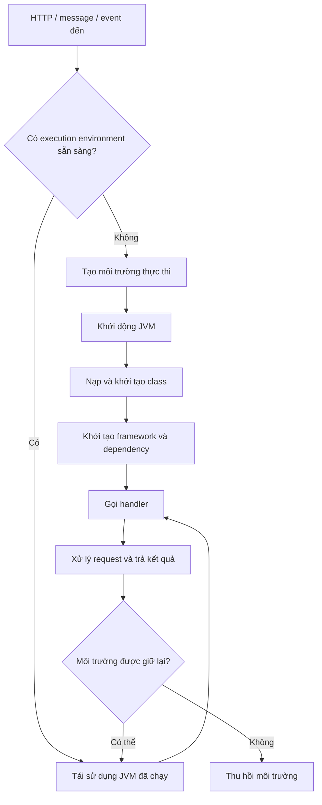

# Tối ưu khởi tạo JVM, class loading và bộ nhớ heap

Java function trong môi trường serverless thường phải xử lý request nhanh ngay cả khi nền tảng vừa tạo một execution environment mới. Khoảng thời gian chuẩn bị môi trường, khởi động JVM, nạp framework và khởi tạo dependency có thể làm tăng độ trễ của lần gọi đầu tiên. Khi môi trường được tái sử dụng, các lớp đã nạp và đối tượng dùng chung có thể còn tồn tại, nhưng lần gọi sau vẫn phải chịu chi phí xử lý request và quản lý bộ nhớ.

Tối ưu Java trên serverless vì vậy cần nhìn vào cả startup và thời gian xử lý: JVM khởi động thế nào, lớp nào được nạp, static initializer làm gì, heap cần bao nhiêu, garbage collector hoạt động ra sao và phần bộ nhớ nào nằm ngoài heap. Mục tiêu là đạt độ trễ, độ ổn định và chi phí phù hợp với workload, đồng thời giữ hành vi đúng khi nền tảng scale out hoặc thu hồi môi trường.

Trong module **CLOUD_SERVERLESS**, Java function có thể được kích hoạt bởi HTTP, message hoặc event. Những function xử lý ngắn, tải biến động và có thể scale về zero thường nhạy với startup; function xử lý batch hoặc tải liên tục lại cần cân bằng thêm throughput, bộ nhớ và GC. Bài này trình bày quy trình đo và tối ưu cho cả hai tình huống.

## 1. Cold start và warm invocation

**Cold start** là lần gọi cần một execution environment mới hoặc cần khởi tạo lại phần runtime trước khi handler có thể xử lý công việc. Với Java, phần khởi tạo có thể gồm chuẩn bị sandbox, khởi động JVM, nạp class, chạy static initializer, khởi tạo framework và tạo các client dùng chung.

**Warm invocation** chạy trong một môi trường đã được khởi tạo và còn được nền tảng tái sử dụng. JVM đã chạy, nhiều class đã được nạp và các đối tượng cấp môi trường có thể còn trong bộ nhớ. Tuy vậy, không có bảo đảm rằng mọi request tiếp theo đều chạy trong cùng môi trường. Khi tải tăng, nền tảng có thể tạo nhiều môi trường mới; khi tải giảm, môi trường cũ có thể bị đóng hoặc thu hồi.



Sơ đồ mô tả vòng đời khái niệm. Thứ tự chi tiết, thời điểm tái sử dụng và cách đo startup phụ thuộc nền tảng. Một số nền tảng báo riêng init duration và handler duration; nơi khác gộp một phần thời gian vào latency của request. Cần đọc metric và log của runtime đang triển khai để biết con số nào phản ánh cold start.

Cold start quan trọng nhất khi:

- API có yêu cầu latency thấp ở phân vị p95/p99 và có thể nhận request sau thời gian nhàn rỗi.
- Tải tăng đột ngột khiến nền tảng tạo nhiều environment mới cùng lúc.
- Function dùng framework lớn, nhiều dependency hoặc thực hiện nhiều việc trong static initializer.
- Function có ít request trên mỗi environment nên JIT và cache khó đạt trạng thái ổn định.

Nếu function chạy liên tục hoặc được gọi rất thường xuyên, startup có thể chiếm tỷ lệ nhỏ trong tổng thời gian. Khi đó, tối ưu throughput, allocation rate, GC và chi phí có thể quan trọng hơn việc giảm vài chục mili giây startup.

## 2. Các giai đoạn khởi động JVM

Khi runtime tạo một tiến trình Java mới, JVM phải chuẩn bị môi trường thực thi trước khi gọi handler. Tùy JDK, VM implementation và framework, công việc có thể gồm:

1. Khởi tạo tiến trình, đọc tham số JVM, thiết lập heap, metaspace, code cache, thread và runtime subsystem.
2. Tìm entry point hoặc bootstrap class và bắt đầu nạp các lớp cần thiết.
3. Load, link và initialize class theo nhu cầu của ứng dụng.
4. Khởi tạo framework, dependency injection container, logging, serializer, SDK client và cấu hình.
5. Runtime gọi handler khi event đã được ánh xạ thành input của ứng dụng.

Không phải mọi class đều được nạp trước khi handler chạy. JVM thường nạp lớp theo nhu cầu; framework có thể chủ động scan classpath hoặc nạp nhiều lớp ngay trong quá trình bootstrap. Vì vậy, hai ứng dụng có cùng JAR size vẫn có thể có startup rất khác nhau do số lớp thực sự được nạp, reflection, annotation scanning, static initializer và cấu trúc dependency.

## 3. Class loading, linking và initialization

Theo vòng đời lớp của JVM, ba nhóm bước quan trọng là loading, linking và initialization.

### Loading — nạp định nghĩa lớp

Class loader tìm bytecode và tạo đối tượng `Class` tương ứng. Nguồn bytecode có thể là thư mục class, JAR, module hoặc class loader tùy chỉnh. Một class có thể được nạp bởi class loader khác nhau; trong JVM, định danh lớp gồm cả tên lớp và class loader định nghĩa nó.

Ứng dụng dùng nhiều framework có thể tạo nhiều class loader. Cơ chế này hữu ích cho plugin hoặc isolation, nhưng có thể tăng số lớp và metadata trong bộ nhớ. Nếu giữ tham chiếu đến class loader hoặc đối tượng của nó sau khi không còn dùng, class loader không thể được thu hồi và có thể gây rò rỉ metaspace.

### Linking — liên kết lớp

Linking gồm các công việc chính:

- **Verification:** kiểm tra bytecode có hợp lệ và tuân thủ quy tắc JVM hay không.
- **Preparation:** cấp phát bộ nhớ cho field static và gán giá trị mặc định theo kiểu dữ liệu. Giá trị khởi tạo tường minh trong source thường được gán ở bước initialization.
- **Resolution:** chuyển symbolic reference trong constant pool thành tham chiếu trực tiếp. JVM có thể thực hiện resolution theo nhu cầu thay vì hoàn tất tất cả ngay lúc load.

### Initialization — chạy initializer

Initialization thực thi static initializer của lớp và các phép gán field static có biểu thức khởi tạo. JVM bảo đảm class initialization được đồng bộ theo quy tắc của Java và chỉ thực hiện thành công một lần cho mỗi class loader.

```java
public final class FunctionBootstrap {
    private static final ObjectMapper JSON = new ObjectMapper();
    private static final HttpClient HTTP = HttpClient.newHttpClient();

    static {
        // Công việc đồng bộ và tốn thời gian ở đây làm tăng startup.
        configureJson(JSON);
    }

    private FunctionBootstrap() {
    }
}
```

Tạo serializer hoặc HTTP client có thể là việc hợp lý để tái sử dụng, nếu thư viện hỗ trợ dùng đồng thời và việc khởi tạo không gọi mạng. Tuy nhiên, không nên thực hiện truy vấn database, gọi API ngoài, tải file lớn hoặc chờ credential provider trong static initializer. Các thao tác đó làm tăng cold start và có thể khiến class initialization thất bại khi dependency tạm thời không sẵn sàng. Nếu initialization của một class kết thúc bằng lỗi, lần truy cập sau trong cùng class loader có thể nhận `NoClassDefFoundError` vì lớp đã ở trạng thái initialization error.

### Khởi tạo sớm hay trì hoãn?

Khởi tạo sớm (eager initialization) tạo dependency ngay khi runtime khởi động. Cách này làm cold start dài hơn nhưng request đầu tiên có thể ít phải khởi tạo hơn. Khởi tạo trì hoãn (lazy initialization) chỉ tạo dependency khi thật sự cần; startup có thể nhanh hơn nhưng request đầu tiên sử dụng dependency sẽ chịu chi phí đó.

Chọn theo đường đi thực tế:

- Dependency luôn cần cho mọi invocation và rẻ để tạo: có thể khởi tạo một lần ở cấp environment.
- Dependency chỉ dùng ở một nhánh ít gặp: cân nhắc lazy initialization.
- Dependency cần credential hoặc kết nối có thể hết hạn: client có thể tái sử dụng, nhưng việc làm mới credential/kết nối phải theo đúng lifecycle của thư viện.
- Dependency cần dữ liệu theo request: khởi tạo hoặc lấy dữ liệu trong invocation, không lưu vào static field dùng chung.

## 4. Giảm chi phí class loading và framework startup

Một ứng dụng Java có thể chứa hàng trăm hoặc hàng nghìn class từ framework và thư viện. Startup chịu ảnh hưởng bởi số class được nạp, số annotation cần scan, reflection, proxy, service discovery và việc tạo object graph.

Các cách giảm chi phí thường có hiệu quả:

1. **Loại dependency không dùng:** kiểm tra dependency tree, bỏ starter hoặc module kéo theo thư viện không cần thiết.
2. **Giảm component scanning:** giới hạn package scan và tránh quét toàn bộ classpath nếu framework cho phép.
3. **Hạn chế reflection không cần thiết:** reflection và proxy động có thể tăng startup, đồng thời gây thêm cấu hình khi dùng AOT/native image.
4. **Tránh khởi tạo object graph quá lớn:** chỉ tạo bean hoặc client cần cho handler; tách chức năng ít dùng thành module/nhánh riêng khi phù hợp.
5. **Giữ artifact gọn và rõ:** loại resource/test data không cần, tránh đóng gói nhiều phiên bản thư viện trùng nhau.
6. **Dùng framework có startup phù hợp:** so sánh framework truyền thống với framework hỗ trợ compile-time dependency injection hoặc AOT dựa trên benchmark của chính workload.
7. **Kiểm tra logging và configuration:** không thực hiện remote configuration lookup hoặc tải metadata đồng bộ nếu có thể dùng cache an toàn hay cấu hình đã được inject.

Framework như Spring Boot có thể cung cấp hệ sinh thái phong phú nhưng startup phụ thuộc số starter, auto-configuration và bean. Micronaut, Quarkus hoặc các cách build AOT có thể giảm một số công việc runtime bằng cách xử lý metadata lúc build. Điều đó không có nghĩa một framework luôn nhanh hơn trong mọi ứng dụng; cần so sánh cùng chức năng, cùng runtime, cùng memory limit và cùng cách đóng gói.

### Dependency tree và kích thước artifact

Kích thước JAR là một chỉ báo hữu ích nhưng không trực tiếp bằng thời gian class loading. Một JAR lớn chứa nhiều resource không nhất thiết làm JVM nạp tất cả class. Ngược lại, framework có thể scan nhiều class dù artifact không quá lớn. Hãy dùng dependency analysis để tìm thư viện thừa, sau đó đo thời gian khởi tạo và số class được nạp.

Với executable/fat JAR, kiểm tra cách framework đóng gói nested JAR và cách class loader đọc chúng. Với container image, giảm layer và image size giúp tải image nhanh hơn trong một số môi trường; nhưng thời gian tải image là một thành phần khác với JVM startup. Tối ưu cả hai nhưng đo riêng khi nền tảng cung cấp metric.

## 5. JIT compilation và warmup

HotSpot JVM thường bắt đầu thực thi bytecode bằng interpreter và có thể biên dịch các method nóng sang mã máy bằng Just-In-Time (JIT) compiler. Khi ứng dụng chạy lâu, JIT dùng thông tin runtime để tối ưu các đường đi thường gặp. Điều này giúp throughput ổn định sau warmup, nhưng có thể tạo chi phí CPU và bộ nhớ trong giai đoạn đầu.

Với function ngắn, môi trường có thể bị thu hồi trước khi nhiều method trở thành hot. Vì vậy, một ứng dụng tối ưu throughput cho service chạy lâu chưa chắc tối ưu cho function chỉ xử lý vài trăm mili giây mỗi invocation.

Các điểm cần cân nhắc:

- **Interpreter và JIT:** code có thể chạy nhanh hơn sau một số lần gọi; benchmark chỉ một invocation có thể không đại diện warm performance.
- **Tiered compilation:** JVM có thể biên dịch qua nhiều mức để cân bằng thời gian khởi động và chất lượng mã máy.
- **Profile-guided optimization:** dữ liệu profile có thể cải thiện tối ưu hóa nhưng cần quy trình tạo và sử dụng profile tương thích.
- **Compiler threads và code cache:** JIT sử dụng CPU và bộ nhớ ngoài Java heap; workload rất nhỏ có thể không hưởng lợi nhiều từ tối ưu hóa sâu.

Một số JVM flag có thể điều chỉnh mức biên dịch hoặc chính sách compiler, nhưng thay đổi flag có thể làm throughput giảm hoặc hành vi khác đi giữa các JDK. Không sao chép một bộ flag từ blog vào production nếu chưa đo startup, p95/p99 và throughput ở đúng runtime.

## 6. Hiểu đúng bộ nhớ của một Java function

Memory limit của nền tảng thường áp dụng cho toàn bộ execution environment hoặc container, không chỉ Java heap. Bộ nhớ tiến trình có thể gồm:

| Thành phần | Nội dung | Dấu hiệu cần theo dõi |
|---|---|---|
| Java heap | Object, array và phần lớn dữ liệu ứng dụng | Heap used/committed/max, allocation rate, GC |
| Metaspace | Metadata của class đã nạp | Metaspace used, số class/class loader |
| Thread stack | Stack cho từng thread | Số thread và stack size |
| Code cache | Mã máy do JIT biên dịch | Code cache usage và compiler activity |
| Direct/native buffers | Buffer ngoài heap, NIO, TLS và thư viện | Direct memory và RSS |
| JVM/runtime native | VM structures, GC metadata, JIT/compiler, JNI | Process RSS và native memory tracking |
| Agent/native library | APM, profiler, compression hoặc thư viện native | RSS và cấu hình agent |

Do đó, `-Xmx` bằng toàn bộ memory limit là cấu hình rủi ro. JVM còn cần bộ nhớ ngoài heap; nếu heap chạm giới hạn trong khi native memory tăng, tiến trình có thể bị hệ điều hành hoặc nền tảng kết thúc trước khi Java ném `OutOfMemoryError`.

### Heap used, committed và max

- **Used:** lượng heap đang được object sử dụng tại thời điểm đo.
- **Committed:** lượng heap JVM đã cam kết để có thể dùng; committed có thể lớn hơn used.
- **Max:** giới hạn heap tối đa theo cấu hình và khả năng JVM nhận diện môi trường.

`Runtime.maxMemory()` phản ánh giới hạn heap tối đa mà JVM nhìn thấy, không phải tổng memory limit của serverless environment. `Runtime.totalMemory()` gần với heap committed và `Runtime.freeMemory()` là phần heap committed còn trống; ba số này không cho biết toàn bộ RSS.

### Ước tính ngân sách bộ nhớ

Có thể bắt đầu bằng cách phân bổ memory limit thành các ngân sách:

\[
M_{limit} \geq M_{heap} + M_{metaspace} + M_{stacks} + M_{direct} + M_{JVM/native} + M_{headroom}
\]

Đây là cách suy nghĩ về ngân sách, không phải công thức cấp phát chính xác. Các vùng có thể thay đổi theo JDK, GC, số thread, thư viện và tải. Hãy đo peak RSS khi chạy cold start lẫn concurrency thực tế, sau đó giữ headroom cho dao động và spike.

## 7. Cấu hình heap trong môi trường có giới hạn memory

JVM hiện đại có khả năng nhận diện một số giới hạn container/cgroup, nhưng hành vi còn phụ thuộc JDK và cách nền tảng giới hạn tài nguyên. Một số tùy chọn thường gặp:

- `-Xms`: heap ban đầu hoặc mức heap tối thiểu theo cách JVM áp dụng.
- `-Xmx`: giới hạn heap tối đa.
- `-XX:InitialRAMPercentage`: tỷ lệ bộ nhớ được JVM dùng để tính heap ban đầu trên các runtime hỗ trợ.
- `-XX:MaxRAMPercentage`: tỷ lệ bộ nhớ được JVM dùng để tính heap tối đa trên các runtime hỗ trợ.

Không nên mặc định giá trị phần trăm giống nhau trên mọi JDK hoặc mọi nền tảng. Hãy xác nhận JVM nhận diện đúng memory limit và kiểm tra giá trị `maxMemory()` trong runtime đã triển khai. Nếu nền tảng cung cấp memory limit nhỏ, cần tính cả overhead của agent, TLS, SDK và thread.

Ví dụ ghi nhận giới hạn heap để log chẩn đoán:

```java
public final class MemoryDiagnostics {
    public static void logHeapLimits() {
        Runtime runtime = Runtime.getRuntime();
        long mib = 1024L * 1024L;

        System.out.printf(
                "heap.maxMiB=%d heap.committedMiB=%d heap.freeMiB=%d%n",
                runtime.maxMemory() / mib,
                runtime.totalMemory() / mib,
                runtime.freeMemory() / mib);
    }
}
```

Các số liệu này chỉ mô tả heap. Hãy đối chiếu với metric memory/RSS do nền tảng cung cấp để phát hiện phần native hoặc thread stack. Không log chi tiết bộ nhớ cho mọi request nếu nó tạo lượng log lớn; thường chỉ cần log ở init, theo chu kỳ hoặc khi vượt ngưỡng.

### Chọn heap theo workload

- Heap quá nhỏ có thể khiến GC chạy thường xuyên, allocation thất bại hoặc function hết thời gian.
- Heap quá lớn có thể làm tăng RSS, kéo dài một số chu kỳ GC và giảm số environment có thể chạy đồng thời trong cùng quota.
- Heap vừa đủ cùng headroom phù hợp thường tạo cân bằng tốt hơn việc đặt heap tối đa bằng memory limit.
- Một số nền tảng cấp thêm CPU khi cấu hình memory cao hơn; khi đó tăng memory có thể giảm latency nhờ CPU hoặc GC, nhưng chi phí cũng có thể tăng. Cần benchmark từng cấu hình.

## 8. Garbage collection và allocation rate

Java cấp phát object trên heap và garbage collector (GC) thu hồi object không còn reachable. Trong function, lượng object tạo ra mỗi invocation và số invocation xử lý trong một environment ảnh hưởng đến GC.

Các nguồn allocation phổ biến:

- Deserialize JSON thành nhiều object lồng nhau.
- Sao chép byte array hoặc String khi chuyển đổi encoding.
- Tạo request/response object và collection tạm.
- Logging tạo chuỗi lớn hoặc serialize toàn bộ payload.
- Tạo HTTP client, SDK client hoặc serializer mới cho từng invocation.
- Buffering toàn bộ file/message thay vì streaming.

Tối ưu allocation có thể giúp giảm GC và memory peak:

1. Tái sử dụng client/serializer thread-safe ở cấp environment.
2. Xử lý dữ liệu lớn theo stream hoặc batch nhỏ.
3. Tránh tạo bản sao không cần thiết của payload và chuỗi.
4. Giới hạn cache, collection và buffer; đặt TTL hoặc eviction.
5. Không giữ object của invocation trong static field, callback hoặc thread nền sau khi xử lý xong.
6. Chọn cấu trúc dữ liệu phù hợp và đo trước khi tối ưu micro-level.

### Chọn GC

G1 là collector mặc định trong nhiều bản HotSpot hiện đại, nhưng runtime có thể chọn collector khác tùy JDK, memory và cấu hình. Serial GC có thể phù hợp với một số tiến trình nhỏ, ít CPU; collector concurrent có thể hữu ích cho workload lớn cần giảm pause nhưng tiêu tốn tài nguyên nền. Không có lựa chọn tốt nhất cho mọi function.

Hãy đo pause time, allocation rate, promotion, old-generation occupancy và CPU do GC trong workload thực. Tránh gọi `System.gc()` trong handler như cách ép giải phóng bộ nhớ; hành vi phụ thuộc JVM và thường làm latency khó dự đoán hơn.

## 9. Bộ nhớ sống lâu qua nhiều invocation

Môi trường được tái sử dụng có thể giữ biến static, singleton, cache, thread pool và connection pool. Điều này giảm chi phí khởi tạo nhưng cũng có nghĩa object có thể sống lâu hơn request tạo ra nó.

Không lưu dữ liệu người dùng hoặc request trong static field. Ví dụ sau có thể rò dữ liệu giữa hai invocation:

```java
public final class UnsafeFunction {
    private static String currentUserId;

    public Response handle(Request request) {
        currentUserId = request.userId();
        return buildResponse(currentUserId);
    }
}
```

Hãy giữ dữ liệu request trong biến cục bộ và truyền qua tham số. Nếu runtime có thể xử lý nhiều invocation đồng thời trong cùng environment, mọi object dùng chung phải thread-safe. Không giả định tất cả nền tảng serverless có cùng concurrency model.

Các điểm dễ gây memory leak:

- Static cache không có giới hạn hoặc không hết hạn.
- ThreadLocal không được `remove()` khi thread được tái sử dụng.
- Thread pool hoặc scheduler tạo thread nhưng không được quản lý vòng đời.
- Listener, callback hoặc collection giữ tham chiếu đến request lớn.
- Class loader tùy chỉnh hoặc proxy được tạo lặp lại và không thể thu hồi.
- Connection pool giữ quá nhiều connection hoặc không xử lý connection stale.

Với ThreadLocal, nếu thư viện yêu cầu dùng, luôn dọn trong `finally`:

```java
REQUEST_CONTEXT.set(context);
try {
    return process(request);
} finally {
    REQUEST_CONTEXT.remove();
}
```

## 10. Tối ưu dependency và client dùng chung

Tạo SDK client hoặc HTTP client trong mỗi invocation có thể lặp lại DNS lookup, TLS setup, connection pool creation và object allocation. Nếu thư viện hỗ trợ tái sử dụng, tạo client một lần cho mỗi execution environment có thể giảm latency và áp lực bộ nhớ.

```java
public final class CatalogFunction {
    private static final HttpClient HTTP = HttpClient.newBuilder()
            .connectTimeout(Duration.ofSeconds(2))
            .build();

    public Response handle(Request request) {
        // Dữ liệu theo invocation là biến cục bộ.
        String sku = request.sku();
        return fetchCatalogItem(HTTP, sku);
    }
}
```

Đối tượng dùng chung phải được kiểm tra thread safety và lifecycle. Một số SDK client có thể tái sử dụng nhưng connection bên trong có thể hết hạn; client cần có cơ chế refresh/reconnect. Không giữ một JDBC connection đơn lẻ trong static field rồi dùng vô thời hạn. Thường nên tái sử dụng `DataSource`/pool được cấu hình đúng, giới hạn connection tổng theo concurrency và để pool quản lý connection lifecycle.

Khởi tạo client ở cấp environment là tối ưu hiệu năng, không phải nơi lưu trạng thái nghiệp vụ. Cache trong static field có thể mất khi environment bị thu hồi và không được chia sẻ với environment khác. Dữ liệu cần nhất quán hoặc tồn tại lâu dài phải nằm ở database, cache phân tán hoặc storage bền vững.

## 11. Các kỹ thuật giảm startup nâng cao

### Class Data Sharing (CDS)

Một số JDK hỗ trợ Class Data Sharing để lưu metadata/lớp đã xử lý vào archive có thể chia sẻ giữa các JVM phù hợp. CDS có thể giảm một phần thời gian class loading và memory footprint, nhưng cần archive tương thích với JDK, classpath/module và cách đóng gói. Khả năng sử dụng trong managed serverless runtime phụ thuộc quyền kiểm soát startup command và filesystem. Chỉ áp dụng sau khi xác nhận runtime hỗ trợ.

### Ahead-of-Time (AOT) processing

AOT có thể chuyển một số công việc phân tích metadata, dependency injection hoặc reflection thành bước build. Framework hỗ trợ AOT có thể giảm công việc runtime, nhưng build pipeline phức tạp hơn và một số hành vi động cần khai báo trước.

### GraalVM Native Image

Native Image biên dịch ứng dụng Java thành executable native ở thời điểm build. Nó có thể giảm thời gian startup và memory footprint cho một số workload, đặc biệt function ngắn và nhạy với cold start. Đổi lại:

- Build lâu hơn và binary phụ thuộc hệ điều hành/kiến trúc đích.
- Reflection, dynamic proxy, resource loading, JNI và service loading có thể cần metadata cấu hình.
- Một số thư viện hoặc agent không tương thích đầy đủ.
- JIT runtime optimization không còn giống JVM HotSpot; throughput sau warmup có thể khác.
- Debugging, profiling và cập nhật JDK có quy trình khác.

Hãy chạy integration test với đúng native artifact và đúng runtime, không chỉ kiểm tra build thành công.

### Checkpoint/restore với CRaC

Coordinated Restore at Checkpoint (CRaC) cho phép một ứng dụng Java tạo checkpoint ở trạng thái đã khởi tạo rồi restore để giảm phần công việc startup. Đây là mô hình cần phối hợp giữa runtime, JDK, ứng dụng và môi trường triển khai. Trước checkpoint cần xử lý tài nguyên phù hợp; sau restore có thể cần mở lại socket, làm mới credential hoặc tái tạo tài nguyên không còn hợp lệ.

### Snapshot execution environment

Một số nền tảng serverless cung cấp tính năng snapshot môi trường sau bước initialization để phục hồi nhanh hơn khi cold start. Tính năng, runtime được hỗ trợ và hook trước checkpoint/sau restore phụ thuộc nhà cung cấp. Ví dụ, AWS Lambda SnapStart hỗ trợ một số runtime Java và phiên bản function được publish; cần đọc hướng dẫn hiện hành của nền tảng trước khi thiết kế.

Snapshot làm cho trạng thái bộ nhớ được khôi phục, vì vậy cần chú ý:

- Không giả định random seed, UUID state hoặc giá trị cần duy nhất sẽ tự khác nhau sau restore nếu chúng được tạo trước snapshot.
- Kết nối mạng, socket, connection pool hoặc credential có thể không còn hợp lệ sau thời gian snapshot; kiểm tra và làm mới sau restore theo hook được hỗ trợ.
- Không lưu dữ liệu request hoặc secret không cần thiết trong heap trước checkpoint.
- Không chạy background thread hoặc tác vụ đang dở nếu nền tảng không hỗ trợ trạng thái đó.
- Kiểm thử nhiều environment được restore đồng thời để phát hiện collision hoặc trạng thái dùng chung không mong muốn.

Snapshot/AOT/native image không phải tối ưu miễn phí. Chúng thay đổi build và runtime model; cần so sánh cold start, warm latency, memory peak, throughput, chi phí build và độ phức tạp vận hành.

## 12. Đo startup, class loading và memory

Không tối ưu chỉ dựa trên cảm giác hoặc thời gian đo trên laptop. Cần đo đúng môi trường triển khai, vì CPU, filesystem, memory limit, network, runtime version và concurrency có thể khác đáng kể.

### Những số liệu cần thu thập

| Chỉ số | Ý nghĩa |
|---|---|
| Init duration / cold start duration | Thời gian nền tảng chuẩn bị environment và runtime theo cách metric định nghĩa |
| Handler duration | Thời gian function xử lý invocation sau khi được gọi |
| End-to-end latency | Thời gian client hoặc producer quan sát được |
| Class load count/time | Số class được nạp và chi phí nạp class |
| Heap used/committed/max | Mức sử dụng heap và giới hạn heap |
| Process RSS / memory peak | Bộ nhớ thực tế của tiến trình/environment, gồm phần ngoài heap |
| Allocation rate | Lượng object được cấp phát theo thời gian |
| GC count/pause/CPU | Tần suất và chi phí garbage collection |
| Thread count | Số thread và tác động đến stack/native memory |
| Error/timeout/OOM rate | Ảnh hưởng của cấu hình đến độ ổn định |

### Công cụ JVM hữu ích

- **Java Flight Recorder (JFR):** ghi nhận startup, class loading, allocation, GC, thread và CPU với overhead có thể kiểm soát theo cấu hình.
- **JVM unified logging:** các tùy chọn `-Xlog` có thể cung cấp log class loading hoặc GC trên các JDK hỗ trợ; cú pháp thay đổi theo phiên bản.
- **JMX / MXBeans:** lấy heap, memory pool, class loading và GC statistics.
- **Native Memory Tracking (NMT):** hỗ trợ phân tích một số nhóm native memory của HotSpot khi được bật lúc JVM khởi động; có overhead và không đại diện cho mọi allocation native bên ngoài JVM.
- **Metric nền tảng:** đối chiếu memory peak, init duration, concurrency, throttling và timeout với số liệu JVM.

Trong serverless, function có thể kết thúc hoặc environment bị thu hồi trước khi bạn attach profiler theo cách truyền thống. Có thể bật recording ngắn, xuất dữ liệu đến storage phù hợp hoặc dùng profiler hỗ trợ runtime triển khai. Cần cân nhắc overhead và không ghi payload/secret vào recording hay log.

### Quy trình benchmark có kiểm soát

1. Chốt phiên bản JDK, framework, artifact, cấu hình memory/CPU và loại trigger.
2. Tạo baseline với cold start và warm invocation; ghi riêng init duration, handler duration và end-to-end latency.
3. Chạy nhiều lần để có p50, p95, p99; không kết luận từ một lần chạy.
4. Thử tải tăng đột ngột để đo số environment mới, concurrency và cold-start burst.
5. Thay đổi một yếu tố mỗi lần: dependency, static initialization, heap, framework hoặc runtime option.
6. Đo cả throughput, memory peak, GC, lỗi và chi phí, không chỉ startup.
7. Kiểm tra lại correctness, retry, connection lifecycle và hành vi sau environment reuse/restore.

Nếu chỉ cải thiện p50 nhưng p99 tăng do GC hoặc cold-start burst, cấu hình mới có thể không phù hợp. Mục tiêu phải gắn với SLA thực tế của API hoặc consumer.

## 13. Ví dụ: đo heap và theo dõi class loading

Java cung cấp API để đọc một số chỉ số cơ bản từ runtime:

```java
import java.lang.management.ClassLoadingMXBean;
import java.lang.management.ManagementFactory;

public final class RuntimeDiagnostics {
    public static void logRuntimeState() {
        Runtime runtime = Runtime.getRuntime();
        ClassLoadingMXBean classes =
                ManagementFactory.getClassLoadingMXBean();
        long mib = 1024L * 1024L;

        System.out.printf(
                "heap.maxMiB=%d heap.committedMiB=%d heap.usedMiB=%d " +
                "classes.loaded=%d classes.totalLoaded=%d classes.unloaded=%d%n",
                runtime.maxMemory() / mib,
                runtime.totalMemory() / mib,
                (runtime.totalMemory() - runtime.freeMemory()) / mib,
                classes.getLoadedClassCount(),
                classes.getTotalLoadedClassCount(),
                classes.getUnloadedClassCount());
    }
}
```

Đây là số liệu chụp tại một thời điểm; `classes.totalLoaded` là tổng số lớp từng được nạp trong JVM, còn `classes.loaded` là số lớp hiện đang được nạp. Những con số này không cho biết class nào gây chậm. Khi cần tìm nguyên nhân, kết hợp class-loading log hoặc JFR và so sánh với mốc thời gian startup.

Ví dụ handler có thể gọi chẩn đoán ở bước init một lần hoặc khi bật debug có kiểm soát. Tránh log ở mọi invocation nếu nó tạo thêm serialization, I/O và chi phí làm sai kết quả benchmark.

## 14. Tối ưu theo loại workload

| Đặc điểm workload | Ưu tiên tối ưu |
|---|---|
| HTTP API có request thưa và nhạy cold start | Giảm startup, dependency, static initializer; cân nhắc snapshot/AOT/native image nếu runtime hỗ trợ |
| Queue consumer xử lý message liên tục | Throughput, allocation rate, GC, batch size, concurrency và connection pool |
| Function xử lý file hoặc payload lớn | Streaming, giới hạn buffer, heap headroom và dung lượng temporary storage |
| Function gọi nhiều dịch vụ ngoài | Tái sử dụng client an toàn, timeout, connection lifecycle, DNS/TLS và concurrency downstream |
| Function chạy ít nhưng có burst lớn | Đo cold-start burst, giới hạn concurrency, memory/CPU và capacity của dependency |
| Workflow có nhiều task ngắn | Giảm overhead mỗi invocation và payload truyền giữa các bước; giữ function nhỏ và startup gọn |

Một cấu hình tốt cho API nhỏ có thể không tốt cho batch consumer. Đừng dùng cùng một `-Xmx`, GC option hoặc số thread cho mọi function chỉ vì chúng cùng một repository.

## 15. Các anti-pattern thường gặp

| Anti-pattern | Vì sao gây vấn đề | Hướng xử lý |
|---|---|---|
| Gọi database/API trong static initializer | Tăng cold start và có thể làm class initialization lỗi | Tách I/O khỏi class init; dùng timeout và lazy initialization có kiểm soát |
| Tạo client mới ở mỗi invocation | Lặp TLS, DNS, pool và object allocation | Tái sử dụng client thread-safe ở cấp environment |
| Đặt `-Xmx` bằng toàn bộ memory limit | Không còn headroom cho metaspace, stack, native và runtime | Đo RSS và dành ngân sách ngoài heap |
| Tăng heap chỉ để tránh OOM mà không tìm nguyên nhân | Che memory leak hoặc payload không giới hạn | Profile allocation, giới hạn cache và streaming |
| Dùng `System.gc()` trong handler | Tạo latency khó dự đoán và không bảo đảm giải phóng ngay | Tối ưu allocation và để GC hoạt động theo chính sách JVM |
| Tạo thread nền rồi trả response | Runtime có thể đóng băng/thu hồi environment | Chờ công việc hoặc gửi sang queue/workflow bền vững |
| Giữ request/user data trong static field | Rò dữ liệu giữa invocation hoặc race condition | Dùng biến cục bộ và truyền context tường minh |
| Bật nhiều agent/profiler ở production mà không đo overhead | Tăng RSS, startup và CPU | Chọn instrumentation cần thiết và đo tác động |
| Chọn native image chỉ vì cold start | Có thể phát sinh vấn đề reflection, tương thích và throughput | Benchmark toàn diện và kiểm thử artifact thật |
| Tối ưu theo một lần chạy trên máy local | Không phản ánh runtime, memory limit và burst trong cloud | Benchmark trên môi trường triển khai với nhiều lần chạy |

## 16. Checklist trước khi triển khai

- **Runtime:** JDK version, JVM vendor, architecture và memory limit đã được xác nhận chưa?
- **Cold start:** init duration được đo riêng với handler duration chưa; p95/p99 có đạt mục tiêu không?
- **Class loading:** dependency tree, component scan, reflection và static initializer đã được rà soát chưa?
- **Initialization:** có network I/O, truy vấn database hoặc chờ secret/configuration trong static initializer không?
- **JIT:** workload đủ dài để hưởng lợi JIT hay phần lớn invocation kết thúc trước warmup?
- **Heap:** `Xmx` hoặc RAM percentage có để headroom cho native memory, thread stack và agent không?
- **GC:** allocation rate, pause time và CPU do GC đã được đo dưới tải thực chưa?
- **Concurrency:** object static, client, cache, ThreadLocal và thread pool có an toàn theo concurrency model của runtime không?
- **Memory leak:** cache có giới hạn; file/stream được đóng; tham chiếu theo invocation được giải phóng không?
- **Optimization option:** CDS, AOT, CRaC, SnapStart hoặc Native Image có được runtime hỗ trợ và đã test sau restore chưa?
- **Observability:** có metric init, handler, RSS, heap, GC, class loading, OOM và timeout không?
- **Cost:** cấu hình memory/CPU và concurrency được so sánh bằng latency, throughput, memory peak và chi phí không?

## 17. Kết luận

Tối ưu Java serverless bắt đầu từ việc tách rõ chi phí khởi tạo môi trường, khởi động JVM, class loading, framework initialization và thời gian xử lý handler. Giảm dependency thừa, kiểm soát static initializer, khởi tạo client dùng chung đúng cách và đo JIT warmup có thể giảm startup mà vẫn giữ khả năng tái sử dụng environment.

Với bộ nhớ, hãy phân biệt heap với tổng memory của tiến trình. Heap phải đủ cho working set và allocation peak nhưng vẫn để headroom cho metaspace, thread stack, code cache, direct buffer và native runtime. Đo GC, RSS, concurrency và p95/p99 trong môi trường thật trước khi chọn JVM flags hoặc memory size.

CDS, AOT, CRaC, snapshot runtime và Native Image là các lựa chọn nâng cao khi startup là nút thắt đã được đo. Mỗi lựa chọn có yêu cầu tương thích và chi phí vận hành riêng. Cấu hình tốt là cấu hình đáp ứng latency, throughput, độ ổn định và chi phí của workload cụ thể, không phải bộ JVM flags dùng chung cho mọi function.
