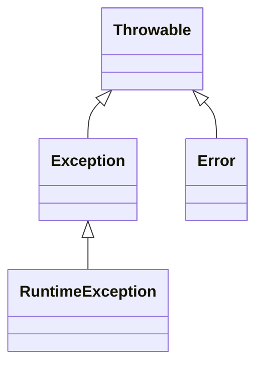
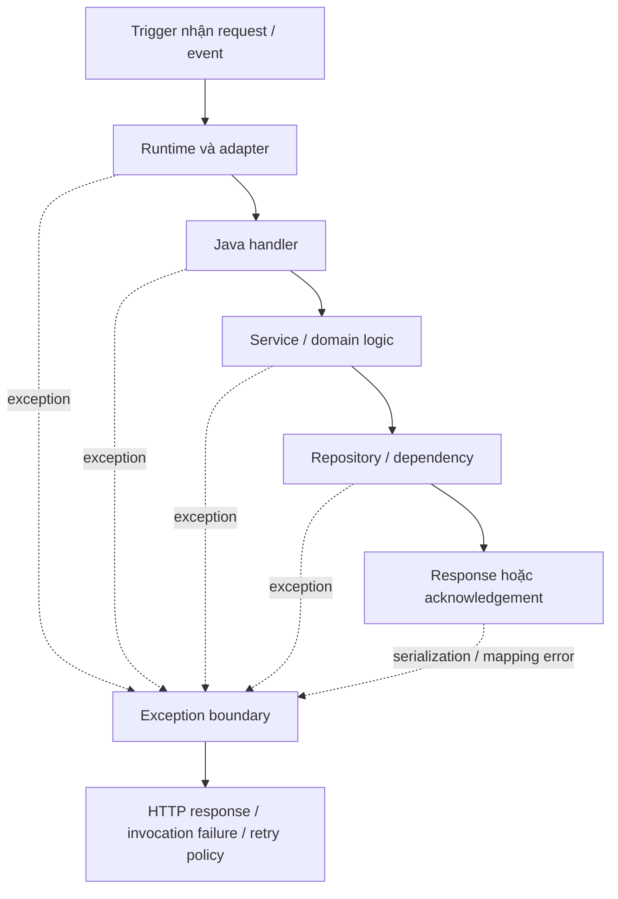
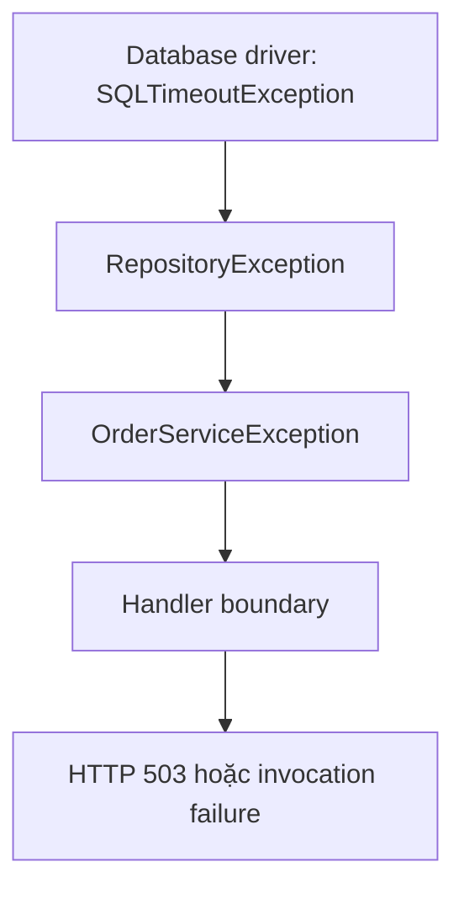

# Xử lý ngoại lệ và bảo toàn nguyên nhân lỗi trong Java handler

Một Java function có thể thất bại khi kiểm tra request, truy vấn database, gọi API bên ngoài hoặc chuyển kết quả thành response. Khi lỗi đi qua nhiều lớp, điều quan trọng là giữ được nguyên nhân ban đầu để chẩn đoán chính xác và để runtime hoặc workflow quyết định cách xử lý. Nếu handler nuốt exception, thay thế nó bằng một thông báo chung hoặc chỉ ghi lại `getMessage()`, thông tin cần thiết để tìm lỗi gốc có thể biến mất.

Trong serverless, exception còn ảnh hưởng đến cách invocation được xem là thành công hay thất bại. Với HTTP đồng bộ, ứng dụng thường phải chuyển lỗi thành response phù hợp. Với queue hoặc event bất đồng bộ, việc ném exception hay trả kết quả bình thường có thể quyết định message được retry hay được xác nhận đã xử lý, tùy adapter và cấu hình trigger. Vì vậy, xử lý ngoại lệ cần gắn với ranh giới handler và loại trigger.

Bài này trình bày cách tổ chức exception trong Java, bảo toàn cause và stack trace, phân biệt lỗi nghiệp vụ với lỗi kỹ thuật, xử lý bất đồng bộ và ánh xạ lỗi ở ranh giới FaaS.

## 1. Exception trong Java và vòng đời invocation

### 1.1. Cấu trúc cơ bản của Throwable

Trong Java, `Throwable` là lớp gốc của các đối tượng có thể được ném bằng `throw`. Hai nhánh chính là `Exception` và `Error`:

- **Exception:** những tình huống ứng dụng có thể dự đoán hoặc xử lý, như dữ liệu không hợp lệ, lỗi kết nối hoặc tài nguyên không tồn tại.
- **RuntimeException:** exception không bắt buộc khai báo hoặc bắt ở compile time. Ví dụ: `IllegalArgumentException`, `NullPointerException` và các exception runtime do ứng dụng định nghĩa.
- **Checked exception:** các lớp exception không kế thừa `RuntimeException`; phương thức phải khai báo `throws` hoặc xử lý bằng `catch`.
- **Error:** vấn đề nghiêm trọng của JVM hoặc môi trường chạy, chẳng hạn `OutOfMemoryError` hoặc `LinkageError`. Ứng dụng thông thường không nên bắt rồi tiếp tục như thể invocation vẫn an toàn.



Checked hay unchecked chỉ là cách Java buộc người viết mã khai báo và xử lý. Nó không tự nói lỗi có thể retry hay không. Một `IOException` có thể là lỗi tạm thời, nhưng cũng có thể do file path sai. Một `RuntimeException` có thể đại diện cho lỗi nghiệp vụ hoặc lỗi lập trình. Hãy phân loại dựa trên loại lỗi và hợp đồng của dependency, không chỉ dựa vào nhánh kế thừa.

### 1.2. Exception ở từng giai đoạn của function

Một invocation thường đi qua các giai đoạn:

1. Nền tảng nhận trigger và định tuyến đến function.
2. Runtime khởi tạo môi trường và ứng dụng Java nếu cần.
3. Adapter chuyển payload thành input của handler.
4. Handler thực hiện validation và logic nghiệp vụ.
5. Service/repository gọi database hoặc dependency bên ngoài.
6. Handler tạo kết quả và adapter chuyển thành response hoặc xác nhận message.

Exception có thể xuất hiện ở bất kỳ giai đoạn nào. Lỗi class loading hoặc static initializer có thể xảy ra trước khi handler bắt đầu. Lỗi parsing payload có thể nằm trong adapter. Lỗi truy vấn nằm trong repository. Lỗi serialization có thể xảy ra sau khi logic nghiệp vụ đã hoàn tất.



Exception boundary là lớp chịu trách nhiệm chuyển exception nội bộ thành kết quả phù hợp với trigger. Không nên để mỗi tầng tự biến lỗi thành một response chung, vì các lớp phía trên sẽ mất thông tin để quyết định retry, compensation hoặc thông báo cho người dùng.

## 2. Bảo toàn nguyên nhân lỗi (cause chain)

### 2.1. Cause là gì?

Một exception có thể bọc một exception khác. Exception bên ngoài mô tả ngữ cảnh ở lớp hiện tại; cause giữ nguyên lỗi phát sinh ở lớp bên dưới.

Ví dụ, repository biết thao tác đọc đơn hàng thất bại, còn JDBC driver biết nguyên nhân cụ thể là connection timeout. Ta có thể tạo `OrderRepositoryException` để bổ sung ngữ cảnh nhưng vẫn giữ `SQLException` làm cause.

```java
public final class OrderRepositoryException extends RuntimeException {
    public OrderRepositoryException(String message, Throwable cause) {
        super(message, cause);
    }
}

public final class JdbcOrderRepository {
    public Order findById(String orderId) {
        try {
            return queryDatabase(orderId);
        } catch (SQLException error) {
            throw new OrderRepositoryException(
                    "Could not load order " + orderId,
                    error);
        }
    }

    private Order queryDatabase(String orderId) throws SQLException {
        // Thực hiện truy vấn bằng JDBC.
        throw new SQLTimeoutException("Connection timed out");
    }
}
```

Khi log exception bên ngoài, stack trace thường hiển thị cả chuỗi `Caused by`, nhờ đó người vận hành có thể thấy lỗi JDBC gốc. Trong ví dụ thực tế, cần bảo đảm `orderId` không chứa dữ liệu nhạy cảm trước khi đưa vào message hoặc log.

### 2.2. Cách bọc exception đúng

Khi cần đổi abstraction, hãy dùng constructor nhận `cause`:

```java
catch (SQLException error) {
    throw new DataAccessException("Reading order failed", error);
}
```

Không làm như sau:

```java
catch (SQLException error) {
    // Sai: message được giữ nhưng cause và stack trace gốc bị mất.
    throw new RuntimeException(error.getMessage());
}
```

Đoạn mã sai tạo một exception mới không liên kết với `SQLException`. Stack trace mới chỉ cho biết exception được tạo ở dòng `throw`, không thể hiện đầy đủ đường đi của lỗi ban đầu.

Một số constructor hữu ích:

```java
public class DependencyCallException extends RuntimeException {
    public DependencyCallException(String message) {
        super(message);
    }

    public DependencyCallException(String message, Throwable cause) {
        super(message, cause);
    }
}
```

Chỉ dùng constructor không có cause khi thực sự không có nguyên nhân bên dưới. Nếu đang chuyển đổi abstraction từ một exception khác, hãy truyền cause.

### 2.3. Khi nào nên rethrow exception gốc?

Nếu lớp hiện tại không bổ sung ngữ cảnh hoặc không thay đổi abstraction, hãy ném lại chính exception đã bắt:

```java
try {
    return paymentClient.charge(command);
} catch (PaymentProviderException error) {
    metrics.increment("payment.provider.failure");
    throw error; // Giữ nguyên object và stack trace ban đầu.
}
```

Không cần bắt rồi ném lại nếu không thực hiện hành động nào. Có thể để exception lan truyền tự nhiên đến exception boundary. Việc catch chỉ để ghi log rồi rethrow ở mọi tầng dễ tạo log trùng và làm nhiễu hệ thống quan sát.

Nếu cần đổi loại exception, hãy wrap với cause. Nếu không cần đổi loại, rethrow exception gốc. Hai lựa chọn này giữ được chuỗi nguyên nhân.

### 2.4. Không dùng `fillInStackTrace()` để che lỗi

`fillInStackTrace()` ghi lại stack trace tại thời điểm phương thức được gọi. Gọi nó khi đang xử lý exception có thể làm mất vị trí ném ban đầu và khiến việc điều tra khó hơn. Hầu hết trường hợp không cần gọi phương thức này thủ công.

Không tạo exception mới ở một lớp tiện ích chỉ để thêm log hoặc thêm một dòng message. Hãy tạo abstraction exception tại ranh giới có ý nghĩa và giữ cause.

## 3. Thiết kế custom exception theo abstraction

### 3.1. Đặt exception theo ý nghĩa của lớp

Mỗi lớp nên phát ra lỗi phù hợp với trách nhiệm của nó:

- Adapter HTTP: lỗi giao thức, timeout, status từ remote service.
- Repository: lỗi truy cập dữ liệu hoặc constraint.
- Domain service: lỗi quy tắc nghiệp vụ hoặc chuyển trạng thái không hợp lệ.
- Handler boundary: phân loại và ánh xạ lỗi sang HTTP response hoặc invocation failure.

Không để domain layer phụ thuộc trực tiếp vào `SQLException`, `HttpClientException` hoặc kiểu exception riêng của nhà cung cấp cloud. Repository/adapter có thể chuyển exception kỹ thuật sang kiểu nội bộ, giữ cause để lớp cao hơn không phụ thuộc thư viện cụ thể.

### 3.2. Phân biệt lỗi nghiệp vụ và lỗi kỹ thuật

Một mô hình đơn giản:

```java
public abstract class ApplicationException extends RuntimeException {
    protected ApplicationException(String message) {
        super(message);
    }

    protected ApplicationException(String message, Throwable cause) {
        super(message, cause);
    }
}

public final class OrderNotFoundException extends ApplicationException {
    public OrderNotFoundException(String orderId) {
        super("Order does not exist: " + orderId);
    }
}

public final class InvalidOrderStateException extends ApplicationException {
    public InvalidOrderStateException(String message) {
        super(message);
    }
}

public final class DependencyUnavailableException extends ApplicationException {
    public DependencyUnavailableException(String message, Throwable cause) {
        super(message, cause);
    }
}
```

`OrderNotFoundException` và `InvalidOrderStateException` biểu diễn kết quả domain có thể dự đoán. `DependencyUnavailableException` biểu diễn lỗi kỹ thuật của dependency. Việc có các kiểu riêng giúp handler hoặc workflow phân loại rõ ràng hơn.

Trong hệ thống lớn, có thể dùng một hierarchy sâu hơn hoặc sealed interface/record result. Không nên tạo hàng chục exception class nếu chúng không giúp quyết định xử lý, quan sát hoặc hợp đồng API rõ hơn.

### 3.3. Không dùng exception cho luồng điều khiển bình thường

Nếu hết hàng là một kết quả hợp lệ của thao tác kiểm tra kho, có thể trả `ReservationResult` với trạng thái `OUT_OF_STOCK` thay vì ném exception. Exception phù hợp với tình huống thao tác không thể hoàn tất theo hợp đồng hoặc hệ thống không thể thực hiện công việc.

Ví dụ:

```java
public enum ReservationStatus {
    RESERVED,
    OUT_OF_STOCK,
    PRODUCT_DISCONTINUED
}

public record ReservationResult(
        ReservationStatus status,
        String reservationId) {
}
```

Khi kết quả nghiệp vụ được biểu diễn tường minh, workflow có thể chọn nhánh tương ứng. Khi dependency timeout, exception kỹ thuật có thể được retry theo policy.

## 4. Catch đúng chỗ và không nuốt exception

### 4.1. Chỉ catch khi có hành động cụ thể

Một `catch` nên làm ít nhất một việc có ý nghĩa:

- chuyển exception sang abstraction phù hợp và giữ cause;
- giải phóng hoặc khôi phục tài nguyên/trạng thái;
- chuyển lỗi thành response theo hợp đồng;
- bổ sung metadata an toàn để quan sát;
- quyết định retry, compensation hoặc nhánh nghiệp vụ.

Nếu không có hành động nào trong số đó, thường nên để exception lan truyền.

### 4.2. Tránh catch quá rộng

Đoạn mã sau nguy hiểm:

```java
try {
    processOrder(event);
} catch (Exception ignored) {
    return "OK";
}
```

Handler trả về thành công dù xử lý thất bại. Với queue trigger, adapter có thể xác nhận message và không giao lại nữa. Với HTTP, caller nhận kết quả thành công giả. Lỗi cũng không còn stack trace để điều tra.

Hãy bắt loại lỗi cụ thể và quyết định hành động:

```java
try {
    processOrder(event);
} catch (DependencyUnavailableException error) {
    throw error; // Cho exception boundary/runtime áp dụng retry policy.
} catch (InvalidOrderStateException error) {
    recordBusinessRejection(event.eventId(), error);
    return ProcessResult.rejected("ORDER_STATE_INVALID");
}
```

Ví dụ này giả định `InvalidOrderStateException` là kết quả nghiệp vụ đã được xác định và có thể được ghi nhận như kết quả xử lý thành công của event. Nếu hợp đồng nguồn event yêu cầu coi kết quả đó là thất bại, adapter phải biểu diễn tương ứng. Điều quan trọng là không biến lỗi kỹ thuật thành thành công giả.

### 4.3. Không bắt `Throwable` để tiếp tục chạy

`catch (Throwable)` bắt cả `Error`, bao gồm lỗi nghiêm trọng của JVM. Hầu hết handler không nên bắt `OutOfMemoryError`, `StackOverflowError` hoặc lỗi linkage rồi tiếp tục xử lý như bình thường. Việc tiếp tục có thể làm môi trường ở trạng thái không an toàn.

Chỉ những thành phần rất đặc biệt ở tầng runtime/diagnostic mới có lý do bắt `Throwable`, và vẫn phải ném lại các lỗi nghiêm trọng sau khi thực hiện hành động tối thiểu an toàn. Trong code nghiệp vụ, bắt các exception cụ thể hoặc `Exception` khi thực sự cần boundary tổng quát.

### 4.4. Không để cleanup che mất exception gốc

Nếu `finally` ném exception mới, exception đó có thể che exception đang được truyền ra ngoài. Hãy dùng try-with-resources cho tài nguyên triển khai `AutoCloseable`:

```java
try (Connection connection = dataSource.getConnection();
     PreparedStatement statement = connection.prepareStatement(SQL)) {
    return execute(statement, orderId);
}
```

Nếu phần thân và `close()` cùng thất bại, Java lưu lỗi khi đóng tài nguyên dưới dạng *suppressed exception* trên exception chính. Có thể xem bằng `getSuppressed()` hoặc stack trace đầy đủ.

Nếu phải tự quản lý cleanup, cần bảo đảm lỗi cleanup không vô tình thay thế lỗi gốc. Chỉ thêm exception cleanup làm suppressed khi có lý do và giữ nguyên exception chính.

## 5. Bảo toàn nguyên nhân qua nhiều lớp

### 5.1. Mỗi lớp bổ sung ngữ cảnh, không xóa lịch sử

Một luồng gọi có thể như sau:



Repository biết thao tác database nào thất bại. Service biết nghiệp vụ nào không thể tiếp tục. Handler biết request/event nào bị ảnh hưởng và cần phản hồi gì. Mỗi lớp có thể thêm ngữ cảnh riêng, nhưng phải giữ exception trước đó làm cause.

```java
public final class OrderServiceException extends RuntimeException {
    public OrderServiceException(String message, Throwable cause) {
        super(message, cause);
    }
}

public final class OrderService {
    private final OrderRepository repository;

    public OrderService(OrderRepository repository) {
        this.repository = repository;
    }

    public Order loadForProcessing(String orderId) {
        try {
            return repository.findById(orderId);
        } catch (OrderRepositoryException error) {
            throw new OrderServiceException(
                    "Could not load order for processing",
                    error);
        }
    }
}
```

### 5.2. Giữ exception gốc khi thêm correlation context

Correlation ID hoặc request ID giúp nối lỗi với invocation. Có thể đưa chúng vào log hoặc exception metadata, nhưng không nên tạo exception mới mà không giữ cause.

```java
try {
    orderService.process(command);
} catch (DependencyUnavailableException error) {
    throw new WorkflowStepException(
            "Step process-order failed; correlationId=" + correlationId,
            error);
}
```

Nếu correlation ID hoặc business key có thể chứa dữ liệu do người dùng kiểm soát, hãy chuẩn hóa hoặc giới hạn trước khi đưa vào log/message để tránh log injection và lộ thông tin.

### 5.3. Không chỉ lưu `getMessage()`

`getMessage()` thường không đủ để chẩn đoán. Message có thể null, quá chung hoặc không chứa stack trace. Khi log, truyền chính exception object:

```java
logger.error("Order processing failed, correlationId={}", correlationId, error);
```

Không làm như sau:

```java
logger.error("Order processing failed: {}", error.getMessage());
```

Cách thứ hai chỉ ghi message, không ghi stack trace và cause chain. Trong môi trường production, nên log exception đầy đủ ở một boundary có trách nhiệm, tránh ghi lặp ở mọi tầng.

## 6. Xử lý exception bất đồng bộ

Java FaaS có thể gọi dịch vụ qua `CompletableFuture`, reactive client hoặc SDK bất đồng bộ. Exception trong tác vụ bất đồng bộ có thể được bọc trong `CompletionException` hoặc `ExecutionException`.

### 6.1. CompletionException và cause

Ví dụ:

```java
CompletableFuture<PaymentResult> future = paymentClient.chargeAsync(command);

try {
    return future.join();
} catch (CompletionException error) {
    Throwable cause = error.getCause();
    throw new PaymentCallException("Asynchronous payment call failed", cause);
}
```

`join()` ném `CompletionException` khi future hoàn tất bất thường. `get()` thường ném `ExecutionException` và có thể ném `InterruptedException`. Khi wrap, giữ cause gốc để lớp trên phân loại được lỗi thực tế.

### 6.2. Không làm mất InterruptedException

`InterruptedException` báo rằng thread đang chờ đã bị yêu cầu ngắt. Nếu bắt exception mà không khôi phục interrupt flag, các lớp phía trên có thể không nhận biết yêu cầu dừng.

```java
try {
    return future.get(timeout, TimeUnit.MILLISECONDS);
} catch (InterruptedException error) {
    Thread.currentThread().interrupt();
    throw new InvocationInterruptedException(
            "Invocation was interrupted",
            error);
} catch (ExecutionException error) {
    throw new DependencyCallException(
            "Asynchronous dependency call failed",
            error.getCause());
} catch (TimeoutException error) {
    throw new DependencyTimeoutException(
            "Dependency call exceeded its deadline",
            error);
}
```

Ví dụ giả định các exception nội bộ có constructor nhận cause. Việc khôi phục interrupt flag bằng `Thread.currentThread().interrupt()` giúp code phía trên hoặc runtime có thể kiểm tra trạng thái ngắt.

### 6.3. Đừng bỏ quên future chưa hoàn tất

Nếu handler trả response trước khi future hoàn tất, invocation có thể kết thúc hoặc môi trường bị thu hồi trong khi công việc vẫn đang chạy. Không nên khởi chạy tác vụ nền rồi trả thành công với giả định process sẽ tiếp tục sống.

Với FaaS, hãy chờ công việc bất đồng bộ hoàn tất trong giới hạn timeout của invocation, hoặc gửi công việc đến queue/workflow service có vòng đời độc lập. Một thread tự tạo trong function không phải cơ chế bảo đảm tác vụ nền sẽ được thực hiện sau khi handler trả về.

### 6.4. Giải nén exception wrapper có kiểm soát

Có thể viết helper để tìm cause sâu hơn, nhưng không nên bỏ mọi wrapper một cách mù quáng. Wrapper có thể mang thông tin timeout, retry-after hoặc context cần thiết. Chỉ unwrap những loại wrapper mà thư viện xác định rõ là lớp bao ngoài, đồng thời giữ wrapper trong cause chain hoặc log.

```java
static Throwable unwrapCompletionFailure(Throwable error) {
    if ((error instanceof CompletionException
            || error instanceof ExecutionException)
            && error.getCause() != null) {
        return error.getCause();
    }
    return error;
}
```

Helper này chỉ xử lý hai wrapper đã biết. Nếu ứng dụng cần thêm context, có thể wrap cause đã unwrap nhưng vẫn giữ exception wrapper làm cause hoặc ghi cả hai trong log theo cách phù hợp.

## 7. Exception boundary theo loại trigger

Không có một cách xử lý lỗi duy nhất cho mọi trigger. Adapter quyết định cách chuyển kết quả của Java handler thành phản hồi HTTP, acknowledgement hoặc invocation failure.

### 7.1. HTTP đồng bộ

Với HTTP API, client thường cần response có status code và body phù hợp. Một mapping phổ biến:

| Loại lỗi | HTTP status thường dùng | Ghi chú |
| --- | ---: | --- |
| Thiếu token hoặc token không hợp lệ | 401 | Không tiết lộ chi tiết xác minh nhạy cảm |
| Không đủ quyền | 403 | Token có thể hợp lệ nhưng không có quyền cần thiết |
| Request sai định dạng/validation | 400 hoặc 422 | Theo hợp đồng API |
| Tài nguyên không tồn tại | 404 | Chú ý không tiết lộ sự tồn tại nếu chính sách yêu cầu |
| Xung đột trạng thái nghiệp vụ | 409 | Ví dụ chuyển trạng thái không hợp lệ |
| Dependency tạm thời không sẵn sàng | 503 | Có thể kèm `Retry-After` nếu xác định được |
| Lỗi không dự kiến | 500 | Message trả client nên an toàn và chung |

Đây là quy ước API, không phải mapping bắt buộc của mọi gateway. Cần bảo đảm adapter trả đúng response envelope mà API Gateway hoặc nền tảng mong đợi. Một handler có thể trả object response có status 500 nhưng invocation vẫn được xem là thành công ở lớp FaaS; điều đó khác với việc ném exception khiến invocation thất bại.

Ví dụ exception mapper:

```java
public final class HttpExceptionMapper {
    public HttpResponse map(Throwable error, String requestId) {
        if (error instanceof InvalidRequestException) {
            return HttpResponse.json(400, "INVALID_REQUEST");
        }
        if (error instanceof OrderNotFoundException) {
            return HttpResponse.json(404, "ORDER_NOT_FOUND");
        }
        if (error instanceof InvalidOrderStateException) {
            return HttpResponse.json(409, "INVALID_ORDER_STATE");
        }
        if (error instanceof DependencyUnavailableException) {
            return HttpResponse.json(503, "SERVICE_TEMPORARILY_UNAVAILABLE");
        }

        logger.error("Unhandled request failure, requestId={}", requestId, error);
        return HttpResponse.json(500, "INTERNAL_ERROR");
    }
}
```

Mapper chỉ chuyển loại lỗi đã biết thành mã phản hồi ổn định. Lỗi không dự kiến được log đầy đủ ở boundary rồi trả message an toàn. Không trả `error.getMessage()` hoặc stack trace cho client vì chúng có thể tiết lộ SQL, hostname, cấu trúc nội bộ hoặc dữ liệu nhạy cảm.

### 7.2. Queue và event bất đồng bộ

Với queue hoặc event trigger, handler thường không trả HTTP response cho producer. Adapter cần xác định message được xem là thành công hay thất bại.

- Nếu xử lý thành công, trả kết quả theo hợp đồng adapter để message được xác nhận.
- Nếu lỗi kỹ thuật có thể retry, để lỗi lan đến adapter hoặc báo record thất bại theo giao thức của event source.
- Nếu là business rejection đã được xử lý như kết quả cuối, ghi trạng thái và xác nhận message theo chính sách nghiệp vụ.
- Nếu lỗi không thể xử lý sau retry, chuyển message sang DLQ/failure destination nếu cấu hình hỗ trợ.

Không bắt exception rồi trả `null` hoặc `OK` khi chưa xử lý xong. Adapter có thể coi đó là thành công và không giao lại message. Ngược lại, không ném exception cho mọi business rejection nếu việc đó khiến cùng một message bị retry vô hạn.

Với batch trigger, một record lỗi có thể làm cả batch được giao lại. Nếu nền tảng hỗ trợ partial batch response, adapter có thể báo riêng record thất bại. Cần dùng đúng contract của provider và vẫn làm từng record idempotent vì duplicate delivery có thể xảy ra.

### 7.3. Scheduled trigger

Với scheduled function, lỗi có thể khiến lần chạy bị bỏ qua, retry hoặc chạy lại theo chính sách scheduler. Không giả định mọi nền tảng tự retry một lịch chạy thất bại. Cần xem retry policy của scheduler, lưu trạng thái lần chạy, dùng execution key theo kỳ và thiết kế để chạy bù an toàn.

Ví dụ, job tổng hợp doanh thu ngày `2026-11-17` nên có khóa nghiệp vụ như `daily-report:2026-11-17`. Nếu scheduler phát lại cùng kỳ, function có thể trả kết quả đã tạo hoặc tiếp tục từ checkpoint thay vì tạo báo cáo trùng.

### 7.4. Webhook

Webhook sender thường chờ HTTP acknowledgement. Nếu handler trả 2xx trước khi lưu bền vững event, sự kiện có thể bị mất khi function bị dừng ngay sau đó. Nếu handler xử lý toàn bộ nghiệp vụ trước khi phản hồi, sender có thể timeout rồi gửi lại dù tác động đã xảy ra.

Một mô hình thường dùng:

1. Xác minh chữ ký và nguồn webhook.
2. Kiểm tra event ID để chống trùng.
3. Lưu event bền vững hoặc ghi vào inbox/queue.
4. Trả acknowledgement theo hợp đồng sender.
5. Xử lý nghiệp vụ bất đồng bộ với retry và idempotency.

Nếu không thể lưu event, trả lỗi phù hợp để sender có thể retry theo hợp đồng. Không giả định sender luôn retry hoặc retry với cùng lịch; hãy đọc chính sách webhook của nhà cung cấp.

## 8. Ném exception có làm FaaS retry không?

Không phải lúc nào cũng vậy. Exception chỉ cho biết handler hoặc adapter báo lỗi. Việc nền tảng retry phụ thuộc kiểu invocation và cấu hình trigger.

| Invocation | Ý nghĩa khi handler thất bại |
| --- | --- |
| HTTP đồng bộ | Thường trả lỗi cho caller hoặc gateway; caller quyết định có gửi lại hay không |
| Invoke đồng bộ qua SDK | Caller nhận thông tin function error và quyết định retry |
| Invoke bất đồng bộ | Nền tảng có thể retry theo policy đã cấu hình và có thể chuyển sang failure destination |
| Queue event source | Message có thể được giao lại theo visibility timeout/receive policy; batch behavior tùy adapter |
| Stream event source | Retry/checkpoint có thể ảnh hưởng partition hoặc shard; cần xử lý poison record theo dịch vụ |
| Scheduled event | Scheduler hoặc event delivery service quyết định retry theo cấu hình riêng |

Do đó, không dùng câu “ném exception để tự động retry” như quy tắc chung. Hãy xác định ai là bên retry: HTTP client, SDK caller, FaaS platform, queue, stream source hay workflow orchestrator.

### 8.1. Đừng xác nhận message trước khi commit

Nếu consumer ghi database rồi mới xác nhận message, có thể xảy ra trường hợp database commit thành công nhưng acknowledgement thất bại. Message được giao lại, vì vậy consumer cần idempotency.

Nếu xác nhận message trước khi commit database, function có thể bị dừng sau acknowledgement và trước commit; message đã biến mất trong khi nghiệp vụ chưa được lưu. Thứ tự acknowledgement và commit phải theo contract của adapter; thiết kế phổ biến là commit bền vững trước, ack sau, kết hợp idempotency.

### 8.2. Timeout không chứng minh side effect chưa xảy ra

Khi function gọi payment provider và timeout, request có thể đã đến provider và được xử lý. Timeout chỉ cho biết caller không nhận được response đúng hạn. Trước khi gửi lại lệnh thu tiền, cần truy vấn trạng thái bằng transaction reference hoặc dùng idempotency key của provider.

Exception type nên thể hiện trạng thái không xác định nếu cần, ví dụ `PaymentOutcomeUnknownException`, thay vì đánh dấu ngay `PaymentFailedException`.

## 9. Log, trace và bảo toàn thông tin lỗi

### 9.1. Ghi exception đầy đủ ở boundary phù hợp

Log nên được ghi ở nơi có đủ ngữ cảnh của invocation: request ID, event ID, workflow execution ID, function version và bước xử lý. Ghi exception object để giữ stack trace và cause chain.

```java
logger.error(
        "Invocation failed: requestId={}, eventId={}, step={}",
        requestId,
        eventId,
        stepName,
        error);
```

Nếu mỗi tầng đều log cùng một exception rồi rethrow, một lỗi có thể tạo nhiều bản ghi gần như giống nhau. Thông thường, tầng thấp chuyển exception và bổ sung context; boundary ghi log cuối cùng hoặc ghi một event có cấu trúc. Với các lỗi được xử lý bình thường như validation hoặc business rejection, có thể log ở mức phù hợp mà không ghi stack trace cho mọi request.

### 9.2. Không làm lộ dữ liệu nhạy cảm

Không ghi:

- `Authorization` header, access token, refresh token hoặc API key;
- password, secret, private key hoặc credential;
- toàn bộ payload có dữ liệu cá nhân hoặc dữ liệu thanh toán;
- connection string hoặc URL chứa credential;
- stack trace cho người dùng cuối.

Dùng mã lỗi ổn định, correlation ID và business identifier đã được cho phép. Redact dữ liệu trước khi ghi log. Nếu cần lưu payload để điều tra, dùng kho có kiểm soát quyền, mã hóa và retention rõ ràng.

### 9.3. Metric theo loại exception

Theo dõi số lượng lỗi theo loại và dependency:

| Metric | Ý nghĩa |
| --- | --- |
| Handler invocation errors | Số invocation kết thúc thất bại |
| Error count theo exception type | Nhóm lỗi xuất hiện thường xuyên |
| Dependency timeout/rate limit | Sức khỏe của dịch vụ phụ thuộc |
| Retry attempts và retry exhaustion | Mức độ lỗi tạm thời và số workflow hết ngân sách |
| Business rejection count | Số request bị từ chối theo quy tắc nghiệp vụ |
| DLQ depth và oldest event age | Số event chưa xử lý và độ trễ tồn đọng |
| Cold start/init error | Phân biệt lỗi bootstrap với lỗi handler |

Không gộp business rejection vào technical error rate nếu dashboard dùng để đo sức khỏe hạ tầng. Hai loại metric trả lời hai câu hỏi khác nhau.

## 10. Những anti-pattern thường gặp

| Anti-pattern | Hậu quả | Cách sửa |
| --- | --- | --- |
| `throw new RuntimeException(error.getMessage())` | Mất cause và stack trace gốc | `throw new RuntimeException("context", error)` hoặc exception nội bộ có constructor nhận cause |
| Catch rồi trả `OK` | Che giấu thất bại, message có thể bị ack | Trả kết quả thật hoặc để lỗi lan đến adapter |
| Catch `Exception` ở mọi tầng | Mất phân loại, tạo nhiều lớp xử lý thừa | Catch tại nơi có hành động cụ thể |
| Catch `Throwable` rồi tiếp tục | Có thể nuốt lỗi JVM nghiêm trọng | Không bắt Error trong luồng nghiệp vụ thông thường |
| Chỉ log `getMessage()` | Thiếu stack trace và cause chain | Truyền exception object vào logger |
| Log cùng exception ở mọi tầng | Log trùng, khó tìm lỗi gốc | Log đầy đủ tại boundary, tầng dưới chỉ wrap hoặc thêm context |
| Trả stack trace cho client | Lộ cấu trúc nội bộ và dữ liệu nhạy cảm | Trả mã lỗi ổn định, log chi tiết nội bộ |
| Retry mọi exception | Retry lỗi vĩnh viễn hoặc business rejection | Phân loại lỗi và giới hạn retry policy |
| Tự tạo thread rồi trả handler | Công việc có thể mất khi instance bị thu hồi | Dùng queue/workflow hoặc chờ future trong deadline |
| Không khôi phục interrupt flag | Mất tín hiệu dừng thread | Gọi `Thread.currentThread().interrupt()` sau khi bắt `InterruptedException` |
| Đánh dấu payment failed sau timeout | Có thể sai nếu provider đã thu tiền | Dùng trạng thái unknown và đối soát |

## 11. Quy trình thiết kế exception handling

Trước khi đưa handler lên production, hãy thực hiện các bước sau:

1. **Xác định exception boundary.** Adapter nào nhận exception cuối cùng và chuyển thành HTTP response, acknowledgement hoặc invocation failure?
2. **Phân loại kết quả.** Đâu là validation, business rejection, lỗi kỹ thuật tạm thời, lỗi kỹ thuật vĩnh viễn và lỗi không xác định?
3. **Thiết kế hierarchy vừa đủ.** Tạo exception theo abstraction; không để domain phụ thuộc driver hoặc SDK của cloud provider.
4. **Bảo toàn cause.** Mọi thao tác wrap exception đều truyền cause; rethrow thì giữ nguyên exception object.
5. **Quyết định retry theo trigger.** Xác định ai retry và policy cụ thể; không mặc định exception đồng nghĩa platform retry.
6. **Bảo vệ side effect.** Dùng idempotency key, transaction hoặc đối soát khi kết quả có thể không xác định.
7. **Ánh xạ lỗi an toàn.** HTTP status hoặc event failure phải đúng hợp đồng; không gửi message nội bộ cho client.
8. **Quan sát có ngữ cảnh.** Ghi request/event ID, function version, step và exception đầy đủ ở boundary.
9. **Kiểm thử lỗi.** Thử timeout, connection reset, sai quyền, validation, business rejection, serialization failure và lỗi sau side effect.
10. **Kiểm thử retry.** Xác nhận lỗi nào được retry, số lần, deadline, DLQ và việc xử lý event trùng.

### Ma trận kiểm thử

| Tình huống | Kết quả mong đợi |
| --- | --- |
| Repository nhận SQL timeout | Ném exception nội bộ có `SQLException` làm cause |
| Service wrap repository exception | Cause chain vẫn chứa exception repository và JDBC gốc |
| Lỗi validation trong HTTP handler | Trả 400/422 theo hợp đồng, không retry tự động |
| Thiếu quyền truy cập | Trả 403 hoặc kết quả phù hợp; không retry mù quáng |
| Dependency trả 503 | Trả lỗi tạm thời hoặc để invocation thất bại theo trigger contract |
| Queue handler lỗi trước khi commit | Message được retry theo cấu hình event source |
| Queue handler commit xong nhưng ack thất bại | Duplicate delivery không tạo side effect lặp |
| Payment timeout sau khi gửi request | Trạng thái unknown; đối soát trước khi gửi lại |
| `InterruptedException` khi chờ future | Interrupt flag được khôi phục và cause được giữ |
| `OutOfMemoryError` | Không bị catch như lỗi nghiệp vụ để tiếp tục xử lý |
| Lỗi không dự kiến | Log stack trace ở boundary, trả mã lỗi an toàn |

## 12. Ví dụ tổng hợp: Java handler cho queue event

Một queue consumer xử lý `OrderPaid`. Repository có thể ném lỗi truy cập dữ liệu; domain service có thể trả kết quả đã xử lý hoặc trạng thái không hợp lệ. Adapter sẽ xác nhận message khi handler hoàn tất đúng hợp đồng, và báo thất bại khi cần retry.

```java
public final class OrderPaidHandler {
    private final OrderService orderService;
    private final Logger logger;

    public OrderPaidHandler(OrderService orderService, Logger logger) {
        this.orderService = orderService;
        this.logger = logger;
    }

    public void handle(OrderPaid event, InvocationContext context) {
        try {
            orderService.markPaid(
                    event.orderId(),
                    event.eventId());
        } catch (InvalidOrderStateException error) {
            // Kết quả nghiệp vụ đã biết: ghi nhận và xử lý theo policy.
            logger.warn(
                    "Order payment event rejected: requestId={}, eventId={}, orderId={}",
                    context.requestId(),
                    event.eventId(),
                    event.orderId());
            throw error;
        } catch (DependencyUnavailableException error) {
            // Giữ cause; để queue adapter/platform áp dụng retry policy.
            throw error;
        } catch (RuntimeException error) {
            // Lỗi chưa phân loại: boundary sẽ ghi stack trace và báo invocation failure.
            throw new OrderHandlerException(
                    "Failed to process OrderPaid event " + event.eventId(),
                    error);
        }
    }
}
```

Ví dụ này chọn ném `InvalidOrderStateException` để adapter có thể xử lý theo policy riêng. Một hệ thống khác có thể ghi nhận business rejection và xác nhận message nếu đó là kết quả cuối hợp lệ. Quyết định phải được thống nhất với contract của event source và domain.

`OrderHandlerException` cần constructor nhận cause:

```java
public final class OrderHandlerException extends RuntimeException {
    public OrderHandlerException(String message, Throwable cause) {
        super(message, cause);
    }
}
```

Nhờ đó, stack trace cuối cùng vẫn thể hiện exception ban đầu. Adapter queue có thể đọc loại exception hoặc error code để quyết định retry; không nên phân tích message text.

## 13. Checklist trước khi triển khai

- [ ] Exception boundary của từng loại trigger đã được xác định.
- [ ] Custom exception phản ánh abstraction của lớp và có constructor nhận cause.
- [ ] Không dùng `getMessage()` để thay thế cause khi wrap exception.
- [ ] Rethrow giữ nguyên exception nếu không cần đổi abstraction.
- [ ] Catch chỉ được dùng khi có hành động cụ thể.
- [ ] Không nuốt exception rồi trả kết quả thành công giả.
- [ ] Không catch `Throwable` để tiếp tục xử lý lỗi JVM nghiêm trọng.
- [ ] Try-with-resources được dùng cho tài nguyên `AutoCloseable` phù hợp.
- [ ] `InterruptedException` được xử lý bằng cách khôi phục interrupt flag.
- [ ] Exception từ `CompletableFuture`/`ExecutionException` được xử lý và giữ cause.
- [ ] HTTP status, event acknowledgement và invocation failure tuân theo contract trigger.
- [ ] Retry chỉ áp dụng cho lỗi đã được phân loại và có thể chạy lại an toàn.
- [ ] Side effect có idempotency hoặc cơ chế đối soát khi kết quả không xác định.
- [ ] Log đầy đủ exception object ở boundary nhưng không lộ token, secret hoặc payload nhạy cảm.
- [ ] Metric phân biệt technical failure với business rejection.
- [ ] Đã kiểm thử timeout, duplicate event, lỗi sau side effect và retry exhaustion.

## Kết luận

Java handler cần xử lý exception tại đúng ranh giới và bảo toàn nguyên nhân lỗi xuyên suốt các lớp. Khi đổi abstraction, hãy wrap exception bằng constructor nhận `cause`; khi không cần đổi abstraction, rethrow chính exception. Tránh nuốt lỗi, chỉ log message hoặc bắt `Throwable` để tiếp tục chạy. Với tác vụ bất đồng bộ, giữ cause khi xử lý wrapper và khôi phục interrupt flag khi bắt `InterruptedException`.

Trong serverless, cách biểu đạt lỗi phải phù hợp với trigger. HTTP handler chuyển lỗi thành response theo hợp đồng API; queue/event handler phải báo thành công hay thất bại đúng cách để adapter áp dụng acknowledgement và retry policy. Exception không tự động đồng nghĩa với retry. Hãy kết hợp phân loại lỗi, idempotency, timeout, DLQ, đối soát và logging có correlation ID để Java function có thể phục hồi an toàn và vẫn giữ được bằng chứng cần thiết khi điều tra.
