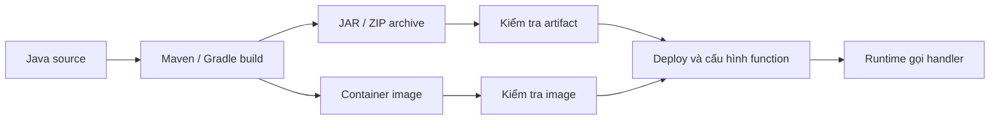

# Đóng gói ứng dụng Java thành archive hoặc container image

Trước khi triển khai Java function lên nền tảng serverless, mã nguồn phải được biên dịch và đóng gói thành artifact mà runtime có thể nạp. Hai cách phổ biến là **archive** (JAR/ZIP chứa bytecode và thư viện phụ thuộc) và **container image** (ảnh OCI chứa ứng dụng cùng môi trường chạy cần thiết).

Lựa chọn cách đóng gói ảnh hưởng đến cách khai báo handler, quản lý dependency, kích thước triển khai, cập nhật runtime, cold start và quy trình bảo mật. Dù dùng cách nào, artifact phải tương thích với Java runtime, hệ điều hành, kiến trúc CPU và giao thức invocation mà nền tảng yêu cầu.

## 1. Artifact nằm ở đâu trong quy trình serverless?

Quy trình cơ bản gồm biên dịch mã Java, đóng gói dependency, kiểm tra artifact, tải artifact lên nền tảng và cấu hình function để runtime gọi đúng handler.



Artifact cần mang theo những gì ứng dụng cần để chạy, chẳng hạn class đã biên dịch, thư viện runtime và tài nguyên như file cấu hình không nhạy cảm. Một số thành phần do nền tảng cung cấp, ví dụ Java runtime hoặc Lambda Runtime Interface Client, có thể không cần đóng gói lại. Điều này phụ thuộc loại deployment và base image được chọn.

Không nên coi JAR, ZIP và container image là ba định dạng thay thế hoàn toàn cho nhau. JAR là định dạng archive của Java; ZIP thường là gói triển khai mà nền tảng nhận; container image là một filesystem và metadata theo chuẩn OCI. Một file JAR có thể nằm bên trong ZIP hoặc container image.

## 2. Đóng gói dạng JAR hoặc ZIP archive

### 2.1. JAR chứa bytecode và dependency

Sau khi biên dịch, mã Java được lưu dưới dạng `.class`. JAR là một archive có cấu trúc ZIP, thường chứa class, resource và metadata trong `META-INF`. Một JAR có thể chỉ chứa ứng dụng, hoặc chứa cả dependency theo kiểu *fat JAR*/*uber JAR*.

Có hai cách tổ chức thường gặp:

- **Thin JAR:** JAR chứa class và resource của ứng dụng; các thư viện phụ thuộc được đóng gói riêng trong một thư mục hoặc archive theo quy ước của nền tảng.
- **Fat JAR / Uber JAR:** các class và resource của dependency được gộp vào một JAR để giảm thao tác quản lý classpath khi triển khai.

Ví dụ cấu trúc một ZIP triển khai kiểu thin JAR:

```text
function.zip
└── lib/
    ├── function.jar
    ├── jackson-databind.jar
    ├── aws-lambda-java-core.jar
    └── other-runtime-dependency.jar
```

Với kiểu fat JAR, cấu trúc có thể chỉ cần một JAR ứng dụng:

```text
function.zip
└── lib/
    └── function-all.jar
```

Đây là ví dụ bố trí thường dùng với AWS Lambda Java ZIP deployment; nền tảng khác có thể yêu cầu đường dẫn, metadata hoặc cách nạp classpath khác. Luôn kiểm tra quy ước deployment package của runtime đích.

### 2.2. Thin JAR và classpath

Thin JAR có ưu điểm là dependency được tách riêng, dễ kiểm tra và có thể chia sẻ giữa nhiều function. Tuy nhiên, tất cả thư viện cần thiết phải nằm trên classpath khi runtime khởi chạy. Nếu thiếu một JAR, function có thể gặp `ClassNotFoundException` hoặc `NoClassDefFoundError` khi chạy.

Nếu nhiều dependency cung cấp cùng một class hoặc resource, classloader có thể nạp nhầm phiên bản. Cần quản lý version bằng Maven/Gradle, tránh đóng gói trùng thư viện và kiểm tra các dependency bắc cầu (transitive dependencies). Không dựa vào thư viện có sẵn trên máy phát triển vì môi trường serverless có thể không có chúng.

### 2.3. Fat JAR bằng Maven Shade Plugin

Với function dùng handler của AWS Lambda Java runtime, có thể dùng Maven Shade Plugin để gộp class ứng dụng và dependency vào một JAR. Ví dụ sau minh họa cấu hình tối thiểu; phiên bản Java trong POM phải khớp với runtime đã chọn.

```xml
<properties>
    <maven.compiler.release>21</maven.compiler.release>
    <project.build.sourceEncoding>UTF-8</project.build.sourceEncoding>
</properties>

<build>
    <finalName>function</finalName>
    <plugins>
        <plugin>
            <groupId>org.apache.maven.plugins</groupId>
            <artifactId>maven-shade-plugin</artifactId>
            <version>3.6.0</version>
            <executions>
                <execution>
                    <phase>package</phase>
                    <goals>
                        <goal>shade</goal>
                    </goals>
                    <configuration>
                        <createDependencyReducedPom>false</createDependencyReducedPom>
                        <transformers>
                            <transformer implementation="org.apache.maven.plugins.shade.resource.ServicesResourceTransformer"/>
                        </transformers>
                    </configuration>
                </execution>
            </executions>
        </plugin>
    </plugins>
</build>
```

`ServicesResourceTransformer` giúp hợp nhất các file service provider trong `META-INF/services`, vốn được một số thư viện dùng với Java ServiceLoader. Các ứng dụng có resource trùng tên, chữ ký JAR hoặc cấu hình framework đặc biệt có thể cần transformer hoặc filter bổ sung. Hãy kiểm tra tài liệu của dependency và thử khởi chạy artifact sau khi shade.

Build bằng Maven:

```bash
mvn -B clean verify
```

Với cấu hình `finalName` ở trên, artifact chính dự kiến là `target/function.jar`. Có thể kiểm tra danh sách nội dung bằng:

```bash
jar tf target/function.jar
```

Nếu không dùng fat JAR, có thể copy các dependency runtime vào thư mục `lib` bằng Maven Dependency Plugin rồi đóng gói cùng JAR ứng dụng. Điều quan trọng là thư mục và classpath phải đúng với runtime đích.

### 2.4. Đóng gói ZIP cho nền tảng

Một số nền tảng nhận ZIP deployment package. Ví dụ với AWS Lambda Java, có thể đặt JAR ứng dụng và dependency trong thư mục `lib` rồi nén thư mục này:

```bash
mkdir -p package/lib
cp target/function.jar package/lib/
(cd package && zip -r ../function.zip lib)
```

Nếu JAR chưa chứa dependency, phải copy các JAR runtime còn thiếu vào `package/lib` trước khi tạo ZIP. Không đưa file test, cache build, source code không cần thiết hoặc thư viện chỉ dùng khi compile vào package runtime.

Handler thường được cấu hình riêng trong cấu hình function của nền tảng. Với AWS Lambda Java, giá trị handler có thể có dạng `com.example.OrderHandler::handleRequest`. Handler phải tồn tại trong classpath và có chữ ký phù hợp với runtime. Đóng gói JAR thành công không có nghĩa runtime tự biết phải gọi class hoặc method nào.

## 3. Java runtime và handler phải tương thích

Trước khi build, hãy chọn Java runtime mà nền tảng hỗ trợ và đặt `maven.compiler.release` hoặc toolchain Gradle tương ứng. Build bằng JDK mới hơn không bảo đảm bytecode chạy được trên runtime cũ hơn. Ngược lại, build bằng release thấp có thể chạy trên runtime mới, nhưng vẫn cần kiểm tra thư viện và API mà ứng dụng sử dụng.

Với FaaS, handler là điểm vào mà nền tảng gọi. Một ứng dụng có `public static void main` không tự động trở thành function tương thích. `main` phù hợp với tiến trình Java độc lập; function cần adapter/handler theo giao thức của nền tảng. Một số framework cung cấp adapter để biến controller hoặc bean thành handler, nhưng adapter đó cũng phải được đóng gói và cấu hình đúng.

Đặc biệt cần phân biệt:

- **FaaS runtime:** nền tảng gọi handler qua invocation protocol. Container image, nếu được hỗ trợ, phải chứa runtime client hoặc runtime interface phù hợp.
- **Serverless container service:** nền tảng chạy một container như dịch vụ; ứng dụng thường khởi động HTTP server và lắng nghe cổng do môi trường cung cấp, ví dụ biến `PORT`. Cách này không nhất thiết dùng handler Java kiểu Lambda.

Không lấy Dockerfile dành cho một loại dịch vụ rồi giả định nó chạy được trên loại còn lại. Hãy xác định rõ nền tảng đang chờ một handler invocation hay một tiến trình HTTP server.

## 4. Đóng gói bằng container image

Container image theo chuẩn OCI chứa filesystem, thư viện hệ thống, Java runtime, ứng dụng và metadata khởi chạy. Cách này cho phép kiểm soát môi trường chạy nhiều hơn archive, đặc biệt khi ứng dụng cần thư viện hệ thống hoặc native library.

Container image thường phù hợp khi:

- Ứng dụng cần native library hoặc công cụ hệ thống mà runtime managed không cung cấp.
- Cần kiểm soát chính xác JRE, thư viện hệ điều hành và cấu trúc filesystem.
- Cùng một image cần được kiểm thử và triển khai qua nhiều môi trường tương thích.
- Nền tảng mục tiêu hỗ trợ image deployment và nhóm vận hành đã có quy trình registry, scan và cập nhật image.

Đổi lại, nhóm phát triển cần quản lý base image, bản vá hệ điều hành, kích thước image, quyền registry và quy trình build/push. Image lớn có thể làm tăng thời gian tải hoặc khởi tạo ở một số nền tảng; hiệu quả thực tế còn phụ thuộc cơ chế cache image của nhà cung cấp.

### 4.1. Multi-stage Dockerfile cho AWS Lambda Java

Ví dụ sau dành riêng cho AWS Lambda Java 21. Build stage dùng Maven/JDK để tạo JAR; runtime stage dùng base image Lambda có sẵn Java runtime và Lambda Runtime Interface Client. Đây là base image dành cho Lambda, không phải Dockerfile chung cho mọi dịch vụ serverless.

```dockerfile
FROM maven:3.9-eclipse-temurin-21 AS build
WORKDIR /workspace

COPY pom.xml .
COPY src ./src
RUN mvn -B clean verify

FROM public.ecr.aws/lambda/java21
COPY --from=build /workspace/target/function.jar ${LAMBDA_TASK_ROOT}/lib/

CMD ["com.example.OrderHandler::handleRequest"]
```

Trong ví dụ, Maven Shade Plugin tạo `target/function.jar`. `LAMBDA_TASK_ROOT` là thư mục ứng dụng của base image Lambda. `CMD` khai báo handler mà runtime gọi. Nếu dùng thin JAR, cần copy đầy đủ dependency vào classpath theo quy ước của base image. Nếu dùng base image khác, hãy làm theo hướng dẫn runtime interface của nền tảng đó.

Build image:

```bash
docker build -t order-function:dev .
```

Kiểm tra metadata image:

```bash
docker image inspect order-function:dev
```

Sau khi kiểm thử, image được tag và đẩy lên registry mà nền tảng có quyền đọc, ví dụ Amazon ECR cho AWS Lambda. Khi triển khai, nên tham chiếu image digest bất biến để biết chính xác nội dung đã phát hành; tag như `latest` có thể trỏ sang image khác theo thời gian.

### 4.2. Dockerfile cho serverless container chạy HTTP

Với một dịch vụ container serverless yêu cầu ứng dụng tự mở HTTP server, runtime stage có thể là JRE thông thường và lệnh khởi chạy là `java -jar`. Ví dụ tổng quát:

```dockerfile
FROM eclipse-temurin:21-jre
WORKDIR /app
COPY target/application.jar /app/application.jar

ENV PORT=8080
EXPOSE 8080
ENTRYPOINT ["java", "-jar", "/app/application.jar"]
```

Ứng dụng phải đọc cổng từ biến môi trường mà nền tảng quy định và bind vào interface phù hợp, thường là `0.0.0.0`. Đoạn Dockerfile này chỉ phù hợp với ứng dụng có HTTP server được đóng gói trong JAR; nó không thay thế Lambda handler runtime. Hãy kiểm tra yêu cầu health check, startup probe, concurrency và shutdown signal của dịch vụ đích.

### 4.3. Chọn kiến trúc CPU và native library

Image phải tương thích với kiến trúc mà function được cấu hình chạy, thường là `x86_64` hoặc `arm64` tùy nền tảng. Nếu ứng dụng dùng JNI, Netty native transport, thư viện nén hoặc binary hệ điều hành, cần xác minh kiến trúc CPU, ABI, libc và phiên bản hệ thống của image.

Khi build image đa kiến trúc, dùng Buildx hoặc quy trình build riêng cho từng kiến trúc theo khả năng của registry và nền tảng. Không copy binary native được build trên máy phát triển Windows/macOS vào image Linux rồi giả định nó hoạt động. Hãy build trong môi trường tương thích và kiểm tra image trên kiến trúc đích.

## 5. So sánh archive và container image

| Tiêu chí | JAR/ZIP archive | Container image |
|---|---|---|
| Thành phần đóng gói | Bytecode, resource và dependency ứng dụng | Ứng dụng, dependency, JRE và filesystem cần thiết |
| Runtime Java | Thường do nền tảng cung cấp | Thường nằm trong image hoặc base image |
| Kiểm soát hệ điều hành | Hạn chế theo runtime managed | Cao hơn nhờ base image |
| Native library | Phải tương thích môi trường nền tảng | Có thể đóng gói thư viện hệ thống tương thích |
| Quy trình phát hành | Upload archive hoặc artifact | Build, scan, push registry rồi deploy image |
| Cập nhật bảo mật | Cập nhật dependency và chọn runtime nền tảng | Cập nhật dependency, JRE và base image |
| Kích thước và cold start | Thường gọn nếu dependency ít; vẫn phụ thuộc classpath | Có thể lớn hơn; tác động phụ thuộc cache và nền tảng |
| Phù hợp | Function Java thông thường, ít phụ thuộc hệ thống | Cần kiểm soát môi trường hoặc thư viện native |

Nếu Java function chỉ cần JRE chuẩn và các thư viện Java phổ biến, archive thường đơn giản để build và triển khai. Nếu cần thư viện hệ thống, runtime tùy chỉnh hoặc muốn kiểm soát môi trường ở mức container, image có thể phù hợp hơn. Cần cân nhắc giới hạn kích thước, thời gian khởi tạo và quy trình vận hành mà nền tảng áp dụng.

## 6. Kiểm tra artifact trước khi triển khai

Không nên đợi đến production mới phát hiện thiếu dependency hoặc handler sai. Một pipeline CI nên kiểm tra artifact sau build.

### 6.1. Kiểm tra JAR và ZIP

Các bước cơ bản:

1. Xác minh file artifact tồn tại và không rỗng.
2. Dùng `jar tf` để kiểm tra class, resource và dependency có trong JAR.
3. Dùng `unzip -l function.zip` để kiểm tra cấu trúc ZIP và bảo đảm không có một thư mục gốc thừa khiến runtime không tìm thấy `lib`.
4. Kiểm tra handler class có trong classpath, method có chữ ký đúng và các thư viện runtime không bị thiếu.
5. Chạy smoke test với runtime emulator hoặc môi trường thử nghiệm tương ứng với nền tảng.

`jar tf` chỉ chứng minh class có trong archive; nó không chứng minh class đó nạp được hoặc handler chạy thành công. Cần có integration test để kiểm tra việc deserialize event, khởi tạo dependency và gọi handler.

### 6.2. Kiểm tra container image

Với image, hãy kiểm tra:

- Image build thành công và dùng đúng base image/runtime.
- Entrypoint hoặc CMD trỏ đúng handler hay lệnh khởi động HTTP server.
- Image chạy trên kiến trúc CPU đã cấu hình cho function.
- Runtime user, quyền filesystem và thư mục ghi tạm phù hợp yêu cầu nền tảng.
- Ứng dụng khởi động được, nhận invocation hoặc HTTP request và kết thúc đúng khi được yêu cầu.
- Không có secret trong layer, build argument, environment mặc định hoặc image history.
- Image được scan dependency và OS package; phát hành bằng digest đã kiểm tra.

Build thành công không bảo đảm image có thể khởi động trong môi trường serverless. Cần kiểm thử bằng runtime interface emulator hoặc staging deployment của nhà cung cấp, với event đại diện và quyền truy cập thật gần với production.

## 7. Tối ưu kích thước, cold start và tài nguyên

Cold start có thể bao gồm thời gian chuẩn bị execution environment, nạp runtime, tải hoặc mount artifact, khởi tạo class và tạo dependency. Kích thước artifact chỉ là một yếu tố; số lượng class, static initializer, framework bootstrap, kết nối mạng và truy vấn khởi tạo cũng ảnh hưởng.

Một số cách tối ưu:

- Chỉ đóng gói dependency cần ở runtime; loại bỏ thư viện phát triển và test.
- Tránh gộp nhiều phiên bản của cùng thư viện hoặc resource không sử dụng.
- Giảm công việc trong static initializer và constructor; trì hoãn kết nối hoặc tải dữ liệu đến lúc thật sự cần.
- Đo thời gian khởi tạo và thời gian xử lý riêng để biết phần nào gây cold start.
- Chọn archive hoặc image theo kết quả đo trên nền tảng mục tiêu, không chỉ dựa vào kích thước file trên máy phát triển.
- Cấu hình memory/CPU và concurrency phù hợp; một mức memory cao hơn có thể cấp CPU nhiều hơn trên một số nền tảng, nhưng làm thay đổi chi phí.

Với container image, dùng multi-stage build để loại bỏ Maven, JDK và source khỏi runtime image khi không cần. Chọn base image phù hợp, chỉ cài package hệ thống cần thiết và cập nhật bản vá thường xuyên. Tuy nhiên, không tối ưu bằng cách xóa thư viện mà runtime hoặc native dependency cần để khởi động.

## 8. Bảo mật chuỗi cung ứng và cấu hình

Artifact là một phần của chuỗi cung ứng phần mềm. Một JAR hoặc image bị thay đổi có thể chạy mã không mong muốn với quyền của function. Vì vậy, build và phát hành cần có khả năng truy xuất nguồn gốc.

- Pin phiên bản dependency và base image; với image production, cân nhắc pin digest để tránh tag thay đổi nội dung.
- Chạy dependency scan, image scan và kiểm tra license theo chính sách tổ chức.
- Sinh SBOM nếu quy trình phát hành yêu cầu để biết artifact chứa thư viện nào.
- Chỉ cho pipeline được ủy quyền push artifact; chỉ cấp cho function quyền pull image cần thiết.
- Ký artifact hoặc image và xác minh chữ ký nếu nền tảng/toolchain hỗ trợ.
- Không đưa password, API key, private key hoặc file `.env` có secret vào JAR, ZIP hay image layer.
- Đưa cấu hình theo môi trường vào biến môi trường hoặc dịch vụ cấu hình/secret manager; phân biệt cấu hình thông thường với secret.
- Dùng role hoặc workload identity để function lấy quyền truy cập dịch vụ; tránh credential dài hạn được nhúng vào artifact.

Nếu secret từng được thêm vào một image layer, xóa file ở layer sau không làm secret biến mất khỏi các layer trước. Cần build lại image sạch, thu hồi hoặc luân chuyển secret và xử lý image cũ trong registry theo quy trình.

## 9. Quy trình triển khai gợi ý

Một quy trình CI/CD có thể thực hiện theo thứ tự sau:

1. Kiểm tra mã nguồn, dependency và phiên bản Java mục tiêu.
2. Chạy unit test, contract test và integration test phù hợp.
3. Build JAR/ZIP hoặc container image từ cùng một revision đã xác định.
4. Kiểm tra nội dung archive hoặc image, handler, classpath, kiến trúc và cấu hình khởi động.
5. Scan dependency và image; tạo SBOM hoặc chữ ký nếu pipeline yêu cầu.
6. Đưa artifact vào kho lưu trữ hoặc registry có kiểm soát quyền truy cập.
7. Deploy vào môi trường thử nghiệm, chạy smoke test với event/request đại diện.
8. Phát hành đúng artifact đã kiểm thử bằng version hoặc digest bất biến.
9. Theo dõi lỗi khởi động, invocation error, cold start, latency, concurrency và chi phí sau triển khai.

Không build lại một artifact khác nhau cho production nếu mục tiêu là phát hành chính xác artifact đã qua kiểm thử. Hãy promote cùng một artifact giữa các môi trường và truyền cấu hình theo môi trường bên ngoài artifact.

## 10. Lỗi đóng gói thường gặp

| Triệu chứng | Nguyên nhân thường gặp | Hướng kiểm tra |
|---|---|---|
| `ClassNotFoundException` | Thiếu dependency hoặc sai classpath | Kiểm tra nội dung JAR/ZIP và dependency scope |
| `NoClassDefFoundError` | Dependency thiếu lúc chạy hoặc lỗi khởi tạo class trước đó | Xem exception gốc, kiểm tra version và classloader |
| Runtime không tìm thấy handler | Sai tên class/method hoặc handler không nằm trong package | Kiểm tra cấu hình handler và `jar tf` |
| Function chạy trên máy local nhưng lỗi trên cloud | Khác Java runtime, kiến trúc, biến môi trường hoặc native library | Đối chiếu runtime, architecture và môi trường triển khai |
| Lỗi `NoSuchMethodError` hoặc `LinkageError` | Các dependency không tương thích version | Kiểm tra dependency tree và JAR bị đóng gói trùng |
| Image build được nhưng không khởi động | Sai base image, CMD/entrypoint hoặc runtime protocol | Dùng đúng base image và emulator của nền tảng |
| Container service không nhận request | Ứng dụng không bind cổng/interface theo yêu cầu | Kiểm tra biến `PORT`, bind address và health check |
| Cold start tăng sau phát hành | Artifact lớn hơn, bootstrap nặng hoặc dependency khởi tạo chậm | So sánh init duration, image size và class initialization |

Khi gặp lỗi, hãy lấy log khởi động và exception gốc trước khi thay đổi dependency hàng loạt. Một lỗi classpath có thể bắt nguồn từ một thư viện bắc cầu duy nhất; thay đổi nhiều version cùng lúc làm khó xác định nguyên nhân.

## 11. Checklist lựa chọn và đóng gói

Trước khi triển khai Java serverless, hãy trả lời:

1. Nền tảng nhận JAR, ZIP hay container image? Có giới hạn kích thước và quy tắc cấu trúc nào?
2. Đây là FaaS handler runtime hay serverless container chạy HTTP server?
3. Java runtime và phiên bản bytecode có tương thích không?
4. Dependency nào cần ở runtime? Classpath và service loader có hoạt động sau khi đóng gói không?
5. Handler class/method hoặc entrypoint có được cấu hình chính xác không?
6. Kiến trúc CPU, native library và thư viện hệ điều hành có tương thích không?
7. Artifact có chứa secret, file test, cache build hoặc dependency không cần thiết không?
8. Đã kiểm tra nội dung package, chạy smoke test và thử lỗi khởi động chưa?
9. Đã scan dependency/image, quản lý base image và lưu digest/version bất biến chưa?
10. Kích thước artifact, cold start, memory, concurrency và chi phí đã được đo trên môi trường mục tiêu chưa?

## Kết luận

Archive JAR/ZIP phù hợp với nhiều Java function có dependency thông thường và runtime do nền tảng quản lý. Container image phù hợp khi cần kiểm soát JRE, hệ điều hành hoặc native library, với điều kiện image tuân thủ invocation protocol của dịch vụ đích. Dù chọn cách nào, cần đóng gói đúng dependency, cấu hình đúng handler hoặc entrypoint, kiểm tra Java runtime và kiến trúc, bảo vệ artifact khỏi secret và kiểm thử bằng runtime tương ứng trước khi phát hành.
