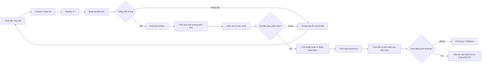

# CI/CD là gì và vai trò trong vòng đời phát triển phần mềm

## 1. Bối cảnh: vì sao cần CI/CD?

Phần mềm được tạo ra qua nhiều thay đổi nhỏ: lập trình viên sửa mã nguồn, bổ sung kiểm thử, cập nhật cấu hình, tích hợp thư viện và sửa lỗi. Mỗi thay đổi đều có thể ảnh hưởng đến những phần khác của hệ thống. Nếu việc tích hợp, kiểm thử và phát hành chủ yếu dựa vào thao tác thủ công, nhóm phát triển thường gặp một số vấn đề:

- Các thay đổi được tích hợp muộn, khiến xung đột và lỗi tương thích khó tìm nguyên nhân.
- Những bước build, kiểm thử hoặc đóng gói được thực hiện khác nhau giữa máy của từng người và môi trường triển khai.
- Bản phát hành khó truy ngược về commit, cấu hình, kết quả kiểm thử hoặc người thực hiện.
- Lỗi có thể chỉ được phát hiện khi phần mềm đã đến môi trường gần với người dùng hoặc môi trường production.
- Việc phát hành phụ thuộc vào một vài cá nhân hiểu quy trình thủ công, làm tăng thời gian chờ và nguy cơ bỏ sót bước.

Continuous Integration và Continuous Delivery/Deployment (CI/CD) giải quyết nhóm vấn đề này bằng cách đưa các bước kiểm tra và chuyển giao phần mềm vào một quy trình tự động, có thể lặp lại và quan sát được. Mục tiêu không chỉ là chạy một lệnh build nhanh hơn. Mục tiêu là giúp nhóm đưa thay đổi nhỏ, đã được kiểm chứng, đến người dùng một cách thường xuyên và có kiểm soát.

## 2. CI/CD là gì?

CI/CD là tập hợp thực hành và quy trình tự động hóa việc tích hợp thay đổi, xác minh chất lượng, tạo gói phần mềm và đưa gói đó qua các môi trường để phát hành.

Ba khái niệm liên quan cần được phân biệt:

| Khái niệm | Ý nghĩa | Kết quả mong đợi |
|---|---|---|
| Continuous Integration (CI) – tích hợp liên tục | Thường xuyên tích hợp thay đổi mã nguồn vào nhánh dùng chung; mỗi thay đổi được kiểm tra tự động. | Phát hiện sớm lỗi build, lỗi kiểm thử, lỗi định dạng hoặc vấn đề tích hợp. |
| Continuous Delivery – chuyển giao liên tục | Tự động build, kiểm thử, đóng gói và chuẩn bị phiên bản để có thể phát hành. Việc đưa lên production thường vẫn cần một quyết định hoặc phê duyệt. | Luôn có một phiên bản đủ điều kiện để phát hành theo quy trình đã định. |
| Continuous Deployment – triển khai liên tục | Mở rộng Continuous Delivery: mọi thay đổi vượt qua các cổng chất lượng và chính sách phát hành sẽ tự động được triển khai production. | Thay đổi đủ điều kiện có thể đến production mà không cần thao tác phê duyệt thủ công cho từng lần. |

Continuous Delivery và Continuous Deployment có chung nền tảng tự động hóa. Điểm khác biệt chủ yếu là quyết định cuối cùng đưa phiên bản lên production được thực hiện bằng một bước phê duyệt có chủ đích hay tự động theo chính sách.

CI/CD không có nghĩa mọi thay đổi đều được phát hành ngay lập tức. Nhóm vẫn cần quy tắc review mã nguồn, kiểm thử phù hợp, quản lý quyền, phê duyệt khi cần và kế hoạch xử lý sự cố. Tự động hóa làm cho quy trình nhất quán; nó không thay thế trách nhiệm kỹ thuật và quyết định phát hành.

## 3. CI/CD nằm ở đâu trong vòng đời phát triển phần mềm?

CI/CD kết nối công việc phát triển với vận hành. Nó tạo một luồng kiểm chứng liên tục từ thay đổi trong Git đến phiên bản chạy trong môi trường đích.



Một vòng đời phần mềm thường có các hoạt động như xác định yêu cầu, thiết kế, lập trình, review, tích hợp, kiểm thử, đóng gói, triển khai, vận hành và cải tiến. CI/CD không thay thế các hoạt động này; nó cung cấp đường đi tự động và bằng chứng kiểm chứng cho phần việc có thể chuẩn hóa.

| Giai đoạn phát triển | Vai trò của CI/CD | Bằng chứng hoặc đầu ra |
|---|---|---|
| Lập kế hoạch và thiết kế | Liên kết thay đổi với issue, yêu cầu hoặc quyết định kỹ thuật; xác định tiêu chí kiểm thử và phát hành. | Mã tham chiếu issue, tiêu chí chấp nhận, quy tắc pipeline. |
| Phát triển và review | Kích hoạt kiểm tra khi có push hoặc pull request; hỗ trợ review bằng kết quả tự động. | Commit, pull request, kết quả lint và kiểm tra tĩnh. |
| Tích hợp | Build và chạy kiểm thử tự động trên thay đổi mới. | Trạng thái pipeline, log build, báo cáo kiểm thử. |
| Đóng gói | Tạo artifact có định danh và lưu trữ để sử dụng lại. | Gói ứng dụng, mã phiên bản hoặc digest, metadata build. |
| Kiểm thử và chấp nhận | Triển khai artifact vào môi trường phù hợp và thực hiện kiểm thử chức năng, tích hợp hoặc chấp nhận. | Kết quả test, báo cáo chất lượng, dấu vết môi trường. |
| Phát hành và triển khai | Áp dụng cổng phê duyệt, cấu hình môi trường, kiểm soát bí mật và chiến lược rollout. | Lịch sử triển khai, phiên bản đã phát hành, người hoặc quy tắc phê duyệt. |
| Vận hành và cải tiến | Xác minh sau triển khai, theo dõi chỉ số và phản hồi sự cố về quy trình phát triển. | Health check, log, metric, cảnh báo và lịch sử rollback. |

## 4. Luồng CI: kiểm chứng thay đổi càng sớm càng tốt

Một luồng CI thường bắt đầu từ sự kiện trong hệ thống quản lý mã nguồn, chẳng hạn push commit hoặc tạo/cập nhật pull request. Hệ thống CI nhận sự kiện, lấy đúng phiên bản mã nguồn và chạy pipeline đã khai báo.

Các bước thường gặp gồm:

1. **Checkout mã nguồn:** lấy commit cần kiểm tra. Pipeline cần ghi nhận chính xác commit hoặc revision đã được checkout.
2. **Chuẩn bị môi trường build:** cài dependency và công cụ với phiên bản được kiểm soát. Khóa dependency và cấu hình build giúp giảm khác biệt giữa các lần chạy.
3. **Kiểm tra nhanh:** chạy formatter check, lint, kiểm tra kiểu hoặc phân tích tĩnh nếu dự án sử dụng.
4. **Build:** biên dịch hoặc đóng gói mã nguồn để xác nhận dự án có thể tạo ra sản phẩm.
5. **Kiểm thử:** chạy unit test trước, sau đó là integration test hoặc các bộ kiểm thử phù hợp với thời gian và rủi ro.
6. **Báo kết quả:** trả trạng thái thành công/thất bại về pull request hoặc hệ thống quản lý công việc, kèm log và báo cáo cần thiết.

Ví dụ, một pull request thay đổi hàm tính phí có thể kích hoạt formatter check, static analysis, build và unit test. Nếu một unit test thất bại, pipeline báo lỗi và cung cấp log để người tạo pull request sửa trước khi hợp nhất. Nhờ vậy, lỗi được phát hiện khi phạm vi thay đổi còn nhỏ và người chịu trách nhiệm vẫn đang tập trung vào phần mã vừa sửa.

CI hiệu quả thường khuyến khích tích hợp thường xuyên, thay đổi có kích thước hợp lý và phản hồi nhanh. Nếu pipeline mất quá lâu, thường xuyên không ổn định hoặc tạo cảnh báo không có giá trị, nhóm sẽ có xu hướng bỏ qua kết quả. Vì vậy cần phân tầng kiểm thử: kiểm tra nhanh trên mỗi pull request, kiểm tra sâu hơn theo nhánh hoặc lịch chạy, đồng thời theo dõi và sửa các bài test chập chờn.

## 5. Luồng CD: chuyển artifact qua các môi trường

Sau khi mã nguồn vượt qua các bước CI, hệ thống có thể tạo artifact – sản phẩm được đóng gói để triển khai, ví dụ file JAR, gói npm, image container hoặc gói cài đặt. Artifact nên được lưu trong kho lưu trữ có quản lý quyền và metadata.

Một luồng CD điển hình gồm:

- Tạo artifact từ một commit đã xác định.
- Gắn phiên bản hoặc định danh bất biến; lưu checksum/digest khi phù hợp.
- Đưa artifact vào kho lưu trữ.
- Triển khai cùng artifact đó lần lượt qua môi trường development, staging và production theo chính sách.
- Cung cấp cấu hình riêng cho từng môi trường tại thời điểm triển khai.
- Chạy kiểm tra sau triển khai và lưu lại kết quả.

Một nguyên tắc quan trọng là **build một lần, triển khai nhiều môi trường**. Nếu mỗi môi trường tự build lại từ mã nguồn, các gói có thể khác nhau do dependency, thời điểm build hoặc cấu hình. Khi dùng cùng một artifact đã được xác định, nhóm có thể kiểm tra chính gói dự kiến phát hành và truy vết phiên bản đang chạy.

Ví dụ: commit `a1b2c3d` tạo ra image `registry.example/app@sha256:...`. Pipeline triển khai image đó vào staging, chạy smoke test, sau khi được phê duyệt thì triển khai cùng digest lên production. Tên tag như `latest` có thể hữu ích khi tra cứu, nhưng tag có thể được di chuyển; digest hoặc định danh bất biến giúp xác định chính xác nội dung đã triển khai.

## 6. Pipeline dưới dạng mã và sự kiện Git

Pipeline dưới dạng mã (Pipeline as Code) nghĩa là các bước tự động hóa được mô tả trong file cấu hình có quản lý phiên bản cùng dự án. Tùy nền tảng, file này có thể là YAML, cú pháp khai báo hoặc mã lệnh. Cách làm này giúp nhóm review thay đổi pipeline như review mã nguồn, tái sử dụng quy tắc và khôi phục lịch sử khi cần.

Các sự kiện Git thường dùng để kích hoạt pipeline gồm:

- **Push:** kiểm tra commit mới được đẩy lên một nhánh.
- **Pull request / merge request:** kiểm tra thay đổi trước khi hợp nhất.
- **Merge vào nhánh chính:** chạy build, kiểm thử sâu hơn hoặc tạo artifact.
- **Tạo tag hoặc release:** khởi động quy trình đóng gói/phát hành theo phiên bản.
- **Lịch chạy hoặc kích hoạt thủ công:** thực hiện kiểm tra định kỳ, bảo trì hoặc tác vụ được kiểm soát.

Ví dụ dưới đây minh họa ý tưởng pipeline, không gắn với cú pháp của một nhà cung cấp cụ thể:

```yaml
name: ci
on:
  pull_request:
  push:
    branches: [main]

jobs:
  verify:
    steps:
      - checkout: source
      - run: install-dependencies
      - run: lint
      - run: build
      - run: unit-tests
```

Tên khóa và cách viết trigger thực tế phụ thuộc công cụ CI/CD. Dù dùng nền tảng nào, pipeline cần làm rõ sự kiện kích hoạt, phiên bản mã nguồn, các bước thực thi, điều kiện thành công, cách lưu artifact và cách công bố kết quả.

## 7. Cổng chất lượng và kiểm soát phát hành

Cổng chất lượng (quality gate) là tập hợp điều kiện phải đạt trước khi pipeline cho phép chuyển sang bước tiếp theo. Điều kiện có thể gồm:

- Build hoàn tất thành công.
- Các bộ kiểm thử bắt buộc đạt ngưỡng đã định.
- Không có lỗi nghiêm trọng từ phân tích mã nguồn hoặc quét lỗ hổng theo chính sách.
- Kiểm tra dependency và license đáp ứng quy định của dự án.
- Artifact được tạo, lưu trữ và định danh thành công.
- Các kiểm thử trên môi trường đích và health check đạt yêu cầu.
- Phê duyệt của người có thẩm quyền đã được ghi nhận nếu quy trình yêu cầu.

Không phải dự án nào cũng cần mọi cổng ở mọi giai đoạn. Nhóm nên chọn điều kiện gắn với rủi ro thực tế, đặt ngưỡng có thể giải thích và chỉ định người chịu trách nhiệm khi cổng thất bại. Cổng chất lượng không có ý nghĩa nếu thất bại vẫn bị bỏ qua thường xuyên hoặc kết quả không thể truy vết.

## 8. Bí mật, quyền truy cập và cấu hình môi trường

Pipeline thường cần thông tin xác thực để đọc dependency, đẩy artifact hoặc triển khai. Token, mật khẩu, private key và credential là bí mật (secret); chúng không được ghi trực tiếp vào mã nguồn hoặc file pipeline được commit.

Thực hành cơ bản gồm:

- Lưu secret trong secret manager hoặc kho bí mật được nền tảng CI/CD hỗ trợ.
- Chỉ cấp quyền tối thiểu cho từng job và từng môi trường.
- Ưu tiên credential ngắn hạn hoặc cơ chế xác thực liên kết danh tính khi nền tảng hỗ trợ.
- Hạn chế secret có thể truy cập từ pipeline chạy trên mã nguồn không đáng tin cậy, đặc biệt là pull request từ fork.
- Che giá trị nhạy cảm trong log; tránh in biến môi trường hoặc lệnh chứa token.
- Luân chuyển và thu hồi credential khi có thay đổi nhân sự hoặc nghi ngờ lộ lọt.

Cấu hình môi trường cũng cần được quản lý rõ ràng. Các giá trị không nhạy cảm có thể được lưu dưới dạng cấu hình có phiên bản; secret được cấp an toàn lúc chạy. Việc tách cấu hình khỏi artifact giúp cùng một gói ứng dụng có thể chạy ở nhiều môi trường với endpoint, giới hạn tài nguyên và chính sách riêng.

## 9. Triển khai an toàn, xác minh và quay lui

Triển khai thành công về mặt kỹ thuật chưa chắc đồng nghĩa ứng dụng hoạt động đúng. Sau khi phát hành, pipeline hoặc hệ thống vận hành cần xác minh ứng dụng thực sự sẵn sàng.

Các cách triển khai thường gặp:

- **Rolling update:** thay thế dần các instance cũ bằng phiên bản mới.
- **Blue-green:** duy trì hai nhóm môi trường, chuyển lưu lượng sang nhóm mới sau khi kiểm tra.
- **Canary:** đưa phiên bản mới đến một phần nhỏ lưu lượng hoặc người dùng, quan sát kết quả rồi mới mở rộng.
- **Feature flag:** phát hành mã nguồn nhưng bật tính năng theo cấu hình hoặc nhóm người dùng.

Sau triển khai, nhóm có thể chạy smoke test, health check, kiểm tra endpoint quan trọng và theo dõi error rate, latency, log hoặc metric nghiệp vụ. Nên xác định trước cửa sổ quan sát và ngưỡng cần hành động để tránh quyết định dựa trên cảm tính.

Rollback là đưa hệ thống về phiên bản hoặc trạng thái hoạt động trước đó khi bản phát hành mới gây sự cố. Khả năng rollback phụ thuộc vào việc lưu giữ artifact cũ, quản lý cấu hình, tương thích dữ liệu và quy trình triển khai. Thay đổi schema cơ sở dữ liệu có thể không thể đảo ngược đơn giản; khi đó cần thiết kế migration tương thích ngược, backup hoặc quy trình khôi phục riêng. Rollback mã ứng dụng không tự động khôi phục dữ liệu đã bị biến đổi.

## 10. Truy vết một lần phát hành

Một quy trình CI/CD đáng tin cậy phải trả lời được các câu hỏi:

- Phiên bản production được tạo từ commit nào?
- Pipeline nào đã chạy, theo cấu hình nào và kết quả ra sao?
- Những bài kiểm thử, kiểm tra bảo mật và cổng chất lượng nào đã đạt?
- Artifact nào đã được triển khai vào từng môi trường?
- Ai hoặc chính sách nào đã cho phép phát hành?
- Sau triển khai, hệ thống được xác minh bằng dữ liệu nào và có rollback hay không?

Để trả lời, cần lưu liên kết giữa commit, lần chạy pipeline, báo cáo kiểm thử, artifact/digest, lần triển khai, phê duyệt và dữ liệu xác minh. Log cần có thời gian, mã lần chạy và thông tin định danh phù hợp; quyền đọc và thời gian lưu trữ cũng cần được quy định. Truy vết tốt giúp điều tra sự cố, đáp ứng kiểm toán và xác định chính xác phiên bản cần khôi phục.

## 11. Ví dụ xuyên suốt: phát hành một dịch vụ web

Giả sử nhóm phát triển một dịch vụ web có mã nguồn trong Git và đóng gói bằng container.

1. Lập trình viên tạo nhánh, sửa một endpoint và mở pull request.
2. Sự kiện pull request kích hoạt pipeline CI. Pipeline checkout commit, cài dependency, chạy lint, build và unit test.
3. Khi có lỗi kiểm thử, pull request nhận trạng thái thất bại cùng log. Lập trình viên sửa lỗi và cập nhật pull request; pipeline chạy lại trên commit mới.
4. Khi review và các kiểm tra bắt buộc đều đạt, thay đổi được hợp nhất vào nhánh chính.
5. Pipeline tạo image, gắn định danh theo phiên bản và digest, sau đó đẩy image vào registry. Thông tin commit và kết quả kiểm thử được liên kết với artifact.
6. CD triển khai digest đó lên staging bằng credential lấy từ secret manager. Pipeline chạy integration test và smoke test.
7. Sau khi đáp ứng quality gate và được phê duyệt theo chính sách, cùng digest được triển khai lên production theo chiến lược canary.
8. Hệ thống theo dõi health check, tỷ lệ lỗi và độ trễ. Nếu các chỉ số vượt ngưỡng, rollout dừng và nhóm chuyển về phiên bản ổn định trước đó theo quy trình rollback.
9. Lịch sử phát hành lưu commit, artifact digest, pipeline run, phê duyệt, môi trường, kết quả xác minh và hành động rollback nếu có.

Ví dụ này cho thấy CI/CD nối các hoạt động vốn rời rạc thành một luồng có thể kiểm tra. Mỗi bước có đầu vào, đầu ra và điều kiện chuyển tiếp rõ ràng.

## 12. Lợi ích và giới hạn của CI/CD

Khi được thiết kế và duy trì tốt, CI/CD mang lại một số lợi ích:

- **Phản hồi sớm:** lỗi được phát hiện gần thời điểm tạo ra thay đổi.
- **Tính lặp lại:** build, kiểm thử và triển khai theo các bước đã khai báo.
- **Tốc độ phát hành:** giảm thao tác thủ công và thời gian chờ giữa các giai đoạn.
- **Chất lượng và độ tin cậy:** các kiểm tra bắt buộc được thực hiện nhất quán.
- **Truy vết:** liên kết được mã nguồn, artifact, môi trường và lịch sử phát hành.
- **Khả năng phục hồi:** có dữ liệu và quy trình để dừng rollout hoặc quay lui.

CI/CD cũng có giới hạn. Pipeline tự động hóa sai quy trình sẽ làm sai nhanh hơn; test kém chất lượng không thể bảo đảm sản phẩm đúng; pipeline không ổn định làm giảm niềm tin; và triển khai thường xuyên mà thiếu quan sát có thể tăng rủi ro vận hành. Nhóm cần đầu tư vào chất lượng kiểm thử, quản lý dependency, quyền truy cập, khả năng quan sát và bảo trì pipeline.

CI/CD không đồng nghĩa DevOps, nhưng là một năng lực kỹ thuật quan trọng hỗ trợ cách làm DevOps. DevOps còn bao gồm văn hóa cộng tác giữa phát triển và vận hành, trách nhiệm chung, phản hồi từ production và cải tiến liên tục. Một pipeline tốt giúp hiện thực hóa các nguyên tắc đó bằng quy trình cụ thể.

## 13. Những nguyên tắc nền tảng cần ghi nhớ

1. Tích hợp thay đổi thường xuyên và kiểm tra tự động ngay khi có sự kiện phù hợp trong Git.
2. Lưu pipeline dưới dạng mã để review, tái sử dụng và truy vết.
3. Tạo artifact có định danh rõ ràng; ưu tiên triển khai cùng một artifact qua các môi trường.
4. Dùng quality gate gắn với rủi ro và tiêu chí phát hành đã thống nhất.
5. Bảo vệ secret, giới hạn quyền và tách cấu hình môi trường khỏi artifact.
6. Ghi nhận quan hệ giữa commit, pipeline, kiểm thử, artifact, phê duyệt và triển khai.
7. Xác minh sau triển khai bằng kiểm tra kỹ thuật và tín hiệu vận hành.
8. Chuẩn bị phương án dừng rollout hoặc rollback, đồng thời xem xét tính tương thích của dữ liệu.

Khi hiểu CI/CD như một phần xuyên suốt vòng đời phát triển phần mềm, người làm DevOps có thể đánh giá một pipeline không chỉ bằng việc nó chạy thành công, mà còn bằng khả năng tạo ra phiên bản có thể kiểm chứng, triển khai an toàn, truy vết đầy đủ và phục hồi khi có sự cố.
