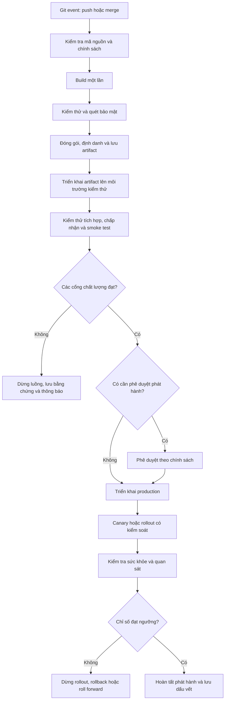

# Phân phối liên tục (Continuous Delivery): luôn sẵn sàng đưa thay đổi đến người dùng

Một nhóm phát triển có thể hoàn thành tính năng, chạy được bộ kiểm thử và tạo ra bản build thành công, nhưng vẫn mất nhiều ngày để đưa thay đổi đến người dùng. Nguyên nhân thường nằm ở những bước phát hành thủ công, môi trường khó tái tạo, cấu hình khác nhau giữa các nơi, thiếu kiểm chứng trước production hoặc không có cách quay lui đáng tin cậy.

**Phân phối liên tục (Continuous Delivery, viết tắt là CD)** giải quyết khoảng cách đó bằng cách biến quá trình đưa phần mềm từ thay đổi trong Git đến một bản phát hành có thể triển khai thành một luồng công việc lặp lại, tự động và có thể kiểm chứng. Mục tiêu là sau mỗi thay đổi đạt yêu cầu, nhóm luôn có một phiên bản đã được xây dựng, kiểm thử, đóng gói và sẵn sàng phát hành. Việc chọn thời điểm đưa phiên bản ấy đến người dùng có thể vẫn cần quyết định của con người.

CD là một năng lực của cả nhóm và hệ thống phát triển phần mềm. Pipeline chỉ là phần thực thi nhìn thấy được; để pipeline đáng tin cậy, nhóm còn cần thay đổi nhỏ, kiểm thử phù hợp, artifact bất biến, môi trường nhất quán, quản lý cấu hình và bí mật an toàn, quan sát production cùng phương án xử lý sự cố.

## 1. Continuous Delivery là gì?

Continuous Delivery là thực hành duy trì phần mềm ở trạng thái có thể phát hành bất cứ lúc nào. Mỗi thay đổi được đưa qua một chuỗi kiểm tra và triển khai tự động đến các môi trường cần thiết. Khi mọi cổng chất lượng đều đạt, nhóm có thể phát hành mà không phải bắt đầu một quy trình build và kiểm thử đặc biệt vào ngày release.

Một thay đổi được xem là **sẵn sàng phát hành** khi nhóm có đủ bằng chứng để tin rằng phiên bản đó:

- Được tạo từ một revision Git xác định và có thể truy ngược nguồn gốc.
- Đã vượt qua các kiểm thử và kiểm tra chất lượng được quy định cho loại thay đổi đó.
- Được đóng gói thành artifact có định danh ổn định, lưu ở nơi có kiểm soát.
- Đã được xác minh trên môi trường đại diện cho cách phần mềm sẽ chạy thực tế.
- Có cấu hình, quyền truy cập và bí mật được cung cấp theo cách an toàn.
- Có kế hoạch phát hành, giám sát và xử lý khi triển khai không đạt yêu cầu.

Điều này không có nghĩa mọi commit đều phải được đưa ngay lên production. Một commit có thể bị từ chối vì kiểm thử thất bại, vi phạm chính sách bảo mật hoặc chưa đáp ứng tiêu chí nghiệp vụ. Một commit vượt qua tất cả cổng kiểm soát sẽ tạo ra phiên bản có thể phát hành; người có trách nhiệm có thể chọn phát hành ngay, theo lịch hoặc khi điều kiện kinh doanh phù hợp.

### Continuous Delivery và Continuous Deployment

Hai thuật ngữ thường bị dùng thay thế cho nhau, nhưng chúng mô tả hai mức tự động hóa khác nhau:

| Khía cạnh | Continuous Delivery | Continuous Deployment |
|---|---|---|
| Trạng thái mong muốn | Mọi thay đổi đạt chuẩn đều sẵn sàng phát hành | Mọi thay đổi đạt chuẩn được tự động triển khai lên production |
| Quyết định phát hành production | Có thể cần phê duyệt hoặc thao tác chủ động | Được pipeline tự động thực hiện sau các cổng chất lượng |
| Vai trò của con người | Có thể chọn thời điểm phát hành theo nhu cầu sản phẩm, kinh doanh hoặc vận hành | Tập trung thiết kế chính sách, cổng kiểm soát và giám sát; không duyệt từng lần phát hành thông thường |
| Điều kiện cần | Pipeline đáng tin cậy và artifact luôn sẵn sàng | Toàn bộ điều kiện của Continuous Delivery cùng mức tin cậy đủ cao để tự động phát hành |

Ví dụ, một dịch vụ ngân hàng có thể triển khai liên tục đến môi trường production nhưng giữ tính năng mới sau feature flag cho đến khi bộ phận sản phẩm cho phép người dùng sử dụng. Đó vẫn có thể là Continuous Delivery: phần mềm đã được triển khai và sẵn sàng, còn thời điểm bật tính năng được kiểm soát riêng. Nếu mọi thay đổi đạt chuẩn tự động được triển khai và mở cho người dùng theo chính sách đã định, mô hình tiến gần Continuous Deployment.

## 2. Luồng phân phối liên tục từ Git đến production

Một pipeline CD thường có các chặng sau. Tên job và cách chia stage tùy nền tảng CI/CD, nhưng mỗi chặng cần có đầu vào, đầu ra và điều kiện thành công rõ ràng.



**Git event** là điểm bắt đầu có thể là pull request, push lên nhánh tích hợp, merge hoặc tạo tag phát hành. Pull request thường chạy các kiểm tra nhanh để phản hồi sớm; sau khi merge, pipeline tích hợp tạo artifact ứng viên từ revision đã được chấp nhận.

**Build và kiểm thử** xác minh mã nguồn, dependency và hành vi của ứng dụng. Những kiểm tra nhanh nên chạy sớm để phát hiện lỗi với chi phí thấp. Các kiểm tra cần nhiều dịch vụ hoặc thời gian hơn có thể chạy ở stage sau.

**Đóng gói và lưu artifact** tạo ra đơn vị triển khai có phiên bản hoặc digest rõ ràng, ví dụ image container, gói ứng dụng hoặc bundle tĩnh. Artifact được lưu trong registry hoặc kho artifact có kiểm soát quyền truy cập và chính sách lưu giữ.

**Triển khai và xác minh trên môi trường trung gian** kiểm tra cách artifact hoạt động khi kết hợp với cấu hình, dịch vụ phụ thuộc, cơ sở dữ liệu và hạ tầng gần với production. Kết quả kiểm thử phải gắn với đúng artifact đã được build.

**Phát hành production và xác minh sau triển khai** đưa phiên bản đến người dùng theo chiến lược rollout phù hợp. Pipeline kiểm tra ứng dụng có khởi động, phục vụ yêu cầu và duy trì các chỉ số sức khỏe hay không. Một lần deploy hoàn tất về mặt kỹ thuật chưa đủ để kết luận phát hành thành công.

## 3. Những nguyên tắc tạo nên một hệ thống CD đáng tin cậy

### 3.1. Dùng một luồng phát hành có thể lặp lại

Đường đi từ revision Git đến production cần được mô tả bằng quy trình thống nhất và thực thi nhất quán. Nếu nhóm có một pipeline cho kiểm thử, một bộ script riêng cho staging và một hướng dẫn thủ công khác cho production, các bước có thể dần lệch nhau.

Pipeline nên là nơi thể hiện các bước có thể tự động hóa: lệnh build, kiểm thử, đóng gói, triển khai, kiểm tra sức khỏe và điều kiện chuyển stage. Các thao tác đặc biệt cần được ghi lại, giới hạn quyền và có người chịu trách nhiệm. Một release không nên phụ thuộc vào trí nhớ của một cá nhân hoặc một máy tính cá nhân.

### 3.2. Chia thay đổi thành các lô nhỏ

Thay đổi nhỏ thường dễ hiểu, dễ kiểm thử và dễ xác định nguyên nhân khi có lỗi. Khi một release chứa hàng chục tính năng và nhiều thay đổi cơ sở dữ liệu, việc tìm ra thay đổi gây lỗi và quay lui sẽ khó hơn.

Nhóm có thể tích hợp thường xuyên vào nhánh chính, dùng feature flag để giữ tính năng chưa sẵn sàng cho người dùng và tách việc triển khai kỹ thuật khỏi thời điểm bật tính năng. Feature flag cần có chủ sở hữu, thời hạn xem xét và kế hoạch dọn bỏ để tránh tích lũy cờ cũ.

### 3.3. Tự động hóa kiểm thử và phản hồi sớm

Pipeline chỉ hữu ích khi kiểm thử đủ nhanh và đủ tin cậy để nhóm dựa vào kết quả. Một cách tổ chức phổ biến là chạy kiểm tra theo thứ tự từ nhanh đến chậm:

| Nhóm kiểm tra | Mục tiêu | Ví dụ |
|---|---|---|
| Kiểm tra mã nguồn | Phát hiện lỗi đơn giản và vi phạm quy ước | Format, lint, type check |
| Unit test | Kiểm tra logic ở phạm vi nhỏ | Quy tắc tính phí, kiểm tra dữ liệu đầu vào |
| Integration test | Kiểm tra tương tác giữa các thành phần | Repository với database, API với message broker |
| Contract test | Kiểm tra thỏa thuận giữa các dịch vụ | Schema request/response, event version |
| End-to-end test | Kiểm tra luồng nghiệp vụ xuyên hệ thống | Tạo đơn hàng và thanh toán thử |
| Security test | Phát hiện rủi ro đã biết | SAST, dependency scan, secret scan, image scan |
| Performance test | Kiểm tra khả năng đáp ứng tải | Latency, throughput, mức dùng tài nguyên |
| Smoke test sau deploy | Xác nhận phiên bản mới hoạt động cơ bản | Health endpoint, đăng nhập thử, truy vấn đọc an toàn |

Không phải thay đổi nào cũng cần chạy mọi loại kiểm thử ở mọi stage. Nhóm nên lựa chọn dựa trên rủi ro, tác động và thời gian phản hồi. Ví dụ, thay đổi giao diện có thể cần kiểm thử trình duyệt; thay đổi schema sự kiện cần contract test; thay đổi thuật toán tính phí cần bộ kiểm thử nghiệp vụ và kiểm thử hồi quy phù hợp.

Kiểm thử chập chờn (flaky test) làm suy giảm niềm tin vào pipeline. Nhóm cần theo dõi tỷ lệ flaky, tìm nguyên nhân như phụ thuộc thứ tự chạy, dữ liệu dùng chung, timeout không phù hợp hoặc môi trường không ổn định. Không nên liên tục chạy lại một kiểm thử thất bại cho đến khi nó tình cờ thành công rồi xem pipeline là đạt.

### 3.4. Build một lần, triển khai nhiều môi trường

Sau khi một revision vượt qua bước build và kiểm thử, pipeline tạo một artifact xác định. Chính artifact đó được đưa lần lượt qua môi trường kiểm thử, staging và production.

Giả sử pipeline tạo image `orders-api` với digest `sha256:abc...`. Staging và production đều phải tham chiếu đến digest đó. Nếu staging dùng image được build lúc 10 giờ nhưng production lại build lại từ cùng nhánh lúc 15 giờ, hai môi trường có thể nhận mã nguồn, dependency hoặc công cụ build khác nhau. Việc build lại làm mất bằng chứng rằng phiên bản production chính là phiên bản đã được kiểm thử.

Tag như `latest` hoặc `stable` thuận tiện để tra cứu nhưng có thể bị trỏ sang nội dung khác. Với triển khai, nên dùng version bất biến hoặc digest. Pipeline cần từ chối artifact không có nguồn gốc hợp lệ hoặc không khớp với kết quả kiểm thử đã lưu.

### 3.5. Môi trường nhất quán và cấu hình tách khỏi artifact

Các môi trường không nhất thiết phải có cùng quy mô, nhưng cần tương đồng ở những yếu tố ảnh hưởng đến hành vi: phiên bản runtime, cách đóng gói, cấu trúc mạng, quyền truy cập, dịch vụ phụ thuộc và cơ chế cấu hình.

Thông tin thay đổi theo môi trường như URL dịch vụ, mức log, giới hạn tài nguyên và feature flag nên được cung cấp lúc triển khai hoặc lúc chạy. Không nhúng mật khẩu, token hay khóa riêng vào image, repository hoặc log pipeline. Bí mật nên lấy từ secret manager với quyền tối thiểu và thời hạn phù hợp.

Hạ tầng và cấu hình môi trường nên được quản lý bằng mã khi có thể. Nhờ vậy nhóm có thể xem xét thay đổi qua Git, tái tạo môi trường và truy ra phiên bản cấu hình đã được dùng cho một lần triển khai.

### 3.6. Đặt cổng chất lượng rõ ràng

Quality gate là điều kiện quyết định một artifact có được chuyển sang bước tiếp theo hay không. Một cổng có thể yêu cầu toàn bộ kiểm thử bắt buộc đạt, không có lỗ hổng nghiêm trọng chưa được xử lý, artifact có chữ ký hợp lệ và kiểm tra triển khai thành công.

Mỗi cổng cần nêu rõ:

- Dữ liệu nào được đánh giá và lấy từ đâu.
- Ngưỡng nào được xem là đạt, cảnh báo hoặc thất bại.
- Ai có quyền ngoại lệ và ngoại lệ phải có lý do, thời hạn cùng dấu vết.
- Khi thất bại, pipeline dừng ở đâu và cung cấp thông tin nào để xử lý.

Không nên dùng một con số tùy ý làm tiêu chí chung cho mọi hệ thống. Ví dụ, tỷ lệ coverage cao không chứng minh kiểm thử có chất lượng nếu các assertion không kiểm tra hành vi quan trọng. Cổng chất lượng nên phản ánh rủi ro thực tế của sản phẩm và được điều chỉnh khi nhóm có thêm dữ liệu vận hành.

## 4. Thiết kế pipeline dưới dạng mã

Pipeline as Code lưu định nghĩa pipeline trong repository hoặc hệ thống quản lý phiên bản. Nhóm có thể review thay đổi của pipeline như review mã ứng dụng, kiểm tra lịch sử, tái sử dụng mẫu và khôi phục cấu hình khi cần.

Một pipeline nên thể hiện được quan hệ phụ thuộc giữa các job. Ví dụ: không thể đóng gói nếu build thất bại; không thể triển khai staging nếu kiểm thử bắt buộc chưa đạt; không thể rollout production nếu thiếu phê duyệt theo chính sách. Các bước độc lập có thể chạy song song để giảm thời gian phản hồi.

Ví dụ dưới đây là **mô hình YAML minh họa**, không phải cú pháp có thể chạy trực tiếp trên một nền tảng CI/CD cụ thể:

```yaml
pipeline:
  trigger:
    - pull_request
    - merge_to_main

  jobs:
    validate:
      steps:
        - checkout_source
        - lint_and_type_check
        - unit_tests

    build_and_verify:
      needs: [validate]
      steps:
        - build_application
        - integration_tests
        - security_scans

    publish_artifact:
      needs: [build_and_verify]
      outputs:
        - immutable_artifact_digest
        - build_provenance

    deploy_staging:
      needs: [publish_artifact]
      input: immutable_artifact_digest
      steps:
        - deploy_same_artifact
        - acceptance_tests
        - smoke_tests

    deploy_production:
      needs: [deploy_staging]
      condition: quality_gates_passed
      approval: release_policy
      input: immutable_artifact_digest
      strategy: canary
      steps:
        - deploy_and_observe
        - verify_release_health
```

Khi chuyển mô hình này sang GitHub Actions, GitLab CI, Jenkins hoặc nền tảng khác, cần dùng đúng cú pháp, cơ chế artifact, secret, environment protection và quyền của nền tảng đó. Tên job không quan trọng bằng hợp đồng giữa chúng: job sau phải biết chính xác nó nhận artifact nào, dựa vào bằng chứng nào và được phép thực hiện hành động gì.

Một số quyết định thiết kế cần được làm rõ:

- **Trigger:** pull request chạy kiểm tra nhanh; merge vào nhánh chính tạo ứng viên phát hành; tag có thể đánh dấu một mốc release. Tránh để nhiều trigger tạo các artifact không có quy tắc định danh thống nhất.
- **Phụ thuộc:** khai báo rõ job nào cần job nào. Chỉ chạy song song khi không tạo tranh chấp dữ liệu hoặc trạng thái môi trường.
- **Điều kiện:** dùng điều kiện để giới hạn triển khai theo nhánh, tag, môi trường và trạng thái quality gate. Không dựa vào việc người vận hành nhớ chọn đúng tham số.
- **Quyền:** job build không cần quyền ghi production. Job triển khai chỉ nhận quyền cần thiết trong thời gian cần thiết.
- **Độ bền:** đặt timeout, giới hạn retry và xử lý hủy pipeline. Retry chỉ phù hợp với lỗi tạm thời có thể phục hồi; retry không được che giấu lỗi logic.
- **Đồng thời:** kiểm soát nhiều pipeline cùng triển khai một môi trường để tránh release sau ghi đè hoặc làm lẫn trạng thái.
- **Khả năng đọc:** đặt tên job và lưu log đủ rõ để người trực vận hành xác định stage thất bại, artifact liên quan và hành động tiếp theo.

## 5. Quản lý artifact, nguồn gốc và khả năng truy vết

Artifact là sản phẩm đầu ra của quá trình build, chẳng hạn container image, file JAR, package, binary hoặc bộ tài nguyên frontend. Artifact cần có định danh duy nhất và được lưu trong registry hoặc kho có chính sách truy cập, kiểm tra và lưu giữ.

Một chuỗi truy vết tốt nối được các thông tin sau:

| Dấu vết | Câu hỏi cần trả lời |
|---|---|
| Commit SHA và repository | Mã nguồn nào tạo ra phiên bản này? |
| Pipeline run ID | Phiên bản được build bằng lần chạy nào, khi nào và bởi trigger nào? |
| Build environment và dependency | Công cụ, runtime và dependency nào đã tham gia build? |
| Artifact version hoặc digest | Chính xác nội dung nào đã được lưu và triển khai? |
| Test report và scan result | Artifact đã vượt qua những kiểm tra nào? |
| Approval và deployment ID | Ai hoặc chính sách nào cho phép phát hành, triển khai lúc nào và lên đâu? |
| Configuration revision | Phiên bản cấu hình nào được áp dụng cho môi trường? |
| Release telemetry | Sau triển khai, hệ thống có hoạt động theo kỳ vọng không? |

Với hệ thống cần bảo đảm nguồn gốc phần mềm, nhóm có thể bổ sung build provenance, Software Bill of Materials (SBOM), chữ ký số và attestations. Những bằng chứng này giúp xác minh artifact được tạo từ nguồn nào, dùng thành phần nào và đã qua quy trình nào. Việc ký artifact chỉ có ý nghĩa khi khóa ký được bảo vệ và bên triển khai thực sự kiểm tra chữ ký.

Quyền truy cập registry cũng là một phần của chuỗi cung ứng phần mềm. Nên giới hạn ai có thể publish, ghi đè hoặc xóa artifact; bật audit log; quét lỗ hổng theo chính sách; và giữ artifact đủ lâu để phục vụ điều tra hoặc rollback. Không đưa bí mật môi trường vào artifact vì artifact thường được chia sẻ qua nhiều môi trường.

## 6. Đưa phiên bản qua các môi trường

Một cách bố trí phổ biến gồm:

| Môi trường | Mục đích chính | Kiểm tra phù hợp |
|---|---|---|
| Development hoặc integration | Phản hồi nhanh khi các thay đổi được tích hợp | Unit, integration, contract test |
| Test hoặc QA | Xác minh chức năng và luồng nghiệp vụ | Acceptance test, regression, kiểm thử dữ liệu |
| Staging hoặc pre-production | Mô phỏng cách triển khai và vận hành production | Smoke, performance phù hợp, migration rehearsal, kiểm tra cấu hình |
| Production | Phục vụ người dùng thật | Health check, canary analysis, SLO và giám sát nghiệp vụ |

Không phải hệ thống nào cũng cần đủ bốn môi trường hoặc đặt tên như trên. Điều cần giữ là môi trường kiểm tra phải đại diện cho các rủi ro quan trọng của production. Nếu staging dùng database, quyền truy cập hoặc cấu hình khác biệt lớn, kết quả staging có thể không dự báo được hành vi production.

Để tránh drift, nhóm nên quản lý cấu hình và hạ tầng bằng mã, định kỳ so sánh trạng thái thực tế với trạng thái khai báo, đồng thời giới hạn chỉnh sửa trực tiếp trên môi trường. Nếu buộc phải xử lý khẩn cấp bằng thao tác trực tiếp, cần ghi nhận thay đổi và đồng bộ trở lại mã nguồn chuẩn.

Môi trường tạm thời (ephemeral environment) có thể được tạo cho từng pull request hoặc nhánh tính năng. Cách này giúp kiểm thử tích hợp mà không phải chờ môi trường dùng chung, nhưng cần cơ chế đặt tên, giới hạn tài nguyên, dữ liệu thử và tự động thu hồi sau khi hoàn thành.

## 7. Phát hành production có kiểm soát

Deploy là đưa phiên bản phần mềm vào môi trường chạy. Release là làm cho thay đổi có hiệu lực đối với người dùng hoặc nghiệp vụ. Hai hoạt động có thể diễn ra cùng lúc hoặc tách biệt. Tách chúng ra bằng feature flag, định tuyến traffic hoặc cấu hình giúp nhóm giảm rủi ro và chọn thời điểm công bố phù hợp.

Các chiến lược triển khai thường gặp:

| Chiến lược | Cách hoạt động | Khi phù hợp | Điểm cần chú ý |
|---|---|---|---|
| Rolling deployment | Thay dần từng nhóm instance bằng phiên bản mới | Dịch vụ có nhiều instance và hỗ trợ chạy nhiều phiên bản tạm thời | Cần tương thích giữa phiên bản cũ và mới trong thời gian chuyển tiếp |
| Blue-green deployment | Duy trì hai môi trường; chuyển traffic từ môi trường cũ sang môi trường mới sau khi xác minh | Muốn chuyển đổi nhanh và có đường quay lại rõ ràng | Tốn tài nguyên; dữ liệu dùng chung vẫn có thể khiến rollback phức tạp |
| Canary release | Gửi một tỷ lệ nhỏ traffic đến phiên bản mới, quan sát rồi tăng dần | Muốn kiểm tra tác động trên production với phạm vi ảnh hưởng giới hạn | Cần phân phối traffic đúng và có chỉ số đủ nhạy để phát hiện lỗi |
| Feature flag | Triển khai mã nhưng bật tính năng theo nhóm người dùng hoặc điều kiện | Muốn tách thời điểm deploy khỏi thời điểm công bố | Cờ cần được quản lý, kiểm soát quyền và dọn bỏ |

Canary thường bắt đầu với một tỷ lệ nhỏ, chẳng hạn 5% traffic, sau đó tăng lên 25%, 50% và 100% nếu các chỉ số đạt yêu cầu. Đây chỉ là ví dụ; tỷ lệ, thời gian quan sát và tiêu chí tăng traffic phải phù hợp với lưu lượng, mức độ rủi ro và khả năng phục hồi của dịch vụ.

Khi triển khai nhiều phiên bản song song, API, message schema và database schema cần có khả năng tương thích trong giai đoạn chuyển tiếp. Ví dụ, phiên bản mới không nên lập tức xóa một field mà phiên bản cũ vẫn đọc. Một rollout an toàn tính đến cả thứ tự triển khai, thời gian chạy song song và khả năng quay về phiên bản trước.

## 8. Xác minh sau triển khai và phản hồi từ production

Pipeline nên tiếp tục sau lệnh deploy để kiểm tra phiên bản mới thực sự hoạt động. Một số lớp xác minh hữu ích:

- **Health check:** tiến trình khởi động, kết nối được dependency thiết yếu và endpoint sức khỏe phản hồi đúng.
- **Smoke test:** thực hiện một số thao tác đại diện, giới hạn phạm vi và tránh làm thay đổi dữ liệu thật ngoài dự kiến.
- **Synthetic monitoring:** chạy hành trình kiểm tra định kỳ từ góc nhìn gần với người dùng.
- **Metrics:** theo dõi tỷ lệ lỗi, latency, throughput, mức sử dụng CPU/bộ nhớ và các chỉ số nghiệp vụ.
- **Logs và traces:** liên kết lỗi với request, phiên bản ứng dụng và dịch vụ phụ thuộc để điều tra nguyên nhân.

Nên xác định trước ngưỡng dừng rollout. Ví dụ: tỷ lệ lỗi 5xx tăng vượt ngưỡng, p95 latency xấu đi rõ rệt so với baseline hoặc tỷ lệ thanh toán thành công giảm. Khi điều kiện xấu xuất hiện, pipeline có thể dừng tăng traffic, chuyển traffic về phiên bản ổn định hoặc yêu cầu người trực vận hành can thiệp.

Không nên chỉ dựa vào việc pod đã chạy hoặc endpoint trả HTTP 200. Một dịch vụ có thể khởi động thành công nhưng vẫn tính sai phí, gửi sự kiện trùng lặp hoặc làm chậm luồng nghiệp vụ. Vì vậy, cần kết hợp chỉ số kỹ thuật với chỉ số phản ánh kết quả mà người dùng quan tâm.

## 9. Quay lui và phục hồi khi phát hành lỗi

Rollback là đưa hệ thống trở lại một trạng thái đã biết là ổn định, thường bằng cách chuyển traffic về phiên bản trước hoặc triển khai lại artifact trước đó. Roll forward là phát hành một phiên bản sửa lỗi để tiến lên trạng thái đúng. Hai cách đều cần được chuẩn bị trước khi có sự cố.

Một phương án phục hồi nên trả lời được:

1. Điều kiện nào khiến rollout phải dừng hoặc kích hoạt rollback?
2. Ai hoặc thành phần nào có quyền thực hiện hành động đó?
3. Artifact và cấu hình ổn định gần nhất được xác định ở đâu?
4. Có thể khôi phục traffic và dịch vụ trong bao lâu?
5. Dữ liệu đã thay đổi có tương thích với phiên bản cũ không?
6. Sau phục hồi, cần kiểm tra và thông báo điều gì?

Rollback ứng dụng không tự động khôi phục dữ liệu đã ghi. Đây là điểm đặc biệt quan trọng với database migration. Một migration xóa cột hoặc đổi kiểu dữ liệu không tương thích có thể khiến phiên bản cũ không chạy được dù image cũ vẫn còn.

Với thay đổi schema có rủi ro, có thể dùng mẫu **expand–migrate–contract**:

1. **Expand:** thêm cấu trúc mới theo cách vẫn tương thích với phiên bản hiện tại, chẳng hạn thêm cột mới cho phép tồn tại song song.
2. **Migrate:** cập nhật ứng dụng để ghi/đọc cấu trúc mới, chuyển dữ liệu theo lô và xác minh kết quả.
3. **Contract:** chỉ xóa cấu trúc cũ sau khi mọi phiên bản đang chạy không còn phụ thuộc vào nó và đã hết cửa sổ rollback cần thiết.

Nếu dữ liệu đã bị biến đổi không thể đảo ngược, nhóm có thể cần phục hồi từ backup, chạy tác vụ bù hoặc roll forward bằng bản sửa lỗi. Hãy thử diễn tập phương án phục hồi trong môi trường phù hợp; một tài liệu rollback chưa từng được thực hiện không phải là bằng chứng rằng hệ thống có thể phục hồi.

## 10. Bảo vệ bí mật và quyền triển khai

Pipeline thường cần quyền đọc repository, ghi registry, truy cập cloud và triển khai môi trường. Nếu mọi job dùng chung một tài khoản có quyền quản trị, một script bị xâm nhập có thể gây ảnh hưởng trên diện rộng.

Các nguyên tắc nên áp dụng:

- Cấp quyền tối thiểu theo job và môi trường; job kiểm thử không cần quyền deploy production.
- Ưu tiên danh tính workload hoặc OIDC để lấy credential ngắn hạn thay cho khóa dài hạn lưu trong biến CI.
- Đọc bí mật từ secret manager; che giá trị nhạy cảm khỏi log và không truyền bí mật qua artifact công khai.
- Bảo vệ nhánh chính, yêu cầu review cho thay đổi pipeline và kiểm soát nguồn workflow được phép chạy.
- Dùng approval hoặc environment protection cho thao tác có tác động cao; lưu người phê duyệt, thời điểm và lý do.
- Quét mã nguồn, dependency, container image và cấu hình hạ tầng theo chính sách rủi ro.
- Theo dõi và thu hồi token, runner hoặc credential khi không còn cần thiết.

Runner thực thi pipeline cũng là một phần của vùng tin cậy. Runner tự quản lý cần được cập nhật, cô lập job, giới hạn quyền truy cập mạng và tránh tái sử dụng workspace chứa dữ liệu nhạy cảm giữa các job không tin cậy.

## 11. Đo lường hiệu quả của Continuous Delivery

CD cần được đánh giá bằng khả năng đưa thay đổi an toàn đến người dùng và tốc độ nhận phản hồi, không chỉ bằng số lượng job hoặc số dòng YAML.

| Chỉ số | Ý nghĩa | Cách diễn giải |
|---|---|---|
| Lead time for changes | Thời gian từ khi thay đổi được commit đến khi chạy trong production | Giảm thời gian chờ và điểm nghẽn trong luồng phát hành |
| Deployment frequency | Tần suất triển khai production | Cho biết nhóm có thể phát hành thường xuyên đến mức nào; cần đọc cùng độ ổn định |
| Change failure rate | Tỷ lệ triển khai dẫn đến suy giảm dịch vụ hoặc cần khắc phục | Phản ánh chất lượng của thay đổi và cổng kiểm soát |
| Time to restore service | Thời gian khôi phục dịch vụ sau sự cố do thay đổi | Phản ánh khả năng phát hiện, rollback và phục hồi |
| Pipeline duration | Thời gian từ trigger đến khi có kết quả | Giúp nhận ra stage chậm và cải thiện vòng phản hồi |
| Flaky test rate | Tỷ lệ kiểm thử cho kết quả không ổn định | Cho biết mức độ tin cậy của tín hiệu kiểm thử |
| Release queue time | Thời gian artifact đã sẵn sàng nhưng chờ phát hành | Cho biết điểm nghẽn nằm ở phê duyệt, lịch phát hành hay phối hợp |

Không nên tối ưu một chỉ số riêng lẻ. Tăng deployment frequency bằng cách bỏ kiểm thử có thể làm change failure rate tăng. Giảm pipeline duration bằng cách bỏ qua kiểm tra quan trọng có thể khiến lỗi xuất hiện muộn hơn và tốn kém hơn. Hãy đọc các chỉ số cùng nhau, phân tích theo dịch vụ hoặc nhóm và dùng chúng để tìm điểm nghẽn cụ thể.

## 12. Ví dụ xuyên suốt: phát hành phiên bản mới của dịch vụ đặt hàng

Giả sử nhóm phát triển dịch vụ `orders-api` cần bổ sung quy tắc kiểm tra tồn kho trước khi xác nhận đơn hàng.

**Bước 1 — Tạo thay đổi và mở pull request.** Nhà phát triển tạo nhánh từ nhánh chính, cập nhật logic và unit test, sau đó mở pull request. Pipeline chạy lint, type check, unit test, kiểm tra dependency và rà soát thay đổi. Nếu một kiểm tra bắt buộc thất bại, pull request chưa đủ điều kiện merge.

**Bước 2 — Tích hợp vào nhánh chính.** Sau review và khi các cổng đạt, thay đổi được merge. Pipeline chạy integration test với database và dịch vụ kho hàng, contract test cho API liên quan và kiểm thử luồng tạo đơn hàng. Các kiểm tra xác minh quy tắc mới không phá vỡ hành vi hiện có.

**Bước 3 — Tạo artifact.** Pipeline build image một lần, gắn commit SHA, tạo digest, quét image và publish vào registry. Build provenance cùng kết quả kiểm thử được lưu để có thể tra cứu. Digest của image trở thành đầu vào duy nhất cho các bước triển khai tiếp theo.

**Bước 4 — Triển khai staging.** Pipeline triển khai đúng digest đó lên staging, nạp cấu hình từ nguồn được quản lý, chạy migration tương thích nếu cần, rồi thực hiện acceptance test và smoke test. Nếu kiểm tra thất bại, pipeline dừng và cung cấp log, report cùng định danh artifact.

**Bước 5 — Phát hành production.** Khi quality gate đạt, người phụ trách phát hành phê duyệt theo chính sách. Pipeline triển khai canary cho một phần traffic. Trong thời gian quan sát, hệ thống theo dõi tỷ lệ lỗi, p95 latency và tỷ lệ đơn hàng được xác nhận thành công.

**Bước 6 — Mở rộng hoặc phục hồi.** Nếu chỉ số ổn định, pipeline tăng dần traffic đến 100% và ghi nhận deployment ID. Nếu tỷ lệ xác nhận đơn hàng giảm vượt ngưỡng, rollout dừng; traffic quay về phiên bản ổn định hoặc nhóm phát hành bản sửa lỗi. Sau đó nhóm liên kết sự cố với commit, artifact, cấu hình và telemetry để tìm nguyên nhân.

Với luồng này, nhóm có thể trả lời được phiên bản đang chạy được tạo từ commit nào, đã qua kiểm tra gì, ai cho phép phát hành, đã triển khai lên môi trường nào và điều gì xảy ra sau khi người dùng nhận thay đổi.

## 13. Những sai lầm thường gặp

| Sai lầm | Hệ quả | Cách cải thiện |
|---|---|---|
| Chỉ build thành công đã coi là sẵn sàng phát hành | Lỗi tích hợp, bảo mật hoặc vận hành chỉ xuất hiện khi deploy | Định nghĩa rõ các kiểm tra bắt buộc trước khi artifact được promote |
| Build lại cho từng môi trường | Staging và production có thể chạy nội dung khác nhau | Build một lần, promote cùng artifact bất biến |
| Dùng tag mutable làm định danh triển khai | Không xác định chắc chắn nội dung thực tế được chạy | Ghi nhận version bất biến hoặc digest |
| Kiểm thử thủ công ở cuối chu kỳ | Phản hồi chậm và tạo nút thắt trước release | Tự động hóa kiểm thử lặp lại, chạy sớm và theo rủi ro |
| Bỏ qua flaky test | Kết quả pipeline mất độ tin cậy | Theo dõi, sửa nguyên nhân và cô lập có thời hạn khi cần |
| Staging khác production quá nhiều | Lỗi cấu hình và tích hợp chỉ xuất hiện sau release | Giảm drift, quản lý cấu hình và hạ tầng bằng mã |
| Lưu credential dài hạn trong biến pipeline | Tăng hậu quả khi runner hoặc workflow bị xâm nhập | Dùng secret manager, OIDC và quyền tối thiểu |
| Rollback chỉ được mô tả trên giấy | Không phục hồi kịp khi có sự cố thật | Diễn tập, giữ artifact cũ và kiểm tra tương thích dữ liệu |
| Chỉ kiểm tra trạng thái tiến trình sau deploy | Bỏ sót lỗi nghiệp vụ và suy giảm trải nghiệm người dùng | Kết hợp smoke test, telemetry kỹ thuật và chỉ số nghiệp vụ |
| Feature flag không có chủ sở hữu | Cấu hình phức tạp và nhánh logic cũ tích tụ | Gán người phụ trách, thời hạn và kế hoạch xóa cờ |

## 14. Checklist thiết kế một luồng Continuous Delivery

Trước khi xem một pipeline là đủ tin cậy để phân phối liên tục, nhóm có thể rà soát các câu hỏi sau:

- [ ] Mỗi thay đổi được liên kết với commit, pull request và pipeline run xác định.
- [ ] Pipeline có thể được review và quản lý phiên bản như mã nguồn.
- [ ] Các kiểm thử bắt buộc, kiểm tra bảo mật và quality gate được định nghĩa rõ.
- [ ] Artifact được build một lần, có version hoặc digest bất biến và được lưu an toàn.
- [ ] Kết quả kiểm thử gắn với đúng artifact sẽ được triển khai.
- [ ] Cấu hình và bí mật được quản lý riêng, có quyền tối thiểu và không nằm trong artifact.
- [ ] Các môi trường đủ tương đồng để kết quả kiểm thử có ý nghĩa.
- [ ] Triển khai production có kiểm soát quyền, approval khi cần và chiến lược rollout phù hợp.
- [ ] Có health check, smoke test và chỉ số quan sát sau triển khai.
- [ ] Có ngưỡng dừng rollout, cách rollback hoặc roll forward và người chịu trách nhiệm.
- [ ] Database migration và thay đổi hợp đồng API tương thích trong thời gian các phiên bản chạy song song.
- [ ] Có thể truy vết từ commit đến artifact, lần triển khai, cấu hình và kết quả production.
- [ ] Nhóm theo dõi lead time, tần suất triển khai, tỷ lệ lỗi và thời gian khôi phục để cải thiện luồng.

## 15. Kết luận

Continuous Delivery giúp nhóm duy trì khả năng phát hành phần mềm một cách thường xuyên và có kiểm soát. Năng lực này hình thành từ một pipeline có thể lặp lại, kiểm thử tự động đáng tin cậy, artifact bất biến được promote qua các môi trường, cấu hình và bí mật được quản lý an toàn, cùng cơ chế rollout, quan sát và phục hồi rõ ràng.

Khi mọi thay đổi đều đi qua cùng một luồng có dấu vết, nhóm giảm thời gian chờ trước release, phát hiện lỗi sớm hơn và hiểu rõ tác động của mỗi lần triển khai. Khi đó, phát hành trở thành một hoạt động vận hành bình thường, có thể dự đoán và cải tiến liên tục.
