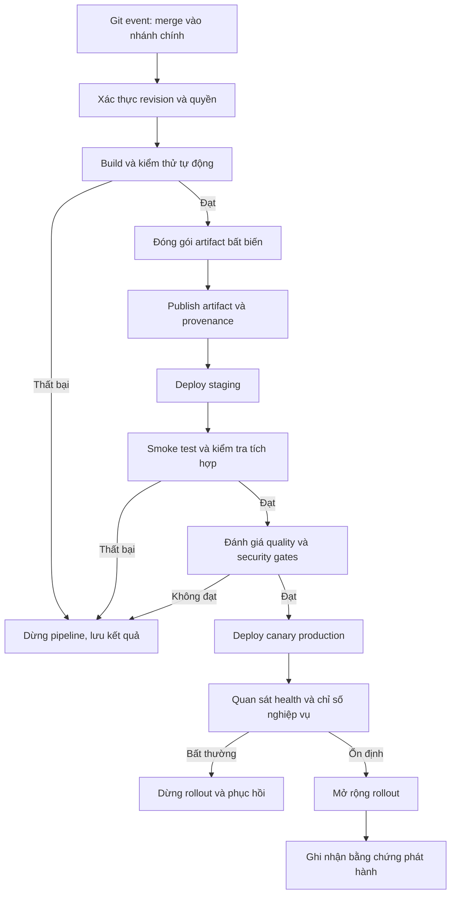

# Triển khai liên tục (Continuous Deployment): tự động triển khai thay đổi đạt điều kiện

Triển khai liên tục (*Continuous Deployment*) là cách tổ chức phát hành trong đó mỗi thay đổi mã nguồn vượt qua toàn bộ kiểm tra và chính sách của pipeline sẽ được tự động đưa lên môi trường production. Con người vẫn thiết kế chính sách, xem xét thay đổi và xử lý ngoại lệ; pipeline chịu trách nhiệm thực thi nhất quán các bước build, kiểm thử, đóng gói, triển khai và xác minh.

Mục tiêu không phải là triển khai thật nhiều lần bằng mọi giá. Mục tiêu là đưa thay đổi nhỏ đến người dùng nhanh, có bằng chứng về chất lượng, biết chính xác phiên bản nào đang chạy và có khả năng phát hiện, giới hạn tác động, phục hồi khi phát hành gặp sự cố. Muốn đạt điều đó, Continuous Deployment phải được xây dựng trên nền tảng CI/CD: sự kiện Git rõ ràng, pipeline được quản lý như mã, build có thể tái lập, artifact bất biến, cấu hình môi trường được kiểm soát, bí mật được bảo vệ và kiểm tra sau triển khai.

## 1. Continuous Deployment là gì?

Ba khái niệm thường được dùng cùng nhau nhưng mô tả các mức tự động hóa khác nhau:

| Khái niệm | Trọng tâm | Điều xảy ra sau khi thay đổi đạt kiểm tra |
|---|---|---|
| Continuous Integration (CI) | Tích hợp thay đổi thường xuyên vào nhánh chung và kiểm tra tự động | Nhóm nhận phản hồi sớm về build, test và xung đột tích hợp |
| Continuous Delivery | Giữ phần mềm luôn ở trạng thái có thể phát hành | Artifact đã qua kiểm tra, sẵn sàng triển khai; bước phát hành production có thể cần người quyết định |
| Continuous Deployment | Tự động hóa cả việc triển khai production | Thay đổi đạt mọi điều kiện được pipeline tự động triển khai lên production |

Trong bài này, *deployment* là đưa phiên bản phần mềm hoặc cấu hình triển khai vào môi trường chạy. *Release* là làm cho chức năng đó khả dụng với người dùng. Hai việc này có thể tách rời: một bản build có thể đã được deploy nhưng tính năng vẫn tắt bằng feature flag. Cách tách này giúp nhóm triển khai thường xuyên, quan sát hành vi thực tế rồi mới mở tính năng theo nhóm người dùng hoặc theo tỷ lệ lưu lượng.

Continuous Deployment đúng nghĩa không có bước bấm nút phê duyệt thủ công thường lệ trước mỗi lần triển khai production. Các điều kiện cần thiết được định nghĩa thành chính sách có thể kiểm tra tự động. Với hệ thống có yêu cầu pháp lý, rủi ro vận hành cao hoặc thay đổi đặc biệt nhạy cảm, tổ chức có thể giữ một bước phê duyệt thủ công; mô hình đó thường gần với Continuous Delivery hơn. Dù chọn mức tự động hóa nào, tiêu chí và người chịu trách nhiệm phải được công bố rõ ràng.

## 2. Vì sao cần triển khai liên tục?

Khi nhóm gom nhiều tuần thay đổi vào một đợt phát hành lớn, mỗi lần release chứa nhiều biến số: nhiều commit, nhiều cấu hình, nhiều thay đổi dữ liệu và nhiều nhóm phụ thuộc. Nếu có lỗi, việc tìm nguyên nhân và xác định thay đổi cần hoàn tác trở nên khó khăn. Đợt phát hành lớn cũng khiến nhóm trì hoãn phản hồi từ production, trong khi các thay đổi tiếp tục tích lũy.

Continuous Deployment giảm kích thước mỗi lần thay đổi được đưa lên production. Pipeline kiểm tra cùng một quy trình cho mọi thay đổi, nhờ đó giảm thao tác thủ công và sai lệch giữa các lần release. Khi một thay đổi gây lỗi, phạm vi tìm kiếm thường nhỏ hơn và nhóm có thể dừng rollout hoặc quay lại artifact trước đó nhanh hơn.

Những lợi ích này chỉ xuất hiện khi hệ thống có kiểm thử đủ tin cậy, môi trường tương thích, khả năng quan sát và phương án phục hồi. Tự động triển khai một thay đổi chưa được kiểm chứng chỉ làm lỗi đến production nhanh hơn. Vì vậy, tốc độ triển khai phải luôn đi cùng chất lượng bằng chứng và khả năng kiểm soát tác động.

## 3. Luồng triển khai liên tục từ Git đến production

Một pipeline triển khai liên tục thường có các giai đoạn sau:

1. **Nhận sự kiện nguồn:** một pull request được hợp nhất vào nhánh chính, một commit mới xuất hiện trên nhánh đã bảo vệ hoặc một sự kiện phát hành hợp lệ kích hoạt workflow.
2. **Xác thực nguồn:** xác định commit, kiểm tra quy tắc nhánh, quyền của tác nhân và các điều kiện đầu vào. Pipeline phải biết chính xác revision nào đang được xử lý.
3. **Build và kiểm thử:** biên dịch, chạy unit test, integration test, contract test và các kiểm tra bảo mật phù hợp. Bước thất bại phải chặn các bước phát hành tiếp theo.
4. **Đóng gói artifact:** tạo một gói triển khai có phiên bản và định danh nội dung, chẳng hạn image digest. Artifact được lưu trong registry hoặc kho lưu trữ có kiểm soát.
5. **Triển khai môi trường kiểm chứng:** dùng chính artifact đó để triển khai lên staging hoặc môi trường tương đương production, sau đó chạy smoke test, kiểm tra tích hợp và các chính sách cần thiết.
6. **Đánh giá cổng chất lượng:** xác minh kết quả kiểm thử, lỗ hổng, nguồn gốc artifact, cấu hình và điều kiện vận hành. Chỉ khi tất cả điều kiện bắt buộc đạt thì pipeline mới tiếp tục.
7. **Triển khai production có kiểm soát:** phát hành theo rolling, blue-green hoặc canary tùy kiến trúc và mức rủi ro. Có thể bắt đầu bằng một phần nhỏ lưu lượng.
8. **Xác minh sau triển khai:** kiểm tra trạng thái dịch vụ, log, metric, trace, giao dịch tổng hợp và chỉ số nghiệp vụ. Nếu có ngưỡng bất thường, dừng rollout và kích hoạt quy trình phục hồi.
9. **Lưu bằng chứng:** ghi lại commit, lần chạy pipeline, artifact digest, môi trường, chiến lược rollout, kết quả gate và trạng thái cuối cùng.



Pipeline thực tế có thể thêm bước kiểm tra hạ tầng, migration dữ liệu, phê duyệt ngoại lệ hoặc thông báo. Các bước đó cần có điều kiện đầu vào, đầu ra và cách xử lý lỗi rõ ràng; không nên biến pipeline thành một chuỗi lệnh khó truy vết.

## 4. Chọn sự kiện Git và revision cần triển khai

Sự kiện Git quyết định khi nào pipeline chạy. Một mô hình phổ biến là chạy kiểm tra trên mọi pull request, sau đó chạy pipeline phát hành khi pull request được hợp nhất vào nhánh chính. Nhánh chính cần được bảo vệ bằng review, kiểm tra bắt buộc và quy tắc không cho phép đưa commit chưa đạt điều kiện vào luồng phát hành.

Pipeline phải ghi nhận commit SHA cụ thể. Không nên dùng nhãn thay đổi theo thời gian như `latest` làm định danh duy nhất cho phiên bản production, vì nhãn đó có thể trỏ đến nội dung khác ở lần chạy sau. Khi workflow chạy lại, nó cần xác định đang build lại cùng revision, tiếp tục một lần triển khai hay tạo một lần phát hành mới.

Hai vấn đề thường gặp là chạy trùng và chạy đồng thời. Ví dụ, một lần push và một lần merge có thể kích hoạt hai workflow gần giống nhau. Cấu hình trigger cần tránh chạy thừa; cơ chế concurrency cần ngăn hai lần triển khai cùng ghi vào một môi trường theo cách gây xung đột. Nếu một lần triển khai mới thay thế lần cũ, chính sách hủy hoặc chờ phải được xác định rõ.

Các thao tác triển khai nên có tính idempotent: chạy lại với cùng đầu vào không tạo ra trạng thái sai hoặc nhân đôi tài nguyên. Retry chỉ nên áp dụng cho lỗi tạm thời đã nhận diện. Retry một thao tác không idempotent có thể tạo bản ghi, job hoặc tài nguyên trùng lặp.

## 5. Quản lý pipeline dưới dạng mã

Pipeline as Code đưa định nghĩa workflow vào repository để có lịch sử thay đổi, review, kiểm thử và khả năng khôi phục như mã ứng dụng. Một thay đổi trong quy trình build hoặc deploy cũng cần được xem xét vì nó có thể làm thay đổi quyền truy cập, tiêu chí chất lượng và hành vi phát hành.

Một pipeline dễ bảo trì thường có các đặc điểm:

- Các bước được chia thành job hoặc stage theo trách nhiệm: kiểm tra, build, kiểm thử, publish, deploy và verify.
- Logic dùng chung được đóng gói thành action, template hoặc script có phiên bản; tránh sao chép các đoạn lệnh quan trọng ở nhiều nơi.
- Phiên bản action, plugin, runner image và công cụ build được ghim rõ ràng. Với thành phần hỗ trợ, có thể ghim bằng digest để tránh nội dung thay đổi ngoài dự kiến.
- Quyền của từng job được giới hạn theo nhu cầu. Job chạy kiểm thử pull request không cần quyền ghi vào production.
- Điều kiện chạy, timeout, retry, concurrency và hành vi khi thất bại được khai báo tường minh.
- Log cho biết bước nào chạy, với revision và artifact nào, nhưng không in token, mật khẩu hoặc dữ liệu nhạy cảm.

Không nên đặt toàn bộ logic phát hành trong một workflow dài khó đọc. Script hoặc action riêng có thể được kiểm thử độc lập, miễn là phiên bản và nguồn của chúng vẫn được quản lý. Thay đổi pipeline nên đi qua review và có thể chạy thử trên môi trường không ảnh hưởng production.

## 6. Build và kiểm thử tự động

Build tạo ra đầu ra có thể triển khai từ mã nguồn và các dependency. Build đáng tin cậy cần kiểm soát phiên bản runtime, compiler, dependency, build tool và tham số cấu hình. Nếu cùng một commit nhưng môi trường build khác nhau tạo ra kết quả không giải thích được, nhóm khó xác định artifact nào đã được kiểm chứng.

Kiểm thử nên tạo thành nhiều lớp với thời gian và mục tiêu khác nhau:

| Lớp kiểm thử | Mục tiêu | Ví dụ |
|---|---|---|
| Unit test | Kiểm tra logic nhỏ trong phạm vi cô lập | Quy tắc tính phí, kiểm tra dữ liệu đầu vào |
| Integration test | Kiểm tra tương tác giữa các thành phần | Service truy cập database hoặc message broker |
| Contract test | Phát hiện thay đổi không tương thích ở giao tiếp | API response, event schema |
| End-to-end test | Xác minh luồng người dùng hoặc nghiệp vụ chính | Tạo đơn hàng và nhận xác nhận |
| Security test | Phát hiện rủi ro trong mã và dependency | SAST, dependency scan, secret scan |
| Performance test | Phát hiện suy giảm hiệu năng có ý nghĩa | Latency, throughput, mức sử dụng tài nguyên |

Không phải mọi kiểm thử đều phải chạy ở mọi stage. Kiểm tra nhanh có thể chạy trước để phản hồi sớm; kiểm tra tốn thời gian hơn có thể chạy sau build hoặc trên staging. Tuy nhiên, các kiểm tra được định nghĩa là bắt buộc phải hoàn tất trước khi pipeline cho phép triển khai production.

Test flaky làm giảm niềm tin vào pipeline. Nhóm cần lưu lịch sử lỗi, phân biệt lỗi sản phẩm với lỗi hạ tầng kiểm thử và sửa nguyên nhân gốc. Không nên liên tục rerun đến khi có một lần xanh rồi xem đó là bằng chứng đạt. Test bị bỏ qua hoặc được miễn trừ phải có lý do, phạm vi và thời hạn rõ ràng.

## 7. Artifact bất biến và khả năng truy vết

Artifact là đầu ra được pipeline đóng gói để triển khai, chẳng hạn container image, package, binary hoặc bundle tĩnh. Sau khi được publish, artifact nên bất biến: cùng một định danh luôn trỏ đến cùng nội dung. Có thể đặt tag theo commit hoặc phiên bản, đồng thời lưu digest để xác định chính xác bytes được triển khai.

Nguyên tắc quan trọng là **build một lần, promote nhiều môi trường**. Pipeline build và kiểm thử artifact, sau đó đưa đúng artifact đó qua staging và production. Nếu build lại riêng cho production, nhóm có thể vô tình triển khai nội dung khác với thứ đã được kiểm thử. Cấu hình theo môi trường nên được truyền vào lúc deploy hoặc lúc chạy, theo thiết kế của ứng dụng.

Kho artifact cần có quyền đọc/ghi rõ ràng, chính sách lưu giữ, khả năng truy xuất phiên bản cũ và kiểm soát xóa. Với hệ thống yêu cầu bảo đảm nguồn gốc, pipeline có thể tạo provenance, ký artifact và lưu Software Bill of Materials (SBOM). Khi triển khai, hệ thống xác minh chữ ký, digest và nguồn build theo chính sách đã đặt ra.

Ví dụ, một lần phát hành có thể được liên kết bằng chuỗi bằng chứng sau:

```text
Commit:          8f31...c2a9
Pipeline run:    build-1842
Artifact:        registry.example/app@sha256:...
Test result:     unit PASS, integration PASS, security PASS
Environment:     production
Deployment:      canary -> 10% -> 50% -> 100%
Verification:    health PASS, error-rate PASS, latency PASS
```

Các giá trị trên chỉ minh họa cấu trúc thông tin. Trong hệ thống thật, cần dùng định danh và đường dẫn do công cụ build, registry và nền tảng triển khai cung cấp.

## 8. Cấu hình môi trường và bí mật

Các môi trường development, test, staging và production thường khác nhau về endpoint, quy mô, quyền truy cập và dữ liệu. Cấu hình cần được quản lý tách khỏi artifact để cùng một artifact có thể được promote qua các môi trường. Những khác biệt quan trọng giữa staging và production phải được hiểu và kiểm soát; staging quá khác production sẽ làm giảm giá trị của kiểm thử trước phát hành.

Cấu hình nên có schema, giá trị mặc định hợp lý và bước xác thực trước khi deploy. Thay đổi cấu hình cũng có thể gây sự cố như thay đổi mã, vì vậy cần có lịch sử, review, quyền truy cập và khả năng khôi phục. Với cấu hình nhạy cảm, không lưu giá trị bí mật trong repository hoặc log.

Pipeline nên lấy bí mật từ secret manager hoặc cơ chế cấp danh tính của nền tảng. Khi có thể, dùng danh tính workload và token ngắn hạn như OIDC thay cho credential dài hạn được lưu cố định. Mỗi job chỉ nhận quyền cần thiết và chỉ trong thời gian cần thiết. Cần đặc biệt cẩn thận với workflow chạy trên mã pull request không đáng tin cậy: không cấp cho workflow đó quyền truy cập bí mật production.

Nếu token hoặc secret bị lộ, quy trình xử lý cần hỗ trợ thu hồi và xoay vòng. Việc che chuỗi trong log là lớp bảo vệ bổ sung, không thay thế việc hạn chế quyền và ngăn bí mật xuất hiện trong đầu ra.

## 9. Cổng chất lượng và chính sách triển khai

Quality gate là điều kiện quyết định pipeline có được chuyển sang bước tiếp theo hay không. Gate tốt phải có tiêu chí kiểm tra được, nguồn bằng chứng, người sở hữu và hành vi khi không đạt. Ví dụ:

- Các test bắt buộc đều thành công và kết quả thuộc đúng commit đang phát hành.
- Không có lỗ hổng vượt ngưỡng rủi ro được tổ chức cho phép; ngoại lệ phải có người chịu trách nhiệm và thời hạn.
- Artifact có digest, nguồn build và chữ ký hợp lệ theo chính sách.
- Cấu hình và manifest triển khai vượt qua kiểm tra schema, policy và quyền.
- Môi trường đích đủ khỏe, không có rollout khác đang xung đột và dung lượng đáp ứng yêu cầu.
- Các điều kiện nghiệp vụ hoặc tuân thủ riêng của dịch vụ đã được xác minh.

Gate không nên chỉ dựa vào một con số dễ bị tối ưu sai, chẳng hạn tỷ lệ coverage tổng thể. Coverage hữu ích để tìm vùng mã chưa được kiểm tra, nhưng không chứng minh test đã xác minh đúng hành vi. Nên kết hợp chỉ số với kiểm tra hành vi, rủi ro và bằng chứng cụ thể.

Trong Continuous Deployment, các gate thường lệ được tự động đánh giá. Một chính sách có thể chặn thay đổi rủi ro cao hoặc yêu cầu quy trình ngoại lệ có kiểm soát. Nếu tổ chức cần phê duyệt thủ công trước mỗi lần production, cần mô tả chính xác đó là mô hình Continuous Delivery với bước release có người quyết định.

## 10. Chọn chiến lược triển khai

Không có một chiến lược rollout phù hợp cho mọi dịch vụ. Lựa chọn phụ thuộc khả năng chạy song song phiên bản, kiến trúc hạ tầng, trạng thái dữ liệu, mức chịu lỗi và cách định tuyến lưu lượng.

| Chiến lược | Cách hoạt động | Điểm cần cân nhắc |
|---|---|---|
| Rolling deployment | Thay từng nhóm instance hoặc pod bằng phiên bản mới | Cần kiểm soát số instance unavailable và tương thích giữa các phiên bản cùng chạy |
| Blue-green | Duy trì hai môi trường; kiểm tra môi trường mới rồi chuyển traffic | Cần tài nguyên cho hai môi trường và cách chuyển traffic có thể đảo ngược |
| Canary | Đưa phiên bản mới đến một tỷ lệ nhỏ traffic rồi tăng dần | Cần metric đủ nhạy, traffic đại diện và quy tắc dừng rõ ràng |
| Feature flag | Deploy mã nhưng bật chức năng theo điều kiện hoặc nhóm người dùng | Flag cần có chủ sở hữu, ngày xem xét và kế hoạch dọn dẹp |

Canary có thể bắt đầu với một nhóm instance hoặc tỷ lệ traffic nhỏ, sau đó tăng theo từng bước khi các chỉ số ổn định. Tỷ lệ và thời gian quan sát phải phù hợp lưu lượng thực tế; một dịch vụ ít giao dịch có thể cần thời gian dài hơn để thu thập đủ bằng chứng. Nếu chỉ số vượt ngưỡng, pipeline cần dừng mở rộng và chuyển sang quy trình phục hồi.

Feature flag giúp tách thời điểm deploy khỏi thời điểm release. Tuy nhiên, flag cũ làm tăng độ phức tạp nếu không được quản lý. Mỗi flag nên có mục đích, người sở hữu, điều kiện bật/tắt và kế hoạch xóa sau khi không còn cần thiết.

## 11. Xác minh sau triển khai

Một lệnh deploy trả về thành công chỉ cho biết nền tảng đã nhận hoặc thực hiện thao tác triển khai. Nó chưa chứng minh ứng dụng hoạt động đúng. Post-deployment validation cần xác minh cả trạng thái kỹ thuật và hành vi nghiệp vụ.

Các kiểm tra thường dùng gồm:

- **Readiness và health check:** instance mới đã sẵn sàng nhận traffic, dependency thiết yếu có thể truy cập.
- **Smoke test:** một tập nhỏ kiểm tra các luồng quan trọng sau khi deploy.
- **Synthetic transaction:** mô phỏng hành động người dùng hoặc giao dịch đại diện từ đầu đến cuối.
- **Metric:** tỷ lệ lỗi, latency, throughput, saturation, số lần restart và hàng đợi tồn đọng.
- **Log và trace:** tìm lỗi mới, exception, timeout hoặc thay đổi bất thường trong đường đi của request.
- **Business metric:** tỷ lệ thanh toán thành công, tạo đơn hàng, xử lý giao dịch hoặc chỉ số cốt lõi khác của dịch vụ.
- **Version verification:** xác nhận instance đang phục vụ đúng artifact digest và cấu hình dự kiến.

Nên so sánh metric với baseline phù hợp và theo dõi đủ lâu để quan sát hành vi thực. Một HTTP 200 từ endpoint đơn giản không thể thay thế kiểm tra luồng nghiệp vụ. Ngưỡng cảnh báo cần được hiệu chỉnh theo đặc điểm dịch vụ, tránh dùng một ngưỡng chung cho mọi ứng dụng.

## 12. Rollback và phục hồi

Rollback đưa dịch vụ về một trạng thái đã biết là tốt, thường bằng cách triển khai lại artifact trước đó hoặc chuyển traffic về môi trường blue. Quy trình phải được chuẩn bị và kiểm chứng trước khi sự cố xảy ra. Nhóm cần biết artifact trước đó nằm ở đâu, ai có quyền kích hoạt rollback, thao tác mất bao lâu và metric nào xác nhận dịch vụ đã phục hồi.

Rollback không phải lúc nào cũng là thao tác đảo ngược dữ liệu. Một phiên bản mới có thể đã ghi dữ liệu theo schema mà phiên bản cũ không hiểu. Với thay đổi database, nên cân nhắc mẫu *expand-contract*:

1. Mở rộng schema theo cách vẫn tương thích với phiên bản hiện tại, chẳng hạn thêm cột hoặc bảng mới.
2. Triển khai mã có thể đọc/ghi tương thích trong giai đoạn chuyển tiếp.
3. Backfill hoặc chuyển dữ liệu theo bước có thể theo dõi.
4. Chuyển ứng dụng sang cấu trúc mới và xác minh kết quả.
5. Chỉ xóa cấu trúc cũ trong một lần phát hành sau, khi không còn phiên bản nào phụ thuộc vào nó.

Với thay đổi không thể đảo ngược an toàn, nhóm có thể cần sửa tiến (*roll forward*) thay vì rollback. Feature flag có thể tắt nhanh một chức năng gây lỗi trong khi nhóm chuẩn bị bản sửa. Quyết định rollback hay roll forward phải dựa trên tác động dữ liệu, khả năng tương thích và thời gian phục hồi, không chỉ dựa vào việc deploy có thể chạy lại hay không.

Pipeline cần định nghĩa ngưỡng dừng rollout và hành động tiếp theo. Ví dụ, nếu tỷ lệ lỗi tăng vượt ngưỡng trong một khoảng quan sát đủ dài, hệ thống dừng mở rộng canary, giữ lại bằng chứng và kích hoạt rollback hoặc quy trình xử lý sự cố. Việc tự động rollback cần được thử nghiệm để tránh tạo thêm lỗi khi hệ thống đang ở trạng thái bất thường.

## 13. Bảo mật và truy vết phát hành

Pipeline là một phần của chuỗi cung ứng phần mềm và có quyền tác động đến production. Vì vậy, bảo mật pipeline cần được thiết kế như bảo mật ứng dụng:

- Tách quyền đọc mã, publish artifact và deploy production; cấp quyền tối thiểu cho từng job.
- Dùng danh tính workload và credential ngắn hạn khi nền tảng hỗ trợ.
- Bảo vệ nhánh chính, workflow và môi trường production bằng quy tắc review và quyền quản trị rõ ràng.
- Ghim phiên bản action, plugin, runner image và dependency quan trọng; cập nhật chúng qua thay đổi được review.
- Quét secret, dependency, mã nguồn, container image và cấu hình hạ tầng theo mức rủi ro.
- Không để log, artifact debug hoặc cache chứa token và dữ liệu nhạy cảm.
- Ký và xác minh artifact hoặc provenance khi yêu cầu bảo đảm nguồn gốc.

Một hồ sơ phát hành có thể trả lời được các câu hỏi: thay đổi đến từ commit và pull request nào; ai review; pipeline nào đã build; những test và gate nào đã chạy; artifact digest nào được publish; artifact đó được deploy vào môi trường nào, lúc nào; ai hoặc chính sách nào cho phép; kết quả xác minh sau deploy ra sao; có rollback hay ngoại lệ nào không. Đây là nền tảng để điều tra sự cố, kiểm toán và cải thiện quy trình.

## 14. Các lỗi thiết kế thường gặp

| Vấn đề | Hậu quả | Cách xử lý |
|---|---|---|
| Build lại ở từng môi trường | Artifact production có thể khác artifact đã test | Build một lần, promote cùng digest |
| Dùng tag thay đổi như `latest` làm định danh duy nhất | Khó xác định chính xác nội dung đang chạy | Ghi commit SHA và digest bất biến |
| Chỉ kiểm tra deploy command thành công | Ứng dụng có thể lỗi ngay sau khi nhận traffic | Thêm health, smoke, synthetic và business checks |
| Test flaky nhưng cứ rerun | Pipeline xanh giả và mất niềm tin | Tìm nguyên nhân, theo dõi flaky test và quản lý ngoại lệ |
| Dùng credential production cho mọi job | Mã không đáng tin cậy có thể chiếm quyền deploy | Tách job, dùng quyền tối thiểu và token ngắn hạn |
| Retry mọi lỗi | Có thể lặp thao tác không idempotent | Phân loại lỗi, đặt giới hạn retry và thiết kế idempotency |
| Không kiểm soát migration dữ liệu | Phiên bản cũ có thể không đọc được dữ liệu mới | Dùng migration tương thích và kế hoạch expand-contract |
| Không có metric sau rollout | Lỗi chỉ được phát hiện qua phản ánh của người dùng | Đặt SLI, baseline và điều kiện dừng rollout |
| Tích lũy feature flag không chủ sở hữu | Logic phân nhánh ngày càng khó kiểm soát | Gắn owner, thời hạn và công việc dọn dẹp |

Một lỗi khác là tối ưu thời gian pipeline bằng cách bỏ qua kiểm tra quan trọng. Tối ưu đúng nên bắt đầu từ việc đo thời gian từng stage, chạy song song các bước độc lập, cache dependency an toàn và giảm test trùng lặp. Mọi tối ưu cần giữ nguyên mức bảo đảm mà nhóm đã cam kết.

## 15. Đo lường hiệu quả triển khai

Năm chỉ số DORA thường được dùng để đánh giá hiệu quả phân phối phần mềm:

- **Deployment frequency:** tần suất triển khai thay đổi lên môi trường production.
- **Lead time for changes:** thời gian từ khi thay đổi được commit đến khi chạy trong production.
- **Change failure rate:** tỷ lệ lần triển khai gây suy giảm dịch vụ hoặc cần can thiệp phục hồi.
- **Failed deployment recovery time:** thời gian khôi phục dịch vụ sau một lần triển khai thất bại.
- **Deployment rework rate:** tỷ lệ triển khai ngoài kế hoạch được thực hiện để sửa lỗi hoặc khắc phục sự cố production.

Nhóm có thể bổ sung thời gian pipeline, tỷ lệ pipeline thành công, thời gian từ phát hiện đến dừng rollout, tỷ lệ rollback, tỷ lệ test flaky và tuổi của các ngoại lệ bảo mật. Cần xem các chỉ số cùng nhau: tăng deployment frequency mà change failure rate và thời gian phục hồi cũng tăng có thể là dấu hiệu chất lượng chưa theo kịp tốc độ.

Không nên dùng một chỉ số riêng lẻ để xếp hạng cá nhân hoặc ép nhóm triển khai nhiều hơn. Các chỉ số có ý nghĩa khi giúp tìm điểm nghẽn, đánh giá thay đổi theo thời gian và chọn một cải tiến cụ thể cho vòng tiếp theo.

## 16. Ví dụ: triển khai một phiên bản dịch vụ đặt hàng

Giả sử nhóm phát triển dịch vụ đặt hàng. Một pull request thay đổi cách tính phí vận chuyển được review và hợp nhất vào nhánh chính.

1. Sự kiện merge kích hoạt pipeline với commit SHA của thay đổi.
2. Pipeline build ứng dụng, chạy unit test cho quy tắc tính phí, integration test với database và contract test với dịch vụ thanh toán.
3. Nếu các kiểm tra đạt, pipeline đóng gói container image, gắn tag theo commit và lưu digest vào registry.
4. Pipeline triển khai image đó lên staging, chạy smoke test tạo đơn hàng và xác minh kết quả tính phí.
5. Các security gate và policy gate xác nhận dependency, cấu hình, nguồn gốc artifact và quyền triển khai.
6. Pipeline đưa phiên bản mới đến một tỷ lệ nhỏ traffic production. Metric theo dõi tỷ lệ tạo đơn thành công, lỗi thanh toán, latency và log lỗi.
7. Nếu các chỉ số ổn định trong cửa sổ quan sát đã định, pipeline tăng dần tỷ lệ traffic. Nếu có bất thường, pipeline dừng rollout và chuyển về phiên bản trước hoặc tắt feature flag theo quy trình.
8. Hệ thống lưu commit, pipeline run, artifact digest, các gate, thời điểm deploy, tỷ lệ rollout và kết quả xác minh.

Trong ví dụ này, con số tỷ lệ traffic và thời gian quan sát cần được chọn dựa trên lưu lượng, mức độ rủi ro và độ nhạy của metric. Một dịch vụ có ít giao dịch có thể cần cửa sổ dài hơn để thu thập đủ dữ liệu. Nếu thay đổi ảnh hưởng schema đơn hàng, nhóm phải bảo đảm phiên bản cũ và mới có thể cùng hoạt động trong giai đoạn rollout.

## 17. Checklist thiết kế Continuous Deployment

Trước khi bật tự động triển khai production, nhóm nên xác minh:

- [ ] Trigger gắn với sự kiện Git và revision cụ thể; nhánh nguồn có quy tắc bảo vệ.
- [ ] Pipeline được lưu dưới dạng mã, review được và có phiên bản dependency rõ ràng.
- [ ] Build có thể tái lập ở mức cần thiết; kết quả build và test gắn với commit.
- [ ] Các lớp test quan trọng và security scan chạy tự động; ngoại lệ có owner và thời hạn.
- [ ] Artifact có định danh bất biến, được lưu ở registry có kiểm soát và promote cùng một digest qua môi trường.
- [ ] Cấu hình được xác thực; secret lấy từ nguồn quản lý phù hợp và job có quyền tối thiểu.
- [ ] Staging đủ tương đồng với production để kiểm chứng những rủi ro chính.
- [ ] Chiến lược rollout phù hợp; có concurrency control và hành vi rõ khi deploy thất bại.
- [ ] Có health check, smoke test, metric, log và trace để xác minh sau triển khai.
- [ ] Có ngưỡng dừng rollout, quy trình rollback hoặc roll forward và phương án cho migration dữ liệu.
- [ ] Hồ sơ phát hành liên kết được commit, pipeline run, artifact, môi trường và kết quả kiểm tra.
- [ ] Nhóm theo dõi deployment frequency, lead time, change failure rate và thời gian phục hồi để cải tiến.

## 18. Kết luận

Continuous Deployment là kết quả của một chuỗi kiểm soát tự động có thể tin cậy. Git xác định thay đổi; pipeline dưới dạng mã mô tả quy trình; build và test cung cấp bằng chứng; artifact bất biến bảo đảm đúng nội dung được promote; cấu hình và danh tính bảo vệ môi trường; quality gate quyết định thay đổi có đủ điều kiện; rollout và post-deployment validation giới hạn, phát hiện tác động; rollback hoặc roll forward giúp phục hồi; dữ liệu truy vết cho phép giải thích điều gì đã xảy ra.

Khi các phần này được thiết kế đồng bộ, nhóm có thể phát hành thay đổi nhỏ thường xuyên mà vẫn kiểm soát được chất lượng và rủi ro. Tự động hóa chỉ thực sự có giá trị khi mỗi lần triển khai đều có thể giải thích, xác minh và phục hồi.
