# Phân biệt build, kiểm thử, triển khai và phát hành

Trong CI/CD, build, kiểm thử, triển khai và phát hành thường xuất hiện liên tiếp trong cùng một pipeline. Vì diễn ra gần nhau, bốn hoạt động này đôi khi bị gọi chung là “đưa phần mềm lên môi trường”. Cách gọi đó che khuất mục tiêu và kết quả riêng của từng bước, khiến nhóm khó xác định lỗi nằm ở đâu, cần phê duyệt điều gì và phải quay lui bằng cách nào.

Hãy phân biệt chúng bằng bốn câu hỏi:

- **Build (xây dựng):** Mã nguồn và các phụ thuộc được biến thành sản phẩm phần mềm có thể sử dụng như thế nào?
- **Kiểm thử (testing):** Bằng chứng nào cho thấy sản phẩm đáp ứng các yêu cầu và không phá vỡ hành vi đã có?
- **Triển khai (deployment):** Phiên bản nào được cài đặt hoặc cập nhật ở môi trường đích?
- **Phát hành (release):** Khi nào và với phạm vi người dùng nào chức năng hoặc phiên bản đó được cung cấp?

Một pipeline tốt liên kết được cả bốn hoạt động với cùng một thay đổi Git, cùng một artifact và bằng chứng kiểm tra tương ứng. Nhờ vậy, nhóm có thể truy vết từ commit đến phiên bản đang chạy, kiểm soát thời điểm người dùng tiếp cận thay đổi và xử lý sự cố có căn cứ.

## 1. Build: tạo ra sản phẩm có thể triển khai

Build nhận mã nguồn tại một revision cụ thể cùng các phụ thuộc và công cụ cần thiết, sau đó tạo ra một hoặc nhiều đầu ra có thể sử dụng ở bước sau. Tùy loại dự án, đầu ra có thể là:

- Tệp JAR, WAR hoặc gói thư viện đã biên dịch.
- Bundle JavaScript, CSS và tài nguyên tĩnh của ứng dụng web.
- Image container chứa ứng dụng và môi trường runtime cần thiết.
- Gói cài đặt, binary hoặc gói phân phối cho một nền tảng.

Build có thể bao gồm biên dịch, xử lý tài nguyên, giải quyết phụ thuộc, đóng gói và tạo metadata phiên bản. Một số dự án cũng tạo checksum, chữ ký hoặc Software Bill of Materials (SBOM) ở giai đoạn đóng gói và phát hành artifact.

**Đầu ra quan trọng của build là artifact.** Artifact là sản phẩm cụ thể được lưu trữ để kiểm thử, triển khai hoặc phân phối. Nó cần gắn với commit nguồn, phiên bản, lần chạy pipeline và định danh nội dung như digest khi định dạng hỗ trợ. Log “build thành công” hữu ích, nhưng chưa đủ để biết chính xác binary nào đã được đưa lên môi trường.

Ví dụ, commit `a81c2f0` có thể tạo ra image `checkout-service` với digest `sha256:...`. Khi triển khai, pipeline nên tham chiếu đến digest đó thay vì chỉ dùng một tag có thể bị ghi đè như `latest`.

Build thành công chỉ cho biết quy trình tạo artifact đã hoàn tất theo các điều kiện của build. Điều đó **không chứng minh** ứng dụng chạy đúng, đáp ứng yêu cầu nghiệp vụ hoặc an toàn. Những kết luận này cần bằng chứng từ kiểm thử và các cổng chất lượng tiếp theo.

## 2. Kiểm thử: thu thập bằng chứng về chất lượng

Kiểm thử đánh giá hành vi hoặc thuộc tính của phần mềm bằng cách so sánh kết quả thực tế với kết quả mong đợi. Kiểm thử có thể chạy trước, trong hoặc sau build tùy loại; ví dụ kiểm tra định dạng và phân tích tĩnh có thể chạy trực tiếp trên mã nguồn, trong khi kiểm thử tích hợp cần chương trình đã được build và các dịch vụ phụ trợ.

Các nhóm kiểm tra thường gặp gồm:

| Loại kiểm tra | Câu hỏi chính | Ví dụ |
|---|---|---|
| Kiểm tra mã nguồn và phân tích tĩnh | Mã có tuân thủ quy tắc và phát hiện được lỗi tiềm ẩn không? | Formatter, linter, static analysis |
| Unit test | Thành phần nhỏ có xử lý đúng các trường hợp được mô tả không? | Kiểm tra hàm tính tổng đơn hàng với dữ liệu biên |
| Integration test | Các thành phần có phối hợp đúng qua ranh giới thật không? | Service ghi và đọc dữ liệu qua database thử nghiệm |
| Contract test | Hai hệ thống có tuân thủ hợp đồng API hoặc message không? | Kiểm tra schema và quy tắc tương thích API |
| End-to-end test | Luồng người dùng quan trọng có hoạt động xuyên suốt không? | Tạo giỏ hàng và hoàn tất đơn hàng trên môi trường kiểm thử |
| Kiểm tra phi chức năng | Các giới hạn vận hành và bảo mật có được đáp ứng không? | Kiểm tra tải, dependency vulnerability, cấu hình bảo mật |

Không phải thay đổi nào cũng cần chạy mọi loại test ở mọi lần commit. Nhóm thường tổ chức kiểm tra theo tốc độ và mức độ rủi ro: kiểm tra nhanh chạy sớm để phản hồi trong vài phút; bộ kiểm tra tích hợp, end-to-end hoặc tải chạy ở những mốc phù hợp. Dù tổ chức thế nào, điều kiện chặn pipeline phải được nêu rõ: chẳng hạn unit test thất bại, lỗi bảo mật vượt ngưỡng hoặc coverage không đạt chính sách thì artifact không được phép đi tiếp.

Kết quả kiểm thử là bằng chứng, không phải lời bảo đảm tuyệt đối rằng phần mềm không có lỗi. Giá trị của bằng chứng phụ thuộc vào chất lượng test, dữ liệu, môi trường và phạm vi tình huống được kiểm tra. Vì vậy, pipeline nên lưu kết quả, log và liên kết đến commit hoặc artifact đã được kiểm tra.

**Phân biệt build và kiểm thử:** build trả lời “đã tạo được sản phẩm chưa?”, còn kiểm thử trả lời “sản phẩm hoặc thay đổi có vượt qua các điều kiện chất lượng đã đặt ra không?”. Build có thể thành công nhưng test thất bại; ngược lại, một số kiểm tra mã nguồn có thể thất bại trước khi build được thực hiện.

## 3. Triển khai: đưa một artifact vào môi trường

Triển khai là quá trình cài đặt hoặc cập nhật artifact vào một môi trường đích để phần mềm có thể được thực thi tại đó. Môi trường có thể là máy phát triển, môi trường tích hợp, staging, production hoặc một cụm triển khai theo vùng.

Một lần triển khai thường có các công việc như:

- Lấy đúng artifact đã được lưu trữ và xác minh định danh của nó.
- Cấp cấu hình theo môi trường, kết nối dịch vụ và danh tính runtime.
- Cập nhật container, máy chủ, serverless function hoặc tài nguyên cần thiết.
- Thực hiện migration dữ liệu khi có thay đổi schema, theo trình tự tương thích đã thiết kế.
- Chờ tiến trình sẵn sàng, kiểm tra health endpoint và xác minh các chức năng cơ bản.

Triển khai có thể dùng nhiều chiến lược. Rolling deployment thay thế từng nhóm instance; blue-green chuẩn bị môi trường mới rồi chuyển lưu lượng; canary chuyển một phần lưu lượng đến phiên bản mới trước khi mở rộng. Chiến lược phù hợp phụ thuộc vào kiến trúc, khả năng tương thích dữ liệu, thời gian gián đoạn cho phép và khả năng quan sát hệ thống.

Một nguyên tắc quan trọng là **build một lần, triển khai cùng artifact qua các môi trường**. Ví dụ, image đã vượt qua kiểm thử ở staging nên được promote lên production bằng đúng digest đó. Nếu pipeline build lại từ mã nguồn khi lên production, đầu ra có thể khác vì phụ thuộc, thời điểm tải gói, biến môi trường build hoặc công cụ đã thay đổi. Khi đó, nhóm không còn chắc rằng production đang chạy đúng sản phẩm đã được kiểm tra.

Cấu hình riêng của môi trường như URL dịch vụ, giới hạn tài nguyên và thông tin kết nối nên được cấp khi triển khai hoặc khi ứng dụng khởi động. Bí mật cần được lấy từ secret manager hoặc cơ chế cấp danh tính phù hợp; không đóng bí mật vào artifact hay ghi chúng vào log.

Triển khai thành công cho biết thao tác cập nhật môi trường đã hoàn tất theo điều kiện kỹ thuật. Nó chưa chứng minh người dùng đã được tiếp cận tính năng mới hoặc luồng nghiệp vụ đang hoạt động tốt. Vì vậy, cần có xác minh sau triển khai như smoke test, kiểm tra health, log, metric và cảnh báo.

## 4. Phát hành: cung cấp thay đổi cho người dùng

Phát hành là quyết định đưa một phiên bản hoặc khả năng phần mềm đến đối tượng sử dụng dự kiến. Trong mô hình tách biệt deployment và release, phần mềm có thể đã được triển khai lên production nhưng chức năng mới vẫn chưa được bật cho người dùng.

Nhóm có thể kiểm soát phát hành bằng:

- **Feature flag:** triển khai mã mới nhưng giữ chức năng ở trạng thái tắt; sau đó bật cho nhóm nội bộ, một nhóm khách hàng hoặc toàn bộ người dùng.
- **Traffic shifting:** chuyển dần lưu lượng đến phiên bản mới và quan sát lỗi, độ trễ hoặc chỉ số nghiệp vụ.
- **Lịch phát hành và phê duyệt:** chỉ mở tính năng sau khi hoàn thành đánh giá, phối hợp hỗ trợ, tài liệu hoặc điều kiện kinh doanh.
- **Phân phối phiên bản:** công bố gói, image hoặc bản cài đặt lên registry hay kênh phân phối theo quy tắc phiên bản của sản phẩm.

Ví dụ, đội phát triển tính năng áp mã giảm giá mới. Pipeline build và kiểm thử phiên bản mới, sau đó triển khai lên production với feature flag đang tắt. Nhân viên nội bộ kiểm tra trước; nếu các chỉ số ổn định, đội bật cho 5% người dùng, theo dõi tỷ lệ áp mã thành công và lỗi thanh toán, rồi mới mở rộng. Việc triển khai hoàn tất trước khi tính năng được phát hành rộng rãi.

Trong một số tổ chức, triển khai production đồng thời làm chức năng xuất hiện với tất cả người dùng. Khi đó deployment và release xảy ra gần như cùng lúc. Với thư viện hoặc sản phẩm phân phối qua package registry, “phát hành” cũng có thể bao gồm việc publish artifact, tạo tag phiên bản và công bố release notes. Thuật ngữ giữa các nhóm có thể khác nhau; điều cần thống nhất là sự kiện nào đánh dấu artifact đã được cài đặt và sự kiện nào đánh dấu người dùng có thể sử dụng nó.

Tách phát hành khỏi triển khai giúp giảm rủi ro khi cần kiểm soát thời điểm cung cấp tính năng. Nếu có lỗi nghiệp vụ sau khi bật flag, nhóm có thể tắt flag để ngừng cung cấp tính năng trong khi vẫn giữ phiên bản đã triển khai để điều tra. Cách này chỉ hiệu quả khi ứng dụng được thiết kế để bật/tắt an toàn và các thay đổi dữ liệu vẫn tương thích.

## 5. Nhìn toàn bộ luồng trong một pipeline

Một luồng tham khảo cho thay đổi ứng dụng có thể được biểu diễn như sau:

```mermaid
flowchart LR
    G[Git event: push hoặc pull request] --> B[Build]
    B --> T[Kiểm thử và quality gates]
    T --> A[Lưu artifact bất biến]
    A --> S[Triển khai staging]
    S --> V[Smoke test và xác minh]
    V --> P[Triển khai production]
    P --> H[Health check và quan sát]
    H --> R[Phát hành: bật tính năng hoặc mở lưu lượng]
    R --> M[Theo dõi người dùng và hệ thống]
    M -->|Có sự cố| X[Tắt tính năng hoặc quay lui]
```



Sơ đồ mô tả thứ tự khái quát, không phải thứ tự bắt buộc cho mọi công nghệ. Một số kiểm tra chạy trước build; một số kiểm tra chạy trên artifact hoặc sau khi triển khai. Pipeline thực tế cần đặt mỗi kiểm tra ở nơi có đủ đầu vào và có thể đưa ra quyết định đúng.

Sự kiện Git là **tác nhân kích hoạt pipeline**, không phải một trong bốn hoạt động trên. Ví dụ:

- Khi mở hoặc cập nhật pull request, pipeline chạy kiểm tra mã nguồn, build và test để cung cấp phản hồi trước khi merge.
- Khi merge vào nhánh chính, pipeline xác minh commit đã tích hợp, tạo artifact có định danh và có thể triển khai lên staging.
- Khi tạo tag phiên bản hoặc có phê duyệt phát hành, pipeline có thể promote artifact đã được kiểm tra, triển khai production và thực hiện bước release theo chính sách.

Không nên suy ra rằng cứ có tag là phải build lại. Nếu artifact của commit đó đã được tạo và kiểm tra, pipeline có thể dùng lại chính artifact đã lưu, miễn là quy tắc truy vết và xác minh nguồn gốc được đáp ứng.

Ví dụ dưới đây là **mã giả**, chỉ minh họa quan hệ phụ thuộc giữa các bước; cú pháp và điều kiện cụ thể tùy nền tảng CI/CD:

```yaml
triggers:
  - pull_request
  - push_to_main

pipeline:
  verify:
    steps:
      - checkout_commit
      - run_static_checks
      - build
      - run_automated_tests

  package:
    needs:
      - verify
    steps:
      - create_immutable_artifact
      - store_artifact_with_commit_and_digest

  deploy_staging:
    needs:
      - package
    steps:
      - deploy_stored_artifact_to_staging
      - run_smoke_tests

  deploy_production:
    needs:
      - deploy_staging
    steps:
      - require_production_approval_when_policy_demands
      - deploy_the_same_artifact
      - verify_health

  release:
    needs:
      - deploy_production
    steps:
      - enable_feature_or_increase_traffic_gradually
      - observe_errors_latency_and_business_metrics
```

Pipeline as code giúp các điều kiện này được lưu cùng repository, review qua pull request và có lịch sử thay đổi. Quyền triển khai production, quyền đọc bí mật và quyền phê duyệt release nên được giới hạn theo vai trò; log pipeline cần đủ thông tin để xác định ai hoặc quy trình nào đã thực hiện hành động.

## 6. Xác định đúng điểm lỗi và cách khôi phục

Khi pipeline dừng, hãy xác định hoạt động cuối cùng đã hoàn tất và bằng chứng của nó. Không nên xem mọi lỗi sau khi merge là “lỗi deploy”, vì cách xử lý phụ thuộc vào giai đoạn:

| Tình huống | Điều đã biết | Hướng xử lý phù hợp |
|---|---|---|
| Build thất bại | Chưa tạo được artifact hợp lệ | Kiểm tra lỗi biên dịch, phụ thuộc, cấu hình build hoặc công cụ |
| Build thành công, test thất bại | Có artifact nhưng chưa vượt qua điều kiện chất lượng | Xem test report, tái hiện lỗi và sửa thay đổi trước khi promote |
| Test đạt, triển khai staging thất bại | Artifact đã được kiểm tra nhưng môi trường chưa cập nhật thành công | Kiểm tra quyền, cấu hình, kết nối, tài nguyên và log triển khai |
| Triển khai thành công, xác minh sau deploy thất bại | Môi trường đã nhận phiên bản nhưng chưa có bằng chứng hệ thống khỏe | Dừng phát hành, điều tra health check và cân nhắc quay về phiên bản ổn định |
| Đã release và phát sinh lỗi với người dùng | Tính năng hoặc phiên bản đã được cung cấp | Giảm/tắt rollout, tắt feature flag hoặc rollback theo kế hoạch đã thử nghiệm |

Rollback cần được thiết kế cùng quá trình triển khai. Với ứng dụng không trạng thái, có thể triển khai lại artifact trước đó. Với database, migration có thể không đảo ngược an toàn; chiến lược expand-and-contract thường giúp phiên bản cũ và mới cùng hoạt động trong giai đoạn chuyển tiếp. Nếu lỗi chỉ nằm ở tính năng vừa bật, tắt feature flag có thể là biện pháp giảm tác động nhanh hơn rollback toàn bộ ứng dụng.

Sau khi khôi phục, nhóm vẫn cần xác định nguyên nhân, lưu lại commit, artifact, lần triển khai, thay đổi cấu hình và tín hiệu quan sát liên quan. Điều đó biến sự cố thành dữ liệu để cải thiện test, quality gate, quy trình phê duyệt hoặc chiến lược rollout.

## 7. Nguyên tắc thiết kế để bốn hoạt động phối hợp tốt

1. **Truy vết xuyên suốt:** liên kết commit Git, lần chạy pipeline, kết quả test, artifact và lần triển khai. Khi có sự cố, có thể trả lời nhanh production đang chạy artifact nào và artifact đó được tạo từ commit nào.
2. **Build một lần, promote nhiều môi trường:** giữ artifact bất biến và dùng cùng định danh khi đi từ staging sang production. Không thay đổi nội dung artifact bằng thao tác thủ công sau kiểm thử.
3. **Đặt quality gate theo rủi ro:** chọn kiểm tra có khả năng phát hiện vấn đề quan trọng, đặt ngưỡng rõ ràng và lưu bằng chứng. Không biến một chỉ số đơn lẻ thành đại diện cho toàn bộ chất lượng.
4. **Tách cấu hình và bí mật khỏi artifact:** cấp cấu hình theo môi trường, dùng cơ chế quản lý secret và danh tính có quyền tối thiểu.
5. **Chuẩn bị xác minh và khôi phục:** xác định trước health check, metric, ngưỡng dừng rollout, người chịu trách nhiệm và cách quay về trạng thái ổn định.
6. **Kiểm soát quyền theo từng hành động:** quyền chạy test, ghi artifact, triển khai production và phát hành cho người dùng có thể khác nhau. Phê duyệt cần gắn với môi trường và thay đổi cụ thể.

Khi thiết kế pipeline, hãy kiểm tra rằng mỗi bước có đầu vào, đầu ra và điều kiện thành công rõ ràng. Build tạo artifact; kiểm thử cung cấp bằng chứng; triển khai cập nhật môi trường; phát hành quyết định phạm vi cung cấp cho người dùng. Ranh giới rõ ràng giúp CI/CD dễ tự động hóa, dễ truy vết và dễ phục hồi khi một thay đổi không đạt kỳ vọng.
