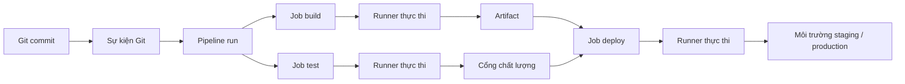

# Nhận diện commit, pipeline, job, runner, artifact và môi trường

Trong CI/CD, một thay đổi mã nguồn đi qua nhiều thành phần trước khi trở thành phiên bản chạy được trên môi trường đích. Muốn đọc, thiết kế hoặc xử lý sự cố một quy trình CI/CD, trước hết cần phân biệt sáu khái niệm thường xuất hiện cùng nhau: **commit**, **pipeline**, **job**, **runner**, **artifact** và **environment (môi trường)**.

Các khái niệm này tạo thành một chuỗi có thể truy vết: commit ghi nhận thay đổi; một sự kiện Git khởi chạy pipeline; pipeline điều phối các job; runner thực thi từng job; job tạo ra artifact; cuối cùng một job triển khai đưa artifact vào môi trường phù hợp. Đây là nền tảng để xây dựng luồng CI/CD có kiểm thử, kiểm soát chất lượng, quản lý phát hành và phản hồi từ vận hành.

## 1. Bức tranh tổng thể

Hãy hình dung nhóm phát triển vừa đẩy một thay đổi lên nhánh chính. Hệ thống CI/CD nhận sự kiện đó, kiểm tra mã nguồn, biên dịch ứng dụng, chạy kiểm thử và tạo gói triển khai. Nếu các điều kiện chất lượng đạt yêu cầu, quy trình có thể đưa gói đó lên môi trường staging để xác minh, rồi tiếp tục phát hành lên production theo chính sách của tổ chức.



Sơ đồ thể hiện trách nhiệm của từng thành phần, không hàm ý mọi nền tảng phải dùng đúng số lượng job hoặc runner như ví dụ. Một runner có thể lần lượt thực hiện nhiều job; các job độc lập cũng có thể chạy song song trên nhiều runner. Pipeline quyết định thứ tự và điều kiện phụ thuộc giữa chúng.

## 2. Commit: dấu mốc bất biến của mã nguồn

**Commit** là một bản ghi lưu lại trạng thái thay đổi của repository tại một thời điểm. Mỗi commit có mã định danh (commit hash), thông điệp mô tả, thông tin người tạo, thời gian và quan hệ với commit cha. Trong Git, hash cho phép xác định chính xác phiên bản mã nguồn được kiểm tra hoặc phát hành.

Ví dụ, một commit có thể bổ sung kiểm tra dữ liệu đầu vào cho API. Khi xem lịch sử, nhóm phát triển có thể lần theo hash để biết thay đổi nào đã được đưa vào, thay đổi dựa trên commit nào và ai thực hiện.

Commit thường được nhắc cùng branch và tag, nhưng ba khái niệm có vai trò khác nhau:

- **Commit** là bản ghi cụ thể của lịch sử mã nguồn.
- **Branch** là một tham chiếu có thể di chuyển tới commit, thường đại diện cho một dòng phát triển.
- **Tag** là tham chiếu thường được dùng để đánh dấu một mốc, chẳng hạn `v2.4.0`, giúp nhận diện phiên bản phát hành.

CI/CD thường phản ứng với một **sự kiện Git** thay vì tự chạy chỉ vì commit tồn tại. Sự kiện có thể là `push` lên branch, mở hoặc cập nhật pull request/merge request, tạo tag, lịch chạy định kỳ hoặc thao tác chạy thủ công. Cùng một commit có thể tạo nhiều lần chạy pipeline, ví dụ một lần khi mở merge request và một lần nữa sau khi merge vào branch chính.

Vì vậy, khi điều tra một lần build hoặc deployment, hãy ghi lại commit hash cụ thể. Tên branch như `main` có thể trỏ tới commit khác ở thời điểm sau; hash mới là căn cứ ổn định để xác định mã nguồn đã được xử lý.

## 3. Pipeline: quy trình điều phối được mô tả bằng mã

**Pipeline** là một lần thực thi quy trình CI/CD được định nghĩa bằng cấu hình. Cấu hình thường nằm trong repository dưới dạng mã, ví dụ `.gitlab-ci.yml` hoặc workflow trong `.github/workflows/`. Pipeline có thể được khởi chạy bởi sự kiện Git, lịch chạy hoặc thao tác thủ công.

Pipeline mô tả những việc cần làm và quan hệ giữa chúng: job nào chạy trước, job nào được phép chạy song song, điều kiện nào khiến một job bị bỏ qua, và điều kiện nào cho phép quy trình chuyển sang bước phát hành. Một pipeline run thường gắn với commit, branch hoặc tag đã kích hoạt nó, đồng thời có mã lần chạy, trạng thái và nhật ký thực thi riêng.

Pipeline không đồng nghĩa với một lệnh build. Một pipeline hoàn chỉnh có thể bao gồm:

1. Kiểm tra định dạng, quy ước và chất lượng mã nguồn.
2. Biên dịch hoặc đóng gói ứng dụng.
3. Chạy unit test, integration test và các kiểm thử cần thiết.
4. Quét lỗ hổng, kiểm tra giấy phép hoặc phân tích chất lượng.
5. Lưu artifact và thông tin truy vết.
6. Triển khai, xác minh sau triển khai và chờ phê duyệt nếu chính sách yêu cầu.

Nhiều nền tảng chia pipeline thành **stage** và **job**. Stage giúp nhóm các giai đoạn ở mức tổng quát; job là đơn vị thực thi cụ thể. Trong một stage, các job không phụ thuộc nhau có thể chạy song song. Job ở stage sau thường chỉ bắt đầu khi các điều kiện phụ thuộc đã thỏa mãn. Một số nền tảng cho phép khai báo đồ thị phụ thuộc trực tiếp thay vì chỉ dựa vào thứ tự stage.

Trạng thái pipeline thường được tổng hợp từ trạng thái các job và quy tắc của nền tảng. Pipeline có thể thành công, thất bại, đang chạy, bị hủy hoặc chờ thao tác thủ công. Pipeline thành công chỉ có nghĩa các bước được cấu hình đã đạt trạng thái yêu cầu; nó không tự chứng minh ứng dụng hoạt động tốt trong mọi tình huống thực tế.

## 4. Job: một đơn vị công việc có đầu vào và đầu ra

**Job** là một đơn vị công việc mà hệ thống CI/CD giao cho runner thực hiện. Một job thường khai báo script hoặc command, môi trường thực thi, điều kiện chạy, thời gian chờ tối đa, biến cấu hình và cách lưu kết quả.

Ví dụ, pipeline có thể có các job `compile`, `unit_test`, `security_scan` và `deploy_staging`. Mỗi job đảm nhiệm một mục tiêu rõ ràng. Nếu `unit_test` thất bại, quy tắc pipeline có thể chặn job triển khai phụ thuộc vào kết quả kiểm thử.

Một job thường có các đặc điểm sau:

- **Đầu vào:** mã nguồn tại commit được chọn, artifact từ job trước, biến cấu hình hoặc dữ liệu kiểm thử.
- **Lệnh thực thi:** các command được khai báo trong cấu hình pipeline hoặc script của repository.
- **Điều kiện:** branch, tag, loại sự kiện, thay đổi file, kết quả job trước hoặc thao tác phê duyệt.
- **Đầu ra:** trạng thái, log, báo cáo kiểm thử, artifact hoặc thông tin phục vụ job tiếp theo.

Job thường được thiết kế đủ nhỏ để dễ hiểu và chẩn đoán. Khi job thất bại, log của chính job đó giúp xác định lệnh nào lỗi, mã thoát là gì và lỗi xuất hiện ở bước nào. Nếu gom build, test và deploy vào một job quá lớn, việc xác định nguyên nhân và chạy lại riêng một phần sẽ khó hơn.

Job cũng không nhất thiết tương ứng với một máy chủ cố định. Hệ thống điều phối chọn runner phù hợp để thực thi job tại thời điểm chạy. Một job có thể được thử lại theo chính sách; lần thử lại vẫn thuộc lần chạy pipeline đó nhưng có lượt thực thi và log riêng tùy nền tảng.

## 5. Runner: nơi thực thi job

**Runner** là agent hoặc worker nhận job từ hệ thống CI/CD và chạy các lệnh được giao. Nếu pipeline là bản mô tả quy trình và job là một nhiệm vụ, runner là năng lực thực thi nhiệm vụ đó.

Runner có thể chạy trên máy ảo, máy chủ riêng, container hoặc cụm điều phối container. Tùy nền tảng và cấu hình, runner có thể sử dụng executor kiểu shell, Docker hoặc Kubernetes. Runner thường thực hiện các việc như chuẩn bị workspace, lấy mã nguồn, khởi tạo môi trường, chạy script, thu thập log và tải artifact lên nơi lưu trữ.

Hệ thống có thể chọn runner dựa trên các tiêu chí như:

- Nhãn hoặc tag mà job yêu cầu, ví dụ `linux`, `windows`, `docker`.
- Hệ điều hành, kiến trúc CPU, công cụ và phiên bản runtime sẵn có.
- Quyền truy cập mạng hoặc tài nguyên cần thiết cho công việc.
- Giới hạn đồng thời, tải hiện tại và chính sách bảo mật.

Runner được quản lý bởi nền tảng (hosted/shared runner) giúp nhóm sử dụng năng lực thực thi có sẵn. Runner tự quản lý (self-hosted runner) cho phép kiểm soát cấu hình, mạng và tài nguyên sâu hơn, nhưng tổ chức phải chịu trách nhiệm cập nhật, phân quyền, giám sát và bảo vệ máy chạy.

Một số điểm cần nhớ khi vận hành runner:

- Job cần runner tương thích. Nếu không có runner đáp ứng tag hoặc yêu cầu, job có thể ở trạng thái pending hoặc stuck.
- Workspace và thông tin xác thực cần được cô lập phù hợp giữa các job, đặc biệt khi runner dùng chung cho nhiều repository hoặc nhóm.
- Runner có quyền truy cập bí mật hoặc mạng nội bộ phải được quản lý chặt chẽ. Không cấp quyền rộng hơn nhu cầu của job.
- Không đưa token, mật khẩu hoặc khóa riêng vào script hay log. Hãy dùng kho secret/CI variables của nền tảng và giới hạn phạm vi truy cập.

Runner thực thi lệnh được giao; nó không tự quyết định toàn bộ chiến lược phát hành. Điều kiện, thứ tự và cổng chất lượng được khai báo trong pipeline cùng chính sách của hệ thống.

## 6. Artifact: sản phẩm được tạo ra từ pipeline

**Artifact** là đầu ra mà một job tạo ra và lưu lại để người hoặc job khác sử dụng. Artifact có thể là file JAR/WAR, gói ZIP, báo cáo kiểm thử, bản đồ mã nguồn, gói Helm hoặc container image. Với ứng dụng container, image thường được đẩy lên container registry và được nhận diện bằng tag hoặc digest.

Artifact có hai vai trò quan trọng:

1. **Chuyển giao giữa các job:** job deploy lấy gói đã được job build tạo ra, thay vì tự biên dịch lại mã nguồn.
2. **Truy vết và tái lập phát hành:** nhóm có thể xác định gói nào được tạo từ commit nào, pipeline run nào, công cụ và phiên bản phụ thuộc nào.

Artifact cần được quản lý như một sản phẩm có phiên bản. Thông tin hữu ích gồm commit hash, pipeline ID, tên và phiên bản ứng dụng, phiên bản toolchain, thời điểm tạo, checksum hoặc digest, cùng kết quả kiểm thử và quét bảo mật liên quan. Với artifact triển khai quan trọng, nên dùng kho lưu trữ hoặc registry có quyền truy cập, chính sách lưu giữ và khả năng kiểm tra nguồn gốc.

### Phân biệt artifact và cache

Artifact và cache đều có thể là dữ liệu được lưu giữa các lần chạy, nhưng mục đích khác nhau:

| Tiêu chí | Artifact | Cache |
|---|---|---|
| Mục đích | Lưu đầu ra cần chuyển giao, kiểm tra hoặc phát hành | Giảm thời gian xử lý bằng cách tái sử dụng dữ liệu có thể tạo lại |
| Ví dụ | File JAR, container image, báo cáo test | Thư mục dependency đã tải, dữ liệu build trung gian |
| Ý nghĩa khi bị thiếu | Job sau có thể không có đúng đầu vào để chạy hoặc triển khai | Quy trình thường vẫn có thể chạy lại, nhưng chậm hơn |
| Quản lý | Cần phiên bản, nguồn gốc và thời hạn lưu phù hợp | Có thể hết hạn hoặc bị làm mới theo khóa cache |

Không nên coi cache là bằng chứng cho phiên bản đã phát hành. Khi cần triển khai hoặc quay lui, phải xác định artifact chính xác đã được kiểm tra và phê duyệt.

## 7. Environment: nơi ứng dụng được triển khai

**Environment** (môi trường) là đích triển khai được CI/CD nhận diện và quản lý. Các tên thường gặp là `development`, `test`, `staging` và `production`. Một environment có thể ánh xạ tới namespace Kubernetes, cụm máy chủ, tài khoản cloud, nhóm máy ảo hoặc một hệ thống kiểm thử cụ thể.

Môi trường không chỉ là một chuỗi tên. Nó thường gắn với cấu hình, endpoint, quyền truy cập, secret, chính sách phê duyệt và lịch sử deployment. Ví dụ, staging có thể dùng database riêng và dữ liệu thử nghiệm; production dùng tài nguyên thật, yêu cầu quyền triển khai hạn chế và có cổng phê duyệt.

Các môi trường thường phục vụ mục tiêu khác nhau:

- **Development:** hỗ trợ phát triển và tích hợp thay đổi thường xuyên.
- **Test/QA:** xác minh chức năng, tích hợp và các tiêu chí kiểm thử.
- **Staging:** mô phỏng gần với production để kiểm tra trước khi phát hành.
- **Production:** phục vụ người dùng thật, cần kiểm soát thay đổi, giám sát và phương án phục hồi.

Không phải tổ chức nào cũng có đủ các môi trường trên hoặc đặt tên giống nhau. Điều quan trọng là xác định rõ đích triển khai, dữ liệu, cấu hình, quyền hạn và tiêu chí chấp nhận của từng môi trường.

Một nguyên tắc phát hành hữu ích là **build một lần, triển khai nhiều môi trường**: tạo một artifact từ commit đã xác định, kiểm thử artifact đó, sau đó đưa cùng artifact qua staging và production. Các giá trị cấu hình theo môi trường được cung cấp lúc triển khai. Cách này giảm nguy cơ staging và production chạy hai gói khác nhau dù cùng được gọi là một phiên bản.

Khi triển khai, pipeline nên ghi lại artifact nào đã được đưa vào environment nào và khi nào. Sau triển khai, cần có bước xác minh phù hợp như health check, smoke test hoặc kiểm tra chỉ số vận hành. Nếu xác minh thất bại, quy trình cần có cách dừng phát hành, chuyển lưu lượng về phiên bản ổn định hoặc quay lui theo chiến lược đã thiết kế.

## 8. Ví dụ: nối các khái niệm trong một pipeline

Ví dụ sau dùng cú pháp GitLab CI để minh họa cách các khái niệm liên kết với nhau. Cấu hình giả định dự án Gradle tạo ra file `build/libs/app.jar`; đường dẫn này cần được điều chỉnh theo tên artifact thực tế của dự án.

```yaml
stages:
  - build
  - test
  - package
  - deploy

default:
  image: eclipse-temurin:21-jdk
  tags:
    - linux
    - docker

build_app:
  stage: build
  script:
    - ./gradlew clean build -x test
  artifacts:
    paths:
      - build/libs/app.jar
    expire_in: 7 days

unit_tests:
  stage: test
  script:
    - ./gradlew test
  artifacts:
    when: always
    reports:
      junit: build/test-results/test/*.xml

package_release:
  stage: package
  needs:
    - job: build_app
      artifacts: true
    - job: unit_tests
  script:
    - mkdir -p dist
    - cp build/libs/app.jar dist/app.jar
    - sha256sum dist/app.jar > dist/app.jar.sha256
  artifacts:
    paths:
      - dist/
    expire_in: 30 days

deploy_staging:
  stage: deploy
  needs:
    - job: package_release
      artifacts: true
  script:
    - ./scripts/deploy.sh dist/app.jar
  environment:
    name: staging
    url: https://staging.example.com
  rules:
    - if: '$CI_COMMIT_BRANCH == $CI_DEFAULT_BRANCH'
```

Đọc ví dụ theo từng khái niệm:

1. Một sự kiện Git tạo pipeline run cho commit đang được xử lý. Metadata của pipeline giúp xác định commit và lần chạy.
2. Pipeline có bốn stage. Các job `build_app`, `unit_tests`, `package_release` và `deploy_staging` là các nhiệm vụ cụ thể.
3. Các job sử dụng runner có tag `linux` và `docker`. Runner cần được đăng ký và cấu hình để đáp ứng các tag cùng executor được yêu cầu.
4. `build_app` tạo file JAR và lưu nó thành artifact. `unit_tests` tạo báo cáo JUnit để hệ thống hiển thị kết quả kiểm thử.
5. `package_release` nhận artifact từ `build_app`, đóng gói đầu ra vào `dist/` và tạo checksum. `needs` thể hiện quan hệ phụ thuộc giữa các job.
6. `deploy_staging` nhận artifact đã đóng gói và triển khai vào environment tên `staging`. Quy tắc trong ví dụ chỉ cho phép job này chạy trên branch mặc định.

Trong cấu hình thực tế, thông tin đăng nhập để triển khai phải được cấp qua secret hoặc biến CI/CD có phạm vi và quyền phù hợp. Không ghi giá trị bí mật trực tiếp vào YAML. Cần bổ sung kiểm tra chất lượng, chính sách bảo vệ branch, phê duyệt production, health check và quy trình quay lui theo yêu cầu của hệ thống.

## 9. Truy vết từ commit đến môi trường

Một quy trình CI/CD đáng tin cậy phải trả lời được câu hỏi: **phiên bản đang chạy ở môi trường này được tạo từ thay đổi nào, qua những kiểm tra nào và được triển khai bởi lần chạy nào?** Để trả lời, cần nối các định danh xuyên suốt quy trình:

| Mốc | Thông tin cần lưu | Câu hỏi có thể trả lời |
|---|---|---|
| Commit | Commit hash, branch/tag, thông điệp | Mã nguồn nào đã thay đổi? |
| Pipeline run | Pipeline ID, sự kiện kích hoạt, thời điểm, trạng thái | Lần xử lý nào đã kiểm tra commit đó? |
| Job | Job ID, runner, log, trạng thái và báo cáo | Bước nào đã chạy, kết quả ra sao? |
| Artifact | Tên, phiên bản, checksum/digest, nguồn tạo | Chính xác gói nào được kiểm thử và phát hành? |
| Environment | Tên đích, deployment ID, thời điểm, người hoặc quy trình phê duyệt | Gói nào đang hoặc đã chạy ở đâu? |

Ví dụ, khi phát hiện lỗi trên production, nhóm có thể tra deployment history để lấy artifact digest, tìm pipeline đã tạo artifact, mở log và báo cáo của các job, rồi xác định commit tương ứng. Chuỗi truy vết này hỗ trợ khoanh vùng lỗi, kiểm tra tác động và chọn đúng phiên bản để phục hồi.

## 10. Những nhầm lẫn thường gặp

- **Coi commit là pipeline:** commit chỉ ghi nhận trạng thái mã nguồn; pipeline là một lần thực thi quy trình có thể được kích hoạt bởi commit hoặc sự kiện khác.
- **Coi pipeline và job là một:** pipeline điều phối toàn bộ luồng; job là một nhiệm vụ nằm trong luồng đó.
- **Coi runner là nơi định nghĩa quy trình:** runner thực thi job được giao; cấu hình pipeline mới mô tả job, điều kiện và quan hệ phụ thuộc.
- **Coi artifact là cache:** artifact là đầu ra cần nhận diện và chuyển giao; cache chủ yếu tăng tốc và có thể tạo lại.
- **Build lại ở mỗi môi trường:** việc tạo gói khác nhau cho staging và production làm suy yếu khả năng chứng minh hai môi trường chạy cùng một phiên bản đã kiểm thử.
- **Coi environment chỉ là tên:** mỗi môi trường còn có cấu hình, secret, quyền, dữ liệu, lịch sử triển khai và yêu cầu xác minh riêng.
- **Không gắn artifact với commit:** khi thiếu hash hoặc digest, nhóm khó chứng minh gói đang chạy được tạo từ mã nguồn nào.

## 11. Checklist khi đọc một pipeline

Khi tiếp nhận một repository hoặc điều tra một lần chạy CI/CD, hãy kiểm tra lần lượt:

1. Sự kiện nào kích hoạt pipeline và commit hash nào đang được xử lý?
2. Pipeline gồm những job nào, được nhóm theo stage hay đồ thị phụ thuộc nào?
3. Job nào chạy song song, job nào là cổng chặn trước khi phát hành?
4. Runner nào có thể nhận job, runner dùng executor và quyền truy cập gì?
5. Job tạo ra artifact nào, lưu ở đâu, có checksum/digest và thông tin nguồn gốc không?
6. Artifact được triển khai tới environment nào, cấu hình và secret được cấp bằng cách nào?
7. Sau triển khai có health check, ghi nhận deployment và phương án quay lui không?

Khi trả lời được các câu hỏi này, bạn có thể đọc một pipeline như một luồng công việc có đầu vào, bước xử lý, đầu ra và đích triển khai rõ ràng. Đây là cơ sở để tiếp tục học cách thiết kế pipeline dưới dạng mã, tự động hóa build và kiểm thử, quản lý artifact, bảo vệ bí mật và xây dựng cổng chất lượng trong CI/CD.
