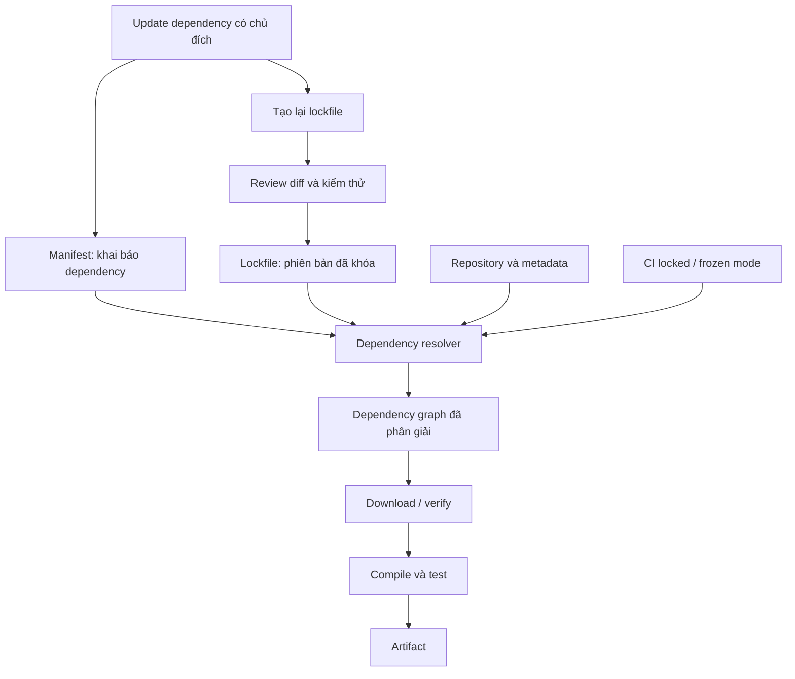
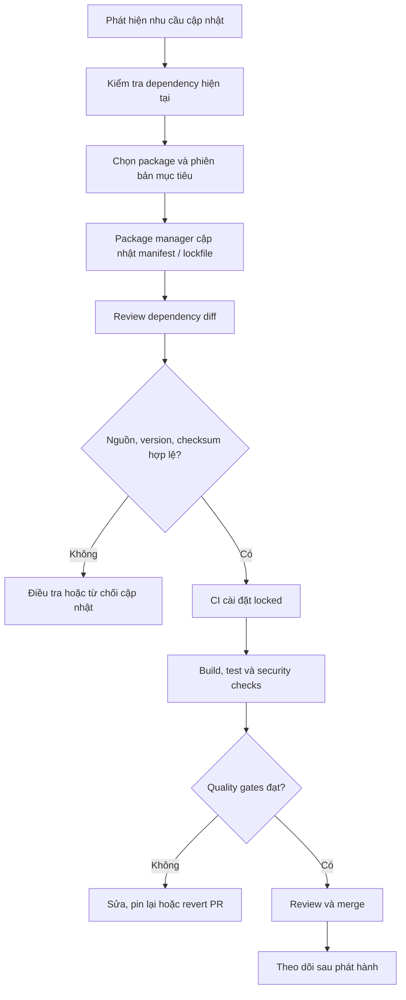

# Ghim phiên bản và quản lý tệp khóa khi hệ sinh thái hỗ trợ

Một commit có thể giữ nguyên nhưng kết quả build vẫn thay đổi nếu dependency được tải theo phiên bản trôi nổi, repository trả về bản phát hành mới hoặc công cụ build được cập nhật ngoài dự kiến. CI/CD cần tái tạo được tập dependency đã dùng để compile, test và đóng gói. Vì vậy, nhóm phải quản lý phiên bản trực tiếp lẫn phiên bản bắc cầu, lưu trạng thái phân giải dependency và yêu cầu pipeline cài đặt đúng trạng thái đó.

Ghim phiên bản (version pinning) giới hạn phiên bản dependency mà dự án chấp nhận. Tệp khóa (lockfile) ghi lại kết quả phân giải cụ thể của một tập dependency, thường bao gồm phiên bản chính xác và metadata cần thiết để tái tạo. Hai cơ chế bổ sung cho nhau: manifest mô tả dependency dự án mong muốn; lockfile ghi lại tập dependency đã được giải quyết. Khi hệ sinh thái có hỗ trợ lockfile, hãy commit file khóa cùng mã nguồn và chạy CI ở chế độ không tự ý cập nhật file này.

## 1. Vì sao cần ghim phiên bản và lockfile?

Giả sử dự án khai báo thư viện `http-client` với một khoảng phiên bản tương thích. Hôm nay CI giải quyết được phiên bản `4.2.1`; tuần sau nhà cung cấp phát hành `4.3.0`, trong đó có thay đổi hành vi hoặc lỗi tương thích. Cùng một commit có thể nhận dependency khác nhau nếu pipeline phân giải lại từ repository.

Rủi ro này không chỉ đến từ dependency trực tiếp. Một thư viện A có thể phụ thuộc B, B lại phụ thuộc C. Dự án chỉ khai báo A nhưng kết quả build chịu ảnh hưởng của cả chuỗi dependency bắc cầu (transitive dependencies). Phiên bản của plugin build, compiler, action CI, image nền và provider hạ tầng cũng có thể làm thay đổi kết quả.

Quản lý phiên bản và lockfile giúp:

- Tái tạo cùng một tập dependency trên máy phát triển, runner CI và môi trường build khác.
- Phát hiện thay đổi dependency qua pull request thay vì âm thầm nhận bản mới khi build.
- Điều tra lỗi bằng cách xác định chính xác thư viện và phiên bản đã được dùng.
- Review tác động của bản cập nhật bảo mật, sửa lỗi và thay đổi tương thích.
- Tạo cơ sở cho build có thể tái lập và truy vết chuỗi cung ứng phần mềm.



Lockfile không thay thế manifest. Manifest giải thích dự án phụ thuộc vào thư viện nào và thường biểu đạt khoảng phiên bản hoặc chính sách tương thích. Lockfile ghi lại kết quả phân giải cụ thể để các lần cài đặt tiếp theo dùng cùng tập dependency. Không nên sửa lockfile bằng tay để ép một phiên bản; hãy dùng package manager để cập nhật và xác minh tính nhất quán.

Lockfile là một phần của đầu vào build, không phải lời cam kết rằng hai lần build sẽ tạo ra byte giống hệt nhau. Kết quả vẫn có thể khác do hệ điều hành, kiến trúc CPU, runtime, compiler, build plugin, script cài đặt, biến môi trường, dữ liệu đầu vào hoặc nguồn tải bên ngoài. Muốn tăng mức tái lập, cần kiểm soát cả toolchain và môi trường build, đồng thời ghi nhận provenance của artifact.

## 2. Phân biệt manifest, lockfile, catalog, BOM và checksum

Các file dependency có thể trông giống nhau nhưng có vai trò khác nhau.

| Loại | Mục đích | Ví dụ |
|---|---|---|
| Manifest | Khai báo dependency trực tiếp, constraint và metadata dự án | `package.json`, `pyproject.toml`, `Cargo.toml`, `go.mod`, `build.gradle` |
| Lockfile | Ghi lại tập dependency được phân giải với phiên bản cụ thể | `package-lock.json`, `pnpm-lock.yaml`, `uv.lock`, `Cargo.lock`, Gradle lockfiles |
| Version catalog | Tập trung tên alias và phiên bản để dùng trong nhiều module | Gradle `libs.versions.toml` |
| BOM (Bill of Materials) | Quản lý tập phiên bản tương thích, thường qua dependency management | Maven BOM, Spring Boot dependency BOM |
| Checksum/integrity metadata | Xác minh nội dung tải về có khớp giá trị mong đợi | npm integrity, Go `go.sum`, Gradle verification metadata |
| Toolchain declaration | Khai báo phiên bản công cụ/runtime dùng để build | Gradle Wrapper, `.java-version`, `.nvmrc`, `rust-toolchain.toml` |

Một số hệ sinh thái gộp nhiều vai trò vào lockfile; một số tách chúng ra. Ví dụ `go.mod` khai báo module và yêu cầu phiên bản tối thiểu, còn `go.sum` ghi checksum cho nội dung module. Gradle dependency locking ghi phiên bản được khóa; `gradle/verification-metadata.xml` có thể bổ sung checksum hoặc chữ ký để xác minh nội dung tải về. Hai lớp kiểm soát này giải quyết hai câu hỏi khác nhau: “đang dùng phiên bản nào?” và “nội dung nhận được có đúng artifact đã mong đợi không?”.

## 3. Chọn chiến lược version pinning

### 3.1. Phiên bản chính xác (exact version)

Ghim chính xác một phiên bản giúp loại bỏ sự mơ hồ khi phân giải. Ví dụ:

```text
http-client = 4.2.1
```

Ưu điểm là dễ xác định đầu vào build và giảm nguy cơ tự nhận thay đổi mới. Nhược điểm là dependency không tự nhận bản sửa lỗi hoặc bản vá bảo mật; nhóm phải có quy trình cập nhật chủ động.

### 3.2. Khoảng phiên bản (version range)

Một số package manager cho phép khai báo khoảng tương thích, ví dụ `^4.2.0`, `~4.2.0`, `>=4.2 <5` hoặc dải phiên bản theo cú pháp riêng. Khoảng phiên bản giúp dự án chấp nhận một số cập nhật mà không cần sửa manifest mỗi lần.

Không được giả định mọi hệ sinh thái hiểu ký hiệu giống nhau. Ý nghĩa caret, tilde, range inclusive/exclusive và prerelease khác nhau theo package manager. Semantic Versioning cũng chỉ là cam kết của nhà phát hành; package có thể không tuân thủ hoàn toàn. Hãy đọc quy tắc của công cụ đang dùng.

Khi có lockfile, manifest có thể giữ khoảng tương thích trong khi lockfile cố định phiên bản được cài tại thời điểm cập nhật. Cách làm này cho phép nhóm chủ động chọn thời điểm nâng cấp nhưng vẫn mô tả giới hạn tương thích của dependency.

### 3.3. Phiên bản động và floating version

Các dạng như `latest`, `1.+`, `SNAPSHOT`, `*`, `main`, `stable` hoặc tag container có thể trỏ đến nội dung mới theo thời gian. Chúng tiện khi thử nghiệm nhưng làm giảm khả năng tái tạo build.

Trong pipeline release, tránh phụ thuộc vào version động nếu không có bước khóa và ghi nhận kết quả. Nếu hệ thống bắt buộc dùng version động, cần resolve một lần, lưu lại phiên bản/digest thực tế, xác minh và promote đúng artifact đã resolve qua các môi trường.

### 3.4. Quy tắc chọn mức pin

| Thành phần | Chiến lược thường phù hợp |
|---|---|
| Dependency ứng dụng trực tiếp | Khai báo constraint tương thích và commit lockfile |
| Dependency bắc cầu | Để resolver khóa qua lockfile; kiểm tra conflict và bản vá |
| Plugin build và compiler | Ghim phiên bản cụ thể hoặc quản lý qua catalog/toolchain |
| CI action, orb, reusable workflow | Ghim version/revision; với thành phần nhạy cảm, pin commit SHA bất biến |
| Container base image | Dùng tag rõ ràng và digest cho build/release có yêu cầu tái lập |
| Terraform provider | Ghim constraint phù hợp và commit `.terraform.lock.hcl` |
| Runtime trên runner | Chọn phiên bản rõ ràng; tránh phụ thuộc mặc định `latest` |

Không phải mọi thứ đều cần pin ở cùng một mức. Hãy ưu tiên những đầu vào có thể thay đổi kết quả build hoặc quyền thực thi, rồi xác định chính sách cập nhật và cách xác minh cho từng nhóm.

## 4. Quản lý dependency trực tiếp và bắc cầu

Dependency trực tiếp là thư viện được dự án khai báo. Dependency bắc cầu là thư viện được kéo vào thông qua dependency khác. Cả hai đều có thể chứa lỗi, lỗ hổng hoặc giấy phép không phù hợp.

Ví dụ:

```text
application
└── web-framework 6.1.0        (direct)
    ├── http-core 5.3.2        (transitive)
    │   └── codec 2.8.1       (transitive)
    └── json-mapper 3.1.4     (transitive)
```

Khi có lỗ hổng trong `codec`, việc chỉ xem manifest của application có thể không thấy dependency này. Cần dùng dependency tree hoặc báo cáo SBOM để xác định đường đi từ dependency trực tiếp đến package bị ảnh hưởng.

Các vấn đề thường gặp:

- Hai thư viện yêu cầu các phiên bản khác nhau của cùng một dependency.
- Một dependency bị loại trừ ở module này nhưng vẫn được kéo vào qua module khác.
- Resolver chọn phiên bản mới hơn nhưng gây thay đổi hành vi.
- Một package biến mất khỏi repository hoặc thay đổi metadata.
- Một thư viện bắc cầu chứa lỗ hổng dù dependency trực tiếp không có bản cập nhật.

Khi xử lý conflict, không chỉ ép một phiên bản để build xanh. Hãy kiểm tra compatibility của tất cả consumer, đọc release notes và chạy test liên quan. Nếu buộc phải override dependency bắc cầu, ghi rõ lý do, phạm vi và điều kiện gỡ override.

## 5. Lockfile trong hệ sinh thái JavaScript/TypeScript

Node.js có nhiều package manager. Chọn một công cụ làm chuẩn cho repository và commit đúng lockfile tương ứng.

| Package manager | Manifest | Lockfile | Chế độ cài đặt CI thường dùng |
|---|---|---|---|
| npm | `package.json` | `package-lock.json` | `npm ci` |
| Yarn Classic | `package.json` | `yarn.lock` | `yarn install --frozen-lockfile` |
| Yarn Berry (Yarn 2+) | `package.json` | `yarn.lock` | `yarn install --immutable` |
| pnpm | `package.json` | `pnpm-lock.yaml` | `pnpm install --frozen-lockfile` |

### 5.1. npm

`package.json` khai báo dependency và range. `package-lock.json` ghi lại cây dependency đã phân giải cùng thông tin integrity. Trong CI, dùng `npm ci` để cài theo lockfile. Lệnh này yêu cầu lockfile phù hợp với manifest, cài đặt sạch và thất bại nếu hai file không đồng bộ.

```bash
# Cài dependency theo lockfile trong CI
npm ci

# Chạy kiểm tra
npm test

# Cập nhật một dependency có chủ đích
npm install lodash@4.17.21

# Xem cây dependency
npm ls --all
```

`npm install` có thể cập nhật lockfile khi manifest thay đổi; vì vậy không dùng nó như lệnh CI mặc định nếu mục tiêu là phát hiện lockfile stale. Khi thêm dependency, chạy lệnh cập nhật local, review cả `package.json` và `package-lock.json`, rồi để CI chạy `npm ci`.

### 5.2. Yarn

Yarn Classic và Yarn Berry có chế độ frozen/immutable khác nhau. Dùng lệnh đúng phiên bản Yarn được dự án ghim trong `packageManager` hoặc toolchain config. Không đổi Yarn major version chỉ để chạy pipeline mà không cập nhật và review lockfile.

```bash
# Yarn Classic
yarn install --frozen-lockfile

# Yarn Berry
yarn install --immutable
```

Yarn Berry có thể dùng Plug'n'Play hoặc node-modules linker. Cache và cấu hình cài đặt phải nhất quán với mode mà dự án chọn. Nếu pipeline dùng cache, key nên bao gồm lockfile và phiên bản Yarn/Node để tránh tái sử dụng cache không tương thích.

### 5.3. pnpm

pnpm dùng `pnpm-lock.yaml`. Trong CI, `pnpm install --frozen-lockfile` đảm bảo package manager không tự cập nhật lockfile. Hãy ghim phiên bản pnpm và Node.js, ví dụ qua trường `packageManager`, Corepack hoặc toolchain setup của pipeline.

```bash
corepack enable
pnpm install --frozen-lockfile
pnpm test
```

Không commit nhiều lockfile cho cùng một repository nếu nhóm không có chủ đích hỗ trợ nhiều package manager. Việc tồn tại `package-lock.json`, `yarn.lock` và `pnpm-lock.yaml` cùng lúc dễ làm các môi trường cài đặt ra cây dependency khác nhau.

## 6. Lockfile trong Python

Python có nhiều cách mô tả dependency. `pyproject.toml` thường là manifest dự án; lockfile phụ thuộc công cụ quản lý môi trường và dependency.

| Công cụ | File thường gặp | Vai trò |
|---|---|---|
| Poetry | `pyproject.toml`, `poetry.lock` | Khóa dependency đã phân giải và metadata package |
| uv | `pyproject.toml`, `uv.lock` | Khóa graph dependency cho môi trường dự án |
| Pipenv | `Pipfile`, `Pipfile.lock` | Khai báo và khóa dependency |
| pip-tools | `requirements.in`, `requirements.txt` | Biên dịch input constraints thành danh sách đã pin, có thể kèm hash |
| pip thuần | `requirements.txt` | Có thể pin exact version và hash theo chính sách dự án |

### 6.1. Pin phiên bản và hash

Một file requirements chỉ ghi `requests>=2.30` vẫn cho phép resolver chọn nhiều phiên bản. Nếu mục tiêu là tái lập, file đầu ra cần ghi phiên bản cụ thể cho cả dependency bắc cầu. Có thể dùng hash để yêu cầu package tải về khớp nội dung đã duyệt.

```text
requests==2.32.3 \
    --hash=sha256:<hash-of-approved-wheel-or-sdist>
urllib3==2.2.3 \
    --hash=sha256:<hash-of-approved-wheel-or-sdist>
```

Các giá trị hash trong ví dụ là placeholder; cần sinh từ artifact thực tế và giữ đầy đủ hash hợp lệ cho nền tảng/package được phép cài. Khi dùng pip với `--require-hashes`, mọi requirement liên quan phải được pin và có hash phù hợp.

```bash
python -m pip install --require-hashes -r requirements.txt
```

Với pip-tools, có thể giữ danh sách constraint ngắn trong `requirements.in` rồi biên dịch ra file đã pin:

```bash
pip-compile --generate-hashes --output-file=requirements.txt requirements.in
pip-sync requirements.txt
```

Chạy `pip-compile` trong bước cập nhật dependency có chủ đích; CI chỉ dùng file đã sinh để cài đặt và kiểm tra.

### 6.2. Poetry và uv

Poetry dùng `poetry.lock`; khi thêm hoặc cập nhật dependency, chạy lệnh lock/update có chủ đích rồi review diff. Trong CI, `poetry install` cài theo lockfile hiện có; với phiên bản Poetry phù hợp, `poetry sync` có thể giúp đồng bộ môi trường để loại package thừa.

uv dùng `uv.lock`. `uv sync --locked` yêu cầu lockfile hiện có phải khớp với manifest và thất bại nếu cần cập nhật; đây là lựa chọn hữu ích cho CI cần phát hiện lockfile cũ. `uv sync --frozen` bỏ qua việc kiểm tra/cập nhật lockfile, vì vậy chỉ dùng khi pipeline đã có lý do rõ ràng và kiểm soát đầu vào khác.

```bash
# Ví dụ CI với uv
uv sync --locked
uv run pytest
```

Hãy ghim phiên bản Python và phiên bản công cụ Poetry/uv/pip-tools. Cùng một lockfile nhưng khác phiên bản resolver hoặc marker theo platform có thể cho hành vi khác; lockfile thường chứa điều kiện nền tảng để resolver chọn đúng package.

## 7. Java và JVM: Gradle, Maven và dependency management

### 7.1. Gradle dependency locking

Gradle hỗ trợ dependency locking để ghi lại phiên bản đã được resolve cho các configuration. Dự án có thể bật khóa cho mọi configuration hoặc chọn configuration cần thiết.

```kotlin
// build.gradle.kts
dependencyLocking {
    lockAllConfigurations()
}
```

Sau khi bật locking, resolve các configuration cần thiết để tạo lock state:

```bash
./gradlew dependencies --write-locks
```

Lock state thường được lưu thành `gradle.lockfile` trong từng project. Commit lockfile cùng thay đổi dependency. Khi CI chạy, Gradle dùng trạng thái đã khóa; nếu manifest yêu cầu phiên bản khác lock state, quá trình resolve có thể thất bại để nhóm cập nhật lockfile có chủ đích.

Gradle version catalog (`gradle/libs.versions.toml`) tập trung alias và phiên bản khai báo. Catalog giúp quản lý tập trung nhưng không tự thay thế dependency locking: nó không nhất thiết ghi toàn bộ dependency bắc cầu đã được resolve.

```toml
[versions]
jackson = "2.17.2"

[libraries]
jackson-databind = { module = "com.fasterxml.jackson.core:jackson-databind", version.ref = "jackson" }
```

Trong pipeline, có thể bổ sung dependency verification để kiểm tra checksum hoặc chữ ký của artifact:

```bash
./gradlew check --dependency-verification=strict
```

Metadata xác minh được quản lý trong `gradle/verification-metadata.xml`. Hãy tạo và review metadata từ nguồn tin cậy; không tự động chấp nhận mọi checksum mới mà không kiểm tra provenance.

### 7.2. Maven dependency management và BOM

Maven dùng `pom.xml` để khai báo dependency. `dependencyManagement` và BOM (Bill of Materials) giúp quản lý phiên bản tập trung, đặc biệt khi nhiều module dùng chung một hệ thư viện.

```xml
<dependencyManagement>
  <dependencies>
    <dependency>
      <groupId>org.springframework.boot</groupId>
      <artifactId>spring-boot-dependencies</artifactId>
      <version>3.3.4</version>
      <type>pom</type>
      <scope>import</scope>
    </dependency>
  </dependencies>
</dependencyManagement>
```

BOM quản lý phiên bản theo tập dependency tương thích, nhưng không phải lockfile phổ quát ghi mọi artifact bắc cầu đã resolve cho từng build. Maven có thể áp dụng quy tắc mediation và dependency management; kết quả còn chịu ảnh hưởng của POM, repository, profile và plugin. Vì vậy:

- Ghim phiên bản plugin trong `pluginManagement` hoặc khai báo plugin rõ ràng.
- Tránh version range và `SNAPSHOT` trong release build nếu không có cơ chế khóa riêng.
- Dùng `mvn dependency:tree` để điều tra dependency bắc cầu và conflict.
- Dùng Maven Enforcer rules như dependency convergence hoặc require upper bound deps khi phù hợp.
- Quản lý BOM/parent POM như một đầu vào có version rõ ràng.

```bash
mvn -B -ntp verify
mvn -B -ntp dependency:tree
```

Nếu tổ chức cần lockfile cho Maven, hãy chọn plugin hoặc quy trình tạo lock phù hợp, kiểm tra mức hỗ trợ và phạm vi bảo đảm. Đừng gọi BOM là lockfile vì hai cơ chế không có cùng semantics.

### 7.3. Ghim toolchain JVM

Dependency ứng dụng chỉ là một phần của đầu vào build. Cần ghim Gradle Wrapper distribution, Maven Wrapper, JDK/toolchain và plugin. Wrapper giúp nhóm dùng cùng phiên bản build tool; checksum distribution có thể được cấu hình để xác minh file tải về.

```properties
# gradle/wrapper/gradle-wrapper.properties
distributionUrl=https\://services.gradle.org/distributions/gradle-8.10.2-bin.zip
distributionSha256Sum=<approved-sha256>
```

Giá trị checksum ở trên là placeholder. Phải lấy checksum từ nguồn phát hành chính thức hoặc nguồn nội bộ đã xác minh trước khi đưa vào dự án. Không sao chép một giá trị chưa kiểm chứng.

## 8. Go modules

Go dùng `go.mod` để khai báo module và dependency. `go.sum` ghi checksum cho nội dung module và go.mod được xác minh. Go Modules dùng Minimal Version Selection (MVS): với mỗi module path, resolver chọn phiên bản tối thiểu đáp ứng các yêu cầu trong graph theo quy tắc của Go.

```go
module example.com/store

go 1.23

require (
    github.com/google/uuid v1.6.0
    golang.org/x/sync v0.8.0
)
```

Các lệnh thường dùng:

```bash
# Đồng bộ khai báo module và checksum
go mod tidy

# Kiểm tra checksum của module đã tải
go mod verify

# Chạy test
go test ./...
```

Commit cả `go.mod` và `go.sum`. `go mod tidy` có thể thay đổi hai file; hãy chạy trong một pull request cập nhật dependency và review diff. Không xóa `go.sum` để xử lý lỗi checksum; hãy điều tra nguồn module, proxy và trạng thái cache.

## 9. Rust và Cargo

Rust khai báo dependency trong `Cargo.toml`; `Cargo.lock` ghi lại phiên bản đã phân giải. Với ứng dụng/binary, thông thường commit `Cargo.lock` để build CI và phát hành dùng cùng graph. Với thư viện, chính sách commit lockfile có thể khác vì downstream consumer sẽ tự resolve dependency theo manifest; nhóm cần theo quy ước repository và mục tiêu build.

Trong CI, `--locked` yêu cầu Cargo không thay đổi lockfile và thất bại nếu cần cập nhật:

```bash
cargo test --locked
cargo build --release --locked
```

Khi cập nhật dependency, dùng `cargo update` có phạm vi rõ ràng hoặc chỉnh constraint rồi chạy Cargo để cập nhật lockfile. Review `Cargo.lock`, đặc biệt các package mới, source Git, registry khác thường và thay đổi lớn của dependency bắc cầu.

Toolchain Rust cũng cần được ghim bằng `rust-toolchain.toml` hoặc cơ chế quản lý toolchain thống nhất. Nếu dùng dependency từ Git, nên pin revision cụ thể thay vì branch/tag trôi nổi.

## 10. .NET và NuGet

NuGet dùng `PackageReference` trong project file hoặc `Directory.Packages.props` khi áp dụng Central Package Management. `packages.lock.json` có thể ghi dependency graph đã resolve. Bật tạo lockfile và dùng locked mode trong restore để CI không tự cập nhật graph.

```xml
<!-- Directory.Build.props hoặc project file -->
<PropertyGroup>
  <RestorePackagesWithLockFile>true</RestorePackagesWithLockFile>
</PropertyGroup>
```

```bash
# Restore theo lockfile, thất bại nếu cần cập nhật
dotnet restore --locked-mode
dotnet test --no-restore
```

Khi dependency thay đổi, chạy restore trong chế độ cập nhật, review `packages.lock.json` và commit. Nếu dùng central package versions, `Directory.Packages.props` giúp thống nhất phiên bản trực tiếp; lockfile vẫn cần thiết để ghi lại dependency bắc cầu nếu mục tiêu là tái tạo graph.

## 11. Container, CI action và công cụ ngoài ứng dụng

Dependency không chỉ nằm trong manifest ngôn ngữ.

### 11.1. Container image

Tag image như `node:22`, `eclipse-temurin:21-jre` hoặc `postgres:16` dễ đọc nhưng có thể được cập nhật để trỏ sang image digest khác. Với build cần tái lập, có thể pin digest:

```dockerfile
FROM eclipse-temurin:21.0.4_7-jre@sha256:<approved-digest>
```

Digest phải lấy từ registry tin cậy và được xác minh. Cập nhật image nền nên đi qua pull request để review OS package, JDK/runtime, CA certificates và các thay đổi bảo mật.

### 11.2. GitHub Actions và thành phần CI tái sử dụng

Action có thể thay đổi nội dung dù tag vẫn tồn tại nếu nhà phát hành di chuyển tag. Ghim action bằng full commit SHA giúp tham chiếu revision bất biến hơn. Có thể ghi comment phiên bản để con người đọc dễ hiểu, đồng thời dùng bot hoặc quy trình định kỳ để cập nhật SHA sau khi review.

Reusable workflow, orb, template, Jenkins Shared Library và plugin cũng là dependency của pipeline. Ghim version/ref, kiểm soát quyền, đọc release notes và kiểm thử trên branch thử nghiệm trước khi nâng cấp diện rộng.

### 11.3. Terraform provider và công cụ hạ tầng

Terraform dùng `.terraform.lock.hcl` để ghi provider selection và checksum. Commit file này để các lần `terraform init` sử dụng cùng provider đã khóa. Dùng `terraform init -lockfile=readonly` trong CI để phát hiện thay đổi cần cập nhật lockfile thay vì âm thầm ghi lại.

Các công cụ như kubectl, Helm, scanner, code generator và CLI phát hành cũng cần phiên bản rõ ràng. Một pipeline chỉ pin thư viện ứng dụng nhưng tải `latest` cho công cụ triển khai vẫn chưa có đầu vào ổn định.

## 12. Quy trình cập nhật lockfile an toàn

Không nên cập nhật tất cả dependency bằng một thao tác khó review rồi merge chỉ vì pipeline xanh. Một quy trình có kiểm soát có thể gồm:

1. **Xác định mục tiêu:** cập nhật để vá CVE, nhận bug fix, hỗ trợ runtime mới hoặc xử lý dependency hết vòng đời.
2. **Kiểm tra phiên bản hiện tại:** xem manifest, lockfile, dependency tree, cảnh báo bảo mật và các consumer.
3. **Chọn phạm vi:** cập nhật một package, một nhóm liên quan hoặc toàn bộ theo lịch; hạn chế gộp thay đổi lớn không liên quan.
4. **Chạy package manager:** dùng lệnh update/lock chính thức để thay đổi manifest và lockfile.
5. **Review diff:** xác nhận package mới, phiên bản bắc cầu, nguồn tải, checksum, license và thay đổi ngoài dự kiến.
6. **Chạy CI ở chế độ locked:** cài đặt không cập nhật lockfile, sau đó compile, test, static analysis và security scan.
7. **Đánh giá tác động:** kiểm tra API thay đổi, runtime compatibility, performance và hành vi production quan trọng.
8. **Merge và theo dõi:** ghi nhận phiên bản mới, theo dõi lỗi sau phát hành và giữ khả năng quay lại phiên bản đã biết tốt.



## 13. Tự động hóa cập nhật dependency

Bot như Dependabot hoặc Renovate có thể tạo pull request khi có phiên bản mới hoặc cảnh báo bảo mật. Tự động hóa giúp nhóm không quên cập nhật, nhưng không nên đồng nghĩa với tự động merge mọi thay đổi.

Chính sách bot có thể phân loại:

- Patch update ít rủi ro: gom theo nhóm nhỏ và yêu cầu CI đầy đủ.
- Minor update: chạy kiểm tra tương thích và review theo mức ảnh hưởng.
- Major update: yêu cầu đánh giá migration, API breaking changes và kế hoạch chuyển đổi.
- Security update: ưu tiên xử lý theo mức độ nghiêm trọng và khả năng khai thác; có thể cần quy trình khẩn cấp.
- Toolchain/plugin update: kiểm tra lại pipeline, cache, runner image và kết quả build.

Giới hạn số pull request đồng thời để tránh tạo hàng đợi review. Grouping chỉ nên gom các dependency có quan hệ hoặc cùng chính sách; nếu gộp quá nhiều package, khi test fail sẽ khó xác định package gây lỗi. Lưu ý bot có thể thay đổi manifest và lockfile; CI vẫn phải xác minh lockfile đồng bộ và nội dung tải về.

## 14. Cache không thay thế lockfile

Cache lưu dữ liệu có thể tái tạo nhằm giảm thời gian tải dependency hoặc build. Lockfile xác định dependency graph cần cài. Hai cơ chế có mục tiêu khác nhau:

| Đặc điểm | Lockfile | Cache |
|---|---|---|
| Vai trò | Xác định phiên bản/graph đã resolve | Tăng tốc bằng cách tái sử dụng dữ liệu |
| Có cần commit vào Git? | Thường có, khi hệ sinh thái hỗ trợ và dự án cần tái lập | Không; thường do CI quản lý |
| Cache miss | Không làm thay đổi graph đã khóa | Tải/tạo lại dữ liệu, có thể chậm hơn |
| Cache stale | Không phải khái niệm áp dụng trực tiếp cho lockfile; lockfile cần update có chủ đích | Có thể gây lỗi nếu key hoặc nội dung không phù hợp |
| Có thể là nguồn sự thật? | Là một phần của đầu vào build | Không nên |

Cache key nên chứa hash lockfile và phiên bản runtime/package manager. Khi lockfile đổi, cache key đổi để tránh dùng cache cũ không tương thích. Có thể dùng restore key làm cache gần đúng để tăng tốc, nhưng package manager vẫn phải xác minh và cài theo lockfile.

Ví dụ ý tưởng cache npm trong GitHub Actions:

```yaml
- uses: actions/setup-node@v4
  with:
    node-version: '22.11.0'
    cache: npm
    cache-dependency-path: package-lock.json

- run: npm ci
```

Cache giúp giảm thời gian tải package, còn `npm ci` vẫn là bước cài đặt theo lockfile. Không bỏ `npm ci` chỉ vì cache đã tồn tại. Tham chiếu `setup-node@v4` trong snippet nhằm minh họa cấu hình; với pipeline nhạy cảm, hãy pin action theo full commit SHA và cập nhật qua quy trình review.

## 15. Xác minh tính toàn vẹn và nguồn dependency

Ghim phiên bản không đảm bảo nội dung tải về an toàn. Repository package có thể bị thay đổi, tài khoản nhà phát hành bị chiếm quyền hoặc artifact bị thay thế. Cần thêm lớp xác minh:

- **Checksum/hash:** xác nhận file tải về khớp digest đã được ghi nhận.
- **Chữ ký:** xác minh artifact được ký bởi danh tính hoặc khóa đáng tin.
- **Repository allowlist:** giới hạn registry/repository được phép cung cấp dependency.
- **Dependency verification:** kiểm tra checksum/chữ ký theo metadata của hệ sinh thái.
- **SBOM:** lưu danh sách thành phần phần mềm trong artifact để phục vụ truy vết và phản ứng bảo mật.
- **Provenance:** liên kết artifact với source revision, workflow, builder và thông tin build.

Hash chỉ chứng minh nội dung khớp giá trị được so sánh; nó không tự chứng minh nhà phát hành đáng tin. Nếu hash được lấy từ cùng một nguồn đã bị xâm nhập, cần thêm chữ ký, provenance hoặc nguồn độc lập để tăng độ tin cậy.

Không ghi token registry vào URL dependency, file lock, log hoặc command line. Dùng secret manager và quyền đọc package tối thiểu. Nếu package cần xác thực, pipeline phải cấp credential đúng phạm vi repository và thời gian sử dụng.

## 16. Xử lý conflict và lỗi lockfile

### 16.1. Manifest và lockfile không đồng bộ

CI ở chế độ frozen/locked có thể thất bại nếu manifest đã đổi nhưng lockfile chưa được cập nhật. Cách xử lý:

1. Xác định package manager và phiên bản đang được ghim.
2. Chạy lệnh cập nhật lockfile đúng công cụ ở local hoặc môi trường được kiểm soát.
3. Review diff để xác nhận thay đổi đúng mục tiêu.
4. Commit cả manifest và lockfile trong cùng thay đổi.
5. Chạy lại CI ở chế độ locked để chứng minh trạng thái mới nhất hợp lệ.

Không tắt frozen mode để pipeline xanh. Làm vậy che giấu việc repository không chứa đầy đủ đầu vào cần thiết để tái tạo build.

### 16.2. Xung đột khi nhiều nhánh cập nhật dependency

Hai pull request cùng sửa lockfile có thể tạo conflict lớn. Không giải quyết bằng cách giữ tùy tiện một nửa file. Hãy cập nhật lại từ nhánh chính sau khi merge thay đổi trước, chạy package manager để tái phân giải và review toàn bộ lockfile được tạo lại.

### 16.3. Dependency không còn tồn tại hoặc không tải được

Kiểm tra registry URL, quyền truy cập, proxy, retention policy, package yanked/unpublished và checksum. Nếu artifact đã bị gỡ, cân nhắc mirror nội bộ hoặc nâng cấp sang phiên bản thay thế đã được xác minh. Không tải một file cùng tên từ nguồn không rõ để thay thế.

### 16.4. Phiên bản bị lỗ hổng

Xác định dependency trực tiếp hay bắc cầu, phiên bản bị ảnh hưởng, đường đi trong dependency graph và phiên bản đã vá. Cập nhật lockfile bằng package manager, chạy test tương thích và security scan lại. Nếu chưa có bản vá, đánh giá khả năng loại bỏ hoặc thay thế dependency, áp dụng mitigation có thời hạn và ghi nhận ngoại lệ theo chính sách.

## 17. Ví dụ quy trình dependency cho ứng dụng JavaScript

Một nhóm phát hiện thư viện `http-client` có bản vá bảo mật. Quy trình có thể là:

1. Bot hoặc người phát triển tạo pull request cập nhật dependency trong `package.json`.
2. Chạy `npm install http-client@<patched-version>` để cập nhật manifest và `package-lock.json` bằng npm đã ghim.
3. Review diff lockfile: phiên bản trực tiếp, dependency bắc cầu, integrity và package mới bị kéo vào.
4. CI dùng đúng Node.js và npm, chạy `npm ci` để xác nhận lockfile đồng bộ và cài đúng cây dependency.
5. Chạy unit/integration tests, lint, build và security scan.
6. Khi mọi cổng đạt, merge pull request; pipeline release build artifact từ revision đã kiểm tra.
7. Lưu SBOM/provenance nếu quy trình hỗ trợ và theo dõi cảnh báo sau phát hành.

Điểm cốt lõi là CI không tự chọn phiên bản mới mỗi lần chạy. Nhóm quyết định thời điểm cập nhật, lockfile ghi lại graph mới và pipeline xác minh đúng graph đó.

## 18. Checklist quản lý version và lockfile

- [ ] Đã xác định manifest và lockfile chuẩn của package manager trong repository.
- [ ] Chỉ dùng một package manager chính cho cùng một workspace, trừ khi có lý do rõ ràng.
- [ ] Phiên bản runtime, package manager, build tool và plugin được ghim.
- [ ] Dependency trực tiếp có constraint phù hợp; tránh version động trong release build.
- [ ] Lockfile được commit cùng thay đổi manifest khi hệ sinh thái hỗ trợ.
- [ ] CI dùng chế độ frozen/locked/readonly phù hợp để không âm thầm cập nhật lockfile.
- [ ] Dependency bắc cầu được xem xét qua dependency tree, lockfile hoặc SBOM.
- [ ] Có kiểm tra checksum/chữ ký/integrity khi hệ sinh thái hỗ trợ.
- [ ] Repository nguồn, credential và quyền tải package được kiểm soát.
- [ ] Cache key dựa trên lockfile và toolchain; cache không thay thế bước cài đặt đã khóa.
- [ ] Dependency update đi qua pull request, review, test và security scan.
- [ ] Có cách xử lý lockfile conflict, package bị gỡ và lỗ hổng chưa có bản vá.
- [ ] Artifact phát hành có thể truy ngược đến commit và dependency graph đã dùng.

Version pinning và lockfile biến dependency từ một tập lựa chọn có thể thay đổi thành đầu vào build có thể kiểm soát. Khi manifest mô tả ý định, lockfile ghi lại kết quả phân giải, CI cài đặt ở chế độ locked và lớp integrity xác minh nội dung, nhóm có cơ sở vững chắc để tái tạo build, review cập nhật và điều tra rủi ro chuỗi cung ứng.
