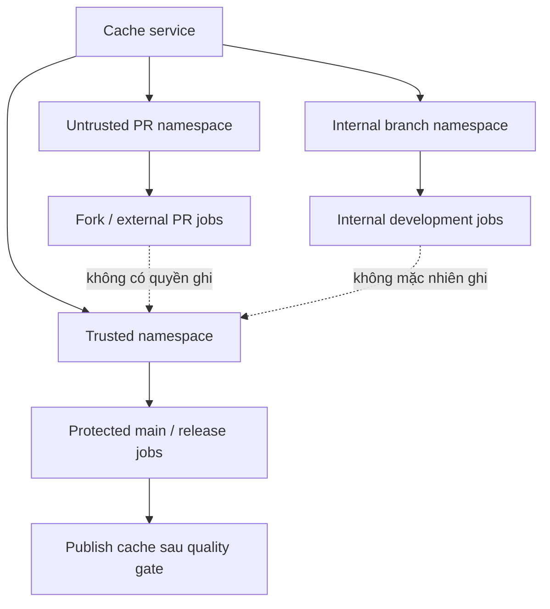

# Ngăn dữ liệu từ nguồn không tin cậy làm nhiễm cache dùng chung

## 1. Cache trong CI/CD và rủi ro về niềm tin

Cache giúp pipeline chạy nhanh hơn bằng cách giữ lại dữ liệu có thể tạo lại, chẳng hạn dependency đã tải, kết quả biên dịch hoặc lớp trung gian của build. Khi một job sau có đầu vào tương tự, nó có thể khôi phục dữ liệu đã lưu thay vì thực hiện lại toàn bộ công việc.

Tuy nhiên, cache cũng là một kênh trao đổi dữ liệu giữa các lần chạy. Nếu một pipeline nhận mã nguồn không đáng tin cậy được phép ghi dữ liệu vào cache mà pipeline đáng tin cậy sử dụng, người đóng góp có thể làm nhiễm cache (cache poisoning). Pipeline sau đó có thể dùng dữ liệu bị thay đổi, lỗi thời hoặc được tạo có chủ đích để gây ra hành vi sai.

Ví dụ: repository cho phép pull request từ fork chạy kiểm thử. Job đó có quyền ghi cache tên `java-build-main`. Một pull request độc hại thay đổi script build để tạo file class giả hoặc ghi nội dung sai vào cache. Sau khi pull request hoàn tất, pipeline trên nhánh chính khôi phục cache cùng tên và sử dụng kết quả đã bị can thiệp. Nếu pipeline chỉ kiểm tra trạng thái cache hit mà không xác minh nội dung, nó có thể tạo artifact sai từ mã nguồn đáng tin cậy.

Vấn đề cốt lõi là ranh giới tin cậy. Cache không tự trở nên đáng tin chỉ vì nó nằm trong hệ thống CI/CD hoặc có tên trùng với nhánh chính. Cần xác định ai được ghi, ai được đọc, dữ liệu nào được lưu, phạm vi nào được chia sẻ và cách xác minh dữ liệu sau khi khôi phục.

## 2. Cache poisoning là gì?

Cache poisoning xảy ra khi dữ liệu được lưu trong cache bị thay đổi hoặc thay thế theo cách khiến lần chạy sau sử dụng đầu vào không mong muốn. Nguồn gây nhiễm có thể là mã độc, pipeline cấu hình sai, dependency bị xâm nhập hoặc một lần build tạo ra kết quả sai nhưng vẫn được publish.

Một số tình huống thường gặp:

- **Ghi đè cache dùng chung:** job từ pull request không đáng tin ghi vào key mà pipeline nhánh chính sẽ khôi phục.
- **Va chạm cache key:** hai loại workload khác nhau dùng cùng key dù toolchain, dependency hoặc cấu hình không giống nhau.
- **Khôi phục từ prefix quá rộng:** khi không có key chính xác, pipeline lấy một cache gần giống nhưng thuộc nguồn hoặc cấu hình khác.
- **Đưa build output vào cache:** kết quả biên dịch do mã không tin cậy tạo ra được dùng lại mà không xác minh các đầu vào.
- **Cache dependency bị sửa:** dữ liệu package tải về hoặc metadata cục bộ bị thay đổi trước khi build sử dụng.
- **Nhiễm qua runner dùng chung:** tiến trình hoặc người dùng trên runner sửa nội dung cache cục bộ trước khi job đáng tin cậy đọc.
- **Lộ dữ liệu qua quyền đọc:** cache chứa file cấu hình, source riêng tư hoặc thông tin nhạy cảm mà job không đáng tin có thể tải xuống.

Cache poisoning có thể ảnh hưởng đến tính toàn vẹn, tính sẵn sàng và tính bảo mật. Nội dung sai có thể làm build/test cho kết quả không đúng; dữ liệu lớn hoặc hỏng có thể khiến job thất bại; file nhạy cảm được cache có thể bị đọc bởi người không được phép.

## 3. Phân loại nguồn theo mức độ tin cậy

Trước khi thiết kế cache, cần phân loại nguồn kích hoạt pipeline và mã được thực thi. Tên branch không phải bằng chứng duy nhất về độ tin cậy: một pull request có thể sửa file pipeline, script build và mã được chạy trong job.

| Nguồn thực thi | Đặc điểm | Cách xử lý cache phù hợp |
|---|---|---|
| Nhánh được bảo vệ như `main` | Thay đổi đã qua review và chính sách bảo vệ | Có thể publish vào cache tin cậy sau khi các kiểm tra bắt buộc đạt |
| Nhánh release được kiểm soát | Dùng để tạo artifact phát hành | Dùng namespace riêng hoặc cache tin cậy có quyền ghi giới hạn; ghi provenance |
| Nhánh phát triển nội bộ | Người có quyền trong tổ chức có thể push | Phân vùng theo nhánh hoặc nhóm quyền; không mặc nhiên chia sẻ cache production |
| Pull request từ cùng repository | Người tạo có thể sửa mã và pipeline trong phạm vi PR | Cho phép đọc cache công khai/phù hợp nếu chính sách cho phép; hạn chế quyền ghi cache tin cậy |
| Pull request từ fork/nguồn bên ngoài | Mã và workflow có thể do bên ngoài kiểm soát | Coi là không tin cậy; dùng cache riêng, không cấp quyền ghi vào namespace trusted |
| Job chạy script hoặc dependency bên ngoài | Hành vi có thể thay đổi ngoài repository | Ghim phiên bản, xác minh nội dung và giới hạn quyền publish cache |

Độ tin cậy có thể thay đổi theo sự kiện và chính sách repository. Một contributor nội bộ vẫn có thể gửi mã lỗi hoặc bị chiếm tài khoản; vì vậy cache dùng cho phát hành cần dựa trên quy trình review và quyền thực thi rõ ràng, không chỉ dựa vào việc người gửi có tài khoản trong tổ chức.

## 4. Phân biệt các loại cache và mức rủi ro

Không phải cache nào cũng có cùng tác động. Cache dependency tải về thường có thể được xác minh bằng checksum của package và lockfile. Cache kết quả biên dịch có rủi ro cao hơn vì nội dung được tái sử dụng có thể trực tiếp trở thành một phần của artifact.

| Loại cache | Ví dụ | Rủi ro chính | Kiểm soát nên có |
|---|---|---|---|
| Download/dependency cache | Package đã tải từ Maven, npm, NuGet hoặc registry | Package/metadata bị thay đổi hoặc lấy từ nguồn giả | Lockfile, checksum/chữ ký, repository allowlist, quyền ghi giới hạn |
| Build/tool cache | Gradle cache, compiler cache, build-system cache | Đầu ra biên dịch sai được tái sử dụng | Key phản ánh đầy đủ đầu vào, build có thể tái lập, remote cache ACL và kiểm tra tính toàn vẹn |
| Test cache | Kết quả test hoặc dữ liệu fixture | Kết quả cũ khiến test bị bỏ qua hoặc tạo false pass | Chỉ cache khi đầu vào được xác định; không bỏ qua test bắt buộc chỉ dựa trên dữ liệu không tin cậy |
| Generated output cache | Code sinh tự động, schema đã biên dịch | Output không khớp schema hoặc generator hiện tại | Ghim generator/schema, xác minh checksum và dependency |
| Docker/layer cache | Image layer hoặc layer build | Layer chứa file hoặc package bị nhiễm | Pin base image, kiểm soát builder, quét và ký image/artifact |
| Cache tự quản lý trên runner | Thư mục dùng chung trên đĩa hoặc volume | Job khác có thể đọc/ghi trực tiếp | Tách tài khoản, quyền thư mục, runner/pool và vòng đời cache |

Nguyên tắc là xác định dữ liệu nào có thể ảnh hưởng trực tiếp đến artifact hoặc quyết định quality gate. Dữ liệu càng gần đầu ra phát hành thì yêu cầu về nguồn gốc, quyền ghi và xác minh càng nghiêm ngặt.

## 5. Tách trust domain và namespace cache

Trust domain là phạm vi các lần chạy có mức độ tin cậy và quyền tương đương. Cache cần được phân vùng theo trust domain để dữ liệu từ nguồn ít tin cậy không thể ghi vào vùng được pipeline phát hành tin cậy sử dụng.

Một cách phân vùng minh họa:



Tên namespace thực tế có thể dựa trên repository, tổ chức, branch class, runner pool hoặc một trường phân loại do hệ thống điều phối cung cấp. Không nên để mã pull request tự chọn một namespace bất kỳ qua input có thể sửa, vì người đóng góp có thể giả mạo tên `trusted`.

Các nguyên tắc phân vùng:

- Cache của repository này không nên tự động dùng chung với repository khác nếu quyền và nội dung không tương đương.
- Cache từ fork hoặc pull request không tin cậy phải nằm trong vùng riêng.
- Cache dùng cho build/release chính thức chỉ được ghi bởi workflow và identity được phép.
- Nhánh phát triển không tự động được quyền ghi vào cache release.
- Cache đọc được cũng có thể làm lộ dữ liệu; cần giới hạn quyền đọc nếu cache chứa source hoặc package riêng tư.
- Nếu nền tảng chỉ cung cấp cache theo repository hoặc branch, cần thiết kế key và quyền trigger để mô phỏng trust domain một cách đáng tin cậy.

## 6. Thiết kế cache key có đủ ngữ cảnh

Cache key quyết định lần chạy tìm và khôi phục dữ liệu nào. Key quá rộng có thể khiến dữ liệu của cấu hình khác được dùng lại. Key quá hẹp làm giảm cache hit và tăng thời gian build. Mục tiêu là key thể hiện các đầu vào có ảnh hưởng đến nội dung cache, đồng thời có namespace theo mức độ tin cậy.

Các thành phần thường cần xem xét:

- Repository hoặc project identity.
- Trust domain/nhóm nguồn thực thi.
- Hệ điều hành và kiến trúc CPU.
- Phiên bản runtime, compiler, build tool và package manager.
- Lockfile hoặc checksum của dependency declaration.
- Cấu hình build, profile, compiler flags và feature set.
- Phiên bản schema hoặc code generator nếu cache chứa generated output.
- Phiên bản định dạng cache khi công cụ thay đổi cấu trúc dữ liệu.

Ví dụ key ở mức khái niệm:

```text
trusted/order-service/linux-amd64/jdk21/gradle8.10.2/<lockfile-hash>
untrusted-pr/order-service/linux-amd64/jdk21/gradle8.10.2/<lockfile-hash>/<pr-run-id>
```

Key thứ nhất dành cho cache trusted; key thứ hai thuộc vùng untrusted và có thể thêm run/PR ID để tránh ghi đè qua lại. Cách đặt tên chỉ là minh họa. Phải bảo đảm trust label được hệ thống điều phối xác định, không lấy trực tiếp từ nội dung PR.

Không nên chỉ dùng tên branch làm key. Branch có thể được đổi tên, nhiều run cùng branch có thể chạy đồng thời và một branch không được bảo vệ có thể do người dùng tùy ý cập nhật. Cũng không nên chỉ dùng `latest` hoặc key cố định cho mọi phiên bản toolchain.

## 7. Prefix restore và fallback cần được kiểm soát

Một số hệ thống hỗ trợ restore key hoặc prefix fallback: nếu không tìm thấy cache chính xác, chúng sẽ tìm cache có key bắt đầu bằng một tiền tố. Cách này giúp tái sử dụng cache gần giống, nhưng cũng có thể kéo dữ liệu từ phạm vi rộng hơn dự kiến.

Ví dụ, key chính xác có dạng:

```text
trusted/service/linux/jdk21/<lock-hash>
```

Nếu fallback chỉ dùng prefix `service/`, pipeline có thể khôi phục cache từ nhánh hoặc trust domain khác. Khi đó, namespace trusted trong key chính xác không còn bảo vệ được lần khôi phục.

Quy tắc nên áp dụng:

1. Prefix fallback phải giữ nguyên trust domain và repository scope.
2. Không fallback từ untrusted sang trusted hoặc ngược lại.
3. Chỉ bỏ qua thành phần key khi đã chứng minh thành phần đó không ảnh hưởng đến dữ liệu được cache.
4. Với build output hoặc compiler cache nhạy cảm, cân nhắc tắt fallback rộng và chấp nhận cache miss.
5. Ghi log key thực tế đã được restore, không chỉ key được yêu cầu.
6. Có cách vô hiệu hóa hoặc đổi namespace khi nghi ngờ cache bị nhiễm.

Cache miss thường chỉ làm build chậm hơn. Cache hit từ nguồn sai có thể làm artifact sai. Khi phải lựa chọn, nên ưu tiên tính toàn vẹn của đầu ra.

## 8. Quyền đọc và quyền ghi cache

Một cache an toàn cần kiểm soát riêng quyền đọc và quyền ghi. Job có thể cần đọc dependency cache để tiết kiệm thời gian nhưng không cần quyền publish cache dùng chung. Quyền ghi nên giới hạn cho workflow có nguồn và danh tính đã được xác minh.

| Loại job | Đọc cache trusted | Ghi cache trusted | Cache riêng |
|---|---|---|---|
| Pull request từ fork | Chỉ khi chính sách cho phép và dữ liệu không nhạy cảm | Không | Có, namespace untrusted |
| Pull request nội bộ | Có điều kiện theo trust policy | Thường không trước khi được chấp thuận | Có thể dùng namespace nhánh riêng |
| Build trên nhánh chính đã bảo vệ | Có | Có thể publish sau khi gate đạt | Có thể dùng cache run riêng |
| Release job | Có, theo phiên bản/key được kiểm soát | Có thể publish cache release nếu cần | Nên tách namespace release |
| Job deploy production | Thường không cần build cache | Không nên có quyền ghi cache build | Chỉ nhận artifact đã xác minh |

Bảng trên là chính sách tham khảo; tổ chức cần điều chỉnh theo nền tảng và mô hình đe dọa. Đặc biệt, không nên cấp quyền ghi cache chỉ vì job có quyền upload artifact. Hai quyền này có mục đích và phạm vi tác động khác nhau.

Nếu cache server hỗ trợ ACL, dùng identity riêng cho publisher và consumer. Nếu nền tảng cache chỉ cho phép workflow trong cùng repository, vẫn cần kiểm soát trigger, branch protection, fork behavior và các quyền token. Không giả định mọi cache service đều có semantics giống nhau.

## 9. Bảo vệ cache dependency

Dependency cache thường chứa file package đã tải và metadata để package manager tìm lại. Để giảm nguy cơ dữ liệu bị sửa hoặc thay thế:

- Dùng lockfile để xác định phiên bản package và dependency bắc cầu.
- Bật checksum/integrity verification của package manager khi có hỗ trợ.
- Chỉ lấy package từ registry hoặc mirror được phê duyệt.
- Ghim phiên bản package manager và định dạng cache tương ứng.
- Không dùng chung cache ghi được giữa workload không tin cậy và release job.
- Nếu cache bị xóa, pipeline vẫn phải tải lại và xác minh package thành công.
- Tránh cache file cấu hình chứa token, credential hoặc thông tin xác thực registry.

Một số package manager lưu cache theo content hash và tự xác minh integrity; một số công cụ khác phụ thuộc nhiều hơn vào metadata hoặc trạng thái thư mục. Cần hiểu cơ chế cụ thể trước khi cho phép chia sẻ. Cache không thay thế xác minh chữ ký hoặc checksum của package.

Ví dụ, với dependency Java, lockfile/Gradle dependency verification giúp kiểm soát phiên bản và nội dung artifact. Khi khôi phục cache Gradle, vẫn cần để Gradle áp dụng cơ chế verification đã cấu hình; không xem thư mục cache được restore là bằng chứng package đáng tin.

## 10. Bảo vệ build cache và compiler cache

Build cache lưu kết quả của task hoặc compiler để lần chạy sau có thể bỏ qua công việc đã thực hiện. Vì dữ liệu cache có thể được đưa trực tiếp vào artifact, yêu cầu tin cậy cao hơn dependency download cache.

Một build cache an toàn cần:

- Key hoặc cache fingerprint bao phủ đầy đủ đầu vào ảnh hưởng đến kết quả: source, dependency, compiler, build flags, environment và task implementation.
- Chỉ publish output từ build đã chạy trong môi trường được tin cậy.
- Bảo vệ remote cache bằng xác thực và quyền ghi giới hạn.
- Không để pull request không tin cậy publish vào cache mà nhánh chính hoặc release sẽ đọc.
- Có thể xóa cache và build lại từ đầu mà không làm thay đổi tính đúng đắn.
- Theo dõi publisher, thời điểm ghi và phạm vi cache nếu backend hỗ trợ.
- Cân nhắc ký hoặc xác minh metadata cache nếu hệ thống có hỗ trợ và rủi ro yêu cầu.

Với Gradle Remote Build Cache, cần cấu hình quyền ghi riêng cho trusted CI và quyền đọc phù hợp cho consumer. Một lựa chọn phổ biến là cho developer hoặc PR job chỉ đọc cache, trong khi job trên nhánh chính được bảo vệ mới có quyền ghi. Cần kiểm tra cấu hình thật của cache backend; chỉ đặt `isPush = false` ở một client không bảo vệ được nếu credential backend vẫn cho phép ghi từ đường khác.

Với compiler cache như `ccache`, cache key cần phản ánh compiler, flags và các đầu vào liên quan. Nếu hai dự án hoặc trust domain dùng chung cache directory có quyền ghi, cần tách namespace hoặc backend. Không dùng compiler cache để bỏ qua bước kiểm tra integrity của binary hoặc artifact cuối cùng.

## 11. Runner isolation và cache cục bộ

Ngay cả khi cache service bên ngoài có ACL tốt, cache cục bộ trên runner vẫn có thể bị nhiễm nếu nhiều job dùng chung tài khoản, filesystem hoặc process namespace.

Các biện pháp:

- Ưu tiên runner ephemeral cho mã nguồn từ fork hoặc nguồn không tin cậy.
- Nếu dùng persistent runner, tách tài khoản, workspace, cache directory và quyền filesystem theo trust domain.
- Không chạy job tin cậy và không tin cậy đồng thời dưới cùng tài khoản có quyền ghi cache chung.
- Hạn chế mount volume hoặc Docker socket vào job không tin cậy.
- Xóa hoặc tái tạo cache cục bộ khi runner chuyển từ trust domain thấp sang cao.
- Theo dõi process còn sót, file lạ và quyền sở hữu cache directory.
- Tái tạo runner khi không thể chứng minh trạng thái sạch.

Chỉ xóa workspace không đủ nếu package cache hoặc compiler cache nằm ngoài workspace, ví dụ trong thư mục home của runner. Cần xác định vị trí thật của từng loại cache và quy định vòng đời riêng.

## 12. Không đưa secret và dữ liệu nhạy cảm vào cache

Cache thường có thời gian tồn tại dài hơn một step và có thể được khôi phục bởi nhiều lần chạy. Vì vậy, không cache:

- File `.env` chứa token, password hoặc private key.
- Credential registry hoặc file cấu hình package manager có thông tin đăng nhập.
- SSH key, cloud credential, kubeconfig hoặc access token.
- Log có thể chứa dữ liệu người dùng hoặc header xác thực.
- Database dump hoặc test fixture chứa dữ liệu production chưa được làm sạch.
- File cấu hình nội bộ không cần thiết cho build và không có quyền đọc tương đương giữa các consumer.

Nếu job cần credential để tải dependency riêng tư, hãy cấp credential lúc chạy qua secret manager hoặc cơ chế token ngắn hạn. Không đưa credential vào cache key, cache path, output hoặc metadata. Sau khi tải package, có thể cache package đã xác minh nếu chính sách cho phép, nhưng cần bảo đảm cache không chứa file cấu hình xác thực.

Quyền đọc cache cũng phải được xem xét như quyền đọc dữ liệu. Một cache có thể không chứa password nhưng vẫn chứa source riêng tư, file cấu hình hoặc package nội bộ. Chỉ chia sẻ cho consumer có quyền truy cập hợp lệ.

## 13. Ví dụ cấu hình cache an toàn theo trust domain

Ví dụ dưới đây là cấu hình giả định để minh họa ý tưởng. Tên biến và cú pháp restore/save khác nhau giữa các nền tảng; cần chuyển thành cú pháp đúng của công cụ đang dùng.

```yaml
jobs:
  verify:
    steps:
      - name: Determine trust domain
        run: |
          if [ "$EVENT_SOURCE" = "protected-main" ]; then
            echo "CACHE_DOMAIN=trusted" >> "$CI_OUTPUT"
          else
            echo "CACHE_DOMAIN=untrusted" >> "$CI_OUTPUT"
          fi

      - name: Restore dependency cache
        uses: cache/restore
        with:
          key: "${CACHE_DOMAIN}-${OS}-${TOOLCHAIN}-${LOCKFILE_HASH}"

      - name: Verify dependencies and build
        run: ./gradlew --no-daemon clean test

      - name: Save cache from trusted source only
        if: EVENT_SOURCE == 'protected-main' && QUALITY_GATE == 'passed'
        uses: cache/save
        with:
          key: "trusted-${OS}-${TOOLCHAIN}-${LOCKFILE_HASH}"
```

Đoạn mã chỉ diễn đạt chính sách, không phải cú pháp hợp lệ cho một nền tảng cụ thể. Trong triển khai thực tế, `EVENT_SOURCE` và `QUALITY_GATE` phải do hệ thống CI xác định từ ngữ cảnh sự kiện và kết quả job; không được lấy từ input tùy ý do pull request điều khiển. Bước save trusted cần chạy trong job có quyền publish được bảo vệ, không chỉ dựa vào một điều kiện YAML mà contributor có thể sửa.

Một thiết kế khác là không cho PR ghi cache dùng chung: PR chỉ đọc cache trusted nếu nền tảng cho phép an toàn, còn mọi cache mới được ghi vào namespace PR riêng. Sau khi thay đổi được hợp nhất và pipeline trusted chạy lại, pipeline đó tự tạo hoặc cập nhật cache trusted.

## 14. Phát hiện, xử lý và phục hồi khi nghi ngờ cache bị nhiễm

Một số dấu hiệu cảnh báo:

- Build sạch và build có cache tạo ra artifact khác nhau ngoài dự kiến.
- Pipeline trên nhánh chính chỉ thất bại hoặc thành công khi khôi phục một cache cụ thể.
- Cache được tạo bởi run hoặc branch không thuộc trust domain dự kiến.
- File trong cache có timestamp, owner hoặc nội dung không phù hợp.
- Một cache key được nhiều loại runner/toolchain sử dụng.
- Có sự thay đổi bất thường về kích thước cache hoặc tỷ lệ cache hit.
- Build output chứa file không có trong source tree hoặc không được task nào khai báo.

Khi nghi ngờ:

1. Dừng việc publish và sử dụng cache liên quan trong pipeline nhạy cảm.
2. Xác định key, namespace, thời điểm tạo, publisher và các run đã khôi phục cache nếu log/backend có lưu.
3. Cô lập hoặc xóa cache bị ảnh hưởng theo cơ chế của nền tảng; tránh xóa nhầm namespace khác.
4. Chạy build sạch trên runner tin cậy, không khôi phục cache đáng ngờ.
5. Xác minh dependency, build output và artifact bằng lockfile, checksum hoặc nguồn tin cậy.
6. Nếu artifact phát hành có thể đã bị ảnh hưởng, xác định các phiên bản liên quan và thực hiện quy trình đánh giá/phát hành lại.
7. Sửa quyền, key, prefix fallback hoặc runner isolation gây ra vấn đề.
8. Ghi lại sự cố, thời gian ảnh hưởng và bằng chứng phục hồi.

Không nên chỉ đổi cache key để che dấu sự cố. Nếu không biết dữ liệu đã nhiễm đi vào đâu, cache mới có thể vẫn khôi phục cùng dữ liệu qua một prefix fallback hoặc backend khác.

## 15. Chính sách retention và vô hiệu hóa cache

Cache cần thời hạn lưu giữ phù hợp. Cache quá cũ có thể chứa dependency hoặc output không còn tương thích; cache tồn tại quá lâu cũng tăng bề mặt dữ liệu cần bảo vệ.

Chính sách có thể quy định:

- Thời gian lưu tối đa theo loại cache.
- Giới hạn dung lượng và cơ chế eviction.
- Xóa cache khi nâng cấp major của toolchain hoặc đổi định dạng cache.
- Đổi namespace khi thay đổi trust policy hoặc nghi ngờ cache bị nhiễm.
- Lưu lại thông tin cần thiết để điều tra trước khi xóa cache sự cố.
- Không giữ cache chứa dữ liệu nhạy cảm hoặc dữ liệu cá nhân.
- Định kỳ kiểm tra cache không còn được sử dụng và dọn theo ownership.

Cache có thể được tái tạo nên không cần retention dài như artifact phát hành. Artifact và provenance cần lưu theo chính sách release; cache thường chỉ cần giữ đủ lâu để có hiệu quả hiệu năng. Khi cache miss hoặc bị eviction, pipeline phải tiếp tục hoạt động đúng bằng cách tải dependency và build lại.

## 16. Những anti-pattern thường gặp

| Anti-pattern | Hệ quả | Cách cải thiện |
|---|---|---|
| PR từ fork ghi vào cache của `main` | Mã không tin cậy có thể thay dữ liệu pipeline phát hành dùng | Tách namespace và cấm ghi trusted cache từ fork |
| Dùng một key chung cho mọi OS/toolchain | Khôi phục dữ liệu không tương thích | Thêm OS, architecture, toolchain và lock hash vào key |
| Prefix fallback bỏ qua trust domain | Lấy cache từ nguồn khác mức tin cậy | Giữ trust scope trong mọi restore prefix |
| Cho mọi job quyền đọc/ghi cache | Tăng phạm vi ảnh hưởng khi một job bị xâm nhập | Tách publisher và consumer, cấp quyền tối thiểu |
| Cache cả thư mục home | Có thể lưu credential, file cấu hình và dữ liệu ngoài ý muốn | Chỉ cache đường dẫn cần thiết, kiểm tra nội dung trước khi lưu |
| Dùng build cache mà không xác minh đầu vào | Output cũ hoặc bị giả mạo đi vào artifact | Khóa task input, bảo vệ remote cache và build sạch định kỳ |
| Dùng cache làm nguồn package đáng tin duy nhất | Không xác minh nguồn gốc package khi cache được restore | Lockfile, checksum/chữ ký và registry tin cậy |
| Chỉ đổi key sau sự cố | Dữ liệu nhiễm có thể vẫn tồn tại ở prefix/backend khác | Điều tra publisher, restore path và cô lập toàn bộ phạm vi ảnh hưởng |
| Coi cache hit là bằng chứng build đúng | Cache hit chỉ cho biết tìm thấy dữ liệu phù hợp theo key | Kiểm tra integrity, provenance và test đầu ra |

## 17. Checklist thiết kế cache an toàn

Trước khi bật cache cho một pipeline, hãy kiểm tra:

- [ ] Đã phân loại nguồn chạy theo trust domain.
- [ ] Cache key có repository scope, trust domain và các đầu vào ảnh hưởng nội dung.
- [ ] Restore prefix không thể vượt qua ranh giới tin cậy.
- [ ] Job không tin cậy không có quyền ghi cache trusted.
- [ ] Quyền đọc cache không làm lộ source, package hoặc cấu hình riêng tư.
- [ ] Dependency cache được bảo vệ bằng lockfile và checksum/chữ ký khi có hỗ trợ.
- [ ] Build cache chỉ được publish từ builder/job đáng tin cậy.
- [ ] Runner và cache directory cục bộ được cách ly theo trust domain.
- [ ] Không cache secret, credential, file `.env` hoặc dữ liệu production nhạy cảm.
- [ ] Cache có retention, eviction và quy trình invalidation rõ ràng.
- [ ] Có thể build sạch khi cache miss hoặc bị xóa.
- [ ] Log cho biết key/namespace được restore và publisher nếu nền tảng hỗ trợ.
- [ ] Có quy trình xử lý khi nghi ngờ cache poisoning.

## 18. Nguyên tắc thực hành cốt lõi

1. Xem cache là dữ liệu có nguồn gốc và mức độ tin cậy cần kiểm soát, không phải vùng lưu trữ mặc định an toàn.
2. Phân loại nguồn pipeline và chia cache theo trust domain, repository và mục đích.
3. Chỉ cho workflow được bảo vệ publish vào cache mà build/release tin cậy sử dụng.
4. Thiết kế key theo OS, kiến trúc, toolchain, dependency lock và cấu hình ảnh hưởng đến nội dung.
5. Giữ trust domain trong restore prefix; chấp nhận cache miss thay vì fallback qua ranh giới tin cậy.
6. Xác minh dependency bằng lockfile, checksum/chữ ký và nguồn package được phê duyệt.
7. Bảo vệ build cache bằng quyền ghi giới hạn, đầu vào xác định và khả năng build sạch.
8. Tách runner, workspace, cache cục bộ và credential giữa workload tin cậy và không tin cậy.
9. Không lưu secret hoặc dữ liệu nhạy cảm trong cache; kiểm soát cả quyền đọc lẫn quyền ghi.
10. Theo dõi publisher, retention và có quy trình cô lập, xóa và điều tra cache khi có dấu hiệu bị nhiễm.

Cache an toàn giúp giảm thời gian CI/CD mà không làm mất tính toàn vẹn của artifact. Điều đó đòi hỏi nhóm biết dữ liệu đến từ đâu, ai có thể ghi hoặc đọc, lần chạy nào được phép khôi phục và làm thế nào xác minh kết quả. Khi cache được quản lý theo trust domain và có thể loại bỏ mà không làm hỏng build, nó mới thực sự là một tối ưu hiệu năng đáng tin cậy.
