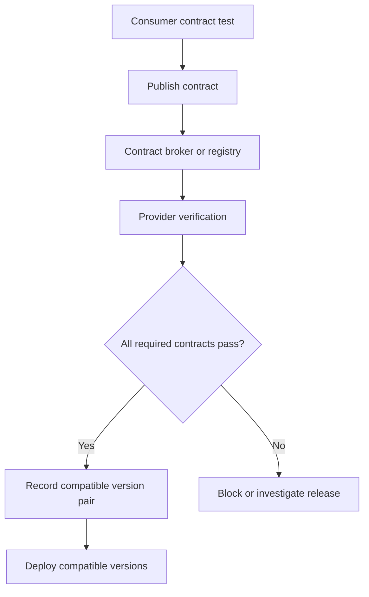
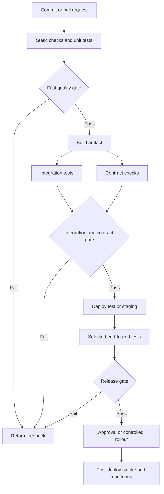

# Phân biệt kiểm thử đơn vị, tích hợp, hợp đồng và đầu cuối

Một pipeline CI/CD có thể chạy hàng trăm kiểm thử, nhưng số lượng test lớn không tự động chứng minh phần mềm đáng tin cậy. Điều quan trọng là mỗi kiểm thử xác minh điều gì, chạy ở ranh giới nào, phụ thuộc vào những thành phần nào và cung cấp phản hồi nhanh đến đâu.

Bốn loại kiểm thử thường gặp là **unit test**, **integration test**, **contract test** và **end-to-end test**. Chúng bổ sung cho nhau:

- Unit test kiểm tra logic của một đơn vị nhỏ trong phạm vi cô lập.
- Integration test kiểm tra cách nhiều thành phần thực sự phối hợp với nhau.
- Contract test xác minh các bên giao tiếp tuân thủ thỏa thuận đã thống nhất.
- End-to-end test kiểm tra một luồng nghiệp vụ xuyên qua hệ thống từ góc nhìn gần với người dùng.

Không có loại kiểm thử nào thay thế hoàn toàn các loại còn lại. Unit test phản hồi nhanh nhưng có thể bỏ sót lỗi cấu hình hoặc giao tiếp. Integration test xác minh tương tác thật nhưng thường cần môi trường và dữ liệu phức tạp hơn. Contract test phát hiện sai lệch giữa producer và consumer mà không cần dựng toàn bộ hệ thống. End-to-end test cho bằng chứng về hành trình nghiệp vụ nhưng tốn thời gian và dễ chịu ảnh hưởng từ môi trường.

Trong CI/CD, chiến lược hiệu quả kết hợp các loại test theo rủi ro và đặt chúng ở đúng thời điểm. Những kiểm tra nhanh, ổn định chạy sớm trên pull request; kiểm tra cần nhiều dịch vụ chạy ở stage phù hợp; các luồng đầu cuối quan trọng chạy trên môi trường gần production và sau triển khai khi cần.

## 1. Vì sao cần phân biệt các loại kiểm thử?

Mỗi kiểm thử có phạm vi quan sát khác nhau. Nếu chỉ dùng unit test, nhóm có thể bỏ sót lỗi kết nối database, sai cấu hình HTTP client hoặc không tương thích giữa hai service. Nếu chỉ dùng end-to-end test, mỗi thay đổi nhỏ có thể phải chờ một môi trường lớn khởi động và một luồng nghiệp vụ dài hoàn tất.

Phân loại rõ giúp nhóm trả lời bốn câu hỏi:

1. **Đang xác minh điều gì?** Logic của một đơn vị, tương tác giữa các thành phần, thỏa thuận giao tiếp hay hành trình nghiệp vụ?
2. **Cần dựng những gì?** Chỉ cần process test, một số dependency thật, một cặp producer/consumer hay gần như toàn bộ hệ thống?
3. **Khi thất bại thì tìm ở đâu?** Trong logic nhỏ, adapter, giao thức, cấu hình, dữ liệu hay một chuỗi thành phần xuyên hệ thống?
4. **Nên chạy ở giai đoạn nào?** Trước commit, trên pull request, sau build, ở staging hay sau khi triển khai production?

| Loại kiểm thử | Ranh giới chính | Mục tiêu | Đặc điểm thường gặp |
|---|---|---|---|
| Unit | Một hàm, lớp hoặc đơn vị logic nhỏ | Xác minh quy tắc và nhánh xử lý | Nhanh, cô lập, nhiều trường hợp |
| Integration | Hai hoặc nhiều thành phần được kết nối | Xác minh tương tác và cấu hình thực tế | Cần dependency, dữ liệu hoặc môi trường |
| Contract | Thỏa thuận giữa consumer và provider | Phát hiện thay đổi giao tiếp không tương thích | Tập trung vào request, response, event hoặc schema |
| End-to-end | Luồng nghiệp vụ qua hệ thống | Xác minh hành vi từ đầu đến cuối | Gần trải nghiệm thật, chi phí cao hơn |

Ranh giới của một test phụ thuộc kiến trúc. Ví dụ, kiểm tra một service với database thật có thể được gọi là integration test hoặc component test trong một số tổ chức. Tên gọi ít quan trọng hơn việc mô tả rõ thành phần nào thật, thành phần nào giả lập và hành vi nào đang được xác minh.

## 2. Unit test: kiểm tra logic trong phạm vi nhỏ

Unit test xác minh một đơn vị logic với đầu vào xác định và kết quả mong đợi. Đơn vị có thể là hàm, method, lớp hoặc một nhóm nhỏ các đối tượng cộng tác. Phạm vi cần đủ nhỏ để khi test thất bại, người phát triển nhanh chóng xác định phần logic có vấn đề.

### 2.1. Đặc điểm của unit test

- **Tập trung:** mỗi test xác minh một hành vi hoặc một nhóm hành vi liên quan.
- **Nhanh:** thường chạy trong bộ nhớ, không cần khởi động dịch vụ bên ngoài.
- **Cô lập:** không phụ thuộc mạng, database dùng chung, đồng hồ thật hoặc thứ tự test khác.
- **Có tính xác định:** cùng đầu vào và trạng thái ban đầu phải cho kết quả nhất quán.
- **Dễ chẩn đoán:** tên test và assertion cho biết quy tắc nào không còn đúng.

Unit test thường kiểm tra cả trường hợp bình thường, biên và lỗi. Ví dụ, hàm tính phí giao hàng cần kiểm tra đơn hàng miễn phí, đơn hàng dưới ngưỡng, đơn hàng đúng ngưỡng, địa chỉ không hỗ trợ và dữ liệu đầu vào không hợp lệ.

### 2.2. Ví dụ unit test

Giả sử dịch vụ đặt hàng có quy tắc miễn phí giao hàng khi tổng giá trị hàng hóa đạt ngưỡng. Ví dụ Java với JUnit:

```java
import static org.junit.jupiter.api.Assertions.assertEquals;

import java.math.BigDecimal;
import org.junit.jupiter.api.Test;

class ShippingFeeCalculatorTest {
    private final ShippingFeeCalculator calculator =
            new ShippingFeeCalculator(new BigDecimal("500000"),
                                      new BigDecimal("30000"));

    @Test
    void returnsZeroWhenOrderReachesFreeShippingThreshold() {
        BigDecimal fee = calculator.calculate(new BigDecimal("500000"));

        assertEquals(new BigDecimal("0"), fee);
    }

    @Test
    void returnsStandardFeeWhenOrderIsBelowThreshold() {
        BigDecimal fee = calculator.calculate(new BigDecimal("499000"));

        assertEquals(new BigDecimal("30000"), fee);
    }
}
```

Đoạn mã minh họa giả định constructor và quy tắc của lớp đã được định nghĩa tương ứng. Hai test kiểm tra hai phía của ngưỡng. Một bộ test đầy đủ có thể bổ sung giá trị âm, `null`, tiền tệ khác hoặc quy tắc theo khu vực tùy hợp đồng của lớp.

### 2.3. Khi nào dùng test double?

Unit test có thể thay dependency bằng test double để điều khiển đầu vào và quan sát tương tác. Một số dạng phổ biến:

| Dạng | Vai trò | Ví dụ |
|---|---|---|
| Stub | Trả về dữ liệu đã định trước | Repository trả một đơn hàng mẫu |
| Fake | Cài đặt đơn giản nhưng có hành vi hoạt động | Repository lưu dữ liệu trong bộ nhớ |
| Mock | Xác minh tương tác hoặc lời gọi | Kiểm tra payment gateway được gọi đúng một lần |
| Spy | Ghi nhận lời gọi trong khi vẫn giữ hành vi thật hoặc một phần hành vi | Theo dõi phương thức được gọi trong một object |

Test double hữu ích khi dependency khó khởi tạo hoặc khi cần mô phỏng lỗi hiếm. Tuy nhiên, lạm dụng mock có thể khiến test xác minh cách triển khai thay vì hành vi. Một test có thể pass dù hệ thống thật không hoạt động vì mock đã mô phỏng đúng điều mà mã nguồn giả định.

Nên ưu tiên kiểm tra kết quả và trạng thái có ý nghĩa với người dùng. Chỉ xác minh tương tác khi thứ tự hoặc số lần gọi là một phần của hợp đồng, chẳng hạn không được thu tiền hai lần.

### 2.4. Điều unit test không chứng minh được

Unit test không tự chứng minh rằng:

- SQL thực thi đúng trên database thật.
- JSON serializer tương thích với API bên ngoài.
- HTTP client được cấu hình đúng timeout, TLS hoặc authentication.
- Hai service thống nhất về tên field và kiểu dữ liệu.
- Container khởi động được trong môi trường triển khai.
- Luồng nghiệp vụ xuyên hệ thống hoạt động.

Đây là lý do cần thêm integration, contract và end-to-end test ở các ranh giới phù hợp.

## 3. Integration test: kiểm tra các thành phần phối hợp

Integration test xác minh hai hoặc nhiều thành phần khi chúng được kết nối. Thành phần có thể là lớp và database, service và message broker, API và identity provider, hoặc nhiều module trong cùng ứng dụng.

Mục tiêu là tìm lỗi ở ranh giới tích hợp: mapping dữ liệu, SQL, transaction, serialization, protocol, cấu hình, timeout, retry, authentication và xử lý lỗi từ dependency.

### 3.1. Ví dụ các phạm vi integration

| Phạm vi | Thành phần được kết nối | Lỗi có thể phát hiện |
|---|---|---|
| Repository integration | Repository và PostgreSQL | SQL sai, mapping sai, constraint hoặc transaction không như mong đợi |
| HTTP client integration | Service và mock HTTP server hoặc provider thử nghiệm | Header, serialization, timeout, retry và xử lý status code |
| Messaging integration | Producer/consumer và message broker | Routing key, serialization, ack, retry và dead-letter behavior |
| Module integration | Nhiều module trong một ứng dụng | Sai wiring dependency injection, cấu hình hoặc giao tiếp nội bộ |
| Container integration | Ứng dụng và dependency chạy trong container | Port, environment variable, health check và network |

Một integration test không nhất thiết phải dựng toàn bộ production stack. Nên chọn đúng ranh giới cần xác minh. Ví dụ, để kiểm tra repository với PostgreSQL, có thể dùng PostgreSQL thật trong container nhưng thay payment provider bằng một fake server có kiểm soát.

### 3.2. Ví dụ kiểm tra repository với database thật

Một test repository có thể tạo database tạm, ghi một đơn hàng rồi đọc lại để xác minh mapping và transaction. Pseudocode Java:

```java
@Test
void savesAndLoadsOrderFromPostgres() {
    Order order = new Order("order-10482", "customer-17", new BigDecimal("250000"));

    orderRepository.save(order);
    Order loaded = orderRepository.findById("order-10482").orElseThrow();

    assertEquals(order.id(), loaded.id());
    assertEquals(order.customerId(), loaded.customerId());
    assertEquals(order.total(), loaded.total());
}
```

Test này xác minh tương tác giữa repository, driver, SQL và PostgreSQL. Nó không cần gọi giao diện người dùng hoặc các service khác để có giá trị.

### 3.3. Quản lý dependency thật và giả

Integration test cần lựa chọn dependency nào phải chạy thật. Database thật thường hữu ích khi cần xác minh SQL và transaction. Một HTTP provider bên ngoài có thể được thay bằng test server nếu mục tiêu chỉ là xác minh client xử lý response. Một số kiểm thử cần môi trường sandbox của provider để xác minh hành vi mà mock không mô phỏng đáng tin cậy.

Hãy ghi rõ phạm vi của test:

- Database thật, broker thật hay in-memory substitute?
- HTTP server là provider thật, sandbox hay mock server?
- Có chạy authentication và TLS như production không?
- Có dùng migration mới nhất và dữ liệu đại diện không?
- Test xác minh giao thức, cấu hình hay cả nghiệp vụ?

Tên `integration test` tự nó chưa nói đủ. Mô tả ranh giới giúp người đọc hiểu test có thể phát hiện loại lỗi nào và giới hạn ở đâu.

### 3.4. Test data và tính cô lập

Integration test thường dùng dữ liệu và tài nguyên dùng chung. Nếu test phụ thuộc vào thứ tự chạy, dữ liệu còn lại từ lần trước hoặc một database chung bị test khác thay đổi, kết quả sẽ chập chờn.

Các cách giảm xung đột:

- Tạo database hoặc schema riêng theo pipeline run.
- Dùng transaction rollback khi hành vi test cho phép.
- Tạo dữ liệu có định danh duy nhất cho từng test hoặc shard.
- Dọn dữ liệu theo đúng phạm vi sở hữu.
- Không phụ thuộc vào thứ tự thực thi test.
- Chờ trạng thái bất đồng bộ bằng điều kiện và timeout rõ ràng thay vì sleep cố định.

### 3.5. Khi integration test thất bại

Lỗi có thể đến từ ứng dụng, dependency, môi trường hoặc dữ liệu. Pipeline cần lưu log của service, test report, version container, cấu hình không nhạy cảm và correlation ID. Nếu chỉ lưu stack trace của test runner, nhóm có thể thiếu bằng chứng để xác định nguyên nhân.

## 4. Contract test: xác minh thỏa thuận giao tiếp

Contract test kiểm tra các bên giao tiếp tuân thủ một hợp đồng. Hợp đồng mô tả điều consumer gửi, điều provider chấp nhận và cấu trúc hoặc ý nghĩa của dữ liệu trao đổi. Hợp đồng có thể là HTTP API, event message, schema, RPC interface hoặc một giao thức nội bộ.

Contract test đặc biệt hữu ích khi các service được phát triển và triển khai độc lập. Consumer và provider có thể thay đổi ở những thời điểm khác nhau; nếu không có kiểm tra tương thích, một thay đổi tưởng như cục bộ có thể phá vỡ service khác.

### 4.1. Consumer và provider

- **Consumer:** thành phần gọi API, đọc event hoặc sử dụng interface của thành phần khác.
- **Provider:** thành phần cung cấp API, phát event hoặc triển khai interface.
- **Contract:** tập quy tắc giao tiếp mà hai bên đồng ý tuân thủ.

Ví dụ `orders-api` gọi `inventory-api` để kiểm tra tồn kho. Consumer gửi request chứa `sku` và `quantity`; provider trả về trạng thái có thể đáp ứng cùng số lượng còn lại. Contract test kiểm tra request và response theo hợp đồng đã thống nhất.

### 4.2. Consumer-driven contract testing

Trong consumer-driven contract testing, consumer mô tả những tương tác mà nó thực sự cần. Contract được publish để provider xác minh rằng phiên bản provider đáp ứng các kỳ vọng đó.

Quy trình khái quát:

1. Consumer viết test mô tả request và response mà nó cần.
2. Công cụ tạo contract artifact từ các tương tác đã khai báo.
3. Contract được lưu trong broker hoặc kho có version.
4. Provider lấy các contract còn hiệu lực và chạy verification.
5. Kết quả verification được công bố để pipeline quyết định có thể triển khai phiên bản mới hay không.



Consumer-driven contract test không có nghĩa provider phải chấp nhận mọi cách dùng tùy tiện. Contract cần phản ánh các tương tác có thật, có owner và được quản lý vòng đời. Contract cũ không còn consumer có thể được đánh dấu deprecated và xóa theo chính sách.

### 4.3. Schema validation và contract verification

Schema validation kiểm tra dữ liệu tuân thủ cấu trúc, ví dụ JSON Schema, OpenAPI, Protocol Buffers hoặc AsyncAPI. Đây là một phần hữu ích của contract testing nhưng không phải lúc nào cũng đủ.

Hai payload có thể hợp lệ theo schema nhưng vẫn sai ý nghĩa nghiệp vụ. Ví dụ, field `amount` có kiểu number ở cả hai phía nhưng một bên hiểu là đồng, bên kia hiểu là nghìn đồng. Contract tốt cần xác định cả kiểu, giới hạn, đơn vị, tính bắt buộc, quy tắc nullability và semantics quan trọng.

Provider verification có thể kiểm tra status code, header, field, event key và một số quy tắc hành vi. Với giao tiếp bất đồng bộ, cần kiểm tra schema event, routing, versioning và khả năng consumer xử lý event cũ trong thời gian chuyển tiếp.

### 4.4. Tương thích ngược và thay đổi phá vỡ

Một số thay đổi thường có nguy cơ phá vỡ consumer:

- Xóa field mà consumer đang đọc.
- Đổi tên field hoặc thay đổi kiểu dữ liệu.
- Chuyển field tùy chọn thành bắt buộc.
- Thay đổi ý nghĩa hoặc đơn vị của giá trị.
- Đổi status code, error code hoặc cấu trúc lỗi.
- Thay đổi thứ tự hoặc semantics của event.
- Siết giới hạn validation mà consumer hiện tại không đáp ứng.

Thêm field tùy chọn thường dễ tương thích hơn, nhưng vẫn cần xem consumer có xử lý payload không biết field mới hay không. Không có quy tắc chung bảo đảm mọi thay đổi “thêm” đều an toàn.

Với thay đổi phá vỡ, nhóm có thể version API, hỗ trợ hai phiên bản trong giai đoạn chuyển tiếp, triển khai consumer trước hoặc provider trước tùy thiết kế, rồi chỉ xóa hợp đồng cũ khi mọi consumer đã di chuyển.

### 4.5. Contract test không thay thế integration test

Contract test có thể xác minh hai bên thống nhất cấu trúc và hành vi giao tiếp được mô tả. Nó không tự chứng minh mạng, DNS, TLS, credential, service discovery, broker hoặc cấu hình production hoạt động đúng.

Do đó, hệ thống vẫn cần một số integration test để kiểm tra việc kết nối thật, cùng end-to-end test cho các luồng nghiệp vụ quan trọng.

## 5. End-to-end test: xác minh luồng nghiệp vụ từ đầu đến cuối

End-to-end (E2E) test kiểm tra một hành trình xuyên qua nhiều thành phần, thường từ giao diện hoặc API đầu vào đến kết quả cuối cùng. Test có thể bao gồm frontend, backend, database, message broker, dịch vụ bên ngoài và các bước xử lý bất đồng bộ.

Ví dụ, hành trình đặt hàng:

1. Người dùng đăng nhập.
2. Chọn sản phẩm và thêm vào giỏ.
3. Nhập địa chỉ giao hàng.
4. Xác nhận đơn hàng.
5. Hệ thống kiểm tra tồn kho và tạo thanh toán thử.
6. Người dùng nhận mã đơn hàng và trạng thái xác nhận.

E2E test xác minh rằng các thành phần phối hợp để tạo ra kết quả nghiệp vụ mong muốn. Nó có thể phát hiện lỗi routing, cấu hình, authentication, dữ liệu, tích hợp hoặc giao diện mà các test nhỏ không phát hiện.

### 5.1. Phạm vi và môi trường

E2E test thường cần môi trường gần production, dữ liệu có thể dự đoán và các dependency được kiểm soát. Có thể dùng sandbox cho payment provider, email sink thay cho gửi email thật và tài khoản test được cấp quyền giới hạn.

Một E2E test không nhất thiết phải dùng production thật. Điều quan trọng là hành trình được kiểm tra qua các ranh giới chính với mức giả lập được công bố rõ. Nếu mọi service đều bị mock, test có thể không còn đại diện cho hành vi end-to-end.

### 5.2. Ví dụ E2E qua giao diện

Pseudocode minh họa với một công cụ browser automation:

```javascript
test("customer can place an order", async ({ page }) => {
  await page.goto("/login");
  await page.getByLabel("Email").fill("buyer@example.test");
  await page.getByLabel("Password").fill(process.env.TEST_PASSWORD);
  await page.getByRole("button", { name: "Sign in" }).click();

  await page.getByRole("link", { name: "Product A" }).click();
  await page.getByRole("button", { name: "Add to cart" }).click();
  await page.getByRole("button", { name: "Checkout" }).click();
  await page.getByLabel("Address").fill("10 Test Street");
  await page.getByRole("button", { name: "Place order" }).click();

  await expect(page.getByTestId("order-status"))
    .toHaveText("Confirmed");
});
```

Đây là ví dụ minh họa, giả định ứng dụng cung cấp các label và test ID tương ứng. Test thật cần tạo hoặc chuẩn bị tài khoản, sản phẩm và dữ liệu độc lập cho mỗi lần chạy; mật khẩu lấy từ secret manager và không được ghi vào log.

### 5.3. Giữ E2E test ổn định

E2E test dễ chập chờn vì phụ thuộc nhiều thành phần và thời điểm. Một số nguyên nhân:

- Dùng sleep cố định thay vì chờ điều kiện cụ thể.
- Dữ liệu test dùng chung hoặc không được reset.
- Service phụ thuộc khởi động chậm hoặc không ổn định.
- Selector phụ thuộc cấu trúc giao diện dễ thay đổi.
- Test phụ thuộc thứ tự chạy hoặc trạng thái của test trước.
- Gọi dịch vụ bên ngoài không có sandbox hoặc quota ổn định.
- Chạy song song nhưng dùng chung tài khoản, giỏ hàng hoặc dữ liệu.

Để giảm flaky test, dùng explicit wait theo trạng thái, test ID ổn định, dữ liệu riêng, cleanup rõ ràng và dependency sandbox. Retry có thể giúp phân biệt lỗi tạm thời, nhưng không được dùng để biến một test không ổn định thành tín hiệu pass đáng tin cậy.

### 5.4. Chọn luồng E2E có giá trị

Không cần biến mọi trường hợp nghiệp vụ thành E2E test. Nên chọn một số hành trình quan trọng có tác động lớn đến người dùng hoặc doanh thu, ví dụ đăng nhập, tạo đơn, thanh toán, hoàn tiền hoặc cập nhật hồ sơ. Các trường hợp biên chi tiết nên được kiểm tra ở unit, integration hoặc contract test phù hợp.

## 6. So sánh bốn loại kiểm thử

| Tiêu chí | Unit | Integration | Contract | End-to-end |
|---|---|---|---|---|
| Phạm vi | Một đơn vị logic nhỏ | Nhiều thành phần kết nối | Thỏa thuận giao tiếp giữa các bên | Luồng nghiệp vụ xuyên hệ thống |
| Dependency thật | Thường ít; dùng test double khi phù hợp | Có một hoặc nhiều dependency thật | Thường kiểm tra contract artifact hoặc provider verification | Nhiều thành phần thật hoặc môi trường đại diện |
| Tốc độ tương đối | Nhanh nhất | Trung bình | Thường nhanh đến trung bình | Chậm hơn |
| Khả năng chẩn đoán | Thường rõ và hẹp | Phụ thuộc số thành phần | Tập trung vào điểm không tương thích | Có thể khó xác định thành phần gây lỗi |
| Rủi ro flaky | Thấp nếu cô lập tốt | Trung bình nếu môi trường/dữ liệu không ổn định | Thấp đến trung bình tùy provider và broker | Cao hơn do nhiều dependency và trạng thái |
| Lỗi tiêu biểu | Logic tính sai, nhánh xử lý sai | SQL, serialization, cấu hình, protocol | Field, schema, semantics hoặc version không tương thích | Luồng người dùng bị đứt, cấu hình hoặc tích hợp tổng thể lỗi |
| Vị trí thường gặp | Trên mỗi commit và pull request | Pull request, sau build hoặc stage tích hợp | Pull request, provider build và trước release | Staging, pre-release hoặc sau deploy theo chính sách |

Các mô tả về tốc độ và flaky chỉ là xu hướng, không phải quy luật. Một integration test dùng container tối ưu có thể chạy rất nhanh; một unit test phụ thuộc đồng hồ toàn cục hoặc trạng thái dùng chung vẫn có thể chập chờn.

## 7. Cách các loại kiểm thử bổ sung cho nhau

Hãy xem một thay đổi thêm quy tắc giới hạn số lượng sản phẩm trong đơn hàng.

| Câu hỏi | Loại test phù hợp | Ví dụ kiểm tra |
|---|---|---|
| Quy tắc tính số lượng tối đa có đúng không? | Unit | 0, 1, đúng giới hạn và vượt giới hạn |
| Repository lưu và đọc số lượng đúng không? | Integration | Insert/update và đọc lại từ database thật |
| API consumer hiểu field `quantity` như provider công bố không? | Contract | Request schema, response và error behavior |
| Người dùng có thể đặt đơn và nhận thông báo lỗi đúng không? | End-to-end | Thao tác qua UI đến kết quả cuối |

Một lỗi có thể được phát hiện ở nhiều tầng. Ví dụ, provider đổi field `availableQuantity` thành `stock` có thể làm contract test thất bại trước khi E2E chạy. Điều này giúp phản hồi sớm và chỉ ra chính xác ranh giới giao tiếp bị phá vỡ.

Không cần viết cùng một assertion ở mọi tầng. Mỗi tầng nên bổ sung bằng chứng mới. Nếu unit test đã bao phủ hàng chục giá trị biên của thuật toán, E2E chỉ cần xác minh một vài hành trình đại diện qua giao diện.

## 8. Tổ chức chiến lược kiểm thử trong CI/CD

Một pipeline có thể chia kiểm thử thành các stage theo tốc độ, chi phí và mục tiêu.



### 8.1. Trên pull request

Ưu tiên kiểm tra có phản hồi nhanh:

- Lint, format, type check và static analysis.
- Unit test của module bị ảnh hưởng.
- Contract test của consumer/provider liên quan.
- Integration test nhỏ có thể chạy trong thời gian phù hợp.
- Secret scan và dependency policy cần thiết.

Mục tiêu là giúp người tạo thay đổi biết sớm lỗi trước khi merge. Nếu một test chậm nhưng cần thiết cho mọi thay đổi, có thể tối ưu môi trường hoặc chia nhỏ thay vì mặc định bỏ qua.

### 8.2. Sau khi merge và build artifact

Sau khi tạo artifact ứng viên, chạy integration test với dependency thật hoặc sandbox phù hợp. Contract verification có thể chạy ở phía provider để xác nhận các consumer đang được hỗ trợ. Test cần gắn với đúng commit và artifact sẽ được promote.

### 8.3. Trên staging hoặc pre-production

Chạy các E2E test quan trọng, migration rehearsal, smoke test và một số kiểm tra hiệu năng hoặc bảo mật theo rủi ro. Môi trường nên tương đồng với production ở những yếu tố ảnh hưởng hành vi.

### 8.4. Sau triển khai production

Smoke test sau deploy kiểm tra dịch vụ đã khởi động và các chức năng cơ bản phản hồi. Synthetic monitoring có thể chạy hành trình định kỳ với tài khoản và dữ liệu được kiểm soát. Đây là kiểm tra vận hành liên tục, không thay thế toàn bộ bộ E2E trước release.

### 8.5. Chạy theo thay đổi nhưng không bỏ sót dependency

Trong monorepo, pipeline có thể chọn test theo module thay đổi và dependency graph. Nếu thư viện chung thay đổi, cần chạy test consumer phù hợp. Nếu không xác định được phạm vi ảnh hưởng, nên mở rộng kiểm tra hoặc chạy toàn bộ bộ test liên quan thay vì coi diff lỗi là không có thay đổi.

## 9. Ví dụ pipeline YAML minh họa

Ví dụ dưới đây mô tả cách sắp xếp các loại test theo dependency. Đây là YAML khái niệm, không phải cú pháp chạy trực tiếp trên một nền tảng cụ thể:

```yaml
pipeline:
  trigger:
    - pull_request
    - merge_to_main

  jobs:
    validate:
      steps:
        - lint
        - static_analysis

    unit_tests:
      needs: [validate]
      steps:
        - run_unit_tests
        - publish_unit_report

    build:
      needs: [unit_tests]
      outputs:
        - immutable_artifact_digest

    integration_tests:
      needs: [build]
      steps:
        - start_test_dependencies
        - run_integration_tests
        - upload_integration_reports
        - cleanup_test_dependencies

    contract_tests:
      needs: [build]
      steps:
        - verify_consumer_provider_contracts
        - publish_contract_results

    test_gate:
      needs: [integration_tests, contract_tests]
      condition: all_required_checks_pass

    deploy_staging:
      needs: [test_gate]
      input: immutable_artifact_digest

    end_to_end_tests:
      needs: [deploy_staging]
      steps:
        - run_critical_user_journeys
        - publish_e2e_reports

    release:
      needs: [end_to_end_tests]
      condition: release_policy_approved
      input: immutable_artifact_digest
```

Trong mô hình này, integration test và contract test có thể chạy song song sau khi artifact được build nếu chúng độc lập. Gate chờ cả hai. E2E chỉ chạy sau khi staging đã triển khai đúng artifact. Job cleanup cần được cấu hình theo cơ chế always-run của nền tảng để vẫn thu hồi dependency khi test thất bại; release phải tiếp tục giữ điều kiện quality gate.

Trong pipeline thực tế, có thể chạy unit test song song với một số kiểm tra tĩnh nếu chúng cùng đọc revision và không có dependency dữ liệu. Cần dùng đúng ngữ nghĩa dependency, trạng thái skipped và điều kiện lỗi của công cụ CI/CD đang triển khai.

## 10. Test pyramid và các mô hình phân bổ kiểm thử

Test pyramid là mô hình gợi ý rằng bộ kiểm thử thường có nhiều unit test, ít integration test hơn và số lượng E2E test nhỏ hơn. Lý do là unit test rẻ và nhanh; test ở phạm vi rộng thường tốn thời gian, môi trường và công sức bảo trì.

```text
              /\
             /  \
            / E2E\          Ít, tập trung luồng quan trọng
           /------\
          /Contract\        Kiểm tra thỏa thuận giữa service
         /----------\
        /Integration \      Kiểm tra ranh giới và dependency
       /--------------\
      /   Unit tests   \    Nhiều, nhanh, cô lập
     /__________________\
```

Đây là hướng dẫn tư duy, không phải tỷ lệ bắt buộc. Một hệ thống event-driven có thể cần nhiều contract test; một ứng dụng xử lý dữ liệu có thể cần nhiều integration test với database; một sản phẩm giao diện có thể cần một số E2E test quan trọng.

Một số nhóm dùng test trophy hoặc mô hình phân bổ khác, nhấn mạnh integration/component test vì chúng cân bằng giữa độ tin cậy và chi phí. Hãy chọn dựa trên kiến trúc, rủi ro và dữ liệu thất bại thực tế, không chạy theo hình dạng của sơ đồ.

## 11. Chọn loại kiểm thử theo rủi ro

Mức độ kiểm thử cần tăng theo tác động nếu thay đổi thất bại. Có thể dùng bảng sau làm điểm khởi đầu:

| Loại thay đổi | Kiểm tra cơ bản | Kiểm tra bổ sung khi cần |
|---|---|---|
| Thuật toán hoặc quy tắc nghiệp vụ nội bộ | Unit test với trường hợp biên | Integration nếu logic phụ thuộc dữ liệu hoặc dịch vụ |
| SQL, transaction hoặc repository | Unit cho logic mapping khi phù hợp | Integration với database thật và migration |
| API request/response | Unit cho validation và handler | Contract test, integration với auth/HTTP stack |
| API hoặc event schema dùng chung | Schema validation | Consumer/provider contract và integration của consumer |
| Message broker hoặc async workflow | Unit cho handler | Integration với broker, contract cho event, E2E cho hành trình quan trọng |
| UI hoặc frontend routing | Unit/component test | E2E cho hành trình người dùng quan trọng |
| Authentication/authorization | Unit cho policy logic | Integration với identity provider, E2E cho luồng đăng nhập và quyền |
| Database migration | Migration validation | Integration, rehearsal và kiểm tra tương thích phiên bản |
| Thay đổi cấu hình hoặc deployment | Static/policy validation | Deploy staging, smoke test và rollout verification |

Rủi ro còn phụ thuộc số lượng consumer, khả năng rollback, mức độ nhạy cảm của dữ liệu và phạm vi ảnh hưởng. Thay đổi một field API được nhiều service sử dụng có thể cần contract test rộng hơn một thay đổi nội bộ trong một module.

## 12. Quản lý chất lượng của chính các kiểm thử

Test suite cũng là phần mềm và cần được duy trì. Một bộ test chậm, flaky hoặc khó chẩn đoán có thể làm nhóm mất niềm tin vào pipeline.

### 12.1. Flaky test

Flaky test cho kết quả khác nhau khi chạy lại trong điều kiện về cơ bản không đổi. Nguyên nhân có thể là race condition, dữ liệu dùng chung, phụ thuộc thời gian, network không ổn định, thứ tự test hoặc tài nguyên thiếu.

Khi phát hiện flaky test:

1. Ghi nhận tỷ lệ và lịch sử lần chạy.
2. Xác định test, môi trường và dependency liên quan.
3. Tái hiện với dữ liệu và log đủ để điều tra.
4. Sửa nguyên nhân như đồng bộ, isolation, timeout hoặc test data.
5. Nếu cần tạm thời quarantine, phải có owner, lý do, thời hạn và cách theo dõi.

Không nên retry vô hạn hoặc bỏ qua thất bại để giữ pipeline xanh. Retry có thể phân loại lỗi tạm thời nhưng không thay thế việc sửa test.

### 12.2. Test coverage

Coverage cho biết phần mã được thực thi khi test chạy, ví dụ line coverage hoặc branch coverage. Coverage hữu ích để tìm vùng chưa được kiểm tra, nhưng không đo trực tiếp chất lượng assertion hay mức độ quan trọng của hành vi được xác minh.

Một test có thể chạy qua một dòng mã nhưng không kiểm tra kết quả. Vì vậy, không nên xem một ngưỡng coverage duy nhất là bằng chứng đầy đủ về chất lượng. Kết hợp coverage với review test case, mutation testing khi phù hợp và dữ liệu lỗi thực tế sẽ cho góc nhìn tốt hơn.

### 12.3. Tốc độ và khả năng chẩn đoán

Theo dõi thời gian chạy từng loại test, queue time, tỷ lệ thất bại và thời gian từ khi test fail đến khi có nguyên nhân. Test nên có tên mô tả hành vi, report rõ ràng và log có correlation ID khi đi qua nhiều service.

Nếu integration test mất quá lâu, có thể chia bộ test, chạy song song trên dữ liệu riêng hoặc tối ưu việc khởi động dependency. Nếu E2E suite quá lớn, hãy giữ lại các hành trình có giá trị cao và chuyển trường hợp biên xuống tầng test hẹp hơn.

## 13. Dữ liệu, môi trường và bí mật trong kiểm thử

Chất lượng test phụ thuộc vào chất lượng môi trường. Dữ liệu cần đại diện cho các trường hợp quan trọng nhưng không làm lộ thông tin nhạy cảm.

- Dùng dữ liệu tổng hợp hoặc đã ẩn danh; tránh sao chép nguyên dữ liệu production vào CI.
- Cấp dữ liệu riêng cho test hoặc shard để tránh xung đột.
- Version hóa fixture và schema test khi chúng ảnh hưởng kết quả.
- Dùng sandbox hoặc fake server có kiểm soát cho dịch vụ bên ngoài.
- Cấp credential tối thiểu và ngắn hạn; không lưu secret trong source, fixture hoặc report.
- Dọn process, container, database và tệp tạm sau test.
- Giữ test report và log cần thiết theo retention policy, đồng thời lọc dữ liệu nhạy cảm.

Một test pass trong môi trường khác biệt lớn với production có thể tạo cảm giác an toàn sai. Cần xác định rõ môi trường test đang đại diện cho điều gì và những rủi ro nào vẫn cần xác minh ở staging hoặc production.

## 14. Đọc kết quả kiểm thử và xử lý thất bại

Khi pipeline thất bại, nhóm nên phân loại nguyên nhân trước khi quyết định chạy lại hoặc sửa mã.

| Dấu hiệu | Khả năng cần kiểm tra | Hành động phù hợp |
|---|---|---|
| Unit test fail ổn định | Logic hoặc kỳ vọng test không đúng | Kiểm tra assertion và thay đổi gần nhất |
| Integration test không kết nối được database | Service chưa sẵn sàng, port, credential hoặc network | Kiểm tra log dependency và health check |
| Contract verification fail | Consumer expectation không tương thích provider | Xác định bên thay đổi, đánh giá version và migration contract |
| E2E timeout | Dependency chậm, selector sai hoặc luồng bị kẹt | Kiểm tra trace, screenshot, log và trạng thái từng bước |
| Test chỉ fail khi chạy song song | Dữ liệu hoặc tài nguyên dùng chung | Cô lập namespace, fixture và resource |
| Test fail ngẫu nhiên | Flaky behavior hoặc môi trường không ổn định | Theo dõi lịch sử, tái hiện và sửa nguyên nhân |

Không nên tự động retry mọi loại thất bại. Unit test fail do assertion thường không tự hết; lỗi rate limit hoặc khởi động dependency có thể tạm thời. Retry cần có chính sách theo loại lỗi và không được biến kết quả không xác định thành pass.

## 15. Ví dụ xuyên suốt: thay đổi luồng đặt hàng

Giả sử nhóm bổ sung quy tắc không cho phép xác nhận đơn hàng nếu tồn kho không đủ. Thay đổi liên quan đến `orders-api`, `inventory-api`, database và giao diện storefront.

**Unit test:** kiểm tra hàm quyết định số lượng có thể đặt, gồm tồn kho bằng 0, tồn kho đủ, tồn kho thiếu, số lượng không hợp lệ và dữ liệu biên. Các test chạy nhanh, không cần database hoặc network.

**Integration test:** kiểm tra `orders-api` đọc tồn kho từ database hoặc gọi `inventory-api` qua HTTP client với cấu hình và serialization phù hợp. Một test khác xác minh transaction không tạo đơn hàng nếu bước kiểm tra tồn kho thất bại.

**Contract test:** consumer `orders-api` mô tả request và response cần từ `inventory-api`. Provider verification xác nhận phiên bản mới vẫn đáp ứng các contract đang được consumer sử dụng. Nếu event `OrderConfirmed` thay đổi schema, các consumer của event cũng được kiểm tra.

**End-to-end test:** người dùng thêm sản phẩm vào giỏ, nhập số lượng vượt tồn kho và xác nhận đơn. Giao diện hiển thị thông báo phù hợp, không tạo đơn hàng và không khởi tạo thanh toán. Một hành trình khác xác minh đơn hàng thành công khi tồn kho đủ.

**CI/CD:** unit test và static checks chạy sớm trên pull request. Contract và integration test chạy sau build hoặc song song nếu độc lập. Artifact đã qua gate được triển khai staging; một số E2E test quan trọng xác minh hành trình. Sau khi release, smoke test và telemetry tiếp tục theo dõi tỷ lệ xác nhận đơn hàng.

Mỗi tầng cung cấp một loại bằng chứng. Nếu contract fail, nhóm biết giao tiếp giữa service không còn tương thích. Nếu unit test fail, lỗi có thể nằm trong quy tắc quyết định. Nếu E2E fail trong khi các tầng trước pass, cần điều tra wiring, cấu hình, dữ liệu hoặc tương tác xuyên hệ thống.

## 16. Những anti-pattern thường gặp

| Anti-pattern | Hệ quả | Cách cải thiện |
|---|---|---|
| Chỉ có unit test | Bỏ sót lỗi tích hợp và cấu hình | Bổ sung integration, contract và một số E2E test quan trọng |
| Chỉ có E2E test | Phản hồi chậm, lỗi khó định vị | Chuyển logic và trường hợp biên xuống tầng test hẹp hơn |
| Mock mọi dependency | Test pass nhưng hệ thống thật không tương thích | Dùng dependency thật ở các ranh giới cần xác minh |
| Mock quá nhiều chi tiết nội bộ | Test dễ vỡ khi refactor | Kiểm tra hành vi và kết quả có ý nghĩa |
| Dùng schema validation thay mọi contract test | Bỏ sót semantics và tương tác thực tế | Kiểm tra request/response/event và quy tắc nghiệp vụ trong contract |
| Dùng chung dữ liệu test | Race condition và kết quả không ổn định | Namespace dữ liệu theo run hoặc test |
| Chạy E2E trên dịch vụ bên ngoài không kiểm soát | Flaky test và chi phí phát sinh | Dùng sandbox, fake server hoặc môi trường kiểm soát |
| Retry mọi thất bại | Che giấu lỗi và làm mất niềm tin | Retry theo loại lỗi, giới hạn số lần và theo dõi flaky |
| Chạy mọi test tuần tự | Pipeline lâu dù nhiều test độc lập | Song song hóa với dữ liệu và tài nguyên được cô lập |
| Đo chất lượng chỉ bằng coverage | Coverage cao nhưng assertion yếu | Review test, kiểm tra hành vi và xem lỗi thực tế |
| Không gắn test với artifact | Không biết phiên bản nào đã được xác minh | Build một lần và lưu kết quả theo commit/digest |

## 17. Checklist xây dựng chiến lược kiểm thử

Trước khi đưa bộ test vào pipeline, nhóm có thể rà soát:

- [ ] Mỗi test nêu rõ hành vi và ranh giới đang được xác minh.
- [ ] Unit test tập trung vào logic, trường hợp biên và lỗi có thể dự đoán.
- [ ] Test double được dùng có chủ đích; không mock quá mức làm mất giá trị kiểm chứng.
- [ ] Integration test xác minh các dependency quan trọng bằng môi trường hoặc thành phần thật phù hợp.
- [ ] Test data và tài nguyên tích hợp được cô lập, có cleanup rõ ràng.
- [ ] Contract mô tả request, response, event và semantics quan trọng giữa consumer/provider.
- [ ] Provider verification chạy với các contract còn hiệu lực trước khi phát hành thay đổi tương ứng.
- [ ] Thay đổi phá vỡ có versioning và kế hoạch chuyển tiếp consumer.
- [ ] E2E tập trung vào hành trình nghiệp vụ quan trọng và có môi trường ổn định.
- [ ] Test không phụ thuộc thứ tự, dữ liệu dùng chung hoặc sleep cố định.
- [ ] Pipeline chạy kiểm tra nhanh sớm và đặt test rộng ở stage phù hợp.
- [ ] Artifact được build một lần; test report gắn với commit và artifact được triển khai.
- [ ] Flaky test được theo dõi, có owner và thời hạn xử lý nếu quarantine.
- [ ] Coverage được dùng để tìm vùng chưa kiểm tra, không xem là thước đo duy nhất.
- [ ] Log, report và screenshot không làm lộ secret hoặc dữ liệu nhạy cảm.
- [ ] Quality gate phân biệt rõ pass, fail, skipped hợp lệ và kết quả chưa xác định.

## 18. Kết luận

Unit, integration, contract và end-to-end test kiểm tra những ranh giới khác nhau trong hệ thống. Unit test giúp xác minh logic nhanh và chính xác; integration test kiểm tra cách các thành phần thực sự phối hợp; contract test bảo vệ thỏa thuận giữa producer và consumer; E2E test xác minh những hành trình nghiệp vụ quan trọng từ đầu đến cuối.

Chiến lược CI/CD hiệu quả không cố gắng đẩy mọi trường hợp vào một loại test. Nhóm chọn loại kiểm thử theo rủi ro, đặt chúng ở stage phù hợp, giữ dữ liệu và môi trường ổn định, liên kết kết quả với artifact và cải thiện các test chập chờn. Khi mỗi tầng cung cấp bằng chứng riêng và bổ sung cho nhau, pipeline có thể phản hồi nhanh mà vẫn tạo đủ niềm tin trước khi đưa thay đổi đến người dùng.
