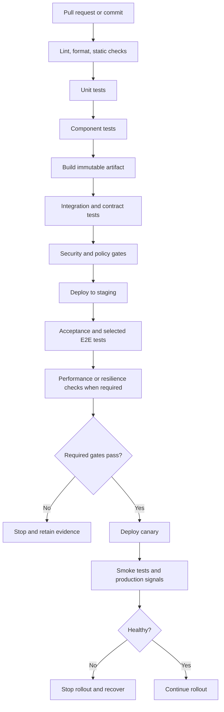

# Chọn lớp kiểm thử theo loại rủi ro cần phát hiện

Không phải mọi lỗi đều được phát hiện tốt nhất bằng cùng một loại test. Unit test có thể bắt lỗi tính toán nhanh và chính xác, nhưng không chứng minh service kết nối database đúng. Integration test có thể phát hiện sai lệch khi gọi message broker, nhưng chưa chắc phát hiện được một luồng nghiệp vụ xuyên qua nhiều service. End-to-end test xác minh hành vi gần với người dùng, nhưng thường chậm, khó chẩn đoán và tốn công duy trì.

Vì vậy, chiến lược kiểm thử trong CI/CD cần bắt đầu từ câu hỏi **hệ thống có thể hỏng theo cách nào và hậu quả của lỗi đó là gì?** Sau đó chọn lớp test có khả năng phát hiện rủi ro với chi phí hợp lý, đặt test vào đúng thời điểm trong pipeline và xác định bằng chứng nào đủ để cho phép thay đổi đi tiếp. Mục tiêu là có phản hồi nhanh cho lỗi thường gặp, có kiểm tra sâu cho rủi ro lớn và có xác minh trên môi trường chạy thật trước khi mở rộng phát hành.

## 1. Bắt đầu từ rủi ro, không bắt đầu từ số lượng test

Một test chỉ có giá trị khi nó kiểm tra một hành vi hoặc một thuộc tính mà nhóm quan tâm. Việc có nhiều test không tự động đồng nghĩa với chất lượng cao. Một bộ test có thể chạy hàng nghìn trường hợp nhưng vẫn bỏ sót lỗi phân quyền, sai schema event hoặc migration làm mất dữ liệu.

Khi đánh giá một rủi ro, hãy xem xét ít nhất ba yếu tố:

- **Khả năng xảy ra:** lỗi có dễ xuất hiện do độ phức tạp, tần suất thay đổi, phụ thuộc ngoài hoặc lịch sử sự cố không?
- **Mức độ tác động:** nếu xảy ra, lỗi ảnh hưởng đến bao nhiêu người dùng, dữ liệu, giao dịch hoặc dịch vụ? Có thể gây mất dữ liệu, lộ thông tin hay gián đoạn hoạt động không?
- **Khả năng phát hiện và phục hồi:** lỗi có được phát hiện trước khi người dùng bị ảnh hưởng không? Có thể giới hạn rollout hoặc quay lui an toàn không?

Nhóm có thể dùng thang điểm định tính như thấp, trung bình, cao để ưu tiên. Một cách lượng hóa đơn giản là nhân điểm khả năng xảy ra với điểm tác động, nhưng con số chỉ hỗ trợ thảo luận; nó không thay thế đánh giá kỹ thuật và yêu cầu tuân thủ. Rủi ro có hậu quả nghiêm trọng như mất dữ liệu hoặc lộ bí mật cần kiểm soát riêng, kể cả khi xác suất được đánh giá thấp.

Ví dụ, thay đổi màu sắc của một nút thường có tác động thấp và có thể kiểm tra bằng component hoặc visual test. Thay đổi cách tính số tiền thanh toán có tác động cao hơn, cần unit test cho quy tắc, integration test cho luồng giao dịch và có thể cần end-to-end test cho hành trình thanh toán. Thay đổi quyền truy cập dữ liệu cần test quyền ở nhiều lớp và kiểm tra rằng người dùng không có quyền không thể đọc tài nguyên.

## 2. Bản đồ lớp kiểm thử

Các lớp test khác nhau về phạm vi, độ cô lập, tốc độ và loại lỗi có thể phát hiện. Tên gọi có thể khác nhau giữa các nhóm; điều quan trọng là mô tả rõ ranh giới được kiểm tra và dependency thật sự được sử dụng.

| Lớp kiểm thử | Phạm vi | Rủi ro phát hiện tốt | Chi phí tương đối |
|---|---|---|---|
| Static analysis và lint | Mã nguồn, cấu hình, dependency metadata | Lỗi cú pháp, quy tắc mã, một số lỗi bảo mật và cấu hình sai | Thấp |
| Unit test | Hàm hoặc lớp trong phạm vi cô lập | Logic, biên dữ liệu, nhánh điều kiện, phép tính sai | Thấp |
| Component test | Một component hoặc service với dependency được thay thế có kiểm soát | Hành vi component, serialization, xử lý lỗi và tương tác nội bộ | Thấp đến trung bình |
| Integration test | Nhiều thành phần thật được kết nối | Sai cấu hình, SQL, transaction, serialization, giao tiếp với broker hoặc API | Trung bình |
| Contract test | Hợp đồng giữa provider và consumer | Thay đổi API hoặc event không tương thích | Thấp đến trung bình |
| End-to-end test | Luồng người dùng xuyên qua nhiều thành phần | Lỗi tích hợp tổng thể, định tuyến, xác thực và hành vi nghiệp vụ | Cao |
| Acceptance test | Điều kiện nghiệp vụ hoặc tiêu chí chấp nhận | Hành vi không đáp ứng yêu cầu người dùng hoặc bên nghiệp vụ | Trung bình đến cao |
| Smoke test | Tập nhỏ kiểm tra hệ thống đã khởi động và chức năng chính hoạt động | Deploy sai, thiếu cấu hình, dependency thiết yếu không sẵn sàng | Thấp |
| Exploratory test | Người kiểm thử chủ động khám phá hành vi | Trường hợp bất ngờ, trải nghiệm khó mô hình hóa hoàn toàn bằng script | Tùy phạm vi |

Static analysis không phải test chạy ứng dụng, nhưng thường là lớp kiểm tra rẻ và nên được đặt sớm. Security, performance, compatibility và resilience là các chiều kiểm thử; chúng có thể được thực hiện ở cấp unit, component, integration, end-to-end hoặc trên môi trường chuyên biệt. Ví dụ, kiểm tra SQL injection có thể dùng static analysis, test endpoint và penetration test; kiểm tra hiệu năng có thể dùng benchmark một hàm hoặc load test cả hệ thống.

## 3. Unit test: kiểm tra logic trong phạm vi nhỏ

Unit test xác minh một đơn vị logic với dependency được kiểm soát. Test nên chạy nhanh, kết quả ổn định và chỉ thất bại khi hành vi của đơn vị đó không đúng. Các trường hợp phù hợp gồm:

- Quy tắc tính giá, thuế, phí và chiết khấu.
- Kiểm tra dữ liệu đầu vào và điều kiện biên.
- Chuyển đổi trạng thái của một đối tượng nghiệp vụ.
- Xử lý ngày tháng, múi giờ hoặc số thập phân.
- Phân quyền ở cấp policy hoặc hàm quyết định quyền.
- Quy tắc retry, timeout hoặc phân loại lỗi trong một thành phần.

Unit test nên kiểm tra hành vi quan sát được thay vì phụ thuộc vào chi tiết triển khai không cần thiết. Nếu một test phải mock gần như mọi dependency và xác minh quá nhiều lời gọi nội bộ, nó có thể dễ hỏng khi refactor mà không phát hiện lỗi người dùng gặp phải.

Ví dụ với Java và JUnit 5:

```java
import static org.junit.jupiter.api.Assertions.assertEquals;
import static org.junit.jupiter.api.Assertions.assertThrows;
import org.junit.jupiter.api.Test;

class ShippingFeeCalculatorTest {
    private final ShippingFeeCalculator calculator = new ShippingFeeCalculator();

    @Test
    void waivesFeeWhenOrderMeetsFreeShippingThreshold() {
        Money subtotal = Money.of("500000", "VND");

        Money fee = calculator.calculate(subtotal, DeliveryZone.LOCAL);

        assertEquals(Money.zero("VND"), fee);
    }

    @Test
    void rejectsNegativeSubtotal() {
        Money subtotal = Money.of("-1", "VND");

        assertThrows(IllegalArgumentException.class,
                () -> calculator.calculate(subtotal, DeliveryZone.LOCAL));
    }
}
```

Đây là ví dụ minh họa; `Money`, `DeliveryZone` và `ShippingFeeCalculator` là kiểu dữ liệu của ứng dụng giả định. Bộ test cần bao phủ ngưỡng ngay dưới, tại và ngay trên mức miễn phí vận chuyển, cũng như các loại tiền và vùng giao hàng mà nghiệp vụ hỗ trợ.

Unit test không chứng minh truy vấn database chạy đúng, transaction được commit hay API từ service khác tương thích. Những rủi ro đó cần test ở ranh giới phù hợp.

## 4. Component test: kiểm tra một thành phần với dependency có kiểm soát

Component test thường chạy một component hoặc một service trong phạm vi tương đối đầy đủ, nhưng thay thế một số dependency bên ngoài bằng fake, stub hoặc mock. Nó nằm giữa unit test và integration test.

Ví dụ, có thể chạy Spring application context cho một service, dùng database giả lập hoặc repository fake, rồi gửi HTTP request đến controller. Cách này kiểm tra routing, validation, serialization, dependency injection và xử lý lỗi trong component mà không cần dựng toàn bộ hệ thống.

Component test phù hợp khi:

- Cần kiểm tra cấu hình framework và wiring trong một service.
- Muốn xác minh request/response hoặc message serialization.
- Cần kiểm tra xử lý lỗi ở ranh giới HTTP hoặc message handler.
- Một dependency ngoài khó hoặc tốn kém để dựng cho mọi lần chạy.

Hãy ghi rõ dependency nào là thật và dependency nào được thay thế. Nếu dùng mock cho database, test không thể chứng minh SQL, index, transaction isolation hoặc migration hoạt động với database thật.

## 5. Integration test: xác minh các ranh giới thực sự kết nối

Integration test kiểm tra hai hoặc nhiều thành phần hoạt động cùng nhau. Một test có thể khởi chạy service với database thật trong container, gửi request và xác minh dữ liệu đã được lưu đúng. Test khác có thể gửi message vào broker, chạy consumer và kiểm tra kết quả.

Integration test đặc biệt hữu ích để phát hiện:

- SQL sai, mapping ORM sai hoặc truy vấn không tương thích với database engine.
- Transaction, rollback và tính nhất quán dữ liệu không đúng.
- Serialization/deserialization không tương thích giữa producer và consumer.
- Cấu hình connection pool, timeout, retry hoặc TLS sai.
- Service không xử lý đúng lỗi từ API hoặc broker bên ngoài.
- Migration schema không chạy được từ phiên bản database đang tồn tại.

Nên dùng dependency thật hoặc phiên bản giả lập có hành vi đủ gần với dependency thật. Testcontainers có thể giúp khởi chạy database, broker hoặc service phụ thuộc trong container trong lúc test. Tuy nhiên, image cần được quản lý phiên bản và test phải dọn dữ liệu, container sau khi chạy.

Ví dụ kiểm tra repository với database:

```java
@Testcontainers
class OrderRepositoryIT {
    @Container
    static final PostgreSQLContainer<?> postgres =
            new PostgreSQLContainer<>("postgres:16.4");

    @Test
    void persistsOrderAndCanReadItBack() {
        // Khởi tạo DataSource từ JDBC URL, username và password của container.
        // Chạy migration của ứng dụng, lưu một Order và đọc lại bằng repository.
        // Xác minh ID, trạng thái và các giá trị tiền tệ.
    }
}
```

Đoạn code chỉ minh họa cách khai báo container; phần khởi tạo DataSource và repository phụ thuộc framework của dự án. Trong môi trường cần tái lập, nên pin image theo digest hoặc ít nhất quản lý phiên bản image rõ ràng. Không dùng một database in-memory rồi kết luận đã kiểm tra tương thích với PostgreSQL nếu production chạy PostgreSQL.

Integration test thường chậm hơn unit test vì phải khởi động process, container hoặc network. Hãy gom test theo dependency để tái sử dụng fixture hợp lý, nhưng vẫn giữ tính cô lập dữ liệu giữa các test.

## 6. Contract test: kiểm tra thỏa thuận giữa các service

Trong kiến trúc nhiều service, provider và consumer có thể được triển khai độc lập. Provider thay đổi tên field, kiểu dữ liệu, mã trạng thái hoặc schema event có thể làm consumer cũ lỗi dù unit test của provider vẫn xanh.

Contract test xác minh một hợp đồng giao tiếp cụ thể:

- **Consumer-driven contract:** consumer mô tả cách nó sử dụng API hoặc event; provider xác minh rằng phiên bản hiện tại vẫn đáp ứng hợp đồng đó.
- **Provider contract:** provider kiểm tra các schema, endpoint hoặc quy tắc công bố mà nó cam kết hỗ trợ.
- **Schema compatibility test:** kiểm tra thay đổi schema có tương thích ngược hoặc tương thích xuôi theo chính sách hay không.

Ví dụ, `order-service` phát event `OrderCreated`; `billing-service` đọc event này. Nếu provider đổi `orderId` từ chuỗi sang số, contract test có thể phát hiện trước khi hai service được deploy ở các thời điểm khác nhau.

```json
{
  "eventType": "OrderCreated",
  "schemaVersion": 2,
  "orderId": "ord-1042",
  "currency": "VND",
  "totalAmount": "520000.00"
}
```

Contract cần xác định field bắt buộc, kiểu dữ liệu, quy tắc nullability, ý nghĩa giá trị, versioning và cách consumer xử lý field chưa biết. Chỉ kiểm tra JSON parse được là chưa đủ để chứng minh hai service hiểu cùng một nghiệp vụ.

Contract test không thay thế integration test. Nó xác minh thỏa thuận ở ranh giới; integration test vẫn cần xác minh cấu hình broker, authentication, routing, retry và các hành vi vận hành khi hai thành phần thực sự giao tiếp.

## 7. End-to-end test: kiểm tra luồng nghiệp vụ xuyên hệ thống

End-to-end (E2E) test mô phỏng hành trình thực tế qua nhiều lớp và dependency. Ví dụ, người dùng đăng nhập, thêm sản phẩm vào giỏ, thanh toán và nhận xác nhận đơn hàng. E2E có thể phát hiện lỗi do routing, cấu hình, xác thực, giao tiếp giữa service, frontend hoặc dependency tích hợp.

Do phạm vi rộng, E2E thường:

- Chạy lâu hơn và tiêu tốn nhiều tài nguyên.
- Có nhiều nguyên nhân thất bại, khiến chẩn đoán khó hơn.
- Nhạy với dữ liệu, thời gian, mạng và trạng thái môi trường.
- Dễ flaky nếu selector UI, dữ liệu test hoặc dependency không ổn định.
- Cần bảo trì khi giao diện hoặc luồng nghiệp vụ thay đổi.

Vì vậy, nên giữ một tập E2E nhỏ nhưng có giá trị cao, tập trung vào hành trình quan trọng và rủi ro xuyên hệ thống. Không cần viết E2E cho mọi biến thể của quy tắc nghiệp vụ nếu unit hoặc integration test có thể kiểm tra chúng chính xác hơn.

E2E cần dữ liệu riêng, cách reset trạng thái và account test được kiểm soát. Không dùng tài khoản production hoặc dữ liệu cá nhân thật trong môi trường kiểm thử. Với thanh toán, hãy dùng sandbox hoặc fake payment provider được kiểm soát.

## 8. Acceptance test: xác minh tiêu chí nghiệp vụ

Acceptance test kiểm tra sản phẩm đáp ứng tiêu chí chấp nhận đã thống nhất với người dùng hoặc bên nghiệp vụ. Test có thể chạy ở cấp API, component hoặc E2E; đặc điểm chính là nó xác minh kết quả nghiệp vụ được yêu cầu.

Ví dụ tiêu chí:

> Khi khách hàng có tổng giá trị đơn hàng đạt ngưỡng miễn phí vận chuyển và địa chỉ nằm trong vùng hỗ trợ, hệ thống hiển thị phí vận chuyển bằng 0 trước khi khách hàng xác nhận thanh toán.

Tiêu chí này có thể được chuyển thành nhiều test:

- Unit test cho phép tính phí và ngưỡng.
- API/component test xác minh response có trường phí đúng.
- E2E test xác minh người dùng nhìn thấy phí đúng trong bước checkout.

Acceptance test không nhất thiết phải là một bộ test UI riêng. Điều quan trọng là tiêu chí được diễn đạt rõ, có dữ liệu đầu vào và kết quả mong đợi, đồng thời có người nghiệp vụ xác nhận rằng hành vi được kiểm tra đúng ý nghĩa.

## 9. Smoke test và sanity test sau khi triển khai

Smoke test là tập kiểm tra ngắn để xác minh ứng dụng vừa được khởi động hoặc triển khai có thể thực hiện các chức năng thiết yếu. Smoke test thường chạy sau deploy lên staging hoặc production canary.

Ví dụ:

- Endpoint health/readiness trả trạng thái hợp lệ.
- Service có thể truy cập dependency thiết yếu.
- Một request đọc dữ liệu cơ bản thành công.
- Một giao dịch tổng hợp có thể hoàn tất trong sandbox hoặc phạm vi an toàn.
- Phiên bản hoặc artifact digest đang chạy khớp với bản dự kiến.

Sanity test thường là tập kiểm tra tập trung vào một thay đổi hoặc một vùng chức năng cụ thể. Ranh giới giữa hai thuật ngữ có thể khác nhau giữa các tổ chức; hãy định nghĩa rõ test nào được gọi và điều kiện pass.

Smoke test không thay thế test trước deploy. Nó cung cấp bằng chứng rằng phiên bản đã được đưa vào môi trường thực tế có thể khởi động và hoạt động ở mức tối thiểu. Sau smoke test, cần tiếp tục quan sát metric, log, trace và chỉ số nghiệp vụ trong cửa sổ rollout.

## 10. Chọn test theo loại rủi ro

Một bảng ánh xạ giúp nhóm bắt đầu thiết kế test portfolio:

| Loại rủi ro | Lớp test ưu tiên | Bằng chứng cần có |
|---|---|---|
| Công thức, quy tắc nghiệp vụ sai | Unit, acceptance | Trường hợp chuẩn, biên và kết quả nghiệp vụ |
| Sai mapping hoặc truy vấn database | Integration | Chạy trên database engine tương thích production |
| API/event thay đổi không tương thích | Contract, schema compatibility | Hợp đồng provider-consumer và version schema |
| Cấu hình framework hoặc dependency injection sai | Component, integration, smoke | Service khởi động và xử lý request thực |
| Luồng người dùng xuyên nhiều service bị lỗi | E2E, acceptance | Hành trình quan trọng chạy được từ đầu đến cuối |
| Quyền truy cập hoặc rò rỉ dữ liệu | Unit policy, API integration, security test | Người đúng quyền được phép; người sai quyền bị từ chối |
| Lỗ hổng dependency hoặc mã nguồn | SCA, SAST, secret scan, DAST, review | Báo cáo scan theo commit/artifact và policy gate |
| Hiệu năng suy giảm | Benchmark, load, stress, soak | Latency percentile, throughput, error và saturation |
| Timeout, retry, mất kết nối | Integration, fault injection, resilience | Hành vi fallback, giới hạn retry và phục hồi |
| Migration phá tương thích | Migration integration, contract, rollback rehearsal | Schema/data sau migration và tương thích phiên bản |
| Sai cấu hình môi trường hoặc deploy | Config validation, smoke, post-deploy verification | Version, health và dependency thực tế |
| Tương thích trình duyệt/thiết bị | Cross-browser/device, visual, E2E | Hành vi và giao diện trên ma trận hỗ trợ |

Một rủi ro có thể cần nhiều lớp test. Ví dụ phân quyền dữ liệu có thể được kiểm tra ở unit test cho policy, integration test cho endpoint và database query, cùng security test để thử truy cập trái phép. Nhiều lớp cung cấp bằng chứng bổ sung ở các ranh giới khác nhau.

## 11. Ma trận rủi ro và quyết định mức kiểm tra

Không phải thay đổi nào cũng cần chạy cùng một tập test. Có thể phân nhóm thay đổi theo phạm vi tác động:

| Mức thay đổi | Ví dụ | Kiểm tra tối thiểu gợi ý |
|---|---|---|
| Thấp | Sửa nội dung tĩnh, comment, tài liệu | Lint/format hoặc link check phù hợp; xác nhận build không bị ảnh hưởng nếu file được dùng trong build |
| Trung bình | Sửa logic trong một module, thêm endpoint nội bộ | Unit, component hoặc integration test liên quan; static analysis |
| Cao | Thay đổi API, schema event, query hoặc transaction | Unit + integration + contract; migration test khi có schema |
| Rất cao | Thay đổi thanh toán, phân quyền, dữ liệu nhạy cảm, migration phá tương thích | Bộ test chuyên biệt, security/acceptance/E2E cần thiết, staging rehearsal, rollout có quan sát và phương án phục hồi |

Đây là ví dụ phân loại, không phải chính sách mặc định cho mọi tổ chức. Nhóm cần điều chỉnh theo kiến trúc, lịch sử sự cố, nghĩa vụ pháp lý và khả năng phục hồi. Một thay đổi nhỏ về cấu hình có thể có rủi ro rất cao nếu nó mở quyền truy cập công khai hoặc trỏ traffic sang sai hệ thống.

### Quy trình chọn lớp test

1. Mô tả thay đổi và ranh giới bị tác động: mã, API, database, event, hạ tầng, quyền hay giao diện.
2. Liệt kê các failure mode có thể xảy ra và hậu quả.
3. Chọn test rẻ nhất có thể phát hiện mỗi failure mode với độ tin cậy đủ cao.
4. Bổ sung test ở ranh giới tích hợp nếu lỗi có thể xuất hiện do nhiều thành phần kết hợp.
5. Với rủi ro người dùng hoặc vận hành quan trọng, thêm acceptance/E2E, security, performance hoặc post-deploy validation phù hợp.
6. Đặt test vào pipeline và định nghĩa điều kiện pass, fail, skip, retry hoặc waiver.
7. Ghi nhận rủi ro còn lại và người chấp nhận rủi ro nếu có ngoại lệ.

## 12. Tổ chức test trong pipeline CI/CD

Test nên được sắp xếp để phát hiện lỗi phổ biến sớm, đồng thời không bỏ qua kiểm tra sâu trước khi phát hành. Một pipeline tham khảo:



Không nhất thiết mọi test đều phải chạy tuần tự. Unit test, lint và một số scan độc lập có thể chạy song song sau khi checkout. Integration test có thể chia theo dependency hoặc shard. Tuy nhiên, job phát hành phải chờ tất cả gate bắt buộc hoàn tất và phải biết kết quả nào thuộc đúng commit và artifact đang được phát hành.

Một cách chia lane thường dùng:

- **Fast lane:** lint, static checks, unit test và các component test nhanh trên pull request.
- **Targeted lane:** integration/contract test của module và dependency bị ảnh hưởng.
- **Full lane:** toàn bộ test cần thiết trên nhánh chính, lịch chạy hoặc trước release.
- **Release lane:** test chấp nhận, security/performance chuyên sâu, staging rehearsal và xác minh artifact.
- **Post-deploy lane:** smoke test, synthetic transaction và quan sát metric trong rollout.

Lane chỉ là cách tổ chức thời điểm chạy. Nếu một test được đánh dấu bắt buộc cho rủi ro cao, không được bỏ qua chỉ vì lane nhanh không chạy nó. Pipeline cần có cơ chế chặn promote khi bằng chứng bắt buộc chưa có.

## 13. Chọn test theo phạm vi thay đổi

Trong monorepo hoặc hệ thống nhiều module, chạy toàn bộ test cho mọi thay đổi có thể tốn thời gian. Có thể dùng dependency graph và thông tin thay đổi để chạy test liên quan trước. Tuy nhiên, lựa chọn test theo diff có nguy cơ bỏ sót nếu quan hệ phụ thuộc không đầy đủ hoặc thay đổi tác động đến cấu hình dùng chung.

Một chính sách an toàn nên có:

- Danh mục module và dependency được cập nhật cùng mã nguồn.
- Quy tắc ánh xạ file/config/API/schema thay đổi đến test liên quan.
- Tập test bắt buộc luôn chạy cho rủi ro xuyên hệ thống, bảo mật và release.
- Fallback chạy full suite khi không xác định được phạm vi tác động.
- Full suite định kỳ để phát hiện lỗi trong cơ chế chọn test.
- Ghi log vì sao một test được chọn hoặc bỏ qua.

Ví dụ, thay đổi một hàm tính phí có thể chạy unit test của module pricing, component test checkout và một số acceptance test. Thay đổi schema event dùng chung phải chạy contract test của mọi consumer đã đăng ký. Thay đổi build script hoặc thư viện nền có thể yêu cầu chạy full suite.

Không dùng tên file thay đổi làm tiêu chí duy nhất. Một thay đổi trong cấu hình có thể tác động toàn hệ thống; một thay đổi trong module nhỏ có thể ảnh hưởng API mà service khác sử dụng. Dependency graph và ownership phải phản ánh quan hệ thực tế.

## 14. Test data: đúng, cô lập và có thể tái tạo

Test data ảnh hưởng trực tiếp đến độ tin cậy. Dữ liệu dùng chung có thể khiến test phụ thuộc thứ tự chạy; dữ liệu production có thể làm lộ thông tin; dữ liệu không đại diện có thể che giấu lỗi.

Các nguyên tắc quan trọng:

- Tạo fixture hoặc factory có mục đích rõ ràng, tránh dữ liệu ngầm khó hiểu.
- Mỗi test có dữ liệu riêng hoặc namespace riêng để chạy song song an toàn.
- Reset trạng thái trước/sau test bằng transaction, truncate có kiểm soát, container mới hoặc API cleanup phù hợp.
- Dùng clock giả hoặc time provider để kiểm tra ngày giờ và timeout ổn định.
- Dùng seed cố định cho dữ liệu ngẫu nhiên khi cần tái tạo lỗi; ghi seed trong report.
- Không đưa dữ liệu cá nhân thật vào CI; nếu cần dữ liệu tương tự production, phải được ẩn danh và kiểm soát quyền truy cập.
- Tạo dữ liệu biên và dữ liệu lỗi, không chỉ dữ liệu happy path.
- Quản lý version schema và fixture để test phản ánh hợp đồng hiện tại.

Với database, một test cần xác định rõ isolation level, transaction boundary và cách cleanup. Nếu test chạy song song trên cùng database, các khóa và ID phải tránh xung đột. Nếu một test phụ thuộc vào thứ tự của test khác, bộ test có thể xanh trên máy này nhưng thất bại ngẫu nhiên trên CI.

## 15. Môi trường kiểm thử và độ tương đồng với production

Không phải mọi test cần môi trường production-like. Unit test nên chạy trong môi trường tối thiểu và cô lập. Integration test cần dependency tương ứng. E2E hoặc acceptance test cần một môi trường có cấu hình gần production ở các yếu tố ảnh hưởng đến hành vi.

Khi thiết kế môi trường:

- Ghim version database, broker, runtime và service dependency.
- Quản lý cấu hình qua cùng cơ chế hoặc cùng schema với production.
- Dùng secret riêng cho test, có quyền tối thiểu và vòng đời ngắn.
- Không chia sẻ state giữa pipeline không tin cậy và pipeline phát hành.
- Có thể tạo môi trường tạm theo pull request khi chi phí cho phép.
- Dọn tài nguyên tạm sau test và lưu lại thông tin môi trường để điều tra.
- Định kỳ kiểm tra khác biệt staging-production có thể làm mất giá trị của test.

Một staging giống production không có nghĩa phải dùng dữ liệu hoặc credential production. Cần tương đồng về phiên bản, topology, cấu hình kỹ thuật và đường đi request ở mức cần thiết, đồng thời dữ liệu và quyền phải an toàn cho kiểm thử.

## 16. Security testing: chọn kiểm tra theo bề mặt tấn công

Security test cần xuất hiện ở nhiều thời điểm, vì mỗi phương pháp phát hiện một nhóm vấn đề khác nhau:

| Phương pháp | Thời điểm phù hợp | Ví dụ rủi ro |
|---|---|---|
| Secret scanning | Pull request và commit | Token, private key bị commit |
| SAST | Pull request hoặc nhánh chính | Lỗi bảo mật có thể nhận diện từ mã nguồn |
| SCA/dependency scanning | Khi resolve dependency và trước release | Thư viện có lỗ hổng hoặc license không được phép |
| IaC/container scanning | Khi thay đổi hạ tầng hoặc build image | Quyền quá rộng, image chứa package dễ tổn thương |
| DAST | Staging hoặc môi trường kiểm thử | Lỗi có thể quan sát khi ứng dụng đang chạy |
| API authorization tests | Unit/integration/E2E | Người dùng truy cập dữ liệu hoặc hành động trái quyền |
| Penetration testing | Theo kế hoạch, thay đổi lớn hoặc release quan trọng | Chuỗi khai thác nhiều bước và lỗi logic bảo mật |

Không phải mọi phát hiện đều cần chặn theo cùng một ngưỡng. Gate cần xét mức độ nghiêm trọng, khả năng khai thác, mức phơi bày, khả năng có bản vá và chính sách của tổ chức. Ngoại lệ phải có người chịu trách nhiệm, lý do, phạm vi và thời hạn xem xét.

Security test phải chạy với quyền phù hợp. Workflow kiểm tra mã từ fork không được nhận secret hoặc token có quyền ghi production. Báo cáo scan cũng cần được liên kết với commit và artifact; scan một commit không chứng minh artifact được triển khai là cùng nội dung nếu pipeline đã build lại.

## 17. Performance testing: xác minh giới hạn tải và độ trễ

Performance test trả lời câu hỏi hệ thống hoạt động thế nào dưới mức tải dự kiến và khi tải tăng. Có thể chọn:

- **Benchmark:** đo một hàm hoặc component với dữ liệu cố định để phát hiện hồi quy nhỏ.
- **Load test:** mô phỏng mức tải dự kiến trong một khoảng thời gian.
- **Stress test:** tăng tải vượt mức bình thường để tìm điểm suy giảm hoặc giới hạn.
- **Spike test:** tăng tải đột ngột để kiểm tra khả năng hấp thụ biến động.
- **Soak test:** duy trì tải lâu để phát hiện rò rỉ bộ nhớ, tăng queue hoặc suy giảm theo thời gian.
- **Capacity test:** xác định năng lực tối đa và tài nguyên cần thiết.

Chỉ số cần chọn theo đặc điểm dịch vụ: p50/p95/p99 latency, throughput, error rate, CPU, memory, connection pool, queue depth và saturation. Trung bình latency có thể che giấu nhóm request chậm; vì vậy cần theo dõi percentile và phân loại theo endpoint hoặc loại giao dịch.

Performance test cần môi trường, dữ liệu và tải nền đủ đại diện. Nếu runner dùng chung với nhiều pipeline hoặc dependency không ổn định, kết quả có thể nhiễu. Hãy đặt baseline, ngưỡng cảnh báo và cách so sánh có ý nghĩa. Không dùng một lần chạy load test đơn lẻ làm bằng chứng tuyệt đối cho năng lực production.

## 18. Resilience testing: kiểm tra khi dependency gặp sự cố

Hệ thống phân tán cần được kiểm tra trong điều kiện lỗi, không chỉ khi mọi dependency đều khỏe. Resilience test có thể xác minh:

- Timeout có giới hạn và không giữ thread/connection vô hạn.
- Retry có backoff, jitter và giới hạn số lần.
- Circuit breaker mở khi dependency liên tục thất bại và phục hồi đúng khi dependency khỏe lại.
- Bulkhead ngăn một dependency chậm làm cạn tài nguyên toàn service.
- Queue xử lý được message lặp hoặc đến sai thứ tự theo thiết kế.
- Consumer xử lý idempotent khi nhận lại message.
- Dịch vụ có degraded mode hoặc fallback hợp lệ khi một thành phần không sẵn sàng.
- Dữ liệu không bị mất hoặc xử lý hai lần ngoài dự kiến khi process bị dừng giữa chừng.

Có thể dùng fault injection hoặc chaos testing trong môi trường được kiểm soát để mô phỏng mất kết nối, latency cao, process restart hoặc lỗi vùng. Phạm vi và blast radius phải được giới hạn; không thử nghiệm phá hoại trên production nếu chưa có cơ chế kiểm soát, người chịu trách nhiệm và kế hoạch dừng.

## 19. Database migration và tương thích phiên bản

Thay đổi schema thường có vòng đời dài hơn một lần deploy vì nhiều phiên bản ứng dụng có thể cùng chạy trong quá trình rollout. Test migration cần kiểm tra:

- Migration chạy được từ schema của phiên bản đang tồn tại.
- Dữ liệu cũ được giữ nguyên hoặc chuyển đổi đúng.
- Index, constraint và default có hành vi như mong đợi.
- Phiên bản ứng dụng cũ và mới có thể cùng hoạt động trong giai đoạn chuyển tiếp nếu chiến lược deploy yêu cầu.
- Migration thất bại có thể được phát hiện và phục hồi theo kế hoạch.
- Rollback ứng dụng không làm schema hoặc dữ liệu rơi vào trạng thái không tương thích.

Một mẫu thường dùng là *expand-contract*:

1. Thêm cấu trúc mới theo cách tương thích với ứng dụng hiện tại.
2. Deploy phiên bản có thể đọc/ghi cả cấu trúc cũ và mới.
3. Backfill dữ liệu và xác minh số lượng, tính toàn vẹn.
4. Chuyển dần ứng dụng sang cấu trúc mới.
5. Chỉ xóa cấu trúc cũ sau khi không còn phiên bản nào phụ thuộc.

Test migration nên dùng snapshot hoặc fixture đại diện cho schema cũ và dữ liệu thực tế đã ẩn danh. Chạy migration trên database rỗng là chưa đủ nếu production có dữ liệu lớn, giá trị null, duplicate hoặc constraint phức tạp.

## 20. Test flaky và độ tin cậy của bộ kiểm thử

Flaky test là test có cùng đầu vào nhưng kết quả lúc pass lúc fail mà không có thay đổi tương ứng trong sản phẩm. Nguyên nhân thường gặp gồm race condition, sleep cố định, phụ thuộc thời gian, test data dùng chung, network không ổn định, thứ tự chạy và cleanup thiếu.

Khi gặp flaky test:

1. Ghi nhận test, commit, môi trường, seed, log và thời điểm xảy ra.
2. Xác định lỗi đến từ sản phẩm, test, hạ tầng hay dependency ngoài.
3. Loại bỏ sleep cố định bằng polling có timeout hoặc đồng hồ giả.
4. Cô lập dữ liệu và tài nguyên giữa các test chạy song song.
5. Đặt timeout hợp lý và dọn tài nguyên trong `finally` hoặc lifecycle hook.
6. Theo dõi tỷ lệ flaky và thời gian test bị quarantine.
7. Đặt owner và thời hạn sửa; không để test bị bỏ qua vô thời hạn.

Retry có thể giúp xác định một lỗi tạm thời, nhưng không được biến một lần pass ngẫu nhiên thành bằng chứng chắc chắn. Nếu policy yêu cầu test phải ổn định, retry phải được ghi nhận và kết quả flaky vẫn cần được điều tra. Test quan trọng bị quarantine phải có biện pháp thay thế hoặc quyết định chấp nhận rủi ro có thời hạn.

## 21. Coverage và các chỉ số chất lượng test

Code coverage cho biết phần mã được thực thi trong một lần chạy test. Line coverage hoặc branch coverage có thể chỉ ra vùng chưa được kiểm tra, nhưng không chứng minh assertion đã xác minh đúng hành vi. Một test có thể chạy qua mọi dòng mà không kiểm tra kết quả có ý nghĩa.

Nên kết hợp nhiều tín hiệu:

- Coverage theo module và vùng logic quan trọng.
- Mutation testing để đánh giá test có phát hiện một số thay đổi sai có chủ đích hay không.
- Tỷ lệ test pass/fail và tỷ lệ flaky.
- Thời gian phản hồi của fast lane và full lane.
- Số lỗi production được test hiện có phát hiện trước deploy.
- Tỷ lệ deploy cần rollback hoặc hotfix do lỗi lọt qua kiểm thử.
- Thời gian từ khi phát hiện lỗi đến khi có test ngăn lỗi tái diễn.
- Mức độ bao phủ contract/API và các luồng nghiệp vụ trọng yếu.

Không dùng coverage như mục tiêu duy nhất để đánh giá nhóm hoặc ép tạo test vô nghĩa. Chỉ số nên giúp xác định vùng rủi ro chưa được kiểm tra và cải thiện khả năng phát hiện lỗi.

## 22. Quality gate: quyết định dựa trên bằng chứng

Quality gate là tập điều kiện cần đạt trước khi pipeline chuyển sang bước tiếp theo. Một gate tốt phải chỉ rõ test nào bắt buộc, kết quả nào được chấp nhận, bằng chứng thuộc revision/artifact nào và xử lý ra sao khi test không chạy.

Ví dụ gate trước staging:

- Build và unit test bắt buộc thành công.
- Component test quan trọng đã chạy.
- Không có lỗi lint hoặc static analysis vượt policy.
- Artifact có định danh và digest.

Ví dụ gate trước production:

- Integration và contract test bắt buộc đạt.
- Security scan đáp ứng ngưỡng policy.
- Migration và tương thích phiên bản đã được xác minh.
- Acceptance/E2E quan trọng đạt trên staging.
- Artifact production có cùng digest với artifact đã được kiểm tra.
- Kế hoạch rollout, health check và phục hồi sẵn sàng.

Test bị skip không mặc nhiên là pass. Gate cần phân biệt `passed`, `failed`, `skipped`, `cancelled`, `timed out` và `waived`. Nếu một test không áp dụng, cần rule xác định lý do. Nếu miễn trừ, phải ghi ai chấp nhận, rủi ro nào được chấp nhận và thời hạn.

## 23. Xác minh sau triển khai và canary

Một số lỗi chỉ xuất hiện trong môi trường thật do traffic, cấu hình, dữ liệu hoặc dependency production. Vì vậy, chiến lược kiểm thử không kết thúc khi staging pass.

Sau khi deploy canary, có thể thực hiện:

- Kiểm tra health/readiness và xác nhận đúng artifact digest.
- Chạy smoke test trên endpoint quan trọng.
- Gửi synthetic transaction an toàn, không tạo giao dịch thật ngoài ý muốn.
- Theo dõi error rate, latency percentile, saturation và log/trace.
- So sánh metric của canary với baseline hoặc nhóm phiên bản cũ.
- Dừng mở rộng nếu vượt ngưỡng và kích hoạt rollback hoặc roll-forward theo quy trình.

Canary cần đủ traffic và thời gian quan sát để thu thập tín hiệu có ý nghĩa. Một dịch vụ ít giao dịch có thể cần thời gian lâu hơn. Nếu không có đủ mẫu, hãy kết hợp synthetic test, metric kỹ thuật và xác minh nghiệp vụ; không suy luận “không thấy lỗi” đồng nghĩa “đã chứng minh an toàn”.

## 24. Ví dụ thực tế: thay đổi luồng đặt hàng

Giả sử nhóm thay đổi quy tắc áp dụng mã giảm giá trong `order-service`. Thay đổi liên quan đến số tiền, database, API và event gửi sang billing. Nhóm có thể lập kế hoạch test như sau:

| Rủi ro | Test được chọn | Vị trí trong pipeline |
|---|---|---|
| Tính sai phần trăm hoặc giới hạn giảm giá | Unit test với ngưỡng, số thập phân và trường hợp không hợp lệ | Fast lane của pull request |
| Ghi tổng tiền sai hoặc transaction không nhất quán | Integration test trên database cùng engine với production | Targeted lane |
| API response thay đổi làm frontend lỗi | Contract test của consumer và provider | Targeted lane, trước merge/release |
| Event `OrderCreated` không còn tương thích với billing | Event schema/contract test với consumer hiện tại | Trước khi promote artifact |
| Người dùng áp mã trong checkout nhưng tổng tiền không cập nhật | E2E/acceptance test cho hành trình áp mã | Staging/release lane |
| Người dùng không có quyền dùng mã nội bộ | Authorization test và security test | Fast lane + security gate |
| Migration thêm cột trạng thái giảm giá làm lỗi dữ liệu cũ | Migration integration test và kiểm tra expand-contract | Trước staging |
| Tính toán tăng thời gian phản hồi dưới tải | Benchmark hoặc load test tập trung | Release lane khi thay đổi ảnh hưởng hiệu năng |
| Deploy cấu hình sai khiến mã giảm giá luôn bật | Config validation, canary metric và synthetic transaction | Post-deploy lane |

Kế hoạch này không tạo một E2E test cho mọi biến thể mã giảm giá. Unit test kiểm tra nhiều trường hợp tính toán nhanh; integration test xác minh database; contract test bảo vệ giao tiếp; một số E2E xác minh hành trình quan trọng. Sau deploy, canary theo dõi tỷ lệ đơn hàng, lỗi và thời gian phản hồi để phát hiện hành vi chỉ xuất hiện với traffic thực.

## 25. Anti-pattern khi lựa chọn test

| Anti-pattern | Hậu quả | Cách cải thiện |
|---|---|---|
| Chỉ dựa vào unit test | Bỏ sót lỗi tích hợp, cấu hình và giao tiếp | Thêm integration/contract test ở ranh giới quan trọng |
| Quá nhiều E2E | Pipeline chậm, flaky và khó chẩn đoán | Chuyển biến thể logic xuống unit/component; giữ E2E cho hành trình trọng yếu |
| Mock tất cả dependency | Test không phản ánh hành vi thật của database hoặc broker | Dùng integration test với dependency thật ở các ranh giới có rủi ro |
| Chạy test theo tên file thay đổi | Bỏ sót dependency gián tiếp hoặc cấu hình dùng chung | Dùng dependency graph, policy và fallback full suite |
| Coverage cao nhưng assertion yếu | Mã được chạy nhưng hành vi sai vẫn pass | Kiểm tra kết quả, mutation testing và rủi ro nghiệp vụ |
| Retry flaky đến khi pass | Che giấu lỗi thật và làm mất niềm tin | Ghi nhận flaky, điều tra và sửa nguyên nhân |
| Dùng dữ liệu production trong test | Rò rỉ thông tin và kết quả khó tái tạo | Dữ liệu tổng hợp hoặc ẩn danh, fixture có version |
| Staging khác xa production | Test pass nhưng deploy thật thất bại | Kiểm soát khác biệt runtime, topology và cấu hình |
| Bỏ qua test khi timeout | Gate có thể cho qua thay đổi chưa được xác minh | Timeout phải fail hoặc waiver có kiểm soát |
| Chỉ kiểm tra deploy command | Không biết ứng dụng sau deploy có hoạt động không | Smoke, synthetic và quan sát metric |
| Dùng một ngưỡng gate cho mọi thay đổi | Quá chặt với rủi ro thấp hoặc quá lỏng với rủi ro cao | Chính sách theo loại rủi ro và tác động |

## 26. Checklist xây dựng chiến lược kiểm thử

Trước khi đưa chiến lược vào pipeline, hãy xác minh:

- [ ] Các failure mode và hậu quả chính đã được liệt kê cho thay đổi hoặc dịch vụ.
- [ ] Mỗi rủi ro có một hoặc nhiều lớp test phù hợp và có lý do lựa chọn.
- [ ] Unit test kiểm tra logic, điều kiện biên và quy tắc nghiệp vụ quan trọng.
- [ ] Integration test dùng dependency thật ở những ranh giới có rủi ro.
- [ ] Contract test bảo vệ API, event và schema giữa các consumer/provider.
- [ ] E2E/acceptance test tập trung vào hành trình nghiệp vụ quan trọng.
- [ ] Security, performance, resilience và migration test được đưa vào khi rủi ro yêu cầu.
- [ ] Test được đặt trong pipeline theo thời gian phản hồi và điều kiện phát hành.
- [ ] Test chọn theo diff có dependency map, log quyết định và fallback full suite.
- [ ] Test data được cô lập, có thể tái tạo và không chứa dữ liệu cá nhân thật.
- [ ] Môi trường test có version/config được kiểm soát và tương đồng ở các yếu tố quan trọng.
- [ ] Flaky test được theo dõi, có owner và thời hạn xử lý.
- [ ] Coverage được kết hợp với chất lượng assertion và các tín hiệu khác.
- [ ] Quality gate phân biệt pass, fail, skip, timeout và waiver.
- [ ] Artifact được kiểm thử và triển khai có cùng định danh/digest.
- [ ] Sau deploy có smoke test, synthetic check và quan sát metric phù hợp.
- [ ] Có cách dừng rollout, phục hồi và lưu bằng chứng khi kiểm tra thất bại.

## 27. Kết luận

Chiến lược kiểm thử hiệu quả phân bổ test theo rủi ro và ranh giới cần xác minh. Unit test phát hiện logic sai với chi phí thấp; component và integration test xác minh wiring cùng dependency thật; contract test bảo vệ giao tiếp giữa service; E2E và acceptance test kiểm tra hành trình nghiệp vụ; security, performance, resilience và migration test xử lý các nhóm rủi ro chuyên biệt; smoke test cùng production signals xác minh phiên bản sau deploy.

Không có một lớp test nào thay thế được tất cả lớp còn lại. Nhóm cần chọn tập kiểm tra nhỏ nhất nhưng đủ bằng chứng cho từng rủi ro, đặt chúng đúng vị trí trong pipeline, giữ test data và môi trường ổn định, xử lý flaky test có trách nhiệm và chặn phát hành khi gate bắt buộc chưa đạt. Khi quyết định test gắn với rủi ro cụ thể, CI/CD vừa phản hồi nhanh vừa bảo vệ được các hành vi quan trọng của hệ thống.
